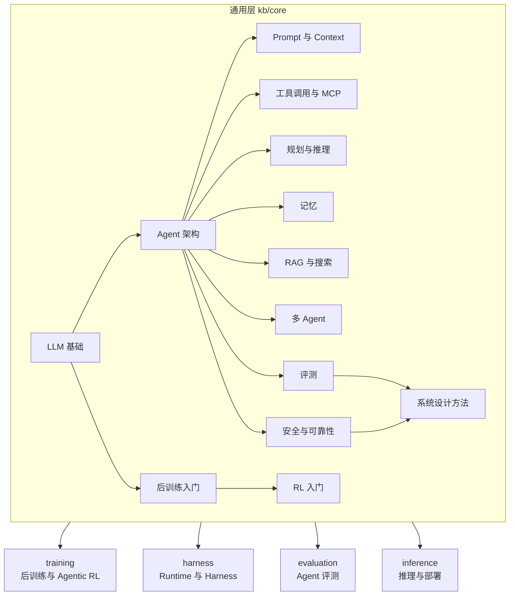

# 知识地图

知识库分两层。**通用层**是所有 Agent 算法岗都会问的内容；**垂类层**按岗位方向加深。先打通用层，再按目标岗位选一两个垂类。

## 四个垂类方向

按招聘需求的证据强弱排列。证据来源和统计口径见 [方向调研](tracks/README.md)。

| 方向 | 典型岗位 | 面试重点 | 证据 |
|---|---|---|---|
| [training](tracks/training/track.json) | Agent 后训练、Agentic RL、中训练数据 | 轨迹数据、GRPO 系、多轮 RL、reward / verifier、环境与用户模拟器 | 最强 |
| [harness](tracks/harness/track.json) | Agent Harness / Runtime / Infra、Coding / Computer-Use Agent | Loop 与 Harness 边界、上下文压缩、沙箱权限、网关与可靠性、Coding 与 Computer-Use | 强 |
| [evaluation](tracks/evaluation/track.json) | Agent 评测；所有 Agent 岗的高频题 | 评测设计、LLM-as-Judge、轨迹评测、回归门禁 | 强 |
| [inference](tracks/inference/track.json) | 模型公司的 Agent 岗、端侧 Agent 岗的加考 | KV Cache、显存估算、PD 分离、量化、前缀缓存、端侧部署 | 中（作为配套） |

各方向的章节列表和前置要求在对应的 `track.json` 里。学习教练 skill 会按你选的方向自动排顺序。

**怎么选**：

- 目标是“Agent 应用算法”这类综合岗：training 或 harness 选一个做主方向，再加 evaluation。
- 目标是模型公司：training 为主，加 inference。
- 目标是终端厂商或端侧 Agent：harness 为主，加 inference。

## 其他目录

- [design/](design/README.md)：系统设计整题，8 道，每道带评分要点和追问题。
- [coding/](coding/README.md)：手撕题，模型侧和工程侧。
- [papers/](papers/README.md)：论文精读，只作阅读材料，不出题。
- [method/](method/README.md)：面试方法，包括答题框架、项目讲法、行为题、模拟与复盘。

## 内容状态

| 部分 | 数量 | 题数 | 说明 |
|---|---|---|---|
| 通用层 | 13 章 | 132 | 所有方向都要学 |
| training | 7 章 | 62 | |
| harness | 7 章 | 72 | |
| evaluation | 6 章 | 58 | |
| inference | 6 章 | 55 | |
| [系统设计整题](design/README.md) | 8 道 | 33 道追问题 | 每道带评分要点，学习教练按方向排进计划 |
| [手撕题](coding/README.md) | 20 道 | 20 | 模型侧 13 道，工程侧 7 道 |
| [论文精读](papers/README.md) | 13 篇 | 不出题 | 从相关章节的资料列表链接过来 |
| [面试方法](method/README.md) | 4 篇 | 不出题 | 示例都是虚构的 |

知识章按技术文档标准写：原理从定义推导，配可运行的最小实现（只用标准库和 numpy，结尾用 assert 验证正文的结论或数字）、数值例子、常见坑（现象、原因、排查、处理）和对比取舍。每章约 600–1400 行，按一般水平估计学完全部知识章约 109 小时（不含复习）。

所有章节的论文、文档和数字都打开原文核对过；变化快的官方文档（SDK、协议、价格）标注了查阅日期。发现错误或过时内容，欢迎按 [CONTRIBUTING](../CONTRIBUTING.md) 提交修正。
