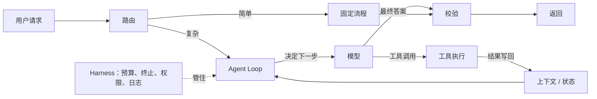

# Agent 架构与设计模式

> 层级：通用层 · 预计 150 分钟 · 题目：[questions.md](questions.md)
> 前置：[01 LLM 与 Transformer 基础](../01-llm-foundations/README.md)

## 1 这一章解决什么问题

面试里“讲讲你做的 Agent”几乎是必问开场。面试官想听到的是：你能说清一个 Agent 系统由哪几块组成，每一块为什么存在，以及什么时候不该用 Agent。只会说“我用 LangChain 搭了一个 Agent”的回答，接不住第二层追问。

第二层追问通常是算账：链式拆成 5 步，成功率是升还是降？加一个评委重试 3 次，能好多少，多花几次调用？5 路并行为什么比单次调用慢？步数上限设 10 还是 50？这些问题都能用几行公式回答，但要先把 Agent 写成形式化的对象。

学完这一章，你应该能：

- 用策略、环境、工具结果、终止条件写出 Agent 的定义，并说清它和固定 Workflow 的边界在哪；
- 对 ReAct、Plan-and-Execute、路由、并行、Orchestrator-Workers、Evaluator-Optimizer、反思，各说出机制、适用条件、调用次数和延迟；
- 写出一个最小 ReAct 循环：假模型、工具表、步数上限、循环检测、终止判断；
- 用代价模型算出链式、验证重试、投票、路由的成功率，以及并行的尾延迟和 ReAct 的 token 增长；
- 根据评测集的步数分布定步数上限，说出定低了和定高了各坏在哪；
- 说出死循环、终止条件缺失、错误累积这几类坑的现象和处理。

规划与推理的细节在 [05 规划与推理](../05-planning-reasoning/README.md)，工具协议在 [04 工具调用与 MCP](../04-tool-use-mcp/README.md)，多 Agent 在 [08 多 Agent 系统](../08-multi-agent/README.md)，Loop 与 Harness 的工程实现在 [harness/01](../../tracks/harness/01-loop-and-harness/README.md)。本章只在用到时一句话带过。

**本章符号**（后文沿用）：

| 符号 | 含义 |
|---|---|
| h_t | 第 t 步之前的历史：任务、之前的模型输出、之前的工具结果。ReAct 论文写作 c_t |
| a_t | 第 t 步模型输出的动作：调用某个工具、只写思考，或者 finish |
| o_t | 第 t 步工具执行后写回上下文的工具结果 |
| π(a \| h) | 策略：给定历史时动作的分布。这里就是“模型 + 提示词 + 解码参数” |
| τ | 终止步：循环在第几步停下，是一个随机变量 |
| N | 步数上限 |
| p | 一次模型调用把它那一步做对的概率 |
| n | 链式或 ReAct 里的步数 |
| μ | 单次模型调用的平均延迟 |
| α、v | 验证器的两个指标：α 是放行正确输出的概率，v 是拦下错误输出的概率 |
| R | 最多生成几轮（验证重试的轮数上限） |
| k | 并行或投票的路数 |

## 2 原理：Agent 的形式化

### 2.1 策略、环境、工具结果

把 Agent 写成一个和环境交互的策略。第 t 步，Agent 看到历史 h_t，按策略选一个动作，环境执行后返回工具结果：

```text
h_1     = (任务描述)
a_t     ~ π(· | h_t)                      模型调用一次，输出一个动作
o_t     = Env(a_t)                        工具执行，可能改变外部状态
h_{t+1} = (h_t, a_t, o_t)                 动作和结果都写回上下文
```

这和 ReAct 论文第 2 节的写法一致。论文里第 t 步的上下文是 c_t = (o_1, a_1, …, o_{t−1}, a_{t−1}, o_t)，策略是 π(a_t | c_t)。ReAct 的改动只有一处：把动作空间从任务原有的 A 扩成 Â = A ∪ L，L 是语言空间。从 L 里选出的动作叫思考（thought）。思考不作用于环境，也就没有工具结果，只把自己追加进上下文：c_{t+1} = (c_t, â_t)。

几个容易混的点，从这个定义直接读出来：

1. **策略就是“模型 + 提示词 + 解码参数”**。ReAct 论文用的是冻结的 PaLM-540B 加 few-shot 示例，不训练。改提示词、改温度、换模型，都是换策略。
2. **状态就是历史 h_t**。模型本身没有记忆，每一步的决策只依赖送进去的上下文。上下文怎么装配，见 [03 Prompt 与 Context Engineering](../03-prompt-context/README.md)；需要跨会话保留的，见 [06 记忆](../06-memory/README.md)。
3. **环境包括工具和外部世界**。Env 是不是确定的，决定了能不能重放；有没有副作用，决定了能不能重试。
4. **每一步一次模型调用**。这是后面所有代价模型的计数单位。原生 Function Calling 允许一次调用输出多个并行的工具调用，这时“一步”对应一次模型调用加若干个工具执行，协议细节见 [04 第 3.5 节](../04-tool-use-mcp/README.md#35-多工具并行)。

### 2.2 终止条件

循环在第 τ 步停下。τ 是一个停时：是否在第 t 步停，只能依赖 h_t 和 a_t，不能偷看未来。常见的停止规则有两类：

```text
τ = min{ t : a_t 是 finish 且通过校验 }                 正常完成
  ∧ N                                                   步数上限
  ∧ min{ t : 最近 m 次（调用, 结果）完全相同 }          循环检测
  ∧ 预算、超时、用户取消 ……                             其他上限

（∧ 表示取较小者，即哪个先到就在哪停）
```

第一类由模型触发，第二类由程序触发。只有第一类时，τ 可以是无穷大：模型一直不输出 finish，循环就一直跑。加上步数上限 N 之后，τ ≤ N 恒成立，这是循环一定会停的唯一硬保证。循环检测、预算这些条件不提供“一定停”的保证，它们的作用是让卡住的试次早一点停，少花钱。

Anthropic 的 [Building effective agents](https://www.anthropic.com/engineering/building-effective-agents)（2024-12-19）写得很直白：任务常在完成时结束，但也常加停止条件（例如最大迭代次数）来保持控制。终止条件的完整清单、各框架的默认上限、超限后返回什么，见 [harness/01 第 5 节](../../tracks/harness/01-loop-and-harness/README.md#5-终止条件)。

### 2.3 Workflow 与 Agent 的边界

Anthropic 那篇文章把两类系统统称为 agentic systems，按“谁控制执行路径”区分：

- **Workflow**：模型和工具按预先写好的代码路径编排（"orchestrated through predefined code paths"）；
- **Agent**：模型动态决定自己的流程和工具使用，自己掌握怎么完成任务。

用 2.1 节的记号说，区别在于**下一步做什么由谁决定**：

| | 下一步调用什么 | 一共几步 | 终止由谁定 |
|---|---|---|---|
| Workflow | 程序写死；模型只填内容，或在程序列好的几个分支里选一个 | 事先固定，或有事先知道的上界 | 程序 |
| Agent | 模型从 π(· \| h_t) 里选，可以是任意工具 | 运行时才知道 | 模型（finish）加程序（上限） |

所以“有没有循环”“有没有工具”都不是判据。路由里模型也在做选择，但它只能在程序列好的分支里选一次，执行路径仍是写死的；Evaluator-Optimizer 有循环，但每轮做什么是写死的，模型只决定“够不够好”。判据只有一条：**动作序列能不能在写代码时枚举出来**。

文章对什么时候用哪一类的建议：先找最简单的方案，必要时才加复杂度，甚至可以完全不做 agentic system；agentic system 常常用延迟和成本换任务表现；任务定义清楚时 Workflow 提供可预测和一致，需要灵活性和模型驱动的决策时才用 Agent；很多应用里，优化单次调用、加检索和上下文示例就够了。

文章对 Agent 的描述也值得原样记住：Agent 通常“只是在循环里根据环境反馈使用工具的 LLM”（"typically just LLMs using tools based on environmental feedback in a loop"）。它的适用场景是开放问题，难以或无法预测需要多少步，不能写死固定路径；代价是更高的成本和错误累积的可能，文章建议在沙盒里充分测试并加护栏。

注意：这篇文章开头加了说明，文中提到的工具生态自 2024 年 12 月以来已有很多变化。模式的定义没有过时，框架和 SDK 的名字以当前文档为准。

### 2.4 组成部分



| 模块 | 对应 2.1 节的哪一项 | 作用 | 去掉它会怎样 |
|---|---|---|---|
| 路由 | 在进入循环之前选策略 | 把简单请求分给便宜的固定流程，难题才进 Loop | 所有请求都付 Agent 的成本和延迟 |
| 模型 | π | 每一步做决策 | 退化成脚本 |
| 循环 | t → t+1 | 重复“决定 → 执行 → 写回” | 退化成单次调用 |
| 工具 | Env | 获取外部事实、改变外部状态 | 只能凭参数知识回答 |
| 状态 | h_t | 记录每一步的动作和结果 | 每一步从零开始 |
| Harness | τ 的程序部分 | 步数和 token 预算、终止条件、权限、重试、日志 | 循环可能跑飞，出了问题无法复现 |
| 校验 | finish 之后的检查 | 检查输出格式、引用、业务规则 | 错误直接到用户手里 |

Loop 和 Harness 的边界在 [harness/01](../../tracks/harness/01-loop-and-harness/README.md) 里深挖。

## 3 实现：最小 ReAct 循环

下面的代码把 2.1、2.2 节的定义直接写成程序：

- `history` 就是 h_t，每次调用 `policy(history)` 算一次模型调用；
- 工具表 `TOOLS` 是环境，工具异常和未知工具都写回成工具结果，不中断循环；
- 终止条件有四个：`finish` 带非空答案（正常完成）、步数上限 N、相同的（调用, 结果）连续出现 3 次（循环检测）、连续 2 次输出里没有可解析的动作。

动作格式沿用 ReAct 论文的文本约定 `Action: 工具名[参数]`。今天的原生 Function Calling 把这一行换成结构化的工具调用块，解析错误少了很多，但循环结构不变，见 [04 第 3.6 节](../04-tool-use-mcp/README.md#36-实现最小-function-calling-循环)。模型用按脚本输出的假模型代替，这样每条终止路径都能确定地触发。

```python
import re

# ---------- 环境：工具表。每个工具吃一个字符串参数，返回工具结果字符串 ----------
KB = {  # 虚构条目
    "星河手册": "《星河手册》是一本虚构的小说，作者是林舟。",
    "林舟": "林舟，虚构作家，1962 年出生。",
}

def search(arg):
    if arg in KB:
        return KB[arg]
    near = sorted(k for k in KB if set(arg) & set(k))   # 仿论文：找不到就给相似条目
    return f"没有找到 {arg}。相似条目：{near}"

def calc(arg):
    m = re.fullmatch(r"\s*(\d+)\s*([+\-*])\s*(\d+)\s*", arg)
    if not m:
        raise ValueError("只支持“整数 运算符 整数”，例如 3+4")
    a, op, b = int(m[1]), m[2], int(m[3])
    return str({"+": a + b, "-": a - b, "*": a * b}[op])

TOOLS = {"search": search, "calc": calc}
ACTION = re.compile(r"^Action:\s*(\w+)\[(.*)\]\s*$", re.M)


def react(task, policy, max_steps=8, max_repeat=3, max_bad_format=2):
    """最小 ReAct 循环。history 就是 h_t；每次 policy(history) 是一次模型调用。"""
    history = [("task", task)]
    calls, bad_format = [], 0
    for t in range(1, max_steps + 1):
        out = policy(history)                       # a_t ~ π(· | h_t)
        history.append(("model", out))
        m = ACTION.search(out)
        if m is None:                               # 只有思考、没有动作：不碰环境
            bad_format += 1
            if bad_format >= max_bad_format:
                return {"reason": "invalid_output", "answer": None, "steps": t, "history": history}
            history.append(("obs", "格式错误：请在最后一行写 Action: 工具名[参数]"))
            continue
        bad_format = 0
        name, arg = m[1], m[2].strip()
        if name == "finish":
            if arg:                                 # 终止条件 1：给出非空答案
                return {"reason": "success", "answer": arg, "steps": t, "history": history}
            history.append(("obs", "答案为空，请给出答案"))
            continue
        try:
            obs = TOOLS[name](arg) if name in TOOLS else f"错误：没有工具 {name}，可用 {sorted(TOOLS)}"
        except Exception as e:                      # 工具异常写回上下文，不中断循环
            obs = f"错误：{e}"
        history.append(("obs", obs))
        calls.append((name, arg, obs))
        if len(calls) >= max_repeat and len(set(calls[-max_repeat:])) == 1:
            return {"reason": "loop_detected", "answer": None, "steps": t, "history": history}
    return {"reason": "max_steps", "answer": None, "steps": max_steps, "history": history}


# ---------- 假模型：按脚本输出，脚本放完就重复最后一句 ----------
def scripted(lines):
    def policy(history):
        k = sum(1 for role, _ in history if role == "model")
        return lines[min(k, len(lines) - 1)]
    return policy

good = scripted([
    "Thought: 先查书的作者。\nAction: search[星河手册]",
    "Thought: 作者是林舟，再查出生年份。\nAction: search[林舟]",
    "Thought: 1962 年出生，算到 2000 年时的年龄。\nAction: calc[2000-1962]",
    "Thought: 38 岁。\nAction: finish[38]",
])
r = react("《星河手册》的作者在 2000 年多少岁？", good)
assert r["reason"] == "success" and r["answer"] == "38"
assert r["steps"] == 4                                     # 4 次模型调用 = 3 次工具 + 1 次 finish
assert [x for role, x in r["history"] if role == "obs"][-1] == "38"

# 1) 死循环：一直查同一个不存在的条目。相同（调用, 结果）连续 3 次就停，不用等到步数上限
stuck = scripted(["Thought: 再查一次。\nAction: search[星河]"])
r = react("同上", stuck, max_steps=50)
assert r["reason"] == "loop_detected" and r["steps"] == 3

# 2) 去掉循环检测，只剩步数上限：一样会停，但把 50 次调用全部花掉
r = react("同上", stuck, max_steps=50, max_repeat=10**9)
assert r["reason"] == "max_steps" and r["steps"] == 50

# 3) 工具异常、未知工具都写回成工具结果，模型下一步可以改正
fix = scripted([
    "Action: calc[2000 减 1962]",
    "Action: compute[2000-1962]",
    "Action: calc[2000-1962]",
    "Action: finish[38]",
])
r = react("2000 减 1962", fix)
obs = [x for role, x in r["history"] if role == "obs"]
assert obs[0].startswith("错误：只支持") and obs[1].startswith("错误：没有工具")
assert r["reason"] == "success" and r["steps"] == 4

# 4) 连续两次只写思考、不写动作：判为输出不可解析，停下
r = react("随便", scripted(["Thought: 我想想。"]))
assert r["reason"] == "invalid_output" and r["steps"] == 2

# 5) finish 的参数为空不算完成
r = react("随便", scripted(["Action: finish[]", "Action: finish[42]"]))
assert r["reason"] == "success" and r["answer"] == "42" and r["steps"] == 2
print("ReAct 循环：5 种终止路径都按预期")
```

几点说明，都对应代码里的一行：

- **思考不调用环境**。只写 Thought、不写 Action 的输出，等于 ReAct 里从 L 选出的动作。论文的知识任务要求每步都有动作，所以这里把它当成格式错误写回提示；决策类任务里思考是稀疏的，可以允许连续几步只思考，但同样要计数，否则模型能一直“想”下去。
- **循环检测比的是（调用, 结果）对**，不只比调用。轮询一个任务状态时，参数相同但结果在变，不能算重复。更多检测规则（来回打转、连续无新信息）见 [harness/01 第 7 节](../../tracks/harness/01-loop-and-harness/README.md#7-三种失败模式与检测)。
- **finish 也要校验**。这里只查非空；真实系统里要查格式、引用、业务规则，校验不过就写回原因让模型继续，并对“连续校验不过”计数。
- **断言 2 是本章最重要的一个数**：没有循环检测时，一个卡住的试次会把步数上限全部花完。第 6.1 节会算这笔钱。

## 4 常见模式

### 4.1 总览

下表前七行的分类依据 Anthropic 的 [Building effective agents](https://www.anthropic.com/engineering/building-effective-agents)：增强型 LLM 是基础构件；中间五种是 Workflow；Agent 是最后一种。后三行是文献里常见的 Agent 内部结构，Anthropic 那篇没有单列。调用次数一列是本章的推导，记号见第 1 节的符号表。

| 模式 | 做法 | 适合 | 模型调用次数 | 关键路径延迟 |
|---|---|---|---|---|
| 增强型 LLM | 单次调用，带检索、工具、记忆 | 大多数问答 | 1 | μ |
| Prompt Chaining | 多次串行调用，步骤间可加程序校验 | 步骤固定的长任务，例如先写大纲再写正文 | n | n·μ |
| Routing | 先分类，再分给专门的处理链 | 输入类型差别大 | 1 + 下游 | μ + 下游 |
| Parallelization | 分段并行，或同一任务跑多次投票 | 可拆分的子任务；需要提高置信度 | k（+1 汇总） | k 个里最慢的那个 |
| Orchestrator-Workers | 中心模型动态拆任务、分给 worker、汇总 | 子任务事先不知道，例如改多个文件 | m + 2 | 规划 + 最慢的 worker + 汇总 |
| Evaluator-Optimizer | 一个生成，一个当评委，循环改进 | 有清晰评价标准的任务，例如翻译 | 最多 2R | 最多 2R·μ |
| Agent | 模型在循环里自己决定工具调用，靠环境反馈推进 | 步骤无法预测的开放任务 | τ（随机） | τ·μ + 工具耗时 |
| ReAct | 思考和动作交替，每个动作后读工具结果 | Agent 的默认内部结构 | n + 1 | (n+1)·μ |
| Plan-and-Execute | 先写计划，执行器逐步执行，结束后决定是否重规划 | 步骤多但结构清楚 | 1 + n + 重规划次数 | 同左乘 μ |
| 反思 | 失败后写下原因，下次尝试时读取 | 有环境信号判断成败的任务 | 每次尝试 + 1 | 按尝试次数叠加 |

**ReAct** 是 Agent 模式最常被引用的起点：[Yao 等，2022-10](https://arxiv.org/abs/2210.03629) 让模型交替输出推理（Thought）和动作（Action），再读取工具结果（Observation）。今天的原生 Function Calling 把 Action 变成了结构化输出，但“推理 → 行动 → 观察”的循环没变。

下面逐个讲机制、适用条件和代价。成功率和延迟的公式在第 4.10、4.11 节用代码验证。

### 4.2 增强型 LLM 与 Prompt Chaining

**增强型 LLM** 是一次调用，模型可以自己写检索词、选工具、决定记住什么。Anthropic 认为这是所有模式的基础构件，并建议先把单次调用优化到头：很多应用里，单次调用加检索和上下文示例就够了。

**Prompt Chaining** 把任务拆成固定的几步，每次调用处理上一步的输出，步骤之间可以加程序检查（原文叫 gate）。Anthropic 写的适用条件是：任务能干净地拆成固定子任务；它的目的是用延迟换准确率，让每次调用做一件更容易的事。

代价模型（推导）。设每步独立地以 p 做对，任何一步错整条链错：

```text
P(成功) = p^n          调用 n 次，延迟 n·μ
```

这条式子说明，**拆步不是免费的**。一次做完的成功率是 p_1，拆成 n 步后每步成功率 p 要满足 p^n > p_1，拆分才值。例如 p_1 = 0.6，拆成 4 步：每步 0.9 时 0.9⁴ = 0.656，只略好；每步 0.95 时 0.815，才明显好。链式真正的收益来自两处：每步变简单后 p 上升；步骤之间的 gate 能把错误拦在早期。后者就是第 4.6 节的验证重试。

错误累积的更细模型（单步纠错率 r、步与步不独立）见 [09 评测第 2.3 节](../09-evaluation/README.md#23-多步让小误差连乘)。

### 4.3 路由

**做法**：先对输入分类，再交给专门的下游处理。Anthropic 的理由是关注点分离：不分开时，为一类输入优化提示词会损害另一类。适用条件是类别分明、分开处理更好，而且分类本身能做准，分类器可以是 LLM，也可以是传统分类模型。原文的例子有两个：客服问题按类型分到不同流程；简单问题分给小模型，难题分给更强的模型。

代价模型（推导）。设路由准确率 a，送对分支后成功率 p_s，送错分支 p_w，不路由时通用处理的成功率 p_g：

```text
P(路由) = a·p_s + (1 − a)·p_w
路由值得做  ⇔  a > a* = (p_g − p_w) / (p_s − p_w)
```

代入 p_s = 0.9、p_w = 0.5、p_g = 0.8：a* = 0.75。路由准确率低于 75% 时，不如不分。这条式子还说明了两种改进方向：提高 a（更好的分类器），或者提高 p_w（让分支对送错的输入也能兜底，例如低置信度时升级到通用链）。

成本上，路由多一次分类调用，但能把大部分流量送到便宜的分支。省多少取决于流量结构，要按真实分布算。

### 4.4 并行化：分段与投票

Anthropic 把并行化分成两种：

- **分段（sectioning）**：把任务拆成互相独立的子任务，同时跑。原文例子：一个实例处理用户请求，另一个同时筛查不当内容，比让同一次调用兼顾两件事效果好；评测时每次调用只评一个方面。
- **投票（voting）**：同一个任务跑多次，得到多样的输出。原文例子：几个不同的提示词各自审查同一段代码的漏洞；用不同的投票阈值平衡误报和漏报。

适用条件：子任务可以并行以提速；或者需要多个视角、多次尝试来提高置信度。

**延迟不是 μ**（推导）。k 路并行的墙钟时间是 k 个延迟里的最大值。延迟服从均值 μ 的指数分布时：

```text
E[max(L_1, …, L_k)] = μ·H_k        H_k = 1 + 1/2 + … + 1/k
k = 5:  H_5 ≈ 2.28                  5 路并行约 2.28μ，串行是 5μ
```

指数分布是一个偏悲观的假设。真实延迟通常是“固定部分 d + 随机部分”，只有随机部分被放大：E[max] = d + (μ − d)·H_k。所以并行的提速取决于延迟的离散程度。尾延迟越重，并行越亏。工程上常见的应对是给每一路设超时，或者“前 k−1 路返回就汇总”。

**投票有前提**（推导）。设每次采样独立地以 p 答对，所有错误答案都相同（二选一，这是对投票最不利的情形），k 取奇数：

```text
P(多数正确) = Σ_{j > k/2} C(k, j) · p^j · (1 − p)^{k−j}
p = 0.7, k = 5  →  0.837
p = 0.4, k = 5  →  0.317        比单次的 0.4 还差
```

p > 0.5 时投票把成功率推高，k 越大越高；p < 0.5 时投票把错误也放大。错误答案越分散，多数票越容易落在正确答案上，所以真实任务里投票的效果通常比这个下界好。Self-Consistency（[Wang 等，arXiv 2203.11171](https://arxiv.org/abs/2203.11171)，2022-03）就是对 CoT 采样多条推理路径、取最一致的答案。代价是调用次数乘 k，延迟是 k 路里最慢的那个。

### 4.5 Orchestrator-Workers

**做法**：一个中心模型动态拆分任务，分给 worker，再汇总结果。Anthropic 强调它和并行化在拓扑上相似，关键区别是灵活性：子任务不是事先定义的，而是编排模型根据具体输入决定的。原文例子是每次要改多个文件的编程产品，以及需要从多个来源收集和分析信息的搜索任务。

代价模型（推导）：规划 1 次 + m 个 worker + 汇总 1 次，调用 m + 2 次；关键路径是 μ + μ·H_m + μ（指数延迟假设）。m = 5、μ = 2 秒时约 8.6 秒。

它有两个单点：规划拆错，所有 worker 一起错；汇总时信息被压缩，worker 发现的细节可能丢掉。子任务之间依赖强时，并行没有收益，还要付交接的代价。worker 本身是带工具的 Agent 时就是多 Agent 系统，拆分和交接的问题见 [08 多 Agent 系统](../08-multi-agent/README.md)。

### 4.6 Evaluator-Optimizer 与验证重试

**做法**：一次调用生成，另一次调用评价并给反馈，循环进行。Anthropic 写的适用条件是：评价标准清楚，并且迭代改进能带来可测量的价值。两个判断信号：人给出反馈后模型的输出能明显改进；模型自己能给出这样的反馈。原文例子是文学翻译和多轮搜索（评委决定要不要继续搜）。

把它写成代价模型（推导）。每一轮生成以 p 做对。验证器有两个指标：α 是放行正确输出的概率，v 是拦下错误输出的概率。最多生成 R 轮，前 R−1 轮被拦下就重来，第 R 轮直接交出。每一轮有三种结局：

```text
A = p·α                 对了且放行：成功结束
B = (1 − p)·(1 − v)     错了但放行：失败结束
C = 1 − A − B           被拦下：进入下一轮

P(成功)     = A·(1 + C + … + C^{R−2}) + C^{R−1}·p
E[生成次数] = 1 + C + … + C^{R−1}
```

代入 p = 0.6、α = 0.95、v = 0.8、R = 3：A = 0.57，B = 0.08，C = 0.35，成功率 0.843，平均生成 1.47 次。从式子能读出三个推论：

1. **完美验证器**（α = v = 1）时 B = 0，成功率 = 1 − (1 − p)^R。R = 3 时 0.936。
2. **R 再大也有上限**：R → ∞ 时成功率趋于 A / (A + B) = 0.877。它是验证器放行的输出里正确的比例。拦不住的错误（B）每轮都在漏，重试救不回来。
3. **坏验证器比不加更差**：v = 0（什么错都拦不住）、α < 1（还会误拦对的）时，成功率低于 p。被误拦的正确输出换来的是一次新的、可能错的生成。

所以 Evaluator-Optimizer 的效果几乎全由 v 决定。用测试、编译器、规则这类可执行检查时 v 接近 1；用同一个模型当评委时 v 往往很低，原因见 [05 第 5 节](../05-planning-reasoning/README.md#5-反思与自我纠错)。轮数一定要设上限 R，否则评委一直不满意，循环就不停。

把验证重试放进链式的每一步（推导）：10 步、每步 p = 0.9，验证器 α = 1、v = 0.8，每步最多生成 3 次。每步成功率从 0.9 升到 0.978，整条链从 0.9¹⁰ = 0.349 升到 0.799；代价是模型调用从 10 次涨到约 21.7 次（每轮生成加评价两次调用）。

### 4.7 ReAct

ReAct 的机制在第 2.1 节已经写成式子：动作空间加上语言空间，思考只更新上下文。论文的几个设定和结论（核对 arXiv 2210.03629 v3，ICLR 2023 版）：

- **思考的密度按任务定**。知识密集任务（HotpotQA、FEVER）里思考和动作交替出现，每步都是 Thought → Action → Observation；动作很多的决策任务（ALFWorld、WebShop）里，由模型自己决定什么时候插入思考。
- **步数上限按“再加也不涨”定**。论文和 CoT-SC 组合时，ReAct 在给定步数内没给出答案就退回 CoT-SC。HotpotQA 设 7 步、FEVER 设 5 步，理由是更多步数不会提高 ReAct 的表现。脚注写明：答对的轨迹里，用满 7 步（HotpotQA）和 5 步（FEVER）的只占 0.84% 和 1.33%。第 6.1 节用同样的思路定上限。
- **ReAct 特有的失败模式是循环**。论文人工标注 200 条 HotpotQA 轨迹（表 2），ReAct 的失败里推理错误占 47%，其中包括“反复生成之前的思考和动作，跳不出循环”；搜索没返回有用信息占 23%。作者猜测循环和贪心解码有关。
- **代价**：每个工具调用都要一次模型调用，n 个工具步共 n + 1 次（最后一次输出答案）。每次调用都要重新读入越来越长的历史，输入 token 随 n 二次增长（第 4.11 节）。

论文的更多细节和实验见 [论文精读：ReAct](../../papers/01-react.md)。

### 4.8 Plan-and-Execute 与 ReWOO

LangChain 的 [Plan-and-Execute Agents](https://blog.langchain.com/planning-agents/)（2024-02-13）把 ReAct 的缺点归为两条：每个工具调用都要一次 LLM 调用；模型一次只规划一个子问题，没有被迫对整个任务推理，轨迹可能次优。

**Plan-and-Execute** 的做法：规划器先写出多步计划，执行器逐步执行（每步可调用一个或多个工具），执行完再用重规划提示调用规划器，决定结束还是追加计划。文章说它松散地基于 Plan-and-Solve Prompting（[Wang 等，arXiv 2305.04091](https://arxiv.org/abs/2305.04091)，2023-05）。收益是不必每个工具调用都调大模型：大模型只做规划和重规划，执行器可以是小模型。调用次数不一定少（1 + n + 重规划次数），但贵的调用少了。

**ReWOO**（[Xu 等，arXiv 2305.18323](https://arxiv.org/abs/2305.18323)，2023-05）更进一步：规划器一次写出全部工具调用，用 `#E1`、`#E2` 这样的变量引用前面步骤的结果；worker 按顺序执行并替换变量，中间不回到模型；最后由求解器汇总。模型调用固定为 2 次。论文摘要报告在 HotpotQA 上 token 效率提高 5 倍。代价是中间结果出乎意料时没法调整，只能整轮重来。

三者的选择取决于工具结果有多“出乎意料”：结果可预测、依赖固定，用 ReWOO；结构清楚但偶尔要改，用 Plan-and-Execute；每一步都要看结果再定下一步，用 ReAct。计划的表示、重规划的触发条件见 [05 第 3、4 节](../05-planning-reasoning/README.md#3-规划的几种形态)。

### 4.9 反思

**做法**：任务失败后，让模型把失败原因写成文字，下次尝试时放进上下文。Reflexion（[Shinn 等，arXiv 2303.11366](https://arxiv.org/abs/2303.11366)，2023-03）把反思文字存进情景记忆，不更新权重；反馈信号可以是标量也可以是自由文本，可以来自外部也可以由模型内部模拟。Self-Refine（[Madaan 等，arXiv 2303.17651](https://arxiv.org/abs/2303.17651)，2023-03）用同一个模型生成、反馈、修改，循环多轮。

用第 4.6 节的代价模型看，反思是“验证重试”的一个变体：验证器是环境信号（测试结果、任务成败），重试时多带一段反思文字，期望下一轮的 p 比上一轮高。所以反思有没有用，取决于两件事：判断成败的信号可不可靠（v）；反思能不能真的提高下一轮的 p。没有外部反馈时，模型很难判断自己的推理对错，反思的分级和边界见 [05 第 5 节](../05-planning-reasoning/README.md#5-反思与自我纠错)。

代价：每次尝试多一次反思调用，延迟按尝试次数叠加；反思文字会越积越长，要设尝试次数上限。

### 4.10 实现：成功率的代价模型

下面的代码把第 4.2 到 4.6 节的成功率公式写出来，用蒙特卡洛核对验证重试的闭式，并 assert 正文里的每个数。所有模型都假设调用之间独立、“做对”是二值的。真实系统里错误往往相关（同一个模型在同一类输入上反复犯同一个错），这时投票和重试的收益会比这里小。

```python
import numpy as np
from math import comb

# 记号：p 是一次调用做对的概率；调用之间独立；“做对”是二值的

# ---------- 链式：n 步串行，任何一步错整题错 ----------
def chain(p, n):
    return p ** n

assert abs(chain(0.9, 10) - 0.3487) < 1e-4
# 拆步值不值：一次做完的成功率是 0.6；拆成 4 步，每步 0.9 只略好，每步 0.95 才明显好
assert abs(chain(0.9, 4) - 0.6561) < 1e-4 and abs(chain(0.95, 4) - 0.8145) < 1e-4

# ---------- 验证器 + 重试（Evaluator-Optimizer 的轮次）----------
def verified(p, alpha, v, R):
    """p：一次生成做对；alpha：验证器放行正确输出的概率；v：验证器拦下错误输出的概率。
    最多生成 R 次，第 R 次不再看验证结果直接交出。返回 (成功率, 期望生成次数)。"""
    A = p * alpha                 # 对了且放行：成功结束
    B = (1 - p) * (1 - v)         # 错了但放行：失败结束
    C = 1 - A - B                 # 被拦下：进入下一轮
    succ = sum(A * C ** (i - 1) for i in range(1, R)) + C ** (R - 1) * p
    rounds = sum(C ** (i - 1) for i in range(1, R + 1))
    return succ, rounds

def simulate(p, alpha, v, R, trials=200_000, seed=0):
    rng = np.random.default_rng(seed)
    ok = rng.random((trials, R)) < p                       # 形状 (试次, 轮)：每轮生成是否做对
    u = rng.random((trials, R))
    accept = np.where(ok, u < alpha, u >= v)               # 验证器是否放行
    accept[:, R - 1] = True                                # 最后一轮直接交出
    first = accept.argmax(axis=1)                          # 第一次放行的轮次（从 0 数）
    return ok[np.arange(trials), first].mean(), (first + 1).mean()

s, r = verified(0.6, 0.95, 0.8, 3)
assert abs(s - 0.843) < 1e-9 and abs(r - 1.4725) < 1e-9
ms, mr = simulate(0.6, 0.95, 0.8, 3)
assert abs(ms - s) < 0.005 and abs(mr - r) < 0.01          # 蒙特卡洛和闭式对上

# 三个推论
assert abs(verified(0.6, 1, 1, 3)[0] - (1 - 0.4 ** 3)) < 1e-12   # 完美验证器：1 − (1−p)^R = 0.936
assert abs(verified(0.6, 1, 0, 3)[0] - 0.6) < 1e-12              # 什么都放行：和不加一样
assert verified(0.6, 0.9, 0, 3)[0] < 0.6                         # 拦不住错、还误拦对的：比不加更差
A, B = 0.6 * 0.95, 0.4 * 0.2
assert abs(verified(0.6, 0.95, 0.8, 50)[0] - A / (A + B)) < 1e-9 # R 再大，上限也只是放行精确率 0.877

# 链式 + 每步验证：10 步任务，每步 p=0.9，验证器拦下 80% 的错、不误拦，最多生成 3 次
step, step_rounds = verified(0.9, 1.0, 0.8, 3)
assert abs(step - 0.97776) < 1e-9
assert abs(chain(step, 10) - 0.7986) < 1e-4                      # 0.349 → 0.799
assert abs(10 * 2 * step_rounds - 21.728) < 1e-9                 # 调用 10 次 → 约 21.7 次

# ---------- 投票：k 次独立采样取多数 ----------
def vote(p, k):
    """k 为奇数。假设所有错误答案都相同（二选一），这是对投票最不利的情形。"""
    return sum(comb(k, j) * p ** j * (1 - p) ** (k - j) for j in range(k // 2 + 1, k + 1))

assert abs(vote(0.7, 5) - 0.8369) < 1e-4
assert abs(vote(0.4, 5) - 0.3174) < 1e-4                         # p < 0.5 时投票让结果更差
assert vote(0.7, 3) < vote(0.7, 5) < vote(0.7, 9)

# ---------- 路由：准确率 a，专用分支 p_s，送错分支 p_w；对照通用处理 p_g ----------
def route(a, p_s, p_w):
    return a * p_s + (1 - a) * p_w

assert abs(route(0.9, 0.9, 0.5) - 0.86) < 1e-12                  # 比通用的 0.8 好
a_star = (0.8 - 0.5) / (0.9 - 0.5)                               # 盈亏平衡的路由准确率
assert abs(a_star - 0.75) < 1e-12 and abs(route(a_star, 0.9, 0.5) - 0.8) < 1e-12
print(f"验证重试 {s:.3f}，链式 10 步 {chain(0.9, 10):.3f} → {chain(step, 10):.3f}，投票 {vote(0.7, 5):.3f}")
```

### 4.11 实现：延迟与 token 的代价模型

成功率之外，面试常追问两件事：并行到底快多少；ReAct 为什么比 Plan-and-Execute、ReWOO 费 token。

ReAct 的 token 账（推导）。设固定前缀（系统提示、工具定义、任务）有 P 个 token，每个工具步往历史里追加 g 个 token（思考 + 调用 + 工具结果）。第 i 次调用（i = 0, 1, …, n）要读入 P + i·g 个 token：

```text
ReAct 总输入 = Σ_{i=0}^{n} (P + i·g) = (n + 1)·P + g·n(n + 1)/2
ReWOO 总输入 = P（规划器）+ (P + n·g)（求解器读全部工具结果）= 2P + n·g
```

ReAct 里 g 的一项随 n 二次增长，ReWOO 是线性的。P = 2000、g = 300、n = 6 时，ReAct 读 20,300 个 token，ReWOO 读 5,800 个，差 3.5 倍；n 翻到 12，ReAct 涨到 2.43 倍，ReWOO 只涨到 1.31 倍。ReWOO 论文报告的 5 倍是 HotpotQA 上的实测，这里的 3.5 倍只是这组假设参数下的推导。前缀缓存能让重复读入的前缀更便宜、更快（见 [inference/05](../../tracks/inference/05-agent-serving/README.md)），但读入的 token 数不变，上下文仍会撞上窗口上限。预算的累积和检查方式见 [harness/01 第 6 节](../../tracks/harness/01-loop-and-harness/README.md#6-预算怎么计什么时候查会超多少)。

```python
import numpy as np

mu = 2.0                                   # 单次模型调用的平均延迟，秒（假设值）

def H(k):
    return sum(1 / i for i in range(1, k + 1))

# 1) 并行 k 路的墙钟时间是 k 个延迟里的最大值。延迟服从均值 μ 的指数分布时 E[max] = μ·H_k
rng = np.random.default_rng(0)
lat = rng.exponential(mu, size=(200_000, 5))             # 形状 (试次, 并行路数)
assert abs(lat.max(axis=1).mean() - mu * H(5)) < 0.02
assert abs(H(5) - 2.2833) < 1e-4                         # 5 路并行约 2.28μ，不是 μ；串行是 5μ
# 延迟 = 固定部分 d + 指数部分：只有随机部分被放大
d = 1.0
lat2 = d + rng.exponential(mu - d, size=(200_000, 5))
assert abs(lat2.max(axis=1).mean() - (d + (mu - d) * H(5))) < 0.02

# 2) Orchestrator-Workers：规划 1 次 + m 路并行 + 汇总 1 次
def ow(m):
    return {"calls": m + 2, "latency": mu + mu * H(m) + mu}

assert ow(5)["calls"] == 7 and abs(ow(5)["latency"] - 2 * (2 + H(5))) < 1e-12

# 3) ReAct、Plan-and-Execute、ReWOO：n 个工具步，每次调用都要重新读入前缀
P, g, n = 2000, 300, 6       # 固定前缀 token、每步追加的 token（思考+调用+结果）、工具步数（假设值）

def react_tokens(n):         # 第 i 次调用（i = 0..n）读入 P + i·g
    return sum(P + i * g for i in range(n + 1))

def rewoo_tokens(n):         # 规划器读 P；汇总器读 P 加全部工具结果
    return P + (P + n * g)

assert react_tokens(n) == (n + 1) * P + g * n * (n + 1) // 2 == 20300
assert rewoo_tokens(n) == 5800 and abs(react_tokens(n) / rewoo_tokens(n) - 3.5) < 1e-12
calls = {"ReAct": n + 1, "Plan-and-Execute": 1 + n + 1, "ReWOO": 2}
assert calls == {"ReAct": 7, "Plan-and-Execute": 8, "ReWOO": 2}
# Plan-and-Execute 调用次数不少，但大模型只调规划和重规划 2 次，执行器只看“问题 + 当前一步”

# 工具步数翻倍：ReAct 涨到 2.43 倍，ReWOO 涨到 1.31 倍
assert abs(react_tokens(2 * n) / react_tokens(n) - 2.4335) < 1e-4
assert abs(rewoo_tokens(2 * n) / rewoo_tokens(n) - 1.3103) < 1e-4
# 关键路径上的模型延迟（工具耗时两者相同，不计）
assert calls["ReAct"] * mu == 14.0 and calls["ReWOO"] * mu == 4.0
print(f"5 路并行 {mu * H(5):.2f}s，ReAct {react_tokens(n)} token / ReWOO {rewoo_tokens(n)} token")
```

## 5 数值例子：同一个任务，四种做法

一个 10 步的串行任务，每次调用把它那一步做对的概率 p = 0.9，单次调用平均 2 秒。比较四种做法（都是推导，参数是假设值）：

1. 裸链式：每步调一次；
2. 每步加模型评委：评委不误拦（α = 1），拦下 80% 的错（v = 0.8），每步最多生成 3 次，每轮生成加评价共两次调用；
3. 每步加可执行检查（例如单测、schema 校验）：近似完美（α = v = 1），检查本身不花模型调用；
4. 每步 3 路投票：3 路并行，取多数。

先手算第 2 种的一步：A = 0.9，B = 0.1 × 0.2 = 0.02，C = 0.08。成功率 = 0.9 + 0.08 × 0.9 + 0.08² × 0.9 = 0.97776；平均生成 1 + 0.08 + 0.0064 = 1.0864 轮，乘 2 是每步 2.17 次调用。整条链 0.97776¹⁰ ≈ 0.799。

```python
from math import comb

# 同一个任务：10 个串行步骤，每次调用把它那一步做对的概率 p = 0.9，单次调用平均 2 秒（假设值）
n, p, mu = 10, 0.9, 2.0

def H(k):                                     # 指数延迟下 k 路并行的 E[max] = μ·H_k
    return sum(1 / i for i in range(1, k + 1))

def verified(p, alpha, v, R):                 # 同第 4.10 节
    A, B = p * alpha, (1 - p) * (1 - v)
    C = 1 - A - B
    succ = sum(A * C ** (i - 1) for i in range(1, R)) + C ** (R - 1) * p
    return succ, sum(C ** (i - 1) for i in range(1, R + 1))

def vote(p, k):
    return sum(comb(k, j) * p ** j * (1 - p) ** (k - j) for j in range(k // 2 + 1, k + 1))

plans = {}
plans["裸链式"] = (p ** n, n, n * mu)
s, r = verified(p, 1.0, 0.8, 3)               # 模型评委：不误拦，拦下 80% 的错
plans["每步模型评委重试"] = (s ** n, 2 * n * r, 2 * n * r * mu)
s, r = verified(p, 1.0, 1.0, 3)               # 可执行检查（如单测）：近似完美，且几乎不花模型调用
plans["每步可执行检查重试"] = (s ** n, n * r, n * r * mu)
plans["每步 3 路投票"] = (vote(p, 3) ** n, 3 * n, n * mu * H(3))

expect = {                                   # (成功率, 模型调用次数, 期望延迟秒)
    "裸链式": (0.3487, 10, 20.0),
    "每步模型评委重试": (0.7986, 21.728, 43.456),
    "每步可执行检查重试": (0.9900, 11.1, 22.2),
    "每步 3 路投票": (0.7528, 30, 36.667),
}
for name, (s, c, t) in plans.items():
    es, ec, et = expect[name]
    assert abs(s - es) < 1e-4 and abs(c - ec) < 1e-3 and abs(t - et) < 1e-3, name
    print(f"{name:10s} 成功 {s:.3f}  调用 {c:5.1f}  延迟 {t:5.1f}s")

# 每多花一次调用换来多少成功率：可执行检查最划算，投票最不划算
gain = {k: (v[0] - plans["裸链式"][0]) / (v[1] - n) for k, v in plans.items() if k != "裸链式"}
assert max(gain, key=gain.get) == "每步可执行检查重试"
assert min(gain, key=gain.get) == "每步 3 路投票"
```

| 做法 | 成功率 | 模型调用 | 期望延迟 |
|---|---|---|---|
| 裸链式 | 0.349 | 10 | 20.0 s |
| 每步模型评委重试 | 0.799 | 21.7 | 43.5 s |
| 每步可执行检查重试 | 0.990 | 11.1 | 22.2 s |
| 每步 3 路投票 | 0.753 | 30 | 36.7 s |

读这张表的三个结论：

- **验证器的质量比轮数重要**。可执行检查只多花 1.1 次调用，成功率到 0.99；模型评委多花 11.7 次，只到 0.80。v 从 0.8 到 1 的差别，比 R 从 3 加到 10 的差别大得多（第 4.6 节的推论 2）。
- **投票最贵**。每步 3 次调用，而且不管第一次对不对都要付。验证重试只在被拦下时才多花。
- **延迟和调用次数不成正比**。投票的 30 次调用是并行的，延迟只是 10 × 2 × H_3 ≈ 36.7 秒；评委重试的调用是串行的，21.7 次就是 43.5 秒。

面试时被问“怎么提高 Agent 成功率”，按这个顺序答：先找能写成可执行检查的步骤；剩下的再考虑模型评委；投票留给没有验证手段、又必须提高置信度的步骤。

## 6 工程细节与常见坑

### 6.1 步数上限怎么取

步数上限 N 同时影响两件事：定低了，截掉本来能做对的长轨迹；定高了，卡住的试次把上限全部花完。用一个虚构的步数分布算一遍（推导）：

- 90% 的试次最终会做对，它们“需要的步数”分布是：3 步 30%、4 步 30%、5 步 20%、6 步 10%、8 步 5%、12 步 5%；
- 另外 10% 卡在循环里，永远不输出 finish。

上限为 N 时，成功率 = 0.9 × P(需要步数 ≤ N)；每个试次的期望步数 = 0.9 × E[min(K, N)] + 0.1 × N。卡住的试次每个都要花满 N 步。

| 上限 N | 成功率 | 每个试次的期望步数 | 每次成功的期望步数 |
|---|---|---|---|
| 4 | 0.540 | 3.73 | 6.91 |
| 6 | 0.810 | 4.47 | 5.52 |
| 8（成功试次的 P95） | 0.855 | 4.85 | 5.67 |
| 12（盖住全部成功） | 0.900 | 5.43 | 6.03 |
| 50 | 0.900 | 9.23 | 10.26 |
| 12，加循环检测（卡住后第 3 步抓到） | 0.900 | 4.53 | 5.03 |

几点读法：

- **只按成功轨迹的 P95 设上限会截掉尾部**。P95 = 8 时丢掉了最长的 5%，成功率从 0.90 掉到 0.855。所以取高分位数之后要再留余量，并单独统计“因超限失败”的比例。
- **上限过高时，成功率不涨，成本只涨**。N 从 12 到 50，每次成功的成本从 6.03 步涨到 10.26 步，多出来的全是卡住的试次花的。
- **循环检测比调上限更有效**。加了检测后，N = 12 和 N = 50 的结果完全一样：上限只管“一定会停”，卡住的试次在第 3 步就被抓到。这和 ReAct 论文的做法一致：上限按“再加步数也不涨”定（第 4.7 节）。
- **换模型、换工具、换提示词，分布就变了**，上限要重测。

```python
# 某 ReAct Agent 在评测集上的步数分布（虚构）：
# 90% 的试次最终会做对，下面是这部分试次“需要 k 步”的比例；另外 10% 卡在循环里，永远不会 finish
need = {3: 0.30, 4: 0.30, 5: 0.20, 6: 0.10, 8: 0.05, 12: 0.05}
stuck = 0.10
assert abs(sum(need.values()) - 1) < 1e-12

def evaluate(N, detect_after=None):
    """步数上限 N；detect_after：卡住的试次在第几步被循环检测抓到（None 表示没有检测）。
    返回 (成功率, 每个试次的期望步数, 每次成功的期望步数)。"""
    succ = (1 - stuck) * sum(p for k, p in need.items() if k <= N)
    steps_ok = (1 - stuck) * sum(min(k, N) * p for k, p in need.items())
    steps_stuck = stuck * (N if detect_after is None else min(detect_after, N))
    steps = steps_ok + steps_stuck
    return succ, steps, steps / succ

def quantile(q):
    acc = 0.0
    for k in sorted(need):
        acc += need[k]
        if acc >= q - 1e-12:
            return k

def close(x, y):
    return all(abs(a - b) < 1e-4 for a, b in zip(x, y))

# 上限太低：截掉需要长轨迹的成功
assert close(evaluate(4), (0.54, 3.73, 6.9074))
assert close(evaluate(6), (0.81, 4.47, 5.5185))
# 只按成功试次的 P95 设上限：P95 = 8，最长的 5% 被截掉
assert quantile(0.95) == 8 and close(evaluate(8), (0.855, 4.85, 5.6725))
# 盖住全部成功：成功率到顶
assert close(evaluate(12), (0.90, 5.43, 6.0333))
# 上限太高：成功率不变，卡住的试次把成本拉高
assert close(evaluate(50), (0.90, 9.23, 10.2556))
# 加循环检测（卡住后第 3 步抓到）：上限可以放宽，成本反而最低
assert close(evaluate(12, detect_after=3), (0.90, 4.53, 5.0333))
assert evaluate(50, detect_after=3) == evaluate(12, detect_after=3)
print("N=12 无检测 %.2f 步/成功，有检测 %.2f 步/成功" % (evaluate(12)[2], evaluate(12, 3)[2]))
```

### 6.2 常见坑

每条写现象、原因、排查、处理。

**1. 死循环：重复调用同一个工具**

- 现象：轨迹里连续出现同一个调用和同样的结果；步数分布在上限处有一个尖峰；少数试次的 token 花费是中位数的几倍。
- 原因：工具结果没给模型新信息（例如搜索一个不存在的条目），模型又找不到别的路。ReAct 论文把这归为推理错误的一种，并猜测和贪心解码有关。
- 排查：画步数直方图，看上限处的尖峰；按（工具名, 规范化参数, 结果哈希）统计连续重复次数。
- 处理：循环检测（第 3 节代码的 `max_repeat`）；工具在“没找到”时给出相似条目或可操作的提示，而不是空结果；触发后换策略、换温度，或者结束并返回部分结果。

**2. 终止条件缺失或只依赖模型**

- 现象：服务偶尔出现跑几十分钟的请求；账单上有少数异常贵的会话；本地测试从没遇到过。
- 原因：循环只在模型输出 finish 时停（2.2 节里 τ 可以无穷大）；或者让模型自己报告用了几步、完成了没有，模型出问题时这些条件一起失效。
- 排查：查看有没有程序侧的步数、token、墙钟上限；统计结束原因的分布，看有没有“没有原因”的结束。
- 处理：至少保留一个不依赖模型的硬上限（步数）；每个结束都要带原因（`success`、`max_steps`、`loop_detected` 等），见 [harness/01 第 5 节](../../tracks/harness/01-loop-and-harness/README.md#5-终止条件)。

**3. 步数上限设错**

- 现象：设低了，评测里“超限失败”占了相当比例，看轨迹其实快做完了；设高了，成功率没变，平均成本明显上涨（第 6.1 节的 N = 50 行）。
- 原因：照搬框架默认值，或拍脑袋取一个整数。框架默认值反映的是框架的定位，不是你的任务。
- 排查：在评测集上画成功试次的步数分布，同时统计超限试次的比例和它们最后几步在做什么。
- 处理：上限取成功分布的高分位数再留余量；配循环检测控制卡住的成本；超限时返回已有进度和原因，交给固定流程或人工。

**4. 错误累积：一步错，后面都基于错的事实**

- 现象：单步评测正确率很高，端到端成功率低；失败轨迹里，最终错误能追溯到很早的一个工具结果或一次误读。
- 原因：链式成功率是 p^n（第 4.2 节），单步 0.9、10 步只剩 0.35；模型倾向于相信上下文里的工具结果，不会回头质疑。
- 排查：对失败轨迹做“第一个错误步”标注，统计错误在哪类步骤上发生最多。
- 处理：在错误最集中的步骤后加可执行检查（第 5 节表里最划算的一行）；工具结果做格式和合理性校验；关键事实交叉核对；失败时回退到固定流程。

**5. 把一个可以写死的流程做成 Agent**

- 现象：同一类请求的步数和工具顺序几乎每次都一样，但成本和延迟波动很大，偶尔还会走错路。
- 原因：步骤可以提前枚举，却交给了模型决定（2.3 节的判据）。
- 排查：统计轨迹里工具序列的种类；如果 90% 以上的请求走同一条序列，它就是一个 Workflow。
- 处理：把高频序列写成固定流程，前面加路由；Agent 只接剩下的长尾。

**6. 验证器漏错，重试当成万能药**

- 现象：加了评委重试后成功率只涨了一点，调用次数翻倍；或者成功率反而下降。
- 原因：成功率的上限是 A / (A + B)，由验证器的漏检率决定；同一个模型当评委，和生成者犯同类错误，v 很低；评委还会误拦正确输出（第 4.6 节推论 3）。
- 排查：拿一批有标准答案的样本单独测验证器的 α 和 v，再代入公式估算重试的上限。
- 处理：优先用可执行检查；评委用不同的模型或不同的提示词；限制轮数 R。

**7. 并行后延迟没降，甚至更慢**

- 现象：从串行改成 5 路并行后，P50 降了，P99 没降或更高。
- 原因：并行的墙钟时间是最慢的那一路；尾延迟重时，k 路里出现一个慢调用的概率随 k 上升（第 4.4 节）。另外并行调用可能撞上限流，排队等待。
- 排查：看每一路的延迟分布，而不是整体平均；看网关的限流和排队指标。
- 处理：每路设超时，超时的那一路降级；够用时只等前 k−1 路；减少并行路数。

**8. 工具异常中断循环，或者被吞掉**

- 现象：一次工具超时，整个任务报错退出；或者工具失败了，模型却以为成功，基于空结果继续推理。
- 原因：异常没捕获；或者捕获了但没写回上下文，模型看不到失败。
- 排查：注入工具故障（超时、500、空结果）做回归测试，看循环是否继续、模型是否看到了错误。
- 处理：异常写回成工具结果，带可操作的提示（第 3 节代码的断言 3）；每个工具调用都要有对应的结果，协议上的要求见 [harness/01 第 2 节](../../tracks/harness/01-loop-and-harness/README.md#2-最小-loop-与它缺的东西)。

## 7 对比与取舍

### 7.1 几种 Agent 内部结构

| 结构 | 每步看工具结果吗 | 模型调用 | 输入 token 增长 | 中途能调整吗 | 适合 |
|---|---|---|---|---|---|
| ReAct | 每步都看 | n + 1 | 二次 | 每步都能 | 每一步都要看结果再定下一步 |
| Plan-and-Execute | 执行器看，规划器在执行完后看 | 1 + n + 重规划 | 执行器只看当前步，较小 | 重规划时能 | 步骤多但结构清楚；想让大模型少调几次 |
| ReWOO | 求解器最后看一次 | 2 | 线性 | 不能 | 工具之间依赖固定、结果可预测 |
| 反思 | 每次尝试结束后看成败 | 每次尝试 + 1 | 按尝试次数增长 | 只在两次尝试之间 | 能多次尝试、有可靠的成败信号 |

### 7.2 选型的判断顺序

1. 单次调用加检索能不能解决？能就停在这里。
2. 步骤能否提前枚举？能就用 Workflow，按需要选 Chaining、Routing 或 Parallelization。
3. 步骤不能枚举，但任务能拆成独立子任务？用 Orchestrator-Workers。
4. 都不行，才用 Agent，并且先设计 Harness：最大步数、预算、终止条件、需要人工确认的动作。
5. 有清晰的评价标准，任何一层都可以叠加 Evaluator-Optimizer；先找可执行检查，再考虑模型评委。

实际系统通常是混合的：路由在前，简单请求走 Workflow，复杂请求进 Agent，最后统一校验。面试时主动说出这一点，比只讲 Agent 更能体现你做过真实系统。Anthropic 那篇的总结也是这个意思：这些模式不是处方，要按用例组合，并且只在复杂度能被测量证明改善结果时才加。

### 7.3 把控制流交给模型的代价

| 代价 | 从哪来 | 控制手段 | 本章哪里讲 |
|---|---|---|---|
| 成本和延迟不可预测 | τ 是随机变量；ReAct 的 token 随步数二次增长 | 步数上限、token 预算、按难度路由、循环检测 | 2.2 节、4.11 节、6.1 节 |
| 错误会累积 | 成功率 p^n；模型相信错的工具结果 | 工具结果校验、关键步骤的可执行检查、失败时回退到固定流程 | 4.2 节、4.6 节、第 5 节 |
| 难以测试和复现 | 策略带随机性，环境可能有副作用 | 记录完整轨迹，评测按轨迹和终态分别打分 | [09 评测](../09-evaluation/README.md)、[harness/06](../../tracks/harness/06-tracing-replay/README.md) |

## 8 自测清单

- [ ] 用 h_t、a_t、o_t、π 写出 Agent 的定义，说出 ReAct 的扩展动作空间 Â = A ∪ L 是什么意思
- [ ] 说出 Workflow 和 Agent 的判据，解释为什么路由和 Evaluator-Optimizer 仍是 Workflow
- [ ] 写出终止步 τ 的定义，说明为什么只有步数上限能保证循环一定停
- [ ] 不看代码写出最小 ReAct 循环，包含工具异常写回、循环检测和步数上限
- [ ] 说出 7 种 Anthropic 模式和 ReAct、Plan-and-Execute、ReWOO、反思，各自的调用次数和适用条件
- [ ] 推出验证重试的成功率公式，说出 R → ∞ 时的上限和“坏验证器比不加更差”的条件
- [ ] 说出投票什么时候会让结果更差；算出 5 路并行在指数延迟下的期望墙钟时间
- [ ] 写出 ReAct 和 ReWOO 的输入 token 公式，说出谁随步数二次增长
- [ ] 给一个步数分布，算出不同步数上限下的成功率和每次成功的成本
- [ ] 说出至少五个工程坑的现象和处理

## 资料

- 论文精读：[ReAct](../../papers/01-react.md)
- Anthropic（Erik S.、Barry Zhang），[Building effective agents](https://www.anthropic.com/engineering/building-effective-agents)，2024-12-19，2026-11 查阅（Workflow 与 Agent 的定义、五种 Workflow 的适用条件、Agent 的停止条件）
- Yao 等，[ReAct: Synergizing Reasoning and Acting in Language Models](https://arxiv.org/abs/2210.03629)，arXiv 2210.03629，2022-10（核对 v3：第 2 节形式化、3.2 节步数设定与脚注 3、表 2 与脚注 4）
- LangChain，[Plan-and-Execute Agents](https://blog.langchain.com/planning-agents/)，2024-02-13，2026-11 查阅
- Wang 等，[Plan-and-Solve Prompting](https://arxiv.org/abs/2305.04091)，arXiv 2305.04091，2023-05
- Xu 等，[ReWOO: Decoupling Reasoning from Observations for Efficient Augmented Language Models](https://arxiv.org/abs/2305.18323)，arXiv 2305.18323，2023-05（摘要：HotpotQA 上 5 倍 token 效率）
- Wang 等，[Self-Consistency Improves Chain of Thought Reasoning in Language Models](https://arxiv.org/abs/2203.11171)，arXiv 2203.11171，2022-03
- Shinn 等，[Reflexion: Language Agents with Verbal Reinforcement Learning](https://arxiv.org/abs/2303.11366)，arXiv 2303.11366，2023-03
- Madaan 等，[Self-Refine: Iterative Refinement with Self-Feedback](https://arxiv.org/abs/2303.17651)，arXiv 2303.17651，2023-03
