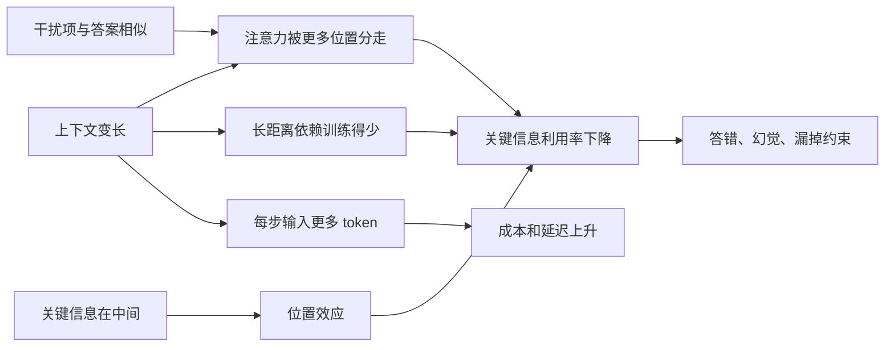
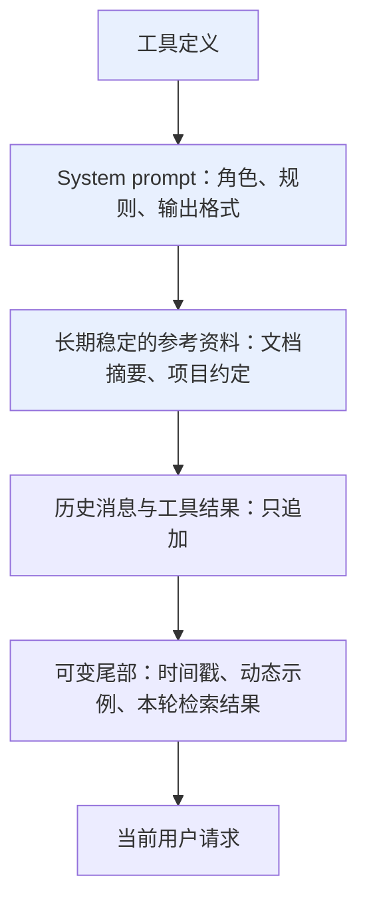

# Prompt 与 Context Engineering

> 层级：通用层 · 预计 150 分钟 · 题目：[questions.md](questions.md)
> 前置：[01 LLM 与 Transformer 基础](../01-llm-foundations/README.md)（token、注意力、KV Cache）、[02 Agent 架构](../02-agent-architecture/README.md)

## 1 这一章解决什么问题

模型每次调用都只看得到这一次传进去的内容。它不记得上一轮，不知道你的业务规则，也不知道哪些工具结果已经过时。Agent 做得好不好，很大一部分取决于每一步给模型装配了什么上下文。

早期的做法是“写好一段 prompt，然后把能拿到的东西都拼进去”。这在单轮问答里还行，到了 Agent 里会出三类问题：

- **效果**：上下文越长，模型越难用好其中关键的那几句。窗口没满，效果已经在下降。
- **成本**：Agent 每一步都要把整段上下文再送一遍。装配顺序不对，前缀缓存命中不了，账单会翻几倍。
- **可控性**：few-shot 示例的顺序、标签分布会悄悄改变输出分布；格式靠“请输出 JSON”来保证，下游解析时常失败。

面试里常见的问法有：“你的 system prompt 是怎么组织的”“few-shot 示例怎么选”“怎么保证模型输出合法 JSON”“上下文超长了怎么办”“装配顺序怎么定”。这一章讲通用原理和最小实现。上下文压缩、Checkpoint、断点续跑等长任务技术放在 [harness/02](../../tracks/harness/02-context-compaction/README.md)。

学完这一章，你应该能：

- 说清 Prompt Engineering 和 Context Engineering 的区别，用注意力的 softmax 解释为什么上下文越长关键信息越难被用上；
- 说出上下文腐化（context rot）的实验证据：长度、干扰项、问题和答案的相似度各怎么影响效果；
- 解释 few-shot 的多数标签偏差、近因偏差和上下文校准，知道示例真正在教模型什么；
- 区分 JSON 模式和约束解码的保证范围；
- 算出不同装配顺序下的前缀缓存命中 token 数和成本，说出缓存的盈亏点；
- 写一个上下文预算分配器，超限时按优先级截断；
- 说出 prompt 版本管理和回归的基本做法。

**本章符号**（后文沿用）：

| 符号 | 含义 |
|---|---|
| n | 上下文里的 token 数（注意力要覆盖的位置数） |
| s_j | 当前查询对第 j 个位置的注意力打分（softmax 之前） |
| a_j | 第 j 个位置分到的注意力权重，Σ a_j = 1 |
| Δ | 关键位置的打分比干扰位置高出多少 |
| μ, σ | 干扰位置打分的均值和标准差 |
| k | 第几轮（从 0 起） |
| P | 稳定前缀的 token 数（工具定义 + system + 稳定参考资料） |
| h | 前缀缓存命中率：命中 token 数 / 输入 token 数 |
| ρ_r, ρ_w | 缓存读价、写价相对基础输入价的倍率 |

## 2 从 Prompt 到 Context：定义与因果链

### 2.1 两个定义

Anthropic 在 [Effective context engineering for AI agents](https://www.anthropic.com/engineering/effective-context-engineering-for-ai-agents)（2025-09-29）里把两者区分为：

- Prompt Engineering：编写和组织 LLM 指令、以得到最好结果的方法。
- Context Engineering：在推理过程中挑选并维护最优 token 集合的一组策略，范围包括 prompt 以外的所有信息。文章说它是 Prompt Engineering 的自然延伸，区别在于它是迭代的：每次决定给模型传什么，都要重新挑一遍。

| | Prompt Engineering | Context Engineering |
|---|---|---|
| 关注对象 | 指令怎么写、怎么组织 | 每次推理时上下文里放哪些 token |
| 范围 | 主要是 system prompt 和用户指令 | 指令、工具定义、检索结果、历史消息、工具结果、记忆 |
| 频率 | 写一次，按版本迭代 | 每一步调用都要重新决定 |
| 主要手段 | 措辞、结构、示例 | 选择、排序、截断、压缩、按需加载 |

文章给的指导原则是：找到“尽可能小的、高信号的 token 集合”，让期望结果出现的概率最大。理由是上下文是“边际收益递减的有限资源”。下面三节拆开这个判断：为什么长了会变差（2.2）、实验上变差成什么样（2.3）、位置有没有影响（2.4）。

### 2.2 注意力稀释：一个 softmax 推导

Anthropic 的文章给了两条架构层面的解释：一是 n 个 token 之间有 n² 对关系，模型的“注意力预算”被摊开；二是训练数据里短序列比长序列多，模型为长距离依赖专门学到的参数更少。文章说这形成的是一条“性能梯度”，而不是在某个长度上突然失效。

第一条可以用 softmax 写出来。下面是本章的推导，不是论文结论，只用来说明方向。

取一个查询 token 对 n 个位置的注意力。设其中 1 个位置含有关键信息，打分为 s* = μ + Δ；其余 n−1 个是干扰位置，打分 s_j 独立服从 N(μ, σ²)。关键位置的权重是：

```text
a* = e^{s*} / ( e^{s*} + Σ_{j=1}^{n-1} e^{s_j} )
```

n 较大时，按大数定律 Σ e^{s_j} ≈ (n−1)·E[e^{s_j}]。正态变量的指数的期望是 E[e^{s_j}] = e^{μ + σ²/2}（对数正态分布的均值）。代入，分子分母同除 e^μ：

```text
a* ≈ e^Δ / ( e^Δ + (n−1)·e^{σ²/2} )
```

从这个式子能读出三件事：

1. **Δ 不变时，a* 随 n 单调下降。** 关键信息本身没变，只是旁边多了内容，它分到的权重就变少了。
2. **要保持 a* = 1/2，Δ 必须随 ln n 增长。** 令 e^Δ = (n−1)·e^{σ²/2}，得 Δ_half = ln(n−1) + σ²/2。上下文每长 10 倍，关键位置的打分优势要多 ln 10 ≈ 2.3 才能保住同样的权重。
3. **干扰项越像关键信息，稀释越严重。** 关键位置的打分固定，干扰项越像答案，它们的打分均值 μ 越高，相当于 Δ 变小，分母里的那一项按 e^μ 放大。少量“看起来像答案”的内容，伤害可以抵得上大量无关内容。代码里 100 个位置中有 10 个高相似干扰项时，关键位置的权重相当于 590 个左右无关位置时的水平。

这个模型很粗：真实模型有多层、多头，打分也不独立。它解释的是方向：**加内容有代价，代价随干扰项与关键信息的相似度增大**。这和下一节的实验现象一致。

```python
import numpy as np

# 简化模型：一个查询 token 对 n 个位置做注意力。1 个“关键”位置的打分比其余高 Δ，
# 其余 n-1 个“干扰”位置的打分独立服从 N(μ, σ²)。关键位置分到的注意力权重：
#   a*(n) = e^Δ / (e^Δ + Σ_j e^{z_j})  ≈  e^Δ / (e^Δ + (n-1)·e^{μ+σ²/2})
rng = np.random.default_rng(0)
DELTA, SIGMA = 6.0, 1.0


def weight_mc(n, mu=0.0, trials=2000):
    """蒙特卡洛：z 形状 (trials, n-1)，返回关键位置权重的平均值。"""
    z = rng.normal(mu, SIGMA, size=(trials, n - 1))
    return float(np.mean(np.exp(DELTA) / (np.exp(DELTA) + np.exp(z).sum(axis=1))))


def weight_approx(n, mu=0.0):
    return np.exp(DELTA) / (np.exp(DELTA) + (n - 1) * np.exp(mu + SIGMA**2 / 2))


ns = [100, 1_000, 10_000]
mc = [weight_mc(n) for n in ns]
ap = [weight_approx(n) for n in ns]
for n, a, b in zip(ns, mc, ap):
    print(f"n={n:>6}  蒙特卡洛 {a:.4f}  近似式 {b:.4f}")

# 1) 近似式和蒙特卡洛一致（n 大时大数定律让 Σ e^z ≈ (n-1)·E[e^z]）
assert all(abs(a - b) / b < 0.05 for a, b in zip(mc, ap))

# 2) 打分优势不变，上下文变长，关键位置的权重单调下降
assert mc[0] > mc[1] > mc[2]

# 3) 要让权重保持 1/2，Δ 必须随 ln(n) 增长：Δ_half = ln(n-1) + σ²/2（μ = 0）
for n in ns:
    d_half = np.log(n - 1) + SIGMA**2 / 2
    a = np.exp(d_half) / (np.exp(d_half) + (n - 1) * np.exp(SIGMA**2 / 2))
    assert abs(a - 0.5) < 1e-12
# 上下文每长 10 倍，需要的优势多 ln(10) ≈ 2.3
assert abs((np.log(9_999) - np.log(999)) - np.log(10)) < 1e-3

# 4) 干扰项和关键信息越像（μ 越高），稀释越严重：同样 1,000 个位置，μ 从 0 升到 2
w_unrelated, w_similar = weight_mc(1_000, mu=0.0), weight_mc(1_000, mu=2.0)
print(f"n=1000  干扰项无关 {w_unrelated:.4f}  干扰项相似 {w_similar:.4f}")
assert w_similar < w_unrelated / 3

# 5) 少量高相似干扰项的伤害很大：100 个位置里有 10 个 μ=4 的“近似答案”，
#    权重从 0.71 掉到 0.29 左右，相当于把上下文从 100 个无关位置加长到约 590 个
z_mix = np.concatenate([rng.normal(4.0, SIGMA, (2000, 10)), rng.normal(0.0, SIGMA, (2000, 89))], axis=1)
w_mix = float(np.mean(np.exp(DELTA) / (np.exp(DELTA) + np.exp(z_mix).sum(axis=1))))
n_equiv = 1 + np.exp(DELTA) * (1 / w_mix - 1) / np.exp(SIGMA**2 / 2)   # 反解近似式里的 n
print(f"100 个位置里 10 个高相似干扰项 {w_mix:.4f}，等效无关位置数 {n_equiv:.0f}")
assert w_mix < mc[0] / 2 and 500 < n_equiv < 700
```

### 2.3 上下文腐化：实验上看到了什么

Anthropic 文章里“context rot”一词链接到 Chroma 的技术报告 [Context Rot: How Increasing Input Tokens Impacts LLM Performance](https://www.trychroma.com/research/context-rot)（Hong、Troynikov、Huber，2025-07-14）。报告测了 18 个模型，做法是固定任务难度、只改输入长度。报告的定性结论：

| 实验 | 改变什么 | 报告的现象 |
|---|---|---|
| 输入长度 | 只加长输入，任务不变 | 所有实验里，效果都随输入变长而下降，而且下降不均匀 |
| 问题与答案的相似度 | 让问题和“针”（藏在长文里的答案句）在语义上更远 | 相似度越低，效果随长度下降得越快；短输入时低相似度也能答对 |
| 干扰项 | 加入和答案相近但不对的句子 | 一个干扰项就让效果低于基线，四个更差；不同干扰项的影响不一样，长度越长差别越大 |
| 文本结构 | 把背景长文打乱成句子级随机顺序 | 打乱后效果反而更好，18 个模型都是如此；报告说原因还不清楚 |
| LongMemEval | 只给相关的约 300 token，或给完整的约 113k token | 所有模型在聚焦版上都明显更好；开启思考模式两种都提升，差距仍在 |
| 重复词复制 | 输出长度随输入一起增长 | 所有模型都随长度变差，会多写、少写或写出输入里没有的词 |

报告还有两点要注意。第一，在它的“针在长文里”任务中，针放在 11 个不同位置，效果没有明显差别；这和下一节的位置效应不矛盾，任务和设置不同，结论也不能直接外推。第二，报告不解释下降的原因，说那需要机制可解释性研究。2.2 节的推导只是一个与现象相容的直觉，不是报告给出的解释。

对工程的含义：**“窗口放得下”和“模型用得好”是两回事。**正确的信息在上下文里还不够，它怎么呈现、旁边有什么同样重要。

### 2.4 位置效应

[Liu 等，Lost in the Middle，2307.03172](https://arxiv.org/abs/2307.03172)（2023-07）在多文档问答和键值检索上改变相关信息的位置，发现效果曲线呈 U 形：相关信息在开头或末尾时最好，在中间时明显下降，长上下文版本的模型也是如此。实验设置和更多结论见 [07 第 9.1 节](../07-rag-search/README.md#91-上下文排布lost-in-the-middle)，这里只用它的定性结论。

位置效应和 2.2 节的稀释是两件事。稀释说的是“内容越多，单条信息越难被用上”；位置效应说的是“同样多的内容，放在哪里也有影响”。两者叠加，给出装配时的两条规则：总量要少，关键内容放两端。

### 2.5 因果链

把上面串起来：



对应的手段：减总量（第 7 节预算与截断、按需加载），减干扰（检索后重排、清理过时的工具结果），排位置（第 6 节装配顺序），降成本（第 6 节前缀缓存）。

## 3 Prompt 的结构

### 3.1 六个部分

一个可维护的 system prompt 通常分成以下几块，用 Markdown 标题或 XML 标签分隔：

| 部分 | 写什么 | 常见错误 |
|---|---|---|
| 角色与目标 | 这个助手服务谁，要达成什么结果 | 只写“你是一个有帮助的助手” |
| 背景信息 | 模型不知道、但做决策需要的事实 | 假设模型知道内部术语 |
| 任务与步骤 | 要做什么，有没有固定顺序 | 写成几十条 if-else |
| 约束 | 不能做什么，遇到什么情况要停下或转人工 | 约束之间互相冲突 |
| 输出格式 | 字段、长度、语气，最好给一个样例 | 只说“输出 JSON” |
| 示例 | 少量典型输入输出 | 把所有边界情况都塞进去 |

Anthropic 的文章建议写在“合适的高度”：太具体会变成脆弱的硬编码规则，太抽象又默认模型和你有共同背景。推荐的迭代方式是先用最强的模型和最简的 prompt 跑起来，看到具体失败再补指令。“最简”不等于“最短”。

### 3.2 为什么要分块、用分隔符

分块有三个作用，都能对回上一节的因果链：

- **减少互相干扰**。规则、资料、示例混在一段里，示例里的具体内容会被当成规则，资料里的祈使句会被当成指令。分隔符给模型一个边界信号。
- **方便按需加载**。只在特定场景用到的规则拆成独立的块，不用时不装，直接减总量。
- **方便缓存和版本管理**。稳定的块放前面、整体做版本号；变化的块放后面。见第 6 节和第 9 节。

### 3.3 角色和优先级

一次调用里通常有 system、user、assistant、tool 几种角色。[Wallace 等，The Instruction Hierarchy，2404.13208](https://arxiv.org/abs/2404.13208)（2024-04）指出，模型把开发者的 system prompt 和不可信的用户或第三方文本当成同等优先级，是注入和越狱的主要原因之一。论文提出训练模型在指令冲突时优先服从高权限来源。写 prompt 时要配合这个顺序：规则写在 system 里，外部数据放在 user 或 tool 结果里并明确标注来源。

## 4 Few-shot 的机制

### 4.1 示例在教模型什么

直觉上，few-shot 示例在教“输入到标签的映射”。[Min 等，Rethinking the Role of Demonstrations，2202.12837](https://arxiv.org/abs/2202.12837)（2022-02）的实验说明不完全是这样。论文把示例里的正确标签随机替换，在分类和多选任务上，论文测的 12 个模型几乎都只下降 0 到 5 个百分点（论文报告的绝对值）。论文认为示例真正提供的是三样东西：

1. **标签空间**：可能的答案有哪些；
2. **输入文本的分布**：真实输入长什么样；
3. **整体格式**：输入和答案怎么排。

论文还发现，标签空间未知时，用随机英文词当标签也比完全不给标签好得多，说明格式本身就有用。这对 Agent 的启示是：示例的主要价值在“演示输出的形状和取值范围”，所以示例的格式要和你期望的输出完全一致，示例输入的分布要像真实请求。

这个结论有边界：论文也报告，GPT-J 在分类任务上标签全错时效果下降接近 10 个点，只是仍明显好于不给示例。所以“标签对错无所谓”不能当成通用规则，只能说“示例的格式和分布比单条标签更重要”。

### 4.2 三种偏差

[Zhao 等，Calibrate Before Use，2102.09690](https://arxiv.org/abs/2102.09690)（2021-02）在 GPT-3 上发现，few-shot 准确率对格式、示例选择、示例顺序都很敏感。论文报告，在情感分类上固定 4 个示例、只换它们的顺序，准确率就能从接近随机变到接近当时最好的结果。论文把原因归为三种偏差：

| 偏差 | 现象 | 论文的例子 |
|---|---|---|
| 多数标签偏差（majority label bias） | 示例里哪个标签多，模型就偏向哪个 | 从 0-shot 换到 1-shot 准确率常常下降，因为模型经常重复那一个示例的类别 |
| 近因偏差（recency bias） | 偏向提示末尾出现的答案 | 示例为 P P P N 时，近 90% 的预测是 Negative，尽管 3/4 的示例是 Positive |
| 常见 token 偏差（common token bias） | 偏向预训练里常见的 token | 事实抽取任务里常答 “America” 这类常见实体 |

近因偏差可以压过多数标签偏差，这是“顺序比选哪些示例还重要”的直接原因。

[Lu 等，Fantastically Ordered Prompts，2104.08786](https://arxiv.org/abs/2104.08786)（2021-04）补了三点：顺序敏感在各种模型规模上都存在，加大模型只能部分缓解；好的顺序和具体选了哪几个样本无关；**好的顺序不能跨模型迁移**，论文报告同一个排列换到同系列另一个规模的模型上，可能从表现很好掉到接近随机。论文的做法是让模型自己生成一个无标签的探测集，选预测标签分布熵高的排列（避免预测全倒向一类），论文报告在 11 个文本分类任务上平均相对提升 13%。

### 4.3 上下文校准

Zhao 等给的修正方法叫上下文校准（contextual calibration）。思路是：先测出“这套示例本身”让模型偏向哪个答案，再把这个偏好除掉。

1. 用同一套示例，把测试输入换成无内容输入（论文用 “N/A”、“[MASK]” 和空串三个取平均），得到模型对各标签的概率 p̂_cf。理想情况下它应当是均匀的；论文的例子里，SST-2 上模型给无内容输入的 Positive 概率是 61.8%。
2. 设仿射变换 q̂ = softmax(W·p̂ + b)，取 W = diag(p̂_cf)⁻¹，b = 0。
3. 预测时对 W·p̂ 取 argmax。

为什么这样能去掉偏差，可以在二分类里推一下。把模型对“P”的 logit 写成 ℓ = 任务信号 + b（b 是示例带来的偏差），则 p_P = σ(ℓ)，无内容输入时任务信号为 0，p_cf,P = σ(b)。校准后两类之比是：

```text
(p_P / p_cf,P) / (p_N / p_cf,N)
  = [σ(ℓ)/σ(b)] · [σ(−b)/σ(−ℓ)]
  = e^{ℓ} / e^{b}                      （因为 σ(x)/σ(−x) = e^x）
  = e^{ℓ − b}
```

取对数，判决量变成 ℓ − b，偏差被整体减掉。这是本章的推导。它也说明了校准的局限：只能去掉**与输入无关的常数偏差**。如果偏差随输入变化，无内容输入测出来的 b 就不准。

下面的玩具模型用虚构的系数复现这三种偏差和校准的效果。系数不是论文的拟合值，只用来验证机制。

```python
import itertools
import numpy as np

# 玩具模型：二分类情感任务，标签 P / N。模型对“P”的 logit = 任务信号 + 提示偏差 + 常见 token 偏差。
#   任务信号  s·y + ε，y = +1(P) / -1(N)，ε ~ N(0, 1)
#   多数标签偏差  α·(#P − #N)/k                 示例里哪个标签多，就偏向哪个
#   近因偏差      β·Σ_i w_i·y_i，w_i = γ^(k−i)   越靠后的示例权重越大
#   常见 token 偏差 c                            与示例无关的固有偏好
# 这组系数是虚构的，只用来复现 Zhao 等（2102.09690）描述的定性现象，不是论文的拟合结果。
rng = np.random.default_rng(1)
S, ALPHA, BETA, GAMMA, C = 1.5, 1.0, 2.0, 0.3, 0.2
y_test = rng.choice([1, -1], size=4000)                       # 形状 (4000,)，平衡的测试集
task_logit = S * y_test + rng.normal(0, 1, size=y_test.shape)


def prompt_bias(labels):
    k = len(labels)
    majority = ALPHA * sum(labels) / k
    recency = BETA * sum(GAMMA ** (k - 1 - i) * y for i, y in enumerate(labels))
    return majority + recency + C


def evaluate(labels):
    b = prompt_bias(labels)
    raw = np.where(task_logit + b > 0, 1, -1)
    # 上下文校准：喂入无内容输入（如 "N/A"），任务信号为 0，模型给 P 的概率就是 σ(b)。
    # 论文取 W = diag(p_cf)^-1、b = 0。二分类时 q_P/q_N = (p_P/p_cf,P)/(p_N/p_cf,N)，
    # 取对数正好是 logit − logit_cf，也就是把整个偏差 b 减掉。
    p = 1 / (1 + np.exp(-(task_logit + b)))
    p_cf = 1 / (1 + np.exp(-b))
    q_p, q_n = p / p_cf, (1 - p) / (1 - p_cf)
    cal = np.where(q_p > q_n, 1, -1)
    raw_acc, cal_acc = float(np.mean(raw == y_test)), float(np.mean(cal == y_test))
    return raw_acc, cal_acc, float(np.mean(raw == -1))   # 最后一项：预测为 N 的比例


P, N = 1, -1
# 1) 同样 2 个 P、2 个 N，只换顺序（6 种排列），准确率差距很大
orders = sorted(set(itertools.permutations([P, P, N, N])))
res = {o: evaluate(list(o)) for o in orders}
raw_accs = [r[0] for r in res.values()]
for o, (ra, ca, neg) in res.items():
    print("".join("P" if y == 1 else "N" for y in o), f"原始 {ra:.3f}  校准后 {ca:.3f}  预测 N 的比例 {neg:.2f}")
assert max(raw_accs) - min(raw_accs) > 0.15

# 2) 近因偏差：结尾是 N N 的排列，预测 N 的比例最高
assert max(res, key=lambda o: res[o][2]) == (P, P, N, N)

# 3) 近因偏差能压过多数标签偏差：3 个 P、1 个 N，N 放最后，预测 N 的比例仍过半
_, _, neg_pppn = evaluate([P, P, P, N])
_, _, neg_nppp = evaluate([N, P, P, P])
print(f"PPPN 预测 N 的比例 {neg_pppn:.2f}，NPPP {neg_nppp:.2f}")
assert neg_pppn > 0.5 > neg_nppp

# 4) 校准后，所有排列的准确率回到同一个值（偏差被整体减掉，只剩任务信号）
cal_accs = [r[1] for r in res.values()] + [evaluate([P, P, P, N])[1], evaluate([N, N, N, P])[1]]
unbiased = float(np.mean(np.where(task_logit > 0, 1, -1) == y_test))
assert max(cal_accs) - min(cal_accs) < 1e-12 and abs(cal_accs[0] - unbiased) < 1e-12
assert cal_accs[0] > max(raw_accs)

# 5) 局限：校准只能去掉“与输入无关的常数偏差”。如果偏差随输入变化（这里让一半样本的偏差翻倍），
#    用无内容输入测出的 b 只对另一半准，校准后仍低于无偏上限
b = prompt_bias([P, P, N, N])
scale = np.where(np.arange(len(y_test)) % 2 == 0, 1.0, 2.0)
cal_partial = np.where(task_logit + b * scale - b > 0, 1, -1)
assert float(np.mean(cal_partial == y_test)) < unbiased - 0.02
```

### 4.4 工程上怎么用

| 问题 | 做法 | 代价 |
|---|---|---|
| 示例覆盖不全 | 选多样、典型的示例（Anthropic 文章的说法是 diverse, canonical examples），不要穷举边界情况 | 需要先分析真实请求的分布 |
| 多数标签偏差 | 示例里各标签数量均衡 | 某些标签的好示例难找 |
| 近因偏差 | 打乱顺序做多次评测，看均值和方差；不要让同一标签扎堆在末尾 | 评测成本增加 |
| 换模型后变差 | 好的顺序不能跨模型迁移，换模型要重新评测 | 每次换模型都要跑回归 |
| 模型照抄示例的具体内容 | 示例用和真实任务不同的虚构内容 | 示例和任务差太远时效果下降 |
| 示例占上下文 | 按输入动态检索最相近的几个示例 | 示例变化会破坏前缀缓存，要放在稳定前缀之后（第 6 节） |
| 能拿到 logprob 的分类任务 | 上下文校准 | 只修常数偏差；拿不到概率的 API 用不了 |

### 4.5 推理提示

思维链（CoT）、Self-Consistency 和推理模型的机制见 [05 规划与推理第 2 节](../05-planning-reasoning/README.md#2-cot-与推理模型)。和 prompt 写法直接相关的一点：推理模型自己会做长推理，OpenAI 的 [推理模型最佳实践](https://developers.openai.com/api/docs/guides/reasoning-best-practices) 建议避免“一步步想”这类指令，说它可能没有帮助，有时还会降低表现；更有用的是讲清目标、约束和验收标准。OpenAI 的 [Function calling 指南](https://developers.openai.com/api/docs/guides/function-calling) 也提醒，在描述里堆示例可能会降低推理模型的表现。

## 5 结构化输出

Agent 的下游通常是程序，输出必须能被解析。三种方案：

| 方案 | 做法 | 保证什么 | 不保证什么 |
|---|---|---|---|
| 提示约束 | 在 prompt 里说明格式并给样例，代码里解析和重试 | 什么都不保证，尽力而为 | 会出现多余文字、缺字段、类型错 |
| JSON 模式 | 解码时保证输出能被解析成 JSON | 语法合法 | 不保证符合你的 schema |
| Schema 约束（约束解码） | 按 JSON Schema 在每一步屏蔽不合法的 token | 正常结束的、非拒答的输出符合 schema | 字段取值是否正确；被截断或拒答时的输出 |

JSON 模式和约束解码的差别在“约束对象”。JSON 模式只约束到 JSON 语法，字段名、类型、必填都不管。约束解码把 schema 编译成文法，每一步只允许“还能走到一个合法输出”的 token。OpenAI 的 [Structured Outputs 指南](https://developers.openai.com/api/docs/guides/structured-outputs)（查阅于 2026-11）写明了两者的区别：都保证合法 JSON，只有 Structured Outputs 保证符合 schema；文档建议能用 Structured Outputs 时总是用它。

文档还写了 JSON 模式的两个坑：

- 必须在对话里明确要求模型输出 JSON。上下文里没有出现 “JSON” 这个字符串时，API 会报错；文档说不这样做时，模型可能一直输出空白，直到 token 上限。
- 约束解码也有输出不符合 schema 的情况：模型因为安全原因拒答（响应里有单独的 `refusal` 字段），或者达到 max tokens 被截断。应用仍要处理拒答、不完整输出和 API 错误。

`strict: true` 对 schema 的要求（`additionalProperties: false`、字段全部列进 `required`、可选字段用加 `null` 的类型）和两家实现的差异见 [04 第 3.7 节](../04-tool-use-mcp/README.md#37-strict-模式与约束解码)。约束解码怎么算每一步的 token 掩码、为什么 JSON 需要下推自动机、截断为什么不归文法管，见 [inference/05 第 7 节](../../tracks/inference/05-agent-serving/README.md#7-结构化输出与约束解码)。

格式合法不等于内容正确。字段取值是否合理、引用的 ID 是否存在、用户有没有权限，仍要靠程序校验。

## 6 上下文装配顺序与前缀缓存

### 6.1 推荐顺序

一次 Agent 调用的上下文，大致按下面的顺序装配：



排序依据有两条：

**1 前缀缓存要求稳定的内容在前**。推理服务可以复用相同前缀的 KV Cache：每个位置的 K、V 只取决于它前面的 token，所以两次请求从头起相同的部分可以直接复用，前面任何一个 token 变了，后面全部要重算（原理见 [inference/01 第 2.1 节](../../tracks/inference/01-kv-cache-memory/README.md#21-从注意力出发为什么缓存-kv不缓存-q)）。以 Anthropic 的 [Prompt caching 文档](https://platform.claude.com/docs/en/build-with-claude/prompt-caching)（查阅于 2026-11）为例，缓存前缀按 tools → system → messages 的顺序构成，某一级变化会让这一级和之后的缓存失效；改工具定义会让整个缓存失效。两种实现（API 的断点缓存、vLLM 的块哈希）的规则对比见 [harness/02 第 5 节](../../tracks/harness/02-context-compaction/README.md#5-稳定前缀与-kv-cache-命中)。

所以时间戳、请求 ID、按请求动态挑选的示例，不要放进 system prompt 开头。工具列表也要保持固定顺序。

**2 位置影响模型能否用上信息**。第 2.4 节的位置效应：开头和末尾最容易被用上。所以当前请求和最关键的检索结果放在末尾，重要规则在 system 里说清，必要时在请求附近简短重复。

两条规则在“历史放哪”上有冲突：历史是会变的，按效果它不该在最前面；按缓存它要放在可变尾部之前，因为它是只追加的。只追加的内容对缓存来说是稳定的：第 k 轮的历史是第 k+1 轮历史的前缀。真正破坏缓存的是“每轮都换”的内容（时间戳、动态示例、检索结果），这些必须放在历史之后。

### 6.2 成本模型：命中率和盈亏点

记一次请求的输入为 T 个 token，其中前 H 个命中缓存，命中率 h = H / T。命中的按读价 ρ_r 计，没命中的按写价 ρ_w 计（API 开启缓存时，没命中的部分会写入缓存，写价高于基础价）。以基础输入价为 1：

```text
cost = ρ_r·H + ρ_w·(T − H) = T·[ ρ_w − (ρ_w − ρ_r)·h ]
```

和不开缓存（cost = T）比，开缓存更便宜的条件是：

```text
ρ_w − (ρ_w − ρ_r)·h < 1   ⇔   h > (ρ_w − 1) / (ρ_w − ρ_r) = h*
```

代入 Anthropic 文档的 5 分钟缓存倍率（写 1.25，读 0.1）：h* = 0.25 / 1.15 ≈ 21.7%。这是本章的推导。它说明两件事：

- **命中率低于约两成时，开缓存比不开还贵**，因为每次都按 1.25 倍写，却几乎读不到。
- **盈亏点主要由写入溢价 ρ_w − 1 决定**。读价从 0.1 降到 0.05，h* 只从 21.7% 变到 20.8%。读价更低影响的是命中以后省多少，不是要不要开。

倍率随厂商和模型变化。文档写明 1 小时缓存的写入是 2 倍；部分较新的模型读价是 0.05 倍或 0.025 倍。下面的代码把倍率当参数。

### 6.3 实现：五种装配顺序的命中和成本

一个 20 轮的会话：工具定义 3,000 token，system 1,500，稳定参考资料 4,000；每轮新增用户请求 200、回复和工具结果 1,200；每轮还有一个 20 token 的时间戳、800 token 的动态示例、2,500 token 的检索结果，都是每轮不同的。比较五种装配顺序。缓存规则只用“从头起完全相同的部分命中”这一条，两种实现都满足。

```python
# 上下文装配顺序对前缀缓存的影响：同一个 20 轮会话，五种装配顺序，比较命中 token 数和输入成本。
# 缓存规则（按 Anthropic prompt caching 与 vLLM 前缀缓存的共同点抽象）：
#   只有“从头起完全相同”的前缀能命中；命中部分按读价，其余按写价。
# 价格用相对基础输入价的倍率表示，作为参数：READ、WRITE。
# 默认值取 Anthropic 文档的 5 分钟缓存（读 0.1、写 1.25，查阅于 2026-11，部分模型读价更低）。
READ, WRITE = 0.1, 1.25
BLOCK = 1            # 缓存粒度（token）。vLLM 按块缓存时改成 16，不满的尾块不命中

TOOLS, SYSTEM, DOCS = 3_000, 1_500, 4_000      # 工具定义、system prompt、稳定参考资料
TS, SHOTS, RETR = 20, 800, 2_500               # 时间戳、按请求动态选的示例、本轮检索结果
USER, REPLY = 200, 1_200                        # 每轮用户请求、每轮回复与工具结果
TURNS = 20


def seg(name, n, ver=0):
    """一段内容 = n 个 token，每个 token 用 (段名, 版本, 序号) 标识；版本不同就是不同的 token。"""
    return [(name, ver, i) for i in range(n)]


def history(k):
    """第 k 轮（从 0 起）之前积累的历史：前 k 轮的用户请求和回复，只追加。"""
    out = []
    for j in range(k):
        out += seg("user", USER, j) + seg("reply", REPLY, j)
    return out


def build(order, k):
    parts = {
        "tools": seg("tools", TOOLS), "system": seg("system", SYSTEM), "docs": seg("docs", DOCS),
        "ts": seg("ts", TS, k), "shots": seg("shots", SHOTS, k), "retr": seg("retr", RETR, k),
        "hist": history(k), "user": seg("user", USER, k),
    }
    return [t for name in order for t in parts[name]]


def lcp(a, b):
    n = 0
    for x, y in zip(a, b):
        if x != y:
            break
        n += 1
    return n // BLOCK * BLOCK


def run(order):
    prev, hit_total, len_total, cost = None, 0, 0, 0.0
    for k in range(TURNS):
        cur = build(order, k)
        hit = lcp(prev, cur) if prev else 0
        hit_total, len_total = hit_total + hit, len_total + len(cur)
        cost += READ * hit + WRITE * (len(cur) - hit)
        prev = cur
    return hit_total, len_total, cost


ORDERS = {
    "稳定在前（推荐）": ["tools", "system", "docs", "hist", "ts", "shots", "retr", "user"],
    "时间戳在 system 开头": ["tools", "ts", "system", "docs", "hist", "shots", "retr", "user"],
    "动态示例放进 system": ["tools", "system", "shots", "docs", "hist", "ts", "retr", "user"],
    "检索结果放在历史前": ["tools", "system", "docs", "retr", "hist", "ts", "shots", "user"],
    "时间戳放在工具前": ["ts", "tools", "system", "docs", "hist", "shots", "retr", "user"],
}
res = {name: run(o) for name, o in ORDERS.items()}
no_cache = res["稳定在前（推荐）"][1] * 1.0          # 不开缓存：全部按基础价 1.0
for name, (hit, total, cost) in res.items():
    print(f"{name:<14} 命中 {hit:>7} / {total} = {hit / total:5.1%}  成本 {cost / no_cache:5.1%}（相对不开缓存）")

good, ts_sys, shots_sys, retr_first, ts_first = (res[n] for n in ORDERS)
P = TOOLS + SYSTEM + DOCS

# 1) 推导：推荐顺序下第 k 轮命中的正好是“稳定前缀 + 上一轮的历史” = P + (k-1)(USER+REPLY)
assert good[0] == sum(P + (k - 1) * (USER + REPLY) for k in range(1, TURNS))

# 2) 一个 20 token 的时间戳放在 system 开头，命中只剩工具定义那一段
assert ts_sys[0] == TOOLS * (TURNS - 1)
# 放在最前面，一个 token 都命中不了；成本比不开缓存还高（每次都按 1.25 倍写）
assert ts_first[0] == 0 and ts_first[2] > no_cache

# 3) 命中和成本的排序：推荐顺序最好；破坏位置越靠前，损失越大
assert good[0] > retr_first[0] > shots_sys[0] > ts_sys[0] > ts_first[0]
assert good[2] < retr_first[2] < shots_sys[2] < ts_sys[2] < ts_first[2]

# 4) 推荐顺序的命中率约 79%，输入成本约为不开缓存的 34%。
#    没命中的是第 1 轮的全部，以及每轮的可变尾部和上一轮新增的历史
assert 0.78 < good[0] / good[1] < 0.80 and 0.33 < good[2] / no_cache < 0.35
tail = TS + SHOTS + RETR + USER
# 第 k≥1 轮没命中的：上一轮的请求和回复（它们上一轮在可变尾部之后，这一轮挪进了历史）+ 本轮可变尾部
assert good[1] - good[0] == (P + tail) + (TURNS - 1) * (USER + REPLY + tail)

# 5) 盈亏点：命中率 h 时每 token 成本 READ·h + WRITE·(1−h)，低于 1 需要 h > (WRITE−1)/(WRITE−READ)
h_star = (WRITE - 1) / (WRITE - READ)
assert abs(h_star - 0.25 / 1.15) < 1e-12          # ≈ 21.7%
for hit, total, cost in res.values():
    assert (cost < no_cache) == (hit / total > h_star)

# 6) 换成 vLLM 式的块缓存（16 token 一块，不满的尾块不命中）：每轮最多少命中 15 个 token
hit_tok = good[0]
BLOCK = 16
hit_blk = run(ORDERS["稳定在前（推荐）"])[0]
print(f"块大小 16：命中 {hit_blk}，比按 token 少 {hit_tok - hit_blk}")
assert 0 <= hit_tok - hit_blk <= 15 * (TURNS - 1)
```

运行结果（命中率 / 相对不开缓存的成本）：

| 装配顺序 | 命中率 | 成本 |
|---|---|---|
| 稳定在前（推荐） | 79.2% | 34.0% |
| 检索结果放在历史前 | 31.9% | 88.3% |
| 动态示例放进 system | 16.9% | 105.6% |
| 时间戳在 system 开头 | 11.3% | 112.1% |
| 时间戳放在工具前 | 0.0% | 125.0% |

几个读法：

- 一个 20 token 的时间戳放在 system 开头，命中只剩前面的 3,000 token 工具定义，成本反而比不开缓存高 12%。
- “检索结果放在历史前”看起来只是挪了一块，但检索结果每轮都变，它后面不断增长的历史一个都命中不了。会话越长，损失越大。
- 推荐顺序没命中的，是第 1 轮的全部，加上每轮的可变尾部和上一轮新增的历史。可变尾部（这里 3,520 token）越大，命中率越低。所以动态内容也要控制总量。

## 7 上下文窗口预算与截断

### 7.1 先分预算，再装内容

窗口要先分预算，再装内容。一个常见的分法：

| 区块 | 预算思路 | 超出时的处理 |
|---|---|---|
| 输出预留 | 按任务最长输出留足 | 不能挤占，否则回答被截断；结构化输出被截断就是非法 JSON |
| 工具定义与 system | 固定开销，上线前测好 | 精简描述，按需加载工具（见 [04 章](../04-tool-use-mcp/README.md)） |
| 当前请求 | 必须完整保留 | 超长输入先分块处理 |
| 检索结果 | 给一个上限，按相关度排序装 | 降低条数，或只保留片段 |
| 历史与工具结果 | 剩下的空间 | 先清理旧的工具结果，再丢或摘要早期对话 |

固定开销放不下时要报错，而不是悄悄截断 system 或请求。悄悄截断的现象是“模型突然不遵守某条规则”，很难查。

### 7.2 截断按什么优先级

截断策略的对比：

| 策略 | 做法 | 丢了什么 | 对缓存的影响 |
|---|---|---|---|
| 清理旧工具结果 | 保留调用记录，把已用过的大段返回换成占位符 | 原始返回；需要时要重新调用工具 | 改写了历史中段，从那里往后的缓存失效 |
| 丢弃最早的消息 | 滑动窗口 | 早期的目标和约束可能被丢掉 | 改写了开头，历史部分全部失效 |
| 摘要早期对话 | 用模型压缩历史 | 细节；摘要可能出错 | 改变前缀，同上 |
| 按需加载 | 上下文里只放文件路径、查询语句等引用，用到时再取 | 不丢，但运行时多几次工具调用 | 只追加，对缓存友好 |

Anthropic 的文章把清理旧工具结果称为“最安全、最轻”的压缩方式，理由是工具在很早之前调用过，Agent 很少需要再看原始结果。文章推荐“即时检索”：只保留轻量引用，用到时再加载，代价是运行时探索比读预先算好的数据慢。

由此得到一个默认做法：检索结果单独给一个上限，按分数从高到低装，防止它挤掉历史；历史超出预算时，先清理旧工具结果（丢得最少），再丢最早的普通消息（任务目标那条除外）；历史截断后还有空余，再还给检索。具体比例和顺序要按任务在评测上定。

三个容易漏的约束：

- **任务目标永远保留**。滑动窗口最常见的事故就是把第一条的任务目标丢了。
- **调用和结果成对丢**。只丢调用消息、留下工具结果，API 会拒绝请求（Anthropic 要求 `tool_result` 紧跟对应的 `tool_use`，见 [04 第 3.4 节](../04-tool-use-mcp/README.md#34-tool_result-的回传规则)）。
- **最近几条工具结果不动**。模型正在用它们做下一步决策。

截断会改写历史，所以每次截断都会让后面的缓存失效。频繁小幅截断比偶尔一次大幅截断更贵。什么时候截断能回本、阈值怎么定，见 [harness/02 第 5.4 节](../../tracks/harness/02-context-compaction/README.md#54-压缩什么时候回本)和[第 3.4 节](../../tracks/harness/02-context-compaction/README.md#34-压缩还是重置阈值怎么定)。

### 7.3 实现：预算分配器

```python
# 上下文预算分配器：先扣输出预留和固定开销，再分检索和历史；超限时按优先级截断。
# 检索结果有自己的上限（可用空间的 retr_share），上限内按分数从高到低装，装不下的跳过。
# 历史超出自己的预算时，按优先级截断（先做代价小的）：
#   1) 旧工具结果换成占位符（保留调用记录，最近 KEEP_RECENT 条不动）
#   2) 成对丢最早的消息和它的工具结果（任务目标那条永远保留）
# 历史截断完还有空余，再还给检索。
# 当前请求、system、工具定义、输出预留不参与截断；它们本身放不下就报错，而不是悄悄截断。
from dataclasses import dataclass, replace

PLACEHOLDER = 20      # 被清理的工具结果留下的占位符长度（token）
KEEP_RECENT = 2       # 最近几条工具结果不清理


@dataclass(frozen=True)
class Msg:
    kind: str          # "goal" | "msg" | "tool_result"
    tokens: int
    id: int


def allocate(window, reserve_out, system, tools, request, history, retrieval, retr_share=0.4):
    """history：按时间顺序的 Msg 列表；retrieval：(分数, token 数) 列表。返回 (报告, 保留的历史, 保留的检索)。"""
    avail = window - reserve_out - system - tools - request
    if avail < 0:
        raise ValueError(f"固定开销超出窗口 {-avail} token：精简 system 或按需加载工具")

    # 检索先拿一个上限，按分数从高到低装，装不下的跳过
    def fill(items, cap):
        kept, used = [], 0
        for score, t in sorted(items, key=lambda x: -x[0]):
            if used + t <= cap:
                kept.append((score, t))
                used += t
        return kept, used

    retr_kept, retr_used = fill(retrieval, int(avail * retr_share))
    hist_budget = avail - retr_used

    # 历史：先清理旧工具结果，再丢最早的普通消息
    hist = list(history)
    steps = []
    tool_idx = [i for i, m in enumerate(hist) if m.kind == "tool_result"]
    for i in tool_idx[:-KEEP_RECENT] if KEEP_RECENT else tool_idx:
        if sum(m.tokens for m in hist) <= hist_budget:
            break
        if hist[i].tokens > PLACEHOLDER:
            hist[i] = replace(hist[i], tokens=PLACEHOLDER)
            steps.append(("clear", hist[i].id))
    while sum(m.tokens for m in hist) > hist_budget:
        drop = next((i for i, m in enumerate(hist) if m.kind != "goal"), None)
        if drop is None:
            raise ValueError("只剩任务目标仍放不下：先把目标摘要成更短的形式")
        # 模型消息和紧跟着的工具结果成对丢：只剩工具结果、没有对应的调用，API 会拒绝这条请求
        n = 2 if drop + 1 < len(hist) and hist[drop + 1].kind == "tool_result" else 1
        for m in hist[drop:drop + n]:
            steps.append(("drop", m.id))
        del hist[drop:drop + n]

    # 历史没用完的空间还给检索，再装一轮
    hist_used = sum(m.tokens for m in hist)
    retr_kept, retr_used = fill(retrieval, avail - hist_used)
    report = dict(fixed=system + tools + request, retrieval=retr_used, history=hist_used,
                  reserve_out=reserve_out, steps=steps)
    report["prompt_total"] = report["fixed"] + retr_used + hist_used
    return report, hist, retr_kept


# 一个虚构的 Agent 会话：第一条是任务目标，之后交替出现模型消息和大段工具结果
history = [Msg("goal", 600, 0)]
for j in range(1, 13):
    history.append(Msg("msg", 300, 2 * j - 1))
    history.append(Msg("tool_result", 4_000, 2 * j))
retrieval = [(0.91, 1_500), (0.85, 1_200), (0.62, 2_000), (0.40, 900), (0.15, 1_800)]
cfg = dict(reserve_out=8_000, system=2_500, tools=6_000, request=400)

# 1) 窗口够大：什么都不截
rep, h, r = allocate(window=128_000, history=history, retrieval=retrieval, **cfg)
assert rep["steps"] == [] and len(h) == len(history) and len(r) == len(retrieval)

# 2) 窗口 64K：只清理旧工具结果就够了，一条消息都没丢
rep, h, r = allocate(window=64_000, history=history, retrieval=retrieval, **cfg)
print("64K:", {k: v for k, v in rep.items() if k != "steps"}, "清理", sum(s[0] == "clear" for s in rep["steps"]))
assert all(kind == "clear" for kind, _ in rep["steps"]) and len(h) == len(history)
assert rep["prompt_total"] <= 64_000 - cfg["reserve_out"]          # 输出预留没被挤占

# 3) 窗口 32K：清理完所有可清理的工具结果仍超，才开始丢最早的消息；目标始终在第一位
rep, h, r = allocate(window=32_000, history=history, retrieval=retrieval, **cfg)
kinds = [s[0] for s in rep["steps"]]
print("32K:", {k: v for k, v in rep.items() if k != "steps"}, "清理", kinds.count("clear"), "丢弃", kinds.count("drop"))
assert "drop" in kinds and kinds.index("drop") > max(i for i, k in enumerate(kinds) if k == "clear")
assert h[0].kind == "goal" and rep["prompt_total"] <= 32_000 - cfg["reserve_out"]
# 没有“孤儿”工具结果：每条工具结果前面都是它的调用消息
assert all(h[i - 1].kind == "msg" for i, m in enumerate(h) if m.kind == "tool_result")
# 最近两条工具结果保持原样
assert [m.tokens for m in h if m.kind == "tool_result"][-KEEP_RECENT:] == [4_000] * KEEP_RECENT

# 4) 检索按分数保留：留下的都是分数最高的那几条
kept_scores = sorted(s for s, _ in r)
all_scores = sorted((s for s, _ in retrieval), reverse=True)
assert kept_scores == sorted(all_scores[:len(r)])

# 5) 单调性：窗口变大，保留的历史条数和检索 token 都不减少
prev = None
for w in [24_000, 32_000, 48_000, 64_000, 96_000, 128_000]:
    rep, h, r = allocate(window=w, history=history, retrieval=retrieval, **cfg)
    cur = (len(h), rep["retrieval"], rep["history"])
    assert prev is None or all(c >= p for c, p in zip(cur, prev))
    prev = cur

# 6) 固定开销放不下时报错，而不是悄悄截掉 system 或请求
try:
    allocate(window=16_000, history=history, retrieval=retrieval, **cfg)
    raise AssertionError("应当报错")
except ValueError as e:
    assert "固定开销" in str(e)
```

这个分配器有两处简化：检索结果“装不下就跳过”，真实系统可能先截断单条再装；截断后只算 token，没有考虑截断带来的缓存失效。后者的账见 harness/02 第 5.4 节。

## 8 Prompt 注入的基本防御

间接 prompt 注入是攻击者把指令藏在网页、邮件、文档等会被读到的外部内容里（[Greshake 等，2302.12173](https://arxiv.org/abs/2302.12173)，2023-02）。它的根源和第 2 节同源：模型在同一个上下文里读指令和数据，没有可靠的机制区分两者。

Prompt 一侧能做的基础动作：

- **来源标注**：外部内容用明确的分隔符包起来，system 里声明分隔符内的只是数据。[Hines 等，Spotlighting，2403.14720](https://arxiv.org/abs/2403.14720)（2024-03）把它扩展成分隔符、数据标记、编码三种变换，论文报告攻击成功率从 50% 以上降到 2% 以下，但编码在较弱模型上会损害任务效果。
- **配合指令层级**：规则放 system，外部数据放 tool 结果（第 3.3 节）。
- **减少暴露面**：用完的外部内容从上下文里清掉，第 7 节的截断同时也减少了注入能影响的范围。

这些只能降低概率，不能保证。高风险动作要靠权限、确认和架构隔离兜底，见 [10 安全与可靠性第 3 节](../10-safety-reliability/README.md#3-prompt-注入与间接注入)和 [harness/03 沙箱与权限](../../tracks/harness/03-sandbox-permissions/README.md)。

## 9 Prompt 的版本管理与回归

Prompt 是代码的一部分，改动要能回滚、能评测：

- **版本化**：prompt 放进版本库，每次上线带版本号，日志和 Trace 里记录每次调用用了哪个版本。没有这一条，线上出问题时无法确定是哪次改动引起的。
- **按块管理**：第 3.2 节的分块同时是版本管理的单位。改的是稳定前缀里的块，要预期上线后有一段缓存命中率下降、成本上升；改的是可变尾部，缓存不受影响。
- **固定回归集**：包括历史上出过错的样例。改一句话也要跑回归，按任务成功率、格式错误率、成本对比新旧版本。
- **多次试次**：few-shot 顺序、采样温度都会让同一个版本的结果波动（第 4.2 节），只跑一次的对比不可信。单次分数有多大波动、要跑几次，见 [09 评测第 6 节](../09-evaluation/README.md#6-离线评测单次分数有多可靠)。
- **换模型重跑**：Lu 等发现好的示例顺序不能跨模型迁移；同一个 prompt 在不同模型上表现可能差很多。

回归门禁、灰度和线上对比的做法见 [evaluation/05 第 4 节](../../tracks/evaluation/05-online-regression/README.md#4-回归评测与发布门禁)。

## 10 数值例子

条件同第 6.3 节和第 7.3 节，全部可以手算。倍率取写 1.25、读 0.1。

**前缀缓存，第 2 轮（k = 1）**。稳定前缀 P = 3,000 + 1,500 + 4,000 = 8,500。可变尾部 = 20 + 800 + 2,500 + 200 = 3,520。输入长度 = 8,500 + 1,400 + 3,520 = 13,420。

- 推荐顺序：命中 8,500，成本 = 0.1 × 8,500 + 1.25 × 4,920 = 7,000。不开缓存是 13,420。
- 时间戳在 system 开头：只命中工具定义 3,000，成本 = 0.1 × 3,000 + 1.25 × 10,420 = 13,325，只比不开缓存便宜 95。命中率 22.4%，刚过 21.7% 的盈亏点。

**第 20 轮（k = 19）**。输入长度 = 8,500 + 19 × 1,400 + 3,520 = 38,620。

- 推荐顺序：每轮没命中的始终是 1,400 + 3,520 = 4,920，成本 = 0.1 × 33,700 + 1.25 × 4,920 = 9,520。
- 时间戳在 system 开头：命中的还是 3,000，命中率掉到 7.8%，成本 44,825，比不开缓存贵 16%。

会话越长，两种顺序的差距越大：推荐顺序的每轮成本只随历史长度乘 0.1 增长，坏顺序按 1.25 增长。

**预算分配，窗口 64K**。可用 = 64,000 − 8,000（输出）− 2,500 − 6,000 − 400 = 47,100。检索上限 int(47,100 × 0.4) = 18,840，5 条共 7,400 全部装下。历史预算 = 47,100 − 7,400 = 39,700，历史共 600 + 12 × 4,300 = 52,200，超出 12,500。每清理一条工具结果省 3,980，要清理 ⌈12,500 / 3,980⌉ = 4 条，历史剩 36,280，一条消息都不用丢。

**预算分配，窗口 32K**。可用 15,100，检索上限 6,040，装下前 4 条共 5,600（最后一条 1,800 装不下）。历史预算 9,500。可清理的 10 条全清理后历史还有 12,400，再成对丢最早的（消息 300 + 占位符 20），要丢 10 对，剩 9,200：任务目标 600 加最近两对 2 × 4,300。

```python
# 第 10 节的手算，逐项核对。价格是相对基础输入价的倍率：读 0.1、写 1.25（参数，可替换）
READ, WRITE = 0.1, 1.25

# 条件同第 6.3 节：稳定前缀 P = 工具 3,000 + system 1,500 + 参考资料 4,000；
# 每轮历史增加 请求 200 + 回复 1,200；每轮可变尾部 = 时间戳 20 + 动态示例 800 + 检索 2,500 + 请求 200
P, USER, REPLY, TAIL = 3_000 + 1_500 + 4_000, 200, 1_200, 20 + 800 + 2_500 + 200
assert (P, TAIL) == (8_500, 3_520)


def length(k):
    """第 k 轮（从 0 起）的输入长度"""
    return P + k * (USER + REPLY) + TAIL


# 1) 第 2 轮（k=1）
L1 = length(1)
assert L1 == 13_420
good_1 = READ * P + WRITE * (L1 - P)                  # 推荐顺序：命中稳定前缀 8,500
ts_1 = READ * 3_000 + WRITE * (L1 - 3_000)            # 时间戳在 system 开头：只命中工具 3,000
assert (good_1, ts_1) == (7_000.0, 13_325.0)
# 这一轮时间戳那种只比不开缓存（13,420）便宜 95：命中率 3,000/13,420 = 22.4%，刚过盈亏点
assert L1 - ts_1 == 95

# 2) 第 20 轮（k=19）：上下文变长，命中的还是那 3,000，命中率掉到 7.8%，比不开缓存贵
L19 = length(19)
assert L19 == 38_620
good_19 = READ * (P + 18 * (USER + REPLY)) + WRITE * (L19 - P - 18 * (USER + REPLY))
ts_19 = READ * 3_000 + WRITE * (L19 - 3_000)
assert (good_19, ts_19) == (9_520.0, 44_825.0)   # 推荐顺序每轮没命中的始终是 1,400 + 3,520 = 4,920
assert ts_19 > L19 and round(3_000 / L19, 3) == 0.078

# 3) 盈亏点：每 token 平均成本 READ·h + WRITE·(1−h) < 1  ⇔  h > (WRITE−1)/(WRITE−READ)
h_star = (WRITE - 1) / (WRITE - READ)
assert round(h_star, 3) == 0.217
# 读价更低（0.05 倍）时，盈亏点几乎不变：它主要由写入溢价 WRITE − 1 = 0.25 决定
assert round((WRITE - 1) / (WRITE - 0.05), 3) == 0.208

# 4) 第 7.3 节的预算分配，窗口 64K
window, reserve, system, tools, request = 64_000, 8_000, 2_500, 6_000, 400
avail = window - reserve - system - tools - request
assert avail == 47_100
retr = 1_500 + 1_200 + 2_000 + 900 + 1_800           # 5 条检索结果全部装下
assert retr <= int(avail * 0.4) and retr == 7_400
hist_budget, hist_total = avail - retr, 600 + 12 * (300 + 4_000)
assert (hist_budget, hist_total) == (39_700, 52_200)
saved_per_clear = 4_000 - 20                           # 一条工具结果换成 20 token 占位符
clears = -(-(hist_total - hist_budget) // saved_per_clear)   # 向上取整
assert clears == 4 and hist_total - clears * saved_per_clear == 36_280

# 5) 窗口 32K：可清理的 10 条全清掉仍超，再成对丢最早的（消息 300 + 占位符 20）
avail = 32_000 - reserve - system - tools - request
assert avail == 15_100
retr = 1_500 + 1_200 + 2_000 + 900                     # 上限 int(15,100 × 0.4) = 6,040，最后一条 1,800 装不下
hist_budget = avail - retr
after_clear = hist_total - 10 * saved_per_clear
pairs = -(-(after_clear - hist_budget) // (300 + 20))
assert (hist_budget, after_clear, pairs) == (9_500, 12_400, 10)
assert after_clear - pairs * 320 == 9_200 == 600 + 2 * (300 + 4_000)   # 剩下：目标 + 最近两对
# 历史没用完的 300 token 还给检索，但最后一条要 1,800，还是装不下
assert avail - 9_200 - retr == 300
```

## 11 工程细节与常见坑

**1. 时间戳或请求 ID 写进 system 开头**

- 现象：开了缓存，账单没降甚至上升；`cache_read_input_tokens` 很小，`cache_creation_input_tokens` 每次都接近全部输入。
- 原因：从这个 token 起往后每次都不同，缓存只能命中它之前的部分（第 6.3 节：命中率 11.3%，成本 112%）。
- 排查：把相邻两次请求的完整输入做 diff，找第一个不同的 token 在哪。
- 处理：时间戳放进最新的用户消息；精度降到天或小时；请求 ID 放请求头或元数据，不放 prompt。

**2. 工具列表每次顺序不同**

- 现象：同一个会话里命中率随机波动；多副本部署时更明显。
- 原因：工具定义在前缀最前面，顺序一变整条前缀失效。常见来源是从字典或集合生成工具列表、MCP Server 返回顺序不固定、按权限动态过滤。
- 排查：日志里记录工具列表的哈希，看它是否每次相同。
- 处理：按名字排序后再序列化；JSON 序列化用固定的键顺序；按权限过滤时用固定的几种组合，而不是每次算一个新集合。

**3. 关键约束被长上下文淹没**

- 现象：前几步遵守规则，到二三十步以后开始违反；同一个任务短对话里没问题，长对话里出错。
- 原因：规则在开头，后面堆了大量工具结果，第 2.2 节的稀释和第 2.4 节的位置效应叠加。
- 排查：取出错那一步的完整上下文，看规则和当前请求之间隔了多少 token；用同一个请求在截短的上下文上重放，看是否恢复。
- 处理：清理旧工具结果；在当前请求附近简短重复关键约束（放在可变尾部，不破坏缓存）；能用程序校验的约束交给程序。

**4. 检索结果塞太多，效果反而变差**

- 现象：召回率上去了，端到端答对率不升反降；模型引用了相关但不对的段落。
- 原因：检索结果里的“近似答案”就是第 2.3 节的干扰项，相似度越高伤害越大；多给文档的收益很快饱和（07 第 9.1 节）。
- 排查：固定问题，把检索条数从 3 调到 20，画端到端准确率曲线。
- 处理：重排后只取前几条，条数在端到端评测上定；最相关的放两端。

**5. few-shot 只测了一种顺序**

- 现象：线上效果和离线差很多；改了一个无关示例，某一类的召回突然掉了。
- 原因：近因偏差和多数标签偏差让输出分布随顺序和标签比例变化（第 4.2 节）；动态检索示例时，每个请求的示例顺序和标签分布都不一样。
- 排查：同一评测集上打乱顺序跑 5 到 10 次，看准确率的方差；统计每类的预测比例，和真实比例对比。
- 处理：标签均衡；末尾不要扎堆同一标签；动态示例检索后按固定规则排序（例如按标签轮流排）；能拿到概率时做上下文校准。

**6. 结构化输出偶发解析失败**

- 现象：开了 JSON 模式，下游仍报字段缺失或类型错；开了约束解码，偶尔仍有截断的 JSON。
- 原因：JSON 模式只保证语法；约束解码管不了 max_tokens 截断和拒答。
- 排查：按 `finish_reason` / `stop_reason` 分类失败样本，区分截断、拒答、内容错误。
- 处理：能用 schema 约束就用；输出预留留足；截断时重试或提高上限；拒答单独处理；内容校验不能省。

**7. 截断时丢了配对或丢了目标**

- 现象：API 报 400，提示 `tool_result` 找不到对应的 `tool_use`；或者 Agent 在长任务后半段“忘了要干什么”。
- 原因：滑动窗口按条数丢消息，把调用和结果拆开了，或者把第一条任务目标丢了。
- 排查：截断后对消息序列做结构校验：每个 `tool_result` 前面是否有对应的调用，第一条是否还是任务目标。
- 处理：调用和结果成对丢；任务目标单独固定（第 7.3 节代码）。

**8. 只看 `input_tokens` 统计用量**

- 现象：按 `input_tokens` 算的成本远低于账单。
- 原因：Anthropic 文档写明总输入 = `cache_read_input_tokens` + `cache_creation_input_tokens` + `input_tokens`，`input_tokens` 只是最后一个缓存断点之后的部分。
- 排查：三个字段分别记，和账单对账。
- 处理：成本统计用三项之和，分别乘各自的倍率。

**9. 前缀太短，缓存没生效也不报错**

- 现象：标了缓存断点，命中始终为 0。
- 原因：Anthropic 文档写明，短于模型最小可缓存长度（按模型从 512 到 4,096 token 不等，查阅于 2026-11）的前缀不缓存，也不报错。
- 排查：看响应里的 `cache_creation_input_tokens` 是否为 0。
- 处理：把断点放在足够长的稳定前缀之后；短 prompt 的场景不必开缓存。

## 12 对比与取舍

### 12.1 上下文里各类内容放哪

| 内容 | 稳定性 | 放在哪 | 理由 |
|---|---|---|---|
| 工具定义 | 版本内不变 | 最前 | 缓存的第一级；顺序固定 |
| System 规则 | 版本内不变 | 工具之后 | 稳定；指令层级里优先级最高 |
| 稳定参考资料 | 按天或按版本变 | System 之后 | 稳定，可缓存 |
| 历史与工具结果 | 只追加 | 中间 | 对缓存是稳定的；定期清理 |
| 时间戳、动态示例、检索结果 | 每轮变 | 历史之后 | 每轮变，放前面会让后面全部失效 |
| 当前请求、关键约束的简短重复 | 每轮变 | 最后 | 位置效应：末尾最容易被用上 |

### 12.2 结构化输出怎么选

| 情况 | 选择 |
|---|---|
| 模型和 API 支持 schema 约束 | 用它，同时做内容校验 |
| 只支持 JSON 模式 | JSON 模式 + 代码里按 schema 校验 + 失败重试 |
| 都不支持（例如部分开源模型直接部署） | 推理引擎侧开约束解码（见 inference/05）；不行就提示约束 + 样例 + 重试 |
| 输出是自由文本，只需抽几个字段 | 不必强求 JSON，用工具调用的参数承载这几个字段 |

### 12.3 few-shot 的做法

| 做法 | 适用 | 代价 |
|---|---|---|
| 固定示例 | 任务分布稳定 | 覆盖面有限；顺序要评测 |
| 动态检索示例 | 输入差异大 | 破坏缓存（放可变尾部）；顺序每次不同 |
| 零样本 + 格式说明 | 推理模型；格式简单 | 格式细节靠说明，可能不够 |
| 上下文校准 | 分类任务，能拿到概率 | 只修常数偏差 |

### 12.4 超限时的处理

| 手段 | 丢得多少 | 对缓存 | 什么时候用 |
|---|---|---|---|
| 清理旧工具结果 | 少 | 中段失效 | 第一选择 |
| 按需加载 | 不丢 | 友好 | 设计阶段就做 |
| 摘要 | 中 | 历史全部失效 | 清理后仍超，任务还要继续 |
| 丢最早的消息 | 多 | 历史全部失效 | 早期对话确实无关时；目标单独保留 |
| 子 Agent 隔离 | 主上下文不丢 | 子 Agent 重新装配 | 探索性子任务，见 harness/02 第 7 节 |

## 13 自测清单

- [ ] 说出 Prompt Engineering 和 Context Engineering 的区别
- [ ] 用 softmax 推出关键位置的权重随 n 怎么变，要保持一半权重 Δ 要怎么增长
- [ ] 说出 Chroma 报告里长度、干扰项、问题与答案相似度三个因素的影响方向
- [ ] 说出 few-shot 的三种偏差，解释为什么顺序可能比选哪些示例更重要
- [ ] 推导上下文校准为什么能去掉常数偏差，说出它的局限
- [ ] 说清 JSON 模式和约束解码各保证什么、不保证什么
- [ ] 画出推荐的装配顺序，解释历史为什么放在可变尾部之前
- [ ] 推出前缀缓存的盈亏命中率，代入写 1.25、读 0.1 算出约 21.7%
- [ ] 给出一个预算方案和截断优先级，说出三个容易漏的约束
- [ ] 说出 prompt 版本管理要记录什么、回归要看哪几个指标

## 资料

- Anthropic，[Effective context engineering for AI agents](https://www.anthropic.com/engineering/effective-context-engineering-for-ai-agents)，2025-09-29
- Hong、Troynikov、Huber，[Context Rot: How Increasing Input Tokens Impacts LLM Performance](https://www.trychroma.com/research/context-rot)，Chroma 技术报告，2025-07-14
- Liu 等，[Lost in the Middle: How Language Models Use Long Contexts](https://arxiv.org/abs/2307.03172)，arXiv 2307.03172，2023-07
- Zhao 等，[Calibrate Before Use: Improving Few-Shot Performance of Language Models](https://arxiv.org/abs/2102.09690)，arXiv 2102.09690，2021-02
- Lu 等，[Fantastically Ordered Prompts and Where to Find Them: Overcoming Few-Shot Prompt Order Sensitivity](https://arxiv.org/abs/2104.08786)，arXiv 2104.08786，2021-04
- Min 等，[Rethinking the Role of Demonstrations: What Makes In-Context Learning Work?](https://arxiv.org/abs/2202.12837)，arXiv 2202.12837，2022-02
- Wallace 等，[The Instruction Hierarchy: Training LLMs to Prioritize Privileged Instructions](https://arxiv.org/abs/2404.13208)，arXiv 2404.13208，2024-04
- Wei 等，[Chain-of-Thought Prompting Elicits Reasoning in Large Language Models](https://arxiv.org/abs/2201.11903)，arXiv 2201.11903，2022-01
- Wang 等，[Self-Consistency Improves Chain of Thought Reasoning in Language Models](https://arxiv.org/abs/2203.11171)，arXiv 2203.11171，2022-03
- Greshake 等，[Not what you've signed up for: Compromising Real-World LLM-Integrated Applications with Indirect Prompt Injection](https://arxiv.org/abs/2302.12173)，arXiv 2302.12173，2023-02
- Hines 等，[Defending Against Indirect Prompt Injection Attacks With Spotlighting](https://arxiv.org/abs/2403.14720)，arXiv 2403.14720，2024-03
- Anthropic，[Prompt caching](https://platform.claude.com/docs/en/build-with-claude/prompt-caching)，官方文档，查阅于 2026-11
- Anthropic，[Tool use with Claude](https://platform.claude.com/docs/en/agents-and-tools/tool-use/overview)，官方文档，查阅于 2026-11
- OpenAI，[Structured Outputs](https://developers.openai.com/api/docs/guides/structured-outputs)，API 文档，查阅于 2026-11
- OpenAI，[Function calling](https://developers.openai.com/api/docs/guides/function-calling)，API 文档，查阅于 2026-11
- OpenAI，[Reasoning best practices](https://developers.openai.com/api/docs/guides/reasoning-best-practices)，API 文档，查阅于 2026-11
