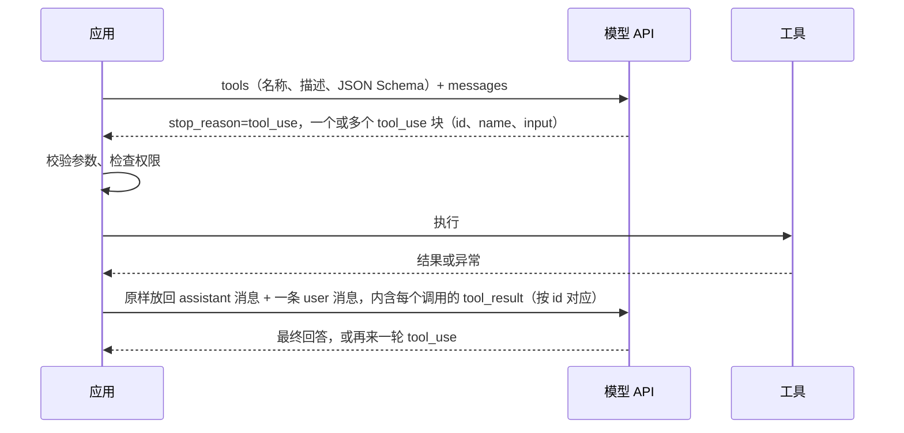

# 工具调用、MCP 与 Skills

> 层级：通用层 · 预计 150 分钟 · 题目：[questions.md](questions.md)
> 前置：[02 Agent 架构](../02-agent-architecture/README.md)、[03 Prompt 与 Context Engineering](../03-prompt-context/README.md)

## 1 这一章解决什么问题

工具是 Agent 接触外部世界的唯一途径：查数据、读文件、调接口、改状态都要靠它。面试里关于工具的问题通常分三层：Function Calling 的一次调用怎么走完，消息里每个字段是什么；工具描述和返回值怎么设计，模型才选得对、用得好；MCP、A2A、Skills 这几个名词各自解决什么问题，边界在哪。

只靠提示词让模型“输出一段 JSON 表示要调用什么”，会遇到三个问题。第一，模型偶尔输出不合法的 JSON 或错的类型，应用要自己猜。第二，一轮里有多个调用时，结果和调用对不上号。第三，每个应用和每个数据源各写一套集成，工具没法复用。Function Calling 用固定的消息结构解决前两个问题，MCP 用开放协议解决第三个。

学完这一章，你应该能：

- 写出 Function Calling 一次往返里每条消息的结构，说清并行调用和错误结果的回传规则；
- 说清 strict 模式靠什么保证参数合法，以及它保证不了什么；
- 写出 Toolformer 的过滤条件，说出 Gorilla、ToolLLM 的数据怎么构造；
- 按清单评审一个工具定义和它的返回值；
- 说清 MCP 的参与方、传输、两类错误，以及 2025-11-25 版和 2026-07-28 版在握手和能力协商上的区别；
- 区分 MCP 和 A2A，说出 A2A 的 Agent Card 和任务状态机；
- 算出 Skills 渐进式加载的 token 账；
- 给出一套排查“模型选错工具”的步骤。

工具的注册、路由、并发执行、超时和重试属于 Harness，见 [harness 方向的工具编排](../../tracks/harness/04-tool-orchestration/README.md)。流式输出里怎么增量解析工具调用，见 [inference/05 第 6 节](../../tracks/inference/05-agent-serving/README.md#6-流式工具调用输出的解析)。

**本章符号**：

| 符号 | 含义 |
|---|---|
| c_i | Toolformer 里插在位置 i 的一次 API 调用（工具名和输入） |
| r_i | 这次调用的工具结果 |
| L_i(z) | 以 z 为前缀时，模型对位置 i 之后 token 的加权交叉熵 |
| τ_f | Toolformer 的过滤阈值 |
| N | 安装的 Skill 个数 |
| m | 一个 Skill 元数据（`name` 加 `description`）的 token 数 |
| B | 一个 Skill 正文（`SKILL.md`）的 token 数 |

## 2 概念边界

| 概念 | 解决什么问题 | 谁定义 | 一句话 |
|---|---|---|---|
| Function Calling | 让模型输出结构化的调用请求 | 各模型 API | 模型说“调什么、传什么”，应用去执行 |
| 工具定义 | 告诉模型有哪些工具、怎么用 | 开发者 | 名称、描述、参数 schema |
| MCP | 工具和数据源怎么以统一协议接入应用 | 开放协议 | 应用和工具服务之间的协议 |
| A2A | 不同的 Agent 之间怎么委派任务、协作 | 开放协议 | Agent 和 Agent 之间的协议 |
| Skills | 怎么把一套做事方法（说明、脚本、资料）按需交给 Agent | Agent 产品 | 带说明书的文件夹，用到时才加载 |

一个常见的组合：Agent 通过 Function Calling 发出调用；调用的工具可能来自 MCP 服务；遇到别的团队维护的 Agent 能做的事，通过 A2A 委派；某类任务的固定流程写成 Skill，触发时才读入。

## 3 Function Calling 的协议

### 3.1 一次往返



OpenAI [Function calling 指南](https://developers.openai.com/api/docs/guides/function-calling) 和 Anthropic [Tool use 文档](https://platform.claude.com/docs/en/agents-and-tools/tool-use/overview) 的流程一致：

1. 应用把工具定义和用户消息一起发给模型；
2. 模型返回一个或多个工具调用（名称和参数），而不是最终答案；
3. 应用执行工具；
4. 应用把结果发回模型，用调用 ID 对应；
5. 模型给出最终回复，或继续发起调用。

模型从不直接执行工具。执行、权限检查、结果校验都在应用这一侧，这是安全控制的着力点。说“模型调用了 API”不准确，准确的说法是“模型生成了调用请求，应用执行了 API”。

### 3.2 工具定义

Anthropic 的一个工具定义有三个必填字段（[Define tools](https://platform.claude.com/docs/en/agents-and-tools/tool-use/define-tools)，2026-11 查阅）：

| 字段 | 要求 |
|---|---|
| `name` | 必须匹配 `^[a-zA-Z0-9_-]{1,128}$` |
| `description` | 纯文本，说明做什么、什么时候用（什么时候不用）、每个参数的含义、有哪些限制。文档建议每个工具至少 3 到 4 句，并说描述是影响工具表现最重要的因素 |
| `input_schema` | 一个 JSON Schema 对象，描述参数 |
| `input_examples`（可选） | 一组符合 schema 的示例输入，用于嵌套对象或格式敏感的参数 |

OpenAI 的字段名是 `parameters`，含义相同。

```json
{
  "name": "get_weather",
  "description": "查询一个城市当前的气温。city 用中文城市名；unit 只能是 celsius 或 fahrenheit，默认 celsius。只返回气温，不返回天气预报。",
  "input_schema": {
    "type": "object",
    "properties": {
      "city": {"type": "string"},
      "unit": {"type": "string", "enum": ["celsius", "fahrenheit"]}
    },
    "required": ["city"],
    "additionalProperties": false
  }
}
```

工具定义不是免费的。名称、描述和 schema 都按输入 token 计费。另外，只要请求里带了工具，API 还会自动加一段工具调用用的系统提示。Anthropic 的价格表列了每个模型这段提示的 token 数，例如 Claude Opus 4.5 在 `tool_choice` 为 `auto` 或 `none` 时是 496 token，为 `any` 或 `tool` 时是 588 token（2026-11 查阅）。

### 3.3 模型输出的结构

两家的结构略有不同，写解析代码时最容易在这里出错：

| | Anthropic Messages | OpenAI Responses |
|---|---|---|
| 怎么知道要调工具 | `stop_reason: "tool_use"` | `output` 里有 `type: "function_call"` 的项 |
| 一个调用的字段 | `type: "tool_use"`、`id`、`name`、`input` | `type: "function_call"`、`call_id`、`name`、`arguments` |
| 参数的类型 | `input` 是 JSON 对象 | `arguments` 是 JSON 编码后的字符串，要自己 `json.loads` |
| 调用前的文字 | 同一条消息里可以先有 `text` 块 | 独立的 message 项 |

Anthropic 的一个响应例子（文档原样，略去无关字段）：

```json
{
  "stop_reason": "tool_use",
  "content": [
    {"type": "text", "text": "I'll check the current weather in San Francisco for you."},
    {"type": "tool_use", "id": "toolu_01A09q90qw90lq917835lq9", "name": "get_weather",
     "input": {"location": "San Francisco, CA", "unit": "celsius"}}
  ]
}
```

**控制调用的参数**：

| 参数 | 作用 |
|---|---|
| `tool_choice` | Anthropic：`auto`（有工具时的默认值）、`any`（必须调一个，不指定哪个）、`tool`（必须调指定的那个）、`none`（不调用）。OpenAI：`auto` / `required` / 指定函数 / `none` |
| 并行开关 | Anthropic 在 `tool_choice` 里设 `disable_parallel_tool_use: true`；OpenAI 设 `parallel_tool_calls: false`，文档说这样一轮只会有零个或一个调用 |
| `strict` | 让参数严格符合 schema，见 3.6 |

Anthropic 文档提醒：用了 prompt 缓存时，改 `tool_choice` 会让缓存的消息块失效。工具定义和系统提示仍然命中，消息部分要重算。

### 3.4 tool_result 的回传规则

Anthropic 的 [Handle tool calls](https://platform.claude.com/docs/en/agents-and-tools/tool-use/handle-tool-calls) 写明了回传步骤：

1. 对每个 `tool_use` 块，执行它指定的工具；
2. 在新请求里保留之前的消息，把模型这次的 `content` 原样作为 `assistant` 消息加回去；
3. 加一条 `user` 消息，里面对每个 `tool_use` 块放一个 `tool_result` 块，工具失败也要放；
4. 用和第一次相同的 `tools` 发请求；
5. 如果下一次的 `stop_reason` 还是 `tool_use`，重复以上步骤。

`tool_result` 有三个字段：`tool_use_id`（对应的调用 ID）、`content`（字符串或内容块列表）、`is_error`（可选，工具失败或调用不合法时设 `true`）。

格式规则有三条，违反了会直接报 400：

- `tool_result` 必须紧跟在对应的 `tool_use` 消息后面，中间不能插别的消息；
- 在放结果的 `user` 消息里，`tool_result` 块必须排在最前面，文字只能放在所有结果之后；
- 每个 `tool_use` 都要有结果。少回一个，报错信息是 “tool_use ids were found without tool_result blocks immediately after”。

OpenAI 的回传是一个 `type: "function_call_output"` 的项，用 `call_id` 对应，`output` 一般是字符串，格式由你定。

**失败怎么回**。工具抛异常或者参数不合法，都作为结果写回，设 `is_error: true`，内容写清错在哪、怎么改。模型看到后可能改参数再调一次，所以文档提醒循环要限制重试次数。参数缺失这种错误，文档的解释是模型没拿到足够的信息，开发阶段先改描述。

### 3.5 多工具并行

模型一轮可以返回多个 `tool_use` 块。Anthropic 的 [Parallel tool use](https://platform.claude.com/docs/en/agents-and-tools/tool-use/parallel-tool-use) 说执行顺序由你定：独立的只读操作通常可以并行；有副作用、共享状态或有顺序依赖的工具更适合串行。不管怎么跑，所有结果放在下一条 `user` 消息里一起回。某个调用你决定不跑（比如串行时前一个失败了），也要给它回一个 `is_error: true` 的结果，写一句原因。

并发闸门、按资源加锁、部分失败这些执行层的设计见 [harness/04 第 5 节](../../tracks/harness/04-tool-orchestration/README.md#5-并发调用)。

### 3.6 实现：最小 Function Calling 循环

下面的代码用一个按脚本回复的假模型，走完一次带并行调用和错误恢复的循环。消息形状照 Anthropic Messages API。验证：

1. 第一轮并行发两个调用，一个参数合法，一个把 `unit` 写成了 `"F"`；校验器拦下后者，写回一条说明合法取值的错误结果；
2. 假模型看到错误后改正重发，第三轮给出最终回答；
3. 少回一个结果、或者在结果前面放文字，格式检查都会报错；
4. 未知工具、执行异常都写成结果，不让循环崩掉。

```python
# 最小 Function Calling 循环（Anthropic Messages 的消息形状）：假模型 + JSON Schema 校验 + 错误回传
import json

TOOLS = [{
    "name": "get_weather",
    "description": "查询一个城市当前的气温。city 用中文城市名；unit 只能是 celsius 或 fahrenheit，默认 celsius。"
                   "只返回气温，不返回天气预报。",
    "input_schema": {
        "type": "object",
        "properties": {"city": {"type": "string"},
                       "unit": {"type": "string", "enum": ["celsius", "fahrenheit"]}},
        "required": ["city"],
        "additionalProperties": False,
    },
}]
CELSIUS = {"北京": 5, "上海": 12}
TYPES = {"object": dict, "string": str, "integer": int, "number": (int, float),
         "boolean": bool, "array": list, "null": type(None)}


def validate(schema, value, path="$"):
    """JSON Schema 的一个小子集：type / enum / required / properties / additionalProperties / minimum。"""
    t = schema.get("type")
    if t is not None:
        ts = t if isinstance(t, list) else [t]
        ok = any(isinstance(value, TYPES[x]) and not (x in ("integer", "number") and isinstance(value, bool))
                 for x in ts)
        if not ok:
            return [f"{path} 应为 {t}，收到 {value!r}"]
    errs = []
    if "enum" in schema and value not in schema["enum"]:
        errs.append(f"{path} 只能取 {schema['enum']} 之一，收到 {value!r}")
    if "minimum" in schema and value < schema["minimum"]:
        errs.append(f"{path} 不能小于 {schema['minimum']}，收到 {value!r}")
    if isinstance(value, dict):
        props = schema.get("properties", {})
        errs += [f"{path} 缺少必填参数 {k}" for k in schema.get("required", []) if k not in value]
        for k, v in value.items():
            if k in props:
                errs += validate(props[k], v, f"{path}.{k}")
            elif schema.get("additionalProperties", True) is False:
                errs.append(f"{path} 不认识参数 {k}，可用参数是 {sorted(props)}")
    return errs


def get_weather(city, unit="celsius"):
    if city not in CELSIUS:
        raise KeyError(f"没有 {city} 的数据，目前支持：{'、'.join(CELSIUS)}")
    c = CELSIUS[city]
    return {"city": city, "temp": c if unit == "celsius" else round(c * 9 / 5 + 32, 1), "unit": unit}


IMPL = {"get_weather": get_weather}


def execute(block):
    """应用侧执行一个 tool_use 块。无论成败都返回一个 tool_result，失败时 is_error=True。"""
    def err(text):
        return {"type": "tool_result", "tool_use_id": block["id"], "content": text, "is_error": True}
    tool = next((t for t in TOOLS if t["name"] == block["name"]), None)
    if tool is None:
        return err(f"没有工具 {block['name']}，可用工具：{[t['name'] for t in TOOLS]}")
    problems = validate(tool["input_schema"], block["input"])
    if problems:                                   # 参数错：可操作的错误信息，让模型自己改
        return err("参数校验失败：" + "；".join(problems))
    try:
        out = IMPL[block["name"]](**block["input"])
    except Exception as e:                         # 执行错：同样写回，不抛给循环
        return err(f"执行失败：{e}")
    return {"type": "tool_result", "tool_use_id": block["id"], "content": json.dumps(out, ensure_ascii=False)}


def fake_model(messages, tools):
    """按脚本回复的假模型。第一轮并行发两个调用，其中一个把 unit 写成了 'F'；看到错误后改正重发。"""
    last = messages[-1]["content"]
    if isinstance(last, str):
        return {"stop_reason": "tool_use", "content": [
            {"type": "text", "text": "我分别查两个城市。"},
            {"type": "tool_use", "id": "toolu_1", "name": "get_weather", "input": {"city": "北京", "unit": "fahrenheit"}},
            {"type": "tool_use", "id": "toolu_2", "name": "get_weather", "input": {"city": "上海", "unit": "F"}},
        ]}
    failed = [r for r in last if r.get("is_error")]
    if failed and "unit" in failed[0]["content"]:
        return {"stop_reason": "tool_use", "content": [
            {"type": "tool_use", "id": "toolu_3", "name": "get_weather", "input": {"city": "上海", "unit": "fahrenheit"}}]}
    temps = {}
    for m in messages:
        if m["role"] == "user" and isinstance(m["content"], list):
            for r in m["content"]:
                if not r.get("is_error"):
                    d = json.loads(r["content"]); temps[d["city"]] = d["temp"]
    return {"stop_reason": "end_turn", "content": [
        {"type": "text", "text": "，".join(f"{c} {t}°F" for c, t in temps.items())}]}


def check_protocol(messages):
    """API 侧的格式检查：每个 tool_use 在紧接着的 user 消息里有且只有一个 tool_result，且结果块排在最前。"""
    for a, u in zip(messages, messages[1:]):
        if a["role"] != "assistant":
            continue
        ids = [b["id"] for b in a["content"] if b["type"] == "tool_use"]
        if not ids:
            continue
        types = [b["type"] for b in u["content"]]
        k = next((i for i, t in enumerate(types) if t != "tool_result"), len(types))
        if "tool_result" in types[k:]:                       # 结果块前面出现了别的内容
            raise ValueError("tool_result 必须排在 user 消息最前面")
        if sorted(b["tool_use_id"] for b in u["content"][:k]) != sorted(ids):
            raise ValueError("tool_use ids were found without tool_result blocks immediately after")


def run_loop(model, user_text, max_turns=5):
    messages = [{"role": "user", "content": user_text}]
    for _ in range(max_turns):
        resp = model(messages, TOOLS)
        messages.append({"role": "assistant", "content": resp["content"]})   # 原样放回，不改
        if resp["stop_reason"] != "tool_use":
            return messages
        results = [execute(b) for b in resp["content"] if b["type"] == "tool_use"]
        messages.append({"role": "user", "content": results})              # 一轮的结果放进同一条消息
        check_protocol(messages)
    raise RuntimeError("超过最大轮数")                                      # 模型可能反复重试，要有上限


msgs = run_loop(fake_model, "北京和上海现在多少华氏度？")
# 1) 三次模型调用：并行两个 → 改正一个 → 最终回答
assert [m["role"] for m in msgs] == ["user", "assistant", "user", "assistant", "user", "assistant"]
assert msgs[-1]["content"][0]["text"] == "北京 41.0°F，上海 53.6°F"
# 2) 并行的两个调用一成一败，各有一个结果；失败的那个带着可操作的提示
r1, r2 = msgs[2]["content"]
assert "is_error" not in r1 and r2["is_error"] is True
assert "['celsius', 'fahrenheit']" in r2["content"] and "'F'" in r2["content"]
# 3) 校验器能抓到的几类错：类型、缺参、多余参数；布尔值不算整数
s = {"type": "object", "properties": {"n": {"type": "integer", "minimum": 1}}, "required": ["n"],
     "additionalProperties": False}
assert validate(s, {"n": "2"}) and validate(s, {}) and validate(s, {"n": 1, "x": 0})
assert validate(s, {"n": True}) and validate(s, {"n": 0}) and not validate(s, {"n": 2})
# 4) 执行异常和未知工具也写回结果，不中断循环
assert execute({"id": "t", "name": "get_weather", "input": {"city": "火星"}})["is_error"]
assert execute({"id": "t", "name": "search", "input": {}})["is_error"]
# 5) 少回一个结果，或在结果前面放文字，都违反格式
bad = msgs[:2] + [{"role": "user", "content": [r1]}]
try:
    check_protocol(bad); raise AssertionError
except ValueError as e:
    assert "without tool_result" in str(e)
bad = msgs[:2] + [{"role": "user", "content": [{"type": "text", "text": "结果如下"}, r1, r2]}]
try:
    check_protocol(bad); raise AssertionError
except ValueError as e:
    assert "最前面" in str(e)
print("ok")
```

几个实现上的要点：

- `validate` 只实现了 JSON Schema 的一个小子集。注意 Python 里 `True` 是 `int` 的子类，不单独排除的话布尔值会通过整数检查。
- 错误信息里带上合法取值和收到的值。模型改参数靠的就是这几个字。
- 循环要有 `max_turns`。模型可能在同一个错误上反复重试，这个上限在 Harness 里叫预算，见 [harness/01](../../tracks/harness/01-loop-and-harness/README.md)。

### 3.7 strict 模式与约束解码

不开 strict 时，模型的参数是“尽力而为”。Anthropic 文档举的例子：需要 `passengers: int` 的地方，模型可能给 `"two"` 或 `"2"`。

开了 strict，两家都用约束解码实现：

- Anthropic 的 [Strict tool use](https://platform.claude.com/docs/en/agents-and-tools/tool-use/strict-tool-use) 说 `strict: true` 通过把 token 采样限制在合法输出上来保证参数符合 schema（文档的说法是 grammar-constrained sampling）。保证两件事：`input` 严格符合 `input_schema`，`name` 一定是合法的工具名。
- OpenAI 的指南说 strict 底层用的是 Structured Outputs，所以对 schema 有两条要求：每个 object 都要 `additionalProperties: false`；`properties` 里所有字段都要列进 `required`。可选字段写成 `"type": ["string", "null"]`。schema 不满足要求又开了 strict，请求会被拒绝。

约束解码怎么在每一步算出合法 token 的掩码、为什么 JSON 需要下推自动机，见 [inference/05 第 7 节](../../tracks/inference/05-agent-serving/README.md#7-结构化输出与约束解码)。这里只讲它对工具定义的影响。

**strict 保证不了什么**。约束解码只管“形状”：类型、必填、枚举、不能有多余字段。它不知道城市有没有数据、日期是不是将来、用户有没有权限。另外，两家都只支持 JSON Schema 的一个子集。Anthropic 的结构化输出文档说 SDK 会把 `minimum`、`maximum`、`minLength`、`maxLength` 这类不支持的约束从发出去的 schema 里删掉，改写进字段描述，再由 SDK 在本地校验返回值。也就是说，这些约束在解码时不是硬约束。应用侧的校验仍然要做。

**schema 第一次用时有额外开销**。OpenAI 文档说，微调模型的 schema 在第一次请求时要额外处理，之后缓存；schema 每次都变会增加延迟。Anthropic 文档说 schema 会缓存，从最后一次使用算起最多 24 小时。

下面的代码检查一个 schema 是否满足 OpenAI strict 的两条要求，并把一个普通 schema 改写成兼容的形状：

```python
# strict 模式对 schema 的要求（OpenAI Function calling 指南的 Strict mode 一节）：
#   1) 每个 object 都要 additionalProperties: false；2) properties 里的字段全部列进 required；
#   可选字段写成 type: ["T", "null"]。下面写一个检查器，并把一个普通 schema 改写成 strict 兼容的形状。
import copy


def strict_problems(schema, path="$"):
    out = []
    if schema.get("type") == "object" or "properties" in schema:
        props = schema.get("properties", {})
        if schema.get("additionalProperties") is not False:
            out.append(f"{path}: additionalProperties 必须是 false")
        missing = sorted(set(props) - set(schema.get("required", [])))
        if missing:
            out.append(f"{path}: 这些字段没进 required：{missing}")
        for k, v in props.items():
            out += strict_problems(v, f"{path}.{k}")
    if "items" in schema:
        out += strict_problems(schema["items"], f"{path}[]")
    return out


def to_strict(schema):
    """把可选字段改成“必填但可为 null”，并封住所有 object。语义变了：调用方要把 null 当成“没传”。"""
    s = copy.deepcopy(schema)
    if s.get("type") == "object" or "properties" in s:
        props = s.get("properties", {})
        req = set(s.get("required", []))
        for k, v in props.items():
            props[k] = to_strict(v)
            if k not in req:
                t = props[k].get("type")
                props[k]["type"] = (t if isinstance(t, list) else [t]) + ["null"]
                if "enum" in props[k]:
                    props[k]["enum"] = props[k]["enum"] + [None]
        s["required"] = list(props)
        s["additionalProperties"] = False
    if "items" in s:
        s["items"] = to_strict(s["items"])
    return s


loose = {"type": "object",
         "properties": {"city": {"type": "string"},
                        "unit": {"type": "string", "enum": ["celsius", "fahrenheit"]},
                        "days": {"type": "array", "items": {"type": "object",
                                                            "properties": {"date": {"type": "string"}}}}},
         "required": ["city"]}
probs = strict_problems(loose)
assert len(probs) == 4                      # 顶层和数组里的 object 各有两处：没封口、有可选字段
s = to_strict(loose)
assert strict_problems(s) == []
assert s["required"] == ["city", "unit", "days"] and s["properties"]["unit"]["type"] == ["string", "null"]
assert None in s["properties"]["unit"]["enum"]

# strict 只管“形状”：类型、必填、枚举。它不知道“上海”有没有数据、日期是不是将来的日子。
# 语义校验和权限检查仍然要在应用侧做，见第 3.6 节的循环。
legal_but_wrong = {"city": "火星", "unit": None, "days": []}
assert set(legal_but_wrong) == set(s["required"])
print("ok")
```

改写有代价：可选字段变成“必填但可以是 null”，执行函数要把 `null` 当作“没传”，不能当作一个真实的值。

## 4 模型是怎么学会调用工具的

协议只规定了格式。模型要先学会两件事，才能在格式里填对内容：什么时候该调工具，调的时候参数怎么填。早期的三篇论文各用了一种方式获得训练数据。

### 4.1 Toolformer：用损失下降做自监督过滤

出处：[Schick 等，Toolformer: Language Models Can Teach Themselves to Use Tools，arXiv 2302.04761](https://arxiv.org/abs/2302.04761)，2023-02，第 2 节和附录 A。基座是 6.7B 参数的 GPT-J，工具有五个：问答系统、Wikipedia 搜索、计算器、日历、机器翻译。

**调用怎么写进文本**。一次调用 c = (工具名 a_c, 输入 i_c) 和它的结果 r 被线性化成：

```text
e(c)    = <API> a_c(i_c) </API>
e(c, r) = <API> a_c(i_c) → r </API>
```

**第一步：采样候选位置和调用**。每个 API 写一个带少量演示的提示 P(x)，让模型在文本 x 里插入调用。对每个位置 i，算模型在这里开始一次调用的概率 p_i = p_M(<API> | P(x), x_{1:i−1})。只保留 p_i > τ_s 的位置，最多 k 个。在每个位置采样最多 m 个调用。论文默认 τ_s = 0.05、k = 5、m = 5。

**第二步：执行调用，按损失过滤**。定义以 z 为前缀时，模型对位置 i 之后各 token 的加权交叉熵：

```text
L_i(z) = − Σ_{j=i..n} w_{j−i} · log p_M(x_j | z, x_{1:j−1})
```

比较两种前缀：

```text
L_i^+ = L_i( e(c_i, r_i) )                         给调用，也给结果
L_i^- = min( L_i(ε), L_i( e(c_i, ε) ) )            不调用；或者只给调用、不给结果
保留条件：L_i^- − L_i^+ ≥ τ_f
```

ε 是空序列。逐项看这个条件为什么这样设计：

- L_i^+ 小，说明有了调用和结果之后，后面的文本更好预测，这个调用有用。
- L_i^- 取两者的最小值。如果“只给调用、不给结果”就已经让后文好预测，说明起作用的是问题本身（比如问题里已经泄露了答案），工具结果没有贡献。取 min 让这种调用过不了阈值。
- 阈值 τ_f 是“至少要好多少”。论文默认 τ_f = 1.0；计算器和翻译工具的候选太少，τ_s 设成 0，k = 20、m = 10，τ_f 降到 0.5。

**权重 w**。论文用 w̃_t = max(0, 1 − 0.2·t) 再归一化，t 是到调用位置的距离。推导：t ≥ 5 时 w̃_t = 0，只有调用后的 5 个 token 有权重，归一化常数是 1 + 0.8 + 0.6 + 0.4 + 0.2 = 3。论文给的理由是让调用发生在结果真正有用的位置附近。

**一个细节**。算损失时，e(c_i, r_i) 是作为整段文本的前缀给的，不是插在位置 i 中间。脚注的解释是：模型还没见过带调用的文本，插在中间会打断文本、和预训练语料不一致，反而让困惑度变差。

**第三步：微调**。把保留下来的调用插回原文，x* = x_{1:i−1}, e(c_i, r_i), x_{i:n}，用普通的语言模型目标微调。论文强调，除了插入的调用，增强后的数据集和原数据集文本完全相同，所以模型学到的只有“何时、怎样调用”。推理时正常解码，生成到 “→” 就暂停，去调 API，把结果和 `</API>` 接上再继续。

下面用一组虚构的 log 概率走一遍过滤条件：

```python
# Toolformer 的过滤条件：L_i^- − L_i^+ ≥ τ_f（Schick 等，2302.04761，第 2 节与第 4.1 节）
import numpy as np

# 权重：w̃_t = max(0, 1 − 0.2·t)，再归一化。t 是离调用位置的距离（j − i）
t = np.arange(10)
w_tilde = np.maximum(0.0, 1 - 0.2 * t)
w = w_tilde / w_tilde.sum()


def L(logp_after_i):
    """L_i(z) = −Σ_j w_{j−i} · log p(x_j | z, x_{1:j−1})，输入是位置 i 起每个 token 的 log 概率。"""
    lp = np.asarray(logp_after_i, dtype=float)
    k = min(len(lp), len(w))
    return float(-(w[:k] * lp[:k]).sum())


# 1) 推导：只有调用后 5 个 token 有权重，归一化常数是 1 + 0.8 + 0.6 + 0.4 + 0.2 = 3
assert np.isclose(w_tilde.sum(), 3.0) and np.count_nonzero(w) == 5
assert np.allclose(w[:5], [1 / 3, 0.8 / 3, 0.2, 0.4 / 3, 0.2 / 3])

# 一段文本“……北京今天的气温是 [调用] 5 摄氏度，适合……”，位置 i 之后的 6 个 token 在三种前缀下的 log 概率（虚构）
no_call     = [-4.0, -1.5, -0.5, -0.4, -0.3, -0.2]   # L_i(ε)：不调用
call_only   = [-3.8, -1.4, -0.5, -0.4, -0.3, -0.2]   # L_i(e(c, ε))：给了调用、没给结果
call_result = [-0.3, -0.6, -0.4, -0.4, -0.3, -0.2]   # L_i(e(c, r))：调用加结果 “→ 5”
L_plus = L(call_result)
L_minus = min(L(no_call), L(call_only))
tau_f = 1.0                                           # 论文默认值；计算器和翻译工具用 0.5
gain = L_minus - L_plus
# 手算：L^- = min(5.72, 5.44)/3，L^+ = 1.24/3，差 = 4.2/3 = 1.4
assert round(gain, 3) == 1.4 and gain >= tau_f       # 结果确实帮助预测“5”，保留

# 2) L^- 取两者的最小值：如果只给调用、不给结果就已经够好，说明有用的是“问题本身”，不是工具结果
leaky_call_only = [-0.6, -0.7, -0.4, -0.4, -0.3, -0.2]
assert min(L(no_call), L(leaky_call_only)) - L_plus < tau_f   # 被过滤掉

# 3) 第 6 个 token 及以后不进 L_i：结果在很远之后才有用的调用拿不到分，逼着调用靠近用得上的地方
far = [-4.0, -1.5, -0.5, -0.4, -0.3, -0.01]
assert np.isclose(L(far), L(no_call))

# 4) 微调时：插入后的序列 x* = x_{1:i−1}, e(c, r), x_{i:n}。工具结果 r 不是模型生成的，
#    现代 SFT/RL 里的做法是给它 loss mask = 0（见 training/04）。这里数一下 mask 掉的 token
segments = [("text", "北京今天的气温是"), ("call", "<API>Weather(北京)"), ("result", "→ 5"),
            ("call", "</API>"), ("text", "5 摄氏度")]
mask = [0 if kind == "result" else 1 for kind, s in segments for _ in s]
n_result = sum(len(s) for kind, s in segments if kind == "result")
assert mask.count(0) == n_result == 3
print("ok")
```

### 4.2 Gorilla：检索增强微调

出处：[Patil 等，Gorilla: Large Language Model Connected with Massive APIs，arXiv 2305.15334](https://arxiv.org/abs/2305.15334)，2023-05。

**数据**。论文构造了 APIBench：Torch Hub 的 94 个 API（全部）、TensorFlow Hub v2 的 626 个（801 个模型里过滤掉模型卡信息太少的）、HuggingFace 的 925 个（每个领域下载量前 20 的模型），共 1,645 个。每个 API 用 Self-Instruct 的办法让 GPT-4 生成 10 条用户指令，得到 16,450 个“指令-API”对。人工写的只有 18 条示例（三个模型库各 6 条）。

**训练**。基于 LLaMA-7B 微调。检索增强训练时，在指令后面附上 “Use this API documentation for reference: <检索到的 API 文档>”，让模型学会照着文档写调用。这样测试时文档改了，模型能跟着新文档走，而不是只记得训练时的版本。

**评测**。用 AST 子树匹配判断生成的调用在功能上是否正确，同时统计调用了不存在的 API 的比例（论文叫 API 幻觉）。

### 4.3 ToolLLM：大规模真实 API 和搜索式标注

出处：[Qin 等，ToolLLM: Facilitating Large Language Models to Master 16000+ Real-world APIs，arXiv 2307.16789](https://arxiv.org/abs/2307.16789)，2023-07。

**API 收集**。从 RapidAPI 抓了 10,853 个工具（53,190 个 API），测试后去掉返回 404、响应太慢、返回质量差的，留下 3,451 个工具（16,464 个 REST API），分属 49 个类别。

**指令生成**。让 ChatGPT 基于采样到的 API 生成指令，分三类：单工具、同类别多工具、同集合多工具。生成的指令里引用了不存在的 API 的，过滤掉。

**解路径标注**。论文说复杂指令连 GPT-4 的通过率都低，用 ReAct 标注效率很差。他们提出 DFSDT（深度优先搜索决策树）：在每一步可以回退、换一条路径继续，而不是一条路走到黑。最后得到 126,486 个“指令-解路径”对，用来微调 LLaMA 得到 ToolLLaMA。评测器 ToolEval 用 ChatGPT 算通过率和两条路径之间的胜率。

### 4.4 今天的做法与工具结果的 loss mask

商用模型一般在 SFT 和 RL 阶段混入大量工具调用轨迹，按对话模板输出结构化调用。三篇论文留下的思路还在用：

| 思路 | 来自 | 今天的形态 |
|---|---|---|
| 用效果过滤数据，而不是人工标注调用位置 | Toolformer | 执行合成的轨迹，只保留调用成功、结果支持答案的 |
| 把文档放进上下文，学“照文档调用” | Gorilla | 工具定义本来就在上下文里；训练时随机换工具、改描述，防止模型背工具名 |
| 真实 API、多工具组合、搜索式标注 | ToolLLM | 在沙箱里跑真实环境，用结果奖励做 RL |

**工具结果不计 loss**。一条轨迹里，工具结果是环境写进来的，不是模型生成的。训练时对这些 token 的 loss mask 设为 0。不 mask 的话，模型会被训练去“预测工具会返回什么”，等于学着编造工具结果。mask 要在 token 上做、按段拼接，否则分词边界会让一个 token 横跨策略段和工具段。推导和代码见 [training/04 第 3 节](../../tracks/training/04-agentic-rl/README.md#3-工具返回的-loss-mask)。

为什么 SFT 之后还要 RL：SFT 学的是模仿格式和常见路径；多步任务里什么时候停、调用失败后怎么换路，要靠结果奖励来优化。见 [training/04](../../tracks/training/04-agentic-rl/README.md)。

## 5 工具描述和返回值怎么写

### 5.1 为什么描述决定了选择

模型选工具时，能依据的只有名称、描述和参数 schema。它看不到工具的实现，也看不到你脑子里“这个工具其实只该在某种情况下用”的约定。所以工具描述本质上是提示词的一部分，要按写提示词的标准来写。

Anthropic 的 [Writing effective tools for agents](https://www.anthropic.com/engineering/writing-tools-for-agents)（2025-09-11）列出了 Agent 用工具时的四类错误：调错工具、参数填错、调用太少、处理结果出错。下面每条建议都对着其中一类。

### 5.2 定义的写法

| 问题 | 做法 | 出处与例子 |
|---|---|---|
| 把每个 API 端点都包成工具 | 按高频任务设计少量工具，一个工具里可以做多次底层调用 | 文章例子：用 `search_contacts` 代替 `list_contacts`；用 `schedule_event` 代替 `list_users`、`list_events`、`create_event` 三个；用 `search_logs` 代替 `read_logs` |
| 总是连着调用的几个工具 | 合并 | 用 `get_customer_context` 一次拿到客户的近期信息，代替按 ID 查客户、列交易、列备注三个工具 |
| 多个服务的工具名相近 | 加命名空间，按服务分（`asana_search`、`jira_search`），也可以按资源分（`asana_projects_search`） | 文章说前缀还是后缀对评测结果有不小的影响，而且因模型而异，要自己测 |
| 描述太简略 | 像给新同事写说明：把隐含的查询格式、术语定义、资源之间的关系写出来 | Anthropic 文档：每个工具至少 3 到 4 句；写清什么时候不该用 |
| 参数含义模糊 | 名字精确，能用枚举就用枚举，用 schema 把输入输出约束住 | 用 `user_id` 而不是 `user`。OpenAI 指南：`toggle_light(on: bool, off: bool)` 允许非法状态，应该改成一个枚举 |
| 让模型填程序已知的值 | 当前用户、租户这类值由代码注入，不进 schema | 少一个让模型出错的机会 |

一个检验方法是 OpenAI 指南里的“实习生测试”：只给一个人模型能看到的信息，他能不能正确使用这个工具？如果他会问你问题，就把答案写进描述。Anthropic 的说法类似：人类工程师都说不清某个场景该用哪个工具，模型也做不到。

### 5.3 返回值的写法

返回值写回上下文以后，和描述一样占 token、影响后续决策。只改描述、不管返回值，是常见的漏项。

| 原则 | 做法 | 出处 |
|---|---|---|
| 只返回高信号信息 | 去掉 `uuid`、`256px_image_url`、`mime_type` 这类底层字段，保留 `name`、`image_url`、`file_type` | 文章说把随机的字母数字 UUID 换成有意义的名字（哪怕是从 0 开始的编号），能减少幻觉、提高检索精度 |
| 让模型选详细程度 | 加一个 `response_format` 枚举参数，取 `concise` 或 `detailed`。简洁模式只给内容，详细模式带上后续调用要用的 ID | 文章的 Slack 例子：详细返回 206 token，简洁返回 72 token，约三分之一 |
| 控制长度 | 分页、范围选择、过滤、截断，配合合理的默认值 | 文章说 Claude Code 默认把工具返回限制在 25,000 token |
| 截断时给提示 | 告诉模型结果被截断了，建议用更精确的条件、多做几次小查询 | 同上 |
| 错误信息可操作 | 说明错在哪、正确格式是什么，不返回不透明的错误码或堆栈 | 同上；第 3.6 节的代码就是这样写的 |
| 格式要测 | XML、JSON、Markdown 哪个好没有定论，和任务、模型有关 | 文章的说法是按自己的评测选 |

### 5.4 工具太多怎么办

工具一多有两个问题：定义占上下文，名字相近的工具更容易选错。OpenAI 指南的软性建议是一轮开始时可用的函数少于 20 个，并强调要用不同数量实测。常用的办法：

| 办法 | 做法 | 代价 |
|---|---|---|
| 精简合并 | 删低频工具，合并总是连用的 | 要有调用日志做依据 |
| 按场景路由 | 先分类请求，只给相关的子集 | 分类错了就缺工具 |
| 按需检索工具 | 给模型一个搜索工具的工具，找到后再展开定义。OpenAI 的 `tool_search`、Anthropic 的 `defer_loading` 都是这个思路 | 多一次调用；动态加载可能破坏前缀缓存 |
| 限定可调用集合 | 工具列表不变，只用参数限制本轮能调哪些 | 依赖接口支持 |
| 写代码调用 | 见第 6.7 节 | 需要沙箱 |

每种办法的数据和实现见 [harness/04 第 4 节](../../tracks/harness/04-tool-orchestration/README.md#4-工具多了怎么选)。

### 5.5 工具也要评测

工具描述的修改要用评测来验证。文章建议用真实任务跑简单的 Agent 循环，除了正确率，还要收集：单个调用和整个任务的耗时、调用次数、token 消耗、工具报错。指标怎么读：

- 冗余调用多，可能是分页或返回长度的参数要调；
- 参数非法的报错多，可能是描述不清或缺例子；
- 要留一份不参与修改的测试集，防止描述对着评测集过拟合。

## 6 MCP

### 6.1 解决什么问题

M 个应用要接 N 个数据源和工具，各写各的集成，就是 M × N 份代码。每个应用还要各自维护工具描述、认证和错误处理。

[Model Context Protocol](https://modelcontextprotocol.io/docs/learn/architecture) 由 Anthropic 在 2024-11 [开源发布](https://www.anthropic.com/news/model-context-protocol)。它规定应用和工具服务之间怎么说话，集成就变成 M 个客户端加 N 个服务端。

### 6.2 参与方和两层结构

| 角色 | 是什么 | 例子 |
|---|---|---|
| Host | 协调一个或多个客户端的 AI 应用 | IDE、桌面助手、编程 Agent |
| Client | Host 内部的组件，每个 Client 维护和一个 Server 的连接 | Host 每连一个 Server 就建一个 Client |
| Server | 向 Client 提供上下文和能力的程序，可在本地或远程运行 | 文件系统服务、数据库服务 |

协议分两层：

- **数据层**：基于 JSON-RPC 2.0。请求带 `id`，响应用同一个 `id` 回，结果放 `result`、失败放 `error`；不带 `id` 的是通知，对方不能回复。MCP 在这之上定义能力发现、原语和通知。
- **传输层**：stdio 和 Streamable HTTP。stdio 用于本地，Host 把 Server 作为子进程启动，消息按行分隔、消息里不能有换行；Server 的 stdout 只能写合法的 MCP 消息，日志写 stderr。Streamable HTTP 用于远程，每条消息是一次 HTTP POST，回复是一个 JSON 对象或一条和这个请求绑定的 SSE 流。远程服务用 OAuth 授权。

### 6.3 原语

服务端的三类原语：

| 原语 | 是什么 | 谁决定用 | 方法 |
|---|---|---|---|
| Tools | 可执行的函数 | 模型 | `tools/list`、`tools/call` |
| Resources | 提供上下文的数据，例如文件内容、表结构 | 应用 | `resources/list`、`resources/read` |
| Prompts | 可复用的交互模板 | 用户 | `prompts/list`、`prompts/get` |

客户端原语：2025-11-25 版有 Roots（告诉服务端能访问哪些目录）、Sampling（服务端请求客户端代为调用模型）、Elicitation（服务端请求用户补充信息或确认）。2026-07-28 版把 Roots、Sampling（以及 Logging 功能）标为弃用，见 6.5。

### 6.4 两类错误

[Tools 规范](https://modelcontextprotocol.io/specification/2025-11-25/server/tools) 把错误分成两类，新旧两版的说法一致：

| | 协议错误 | 工具执行错误 |
|---|---|---|
| 例子 | 未知工具、请求不符合 `CallToolRequest` 的格式、服务端内部错误 | 下游 API 失败、参数校验失败（日期格式错、值越界）、业务规则不允许 |
| 放在哪 | JSON-RPC 的 `error`，例如 `{"code": -32602, "message": "Unknown tool: invalid_tool_name"}` | 正常的 `result`，`isError: true`，`content` 里写原因 |
| 给不给模型看 | 客户端可以（MAY）给模型，但规范说模型不太可能据此修好 | 客户端应当（SHOULD）给模型，让它改参数重试 |

区分的意义在 Host 这一侧。执行错误原样翻译成 Function Calling 的 `is_error` 结果交给模型。协议错误更可能是配置问题（工具名对不上、版本不兼容），应该进日志和告警。直接丢给模型，它只会反复重试。

### 6.5 两版协议：有状态握手和无状态请求

MCP 的版本号是日期。面试中常被问到的变化发生在 [2026-07-28 版](https://modelcontextprotocol.io/specification/2026-07-28/changelog)，上一版是 2025-11-25。

**2025-11-25 版：先握手，再干活**（[Lifecycle](https://modelcontextprotocol.io/specification/2025-11-25/basic/lifecycle)）：

1. Client 发 `initialize` 请求，带自己支持的协议版本（应当是最新的）、能力和 `clientInfo`；
2. Server 回复：支持这个版本就回同一个版本，否则回自己支持的另一个版本；同时带上自己的能力和 `serverInfo`；
3. Client 发 `notifications/initialized` 通知。服务端回复 `initialize` 之前，客户端除了 ping 不应发别的请求；收到这个通知之前，服务端除了 ping 和日志不应发别的请求；
4. 之后双方只能使用协商成功的能力。用 HTTP 时，后续每个请求都要带 `MCP-Protocol-Version` 头。

能力是一组开关。客户端能力有 `roots`、`sampling`、`elicitation` 等；服务端能力有 `tools`、`resources`、`prompts`、`logging`、`completions` 等。子能力 `listChanged` 表示列表变化时会发通知，`subscribe` 表示可以订阅单个资源。

**2026-07-28 版：每个请求自带上下文**。changelog 的主要变化：

| 变化 | 内容 |
|---|---|
| 去掉握手 | 删除 `initialize` 和 `notifications/initialized`。每个请求在 `_meta` 里带 `io.modelcontextprotocol/protocolVersion` 和 `io.modelcontextprotocol/clientCapabilities`（两者必填），客户端应当再带 `clientInfo`；服务端应当在每个结果的 `_meta` 里带 `serverInfo` |
| 去掉会话 | Streamable HTTP 删除 `Mcp-Session-Id`。`tools/list` 等列表不再随连接变化。需要跨调用保存状态的服务端，自己生成一个句柄，作为普通的工具参数传 |
| 新增 `server/discover` | 服务端必须（MUST）实现，返回支持的版本列表、能力和身份。客户端可以先调它选版本，也可以直接发请求，版本不对时处理错误 |
| 版本不匹配 | 服务端返回 `UnsupportedProtocolVersionError`（-32022），`data.supported` 列出它支持的版本，客户端选一个重试 |
| 缺能力 | 处理请求需要客户端没声明的能力时，返回 `MissingRequiredClientCapabilityError`（-32021）。缺少必填 `_meta` 字段的请求按格式错误处理，返回 -32602 |
| 订阅式通知 | 用 `subscriptions/listen` 替代 HTTP GET 端点和 `resources/subscribe`：一条长连接的 POST 响应流，客户端按类型订阅（`toolsListChanged`、`promptsListChanged`、`resourcesListChanged`、`resourceSubscriptions`）。进度这类和某个请求相关的通知仍走那个请求自己的响应流 |
| 去掉的方法 | `ping`、`logging/setLevel`、`notifications/roots/list_changed`。日志级别改成每个请求在 `_meta` 里设 |
| 多轮请求 | 服务端需要额外信息时，不再反过来向客户端发请求（`roots/list`、`sampling/createMessage`、`elicitation/create`），而是返回 `resultType: "input_required"` 的结果，客户端补上 `inputResponses` 重发原请求 |
| `resultType` | 所有结果都带这个字段，普通结果是 `"complete"`。旧版服务端的结果没有这个字段，客户端按 `"complete"` 处理 |
| 缓存提示 | `server/discover`、`tools/list` 等结果必须带 `ttlMs` 和 `cacheScope`；服务端应当按确定的顺序返回工具，方便客户端缓存，也能提高 prompt 缓存命中率 |
| 弃用 | Roots、Sampling、Logging 三个功能标为弃用（仍可用，新实现不应再支持）。迁移建议：目录或文件用工具参数、资源 URI 或服务端配置传，代替 Roots；直接调模型 API，代替 Sampling；日志写 stderr 或用 OpenTelemetry，代替 Logging |
| 错误码 | 资源不存在的错误码从 -32002 改为 -32602 |

**为什么要改成无状态**。推导：有了握手，服务端要记住“这条连接协商的是哪个版本、客户端有哪些能力”。远程部署时，同一个客户端的请求可能落到不同实例上，状态要么共享，要么靠会话粘滞。每个请求自带版本和能力后，任何一个实例都能独立处理任何一个请求，横向扩展和负载均衡就简单了。代价是每个请求多带几十个字节的 `_meta`，以及原来靠会话保存的状态要由服务端显式地做成句柄。

**新旧怎么共存**。新版 [Lifecycle](https://modelcontextprotocol.io/specification/2026-07-28/basic/lifecycle) 给了一张兼容表。同时支持两版的客户端，在 stdio 上应当先发 `server/discover` 探测：拿到 `DiscoverResult` 就走新版；收到非新版的错误或超时，就退回 `initialize`。只支持旧版的客户端连新版服务端会失败，因为 `initialize` 在新版里是未知方法。

### 6.6 实现：JSON-RPC Server/Client 模拟

下面在内存里模拟一个同时支持两版的 MCP 服务端，和两种客户端。消息是一行一个 JSON 字符串，和 stdio 一样。验证：

1. 两版都能完成 `tools/list` 和 `tools/call`；旧版必须先握手，新版不握手直接调；
2. 未知工具返回 JSON-RPC `error`（协议错误），参数越界返回 `isError: true` 的 `result`（执行错误）；
3. 新版请求换一个服务端实例照样能处理，因为状态都在请求里；
4. 版本不支持时返回 -32022 并列出支持的版本；坏 JSON 返回 -32700，未知方法返回 -32601，通知没有回复。

```python
# MCP 风格的 JSON-RPC Server/Client 最小模拟（内存里传字符串，模拟 stdio 的“一行一条消息”）
# 同时支持两版：2025-11-25（initialize 握手，有会话状态）和 2026-07-28（无状态，每个请求在 _meta 里带版本和能力）
import json

V_OLD, V_NEW = "2025-11-25", "2026-07-28"
PARSE_ERROR, INVALID_REQUEST, METHOD_NOT_FOUND, INVALID_PARAMS = -32700, -32600, -32601, -32602
UNSUPPORTED_VERSION = -32022            # 2026-07-28 的 UnsupportedProtocolVersion
PV, CC = "io.modelcontextprotocol/protocolVersion", "io.modelcontextprotocol/clientCapabilities"


class Server:
    def __init__(self, versions=(V_NEW, V_OLD)):
        self.versions = list(versions)
        self.initialized = False         # 只有旧版用到的连接状态
        self.tools = [{
            "name": "kb_search",
            "description": "在知识库里按关键词搜文章，返回标题列表。limit 默认 3，最大 10。",
            "inputSchema": {"type": "object", "properties": {"query": {"type": "string"},
                                                              "limit": {"type": "integer"}},
                            "required": ["query"]},
        }]
        self.docs = ["KV Cache 入门", "KV 量化", "前缀缓存", "工具调用"]

    def handle(self, line):
        try:
            msg = json.loads(line)
        except json.JSONDecodeError:
            return self._err(None, PARSE_ERROR, "Parse error")
        if not isinstance(msg, dict) or msg.get("jsonrpc") != "2.0" or "method" not in msg:
            return self._err(msg.get("id") if isinstance(msg, dict) else None, INVALID_REQUEST, "Invalid Request")
        if "id" not in msg:              # 通知：服务端不能回复
            if msg["method"] == "notifications/initialized":
                self.initialized = True
            return None
        mid, method, params = msg["id"], msg["method"], msg.get("params", {})
        meta = params.get("_meta", {})

        if method == "initialize":       # 旧版握手：协商版本和能力
            want = params.get("protocolVersion")
            ver = want if want in self.versions else self.versions[0]
            return self._ok(mid, {"protocolVersion": ver, "capabilities": {"tools": {"listChanged": False}},
                                  "serverInfo": {"name": "demo", "version": "0.1"}})
        if PV in meta:                   # 新版：每个请求自带版本，不依赖连接状态
            if meta[PV] not in self.versions:
                return self._err(mid, UNSUPPORTED_VERSION, "Unsupported protocol version",
                                 {"supported": self.versions, "requested": meta[PV]})
            if CC not in meta:
                return self._err(mid, INVALID_PARAMS, "missing clientCapabilities in _meta")
        elif not self.initialized:       # 既没 _meta 也没握手
            return self._err(mid, INVALID_REQUEST, "not initialized")
        new = PV in meta

        if method == "server/discover":
            return self._ok(mid, {"supportedVersions": self.versions, "capabilities": {"tools": {}}}, new)
        if method == "tools/list":
            return self._ok(mid, {"tools": self.tools}, new)
        if method == "tools/call":
            tool = next((t for t in self.tools if t["name"] == params.get("name")), None)
            if tool is None:             # 第一类：协议错误。请求本身有问题，模型多半修不好
                return self._err(mid, INVALID_PARAMS, f"Unknown tool: {params.get('name')}")
            args = params.get("arguments", {})
            limit = args.get("limit", 3)
            if not isinstance(limit, int) or not 1 <= limit <= 10:   # 第二类：工具执行错误，放在 result 里
                return self._ok(mid, {"content": [{"type": "text", "text":
                                f"limit 必须是 1 到 10 的整数，收到 {limit!r}。请改用 limit=10 或更小的值。"}],
                                      "isError": True}, new)
            hits = [d for d in self.docs if args.get("query", "") in d][:limit]
            return self._ok(mid, {"content": [{"type": "text", "text": "\n".join(hits)}], "isError": False}, new)
        return self._err(mid, METHOD_NOT_FOUND, f"Method not found: {method}")

    @staticmethod
    def _ok(mid, result, new=False):
        if new:
            result = {"resultType": "complete", **result}      # 2026-07-28 所有结果都带 resultType
        return json.dumps({"jsonrpc": "2.0", "id": mid, "result": result}, ensure_ascii=False)

    @staticmethod
    def _err(mid, code, message, data=None):
        e = {"code": code, "message": message, **({"data": data} if data is not None else {})}
        return json.dumps({"jsonrpc": "2.0", "id": mid, "error": e}, ensure_ascii=False)


class Client:
    def __init__(self, server, version):
        self.server, self.version, self.next_id = server, version, 0

    def request(self, method, params=None):
        self.next_id += 1
        params = dict(params or {})
        if self.version == V_NEW:
            params["_meta"] = {PV: self.version, CC: {}}
        line = json.dumps({"jsonrpc": "2.0", "id": self.next_id, "method": method, "params": params})
        assert "\n" not in line          # stdio 传输：一条消息一行，消息里不能有换行
        resp = json.loads(self.server.handle(line))
        assert resp["id"] == self.next_id
        return resp

    def notify(self, method):
        line = json.dumps({"jsonrpc": "2.0", "method": method})
        assert self.server.handle(line) is None

    def connect(self):
        if self.version == V_OLD:        # 旧版：initialize → initialized 通知，之后才能发别的请求
            r = self.request("initialize", {"protocolVersion": V_OLD, "capabilities": {},
                                            "clientInfo": {"name": "c", "version": "0"}})
            assert r["result"]["protocolVersion"] == V_OLD
            self.notify("notifications/initialized")
        return self


def to_tool_result(resp, call_id):
    """Host 把 MCP 的响应翻译成 Function Calling 的 tool_result。两类错误都回给模型，但含义不同。"""
    if "error" in resp:
        return {"tool_use_id": call_id, "is_error": True,
                "content": f"协议错误 {resp['error']['code']}：{resp['error']['message']}"}
    r = resp["result"]
    return {"tool_use_id": call_id, "is_error": r["isError"], "content": r["content"][0]["text"]}


for version in (V_OLD, V_NEW):
    srv = Server()
    c = Client(srv, version).connect()
    tools = c.request("tools/list")["result"]["tools"]
    assert [t["name"] for t in tools] == ["kb_search"]
    ok = c.request("tools/call", {"name": "kb_search", "arguments": {"query": "KV", "limit": 2}})
    assert ok["result"]["content"][0]["text"] == "KV Cache 入门\nKV 量化"
    # 第一类：未知工具 → JSON-RPC error，没有 result
    e1 = c.request("tools/call", {"name": "kb_delete", "arguments": {}})
    assert "result" not in e1 and e1["error"]["code"] == INVALID_PARAMS
    # 第二类：参数越界 → 正常的 result，isError=True，文字告诉模型怎么改
    e2 = c.request("tools/call", {"name": "kb_search", "arguments": {"query": "KV", "limit": 50}})
    assert "error" not in e2 and e2["result"]["isError"] is True and "limit=10" in e2["result"]["content"][0]["text"]
    # 两版的差别：只有新版结果带 resultType；只有旧版服务端记着连接状态
    assert ("resultType" in ok["result"]) == (version == V_NEW)
    assert srv.initialized == (version == V_OLD)
    assert to_tool_result(e2, "toolu_9")["is_error"] and to_tool_result(e1, "toolu_8")["content"].startswith("协议错误")

# 旧版：没握手就调用 → 被拒绝
assert "error" in Client(Server(), V_OLD).request("tools/list")
# 新版：没握手也能直接调；每个请求自己带版本，所以换一个服务端实例（比如负载均衡到另一台）照样能处理
srv_a, srv_b = Server(), Server()
c = Client(srv_a, V_NEW)
assert "result" in c.request("tools/list")
c.server = srv_b
assert "result" in c.request("tools/call", {"name": "kb_search", "arguments": {"query": "缓存"}})
# 新版：服务端不支持请求的版本 → -32022，并列出它支持的版本，客户端据此重试
old_only = Client(Server(versions=(V_OLD,)), V_NEW)
r = old_only.request("server/discover")
assert r["error"]["code"] == UNSUPPORTED_VERSION and r["error"]["data"]["supported"] == [V_OLD]
# JSON-RPC 层的错误：坏 JSON、未知方法；通知没有回复
s = Server()
assert json.loads(s.handle("{oops"))["error"]["code"] == PARSE_ERROR
assert Client(s, V_NEW).request("tools/delete")["error"]["code"] == METHOD_NOT_FOUND
print("ok")
```

`to_tool_result` 就是 Host 做的翻译：MCP 的 `isError` 对应 Function Calling 的 `is_error`。Host 从各个 Server 调 `tools/list`，把工具定义合并成 Function Calling 的工具列表交给模型；模型发出调用后，Host 按工具名把它路由到对应 Server 的 `tools/call`，再把结果放回对话。所以 MCP 不替代 Function Calling：MCP 解决“工具从哪来、怎么接”，Function Calling 解决“模型怎么表达要调用”。

### 6.7 代价和 Code execution with MCP

接了很多 MCP Server 以后有两个问题：

- 工具定义一次性全部加载，会占满上下文；
- 中间结果都要经过模型。比如从一个系统读一份长文档再写进另一个系统，整份文档要在上下文里进出两次。

Anthropic 的 [Code execution with MCP](https://www.anthropic.com/engineering/code-execution-with-mcp)（2025-11-04）提出：把 MCP Server 呈现成文件系统里的代码 API，Agent 写代码调用。它只读当前任务要用的定义文件，数据在执行环境里过滤后再把结果交给模型。文章的例子里 token 用量从 150,000 降到 2,000，节省 98.7%。代价是需要一个安全的代码执行沙箱，见 [harness/03](../../tracks/harness/03-sandbox-permissions/README.md)。

### 6.8 安全原则

MCP 规范首页的 Security and Trust & Safety 一节（新旧两版都有）列了几条原则：

| 原则 | 内容 |
|---|---|
| 用户同意和控制 | 用户必须明确同意并理解所有数据访问和操作，能控制共享什么数据、执行什么动作 |
| 数据隐私 | Host 把用户数据暴露给 Server 之前要取得同意；未经同意不能把资源数据传到别处 |
| 工具安全 | 工具等同于任意代码执行。工具行为的描述（包括注解）要当作不可信，除非来自可信的 Server；调用任何工具之前要取得用户同意 |

2025-11-25 版还有第四条“LLM Sampling Controls”，新版随 Sampling 弃用而去掉。规范承认协议层无法强制这些原则，要求实现方自己做同意和授权流程。

落到工程上：

- **工具描述和返回内容都可能带注入**。第三方 Server 的描述会原样进模型上下文，返回内容也是。按不可信输入处理，见 [core/10 第 3 节](../10-safety-reliability/README.md#3-prompt-注入与间接注入)。
- **注解不能当真**。`readOnlyHint` 这类注解只是提示，副作用类别要在自己的注册表里标，见 [harness/04 第 3 节](../../tracks/harness/04-tool-orchestration/README.md#3-工具注册与动态发现)。
- **`serverInfo` 是自报的**。`server/discover` 页面写明它没有经过验证，只用于展示和日志，客户端不应据此改变行为。
- **最小权限**。远程 Server 用 OAuth 拿令牌，只开放当前任务需要的工具。

## 7 A2A

### 7.1 解决什么问题

MCP 连接的是工具。工具通常输入输出明确、调用一次就结束。有些任务要交给另一个能推理、能多轮对话、有自己状态的 Agent，而且对方可能由别的团队或组织维护，你看不到它内部用了什么工具和记忆。

Google 在 2025-04 [发布 A2A](https://developers.googleblog.com/en/a2a-a-new-era-of-agent-interoperability/)。[A2A 规范](https://a2a-protocol.org/latest/specification/) 最新发布的版本是 1.0.0（2026-11 查阅）。

### 7.2 核心对象

| 对象 | 作用 |
|---|---|
| Agent Card | 描述 Agent 的 JSON 文档。必填字段有 `name`、`description`、`supportedInterfaces`（支持的接口，第一个优先）、`version`、`capabilities`、`defaultInputModes`、`defaultOutputModes`、`skills`；可选字段有 `securitySchemes`、`securityRequirements`、`signatures`（JWS 签名）等。标准位置是 `https://{域名}/.well-known/agent-card.json`，也可以从注册表或直接配置拿到 |
| Task | 有状态的工作单元，有自己的 ID 和状态 |
| Message | 一次通信轮次，角色是 user 或 agent |
| Artifact | Agent 产出的结果。规范说任务输出应当放在 Artifact 里，不用 Message 传，这样通信和产出分得开 |

方法有 `SendMessage`、`SendStreamingMessage`、`GetTask`、`ListTasks`、`CancelTask`、`SubscribeToTask` 和推送通知的配置方法。协议绑定有 JSON-RPC、gRPC、HTTP+JSON 三种。交互方式有同步请求、流式更新和推送通知（webhook）三种。

### 7.3 任务状态机

规范第 4.1.3 节的 TaskState 把状态分三类：

| 类别 | 状态 | 含义 |
|---|---|---|
| 进行中 | submitted、working | 已受理；正在处理 |
| 中断态 | input-required、auth-required | 要调用方补信息；要补认证。补上后继续 |
| 终止态 | completed、failed、canceled、rejected | 成功；出错；被取消；Agent 决定不做（创建时或中途都可能） |

规范里的值写作 `TASK_STATE_WORKING` 这样的枚举，这里简写。两条和实现直接相关的规则：

- 终止态的任务不能再收消息，发过去返回 `UnsupportedOperationError`；
- 流式订阅在任务进入终止态或中断态时关闭。

中断态的设计理由：被委派的 Agent 可能做到一半才发现缺信息。暂停等调用方回复，比直接失败再从头来一次便宜。

下面用一个小状态机验证这两条规则。转移表是按规范的状态定义整理的，规范没有给出完整的转移表，这张表是推导：

```python
# A2A 任务状态机（A2A 规范 1.0.0 第 4.1.3 节 TaskState）
# 终止态：COMPLETED / FAILED / CANCELED / REJECTED，之后不再接受消息；
# 中断态：INPUT_REQUIRED / AUTH_REQUIRED，等调用方补信息或补认证后回到 WORKING
TERMINAL = {"completed", "failed", "canceled", "rejected"}
INTERRUPTED = {"input-required", "auth-required"}
NEXT = {
    "submitted": {"working", "rejected", "canceled", "failed"},
    "working": {"completed", "failed", "canceled", "rejected"} | INTERRUPTED,
    "input-required": {"working", "canceled", "failed"},
    "auth-required": {"working", "canceled", "failed"},
}


class Task:
    def __init__(self):
        self.state, self.history, self.artifacts = "submitted", [], []

    def move(self, new):
        if self.state in TERMINAL:
            raise RuntimeError(f"UnsupportedOperationError: 任务已处于终止态 {self.state}")
        if new not in NEXT[self.state]:
            raise ValueError(f"非法转移 {self.state} -> {new}")
        self.state = new

    def send_message(self, text):
        """调用方发消息：终止态拒收；中断态收到补充信息后继续工作。"""
        if self.state in TERMINAL:
            raise RuntimeError("UnsupportedOperationError: 终止态的任务不能再收消息")
        self.history.append(("user", text))
        if self.state in INTERRUPTED:
            self.move("working")


def stream_closes(state):
    """流式订阅在终止态或中断态关闭（规范对 SendStreamingMessage 的要求）。"""
    return state in TERMINAL | INTERRUPTED


# 一次委派：提交 → 工作 → 缺信息暂停 → 调用方补充 → 产出 Artifact → 完成
t = Task()
t.move("working")
t.move("input-required")
assert stream_closes(t.state) and t.state not in TERMINAL     # 暂停不是失败，任务还活着
t.send_message("订单号是 A-1024")
assert t.state == "working"
t.artifacts.append({"name": "refund.json", "parts": [{"data": {"refunded": True}}]})   # 结果放在 Artifact 里
t.move("completed")
assert stream_closes(t.state)
for bad in (lambda: t.send_message("再改一下"), lambda: t.move("working")):
    try:
        bad(); raise AssertionError
    except RuntimeError as e:
        assert "UnsupportedOperationError" in str(e)
# 终止态没有出边；每个非终止态都至少能走到一个终止态
assert all(s not in NEXT for s in TERMINAL)
assert all(NEXT[s] & TERMINAL for s in NEXT)
print("ok")
```

### 7.4 和 MCP 的分工

A2A 官方文档 [A2A and MCP](https://a2a-protocol.org/latest/topics/a2a-and-mcp/) 的说法是两者互补。MCP 是纵向的，加深单个 Agent 的能力；A2A 是横向的，连接不同的 Agent。一个 A2A 服务端 Agent 内部完全可以再用 MCP 调自己的工具。

| | MCP | A2A |
|---|---|---|
| 连接对象 | Agent 和工具、数据源 | Agent 和 Agent |
| 对方特点 | 输入输出明确，一次调用结束 | 会推理，有状态，可能多轮 |
| 内部可见性 | 工具定义完全暴露给调用方 | 对方的内部状态、记忆、工具不暴露 |
| 发现 | `tools/list`、`server/discover` | Agent Card |
| 长任务 | 新版把 tasks 移到官方扩展 `io.modelcontextprotocol/tasks` | Task 和状态机是协议核心 |
| 典型场景 | 读文件、查库、调接口 | 把“处理退款”委派给另一个团队的客服 Agent |

不要为同一个进程里的子 Agent 硬套 A2A。同一系统内用普通函数或子 Agent 调用更简单；跨团队、跨组织、需要发现和认证、需要长时任务管理时，A2A 才有价值。多 Agent 的协作模式见 [08 多 Agent 系统](../08-multi-agent/README.md)。

## 8 Agent Skills 与渐进式加载

### 8.1 解决什么问题

要让 Agent 掌握很多套做事方法，全写进 system prompt 会撑爆上下文，而且大部分任务用不到。

Anthropic 在 [Equipping agents for the real world with Agent Skills](https://www.anthropic.com/engineering/equipping-agents-for-the-real-world-with-agent-skills)（2025-10-16）里把 Skill 定义为包含说明、脚本和资料的文件夹。核心是一个带 YAML frontmatter（必填 `name` 和 `description`）的 `SKILL.md`。

### 8.2 三级加载

[Agent Skills 文档](https://platform.claude.com/docs/en/agents-and-tools/agent-skills/overview)（2026-11 查阅）给出了每一级的 token 量级：

| 级别 | 什么时候加载 | token 量级 | 内容 |
|---|---|---|---|
| 1 元数据 | 启动时，放进 system prompt | 每个 Skill 约 100 token | `name` 和 `description` |
| 2 正文 | 模型判断任务相关时 | 5k token 以内 | 完整的 `SKILL.md` |
| 3 附加文件 | 正文里引用到、确实需要时 | 不读就不占 | 参考文档读了才进上下文；脚本通过 bash 执行，只有输出进上下文 |

**token 账**（推导）。设装了 N 个 Skill，元数据平均 m token，用到的那个正文 B token，读了的附件共 R token，脚本输出 O token：

```text
启动开销       = N · m                       随 N 线性增长，系数是 m
一次任务的开销 = N · m + B + R + O           只有一个 Skill 的正文进来
全量加载       = Σ (正文 + 全部附件)          随 N 线性增长，系数是一个 Skill 的全部内容
```

两种做法都是线性的，差别在系数。按文档的量级，m ≈ 100、B ≤ 5,000，渐进式加载的启动系数至少小 50 倍，附件越多差得越多。脚本这一项省得最明显：脚本源码不进上下文，只有一行输出进来。

但线性不等于免费。N 到上千时，光元数据就是 10 万 token 量级。这时要按场景只挂一部分 Skill，或者先检索再加载元数据，和第 5.4 节的工具搜索同一个思路。

### 8.3 实现：算一遍 token 账

下面构造 400 个 Skill（定宽编号，元数据长度相同），token 数用“字符数 / 4”粗估。验证：

1. 每个 Skill 的元数据和正文都落在文档给的量级内；
2. 启动开销严格线性，每加 100 个正好多 100·m；
3. 100 个 Skill 的启动开销约 6 千 token，全量加载是它的 100 倍以上；
4. 一次任务的开销远小于全量加载；跑脚本只占一行输出的 token。

```python
# Skills 渐进式加载的 token 账。按 Anthropic 文档的量级：元数据约 100 token/个，正文 5k token 以内，
# 附件和脚本不读不占。token 数用“字符数 / 4”粗估（英文的常见近似；只用来看量级和增长阶）
def tok(text):
    return max(1, len(text) // 4)


def make_skill(i):
    name = f"skill-{i:04d}"                                   # name ≤ 64 字符，小写字母、数字、连字符
    k = f"{i:04d}"                                           # 编号定宽，每个 Skill 的元数据长度相同
    desc = (f"Handles task family {k}: fills report template {k}, validates inputs with scripts/check_{k}.py. "
            f"Use when the user mentions topic-{k}, form-{k} or asks to generate a type-{k} report. "
            f"Do not use for editing existing reports.")       # 写清做什么、什么时候用、什么时候不用
    body = ("## Steps\n" + "Read the request, pick the template, run the check script, fix errors.\n" * 250)
    files = {f"reference/topic_{k}.md": "x" * 40_000, f"scripts/check_{k}.py": "y" * 20_000}
    assert len(name) <= 64 and len(desc) <= 1024
    return {"name": name, "description": desc, "body": body, "files": files}


def startup_cost(skills):
    """第 1 级：每个 Skill 的 name + description 进 system prompt。"""
    return sum(tok(f"- {s['name']}: {s['description']}\n") for s in skills)


def eager_cost(skills):
    """对照：把所有正文和附件一开始全部塞进上下文。"""
    return sum(tok(s["body"]) + sum(tok(v) for v in s["files"].values()) for s in skills)


def task_cost(skills, used, read_files=(), script_output="Validation passed"):
    """一次任务：启动元数据 + 用到的那个 Skill 的正文 + 真正读的附件 + 脚本的输出（脚本源码不进上下文）。"""
    s = skills[used]
    return (startup_cost(skills) + tok(s["body"]) + sum(tok(s["files"][f]) for f in read_files)
            + tok(script_output))


skills = [make_skill(i) for i in range(400)]
m = startup_cost(skills[:1])
B = tok(skills[0]["body"])
assert 50 <= m <= 150 and B < 5_000                          # 和文档给的量级一致

# 1) 启动开销随 Skill 个数线性增长：每加 100 个，多出的 token 数基本相同（名字长度一样）
c = [startup_cost(skills[:n]) for n in (100, 200, 300, 400)]
diffs = [b - a for a, b in zip(c, c[1:])]
assert diffs == [100 * m] * 3                                # 每 100 个正好多 100·m token，严格线性

# 2) 装 100 个 Skill，启动只占 1 万 token 左右；全量加载要几百万
n100 = startup_cost(skills[:100])
assert 5_000 <= n100 <= 15_000
assert eager_cost(skills[:100]) / n100 > 100

# 3) 一次任务的实际开销：启动 + 一份正文，远小于全量
t = task_cost(skills[:100], used=7, read_files=["reference/topic_0007.md"])
assert t < n100 + B + 11_000 and t < eager_cost(skills[:100]) / 50

# 4) 跑脚本比读脚本省：20,000 字符的脚本只换来一行输出
assert tok(skills[7]["files"]["scripts/check_0007.py"]) == 5_000 and tok("Validation passed") == 4

# 5) 线性但不是零：Skill 一多，元数据本身也会挤占窗口。这里每个 60 token，1,000 个就是 6 万；
#    按文档的 ~100 token/个就是 10 万。这时要按场景只挂一部分 Skill，或者先检索再加载元数据
c1000 = startup_cost([make_skill(i) for i in range(1000)])
assert c1000 == 10 * c[0] == 1000 * m
assert (m, B, n100, t) == (60, 4439, 6000, 20443)          # 第 10 节引用这几个数
print("ok")
```

### 8.4 编写约束

[Skill authoring best practices](https://platform.claude.com/docs/en/agents-and-tools/agent-skills/best-practices) 的几条约束：

- `name` 最多 64 个字符，只能用小写字母、数字和连字符，不能有 XML 标签和保留词；
- `description` 最多 1,024 个字符，不能为空，要同时写“做什么”和“什么时候用”；
- `SKILL.md` 正文建议在 500 行以内，超过就拆成单独的文件；
- 引用文件保持一层深度：都从 `SKILL.md` 直接链接，不要 A 引用 B、B 再引用 C。文档的理由是模型才能读到完整的文件。

### 8.5 和工具、MCP 的区别

工具是一个可调用的动作。MCP 是接入工具的协议。Skill 是“怎么做一类事”的知识包，里面可以指导模型调用哪些工具、运行哪些脚本。三者可以叠在一起用：一个 Skill 的正文告诉模型先用某个 MCP 工具查数据，再运行 Skill 自带的校验脚本。

代价：选不选某个 Skill 完全依赖 `description` 写得好不好。第三方 Skill 可能带恶意指令或脚本，文章建议只从可信来源安装，否则先审计里面的文件和依赖。

## 9 工具选择错误的排查

按从便宜到贵的顺序查：

1. **看轨迹**：模型看到的工具列表和描述，是不是你以为的那样？工具定义有没有因为截断或拼接错误丢失？聚合多个 MCP Server 时有没有撞名？
2. **给错误分类**：没调用、调错了工具、参数错，还是调用对了但没用好结果？这对应第 5.1 节的四类错误，修法各不相同。
3. **描述问题**：两个工具描述重叠？缺“什么时候不用”？参数格式没写清？参数错多半出在这里。
4. **数量问题**：工具是否太多？按第 5.4 节减少同时可见的工具。
5. **上下文问题**：关键信息被埋在长上下文中间，或者被旧工具结果淹没。返回值太长时先按第 5.3 节收紧。
6. **建评测集**：把出错的请求加进回归集，改描述后对比选择准确率、调用次数和报错数。
7. **最后才考虑训练**：描述和结构都改过仍然不行，再用正确轨迹做微调。

## 10 数值例子

把本章用到的几组资料数字放在一起算一遍，方便手算核对：

| 量 | 数字 | 出处 |
|---|---|---|
| 简洁和详细返回的 token | 72 和 206，比值约 0.35 | Writing effective tools |
| Code execution with MCP | 150,000 降到 2,000，省 98.7% | Code execution with MCP |
| Skills 元数据和正文 | 约 100 token/个；5k token 以内 | Agent Skills 文档 |
| 工具返回上限 | Claude Code 默认 25,000 token | Writing effective tools |
| ToolLLM 的 API 过滤 | 10,853 个工具（53,190 个 API）留下 3,451 个（16,464 个） | ToolLLM 第 2.1 节 |
| Gorilla 的 APIBench | 94 + 626 + 925 = 1,645 个 API，16,450 条指令 | Gorilla 第 3.1 节 |

按文档的量级算 Skills：100 个 Skill 启动占 100 × 100 = 10,000 token；一次任务再加一份正文，最多 15,000 token；如果把 100 份正文全部常驻，是 500,000 token，超过一次任务开销的 33 倍。第 8.3 节的模拟用的是自己构造的 Skill，每个元数据 60 token、正文 4,439 token，100 个 Skill 启动 6,000 token，一次任务（读一个 10,000 token 的附件）共 20,443 token。

工具返回上限的一个推论：一个 200K token 的窗口，装满额的工具结果只能装 8 次，还没算系统提示和工具定义。这就是为什么返回值要默认简洁，要分页。

```python
# 第 10 节数值例子里引用的资料数字，算一遍
# 1) Writing effective tools：同一个 Slack 查询，detailed 返回 206 token，concise 返回 72 token
assert round(72 / 206, 2) == 0.35                  # 文章说约 1/3
# 2) Code execution with MCP：150,000 token 降到 2,000 token
assert round(1 - 2_000 / 150_000, 3) == 0.987      # 文章说节省 98.7%
# 3) Skills：元数据约 100 token/个，正文 5k token 以内
N, m, B = 100, 100, 5_000
startup, one_task = N * m, N * m + B
assert (startup, one_task) == (10_000, 15_000)
# 对照：100 个 Skill 的正文全部常驻
assert N * B == 500_000 and N * B / one_task > 33
# 4) Claude Code 默认把单次工具结果限制在 25,000 token：200K 窗口里放不下 8 次满额返回
assert 8 * 25_000 == 200_000
# 5) ToolLLM 的过滤：10,853 个工具（53,190 个 API）留下 3,451 个工具（16,464 个 API）
assert round(3_451 / 10_853, 2) == 0.32 and round(16_464 / 53_190, 2) == 0.31
# 6) Gorilla 的 APIBench：94 + 626 + 925 = 1,645 个 API，每个 10 条指令
assert 94 + 626 + 925 == 1_645 and 1_645 * 10 == 16_450
print("ok")
```

## 11 工程细节与常见坑

**少回一个 tool_result**
- 现象：下一次请求直接 400，报 “tool_use ids were found without tool_result blocks immediately after”。
- 原因：一轮并行三个调用，其中一个超时或被权限拒绝，代码只把成功的两个写回了。
- 排查：在发请求前对比上一条 assistant 消息里的 `tool_use` ID 和这条 user 消息里的 `tool_use_id`。
- 处理：所有失败路径都汇到“写一个 `is_error: true` 的结果”，见第 3.6 节的 `execute` 和 [harness/04 第 2 节](../../tracks/harness/04-tool-orchestration/README.md#2-一次工具调用经过哪些关)。

**把结果拆成多条消息，或者在结果前面加文字**
- 现象：前者让模型之后更少并行调用（Anthropic 文档的说法）；后者直接报错，或提前结束本轮。
- 原因：违反“一轮的结果放在同一条 user 消息、`tool_result` 排最前”的规则。
- 处理：先放全部结果，要补充的说明放在最后。

**OpenAI 的 arguments 当成对象用**
- 现象：`arguments["city"]` 报 `TypeError: string indices must be integers`。
- 原因：Responses API 的 `arguments` 是 JSON 编码的字符串，Anthropic 的 `input` 才是对象。
- 处理：在适配层统一 `json.loads`，解析失败也作为错误结果写回。

**以为开了 strict 就不用校验**
- 现象：参数类型全对，但值不合理：日期是过去、数量是 0、城市不存在；或者 `minimum` 约束没有生效。
- 原因：约束解码只管形状。不支持的约束会被 SDK 挪进描述里，解码时不是硬约束。
- 处理：应用侧保留语义校验和权限检查；用 strict 消掉的是格式错误这一类，不是全部。

**strict 改写后把 null 当成了值**
- 现象：可选字段改成 `["string", "null"]` 后，函数收到 `unit=None`，按 None 处理报错或走了奇怪的分支。
- 原因：模型必须输出每个字段，没想填的就填 null。
- 处理：执行前把值为 null 的可选字段去掉，再用默认值。

**错误信息不透明，模型反复重试**
- 现象：轨迹里同一个调用、同样的参数连续出现很多次，每次都返回 `Error 500` 或一段堆栈。
- 原因：模型从错误信息里看不出该改什么。
- 处理：写清错在哪、合法取值是什么；循环设重试上限；连续相同调用的检测见 [harness/04 第 8 节](../../tracks/harness/04-tool-orchestration/README.md#8-工具死循环与参数幻觉)。

**工具返回太长**
- 现象：几轮之后上下文暴涨，模型开始忽略前面的指令，或者请求超出窗口。
- 原因：返回了整张表、整个文件或带大量 ID 的原始 JSON。
- 排查：在 Trace 里按工具统计结果的 token 数。
- 处理：分页、过滤、截断，截断时提示模型缩小范围；加 `response_format` 参数。

**MCP 协议错误直接丢给模型**
- 现象：模型对一个不存在的工具名反复调用，或者对版本不兼容的服务端反复重试。
- 原因：协议错误（-32602 未知工具、-32022 版本不支持）多半是配置问题，模型修不好。
- 处理：协议错误进日志和告警；执行错误（`isError: true`）才交给模型。

**新版客户端连旧版服务端**
- 现象：stdio 上请求没有响应，或者返回一个看不懂的错误。
- 原因：旧版服务端不认识带 `_meta` 的无状态请求，也没有 `server/discover`。
- 处理：同时支持两版的客户端先发 `server/discover` 探测，失败就退回 `initialize`。

**stdio 服务端往 stdout 打日志**
- 现象：客户端解析 JSON 失败，连接断掉，看起来像服务端崩了。
- 原因：stdio 传输里 stdout 只能写 MCP 消息，一行 `print("debug")` 就会破坏消息流。
- 处理：日志一律写 stderr。

**动态改工具列表，缓存命中率掉了**
- 现象：每次工具列表变化后，首 token 延迟明显上升，账单里的缓存命中 token 减少。
- 原因：工具定义在缓存前缀的最前面，改一个字就让后面全部失效。MCP 服务端返回顺序不固定也会这样。
- 处理：一个任务内冻结工具快照；要求服务端按确定顺序返回；工具很多时用工具搜索或只改可调用集合。见 [inference/05 第 3 节](../../tracks/inference/05-agent-serving/README.md#3-前缀缓存按块哈希)。

**训练数据里工具结果没 mask**
- 现象：微调后的模型在没调工具的时候自己写出一段“工具结果”，接着往下答。
- 原因：工具结果的 token 也计了 loss，模型学会了预测工具会返回什么。
- 处理：工具结果的 loss mask 设 0，按段分词后拼接，见 [training/04 第 3 节](../../tracks/training/04-agentic-rl/README.md#3-工具返回的-loss-mask)。

## 12 对比与取舍

### 12.1 几个概念放在一起

| | Function Calling | MCP | A2A | Skills |
|---|---|---|---|---|
| 层次 | 模型 API 的输出格式 | 应用和工具服务之间的协议 | Agent 之间的协议 | Agent 产品里的知识包 |
| 解决的问题 | 模型怎么表达“我要调这个” | 工具从哪来、怎么接 | 任务怎么委派给另一个 Agent | 一类事怎么做，按需加载 |
| 对上下文的影响 | 工具定义每轮都在 | 定义来自 `tools/list`，数量多时占满上下文 | 只看到对方的 Agent Card 和结果 | 启动只放元数据 |
| 状态 | 无，每轮请求带完整历史 | 旧版有会话，新版无状态 | Task 有状态机 | 无 |
| 主要风险 | 参数错、选错工具 | 第三方描述和结果带注入 | 对方不可见，要靠认证和签名 | 恶意脚本或指令 |

### 12.2 strict 开不开

| | 开 strict | 不开 |
|---|---|---|
| 参数格式 | 保证符合 schema | 尽力而为，偶尔类型错、缺字段 |
| schema 要求 | OpenAI：每个 object 封口、字段全部必填；只支持 JSON Schema 子集 | 任意 |
| 首次延迟 | schema 要先处理、缓存 | 无 |
| 适合 | 参数直接进下游 API、错误成本高 | 原型、schema 经常变 |

两家文档都建议默认开。不开的理由通常只有 schema 用到了不支持的特性。

### 12.3 MCP 两版怎么选

| | 2025-11-25 | 2026-07-28 |
|---|---|---|
| 建立连接 | `initialize` 握手，协商一次 | 不握手，每个请求在 `_meta` 里带版本和能力 |
| 服务端状态 | 每条连接记住协商结果；HTTP 有 `Mcp-Session-Id` | 无；跨调用状态用句柄当参数传 |
| 发现 | 握手里拿到能力 | `server/discover`（服务端必须实现，客户端可选调用） |
| 通知 | HTTP GET 端点、`resources/subscribe` | `subscriptions/listen` 按类型订阅 |
| 服务端请求客户端 | `roots/list`、`sampling/createMessage`、`elicitation/create` | 返回 `input_required` 结果，客户端补信息后重发 |
| 横向扩展 | 要共享会话或会话粘滞 | 任何实例都能处理任何请求 |

新写的服务端按新版实现，同时保留对 `initialize` 的支持，直到你的客户端都升级完。新版的弃用窗口至少 12 个月。

## 13 自测清单

- [ ] 写出 Anthropic 一次工具调用的响应和回传消息，说出 `tool_result` 的三条格式规则
- [ ] 说出 OpenAI 和 Anthropic 在调用 ID、参数类型上的区别
- [ ] 说清 strict 用什么实现、对 schema 有什么要求、保证不了什么
- [ ] 写出 Toolformer 的 L_i^+、L_i^- 和保留条件，解释 L_i^- 为什么取 min
- [ ] 说出 Gorilla、ToolLLM 的数据怎么构造，以及工具结果为什么不计 loss
- [ ] 按第 5 节的表格评审一个工具定义和它的返回值，说出至少四处可改进的地方
- [ ] 说出 MCP 的两类错误分别放在哪、给不给模型看
- [ ] 讲清 MCP 2025-11-25 的握手流程和 2026-07-28 的无状态请求，以及为什么要这样改
- [ ] 说出 A2A 的 Agent Card、Task 的终止态和中断态，以及和 MCP 的分工
- [ ] 算出 N 个 Skill 渐进式加载的启动开销和一次任务的开销
- [ ] 给出“模型总选错工具”的排查步骤

## 资料

- OpenAI，[Function calling](https://developers.openai.com/api/docs/guides/function-calling)，官方文档，查阅于 2026-11
- Anthropic，[Tool use with Claude](https://platform.claude.com/docs/en/agents-and-tools/tool-use/overview)、[Define tools](https://platform.claude.com/docs/en/agents-and-tools/tool-use/define-tools)、[Handle tool calls](https://platform.claude.com/docs/en/agents-and-tools/tool-use/handle-tool-calls)、[Parallel tool use](https://platform.claude.com/docs/en/agents-and-tools/tool-use/parallel-tool-use)、[Strict tool use](https://platform.claude.com/docs/en/agents-and-tools/tool-use/strict-tool-use)，官方文档，查阅于 2026-11
- Anthropic，[Structured outputs](https://platform.claude.com/docs/en/build-with-claude/structured-outputs)，官方文档，查阅于 2026-11
- Anthropic，[Writing effective tools for agents — with agents](https://www.anthropic.com/engineering/writing-tools-for-agents)，2025-09-11
- Anthropic，[Introducing the Model Context Protocol](https://www.anthropic.com/news/model-context-protocol)，2024-11-25
- Model Context Protocol，[Architecture overview](https://modelcontextprotocol.io/docs/learn/architecture)，官方文档，查阅于 2026-11
- Model Context Protocol，[Specification 2025-11-25](https://modelcontextprotocol.io/specification/2025-11-25)：[Lifecycle](https://modelcontextprotocol.io/specification/2025-11-25/basic/lifecycle)、[Tools](https://modelcontextprotocol.io/specification/2025-11-25/server/tools)，查阅于 2026-11
- Model Context Protocol，[Specification 2026-07-28](https://modelcontextprotocol.io/specification/2026-07-28)：[Key Changes](https://modelcontextprotocol.io/specification/2026-07-28/changelog)、[Lifecycle](https://modelcontextprotocol.io/specification/2026-07-28/basic/lifecycle)、[Discovery](https://modelcontextprotocol.io/specification/2026-07-28/server/discover)、[Transports](https://modelcontextprotocol.io/specification/2026-07-28/basic/transports)，查阅于 2026-11
- JSON-RPC Working Group，[JSON-RPC 2.0 Specification](https://www.jsonrpc.org/specification)，查阅于 2026-11
- Anthropic，[Code execution with MCP: Building more efficient agents](https://www.anthropic.com/engineering/code-execution-with-mcp)，2025-11-04
- Google，[Announcing the Agent2Agent Protocol (A2A)](https://developers.googleblog.com/en/a2a-a-new-era-of-agent-interoperability/)，2025-04-09
- A2A Project，[A2A Protocol Specification](https://a2a-protocol.org/latest/specification/)（1.0.0）与 [A2A and MCP](https://a2a-protocol.org/latest/topics/a2a-and-mcp/)，查阅于 2026-11
- Anthropic，[Equipping agents for the real world with Agent Skills](https://www.anthropic.com/engineering/equipping-agents-for-the-real-world-with-agent-skills)，2025-10-16
- Anthropic，[Agent Skills overview](https://platform.claude.com/docs/en/agents-and-tools/agent-skills/overview) 与 [Skill authoring best practices](https://platform.claude.com/docs/en/agents-and-tools/agent-skills/best-practices)，官方文档，查阅于 2026-11
- Schick 等，[Toolformer: Language Models Can Teach Themselves to Use Tools](https://arxiv.org/abs/2302.04761)，arXiv 2302.04761，2023-02
- Patil 等，[Gorilla: Large Language Model Connected with Massive APIs](https://arxiv.org/abs/2305.15334)，arXiv 2305.15334，2023-05
- Qin 等，[ToolLLM: Facilitating Large Language Models to Master 16000+ Real-world APIs](https://arxiv.org/abs/2307.16789)，arXiv 2307.16789，2023-07
