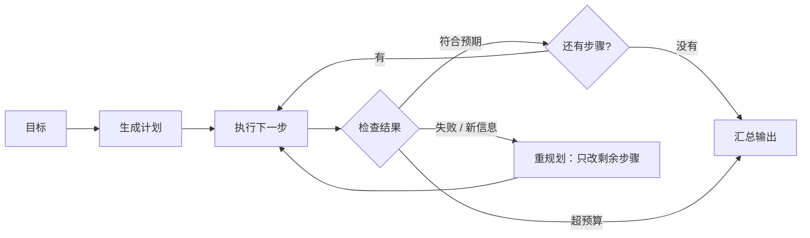

# 规划与推理

> 层级：通用层 · 预计 150 分钟 · 题目：[questions.md](questions.md)
> 前置：[02 Agent 架构与设计模式](../02-agent-architecture/README.md)（ReAct、Workflow 与 Agent 的区分，第 4.4 节的投票公式，第 4.11 节的 token 账）

## 1 这一章解决什么问题

Agent 面试的第二层追问通常落在规划上：任务很长时，模型怎么知道先做什么、做错了怎么办、要不要先写计划。另一类问题来自推理模型：有了会“长思考”的模型，还需要框架层的规划吗？

这一章把“模型内部怎么想”和“系统外部怎么排步骤”分开讲。前者是 CoT 和推理模型，后者是 Plan-and-Execute、重规划、反思和搜索。两者共用一个问题：多花的计算（更多 token、更多采样、更多调用）什么时候换得回正确率。

学完你应该能：

- 说清 CoT 为什么有效，推出 Self-Consistency 的多数票正确率怎么随采样数 k 变化、上限在哪；
- 说清 CoT、Self-Consistency、推理模型三者的关系，以及思考预算和准确率的关系；
- 对比 ReAct 和 Plan-and-Execute，设计重规划机制：什么时候触发、改哪一部分；
- 写出 ToT 的 BFS/DFS 和 MCTS 的 UCT 选择，说清它们都依赖什么；
- 用一个两参数模型说明自我纠错什么时候有效、什么时候只是在原地打转；
- 用代价模型判断一个任务什么时候不该加规划。

**符号表**

| 符号 | 含义 |
|---|---|
| p | 单条推理链（或单次调用）答对的概率 |
| k | Self-Consistency 采样的推理链条数 |
| ρ | 推理链之间的错误相关程度（本章模型里“所有链抄同一份答案”的概率） |
| b | ToT 的 BFS 每层保留的状态数（breadth limit） |
| ε | 中间状态评估器判错的概率 |
| Q(s,a)、N(s)、w | MCTS 中动作的平均回报、节点访问次数、探索系数 |
| a、b（第 5 节） | 自我纠错时“对改错”“错改对”的概率 |
| e、n、C_plan | 单步错误率、任务步数、一次规划调用的成本 |

## 2 CoT 与推理模型

**问题**：模型直接输出答案，多步问题容易在中间某一步算错，而且错了看不出来。

**做法**：

| 方法 | 做法 | 出处 | 代价 |
|---|---|---|---|
| Few-shot CoT | prompt 里放几个带推理步骤的示例，模型照着先写步骤再给答案 | Wei 等，2022-01 | 输出变长；论文发现这个效果在模型足够大时才明显 |
| Zero-shot CoT | 在问题后加一句“Let's think step by step” | 被 Plan-and-Solve 用作基线 | 会漏步骤、算错数 |
| Plan-and-Solve | 先让模型写出子任务计划，再按计划逐个解 | Wang 等，2023-05 | 多一段计划输出 |
| Self-Consistency | 采样多条推理路径，对最终答案多数投票 | Wang 等，2022-03 | 成本随采样数线性增长；只适合答案能比对的任务 |
| 推理模型 | 通过 RL 训练，模型在回答前自己生成长推理，并学会自查、换思路 | DeepSeek-AI，2025-01 | 每次调用 token 多、延迟高；推理过程不一定可读 |

CoT 论文报告，只给 8 个带推理步骤的示例，在 GSM8K 上就超过了此前用 verifier 加微调的做法。这说明推理步骤本身是有价值的计算，而不只是解释。

推理模型把 CoT 从“prompt 技巧”变成了“训练出来的能力”。DeepSeek-R1 的摘要说，纯 RL 训练就让模型出现了自我反思、验证和动态换策略的行为。训练怎么做见 [GRPO 及其变体](../../tracks/training/03-grpo-family/README.md)，这里只讲它对系统设计的影响。

### 2.1 CoT 为什么有效：三种解释

**解释一：可变的计算量。** Wei 等在论文里给的第一条理由是：中间步骤让模型可以给需要更多推理步的问题分配更多计算。不写 CoT 时，模型从读完题到吐出答案的第一个 token，只经过一次前向。这次前向的计算量由层数和宽度固定，和题目难度无关。写 CoT 时，每生成一个 token 都多一次前向，难题写得长，就多算几次。

**解释二：串行计算深度。** Li 等（arXiv 2402.12875，2024-02）从表达能力给了形式化的说法。没有 CoT 时，常数深度、常数比特精度的 Transformer 只能解 AC⁰ 里的问题，这是一类“能被浅层电路并行解决”的问题。允许 T 步 CoT 后，同样的模型能解任何规模为 T 的布尔电路能解的问题。直观上：每一层只能做有限步串行运算，而 CoT 把前一步的结果写进上下文，下一步再读回来，相当于把深度“借”到了序列长度上。论文的实验任务（置换群复合、迭代平方、电路求值）都是公认难以并行的。

**解释三：把中间状态外显。** 写出来的中间结果成了后面步骤的输入，可以被下一步引用，也可以被外部检查。这一点是第 6 节搜索方法的前提：ToT 要评估的“思维”就是一段写出来的中间状态。它也有反面：写出来的步骤不一定是模型真实的计算过程（见第 8 节）。

这三种解释并不冲突。面试里先说“多算几步”，再说“表达能力上是把深度换成长度”，最后说“中间结果可检查，但不一定忠实”，基本就完整了。

### 2.2 Self-Consistency：投票能把正确率推到多高

Self-Consistency（Wang 等，arXiv 2203.11171）的做法：用温度采样得到 k 条推理链，丢掉推理过程，只对最终答案取众数。论文的说法是“把推理路径边缘化掉”，直觉是一道难题常有多种想法通向同一个正确答案，而错误的想法各错各的。

[02 章第 4.4 节](../02-agent-architecture/README.md) 已经推过最简单的情形。这里接着往下推三步：k 变大时会怎样，题目难度不同时会怎样，链之间错误相关时上限在哪。

**第一步：独立、二选一。** 设每条链独立地以 p 答对，错误答案只有一种（对投票最不利），k 为奇数。答对的链数 J 服从二项分布 Binomial(k, p)，多数票正确等价于 J > k/2：

```text
P_k = P(J > k/2) = Σ_{j=(k+1)/2}^{k} C(k, j) · p^j · (1 − p)^{k−j}
```

J/k 的均值是 p，标准差是 √(p(1−p)/k)。k → ∞ 时 J/k 集中到 p（大数定律），所以：

```text
p > 1/2：P_k → 1        p < 1/2：P_k → 0        p = 1/2：P_k = 1/2
```

收敛有多快？用 Hoeffding 不等式，P(J/k ≤ 1/2) ≤ exp(−2k(p − 1/2)²)。p = 0.6 时指数里是 −0.02k，要把错误压到 1% 以下，这个界要求 k ≥ ln(100)/0.02 ≈ 230。真实值比这个界好，下面的代码算出 k = 101 时已经约 0.979。

**第二步：题目难度不同。** 一个评测集里每道题 q 有自己的 p_q。单次采样的平均正确率是 E[p_q]；k → ∞ 时第 q 题的多数票趋于 1[p_q > 1/2]。所以：

```text
单次正确率        = E[p_q]
无限投票的上限    = P(p_q > 1/2)
```

这说明投票只能救“模型多数时候会做”的题，救不了“模型多数时候做错”的题，反而会把这类题的偶然答对也投掉。投票的总收益取决于 p_q 的分布：落在 0.5 到 0.9 之间的题越多，收益越大。

**第三步：错误相关。** 采样温度低、prompt 里有误导、模型对某道题有系统性误解时，多条链会犯同一个错。用一个最简单的混合模型描述：以概率 ρ，k 条链全部抄同一份样本（完全相关）；以概率 1 − ρ，它们独立。那么：

```text
P_k(ρ) = ρ · p + (1 − ρ) · P_k
k → ∞，p > 1/2 时：P_∞(ρ) = ρ · p + (1 − ρ)
```

ρ = 0.5、p = 0.6 时上限是 0.8，而不是 1。相关性越强，加采样越不值钱。这也是 Self-Consistency 需要温度采样、而不是贪心解码重复 k 次的原因：贪心解码 k 次就是 ρ = 1。

**第四步：错误分散时更好。** 上面都假设只有一种错误答案。数学题的错误答案往往五花八门。取众数时，正确答案只要比每一个错误答案都多就行，不需要过半。下面的模拟里 p = 0.4，错误概率平均分到 m 个错误答案上：m = 1 时 15 票投票只剩约 0.21，m = 10 时升到约 0.9。所以 p < 0.5 的题也可能被投票救回来，前提是错误不集中。

```python
from fractions import Fraction
from math import comb
import numpy as np

def maj(p, k):
    """k 条独立链、二选一、k 为奇数时多数票正确的概率。用 Fraction 精确计算，k=401 也不会溢出。"""
    return sum(comb(k, j) * p**j * (1 - p)**(k - j) for j in range(k // 2 + 1, k + 1))

# 第一步：p = 0.6，k 增大时单调趋于 1；p = 0.4 时趋于 0
p = Fraction(6, 10)
ks = [1, 5, 25, 101, 401]
vals = [maj(p, k) for k in ks]
print({k: round(float(v), 4) for k, v in zip(ks, vals)})
assert all(a < b for a, b in zip(vals, vals[1:]))
assert abs(float(maj(p, 5)) - 0.68256) < 1e-9
assert 0.97 < float(maj(p, 101)) < 0.99
assert float(maj(Fraction(4, 10), 401)) < 1e-4

# 第二步：三道题难度不同，无限投票的上限是 p_q > 1/2 的题占比
pq = [Fraction(9, 10), Fraction(6, 10), Fraction(3, 10)]
single = sum(pq) / 3
vote401 = sum(maj(x, 401) for x in pq) / 3
ceiling = Fraction(sum(x > Fraction(1, 2) for x in pq), 3)
print(float(single), round(float(vote401), 4), float(ceiling))
assert single == Fraction(6, 10) and ceiling == Fraction(2, 3)
assert ceiling - vote401 < Fraction(1, 10**4)

# 第三步：错误相关，上限 ρ·p + (1 − ρ)
rho = Fraction(1, 2)
corr = rho * p + (1 - rho) * maj(p, 401)
print(round(float(corr), 4))
assert abs(float(corr) - 0.8) < 1e-4

# 第四步：p = 0.4，错误平均分给 m 个错误答案，k = 15 取众数（并列算错）
rng = np.random.default_rng(0)
def plurality(p, m, k, trials=20000):
    draws = rng.multinomial(k, [p] + [(1 - p) / m] * m, size=trials)   # 形状 (trials, m+1)
    return (draws[:, 0] > draws[:, 1:].max(axis=1)).mean()
r = {m: plurality(0.4, m, 15) for m in (1, 3, 10)}
print(r)
assert r[1] < 0.4 < r[3] < r[10]
```

**和 Best-of-N 的关系**：Self-Consistency 可以看成 Best-of-N 的特例，打分器换成“这个答案出现了几次”。它不需要训练 verifier，但只能用于答案能精确比对的任务。答案是自由文本时，要先做归一化（数字格式、单位、同义选项），否则同一个正确答案会被拆成几个小票仓，相当于人为制造了第四步的“错误分散”，只不过分散的是正确答案。

### 2.3 推理模型与测试时计算

推理模型在回答前先生成一段“思考”token。思考越长，相当于第 2.1 节的串行计算越多。系统设计关心的是：给多少思考预算，准确率怎么变。

公开工作里的方法和趋势：

- **两类扩展**。s1（Muennighoff 等，arXiv 2501.19393，2025-01）把测试时扩展分成串行（后面的计算依赖前面，例如更长的推理链）和并行（独立地跑多次再汇总，例如多数投票）。论文报告，在他们的设置下，串行扩展比同等算力的多数投票更有效。
- **预算强制（budget forcing）**。s1 用解码时干预控制思考长度：超出上限时强行插入思考结束标记；想延长时压住结束标记，在后面追加“Wait”，模型常会因此复查答案、改掉错误的步骤。论文也报告了它的边界：延长到一定程度后效果变平，压结束标记太多次会让模型陷入重复循环。
- **按难度分配**。Snell 等（arXiv 2408.03314，2024-08）比较了两种多花算力的方式：用过程奖励模型做搜索，和让模型逐步修改自己的答案。哪种更好取决于题目难度。论文报告，按难度自适应分配算力的策略，比 Best-of-N 基线的效率高 4 倍以上。

为什么会收益递减、为什么按难度分配有用，可以用一个简单模型推出来（推导，不是论文结论）。设一道题“想清楚”需要的思考 token 数 L 是随机的，服从对数正态分布，中位数取决于难度。预算 B ≥ L 时模型以 c 的概率答对（c < 1，因为有些题怎么想都不会），B < L 时只能以 g 的概率蒙对：

```text
acc(B) = c · P(L ≤ B) + g · (1 − P(L ≤ B))
```

P(L ≤ B) 是 ln B 的 S 形函数，所以 acc 对 log B 也是 S 形：预算远小于中位数时几乎不涨，接近中位数时涨得最快，远大于中位数后贴着上限 c。这就是常见的“准确率对思考 token 数取对数后近似线性，然后变平”。

按难度分配的好处来自 S 形曲线的形状：简单题的中位数小，给它统一预算的大部分都浪费在平台区；把省下的预算挪给难题，难题正处在陡峭段。

```python
import math
import numpy as np

def need_cdf(budget, median, sigma=1.0):
    """一道题需要的思考 token 数 L ~ 对数正态(ln median, sigma)。返回 P(L ≤ budget)。"""
    z = (math.log(budget) - math.log(median)) / sigma
    return 0.5 * (1 + math.erf(z / math.sqrt(2)))

def acc(budget, median, ceiling=0.9, guess=0.1):
    c = need_cdf(budget, median)
    return c * ceiling + (1 - c) * guess

# 1) 收益递减：预算从 250 每次翻倍到 64000
budgets = [250 * 2**i for i in range(9)]
curve = [acc(b, median=2000) for b in budgets]
gains = np.diff(curve)                        # 每翻一倍带来的增量，长度 8
print([round(v, 3) for v in curve])
assert abs(curve[3] - 0.5) < 1e-12            # 预算等于中位数时正好在 S 形中点
assert 0.89 < curve[-1] < 0.9                 # 贴着上限，到不了 1
assert gains.argmax() in (2, 3) and gains[-1] < gains[3] / 10

# 2) 两类题，平均预算 3000 token：统一分配 vs 按难度分配
easy, hard, mean_budget = 400, 6000, 3000
uniform = (acc(mean_budget, easy) + acc(mean_budget, hard)) / 2
best, split = max(((acc(be, easy) + acc(2 * mean_budget - be, hard)) / 2, be)
                  for be in range(100, 2 * mean_budget, 50))
print(round(uniform, 4), round(best, 4), split)
assert best > uniform + 0.02 and split < mean_budget   # 简单题少给，难题多给
```

上面的模型只用来解释形状，参数是虚构的。实际系统里难度事先不知道，常见做法是先用便宜的信号估难度（一次短推理的置信度、几次采样的一致率、路由分类器），再决定思考预算或采样数。这和 [02 章的路由](../02-agent-architecture/README.md) 是同一类设计。

**对系统设计的影响**：推理模型把一部分“规划”移进了模型内部。单轮内的步骤分解、自查，模型已经会做；框架层的显式规划要解决的是另一类问题：跨很多轮、要人确认、要断点恢复、要并行分派。第 3 节讲这一类。

## 3 规划的几种形态

**问题**：长任务有几十步，模型每一步只看局部，容易忘了目标、重复劳动或者走偏。

| 形态 | 做法 | 适合 | 代价 |
|---|---|---|---|
| 隐式规划（ReAct） | 不单独写计划，每一步边想边做 | 步骤短、环境反馈多，例如查一个订单状态 | 长任务容易走偏，没有全局视角 |
| 一次性计划 | 模型一次写出全部步骤，之后不再改 | 步骤固定、环境稳定，例如按模板生成一份报告 | 任何一步和预期不符，后面的步骤都可能作废 |
| Plan-and-Execute | 先生成完整计划，再由执行器逐步执行，必要时重规划 | 步骤多但结构清楚，例如“整理三个文档并生成周报” | 计划一旦和现实不符就要重规划 |
| 计划与观察解耦（ReWOO） | 一次写出全部工具调用和变量占位，执行完再汇总，中间不回到模型 | 工具调用之间依赖固定、可并行 | 中间结果出乎意料时无法调整 |
| 层次分解 | 高层计划拆子目标，子目标再交给子 Agent 或子流程 | 大任务，例如改多个模块的代码 | 子目标边界划错，后面全错 |
| 外接经典规划器（LLM+P） | 模型把问题翻译成 PDDL，交给经典规划器求解，再翻回自然语言 | 规则明确的规划问题，例如排班、积木 | 需要能形式化的领域；翻译出错难发现 |

ReWOO 的摘要报告，在 HotpotQA 上比交替式方法省了 5 倍 token。原因是 ReAct 每一步都要把前面全部内容重新送进模型，token 账的推导见 [02 章第 4.11 节](../02-agent-architecture/README.md)。LLM+P 的结果是，规划器在作者的测试集上大多能给出最优解，而单独用模型时多数问题连可行解都给不出。Kambhampati 等（2024-02）把这个观察总结为：自回归模型自己不能可靠地做规划和自我验证，但可以当“近似知识源”，和外部验证器一起工作。

**层次规划为什么省**（推导）。设任务有 n 个原子步骤。平铺的计划要模型一次写出 n 步并保持它们一致。两层分解时，高层写 m 个子目标，每个子目标内部约 n/m 步，由子流程各自规划。每次规划调用要“同时记住”的步骤数从 n 降到 max(m, n/m)，m = √n 时最小，约 √n。代价是多了 m 次子规划调用，以及子目标之间接口（输入、输出、完成条件）写错的风险。接口写错时，错误要到集成阶段才暴露，所以每个子目标必须带可检查的完成条件。

**计划放在哪**：计划最好作为结构化状态存在 Harness 里，例如一个带状态字段的步骤列表，而不是只留在对话历史里。这样做有三个好处：可以校验依赖关系，可以在中断后恢复，可以展示给用户确认。

```python
from dataclasses import dataclass, field

@dataclass
class Step:
    id: str
    action: str
    deps: list = field(default_factory=list)
    status: str = "pending"          # pending / done / failed
    side_effect: bool = False        # 有副作用的步骤，完成后不可重做

def check_plan(steps):
    """计划进入执行前的程序化校验：依赖存在、没有环。返回一个合法的执行顺序。"""
    ids = {s.id for s in steps}
    for s in steps:
        missing = [d for d in s.deps if d not in ids]
        if missing:
            raise ValueError(f"{s.id} 依赖不存在的步骤 {missing}")
    order, done = [], set()
    while len(order) < len(steps):
        ready = [s for s in steps if s.id not in done and all(d in done for d in s.deps)]
        if not ready:
            raise ValueError("依赖有环")
        for s in ready:
            order.append(s.id)
            done.add(s.id)
    return order

plan = [
    Step("fetch_a", "读取文档 A"),
    Step("fetch_b", "读取文档 B"),
    Step("merge", "合并要点", deps=["fetch_a", "fetch_b"]),
    Step("send", "发送周报", deps=["merge"], side_effect=True),
]
order = check_plan(plan)
assert order.index("merge") > order.index("fetch_b") and order[-1] == "send"

bad = plan + [Step("x", "x", deps=["y"]), Step("y", "y", deps=["x"])]
try:
    check_plan(bad)
    raise AssertionError("应该检测到环")
except ValueError as e:
    assert "环" in str(e)
```

模型写的计划常有两类结构错误：引用了不存在的步骤，或者依赖有环。这两类错误程序就能查出来，不需要再调一次模型。查出来以后，把错误信息交回模型重写计划，这是“有外部反馈的纠错”，比让模型自己检查计划可靠（理由见第 5 节）。

## 4 重规划

**问题**：计划是基于开始时的信息写的。执行中工具报错、发现新事实、用户改需求，原计划就不再成立。



| 设计点 | 推荐做法 | 不这样做的后果 |
|---|---|---|
| 触发条件 | 工具失败、结果和步骤的预期不符、用户插话、预算过半仍未接近目标 | 每步都重规划会浪费 token；从不重规划会一条路走到黑 |
| 修改范围 | 保留已完成的步骤和结果，只重写剩余部分 | 推倒重来会重复执行有副作用的操作 |
| 失败计数 | 同一步失败次数设上限，超限就换方案或请人处理 | 在同一个错误上无限重试 |
| 记录原因 | 重规划时写下“为什么改” | 后面的步骤可能又走回老路 |

旅行规划是个好例子：订机票失败后，重规划只应改“航班”及依赖它的“酒店入住日期”，不应把已经确认的签证材料清单重做一遍。

**改哪些步骤**：上面的“只改剩余部分”可以再收窄成“只改失败步骤的下游”。在依赖图上，从失败步骤出发沿依赖边往后走，能到达的未完成步骤才需要重写；和它没有依赖关系的步骤照常执行。

```python
def downstream(steps, failed_id):
    """依赖图上 failed_id 的全部下游（不含自己）。"""
    out, frontier = set(), {failed_id}
    while frontier:
        nxt = {s.id for s in steps if set(s.deps) & frontier} - out
        out |= nxt
        frontier = nxt
    return out

steps = {
    "visa": [], "flight": [], "hotel": ["flight"], "car": ["flight"],
    "itinerary": ["hotel", "car"], "insurance": ["visa"],
}
from types import SimpleNamespace as S
graph = [S(id=k, deps=v) for k, v in steps.items()]
done = {"visa", "insurance"}

to_replan = {"flight"} | (downstream(graph, "flight") - done)
print(sorted(to_replan))
assert to_replan == {"flight", "hotel", "car", "itinerary"}
assert not (to_replan & done)            # 已完成的签证和保险不动
```

**重规划的触发阈值怎么想**（推导）。设一次重规划成本是 C_r，当前计划剩余 n 步，每步成本 c。如果检测到偏差后不重规划，剩余步骤整体作废的概率是 q，作废就要从这里重做（成本约 n·c 再加一次重规划）。重规划划算的条件近似是 C_r < q·n·c。这给出三个直接结论：剩余步骤越多越值得重规划；偏差越可能让后续作废（q 越大）越值得；重规划本身越贵，越要等确定的信号（工具硬失败、检查条件不满足）再触发，而不是每步都问一次模型“要不要改计划”。

**终止**：同一步失败次数和总重规划次数都要设上限。超限后输出当前进展、已完成步骤和失败原因，交给人决定。这和 [02 章第 6.1 节的步数上限](../02-agent-architecture/README.md) 是同一个问题。

## 5 反思与自我纠错

**问题**：模型第一次的输出常有错误。能不能让它自己检查、自己改？

| 方法 | 做法 | 反馈来源 | 出处 |
|---|---|---|---|
| Self-Refine | 同一个模型生成、自评、按自评修改，循环多轮 | 模型自己 | Madaan 等，2023-03 |
| Reflexion | 任务失败后，模型把失败原因写成文字反思，存进情景记忆，下次尝试时读取；不更新权重 | 环境信号（测试结果、任务成败）加模型反思 | Shinn 等，2023-03 |
| 外部验证 | 用测试、编译器、规则、检索事实来判断对错 | 外部工具 | 工程常用 |

**Reflexion 的结构**（核对 arXiv 2303.11366）。它由三个模型组成：Actor 生成文本和动作；Evaluator 给 Actor 的输出打分；Self-Reflection 模型把打分和轨迹变成一段文字反思。反思存进情景记忆，下一次尝试时放进 Actor 的上下文。记忆的条数有上限 Ω，论文里通常取 1 到 3，为的是不超出上下文长度。反馈可以是标量（成败、分数），也可以是自由文本；可以来自外部环境，也可以是内部模拟的。编程任务里，Evaluator 的信号来自模型自己生成的单元测试。论文自己指出了这里的坑：自生成的测试本身可能是错的，测试全过但程序是错的（假阳性）时，Agent 会提前停下。

**没有外部反馈时为什么常常无效**（核对 arXiv 2310.01798）。Huang 等把“只靠模型自身能力、不借助外部反馈的纠错”叫内在自我纠错（intrinsic self-correction）。他们的结论有三层：

1. 此前一些报告纠错有效的工作，用了“答案对不对”的标签（oracle label）来决定什么时候停止纠错。拿掉这个标签，提升就消失了，推理任务上还会变差。
2. 模型很少把错的改对，更常见的是保留原答案，或者把对的改错。原因是模型判断不了自己推理的对错。
3. 多智能体辩论在相同回答数下，效果不比 Self-Consistency 好。也就是说，多花的调用次数如果直接拿去采样投票，收益至少一样。

论文还指出，有些工作里“纠错后变好”，是因为初始回答的 prompt 写得不好，纠错 prompt 里补上了初始 prompt 缺的信息。比较时要让初始 prompt 同样强。

**一个两参数模型**（推导）。设修改前的正确率是 p。一轮纠错里，模型以概率 a 把对的改错，以概率 b 把错的改对。一轮后：

```text
p' = p·(1 − a) + (1 − p)·b
p' > p  ⇔  b·(1 − p) > a·p  ⇔  b / a > p / (1 − p)
```

这个不等式解释了为什么“初始回答越好，自我纠错越容易变差”：p 越高，右边越大，需要的 b/a 越大。p = 0.75 时要求 b > 3a。多轮反复时，p 收敛到不动点：

```text
p* = b / (a + b)
```

和起点无关。没有外部信号时，多轮纠错最终把正确率拉到 b/(a+b)；初始正确率高于它就是越改越差。

外部检查改变的是“改哪些”。完美检查器只把错的交给模型改，对的不动，所以 p' = p + (1 − p)·b，只升不降。现实的检查器有召回 r（错的被标出的比例）和误报 f（对的被标出的比例），只改被标出的：

```text
p' = p·(1 − f·a) + (1 − p)·r·b
```

```python
from fractions import Fraction as F

def revise(p, a, b):
    """一轮无外部反馈的自我纠错。a：对改错的概率；b：错改对的概率。"""
    return p * (1 - a) + (1 - p) * b

p, a, b = F(3, 4), F(1, 10), F(3, 20)
p1 = revise(p, a, b)
assert p1 == F(57, 80) and p1 < p             # 0.75 → 0.7125，b/a = 1.5 < p/(1−p) = 3
assert (b * (1 - p) > a * p) == (p1 > p)

# 多轮：收敛到 b/(a+b) = 0.6，和起点无关
for start in (F(3, 4), F(1, 5)):
    x = start
    for _ in range(200):
        x = revise(x, a, b)
    assert abs(x - b / (a + b)) < F(1, 10**12)
assert b / (a + b) == F(3, 5)

# 完美外部检查：只改错的
assert p + (1 - p) * b == F(63, 80)            # 0.7875 > 0.75

# 不完美检查：召回 0.8、误报 0.1
def revise_checked(p, a, b, r, f):
    return p * (1 - f * a) + (1 - p) * r * b
q = revise_checked(p, a, b, F(8, 10), F(1, 10))
print(float(p1), float(q))
assert p < q < p + (1 - p) * b                 # 0.7725：在“不改”和“完美检查”之间
```

数字是虚构的，只说明结构。结论是：纠错有没有用，取决于“改对的概率和改错的概率之比”是否超过当前的赔率 p/(1−p)。外部检查的作用是把 a 那一项乘上误报率 f，让对的答案少被碰。

所以反思要按反馈来源分级：

1. **有可执行的检查**（单测、类型检查、格式校验）：反思最有效，优先用。
2. **有外部事实**（检索结果、工具返回）：可以对照纠错。
3. **只有模型自评**：适合改写风格、补遗漏，不适合判断推理对错；要设最大轮数。

Reflexion 有效的一个前提是它有环境反馈。拿它当“模型自己想想就能变好”的例子，是常见的误读。[02 章第 4.6 节](../02-agent-architecture/README.md) 从“验证器可靠度 v”的角度推过同一件事。

## 6 搜索式推理

**问题**：一条推理路径走错就全错。能不能同时探索几条，选最好的？

| 方法 | 做法 | 需要什么 | 代价 |
|---|---|---|---|
| Best-of-N | 独立生成 N 个完整答案，用打分器选一个 | 能给完整答案打分的 verifier 或奖励模型 | N 倍成本；打分器不准就选错 |
| Self-Consistency | Best-of-N 的特例，用多数投票代替打分器 | 答案可以比对（数字、选项） | 开放式答案无法投票 |
| Tree of Thoughts | 把推理拆成“思维单元”，每步展开多个候选，模型评估后用 BFS 或 DFS 搜索，可以回溯 | 能评估中间状态 | 调用次数多，实现复杂 |
| MCTS（如 RAP） | 模型既当策略提出下一步，又当世界模型预测下一状态，用蒙特卡洛树搜索平衡探索和利用 | 中间步骤的奖励信号 | 成本最高，延迟难控 |
| 过程奖励模型（PRM） | 给每一步推理打分，用来给候选答案重排，也可用来剪枝搜索 | 步骤级标注数据 | 标注贵；可能被钻空子 |

### 6.1 ToT：BFS 和 DFS

ToT（Yao 等，arXiv 2305.10601）把一个问题拆成几步“思维”，每个状态 s 是“题目 + 到目前为止写下的思维”。它有四个可替换的部件：怎么拆思维，怎么从一个状态生成候选思维，怎么评估一个状态，用什么搜索算法。

- **评估器**：让模型对状态打分（例如 1 到 10），或分类成 sure / likely / impossible 再换成数值。Game of 24 里用的是 sure / maybe / impossible，判断“剩下的数还能不能凑出 24”。
- **BFS**：每层保留评估最好的 b 个状态。适合步数少（论文的设置是 T ≤ 3）、每步的候选能剪到少数几个（b ≤ 5）的问题。
- **DFS**：先沿最有希望的状态往下走，直到得到答案，或评估器判定当前状态无望（评分低于阈值），这时剪掉子树、回溯到父节点试下一个候选。

论文报告，Game of 24 上同一个模型用 CoT 只解出 4%，用 ToT（b = 5）达到 74%，b = 1 时是 45%；CoT 采 100 次取最好的一次（需要知道答案才能选，属于 oracle 设置）也只到 49%。

Game of 24 的状态空间小到可以穷举，正好用来看清搜索在做什么。四个数，每步任取两个做一次加减乘除，三步后剩一个数。第一步有 C(4,2) = 6 对，每对最多 6 个结果（a+b、a−b、b−a、a×b、a/b、b/a），所以最多 36 个子状态；第二步最多 3 × 6 = 18 个；第三步 6 个。叶子最多 36 × 18 × 6 = 3888 个。

下面的代码做四件事：核对状态空间大小；用精确评估器统计 1 到 13 里四个数（可重复）的 1820 组里有多少组可解；比较“随机走一条路径”、BFS（b = 1 和 b = 5）、带剪枝和回溯的 DFS；再给评估器加噪声（以概率 ε 把“能/不能”判反），看搜索怎么退化。

```python
from fractions import Fraction
from functools import lru_cache
from itertools import combinations, combinations_with_replacement
import random

def children(state):
    """一个“思维”：任选两个数做一次 + − × ÷。state 是排好序的分数元组，长度减 1。"""
    out = []
    for i, j in combinations(range(len(state)), 2):
        a, b = state[i], state[j]
        rest = [state[t] for t in range(len(state)) if t not in (i, j)]
        vals = [a + b, a - b, b - a, a * b] + ([a / b] if b else []) + ([b / a] if a else [])
        out += [tuple(sorted(rest + [v])) for v in vals]
    return out

@lru_cache(maxsize=None)
def solvable(state):
    """精确评估器：从这个状态出发还能不能凑出 24。"""
    if len(state) == 1:
        return state[0] == 24
    return any(solvable(c) for c in children(state))

def value(c, eps, rng):
    """带噪评估器：以概率 eps 判反；第二项是随机打破平局。"""
    return (solvable(c) != (rng.random() < eps), rng.random())

def bfs(state, b, eps, rng):
    frontier, calls = [state], 0
    for _ in range(3):
        cands = list({c for s in frontier for c in children(s)})
        calls += len(cands)                                  # 每个候选评估一次
        v = {c: value(c, eps, rng) for c in cands}
        frontier = sorted(cands, key=v.get, reverse=True)[:b]
    return any(s == (24,) for s in frontier), calls

def dfs(state, eps, rng, budget=60):
    calls = 0
    def go(s):
        nonlocal calls
        if len(s) == 1:
            return s == (24,)
        kids = list(set(children(s)))
        rng.shuffle(kids)
        for c in kids:
            if calls >= budget:
                return False
            calls += 1
            if value(c, eps, rng)[0] and go(c):   # 判为无望就剪掉；否则往下走
                return True
        return False                              # 子节点都失败：回溯
    return go(state), calls

def one_path(state, rng):
    for _ in range(3):
        state = rng.choice(children(state))
    return state == (24,)

# 1) 状态空间
start = tuple(sorted(map(Fraction, (4, 9, 10, 13))))
lv1 = children(start)
lv3 = [c for s in lv1 for t in children(s) for c in children(t)]
assert len(lv1) == 36 and len(lv3) <= 36 * 18 * 6 == 3888 and solvable(start)

# 2) 1820 组里有多少组可解
games = [tuple(sorted(map(Fraction, g))) for g in combinations_with_replacement(range(1, 14), 4)]
ok = [g for g in games if solvable(g)]
print(len(games), len(ok))
assert len(games) == 1820 and len(ok) == 1362

# 3) 在 300 组可解的题上比较
rng = random.Random(0)
sample = rng.sample(ok, 300)
mean = lambda xs: sum(xs) / len(xs)
r_path = mean([one_path(g, rng) for g in sample])
res = {}
for eps in (0.0, 0.2):
    for name, f in (("bfs1", lambda g: bfs(g, 1, eps, rng)),
                    ("bfs5", lambda g: bfs(g, 5, eps, rng)),
                    ("dfs", lambda g: dfs(g, eps, rng))):
        out = [f(g) for g in sample]
        res[eps, name] = (mean([x for x, _ in out]), mean([c for _, c in out]))
print(round(r_path, 3), {k: (round(a, 3), round(c, 1)) for k, (a, c) in res.items()})

assert r_path < 0.05                                       # 不评估、随机走一条：几乎全错
assert all(res[0.0, n][0] == 1.0 for n in ("bfs1", "bfs5", "dfs"))   # 评估器完美时都能解
assert res[0.0, "dfs"][1] < res[0.0, "bfs1"][1] < res[0.0, "bfs5"][1]
assert res[0.2, "bfs1"][0] < res[0.2, "bfs5"][0]           # 评估器有噪声时，宽度能补一部分
assert res[0.2, "dfs"][0] < 0.7                            # 但所有方法都明显退化
```

运行结果：1820 组里 1362 组可解。随机走一条路径的成功率约 0.007。评估器完美时三种搜索都是 100%，DFS 平均只评估约 15 个状态，BFS（b = 1）约 47 个，BFS（b = 5）约 114 个。评估器以 20% 的概率判反时，BFS（b = 1）掉到约 0.11，BFS（b = 5）约 0.37，DFS 约 0.48。

这个玩具例子说明两件事（推导）。第一，搜索的收益几乎全部来自评估器：同样的状态空间，评估器从完美变成 80% 准，成功率从 100% 掉到一半以下。第二，宽度 b 和回溯都是在对冲评估器的错误：评估器偶尔把好状态排到后面，b 大一些就还能留住它；DFS 判错了还能回溯。代价是评估次数，每次评估在真实系统里就是一次模型调用。

### 6.2 MCTS 与 UCT

RAP（Hao 等，arXiv 2305.14992）用 MCTS 搜索推理路径：模型当 Agent 提出动作，也当世界模型预测执行动作后的状态，任务相关的奖励给每一步打分。每轮迭代有四个阶段：选择、扩展、模拟、回传。选择阶段从根节点往下，每层按 UCT 选子节点（RAP 式 1）：

```text
a* = argmax_{a ∈ A(s)} [ Q(s, a) + w · √( ln N(s) / N(c(s, a)) ) ]
```

Q(s, a) 是从状态 s 执行动作 a 之后的平均回报（利用项）。N(s) 是节点 s 被访问的次数，c(s, a) 是执行 a 之后到达的子节点。第二项是探索项：子节点访问得越少，这一项越大；父节点访问得越多，ln N(s) 越大，没怎么试过的子节点越会被拉回来试一次。w 控制两者的权衡。

手算一个例子：父节点访问 10 次，三个子节点的 (Q, N) 分别是 (0.6, 6)、(0.4, 3)、(0.0, 1)，w = 1。ln 10 ≈ 2.303：

```text
子 1：0.6 + √(2.303/6) ≈ 0.6 + 0.619 = 1.219
子 2：0.4 + √(2.303/3) ≈ 0.4 + 0.876 = 1.276
子 3：0.0 + √(2.303/1) ≈ 0.0 + 1.517 = 1.517   ← 被选中
```

Q 最低的子 3 反而被选中，因为它只被试过一次，估计最不可靠。w = 0 时只看 Q，选子 1。

```python
import math
import random

def uct(q, n_child, n_parent, w):
    if n_child == 0:
        return math.inf                      # 没试过的子节点先试
    return q + w * math.sqrt(math.log(n_parent) / n_child)

# 1) 核对上面的手算
kids = [(0.6, 6), (0.4, 3), (0.0, 1)]
vals = [uct(q, n, 10, 1.0) for q, n in kids]
print([round(v, 3) for v in vals])
assert abs(vals[0] - 1.219) < 1e-3 and abs(vals[1] - 1.276) < 1e-3 and abs(vals[2] - 1.517) < 1e-3
assert max(range(3), key=vals.__getitem__) == 2
assert max(range(3), key=lambda i: uct(*kids[i], 10, 0.0)) == 0

# 2) 一层树：三个动作的真实成功率 0.3 / 0.5 / 0.7
def run(w, rounds, seed):
    rng = random.Random(seed)
    p, n, s = [0.3, 0.5, 0.7], [0, 0, 0], [0.0, 0.0, 0.0]
    for t in range(1, rounds + 1):
        a = max(range(3), key=lambda i: uct(s[i] / n[i] if n[i] else 0.0, n[i], t, w))
        n[a] += 1
        s[a] += rng.random() < p[a]
    return n

visits = run(1.4, 3000, 0)
print(visits)
assert visits[2] == max(visits) and min(visits) > 20   # 好动作访问最多，差动作也被试过

# 3) 200 个种子里，最好的动作没拿到多数访问的比例
miss = lambda w: sum(run(w, 300, sd)[2] < 150 for sd in range(200)) / 200
m0, m14 = miss(0.0), miss(1.4)
print(m0, m14)
assert m0 > 0.2 and m14 < 0.05                          # w = 0 的贪心常常锁死在差动作上
```

运行结果：w = 1.4 跑 3000 轮，三个动作的访问次数约为 62、172、2766。w = 0 时，200 个种子里约 40% 没有把多数访问给最好的动作：前几次运气不好，最好的动作 Q 估得偏低，贪心就再也不回去试它。w = 1.4 时这个比例约 0.5%。

在 LLM 搜索里，每次“访问”都要调用模型生成动作、预测状态、打分，所以 MCTS 的成本通常是这几种方法里最高的，延迟也最难控制。

### 6.3 什么时候值得搜索

ToT 在 Game of 24 上的大幅提升，和这个任务的性质有关：中间状态清楚，“剩下的数还能不能凑出 24”容易判断。Lightman 等（2023-05）在 MATH 上比较了过程监督和结果监督：用奖励模型从多个候选解里挑最好的一个时，过程监督训出的奖励模型更好。他们公开了 80 万条步骤级标注的 PRM800K。奖励模型的设计见 [奖励与 Verifier](../../tracks/training/05-reward-verifier/README.md)。

**选型原则**：搜索的收益取决于“能不能可靠地评估中间状态”。能评估（代码能跑测试、数学能验算）就值得搜；不能评估（写一封邮件）就别搜，多采样几次让用户挑更实际。第 6.1 节的模拟给了定量的直觉：评估器的准确率每降一点，搜索的收益就掉一大截，而成本一分不少。

## 7 CoT 的忠实性

**问题**：模型写出的推理过程，真的是它得出答案的原因吗？

Turpin 等（arXiv 2305.04388，2023-05）的实验给了否定的例子。他们用了两种偏置：一是把 few-shot 示例里的正确答案总放在 (A)（Answer is Always A）；二是在 prompt 里暗示某个选项可能是对的（Suggested Answer）。加了偏置后，模型会偏向被偏置指向的选项，但写出的解释几乎从不提这一点（人工检查的 426 条解释里只有 1 条提到），而是编一套看起来合理的理由，为偏置一致的错误答案辩护。在 BIG-Bench Hard 的 13 个任务上，这种偏置让准确率最多下降 36%。论文还观察到，有些不忠实的解释本身推理是通顺的，所以“读起来合理”不能当作“它就是原因”的证据。

**怎么测忠实性**：做干预实验。

- 加入一个推理里没提到的偏置，看答案是否被它影响。被影响而解释不提，就是不忠实。上面的实验就是这一类。
- 修改推理里声称依赖的信息（例如改掉某个中间数字），看最终答案是否跟着变。不跟着变，说明答案不是从这段推理算出来的。

这对系统设计有两点影响：

- **不能把 CoT 当审计证据**。要证明 Agent 为什么做了某个动作，看工具调用记录和输入，而不是它写的理由。轨迹怎么采集见 [Trace 与回放](../../tracks/harness/06-tracing-replay/README.md)。
- **监控 CoT 有用但不充分**。推理里出现异常意图值得报警，但没出现不代表没问题。

## 8 什么时候规划反而有害

| 情况 | 为什么有害 | 更好的做法 |
|---|---|---|
| 简单任务，一两步能完成 | 写计划的 token 和延迟比任务本身还多 | 路由到单次调用或 ReAct |
| 环境变化快，信息要边做边得到 | 计划写完就过时，频繁重规划 | ReAct 式边做边看 |
| 用推理模型时再要求它“先列计划再逐步思考” | 和模型内部的推理重复，多花 token 和延迟，还可能把模型限制在你写的步骤里 | 给清楚的目标和约束，让模型自己想 |
| 计划没有被执行器约束 | 模型写了计划却不按计划做，计划只是装饰 | 计划进 Harness 状态，执行器按步骤推进 |
| 没有预算上限的搜索 | 成本和延迟不可控 | 设步数、token、时间上限，达到阈值就输出当前最优 |

**代价模型**（推导）。设任务有 n 步，每步成本 c，每步独立地以 e 出错。为了让推导简单，假设任何一步出错都要整轮重来（没有局部重试）。一轮成功的概率是 (1 − e)^n，重来次数服从几何分布，期望轮数是 1/(1 − e)^n：

```text
不规划：E[cost₀] = n·c / (1 − e₀)^n
规划：  E[cost₁] = (C_plan + n·c) / (1 − e₁)^n
```

C_plan 是一次规划调用的成本，e₁ < e₀ 是有计划时的单步错误率。规划划算的条件是 E[cost₁] < E[cost₀]，整理得：

```text
((1 − e₁) / (1 − e₀))^n > 1 + C_plan / (n·c)
```

左边随 n 指数增长，右边随 n 减小，所以总有一个回本步数 n*：短于 n* 时规划亏，长于 n* 时赚，而且越长赚得越多。三个推论：

- 规划不降低错误率（e₁ = e₀，例如推理模型已经在内部做了同样的分解）时，左边恒为 1，任何长度都亏。
- 规划降的错误率越多，回本越早。
- 规划调用越贵（例如用更大的模型写计划），回本越晚。

```python
def expected_cost(n, step_cost, err, overhead):
    """n 步任务，每步独立以 err 出错，出错整轮重来。期望成本 = 一轮成本 / 成功概率。"""
    return (overhead + n * step_cost) / (1 - err) ** n

c, plan_cost = 1.0, 3.0       # 一次规划调用相当于 3 个普通步骤
e0, e1 = 0.05, 0.03           # 不规划 / 规划时的单步错误率

def gain(n, e1=e1):
    return expected_cost(n, c, e0, 0.0) - expected_cost(n, c, e1, plan_cost)

for n in (2, 5, 12, 20, 40):
    print(n, round(expected_cost(n, c, e0, 0), 2), round(expected_cost(n, c, e1, plan_cost), 2))

breakeven = next(n for n in range(1, 200) if gain(n) > 0)
assert breakeven == 12
assert gain(2) < 0 and gain(20) > 0 and gain(40) > gain(20)

# 规划不降错误率：任何长度都亏
assert all(gain(n, e1=e0) < 0 for n in range(1, 100))

# 错误率降得更多（0.05 → 0.01），回本更早
assert next(n for n in range(1, 200) if gain(n, e1=0.01) > 0) < breakeven
```

运行结果：n = 2 时不规划的期望成本约 2.2，规划约 5.3；n = 12 开始规划更省；n = 40 时不规划约 311，规划约 145。参数是虚构的，结论只在形状上成立：短任务规划是纯开销，长任务里错误率的小幅下降会被步数指数放大。

真实系统通常有局部重试，出错不必整轮重来，这会让不规划的成本涨得慢一些，回本步数后移。但只要单步错误会传染给后续步骤，指数项就还在。

判断顺序可以和 [02 章的选型顺序](../02-agent-architecture/README.md) 合在一起说：先问任务能不能一步完成，再问步骤能不能提前写出，最后才考虑显式规划和搜索。

**怎么评测规划**：只看最终成功率不够。要分别看计划质量（步骤是否完整、依赖是否正确）、执行忠实度（是否按计划走）、重规划次数和总成本。轨迹级评测见 [09 评测](../09-evaluation/README.md)。

## 9 数值例子：一道题，四种花算力的方式

把前面几节的模型串起来，看同一个预算怎么花。设一类题单条推理链的正确率 p = 0.6，答案是数字，错误答案只有一种（最保守），每条链约 1000 token，总预算约 5000 token。

| 做法 | 怎么算 | 正确率 | 依据 |
|---|---|---|---|
| 单条 CoT | p | 0.60 | 定义 |
| Self-Consistency，k = 5，链独立 | Σ_{j≥3} C(5,j)·0.6^j·0.4^{5−j} | 0.683 | 第 2.2 节第一步 |
| 同上，但 ρ = 0.5 | 0.5·0.6 + 0.5·0.683 | 0.641 | 第 2.2 节第三步 |
| 无外部反馈的自我纠错，4 轮，a = 0.1、b = 0.15 | 迭代 p' = 0.9p + 0.15(1−p) | 0.60，不动（起点就是不动点） | 第 5 节 |
| 一次 CoT 加可执行检查，失败就重做，最多 5 次 | 1 − 0.4^5 | 0.990 | 检查完美、各次独立时的推导 |

手算第二行：C(5,3)·0.6³·0.4² = 10 × 0.216 × 0.16 = 0.3456，C(5,4)·0.6⁴·0.4 = 5 × 0.1296 × 0.4 = 0.2592，0.6⁵ = 0.07776，加起来 0.68256。

第四行从 0.6 出发：0.6 已经是不动点 b/(a+b) = 0.15/0.25 = 0.6，所以多轮纠错完全不动，只花了钱。p 若是 0.75，同样的 a、b 会把它拉低到 0.6。

最后一行看起来最好，但它假设了一个完美、便宜的检查器。检查器只能抓住比例为 r 的错误时，每次漏检的错误会被直接当成答案交出去，正确率上限变成 p 加上被抓住后重做救回的那部分，明显低于 0.99；检查器不存在时这一行不可用。这张表的用途是面试里回答“预算怎么花”：有检查器就花在“生成—检查—重试”上；没有检查器但答案可比对，就花在投票上，并尽量降低链之间的相关；两者都没有，多花的算力大多换不回正确率。

```python
from math import comb

p = 0.6
sc5 = sum(comb(5, j) * p**j * (1 - p)**(5 - j) for j in range(3, 6))
sc5_corr = 0.5 * p + 0.5 * sc5
x = p
for _ in range(4):
    x = 0.9 * x + 0.15 * (1 - x)
retry5 = 1 - (1 - p) ** 5
print(round(sc5, 5), round(sc5_corr, 3), round(x, 3), round(retry5, 3))
assert abs(sc5 - 0.68256) < 1e-12
assert abs(sc5_corr - 0.64128) < 1e-12
assert abs(x - 0.6) < 1e-12                 # 起点就是不动点，纠错不动
assert abs(retry5 - 0.98976) < 1e-12
assert p < sc5_corr < sc5 < retry5
```

## 10 工程细节与常见坑

**投票前没有归一化答案**
- 现象：Self-Consistency 的 k 从 5 加到 20，准确率几乎不动，日志里众数票数很低。
- 原因：同一个正确答案写成了“12”“12.0”“十二”“12 个”，被拆成几个票仓。
- 排查：统计每道题票数最多的答案占比；人工看几道众数占比低的题。
- 处理：投票前做规范化（数值解析、单位、选项字母）；无法规范化的开放答案改用打分器。

**采样温度太低，k 条链几乎一样**
- 现象：加采样只多花钱，准确率接近单条 CoT。
- 原因：链之间高度相关，相当于第 2.2 节的 ρ 接近 1。
- 排查：看 k 条链最终答案的去重数，或推理文本之间的相似度。
- 处理：提高温度，或换 prompt、换示例顺序制造多样性；同时监控单条链的正确率不要掉太多。

**思考预算一刀切**
- 现象：简单请求延迟和成本和难题一样高；难题仍然经常想不完被截断。
- 原因：统一预算，简单题落在 S 形曲线的平台区，难题落在陡峭段的左边。
- 排查：按请求类型统计思考 token 的分布和“被截断”的比例。
- 处理：先路由估难度，再分配预算；被截断的请求单独记录，作为加预算的依据。

**无外部反馈的反思循环**
- 现象：反思轮数越多，答案越来回变；有些对的答案被改错。
- 原因：第 5 节的 a（对改错）不小，p 高于不动点 b/(a+b)。
- 排查：在有标签的评测集上统计每轮“对→错”和“错→对”的条数。
- 处理：只在有外部信号（测试、校验、检索事实）时触发修改；没有信号时最多一轮，或直接改成投票。

**Reflexion 的测试是自己生成的**
- 现象：Agent 很快宣布“测试全过”，但提交的程序是错的。
- 原因：自生成的测试本身有错，出现假阳性，Reflexion 论文也指出了这一点。
- 排查：抽样对比自生成测试和人工测试的结论。
- 处理：能用真实测试就用真实测试；自生成测试只当辅助信号，最终判定交给独立检查。

**ToT 的评估器不准**
- 现象：搜索花了几十倍调用，成功率只比单条路径高一点。
- 原因：第 6.1 节的模拟：评估器判错率从 0 升到 20%，BFS（b = 1）的成功率从 100% 掉到约 11%。
- 排查：单独评测评估器：拿一批已知能否解出的中间状态，算它的准确率。
- 处理：先把评估器换成程序检查（规则、单测、验算）；做不到就别搜，或加大 b、允许回溯，并接受成本上升。

**计划写在对话里，执行器不读**
- 现象：模型先列了五步计划，后面却跳步、重复，或者做计划里没有的事。
- 原因：计划只是一段文本，没有被任何程序约束。
- 排查：对比计划步骤和实际工具调用序列。
- 处理：计划进 Harness 状态（第 3 节的结构化步骤），执行器按步骤推进，偏离时触发重规划。

**重规划推倒重来**
- 现象：一次工具失败后，已经发过的邮件又发了一遍，已经下过的单又下了一次。
- 原因：重规划重写了整个计划，没有保留已完成的有副作用步骤。
- 排查：看重规划前后的计划差异，以及有副作用的工具是否被重复调用。
- 处理：重规划只改失败步骤的下游（第 4 节代码）；有副作用的步骤标记为不可重做，要撤销就走显式补偿步骤。

## 11 对比与取舍

| 方法 | 多花的算力花在哪 | 需要的信号 | 成本量级 | 什么时候选 |
|---|---|---|---|---|
| 单条 CoT / 推理模型 | 一条更长的推理（串行） | 无 | 1 次调用，token 随预算增长 | 默认起点 |
| Self-Consistency | k 条独立推理（并行） | 答案可比对 | k 次调用，延迟取 k 路最慢 | 答案离散、单条正确率中等 |
| Best-of-N | N 个完整答案 + 打分 | 可靠的 verifier | N 次生成 + N 次打分 | 有可靠打分器，答案开放 |
| 生成—检查—重试 | 失败才多花 | 可执行检查 | 期望次数 1/p | 有测试、校验、编译器 |
| ToT（BFS / DFS） | 中间步骤展开和评估 | 可评估的中间状态 | 每层 b × 分支数次评估 | 步数少、中间状态可判断 |
| MCTS | 反复选择、扩展、回传 | 步骤级奖励 | 迭代次数 × 每次多步调用 | 中间奖励可靠、能容忍延迟 |
| 无外部反馈的自我纠错 | 多轮自评和修改 | 无 | 每轮 1 到 2 次调用 | 改风格、补遗漏；不用于判推理对错 |

| 规划形态 | 适应性 | 可控性（校验、展示、恢复） | 调用次数 | 什么时候选 |
|---|---|---|---|---|
| ReAct | 高 | 低 | 每步一次，上下文越来越长 | 步骤少、环境反馈多 |
| 一次性计划 | 低 | 中 | 1 次规划 + 执行 | 步骤固定、环境稳定 |
| Plan-and-Execute + 重规划 | 中 | 高 | 1 次规划 + 执行 + 偶尔重规划 | 步骤多、结构清楚 |
| ReWOO | 低 | 中 | 规划和汇总各 1 次 | 工具依赖固定、可并行 |
| 层次分解 | 中 | 高 | 高层 1 次 + 每个子目标 1 次 | 大任务、可拆成接口清楚的子目标 |

一句话的判断顺序：先看有没有可靠的检查信号，有就把算力花在“生成—检查—重试”或搜索上；没有但答案可比对，花在投票上；两者都没有，少花，靠路由和清楚的目标约束。规划这一侧，先看任务长度和单步错误率，用第 8 节的回本条件判断要不要写计划。

## 12 自测清单

- [ ] 说出 CoT 有效的三种解释，以及“串行计算深度”这个说法的出处
- [ ] 写出独立情形下 Self-Consistency 多数票正确率的公式，说出 p > 1/2 和 p < 1/2 时 k → ∞ 的极限
- [ ] 说出题目难度不同、错误相关时无限投票的上限各是什么
- [ ] 解释为什么思考预算和准确率是 S 形关系，为什么按难度分配比统一分配好
- [ ] 对比 ReAct、一次性计划、Plan-and-Execute、ReWOO、层次分解，各给一个适用场景
- [ ] 画出第 4 节的重规划流程，说出 4 个设计点和“只改下游”的做法
- [ ] 写出自我纠错的两参数模型，推出提升条件和不动点
- [ ] 说出 Reflexion 的三个组件，以及它为什么不能当“无外部反馈也有效”的证据
- [ ] 写出 ToT 的 BFS 和 DFS 各在做什么，算出 Game of 24 的状态空间上限
- [ ] 写出 UCT 公式，手算一次选择
- [ ] 举出 CoT 不忠实的实验证据，说出两种干预实验的做法
- [ ] 写出规划的代价模型和回本条件，说明规划不降低错误率时为什么总是亏

## 资料

- 论文精读：[DeepSeek-R1](../../papers/03-deepseek-r1.md)
- Wei 等，[Chain-of-Thought Prompting Elicits Reasoning in Large Language Models](https://arxiv.org/abs/2201.11903)，arXiv 2201.11903，2022-01
- Li 等，[Chain of Thought Empowers Transformers to Solve Inherently Serial Problems](https://arxiv.org/abs/2402.12875)，arXiv 2402.12875，2024-02
- Wang 等，[Self-Consistency Improves Chain of Thought Reasoning in Language Models](https://arxiv.org/abs/2203.11171)，arXiv 2203.11171，2022-03
- Wang 等，[Plan-and-Solve Prompting: Improving Zero-Shot Chain-of-Thought Reasoning by Large Language Models](https://arxiv.org/abs/2305.04091)，arXiv 2305.04091，2023-05
- Xu 等，[ReWOO: Decoupling Reasoning from Observations for Efficient Augmented Language Models](https://arxiv.org/abs/2305.18323)，arXiv 2305.18323，2023-05
- Liu 等，[LLM+P: Empowering Large Language Models with Optimal Planning Proficiency](https://arxiv.org/abs/2304.11477)，arXiv 2304.11477，2023-04
- Kambhampati 等，[LLMs Can't Plan, But Can Help Planning in LLM-Modulo Frameworks](https://arxiv.org/abs/2402.01817)，arXiv 2402.01817，2024-02
- Madaan 等，[Self-Refine: Iterative Refinement with Self-Feedback](https://arxiv.org/abs/2303.17651)，arXiv 2303.17651，2023-03
- Shinn 等，[Reflexion: Language Agents with Verbal Reinforcement Learning](https://arxiv.org/abs/2303.11366)，arXiv 2303.11366，2023-03
- Huang 等，[Large Language Models Cannot Self-Correct Reasoning Yet](https://arxiv.org/abs/2310.01798)，arXiv 2310.01798，2023-10
- Yao 等，[Tree of Thoughts: Deliberate Problem Solving with Large Language Models](https://arxiv.org/abs/2305.10601)，arXiv 2305.10601，2023-05
- Hao 等，[Reasoning with Language Model is Planning with World Model](https://arxiv.org/abs/2305.14992)，arXiv 2305.14992，2023-05
- Lightman 等，[Let's Verify Step by Step](https://arxiv.org/abs/2305.20050)，arXiv 2305.20050，2023-05
- Turpin 等，[Language Models Don't Always Say What They Think: Unfaithful Explanations in Chain-of-Thought Prompting](https://arxiv.org/abs/2305.04388)，arXiv 2305.04388，2023-05
- Snell 等，[Scaling LLM Test-Time Compute Optimally can be More Effective than Scaling Model Parameters](https://arxiv.org/abs/2408.03314)，arXiv 2408.03314，2024-08
- Muennighoff 等，[s1: Simple test-time scaling](https://arxiv.org/abs/2501.19393)，arXiv 2501.19393，2025-01
- DeepSeek-AI，[DeepSeek-R1: Incentivizing Reasoning Capability in LLMs via Reinforcement Learning](https://arxiv.org/abs/2501.12948)，arXiv 2501.12948，2025-01
