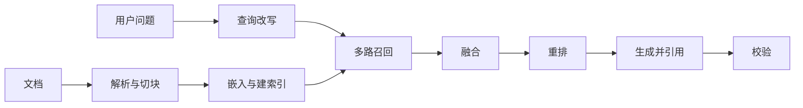

# RAG、搜索与 Deep Research

> 层级：通用层 · 预计 180 分钟 · 题目：[questions.md](questions.md)
> 前置：[04 工具调用、MCP 与 Skills](../04-tool-use-mcp/README.md)、[05 规划与推理](../05-planning-reasoning/README.md)

## 1 这一章解决什么问题

模型的参数知识有截止日期，也不知道你公司的内部文档。RAG（检索增强生成）先检索相关资料，再让模型依据资料回答。它是 Agent 岗面试里最常见的工程题：几乎每个人都做过，所以追问会很细。切块多大？BM25 的 k1 和 b 是干什么的？为什么不能把两路分数直接相加？交叉编码器为什么准、贵在哪？怎么证明改动让效果变好了？

只会说“向量库加 top-k 拼 prompt”的回答，在这些追问下会很快露底。这一章从检索的基本公式讲起，把每一步的机制、失败方式和验证方法讲清楚，再往上讲 Agentic RAG 和 Deep Research。

本库没有单独的搜索方向，这一章是全库唯一讲检索的章节。Search Agent 怎么用 RL 训练，见 [training/04 Agentic RL](../../tracks/training/04-agentic-rl/README.md)；多 Agent 的结构和成本，见 [08 多 Agent 系统](../08-multi-agent/README.md)。

学完你应该能：

- 画出 RAG 的完整链路，按环节说出失败的现象和排查顺序；
- 从定义推出 BM25 的三个部件：词频饱和、长度归一化、IDF，说清 k1 和 b 各控制什么；
- 说清双塔、晚交互（ColBERT）、交叉编码器的打分方式，算出它们的计算量差多少；
- 写出 RRF，解释 k = 60 的作用，以及为什么不能把两路分数直接相加；
- 对比几种切块方法，用一个例子说明固定长度切块为什么会丢掉跨块的指代；
- 讲出 HyDE、IRCoT、Self-RAG、CRAG 各解决什么问题；
- 按 Lost in the Middle 的结论排布上下文，设计 Deep Research 的停止条件；
- 设计 RAG 评测：检索侧用 Recall@k、MRR、nDCG，生成侧用忠实度和引用准确率。

**本章符号**（后文沿用）：

| 符号 | 含义 |
|---|---|
| q、d | 查询、文档（或块） |
| t | 一个词（token 或分词后的词） |
| tf(t, d) | 词 t 在文档 d 里出现的次数（词频） |
| dl、avgdl | 文档长度（词数）、语料里的平均文档长度 |
| N | 语料里的文档总数 |
| n(t) | 包含词 t 的文档数（文档频率） |
| k1、b | BM25 的两个参数：词频饱和速度、长度归一化强度 |
| E_q(·)、E_d(·) | 查询编码器、文档编码器，输出一个向量 |
| r_i(d) | 文档 d 在第 i 路检索结果里的名次，从 1 开始 |
| k | RRF 的平滑常数（论文取 60）；也用在 Recall@k 里表示截断位置，看上下文区分 |

## 2 RAG 链路与失败点

RAG 这个名字来自 Lewis 等（2020-05）：把预训练的生成模型（参数记忆）和一个用神经检索器搜索的维基百科向量索引（非参数记忆）组合起来。今天的工程链路比原论文长得多。



| 环节 | 常见失败 | 表现 | 本章位置 |
|---|---|---|---|
| 解析 | 表格、PDF 版面、扫描件解析错 | 检索到了也读不懂 | 第 12 节 |
| 切块 | 一个完整意思被切断；块里缺上下文 | 召回的块“看起来相关但答不了” | 第 3 节 |
| 嵌入 | 专有名词、编号、代码在向量空间里区分不开 | 搜“错误码 E1023”召回一堆别的错误码 | 第 4.2 节 |
| 召回 | 用户问法和文档写法差别大 | 相关文档没进候选集 | 第 4、6 节 |
| 重排 | 候选太多或太少；长块被截断 | 好文档排在后面被截掉 | 第 5 节 |
| 生成 | 模型不用检索结果，或混入参数知识；相关段落放在中间被忽略 | 答案和资料不符 | 第 9 节 |
| 引用 | 引用的段落不支持该句话 | 看起来有出处，其实没有 | 第 9 节 |

每个环节都是一个过滤器，一个环节丢掉的文档，后面所有环节都找不回来。所以端到端的正确率不会高于召回率，排查也按这个顺序从前往后：

1. 相关块有没有进召回候选？没有，问题在切块、嵌入或召回。
2. 进了候选，重排后还在不在前 k？不在，问题在重排或截断条数。
3. 进了上下文，模型用没用？没用，问题在上下文排布或生成。
4. 用了，引用对不对？不对，问题在引用校验。

面试时先画链路，再按环节说失败，比一上来讲某个技巧更有说服力。

## 3 切块

**问题**：块是检索的最小单位。块太大，一个块里混着几个话题，向量被稀释，检索不精确，还占上下文；块太小，丢了主语和前提，召回了也答不了问题。

| 方法 | 做法 | 适合 | 代价 |
|---|---|---|---|
| 固定长度 + 重叠 | 按 token 数切，相邻块重叠一部分 | 结构松散的长文本 | 会切断句子和段落；重叠只在切口恰好落进重叠区时有用 |
| 按结构切 | 按标题、段落、列表、代码函数切，块前加标题路径 | 文档有清楚结构，如手册、Wiki | 依赖解析质量；块长不均 |
| 语义切块 | 相邻句子 embedding 相似度骤降处切开 | 结构差但主题变化明显的文本 | 建索引时多一轮计算 |
| 父子块 | 用小块检索，返回它所在的大块 | 既要精确召回又要完整上下文 | 存储翻倍，上下文变长 |
| 加上下文 | 给每个块前面加一段说明它在全文中位置的文字 | 块单独看缺主语、缺时间 | 每块多一次模型调用 |

### 3.1 跨块引用：固定长度切块丢掉了什么

手册、合同、规范里，正文常用“本型号”“该条款”“上述方法”指代标题里的对象。主语在标题里，事实在正文里。按结构切并在块前加上标题路径，两者在同一个块里；按固定长度切，切口可能恰好落在标题和正文之间，事实所在的块里就没有主语。

这个块对“X200 的保修期”这样的查询有两种坏结果。一是检索不到：查询里的“X200”在这个块里不出现。二是检索到了也答错：块里写着“本型号保修期为两年”，模型不知道“本型号”是 X100 还是 X200。

下面的代码构造两个章节结构完全相同的型号，比较两种切块在 BM25 下的 top-1 命中率。“命中”要求块里同时有型号和事实。

```python
import math
from collections import Counter

# 一份虚构的产品手册：两个型号的章节结构相同，正文用“本型号”指代标题里的型号。
# 正文里的型号只出现在标题里，这就是“跨块引用”：正文的主语在另一个块。
manual = [
    ("X100 > 保修", "本型号 保修期 为 一年 人为 损坏 不在 保修 范围 内 维修 需 提供 购买 凭证"),
    ("X100 > 电池", "本型号 电池 容量 为 3000 毫安时 充满 约 需 两 小时"),
    ("X200 > 保修", "本型号 保修期 为 两年 人为 损坏 不在 保修 范围 内 维修 需 提供 购买 凭证"),
    ("X200 > 电池", "本型号 电池 容量 为 5000 毫安时 充满 约 需 三 小时"),
]


def fixed_chunks(size):
    """固定长度切块：把“标题 + 正文”拼成一条 token 流，每 size 个 token 切一刀，不重叠。"""
    stream = []
    for path, body in manual:
        stream += path.replace(">", " ").split() + body.split()
    return [" ".join(stream[i:i + size]) for i in range(0, len(stream), size)]


def structure_chunks():
    """按结构切块：一个小节一块，块前加上标题路径（结构化版的“加上下文”）。"""
    return [path.replace(">", " ") + " " + body for path, body in manual]


def bm25_rank(chunks, q, k1=1.2, b=0.75):
    D = [c.split() for c in chunks]
    N, avg = len(D), sum(map(len, D)) / len(D)
    df = Counter(t for d in D for t in set(d))
    def s(d):
        tf, B = Counter(d), 1 - b + b * len(d) / avg
        return sum(math.log(1 + (N - df[t] + 0.5) / (df[t] + 0.5)) * tf[t] * (k1 + 1) / (tf[t] + k1 * B)
                   for t in q.split() if tf[t])
    return sorted(range(N), key=lambda i: -s(D[i]))


def answers(chunk, fact):
    """块能回答问题 = 同时包含型号和事实（只有事实没有型号，读者分不清是哪个型号的）。"""
    return all(t in chunk.split() for t in fact)


tests = [   # (查询, 回答所需的 token)
    ("X200 保修期", ["X200", "两年"]),
    ("X100 保修期", ["X100", "一年"]),
    ("X200 电池 容量", ["X200", "5000"]),
    ("X100 电池 容量", ["X100", "3000"]),
]


def recall_at_1(chunks):
    hit = 0
    for q, fact in tests:
        top = chunks[bm25_rank(chunks, q)[0]]
        hit += answers(top, fact)
    return hit / len(tests)


fixed, struct = fixed_chunks(size=8), structure_chunks()
# 固定长度切块把“X200 保修”和“保修期 为 两年”切到了不同的块
assert any("X200" in c.split() and "两年" not in c.split() for c in fixed)
assert any("两年" in c.split() and "X200" not in c.split() for c in fixed)
r_fixed, r_struct = recall_at_1(fixed), recall_at_1(struct)
print("fixed", r_fixed, "structure", r_struct)
assert r_struct == 1.0 and r_fixed <= 0.5

# 块变大能缓解，但代价是块里混进别的小节，检索不精确：size=40 时一块装了两个小节
big = fixed_chunks(size=40)
assert any("X100" in c.split() and "X200" in c.split() for c in big)

# 重叠也只是在“切口刚好落在重叠区”时才救得回来；主语离事实越远，需要的重叠越大
def fixed_overlap(size, overlap):
    stream = []
    for path, body in manual:
        stream += path.replace(">", " ").split() + body.split()
    step = size - overlap
    return [" ".join(stream[i:i + size]) for i in range(0, len(stream), step)]

assert recall_at_1(fixed_overlap(8, 2)) < 1.0
```

结果：按结构切 4 题全对，固定 8 个 token 切只对 2 题。X200 的两道题都检索到了 X100 的块，因为“保修期”“电池 容量”这些词两个型号的块里都有，而 X200 的标题被切到了上一块的末尾。加 2 个 token 的重叠也救不回来。

### 3.2 Contextual Retrieval

上面的“块前加标题路径”是一种便宜的上下文补全，前提是文档有结构。更一般的做法是 Anthropic 的 Contextual Retrieval（2024-09）：把整篇文档和一个块交给模型，让它写一段说明这个块在全文中位置的文字，文章说通常 50-100 token，加在块前面，再同时建向量索引和 BM25 索引。

文章用 1 − recall@20（top-20 召回失败率）衡量，在几个知识领域上取平均：

| 配置 | 失败率 | 相对基线下降 |
|---|---|---|
| 基线（普通嵌入） | 5.7% | — |
| 上下文嵌入 | 3.7% | 35% |
| 上下文嵌入 + 上下文 BM25 | 2.9% | 49% |
| 再加重排（先取 150 条，重排后留 20 条） | 1.9% | 67% |

成本靠 prompt 缓存控制：整篇文档缓存一次，为每个块生成说明时复用。文章在“800 token 的块、8K token 的文档、50 token 的指令、每块 100 token 的上下文”的假设下，算出一次性成本为每百万文档 token 1.02 美元（2024-09 的价格）。文章还建议：知识库小于 20 万 token（约 500 页）时，可以不做 RAG，直接全放进 prompt。

切块大小没有通用最优值。DPR 把维基百科切成不重叠的 100 词段落，并报告重叠切分没有带来好处；这是它在自己数据上的结论，不能直接搬。要在自己的数据上，固定其他环节，只换切块方式和大小，用检索评测集比 Recall@k。

## 4 混合检索与融合

**问题**：召回要从几十万到上亿个块里快速找出几百个候选。主流做法有两类：按词匹配的稀疏检索（BM25）和按向量相似的稠密检索。两类的失败方式正好互补，所以生产系统一般两路都跑，再融合。这一节先把每一路的打分公式推出来，再讲怎么融合。

### 4.1 BM25：从词频到打分

BM25 来自 Robertson 等人的概率相关性框架，综述见 Robertson 和 Zaragoza（2009）。它的打分是查询里每个词的得分之和：

```text
score(q, d) = Σ_{t ∈ q}  IDF(t) · TF部分(t, d)
```

两部分分开推。

**IDF：越罕见的词越能区分文档。** 概率框架把一个词的权重定义为“相关文档里出现它”和“不相关文档里出现它”的对数几率比（RSJ 权重）：

```text
w(t) = log [ p (1 − q') / ( q' (1 − p) ) ]
  p  = P(t 出现 | 相关)        q' = P(t 出现 | 不相关)
```

没有相关性标注时，综述的处理是取 p = 0.5（等价于在 RSJ 公式里令 R = r = 0），并用全体文档近似不相关文档，q' ≈ n(t)/N。代入：

```text
w(t) = log [ (1 − q') / q' ] = log [ (N − n(t)) / n(t) ]
加 0.5 平滑，防止 n = 0 或 n = N 时出现无穷：
IDF_RSJ(t) = log [ (N − n(t) + 0.5) / (n(t) + 0.5) ]
```

这个式子在 n(t) > N/2 时为负：一个出现在一半以上文档里的词，出现反而扣分。Lucene 的实现改成 `log(1 + (N − n + 0.5)/(n + 0.5))`，恒为正，且仍随 n 单调递减（Lucene `BM25Similarity` 文档）。

**TF 部分之一：词频要饱和。** 综述用“精英性”（eliteness）解释词频：一篇文档要么是在讲这个词的主题（精英），要么只是顺带提到。词频是“是否精英”的带噪证据。在 2-Poisson 模型下推出的权重随 tf 增长，但有上限，极限就是“确知文档是精英”时的权重。综述把这叫饱和：一个词对文档得分的贡献，出现再多次也不会超过某个上限。BM25 用一个形状相近的简单函数近似它：

```text
tf / (k1 + tf)          k1 > 0 控制饱和速度
```

它有三个性质，代码里都会验证：

- tf = 0 时为 0，tf → ∞ 时趋于 1；
- tf = k1 时到达上限的一半，k1 越大饱和越慢；
- k1 → 0 时退化成“出现就算 1”的二值权重；k1 → ∞ 时 (k1+1)·tf/(k1+tf) → tf，退化成线性词频，也就是传统的 tf·idf。

饱和的实际后果是：查询有两个词时，两个词各出现一次的文档，胜过把一个词重复十次的文档。线性词频做不到这一点，关键词堆砌就能刷分。

**TF 部分之二：长度归一化。** 长文档的词频天然更高。综述给了两个极端假设。啰嗦假设：作者用更多的词说同样的事，此时应该把 tf 除以文档长度。范围假设：作者讲了更多的内容，此时长文档确实更可能相关，不该归一化。现实是两者的混合，所以用软归一化：

```text
B = (1 − b) + b · dl / avgdl        0 ≤ b ≤ 1
tf' = tf / B
```

b = 0 关掉归一化；b = 1 完全归一化，tf 按 dl/avgdl 等比例缩放。把 tf' 代入饱和函数，再乘 IDF，就是经典 BM25（综述式 3.15）：

```text
BM25(q, d) = Σ_{t∈q}  IDF(t) · tf(t,d) · (k1 + 1) / ( tf(t,d) + k1 · ((1 − b) + b · dl/avgdl) )
```

分子上的 (k1 + 1) 对所有词相同，不改变排序。综述说加它是为了让 tf = 1 时的权重和单独用 RSJ 权重一致。Lucene 当前的实现就省掉了这一项（源码里的 `doScore` 只算 `weight · freq / (freq + norm)`）。所以不同库的 BM25 绝对分数不能直接比。

**参数怎么取**：综述说模型本身不给设定方法，实验表明 0.5 < b < 0.8、1.2 < k1 < 2 在许多场景下效果不错，最优值和文档、查询类型有关。Lucene 的默认值是 k1 = 1.2、b = 0.75。

下面从零实现 BM25，并用 assert 验证饱和、长度归一化和 IDF 的性质。

```python
import math
from collections import Counter


class BM25:
    """docs 是已分好词的文档（空格分隔）。idf 用 Lucene 的写法，保证非负。"""

    def __init__(self, docs, k1=1.2, b=0.75):
        self.docs = [d.split() for d in docs]
        self.N = len(self.docs)
        self.avgdl = sum(len(d) for d in self.docs) / self.N
        self.df = Counter(t for d in self.docs for t in set(d))   # 文档频率 n(t)
        self.tf = [Counter(d) for d in self.docs]
        self.k1, self.b = k1, b

    def idf(self, t):
        n = self.df.get(t, 0)
        return math.log(1 + (self.N - n + 0.5) / (n + 0.5))

    def tf_part(self, tf, dl):
        B = 1 - self.b + self.b * dl / self.avgdl                 # 软长度归一化
        return tf * (self.k1 + 1) / (tf + self.k1 * B)            # 饱和函数，上限 k1+1

    def score(self, query, i):
        tf, dl = self.tf[i], len(self.docs[i])
        return sum(self.idf(t) * self.tf_part(tf[t], dl) for t in query.split() if tf[t] > 0)

    def search(self, query, k=10):
        s = [(self.score(query, i), i) for i in range(self.N)]
        return [i for sc, i in sorted(s, key=lambda x: (-x[0], x[1])) if sc > 0][:k]


filler = "说明 内容 包括 若干 普通 词语 用于 凑长度"
docs = [
    "退款 退款 退款 退款 退款 退款 退款 退款 退款 退款",          # 0 关键词堆砌
    "退款 期限 为 签收 后 十五 天",                                # 1 两个查询词各出现一次
    "期限 " + filler,                                              # 2
    "运费 由 买家 承担 " + filler,                                 # 3
]
bm = BM25(docs)
k1 = bm.k1

# 1) 词频饱和：同一个词多出现一次，增益越来越小，总贡献不超过 idf·(k1+1)
g = [bm.tf_part(tf, bm.avgdl) for tf in range(0, 1001)]          # dl = avgdl 时 B = 1
assert g[2] - g[1] > g[10] - g[9] > g[100] - g[99] > 0
assert g[1000] < k1 + 1 and abs(g[1000] - (k1 + 1)) < 0.01
assert abs(bm.tf_part(k1, bm.avgdl) - (k1 + 1) / 2) < 1e-12      # tf = k1·B 时到达上限的一半

# 2) 饱和的后果：查询“退款 期限”，两个词各出现一次的文档胜过把一个词堆 10 次的文档
assert bm.search("退款 期限")[0] == 1
# 对照：线性词频（tf·idf，不饱和）会把堆砌文档排第一
lin = lambda i: sum(bm.idf(t) * bm.tf[i][t] for t in "退款 期限".split())
assert max(range(4), key=lin) == 0

# 3) 长度归一化
short, pad = "退款 期限 十五 天", "退款 期限 十五 天 " + filler
twice = short + " " + short                                       # 把同一篇文档拼两遍
for b in (0.0, 0.75, 1.0):
    m = BM25([short, pad, twice, filler], b=b)
    s_short, s_pad, s_twice = (m.score("期限", i) for i in range(3))
    if b == 0.0:
        assert abs(s_short - s_pad) < 1e-12          # 不归一化：塞无关词不扣分
        assert s_twice > s_short                      # 词频翻倍就加分
    if b == 0.75:
        assert s_pad < s_short < s_twice              # 部分归一化
    if b == 1.0:
        assert abs(s_short - s_twice) < 1e-12         # 完全归一化：tf 和 dl 同时翻倍，分数不变
        assert s_pad < s_short

# 4) IDF：越罕见越重要；经典 RSJ 形式在 n > N/2 时为负，Lucene 加 1 后恒为正
N = 10
rsj = lambda n: math.log((N - n + 0.5) / (n + 0.5))
luc = lambda n: math.log(1 + (N - n + 0.5) / (n + 0.5))
assert rsj(1) > rsj(3) > rsj(4) > 0 and rsj(5) == 0 and 0 > rsj(6) > rsj(9)   # n = N/2 时恰为 0
assert all(luc(n) > 0 for n in range(N + 1))
assert all(luc(a) > luc(a + 1) for a in range(N))
print("BM25 ok", [round(bm.score('退款 期限', i), 3) for i in range(4)])
```

### 4.2 稠密检索：双塔与余弦

稠密检索用两个编码器把查询和文档各自压成一个 d 维向量，按向量相似度排序。DPR（Karpukhin 等，2020-04）是代表：

```text
sim(q, d) = E_q(q)ᵀ E_d(d)
```

DPR 论文明确说了为什么要这种形式：更有表达力的打分（比如多层交叉注意力）当然存在，但相似度函数必须可分解，文档的表示才能提前算好并建索引。可分解是双塔的全部意义：建索引时把每个文档过一遍文档塔，存下向量；查询时只过一遍查询塔，再在向量索引里找最近邻。

**余弦和点积**：向量做了 L2 归一化后，点积就等于余弦，取值在 [−1, 1]。不归一化时，点积还受向量长度影响。用哪个要和模型训练时一致，模型卡会写。

**训练：批内负样本。** 一个 batch 有 B 个（问题，正例段落）对。把 B 个问题向量和 B 个段落向量相乘，得到 B × B 的相似度矩阵，对角线是正例，其余都当负例。每个问题就有 B − 1 个负例，几乎不增加计算。DPR 最好的配置是批内负例再加一个 BM25 检索到的难负例。论文报告，在多个开放域问答数据集上，DPR 的 top-20 段落检索准确率比 Lucene-BM25 高 9 到 19 个百分点（绝对值）。

**稠密检索的盲区**：一个向量要装下整段的意思，训练目标又是让“意思相近”的文本靠近。形状相近、语义类别相同的编号（E1021、E1023、E1025），在这种目标下没有被推开的理由，常常挤在一起。罕见专有名词、代码标识符也类似。这是机制上的解释；第 4.5 节的代码用“所有编号映射到同一个概念”模拟它，展示 BM25 怎么补上。

### 4.3 晚交互：ColBERT

双塔把文档压成一个向量，再和查询比，细节在压缩时就丢了。ColBERT（Khattab 和 Zaharia，2020-04）保留每个 token 的向量，打分时再交互：

```text
S(q, d) = Σ_{i ∈ q 的 token}  max_{j ∈ d 的 token}  E_q,i · E_d,j        （MaxSim）
```

每个查询 token 在文档里找和自己最像的 token，取相似度，再对查询 token 求和。论文里的设置：

- 每个向量线性投影到 128 维并做 L2 归一化，点积即余弦；
- 查询固定 32 个 token，不足的用 BERT 的 `[mask]` 补齐，论文叫查询增广，让模型在补位上学出类似查询扩展的向量；
- 文档的 token 向量离线算好存盘，查询时只编码查询。

论文报告，做重排时它比当时基于 BERT 的排序模型快 170 倍以上，每次查询的 FLOPs 少约 14,000 倍，效果和它们相当。代价是存储：每个 token 一个向量。在 MS MARCO（约 900 万段落）上，128 维、每维 4 字节时索引占 286 GiB；压到 24 维、每维 2 字节时只要 27 GiB，MRR@10 只差 1%。

MaxSim 为什么比单向量好，第 5.2 节的代码给了一个构造例子：一篇讲八个话题的文档，单向量被稀释，MaxSim 不受影响。

### 4.4 两路为什么互补

| 检索方式 | 擅长 | 不擅长 | 索引 |
|---|---|---|---|
| 关键词（BM25） | 专有名词、编号、错误码、代码标识符 | 同义改写、跨语言 | 倒排表 |
| 稠密向量（双塔） | 措辞不同但意思相近 | 精确匹配、罕见词 | 每文档一个向量，近似最近邻索引 |
| 多向量（ColBERT） | 两者之间，按 token 级细粒度匹配 | 索引体积大 | 每 token 一个向量 |
| 结构化过滤 | 时间、类别、权限 | 无法表达语义 | 普通字段索引 |

Contextual Retrieval 文章描述的标准做法也是两路：BM25 找精确匹配，嵌入找语义相似，再用排名融合合并去重。

### 4.5 融合：RRF

两路结果怎么合并？最直觉的做法是分数相加，但两路分数的尺度不同：

- BM25 没有上限。它的值取决于 IDF（随语料的 N 和 n(t) 变化）、查询词个数、k1 和是否乘 (k1+1)。同一个文档换一个语料，分数就变。
- 余弦在 [−1, 1]，不同嵌入模型的分布也不一样，有的模型所有文档的余弦都挤在 0.7-0.9 之间。

直接相加时，尺度大的那一路说了算；把一路乘一个常数（换语料、换库时就会发生），融合排序就变了。min-max 归一化后加权可以缓解，但每个查询的分数分布不同，权重还要调。

**RRF**（Reciprocal Rank Fusion，Cormack、Clarke、Büttcher，SIGIR 2009）只看名次：

```text
RRF(d) = Σ_i  1 / (k + r_i(d))          论文取 k = 60
```

r_i(d) 是文档 d 在第 i 路里的名次，从 1 开始；某一路没有返回 d，就不加这一项。名次在任何单调变换下都不变，所以 RRF 对分数尺度完全不敏感。

**k 的作用**：论文说 k 用来削弱“个别系统把某个文档排得很高”的影响。推导一下：两路都排第 10 的文档得 2/(k+10)，只在一路排第 1 的得 1/(k+1)。令两者相等，k = 8。k > 8 时两路的共识胜出，k < 8 时单路第一胜出。k = 60 时第 1 名的贡献只比第 10 名多约 15%（70/61），所以“多路都靠前”比“某一路第一”更重要。论文的 k = 60 是在一组试点实验里定下、之后不再调整的；试点结果显示 60 接近最优，但取值并不关键。

下面在一个小语料上跑 BM25、模拟的嵌入和 RRF，计算 recall@3 和 MRR，并验证 RRF 对分数缩放不敏感、直接相加则敏感。

```python
import math
from collections import Counter
import numpy as np

# 小语料：虚构的设备售后知识库，已分词。查询和文档都去掉停用词，否则“了”这种词会让 BM25 命中无关文档
STOP = {"了", "的", "要", "再", "能", "不", "什么", "一次", "请", "时", "在", "后"}
toks = lambda s: [t for t in s.split() if t not in STOP]
docs = [
    "错误码 E1021 表示 电池 温度 过高",                       # 0
    "错误码 E1024 表示 网络 超时 请 检查 网络 连接",          # 1
    "错误码 E1025 表示 权限 不足 请 联系 管理员",             # 2
    "退款 一般 在 三 个 工作日 内 原路 返回",                 # 3
    "申请 退货 时 在 订单 页 点击 退货 按钮",                 # 4
    "设备 无法 开机 时 先 长按 电源 键 十 秒",                # 5
    "存储 空间 不足 会 导致 应用 闪退",                       # 6
    "修改 密码 后 所有 设备 需要 重新 登录",                  # 7
    "网络 连接 不稳定 时 建议 重启 路由器",                   # 8
    "固件 版本 V2.3.1 修复 了 蓝牙 断连 问题",                # 9
    "错误码 E1022 表示 风扇 故障",                            # 10
    "错误码 E1023 表示 磁盘 已满 请 清理 存储 空间",          # 11
]
queries = [                                   # (查询, 标注的相关文档)
    ("E1023", {11}),                          # 精确编号：BM25 的强项
    ("V2.3.1 修复 了 什么", {9}),              # 精确版本号
    ("钱 多久 能 退回", {3}),                  # 换了说法：嵌入的强项
    ("手机 打 不 开", {5}),
    ("账号 口令 改 了 要 再 登 一次", {7}),
    ("E1024 断网", {1, 8}),                    # 两个相关文档
    ("内存 满 了 软件 崩溃", {11, 6}),
]
N = len(docs)

# ---------- 第一路：BM25（Lucene 的 idf，k1=1.2，b=0.75） ----------
D = [toks(d) for d in docs]
avgdl = sum(map(len, D)) / N
df = Counter(t for d in D for t in set(d))
TF = [Counter(d) for d in D]


def bm25(q, i, k1=1.2, b=0.75):
    s, B = 0.0, 1 - b + b * len(D[i]) / avgdl
    for t in toks(q):
        if TF[i][t]:
            idf = math.log(1 + (N - df[t] + 0.5) / (df[t] + 0.5))
            s += idf * TF[i][t] * (k1 + 1) / (TF[i][t] + k1 * B)
    return s


# ---------- 第二路：模拟的稠密嵌入（双塔） ----------
# 嵌入模型学到了“同义词靠近”，但常把形状相似的编号压到同一片区域。
# 前者用“词 → 概念”映射模拟，后者把所有编号映射成同一个概念“编号”。
# 概念计数向量随机投影到 256 维再 L2 归一化，点积就是余弦。
concept = {
    "钱": "退款", "退回": "退款", "返回": "退款", "原路": "退款", "退款": "退款",
    "多久": "时间", "工作日": "时间", "秒": "时间",
    "手机": "设备", "设备": "设备", "打": "开机", "开": "开机", "开机": "开机", "电源": "开机",
    "账号": "账号", "登录": "登录", "登": "登录", "口令": "密码", "密码": "密码", "改": "修改", "修改": "修改",
    "断网": "网络", "网络": "网络", "连接": "网络", "路由器": "网络", "超时": "网络",
    "内存": "存储", "存储": "存储", "磁盘": "存储", "空间": "存储", "满": "满", "已满": "满", "不足": "满",
    "软件": "应用", "应用": "应用", "崩溃": "闪退", "闪退": "闪退",
    "固件": "版本", "版本": "版本", "修复": "修复", "蓝牙": "蓝牙",
}
is_code = lambda t: t[:1] in "EV" and any(c.isdigit() for c in t)
cvocab = sorted(set(concept.values()) | {"编号"})
R = np.random.default_rng(0).normal(size=(256, len(cvocab))) / 16   # 随机投影 (256, |概念|)


def embed(text):
    v = np.zeros(len(cvocab))
    for t in toks(text):
        c = "编号" if is_code(t) else concept.get(t)
        if c:
            v[cvocab.index(c)] += 1
    e = R @ v
    return e / (np.linalg.norm(e) + 1e-12)


Edoc = np.stack([embed(d) for d in docs])     # 文档塔：离线算好 (N, 256)


def rank(scores, keep=lambda s: True):
    return [i for i in sorted(range(N), key=lambda i: (-scores[i], i)) if keep(scores[i])]


def rrf(rankings, k=60):
    s = Counter()
    for r in rankings:
        for pos, i in enumerate(r, 1):        # 排名从 1 开始
            s[i] += 1 / (k + pos)
    return [i for i, _ in sorted(s.items(), key=lambda x: (-x[1], x[0]))]


def recall_at(r, rel, k):
    return len(set(r[:k]) & rel) / len(rel)


def mrr(r, rel):
    return next((1 / p for p, i in enumerate(r, 1) if i in rel), 0.0)


K = 3
runs = {"bm25": [], "dense": [], "rrf": []}
for q, rel in queries:
    sb = [bm25(q, i) for i in range(N)]
    sd = Edoc @ embed(q)                      # 查询塔：在线只编码查询
    rb = rank(sb, keep=lambda s: s > 0)       # BM25 只返回有词命中的文档
    rd = rank(sd)
    for name, r in (("bm25", rb), ("dense", rd), ("rrf", rrf([rb, rd]))):
        runs[name].append((recall_at(r, rel, K), mrr(r, rel)))
mean = {n: np.mean(v, 0) for n, v in runs.items()}
print({n: tuple(v.round(3)) for n, v in mean.items()})

# 1) 两路各有盲区
assert [x[0] for x in runs["bm25"][2:5]] == [0, 0, 0]     # 换说法的查询，BM25 一个词都没命中
assert runs["dense"][0] == (0.0, 0.2)                      # E1023 在嵌入里和 E1021、E1022 挤在一起，排第 5
# 2) RRF 融合后的 recall@3 不低于较好的一路，MRR 也更高（这个构造的例子上）
assert mean["rrf"][0] >= max(mean["bm25"][0], mean["dense"][0])
assert mean["rrf"][1] > max(mean["bm25"][1], mean["dense"][1])
assert abs(mean["rrf"][0] - 6.5 / 7) < 1e-12 and abs(mean["dense"][0] - 5.5 / 7) < 1e-12

# 3) 为什么不直接把分数相加：相加的结果取决于两路分数的尺度，RRF 只看名次。
#    把 BM25 分数整体乘 0.1（换一个语料、换 k1，BM25 的绝对值就会变），名次不变，
#    RRF 结果不变，“分数相加”的排序却变了
def fused_sum(q, scale):
    sb = [scale * bm25(q, i) for i in range(N)]
    return rank([a + b for a, b in zip(sb, Edoc @ embed(q))])

def fused_rrf(q, scale):
    sb = [scale * bm25(q, i) for i in range(N)]
    return rrf([rank(sb, keep=lambda s: s > 0), rank(Edoc @ embed(q))])

q = "E1023"
assert fused_rrf(q, 1.0) == fused_rrf(q, 0.1)
assert fused_sum(q, 1.0)[0] == 11 and fused_sum(q, 0.1)[0] != 11   # 缩小后被嵌入的并列第一盖过
bm_max = max(bm25(q, i) for q, _ in queries for i in range(N))
assert bm_max > 2                                             # BM25 分数没有上限，余弦在 [-1, 1]

# 4) RRF 的 k：两路都排第 10，和只在一路排第 1，谁分高？
one_top, both_tenth = (lambda k: 1 / (k + 1)), (lambda k: 2 / (k + 10))
assert both_tenth(60) > one_top(60)       # k=60：2/70 ≈ 0.0286 > 1/61 ≈ 0.0164，两路的共识胜出
assert one_top(0) > both_tenth(0)         # k=0：1 > 0.2，单路第一胜出
assert abs(one_top(8) - both_tenth(8)) < 1e-12               # 交点 k = 8
assert abs((1 / 61) / (1 / 70) - 1.1475) < 1e-3              # k=60 时第 1 名只比第 10 名多 15%
```

这个例子是构造的：BM25 对三条换说法的查询一个词都没命中，嵌入把 E1023 和另外两个错误码搅在一起。RRF 的 recall@3 是 6.5/7，高于嵌入的 5.5/7，MRR 也更高。RRF 不保证在所有数据上都不低于较好的一路：如果一路很差，又把很多错误文档排在前面，融合会把它们带进来。所以融合后仍要在自己的评测集上比。

### 4.6 权限过滤要在检索层做

企业知识库问答里，用户只能看到有权限的文档。如果检索后再让模型“别说出来”，信息已经进了上下文；如果检索后再删，删完可能一条不剩。正确做法是把用户的可读范围作为过滤条件，交给向量检索和 BM25，召回阶段就只看得到有权文档。完整设计见 [design/01 企业知识库问答](../../design/01-enterprise-kb-qa/README.md)。

## 5 重排

**问题**：召回阶段为了快，查询和文档是分开编码的（双塔）或只按词匹配（BM25），精度有限。好文档常常进了前 150，却没进前 10。

### 5.1 交叉编码器为什么更准

交叉编码器把查询和文档拼成一个序列送进模型，直接输出相关度。monoBERT（Nogueira 和 Cho，2019-01）是早期代表：查询作句子 A、段落作句子 B，查询截断到 64 个 token，拼接后总长不超过 512 个 token；取 `[CLS]` 向量过一个单层网络，输出“相关”的概率；对 BM25 返回的前 1000 个段落逐个打分后重新排序。

它准的原因在结构上：

- **每一层都有查询和文档之间的注意力。** 查询里的“期限”可以直接看文档里的“十五天”，文档里的“本型号”可以看查询里的型号。双塔里，两边在最后一步点积之前互相看不见。
- **文档表示依赖查询。** 同一篇文档，面对不同的查询，模型关注的部分不同。双塔必须提前把文档压成一个和查询无关的向量，一个向量要服务所有可能的查询。
- **代价就是不可分解。** 分数不能写成 f(q)·g(d)，文档侧没有任何东西能提前算。DPR 论文选择双塔，正是为了换取可分解性（第 4.2 节）。

### 5.2 代价有多大

推导：设模型参数量为 P，每个 token 前向约 2P FLOPs（忽略注意力的二次项），查询 L_q 个 token、文档 L_d 个 token、候选 n 条。

```text
双塔（在线部分）      ≈ 2P · L_q  +  n · 2d             只编码查询，再做 n 次 d 维点积
ColBERT（在线部分）   ≈ 2P · L_q  +  n · L_q · L_d · 2m   m 是 token 向量维度
交叉编码器            ≈ n · 2P · (L_q + L_d)             每个候选整段过一遍模型

交叉编码器 / 双塔 ≈ n · (L_q + L_d) / L_q
```

代入 P = 1.1 亿（BERT-base 量级）、L_q = 32、L_d = 180、n = 150：比值约 1000。也就是说，给 150 个候选做交叉编码器重排的计算量，大约是一次双塔查询的一千倍，而且和 n 成正比。所以它只能放在召回之后、对少量候选使用。

下面的代码验证两件事：一是 MaxSim 能处理单向量被多话题稀释的情况；二是上面的计算量估算。

```python
import numpy as np

rng = np.random.default_rng(0)
dim = 64
# 词向量表：每个“概念”一个单位向量，两两正交（理想化：不同概念完全不相似）
vocab = ["保修", "期限", "电池", "容量", "屏幕", "尺寸", "颜色", "重量", "价格", "售后"]
W = np.linalg.qr(rng.normal(size=(dim, len(vocab))))[0].T   # (10, 64)，行向量两两正交、长度为 1
vec = {w: W[i] for i, w in enumerate(vocab)}
unit = lambda x: x / np.linalg.norm(x)

# 文档 A：一篇“规格总表”，八个话题各一句，其中有“保修 期限”
docA = ["电池", "容量", "屏幕", "尺寸", "颜色", "重量", "价格", "保修", "期限"]
# 文档 B：一句只提到“保修”的短文，没说期限，答不了问题
docB = ["保修"]
query = ["保修", "期限"]

# 1) 双塔（单向量）：文档先压成一个向量，和查询无关。话题越多，每个话题被稀释得越厉害
single = lambda toks: unit(np.mean([vec[t] for t in toks], 0))
cos_A, cos_B = single(query) @ single(docA), single(query) @ single(docB)

# 2) 晚交互（ColBERT 的 MaxSim）：每个查询 token 找文档里最像的 token，再求和
def maxsim(q, d):
    Q, D = np.stack([vec[t] for t in q]), np.stack([vec[t] for t in d])   # (Lq, dim), (Ld, dim)
    return (Q @ D.T).max(1).sum()                                          # (Lq, Ld) → (Lq,) → 标量
ms_A, ms_B = maxsim(query, docA), maxsim(query, docB)

print(f"单向量 cos: A={cos_A:.3f} B={cos_B:.3f}   MaxSim: A={ms_A:.3f} B={ms_B:.3f}")
assert abs(ms_A - 2) < 1e-9               # 两个查询词都在 A 里找到了自己：每个贡献 1
assert ms_A > ms_B                       # MaxSim 把真正能回答的 A 排第一
assert cos_B > cos_A                     # 单向量把只沾一个词的 B 排第一：A 被 7 个无关话题稀释
assert abs(cos_A - 2 / np.sqrt(2 * 9)) < 1e-9   # 正交时 cos_A = 2/√(2·9) ≈ 0.471
assert abs(cos_B - 1 / np.sqrt(2)) < 1e-9       # cos_B = 1/√2 ≈ 0.707

# 3) 双塔能离线算的原因：分数可以分解成 f(q)·g(d)，g(d) 不依赖查询
G = np.stack([single(d) for d in (docA, docB)])        # 建索引时算好 (n_docs, dim)
assert np.allclose(G @ single(query), [cos_A, cos_B])  # 在线只编码查询，再做一次矩阵乘

# 4) 代价估算（推导，BERT-base 约 1.1 亿参数 P，每 token 约 2P FLOPs，忽略注意力的二次项）
N_param, Lq, Ld, n_cand = 110e6, 32, 180, 150
cross = n_cand * 2 * N_param * (Lq + Ld)    # 每个候选都要把 (查询 + 文档) 整段过一遍模型
bi = 2 * N_param * Lq + n_cand * 768 * 2     # 只编码查询，再做 150 次 768 维点积
colbert = 2 * N_param * Lq + n_cand * Lq * Ld * 128 * 2   # 编码查询 + MaxSim（128 维，ColBERT 论文的设置）
print(f"cross={cross:.2e} bi={bi:.2e} colbert={colbert:.2e} FLOPs")
# 比值 ≈ n_cand·(Lq+Ld)/Lq = 150·212/32 ≈ 994：交叉编码器比双塔贵约三个数量级
assert abs(cross / bi - n_cand * (Lq + Ld) / Lq) / (cross / bi) < 0.01 and cross / bi > 900
assert bi < colbert < cross
assert cross / colbert > 100
# 交叉编码器的成本和候选数成正比，所以只能用在召回后的少量候选上
assert abs(n_cand * 2 * N_param * (Lq + Ld) / (2 * N_param * (Lq + Ld)) - 150) < 1e-9

# 5) ColBERT 的存储代价：每个 token 存一个向量，而不是每个文档一个
n_docs, tok_per_doc = 9_000_000, 70          # 约 900 万段落（MS MARCO 规模），平均 token 数为假设值
single_bytes = n_docs * 768 * 4
colbert_bytes = n_docs * tok_per_doc * 128 * 2
assert colbert_bytes / single_bytes > 5      # 每段落 70 个 128 维 FP16 向量，是单个 768 维 FP32 向量的约 5.8 倍
```

### 5.3 几类重排器

| 类型 | 做法 | 精度 | 速度 |
|---|---|---|---|
| 双塔（召回用） | 查询和文档分别编码，算相似度 | 低 | 快，文档向量可预先算好 |
| 晚交互（ColBERT） | 分别编码，但保留 token 级向量，最后做 MaxSim | 中 | 中，存储大 |
| 交叉编码器 | 查询和文档拼在一起送进模型打分 | 高 | 慢，每对都要算一次 |
| LLM 重排 | 让大模型判断相关性或排序 | 高 | 最慢、最贵，还受候选顺序和长度影响 |

典型做法是两段式：先召回较多候选（例如上百条），再用重排模型选出少量（例如十几条）放进上下文。Contextual Retrieval 文章用的是先取 150 条、重排后留 20 条；它还比较了最终放 5、10、20 条，20 条最好，但这和数据与模型相关，要自己试。

## 6 查询改写与多跳

**问题**：用户的问题和文档的写法不一样，或者一个问题需要好几步才能查清。

| 方法 | 做法 | 适合 | 代价 |
|---|---|---|---|
| 改写 | 补全指代、去口语化，例如把“它的退款期限”改成“X 产品的退款期限” | 多轮对话 | 改写错会带偏检索 |
| 多查询 | 生成几个不同表述，分别检索再用 RRF 融合 | 问法多样 | 检索次数成倍 |
| HyDE | 先让模型写一个假想答案，用它的 embedding 去检索真实文档 | 问题短、文档长，两者措辞差别大 | 多一次生成；假答案可能把检索带偏 |
| 分解 | 把复合问题拆成子问题分别检索 | “A 和 B 的保修政策有什么区别” | 拆错就全错 |
| 交替检索（IRCoT） | 推理一步，用这一步的结果再检索，循环 | 多跳问题，下一步查什么取决于上一步 | 延迟随跳数增加 |

**HyDE**（Gao 等，2022-12）解决的是“查询和文档不在一个分布上”：问题是短句，答案段落是陈述句。它让指令模型（论文用 InstructGPT，温度 0.7）按指令写几篇“假想文档”，用无监督对比学习训练的编码器（Contriever）编码，把它们的向量和查询本身的向量取平均作为检索向量：

```text
v_q = 1/(N+1) · [ Σ_{k=1..N} f(d̂_k) + f(q) ]
```

论文的解释是：假想文档里可能有错误细节，但编码器的稠密瓶颈像一个有损压缩器，会把这些细节过滤掉；用这个向量在语料里找最近邻，找回的仍是真实文档。所以 HyDE 的输出是语料里的真文档，假答案只用来定位。它的风险是：模型对问题理解错时，假答案会把检索带到错误的区域。

**IRCoT**（Trivedi 等，2022-12）处理的是多跳：第二跳查什么，要等第一跳的结果。流程是：

1. 先用问题本身检索一批段落；
2. 推理步：根据问题、已检索的段落和已写的思维链，写下一句思维链；
3. 检索步：用刚写的那一句当查询，再检索一批段落，加进已收集的集合；
4. 重复 2、3，直到思维链里出现 “answer is”，或者步数到上限（论文实验设为 8）。已收集段落总数也有上限（论文设为 15），为了给少样本示例留出上下文。

## 7 Agentic RAG

**问题**：固定流程的 RAG 每个问题都检索一次、取固定条数。有的问题不需要检索，有的问题检索一次不够，有的检索结果根本不相关。

**做法**：把检索变成 Agent 的一个工具，或者训练模型自己判断检索结果，由模型决定查不查、查什么、查几次、结果够不够。

| 方法 | 做法 | 出处 |
|---|---|---|
| Self-RAG | 训练模型输出特殊的反思 token，自己决定何时检索，并评价检索段落和自己的输出 | Asai 等，2023-10 |
| CRAG | 用一个轻量评估器给检索结果打分，按置信度决定直接用、改用网页搜索，或者两者结合 | Yan 等，2024-01 |
| Search-o1 | 推理模型在推理中途遇到不确定时发起搜索，用单独的模块先把长而杂的文档提炼后再放回推理链 | Li 等，2025-01 |
| Search-R1 | 用 RL 训练模型在推理中多次发起搜索；检索回来的 token 在 loss 中屏蔽；只用结果奖励 | Jin 等，2025-03 |

**Self-RAG 的四类反思 token**：

| token | 取值 | 判断什么 |
|---|---|---|
| Retrieve | yes / no / continue | 现在要不要检索 |
| IsRel | relevant / irrelevant | 检索到的段落对解题有没有用 |
| IsSup | fully supported / partially supported / no support | 生成的内容是否被段落支持 |
| IsUse | 5 到 1 | 整体回答有多有用 |

推理时，模型先预测 Retrieve；要检索时，对每个段落并行生成候选，再按 IsRel、IsSup、IsUse 给候选排序。因为这些判断是模型输出的 token，推理时可以调整它们的权重，控制“更重视有出处”还是“更重视流畅”。

**CRAG 的三档动作**：评估器用 T5-large 初始化后微调，论文强调它只有 0.77B，比 Self-RAG 的 7B 评判模型轻得多。它给每个检索文档一个置信分，设上下两个阈值：

- 至少一个文档高于上阈值，判为 Correct：把文档拆成细粒度的知识条，过滤掉无关条，再重组；
- 全部低于下阈值，判为 Incorrect：丢掉检索结果，改用网页搜索；
- 介于两者之间，判为 Ambiguous：两种知识都用。

Search-R1 的训练细节（多轮 rollout、检索 token 的 loss mask、奖励设计）见 [training/04 第 6 节](../../tracks/training/04-agentic-rl/README.md#6-search-agent-的-rl以-search-r1-为例)和[论文精读](../../papers/08-search-r1.md)。

| | 固定流程 RAG | Agentic RAG |
|---|---|---|
| 检索次数 | 固定 | 模型决定 |
| 多跳 | 要专门设计 | 自然支持 |
| 延迟和成本 | 可预测 | 不可预测，要设上限 |
| 调试 | 简单 | 要看完整轨迹 |
| 适合 | 问题类型集中的问答 | 开放问题、多跳、需要判断资料够不够 |

选型和 [02 章](../02-agent-architecture/README.md) 一样：固定流程能解决就别上 Agent。大多数企业知识库问答，固定流程加好的检索就够了。

**另一种选择：让 Agent 直接搜文件**。编程助手常用 grep、读文件这类工具代替向量检索：代码里的标识符精确，文件结构清楚，而且代码一直在变，索引容易过时。代价是每次搜索都要多轮工具调用。

**GraphRAG**（Edge 等，2024-04）解决的是另一类问题：“这批文档的主要主题是什么”这种全局问题，答案不在任何一个段落里。做法是用模型从文档中抽取实体关系图，按社区预先写摘要，查询时各社区摘要分别生成部分答案再汇总。代价是建图成本高，文档更新时要重建。

## 8 Deep Research

**问题**：有些问题一次检索装不下，需要像研究员一样：拆问题、多轮搜索、交叉验证、写成带引用的报告。

### 8.1 流程

Anthropic 公开过其研究功能的结构（2025-06）：

1. 主 Agent 先想清楚做法，把计划存进记忆。原因是上下文超过 20 万 token 会被截断，计划不能丢。
2. 主 Agent 派出若干子 Agent，每个子 Agent 拿到一个具体的研究任务，在自己的上下文里独立搜索、评估工具结果，再把发现交回。
3. 主 Agent 汇总结果，判断要不要继续研究。要继续就派新的子 Agent 或调整策略。
4. 信息够了，退出研究循环，把所有发现交给引用 Agent。引用 Agent 在文档和报告里找到每个论断对应的出处位置。

文章还给了两条搜索策略。第一，按复杂度分配投入：简单事实查询用 1 个 Agent、3-10 次工具调用；直接比较用 2-4 个子 Agent，各 10-15 次；复杂研究用 10 个以上子 Agent。第二，先宽后窄：Agent 默认会写又长又具体的查询，返回很少结果；文章的做法是提示它先用短而宽的查询看看有什么，再逐步收窄。

角色分工、token 成本和并行带来的问题见 [08 多 Agent 系统](../08-multi-agent/README.md)，整题设计见 [design/03 Deep Research](../../design/03-deep-research/README.md)。

### 8.2 停止条件

停止条件是 Deep Research 设计的核心难点。文章提到早期的失败：简单查询派出 50 个子 Agent；为不存在的来源没完没了地搜网页。要同时设以下四类条件，任何一类触发都停：

- 预算上限：token、工具调用次数、时间；
- 覆盖条件：计划里的每个子问题都有至少一个可靠来源；
- 收益递减：连续几轮搜索没有新信息就停；
- 冲突处理：来源互相矛盾时，要么继续查权威来源，要么在报告里明确写出分歧。

“新信息”要按内容去重来判断，不能按调用次数或返回条数判断：换一个说法搜到同一篇文章，不算新信息。下面的模拟里，三类条件谁先触发，取决于参数。

```python
# Deep Research 的停止条件：预算、覆盖、收益递减，任何一个触发都停
def research(new_facts_per_round, subqs, budget_calls=30, calls_per_round=5, patience=2):
    covered, seen, calls, stale = set(), set(), 0, 0
    for r, (facts, hit_subqs) in enumerate(new_facts_per_round):
        if calls + calls_per_round > budget_calls:
            return "budget", r
        calls += calls_per_round
        fresh = set(facts) - seen
        seen |= fresh
        covered |= set(hit_subqs)
        if covered >= subqs:
            return "covered", r + 1
        stale = 0 if fresh else stale + 1
        if stale >= patience:
            return "no_new_info", r + 1
    return "exhausted", len(new_facts_per_round)

subqs = {"a", "b", "c"}
# 第 1、2 轮有新发现，之后两轮都是重复内容，子问题 c 始终查不到
rounds = [(["f1", "f2"], ["a"]), (["f3"], ["b"]), (["f1"], []), (["f2", "f3"], []), (["f9"], ["c"])]
assert research(rounds, subqs) == ("no_new_info", 4)          # 收益递减先触发
assert research(rounds, subqs, patience=3) == ("covered", 5)  # 放宽耐心，第 5 轮覆盖全部子问题
assert research(rounds, subqs, budget_calls=12, patience=3) == ("budget", 2)   # 预算先触发
```

这说明停止条件的参数要和预算一起调：耐心太短，查不到最后一个子问题就停了；预算太紧，有新信息也停了。停下时还有子问题没覆盖，报告里要写明。

## 9 引用与可溯源

**问题**：答案附了引用，但引用的段落并不支持那句话；或者相关段落进了上下文，模型却没用上。

### 9.1 上下文排布：Lost in the Middle

Liu 等（2023-07）做了一个控制实验：多文档问答里只有一篇文档含答案，改变它在输入里的位置。论文报告的结论：

- 性能曲线呈 U 形。相关信息在输入的最开头（首因效应）或最末尾（近因效应）时效果最好，在中间时明显下降。
- 中间位置的效果可以比不给任何文档还差。论文报告，有的模型在相关文档放在中间时，多文档问答的表现低于闭卷设置（不给文档）。
- 多给文档的收益很快饱和。论文在 NaturalQuestions-Open 上发现，检索器的召回还在涨，模型的表现早已不涨：文档从 20 篇加到 50 篇，读者模型只多答对一两个百分点。
- 长上下文版本的模型，在这项任务上的表现和对应的短上下文版本常常一样。

工程上的推论：

1. 不要把重排后的所有候选都塞进去。召回率高不等于模型能用上，条数要在端到端评测上定。
2. 最相关的放在两端，最不相关的放中间。按重排结果交错放到开头和结尾即可。
3. 当前问题放在检索结果之后，紧挨着末尾；上下文装配的顺序和前缀缓存的关系见 [03 第 6 节](../03-prompt-context/README.md#6-上下文装配顺序与前缀缓存)。

### 9.2 引用校验

| 做法 | 作用 |
|---|---|
| 检索结果带稳定 ID 放进上下文，要求每句话标 ID | 引用可以机器校验 |
| 生成后逐句校验：被引段落是否蕴含这句话 | 发现无依据的句子和引错段落 |
| 资料里没有就说没有 | 减少用参数知识补空 |
| 按第 9.1 节排布上下文 | 减少“资料在但没被用上” |
| 来源质量过滤 | Anthropic 的研究系统早期就出现过偏好 SEO 内容农场、忽视学术 PDF 等权威来源的问题，在提示词里加入来源质量规则后解决 |

逐句校验要区分两件事。**忠实度**问的是：这句话能不能从整个上下文推出？**引用准确率**问的是：这句话能不能从它引用的那一段推出？内容对但引错了段落，前者算对、后者算错。下面的代码模拟这两个指标，并演示交错排布。

```python
# 生成侧：上下文排布、引用校验、忠实度。都是机制的最小模拟。

# 1) 上下文排布：Lost in the Middle 说开头和结尾最容易被用上。
#    把按相关度排好的列表交错放到两端，最相关的在两头，最不相关的在中间
def edge_order(ranked):
    head, tail = [], []
    for i, x in enumerate(ranked):
        (head if i % 2 == 0 else tail).append(x)
    return head + tail[::-1]

ranked = ["d1", "d2", "d3", "d4", "d5", "d6"]          # d1 最相关
ctx = edge_order(ranked)
assert ctx == ["d1", "d3", "d5", "d6", "d4", "d2"]
assert {ctx[0], ctx[-1]} == {"d1", "d2"}                # 前两名在两端
assert set(ctx[2:4]) == {"d5", "d6"}                    # 最不相关的在中间


# 2) 引用校验 + Ragas 式忠实度 F = |V| / |S|：S 是答案拆出的论断，V 是被上下文支持的那些。
#    真实系统用模型判断“段落是否蕴含论断”；这里用“论断的实词全在被引段落里”做替身
passages = {
    "p1": "X200 保修期 为 两年",
    "p2": "X200 电池 容量 为 5000 毫安时",
}
claims = [                                    # (论断, 它引用的段落)
    ("X200 保修期 两年", "p1"),               # 支持
    ("X200 电池 容量 5000 毫安时", "p2"),     # 支持
    ("X200 防水 等级 IP68", "p2"),            # 有引用，但段落不支持：看起来有出处，其实没有
    ("X200 电池 容量 5000 毫安时", "p1"),     # 内容对，引用错了段落
]
supported = lambda claim, pid: set(claim.split()) <= set(passages[pid].split())
ctx_text = " ".join(passages.values()).split()
faithful = [set(c.split()) <= set(ctx_text) for c, _ in claims]     # 忠实度只看“整个上下文”
cite_ok = [supported(c, p) for c, p in claims]                       # 引用准确率看“被引的那段”
F = sum(faithful) / len(claims)
cite_acc = sum(cite_ok) / len(claims)
assert F == 0.75 and cite_acc == 0.5          # 两个指标不同：内容忠实不等于引用正确
```

## 10 RAG 评测

**问题**：改了切块或换了 embedding，怎么证明效果变好了？

检索侧和生成侧要分开测，否则定位不了问题。

| 层 | 指标 | 要什么数据 |
|---|---|---|
| 检索 | Recall@k、MRR、nDCG | 问题和相关文档的标注 |
| 上下文 | 上下文是否包含答案所需信息；无关内容占比 | 问题和参考答案 |
| 生成：忠实度 | 答案里的每个论断能否从检索内容推出 | 不需要参考答案，可用模型判断 |
| 生成：相关性 | 答案是否回答了问题 | 不需要参考答案 |
| 端到端 | 答案正确率、引用准确率、拒答是否恰当 | 参考答案 |

### 10.1 检索指标的定义

设一个查询的相关文档集合为 Rel，系统返回的排序列表为 L。

```text
Recall@k = |L 的前 k 个 ∩ Rel| / |Rel|                  前 k 个里找回了多少相关文档
MRR      = 对所有查询取平均( 1 / 第一个相关文档的名次 )    没找到记 0
nDCG@k   = DCG@k / IDCG@k
  DCG@k  = Σ_{i=1..k} rel_i / log2(i + 1)                rel_i 是第 i 位的相关度，二值时取 0 或 1
  IDCG@k = 把相关文档全排在最前面时的 DCG@k
```

三者看的东西不同。Recall@k 只问“有没有进前 k”，不管顺序，适合衡量召回阶段：后面还有重排，进了候选就有机会。MRR 只看第一个相关文档，适合只有一个正确答案、用户只看第一条的场景。nDCG 对每个位置都加权，越靠前权重越大，适合有多个相关文档、顺序重要的场景。RAG 的召回阶段主要看 Recall@k（k 取送进重排的条数），重排后看送进上下文那几条的 Recall 或 nDCG。

### 10.2 Ragas 的三个指标

Ragas（Es 等，2023-09）提出了一套不需要人工标注参考答案的指标，都用模型来判断：

- **忠实度** F = |V| / |S|。先让模型把答案拆成若干简短论断 S，再逐条判断能否从上下文推出，V 是被支持的那些。
- **答案相关性** AR = (1/n) Σ sim(q, q_i)。让模型根据答案反推 n 个可能的问题 q_i，计算它们和原问题 q 的嵌入余弦，取平均。答案不完整或有多余内容，反推出的问题就会偏离原问题。它不管答案对不对。
- **上下文相关性** CR = 抽出的句子数 / 上下文总句子数。让模型从上下文里抽出回答问题所必需的句子。CR 低说明上下文里有大量冗余，浪费 token，还可能干扰生成。

用模型当评委有位置偏差、冗长偏差等问题，要和人工标注对一致性，见 [evaluation/02 LLM-as-Judge](../../tracks/evaluation/02-llm-as-judge/README.md)。

### 10.3 评测集与 Deep Research 的评测

评测集从线上真实问题抽样，人工标注相关文档和参考答案；可以补充模型生成的合成问题，但要人工抽检。要专门放三类题：无答案题（测拒答）、权限题（测过滤）、多跳题。

Deep Research 类任务没有唯一答案。BrowseComp（Wei 等，2025-04）用 1266 道“很难找、但答案短且容易核对”的问题测浏览 Agent 的检索能力；它不测长文写作。长报告的评测通常用评委模型按事实准确、引用准确、完整性、来源质量打分，再加人工抽检。Anthropic 的文章提到，早期从约 20 条代表真实使用的查询起步就能看出大改动的效果。

## 11 数值例子

用一组能手算的数字把 BM25、RRF 和三个检索指标走一遍。

**BM25 单个词的分数**。语料 N = 1000 篇，词 t 出现在 n = 10 篇里，k1 = 1.2，b = 0.75。

```text
IDF = log(1 + (1000 − 10 + 0.5) / (10 + 0.5)) = log(1 + 94.33) = 4.557

文档长度等于平均长度（B = 1）时，TF 部分 = tf · 2.2 / (tf + 1.2)：
  tf = 1 → 1.000     tf = 2 → 1.375     tf = 5 → 1.774     tf = 10 → 1.964     上限 2.2

tf = 2，文档长一倍（B = 0.25 + 0.75·2 = 1.75）：2·2.2 / (2 + 2.1) = 1.073
tf = 2，文档短一半（B = 0.25 + 0.75·0.5 = 0.625）：2·2.2 / (2 + 0.75) = 1.600
```

词频从 1 涨到 10，得分只从 1.0 涨到 1.96。同样出现 2 次，在长一倍的文档里得分少 22%。

**RRF**。BM25 返回 [A, B, C]，嵌入返回 [B, D, E]，k = 60：

```text
B = 1/62 + 1/61 = 0.03252      A = 1/61 = 0.01639      D = 1/62 = 0.01613
C = 1/63 = 0.01587             E = 1/63 = 0.01587
融合顺序：B, A, D, C, E
```

如果直接相加原始分数，BM25 给 A、B、C 的是 12.0、7.5、3.1，嵌入给 B、D、E 的余弦是 0.82、0.80、0.78，相加后的顺序就是 BM25 自己的顺序，嵌入那一路几乎不起作用。

**指标**。相关文档是 {B, D}：

```text
只用 BM25 [A, B, C]：Recall@3 = 1/2，MRR = 1/2
RRF [B, A, D, C, E]：Recall@3 = 2/2，MRR = 1
                     nDCG@3 = (1/log2 2 + 1/log2 4) / (1/log2 2 + 1/log2 3) = 1.5 / 1.631 = 0.920
```

nDCG 不到 1，是因为 D 排在第 3 位而不是第 2 位。

```python
import math

# 1) BM25 单个词的分数，手算核对。N=1000 篇文档，这个词出现在 n=10 篇里；k1=1.2，b=0.75
N, n, k1, b = 1000, 10, 1.2, 0.75
idf = math.log(1 + (N - n + 0.5) / (n + 0.5))
assert round(idf, 3) == 4.557
tf_part = lambda tf, ratio: tf * (k1 + 1) / (tf + k1 * (1 - b + b * ratio))   # ratio = dl/avgdl
assert [round(tf_part(t, 1.0), 3) for t in (1, 2, 5, 10)] == [1.0, 1.375, 1.774, 1.964]
assert round(tf_part(2, 2.0), 3) == 1.073          # 文档长一倍：B = 1.75，tf=2 的得分从 1.375 降到 1.073
assert round(tf_part(2, 0.5), 3) == 1.6            # 文档短一半：B = 0.625，得分升到 1.6
assert round(idf * tf_part(2, 1.0), 3) == 6.266

# 2) RRF 手算：两路各给 3 条
bm25_list, dense_list = ["A", "B", "C"], ["B", "D", "E"]
score = {}
for lst in (bm25_list, dense_list):
    for r, d in enumerate(lst, 1):
        score[d] = score.get(d, 0) + 1 / (60 + r)
fused = sorted(score, key=lambda d: (-score[d], d))
assert fused == ["B", "A", "D", "C", "E"]
assert round(score["B"], 5) == 0.03252 and round(score["A"], 5) == 0.01639

# 对照：原始分数直接相加。BM25 分数是几分到十几分，余弦不到 1，嵌入那一路几乎不起作用
bm25_s = {"A": 12.0, "B": 7.5, "C": 3.1}
cos_s = {"B": 0.82, "D": 0.80, "E": 0.78}
raw = {d: bm25_s.get(d, 0) + cos_s.get(d, 0) for d in "ABCDE"}
assert sorted(raw, key=lambda d: -raw[d]) == ["A", "B", "C", "D", "E"]   # 就是 BM25 的顺序

# 3) 检索指标：相关文档是 {B, D}
rel = {"B", "D"}
recall = lambda lst, k: len(set(lst[:k]) & rel) / len(rel)
mrr = lambda lst: next((1 / i for i, d in enumerate(lst, 1) if d in rel), 0.0)
def ndcg(lst, k):
    dcg = sum(1 / math.log2(i + 1) for i, d in enumerate(lst[:k], 1) if d in rel)
    idcg = sum(1 / math.log2(i + 1) for i in range(1, min(len(rel), k) + 1))
    return dcg / idcg
assert recall(bm25_list, 3) == 0.5 and mrr(bm25_list) == 0.5
assert recall(fused, 3) == 1.0 and mrr(fused) == 1.0
assert round(ndcg(fused, 3), 4) == 0.9197          # (1 + 1/log2 4) / (1 + 1/log2 3) = 1.5 / 1.6309
```

## 12 工程细节与常见坑

每条写现象、原因、排查、处理。

**1. 解析出错，后面全白做**

- 现象：某类文档（扫描 PDF、多栏排版、带合并单元格的表格）上召回率明显低于其他文档；召回的块里是乱序文字、表头和数值对不上。
- 原因：PDF 文本抽取按坐标顺序拼字，多栏会串栏；表格被拉平成一行行文字，数值脱离了表头；扫描件没有文字层。
- 排查：按文档类型分桶统计 Recall@k；抽几十个块人工看原文和块文本是否一致。
- 处理：表格单独解析成结构化数据，按行加表头，或者给慢路径一个表格查询工具；扫描件先 OCR；解析质量做成上线前的检查项。

**2. 固定长度切块丢掉主语**

- 现象：同一类问题，换个型号或条款编号就答错，而且总是答成相邻章节的内容；召回的块“看起来相关”，答案却张冠李戴。
- 原因：主语在标题里，事实在正文里，切口把两者分开（第 3.1 节的代码）。
- 排查：统计召回块里以代词或“本型号”“该条款”开头的比例；对标注了相关段落的问题，看命中的块里有没有问题里的关键实体。
- 处理：按结构切并在块前加标题路径；没有结构时用 Contextual Retrieval 生成上下文说明；父子块。

**3. 编号、版本号在向量检索里搜不准**

- 现象：搜“E1023”召回 E1021、E1025；搜版本号召回别的版本的发布说明。
- 原因：嵌入的训练目标让意思相近的文本靠近，形状相似的编号没有被推开的理由（第 4.2 节）。分词器还可能把编号拆成几段。
- 排查：从日志里挑出含编号、型号、代码标识符的查询，单独算这一类的 Recall@k，对比 BM25 和向量两路。
- 处理：加 BM25 路做混合检索；查询里识别出编号时，加精确匹配过滤或提高 BM25 路的权重。

**4. BM25 的分词和语料统计**

- 现象：中文查询 BM25 召回很差；加了一批新文档后，老查询的排序整体变了。
- 原因：中文没有空格，按字切或分词词典缺专有名词，都会让词匹配失效。IDF 和 avgdl 依赖整个语料，语料变了分数就变，分片索引里每个分片的统计量也不同。
- 排查：打印查询和命中文档的分词结果；对比单分片和多分片的分数。
- 处理：中文用分词器加领域词典，或者字和词的 n-gram 两路都建；分片场景下要知道分数用的是分片内还是全局统计量；不要把 BM25 绝对分数当阈值用。

**5. 两路分数直接相加**

- 现象：混合检索的效果和只用 BM25 几乎一样；换了语料或嵌入模型后，融合效果大幅波动。
- 原因：BM25 分数没有上限，余弦在 [−1, 1]，尺度大的一路说了算；任何一路的分数分布一变，融合排序就变（第 4.5 节的代码把 BM25 乘 0.1，排序就变了）。
- 排查：看融合结果和单路结果的重合度；看两路分数的分布。
- 处理：用 RRF；要用加权和，先按每个查询做归一化，并在评测集上调权重。

**6. 重排截断太狠，或者把长块截断了**

- 现象：召回的 Recall@150 很高，最终答案却缺信息；长块的重排分数普遍偏低。
- 原因：重排后只留少数几条，第 6 名以后的相关块被丢掉；交叉编码器有输入长度上限（monoBERT 是 512 token），超出部分被截掉，答案恰好在后半段的块得分偏低。
- 排查：分别算召回后和重排后的 Recall@k，看损失发生在哪一步；统计超长块的比例。
- 处理：块长控制在重排模型的上限以内；截断条数在端到端评测上定。

**7. 上下文塞太多，相关段落被淹没**

- 现象：k 从 10 加到 30，召回率涨了，答案正确率不涨甚至下降；延迟和成本上升。
- 原因：Lost in the Middle：模型对中间位置的信息利用差，多给文档的收益很快饱和（第 9.1 节）。
- 排查：固定一个含答案的段落，改变它在上下文里的位置，看正确率；画“条数 vs 正确率”曲线。
- 处理：减少条数，最相关的放两端；用上下文相关性指标发现冗余。

**8. 引用看起来有，其实不支持**

- 现象：答案每句都带引用编号，人工抽查发现不少引用的段落里根本没有这个说法。
- 原因：模型先凭参数知识写答案，再挑一个看起来相关的段落挂上编号。忠实度和引用准确率是两回事（第 9.2 节的代码）。
- 排查：逐句检查“被引段落是否蕴含这句话”，单独统计引用准确率。
- 处理：生成后做逐句蕴含校验，不支持的句子删掉或标注；提示里要求资料里没有就说没有。

**9. 索引和源文档不同步**

- 现象：文档已经改了或删了，答案还在引用旧内容；权限收回后，用户还能问出那篇文档的内容。
- 原因：增量更新只加不删；向量索引和 BM25 索引分别维护，一边更新了另一边没有；缓存里留着旧结果。
- 排查：定期抽样对比索引里的块和源文档的最新版本；权限变更后用该用户的身份跑一遍测试查询。
- 处理：按文档 ID 维护块映射，文档变更时删掉所有旧块再写新块，两个索引同一事务或同一任务里更新；缓存按权限和文档版本做键。

**10. Agentic RAG 和 Deep Research 跑飞**

- 现象：简单问题也搜十几轮；token 用量的长尾很重；同一个查询换着说法反复搜。
- 原因：没有预算和停止条件，或者“新信息”按返回条数判断而不是按内容去重（第 8.2 节）。
- 排查：看轨迹里的检索次数分布和重复查询比例；按问题类型统计成本。
- 处理：按复杂度给预算；检测重复查询；连续几轮无新内容就停；到预算时用已有结果作答并注明没覆盖的部分。

## 13 对比与取舍

### 13.1 检索方式

| | BM25 | 双塔稠密 | ColBERT | 交叉编码器 |
|---|---|---|---|---|
| 打分 | 词匹配，IDF × 饱和 TF | 两个向量的点积或余弦 | 每个查询 token 的 MaxSim 之和 | 拼接后整段过模型 |
| 可分解 | 是（倒排表） | 是 | 部分（token 向量可预存） | 否 |
| 在线计算 | 很小 | 编码查询 + 近邻搜索 | 编码查询 + MaxSim | 每个候选一次前向 |
| 存储 | 倒排表 | 每文档一个向量 | 每 token 一个向量 | 只存模型 |
| 擅长 | 精确词、编号 | 同义改写 | 细粒度匹配 | 精排 |
| 用在 | 召回 | 召回 | 召回或重排 | 重排 |

### 13.2 什么时候用什么

| 场景 | 建议 |
|---|---|
| 知识库很小（Contextual Retrieval 文章的参考是 20 万 token 以内） | 不做检索，全放进 prompt，配合 prompt 缓存 |
| 文档结构清楚（手册、Wiki、代码） | 按结构切，块前加标题路径 |
| 大量编号、型号、代码标识符 | 必须有 BM25 路，混合检索 |
| 用户问法口语化、和文档措辞差别大 | 稠密检索；查询改写或 HyDE |
| 召回够了但排序不准 | 加交叉编码器重排 |
| 多跳问题 | 查询分解或 IRCoT；类型不集中时用 Agentic RAG |
| 开放研究问题 | Deep Research，先定预算和停止条件 |
| 代码库问答 | 考虑 grep 和读文件，不一定要向量索引 |

### 13.3 融合方法

| 方法 | 做法 | 优点 | 缺点 |
|---|---|---|---|
| 分数直接相加 | 原始分数求和 | 简单 | 尺度大的一路说了算，换语料就变 |
| 归一化加权 | 每路 min-max 或 z-score 后加权 | 能利用分数大小 | 权重要调，每个查询的分布不同 |
| RRF | 只看名次，Σ 1/(k + r) | 不用调参，对尺度不敏感 | 丢掉了分数的间距信息 |
| 合并后统一重排 | 两路候选取并集交给交叉编码器 | 最准 | 重排成本随候选数增长 |

## 14 自测清单

- [ ] 画出 RAG 链路，说出每个环节的一种失败和排查顺序
- [ ] 从 RSJ 权重推出 BM25 的 IDF，说出为什么经典形式会出现负值、Lucene 怎么改
- [ ] 说出 k1 和 b 各控制什么，k1 → 0 和 k1 → ∞ 时 BM25 退化成什么
- [ ] 解释双塔为什么必须是可分解的打分，交叉编码器为什么更准
- [ ] 估算 150 个候选做交叉编码器重排比一次双塔查询贵多少
- [ ] 写出 ColBERT 的 MaxSim，说出它的存储代价
- [ ] 写出 RRF 公式，说出 k 的作用和为什么不能直接把两路分数相加
- [ ] 用一个例子说明固定长度切块怎么丢掉跨块的指代
- [ ] 说出 HyDE、IRCoT、Self-RAG、CRAG 各解决什么问题
- [ ] 说出 Lost in the Middle 的结论和上下文排布的做法
- [ ] 画出 Deep Research 的流程，说出四类停止条件
- [ ] 写出 Recall@k、MRR、nDCG 的定义，说出 Ragas 三个指标各怎么算

## 资料

- 论文精读：[Search-R1](../../papers/08-search-r1.md)
- Lewis 等，[Retrieval-Augmented Generation for Knowledge-Intensive NLP Tasks](https://arxiv.org/abs/2005.11401)，arXiv 2005.11401，2020-05
- Robertson、Zaragoza，[The Probabilistic Relevance Framework: BM25 and Beyond](https://www.nowpublishers.com/article/Details/INR-019)，Foundations and Trends in Information Retrieval 3(4)，2009（RSJ 权重、饱和、软长度归一化、参数范围）
- Apache Lucene，[BM25Similarity](https://lucene.apache.org/core/9_9_0/core/org/apache/lucene/search/similarities/BM25Similarity.html) 文档与[源码](https://github.com/apache/lucene/blob/main/lucene/core/src/java/org/apache/lucene/search/similarities/BM25Similarity.java)（默认 k1 = 1.2、b = 0.75，IDF 写法），2026-11 查阅
- Karpukhin 等，[Dense Passage Retrieval for Open-Domain Question Answering](https://arxiv.org/abs/2004.04906)（DPR），arXiv 2004.04906，2020-04
- Khattab、Zaharia，[ColBERT: Efficient and Effective Passage Search via Contextualized Late Interaction over BERT](https://arxiv.org/abs/2004.12832)，arXiv 2004.12832，2020-04
- Nogueira、Cho，[Passage Re-ranking with BERT](https://arxiv.org/abs/1901.04085)，arXiv 1901.04085，2019-01
- Cormack、Clarke、Büttcher，[Reciprocal Rank Fusion outperforms Condorcet and Individual Rank Learning Methods](https://cormack.uwaterloo.ca/cormacksigir09-rrf.pdf)，SIGIR 2009
- Anthropic，[Introducing Contextual Retrieval](https://www.anthropic.com/news/contextual-retrieval)，2024-09-19
- Gao 等，[Precise Zero-Shot Dense Retrieval without Relevance Labels](https://arxiv.org/abs/2212.10496)（HyDE），arXiv 2212.10496，2022-12
- Trivedi 等，[Interleaving Retrieval with Chain-of-Thought Reasoning for Knowledge-Intensive Multi-Step Questions](https://arxiv.org/abs/2212.10509)（IRCoT），arXiv 2212.10509，2022-12
- Asai 等，[Self-RAG: Learning to Retrieve, Generate, and Critique through Self-Reflection](https://arxiv.org/abs/2310.11511)，arXiv 2310.11511，2023-10
- Yan 等，[Corrective Retrieval Augmented Generation](https://arxiv.org/abs/2401.15884)，arXiv 2401.15884，2024-01
- Li 等，[Search-o1: Agentic Search-Enhanced Large Reasoning Models](https://arxiv.org/abs/2501.05366)，arXiv 2501.05366，2025-01
- Jin 等，[Search-R1: Training LLMs to Reason and Leverage Search Engines with Reinforcement Learning](https://arxiv.org/abs/2503.09516)，arXiv 2503.09516，2025-03
- Edge 等，[From Local to Global: A Graph RAG Approach to Query-Focused Summarization](https://arxiv.org/abs/2404.16130)，arXiv 2404.16130，2024-04
- Anthropic，[How we built our multi-agent research system](https://www.anthropic.com/engineering/multi-agent-research-system)，2025-06-13
- Liu 等，[Lost in the Middle: How Language Models Use Long Contexts](https://arxiv.org/abs/2307.03172)，arXiv 2307.03172，2023-07
- Es 等，[Ragas: Automated Evaluation of Retrieval Augmented Generation](https://arxiv.org/abs/2309.15217)，arXiv 2309.15217，2023-09
- Wei 等，[BrowseComp: A Simple Yet Challenging Benchmark for Browsing Agents](https://arxiv.org/abs/2504.12516)，arXiv 2504.12516，2025-04
