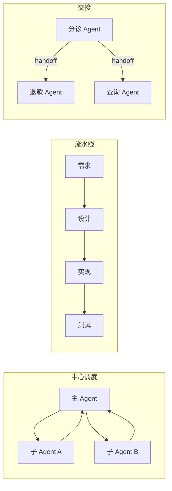

# 多 Agent 系统

> 层级：通用层 · 预计 150 分钟 · 题目：[questions.md](questions.md)
> 前置：[02 Agent 架构与设计模式](../02-agent-architecture/README.md)、[03 Prompt 与 Context Engineering](../03-prompt-context/README.md)

## 1 这一章解决什么问题

“你的系统为什么用多 Agent？”是追问率很高的一题。面试官想听的不是框架名，而是你能说清：拆成多个 Agent 换来了什么，付出了什么，出了问题怎么定位，怎么证明值得。

单 Agent 做大任务有两个硬限制。第一，所有工具结果都堆在一个上下文里，每一步都要重读全部历史，越往后越贵，最后装不下。第二，它只能一步一步串行，十个方向的调研要排队做完。多 Agent 用拆分绕开这两个限制，但引入了新问题：交接时丢信息，子 Agent 之间决策冲突，最慢的那个拖住整体，token 总量往往更高。

学完这一章，你应该能：

- 从上下文隔离、并行、专业化三个机制出发，判断一个任务该不该拆，讲清 Anthropic 和 Cognition 两篇文章各自成立的前提；
- 对主从、流水线、辩论、黑板四种拓扑写出调用次数、关键路径和输入 token 的式子，并用代码算出来；
- 解释交接为什么会丢信息，设计交接内容和共享状态；
- 用 MAST 分类定位失败；算出并行子 Agent 的期望延迟，说明错误独立和相关时整体成功率的差别；
- 说出多 Agent 辩论的机制、代价，以及“收敛不等于正确”；
- 设计一个能排除 token 预算影响的对照实验。

**本章符号**（后文沿用）：

| 符号 | 含义 |
|---|---|
| N | 子 Agent 个数（辩论里是参与辩论的实例数） |
| s | 每个子 Agent 的工具调用步数 |
| c | 每一步追加进上下文的工具结果 token 数 |
| B₀ | 主 Agent 的初始上下文（系统提示、工具定义、用户问题）token 数 |
| b | 主 Agent 写给子 Agent 的任务描述 token 数 |
| o | 子 Agent 返回给主 Agent 的压缩结论 token 数 |
| R | 辩论的总轮数（第 1 轮是各自独立作答） |
| T_i | 第 i 个子 Agent 的耗时，是随机变量 |
| p | 单个 Agent 在某一步答对的概率 |
| ρ | 多个 Agent 错误的相关程度，0 为独立，1 为完全一起对、一起错 |

## 2 什么时候需要多 Agent

多 Agent 指多个各自带 prompt、工具和上下文的模型实例协作完成一个任务。它不是“更高级的 Agent”。它是一种拆分方式，有明确的收益和成本。

### 2.1 三个收益来源和各自的代价

拆分能带来的好处只有三类。每一类都有对应的代价，要成对说。

**上下文隔离**。子 Agent 在自己的上下文里搜索、读网页、试错，最后只把压缩过的结论交回主 Agent。主 Agent 的上下文里只有任务描述和结论，没有中间的几十个工具结果。Anthropic 把搜索的本质说成压缩：子 Agent 并行地在各自的上下文窗口里探索，再把最重要的 token 浓缩给主 Agent。Cognition 那篇也承认这一点：Claude Code（2025-06 时）的子 Agent 只回答问题、不写代码，好处是它的调查过程不必留在主 Agent 的历史里，主 Agent 能跑更长的轨迹。

代价是压缩会丢东西。子 Agent 认为不重要而丢掉的细节，主 Agent 再也看不到（第 4.2 节）。

**并行**。互相独立的子任务可以同时跑，关键路径从“所有步骤之和”变成“最慢的那个子任务”。Anthropic 报告他们做了两层并行：主 Agent 同时启动 3 到 5 个子 Agent，子 Agent 同时调用 3 个以上工具；对复杂查询，研究时间最多减少 90%。

代价是延迟由最慢者决定，并且并行越多，期望的最慢值越大（第 5.3 节）。另一个代价是并行的子 Agent 看不到彼此在做什么，可能重复劳动或者做出互相冲突的决定。

**专业化**。每个子 Agent 有自己的工具、prompt 和探索路径。Anthropic 称之为关注点分离，作用是减少路径依赖，让每条线独立调查。客服分诊把退款、查询交给带不同工具和规则的 Agent，也属于这一类。

代价是角色边界要写清楚。MAST 分类里的“不遵守角色定义”（FM-1.2）就是专业化没守住：一个 Agent 做了另一个 Agent 的事。

### 2.2 两篇文章的论证与前提

两份常被引用的公开资料给出了相反方向的论证，面试时两面都要讲：

| 资料 | 主张 | 依据 |
|---|---|---|
| Anthropic，[How we built our multi-agent research system](https://www.anthropic.com/engineering/multi-agent-research-system)，2025-06 | 广度优先的研究类任务适合多 Agent | 子任务可以并行；每个子 Agent 有独立上下文，能读更多资料 |
| Cognition，[Don't Build Multi-Agents](https://cognition.com/blog/dont-build-multi-agents)，2025-06 | 默认用单线程 Agent | 子 Agent 看不到彼此的决策，输出容易冲突；交接时上下文丢失 |

**Anthropic 的系统怎么分工**。主 Agent（文中叫 LeadResearcher）先思考研究方案，把计划存进外部记忆。原因是上下文超过 200,000 token 会被截断，计划不能丢。然后它创建若干子 Agent，每个子 Agent 拿到一个具体的研究任务，独立做多轮网页搜索，用交错思考评估工具结果，再把发现交回主 Agent。主 Agent 汇总，决定要不要继续：要的话再派子 Agent 或调整策略。信息够了就退出循环，把文档和报告交给单独的引用 Agent（CitationAgent），由它给每个论断找出处。

文中关于效果和成本的几句话，原文是这样说的：

- 文中报告，多 Agent 系统（主 Agent 用较大的模型，子 Agent 用较小的模型）在他们内部的研究评测上明显优于只用那个较大模型的单 Agent。这是内部评测，不是公开 Benchmark，也没有控制 token 预算，所以不能拿来证明“结构本身更好”。
- 在 BrowseComp 上，三个因素解释了 95% 的表现方差。token 用量一项就解释 80%，另外两项是工具调用次数和模型选择。
- Agent 通常比聊天多用约 4 倍 token，多 Agent 系统比聊天多用约 15 倍。
- 不适合的场景：所有 Agent 需要共享同一份上下文，或者 Agent 之间依赖很多。文中举的例子是大多数编程任务，它们真正可以并行的部分比研究少，而且当时的 Agent 还不擅长实时协调和委派。

文章的结论是：多 Agent 适合价值高、可以大量并行、信息量超过单个上下文窗口、要对接很多复杂工具的任务。

**Cognition 的论证**。文章用“做一个 Flappy Bird 克隆”举例。任务拆给两个子 Agent：一个做背景，一个做小鸟。第一种失败是子 Agent 误解了任务，做出了马里奥风格的背景。即使把原始任务也给子 Agent，第二种失败仍会出现：两个子 Agent 看不到对方在做什么，背景和小鸟的画风完全不一致。由此提出两条原则：

1. 共享上下文，而且共享完整的 Agent 轨迹，不只是单条消息；
2. 动作里隐含决策，相互冲突的决策会带来坏结果。

作者认为这两条很少值得违反，默认应排除不满足它们的架构。最简单的做法是单线程线性 Agent。任务长到上下文装不下时，加一个专门压缩历史的模型，把动作和对话压成关键细节、事件和决策。文中另一个例子是 2024 年常见的 edit apply 模型：大模型用 markdown 描述改动，小模型据此重写整个文件。小模型常因指令里的细微歧义改错，后来大多改成由一个模型在一次动作里决定并执行修改。

**两篇各自的前提**。把两篇放在一起看，分歧不在“多 Agent 好不好”，而在任务里**谁在写、写的东西要不要互相一致**：

| | Anthropic 研究系统 | Cognition 的反例 |
|---|---|---|
| 子 Agent 的产物 | 检索到的事实和出处，彼此独立，可以分别核验 | 同一个程序的不同部分，必须风格和接口一致 |
| 子任务之间的依赖 | 弱，各查一个方向 | 强，小鸟的尺寸取决于背景的画法 |
| 最终的写操作 | 集中在主 Agent 汇总和引用 Agent | 分散在多个并行的子 Agent |
| 冲突的后果 | 两个子 Agent 查到矛盾的信息，汇总时可以比较取舍 | 两份不一致的代码，没法简单合并 |

综合判断（这是本章的归纳，不是两篇原文的结论）：**读可以并行，写要集中**。并行的子 Agent 适合做只读的调查，把结果交给一个 Agent 统一决策和写入。Claude Code 子 Agent 只回答问题、不写代码，Anthropic 系统把最终报告交给主 Agent 写，都符合这一条。

### 2.3 判断标准

| 信号 | 倾向多 Agent | 倾向单 Agent |
|---|---|---|
| 子任务之间的依赖 | 弱，能独立完成 | 强，后一步依赖前一步的细节 |
| 信息量 | 超过一个上下文窗口能装下的 | 一个窗口装得下 |
| 可并行度 | 高，例如同时查多个方向 | 低，本质上是串行 |
| 任务价值 | 高，能付得起数倍 token | 低，成本敏感 |
| 输出的一致性要求 | 各部分可以独立成立 | 各部分必须风格和决策一致，例如同一份代码 |
| 子 Agent 做什么 | 只读：搜索、阅读、回答窄问题 | 写：改文件、改外部状态 |

**问题 → 做法 → 代价**：单 Agent 上下文装不下或串行太慢 → 拆成并行的子 Agent，各自压缩结果后返回 → token 总量往往更高，交接时丢信息，调试变难。

在“单 Agent”和“完整的多 Agent”之间还有一个常用的中间档：**把子 Agent 当工具调用**。主 Agent 派一个子 Agent 回答一个窄问题，子 Agent 只返回答案，控制权留在主 Agent。它拿到上下文隔离的好处，不并行写，冲突风险小。

## 3 常见拓扑



| 拓扑 | 做法 | 适合 | 代价 |
|---|---|---|---|
| 中心调度（主 Agent-子 Agent） | 主 Agent（orchestrator）拆任务、派子 Agent、汇总结果 | 可并行的调研、检索 | 主 Agent 是单点；汇总时丢信息 |
| 流水线 | 按固定角色顺序传递产物，每步有明确的输出格式 | 有成熟流程的任务 | 前一步出错会传到下游；不灵活 |
| 交接（handoff） | 一个 Agent 把对话控制权交给另一个专门的 Agent | 客服分诊，不同问题用不同工具和规则 | 接手方的上下文质量决定成败 |
| 辩论与投票 | 多个实例各自作答，互相评论，多轮后收敛 | 有标准答案的推理题 | 成本高；不一定比单模型多次采样好 |
| 黑板（共享状态） | 各 Agent 读写同一块共享状态，按状态变化触发 | 多个专家异步补充一份结果 | 并发写冲突；谁来决定结束 |

几个代表性的做法：

- **中心调度**：Anthropic 研究系统由主 Agent 规划并启动并行的子 Agent，子 Agent 多轮检索后返回结论，主 Agent 汇总，最后由单独的引用 Agent 给论断配出处（Deep Research 的停止条件见 [07 RAG 的 Deep Research 一节](../07-rag-search/README.md#8-deep-research)）。文章还写了一个瓶颈：主 Agent 同步等待一批子 Agent 全部完成，一个慢的子 Agent 会卡住整个系统。
- **流水线**：MetaGPT（[Hong 等，arXiv 2308.00352](https://arxiv.org/abs/2308.00352)，2023-08）把人类的标准作业流程（SOP）写进 prompt，按角色分工，让有专长的角色检查中间产物，减少错误级联。
- **对话编程**：AutoGen（[Wu 等，arXiv 2308.08155](https://arxiv.org/abs/2308.08155)，2023-08）把应用写成多个可对话 Agent 之间的会话模式，Agent 可以由模型、人或工具驱动。
- **交接**：OpenAI Agents SDK 的 [Handoffs](https://openai.github.io/openai-agents-python/handoffs/) 把“交给某个 Agent”暴露成一个工具，例如 `transfer_to_refund_agent`。默认接手方能看到完整的历史对话，可以用输入过滤器裁剪。如果只想调用专家而不交出控制权，文档建议把 Agent 当工具调用。
- **辩论**：[Du 等，arXiv 2305.14325](https://arxiv.org/abs/2305.14325)（2023-05）让多个模型实例多轮互相评论答案，报告推理和事实性都有提升。[Smit 等，arXiv 2311.17371](https://arxiv.org/abs/2311.17371)（2023-11）的对比发现，默认设置下辩论并不稳定地优于 self-consistency 这类单模型多次采样方法，而且对超参数敏感。机制和代价见第 6 节。
- **跨组织的 Agent 互调**：对方 Agent 由别的团队维护、看不到内部实现时，用 A2A 这类协议通信，见 [core/04 第 7 节](../04-tool-use-mcp/README.md#7-a2a)。

### 3.1 成本模型：调用次数、关键路径、输入 token

比较拓扑时只看三个量：

- **调用次数**：一共调了几次模型。决定请求数和速率限制的压力。
- **关键路径**：从开始到结束、必须串行等待的调用个数。决定延迟的下界。
- **输入 token 总量**：每次调用读进去的 token 之和。Agent 场景里输入远多于输出，它基本决定成本。

关键的一条事实：模型每一步都要把整个上下文重读一遍。一个上下文从长度 B₀ 开始，每步追加 c 个 token，走 k 步的输入总量是

```text
Σ_{j=0}^{k-1} (B₀ + j·c) = B₀·k + c·k(k-1)/2
```

第二项随 k² 增长。这是“上下文越长越贵”的来源，也是上下文隔离能省钱的原因。

**单 Agent**：N 个子任务、每个 s 步，全在一个上下文里串行做，k = N·s：

```text
调用 = N·s        关键路径 = N·s
输入 = B₀·Ns + c·Ns(Ns-1)/2                     二次项 ≈ c·N²s²/2
```

**主从**：主 Agent 规划 1 次，N 个子 Agent 各自从长度 b 的任务描述开始走 s 步，主 Agent 读 N 份长度 o 的结论再汇总 1 次：

```text
调用 = N·s + 2    关键路径 = s + 2（子 Agent 并行）
输入 = 2B₀ + N·o + N·(b·s + c·s(s-1)/2)         二次项 ≈ N·c·s²/2
```

两个二次项相比，主从少了约 N 倍。原因是每个子 Agent 只背自己那 s 步的工具结果，不背别人的。代价是多了两次调用，以及子 Agent 只看到 b 个 token 的任务描述，看不到主 Agent 的完整上下文。

**流水线**：K 个阶段，第 k 个阶段读原始输入和前面所有阶段的产物（每个 o）：

```text
调用 = K          关键路径 = K
输入 = Σ_{k=0}^{K-1} (B₀ + k·o) = K·B₀ + o·K(K-1)/2
```

关键路径没有缩短，流水线的收益来自专业化和中间检查，而不是速度。

**辩论**：N 个实例、R 轮。第 1 轮各自读问题（q 个 token）作答；之后每轮读问题加其他 N-1 个人上一轮的答案（每个 a 个 token）：

```text
调用 = N·R        关键路径 = R
输入 = N·q + (R-1)·N·(q + (N-1)·a)              答案项随 N² 增长
```

N 翻倍，答案项约变成 4 倍。Du 等在 Agent 数多时先用模型把其他人的答案总结成一份再给每个人，原因就是直接拼接会超出上下文长度。

**黑板**：M 次写入，每次写之前读整块黑板，黑板每次增长 w：

```text
调用 = M          关键路径 = 1 到 M（写入互相独立时可并行；互相依赖时只能串行）
输入 = M·B₀ + w·M(M-1)/2
```

### 3.2 实现：逐次调用累加，和解析式对上

下面的代码用循环逐次模拟每次调用读多少 token，再和上一节的式子比对。参数是一个假设的调研任务：5 个方向，每个方向 10 步，每步工具结果 2000 token。

```python
# 五种拓扑的调用次数、关键路径、输入 token：逐次调用累加，和解析式比对


def single_agent(N, s, c, B0):
    """单 Agent 串行做 N 个子任务，每个 s 步，所有工具结果留在一个上下文里。"""
    calls, tin, ctx = 0, 0, B0
    for _ in range(N * s):
        tin += ctx; calls += 1; ctx += c                 # 每步重读整个上下文，再追加 c
    return dict(calls=calls, tin=tin, crit=N * s)


def orchestrator(N, s, c, B0, b, o):
    """主 Agent 规划 1 次 → N 个子 Agent 并行各走 s 步 → 主 Agent 汇总 1 次。"""
    calls, tin = 1, B0                                   # 规划
    for _ in range(N):
        ctx = b                                          # 子 Agent 只从任务描述开始
        for _ in range(s):
            tin += ctx; calls += 1; ctx += c
    tin += B0 + N * o; calls += 1                        # 汇总：读 N 份压缩结论
    return dict(calls=calls, tin=tin, crit=1 + s + 1)


def pipeline(K, B0, o):
    return dict(calls=K, tin=sum(B0 + k * o for k in range(K)), crit=K)


def debate(N, R, q, a):
    tin = N * q + (R - 1) * N * (q + (N - 1) * a)
    return dict(calls=N * R, tin=tin, crit=R)


def blackboard(M, B0, w):
    return dict(calls=M, tin=sum(B0 + k * w for k in range(M)), crit=M)   # 按最坏的串行算


N, s, c, B0, b, o = 5, 10, 2000, 3000, 1000, 1500
sa = single_agent(N, s, c, B0)
oc = orchestrator(N, s, c, B0, b, o)
print("单 Agent:", sa)
print("主从    :", oc)

# 循环累加和解析式一致
assert sa["tin"] == B0 * N * s + c * (N * s) * (N * s - 1) // 2
assert oc["tin"] == 2 * B0 + N * o + N * (b * s + c * s * (s - 1) // 2)

assert oc["calls"] == sa["calls"] + 2            # 多了规划和汇总两次调用
assert (sa["crit"], oc["crit"]) == (50, 12)      # 关键路径 50 步 → 12 步
assert sa["tin"] / oc["tin"] > 5                 # 上下文隔离让输入 token 少了 5 倍多

# 辩论：N 从 3 翻到 6，调用数翻倍，输入约 4.7 倍
d3, d6 = debate(3, 3, 300, 2000), debate(6, 3, 300, 2000)
print("辩论 N=3:", d3, " N=6:", d6)
assert (d3["calls"], d6["calls"]) == (9, 18)
assert 4.5 < d6["tin"] / d3["tin"] < 5.0         # 答案项里的 N(N-1) 从 6 变成 30

# 流水线、黑板：每一步读全部历史，输入是二次的
assert pipeline(4, 3000, 1500)["tin"] == 4 * 3000 + 1500 * 6
assert blackboard(20, 1000, 500)["tin"] == 20 * 1000 + 500 * 190
```

运行结果：单 Agent 输入 2,600,000 token、关键路径 50 步；主从输入 513,500 token、关键路径 12 步。

这个结果和 Anthropic 报告的“多 Agent 比聊天多用约 15 倍 token”并不矛盾。上面的模型假设两种结构做的是**同样多的工具调用**。实际系统里，子 Agent 并行时每个方向都会搜得更多，还会重复搜索（Anthropic 文中提到早期系统给简单问题派 50 个子 Agent、几个子 Agent 查同一件事）。第 3.3 节会算到：子 Agent 的步数一多，主从的总输入就会超过单 Agent。另外，单 Agent 那个二次项的大部分会命中前缀缓存，计费时差距会大幅缩小。

### 3.3 数值例子：一个四方向调研任务的账

假设一个“比较四个开源向量库”的任务（参数都是假设值）：4 个方向，每个方向 8 步工具调用，每个工具结果 2500 token；主 Agent 初始上下文 4000，任务描述 1200，子 Agent 结论 1500。前缀缓存命中的输入按 0.1 倍计费。每步耗时服从对数正态，中位数 6 秒；规划和汇总各 15 秒。

```python
# 四方向调研：单 Agent vs 主从，分别算输入 token、计入缓存后的计费、平均延迟（参数为假设）
import numpy as np

N, s, c = 4, 8, 2500
B0, b, o = 4000, 1200, 1500
hit_price = 0.1                         # 命中前缀缓存的输入按 0.1 倍计费（假设）


def run(contexts):
    """contexts: 每个独立上下文的 (起始长度, 步数)。返回 (输入 token, 计费等效 token)。
    每一步除了最新追加的那段，其余部分上一步已经读过，按缓存命中计。"""
    raw = billed = 0.0
    for start, steps in contexts:
        ctx = start
        for k in range(steps):
            raw += ctx
            new = start if k == 0 else c
            billed += new + hit_price * (ctx - new)
            ctx += c
    return raw, billed


single_raw, single_bill = run([(B0, N * s)])
sub_raw, sub_bill = run([(b, s)] * N)
extra = B0 + (B0 + N * o)               # 规划 + 汇总，按未命中计（保守）
orch_raw, orch_bill = sub_raw + extra, sub_bill + extra
print(f"输入 token：单 Agent {single_raw:,.0f}  主从 {orch_raw:,.0f}  比值 {single_raw / orch_raw:.1f}")
print(f"计费等效  ：单 Agent {single_bill:,.0f}  主从 {orch_bill:,.0f}  比值 {single_bill / orch_bill:.1f}")
assert (single_raw, orch_raw) == (1_368_000, 332_400)
assert 4 < single_raw / orch_raw < 4.2          # 不计缓存：差 4.1 倍
assert single_bill / orch_bill < 2              # 计缓存：差距缩到 1.9 倍

# 子 Agent 往往多搜：每个方向步数翻倍，再加 30% 重复搜索
dup_raw, _ = run([(b, int(2 * s * 1.3))] * N)
print(f"子 Agent 多搜时主从输入 {dup_raw + extra:,.0f}")
assert dup_raw + extra > single_raw             # 主从的输入反超单 Agent

# 延迟：单 Agent 32 步串行；主从 4 个子 Agent 并行，等最慢的
rng = np.random.default_rng(0)
steps = rng.lognormal(np.log(6), 0.6, (50_000, N, s))
t_single = steps.sum((1, 2))
t_orch = 15 + steps.sum(2).max(1) + 15
print(f"平均延迟：单 Agent {t_single.mean():.0f}s  主从 {t_orch.mean():.0f}s")
assert t_orch.mean() < 0.5 * t_single.mean()
# 主从比“单个子 Agent 平均耗时 + 30 秒”还多 10 秒以上：最慢的那个拖住了整体
assert t_orch.mean() > steps.sum(2).mean() + 30 + 10
```

运行结果：

| 指标 | 单 Agent | 主从 | 说明 |
|---|---|---|---|
| 输入 token | 1,368,000 | 332,400 | 同样的工具调用次数下，隔离省了 4.1 倍 |
| 计费等效 token（计缓存） | 210,150 | 113,160 | 单 Agent 的重复前缀大多命中缓存，差距缩到 1.9 倍 |
| 子 Agent 步数变成 2.6 倍时的输入 | 1,368,000 | 2,010,000 | 主从反超 |
| 平均延迟 | 230 秒 | 102 秒 | 并行省一半多，但要等最慢的子 Agent |

这组数字说明三件事（推导，不是论文结论）：

1. 上下文隔离省的是“每步重读别人的工具结果”。这部分省多少，取决于有没有前缀缓存。
2. 多 Agent 系统总 token 高，主要不是因为结构本身贵，而是因为它被允许多搜、并行搜。Anthropic 说多 Agent 有效“主要是因为它帮助花足够多的 token 去解决问题”，这和第 7 节要控制 token 预算是同一件事的两面。
3. 并行省下的延迟会被最慢者吃掉一部分，第 5.3 节专门算。

## 4 通信与共享状态

### 4.1 三种方式

多 Agent 的大部分 bug 出在交接上。三种方式对比：

| 方式 | 传什么 | 优点 | 代价 |
|---|---|---|---|
| 消息传递 | 主 Agent 写给子 Agent 的任务描述，子 Agent 返回结论 | 上下文隔离，子 Agent 专注 | 任务描述写不清，子 Agent 会做错事 |
| 完整轨迹共享 | 把之前的对话和工具调用一起给接手方 | 决策不丢 | 上下文变长，成本上升，隐私数据也一起传过去 |
| 共享状态（黑板、文件、数据库） | 结构化的中间结果 | 可持久化，可恢复，可审计 | 要处理并发写、版本和一致性 |

消息传递和完整轨迹共享是同一条轴的两端：传得越少，隔离越好、越便宜，丢的信息越多。Cognition 的原则 1 站在“传完整轨迹”一端，Anthropic 的子 Agent 站在“只传任务描述”一端。第 3.1 节的式子给出了这条轴的价格：把完整轨迹传给每个子 Agent，相当于把 b 换成主 Agent 当前的上下文长度，子 Agent 的输入就回到和单 Agent 一个量级。

交接内容至少写清四件事：目标、输出格式、可用的工具和资料范围、任务边界（做到哪里停）。这四项来自 Anthropic 文中对子 Agent 任务描述的要求。文中的反例是主 Agent 只写“研究半导体短缺”：一个子 Agent 去查 2021 年汽车芯片危机，另外两个重复调查 2025 年的供应链，分工失效。

子 Agent 返回时也要结构化：结论、依据、未完成的部分。只返回自由文本，主 Agent 汇总时容易丢掉关键事实。

### 4.2 交接为什么会丢信息

每一次交接都是一次有损压缩。发送方要从自己的上下文里挑出“对方需要的”内容，而它对“什么重要”的判断有误差：它不知道接收方之后会遇到什么问题。

把这件事写成一个最小模型（推导用，不对应任何论文）：

- 一开始有 40 条事实，真实重要性各不相同，最重要的 5 条是关键事实；
- 每一跳，发送方按“真实重要性 + 噪声”给事实排序，只留前 12 条交给下一方；
- 下一方再加入 12 条自己的新内容，然后进行下一跳。

噪声代表“发送方对重要性的估计误差”。噪声为 0 时，关键事实总排在旧事实前面，只有新加入的内容确实更重要时才会被挤掉，几乎不丢。噪声大于 0 时，关键事实有时被挤出前 12 名，而且每一跳都有一次被挤掉的机会，损失随跳数累积。Anthropic 文中把这叫“传话游戏”（game of telephone）。他们的应对是让子 Agent 把产物直接写进外部系统，只把轻量的引用交回主 Agent，产物不经过主 Agent 的上下文转述。

```python
# 交接丢信息：有噪声的压缩，跳数越多关键事实丢得越多；写外部存储只传引用则不丢
import numpy as np

rng = np.random.default_rng(0)
F, KEEP, KEY, NEW, trials = 40, 12, 5, 12, 5000    # 40 条事实，每跳留 12 条，5 条关键，每跳新增 12 条


def key_kept(hops, noise):
    """返回 hops 跳之后关键事实的平均保留比例。"""
    total = 0.0
    for _ in range(trials):
        imp = rng.normal(0, 1, F)                          # 每条事实的真实重要性
        key = set(np.argsort(-imp)[:KEY])                  # 最重要的 5 条是关键事实
        pool, nid = {i: imp[i] for i in range(F)}, F
        for _ in range(hops):
            ids = list(pool)
            est = np.array([pool[i] for i in ids]) + rng.normal(0, noise, len(ids))
            pool = {ids[j]: pool[ids[j]] for j in np.argsort(-est)[:KEEP]}   # 只留估计最重要的 12 条
            for _ in range(NEW):                           # 下一方加入自己的新内容
                pool[nid] = rng.normal(0, 1); nid += 1
        total += len(key & set(pool)) / KEY
    return total / trials


res = {h: key_kept(h, noise=0.7) for h in (1, 2, 3, 4)}
print({h: round(v, 2) for h, v in res.items()})
assert res[1] > res[2] > res[3] > res[4]                  # 每多一跳，关键事实少一截
assert res[4] < 0.7                                        # 4 跳之后只剩六成多
assert key_kept(3, noise=0.0) > 0.99                       # 判断准确时几乎不丢（只在新内容确实更重要时被挤掉）

# 产物写进外部存储，交接里只放引用：关键事实不经过压缩
store = {"run42/findings.json": list(range(F))}
ref = "run42/findings.json"
assert set(range(F)) <= set(store[ref])
```

运行结果：1 到 4 跳，关键事实的保留比例约为 0.88、0.80、0.72、0.64。

这个模型给出两个可以直接用的结论：

1. **减少跳数**。主 Agent 到子 Agent 再到子子 Agent，每加一层就多一次有损压缩。委派深度要有上限。
2. **降低估计误差**。告诉发送方接收方要拿结果做什么（输出格式、用途），等于减小噪声。这就是任务描述里要写“输出格式”和“任务边界”的原因。

### 4.3 共享状态与并发写

共享状态（黑板）让各 Agent 不必经过主 Agent 转述，直接读写同一份结构化结果。它的问题从“丢信息”变成“写冲突”。

最常见的是**丢失更新**：A 和 B 同时读到版本 1 的来源列表，各自追加一条再写回，后写的 B 覆盖了 A，A 的结果消失，而且没有任何报错。处理方法有两种：每个 Agent 只写自己负责的字段；或者写入时带上读到的版本号，版本不匹配就拒绝，让后写者重读再改（乐观并发控制）。

```python
# 黑板的丢失更新：无版本号时后写者覆盖前者；带版本号时冲突被拒绝，重读后两条都在


class Board:
    def __init__(self):
        self.data, self.ver = {}, 0

    def read(self):
        return dict(self.data), self.ver

    def write(self, patch, expect=None):
        if expect is not None and expect != self.ver:
            return False                                   # 读到的版本已过期，拒绝
        self.data.update(patch)
        self.ver += 1
        return True


def two_writers(use_version):
    b = Board()
    b.write({"sources": []})
    sa, va = b.read()
    sb, vb = b.read()                                      # A、B 同时读到版本 1
    b.write({"sources": sa["sources"] + ["A1"]}, va if use_version else None)
    ok = b.write({"sources": sb["sources"] + ["B1"]}, vb if use_version else None)
    retries = 0
    while not ok:                                          # B 被拒绝：重读最新版本再写
        sb, vb = b.read()
        ok = b.write({"sources": sb["sources"] + ["B1"]}, vb)
        retries += 1
    return b.data["sources"], retries


lost, r0 = two_writers(False)
safe, r1 = two_writers(True)
print("无版本号:", lost, " 带版本号:", safe, "重试", r1, "次")
assert lost == ["B1"] and r0 == 0           # A 的写入丢了，而且没有任何报错
assert safe == ["A1", "B1"] and r1 == 1     # 冲突被发现，代价是一次重读重写
```

共享状态的其他设计要点：

- 长任务把计划和阶段结论写到外部存储，上下文被压缩或进程重启后能续跑。Anthropic 的主 Agent 把研究计划存进记忆，就是为了上下文超过 200,000 token 被截断后还能取回；
- 黑板要有明确的结束条件和负责宣布结束的角色，否则各 Agent 会不停补充；
- 状态变更都记日志，便于复现，见 [Trace 与回放](../../tracks/harness/06-tracing-replay/README.md)。

## 5 成本与失败模式

### 5.1 成本

Anthropic 那篇给了两个量级：Agent 通常比聊天多用约 4 倍 token，多 Agent 系统比聊天多用约 15 倍。它还报告，在 BrowseComp 上三个因素解释了 95% 的表现方差，其中 token 用量单独解释 80%，另外两个是工具调用次数和模型选择。这个数字说的是 Agent 表现整体随 token 用量变化，并不是在比较多 Agent 和单 Agent。但它提示：比较两种结构时，如果不控制 token 预算，就分不清收益来自结构还是来自多花了 token。

第 3.3 节的例子给出了另一个角度：同样的工具调用次数下，主从结构的输入 token 反而更少；多 Agent 总 token 高，主要来自它被允许做更多搜索。所以成本问题的关键是“多搜的那部分值不值”，而不是“拆分本身贵不贵”。Anthropic 的应对是在 prompt 里写资源分配规则：简单的事实查找用 1 个 Agent、3 到 10 次工具调用；直接比较用 2 到 4 个子 Agent、每个 10 到 15 次调用；复杂研究可以用 10 个以上子 Agent，职责要分清。

### 5.2 MAST 失败分类

[Cemri 等，arXiv 2503.13657](https://arxiv.org/abs/2503.13657)（2025-03）分析了多 Agent 系统的运行轨迹，整理出 MAST（Multi-Agent System Failure Taxonomy）。论文的做法：先由专家对 150 条轨迹做扎根理论分析，三轮标注者一致性检验后 Cohen's κ 为 0.88；得到 14 种失败模式，分成 3 类；再用 LLM 评委流水线扩大标注，构成 MAST-Data，论文正文写的是来自 7 个多 Agent 框架的 1642 条标注轨迹。

14 种失败模式（编号和名称照论文附录 A）：

| 类别 | 编号与名称 | 含义 |
|---|---|---|
| FC1 系统设计问题 | FM-1.1 不遵守任务要求 | 不满足任务给定的约束或要求 |
| | FM-1.2 不遵守角色定义 | 越出自己角色的职责，表现得像另一个角色 |
| | FM-1.3 步骤重复 | 重复已经完成的步骤 |
| | FM-1.4 丢失对话历史 | 上下文意外截断，退回到更早的对话状态 |
| | FM-1.5 不知道终止条件 | 不清楚什么时候该结束，交互不必要地继续 |
| FC2 Agent 间未对齐 | FM-2.1 对话重置 | 无故重新开始对话，丢掉进展 |
| | FM-2.2 不请求澄清 | 信息不清楚或不完整时不去问 |
| | FM-2.3 任务偏离 | 偏离原定目标，做无关的事 |
| | FM-2.4 信息隐瞒 | 有对别人决策有用的信息却不分享 |
| | FM-2.5 忽视其他 Agent 的输入 | 不考虑别的 Agent 给的输入或建议 |
| | FM-2.6 推理与行动不一致 | 推理过程和实际动作对不上 |
| FC3 任务验证 | FM-3.1 过早结束 | 必要信息交换完之前就结束 |
| | FM-3.2 没有验证或验证不完整 | 漏掉对结果的检查 |
| | FM-3.3 验证错误 | 检查了，但没检查到关键处 |

对应的工程手段：

| 类别 | 应对 |
|---|---|
| 系统设计问题 | 写清角色和边界；设最大轮数和预算；终止条件写成可判断的规则 |
| Agent 间未对齐 | 结构化交接（第 4.1 节）；共享关键决策；允许并鼓励子 Agent 回问 |
| 任务验证不足 | 用可执行的检查做验证，不只靠另一个模型说“没问题” |

论文里关于验证的观察值得记住：很多系统的验证者只做表面检查，例如代码能不能编译、有没有遗留的 TODO。论文举的例子是 ChatDev 生成的国际象棋程序通过了编译检查，但没有按真实规则验证，运行时有 bug。论文报告，给 ChatDev 加一个检查高层任务目标的验证步骤，在它的 ProgramDev 数据集上任务成功率提高 15.6%。论文的另一个观点是：很多失败来自组织设计和协调，而不是单个 Agent 的能力不足，换更强的模型不足以解决全部问题。

MAST 用作评测时的失败归因表见 [evaluation/03 第 7 节](../../tracks/evaluation/03-trajectory-eval/README.md#7-多-agent-系统的评测)。

### 5.3 并行的延迟：最慢者决定关键路径

主从结构里，主 Agent 同步等待一批子 Agent 全部完成。这一批的耗时是 max(T₁, …, T_N)，不是平均值。[02 第 4.4 节](../02-agent-architecture/README.md#44-并行化分段与投票) 用同一个结论算过 Workflow 并行化的延迟。

若每个 T_i 独立服从均值为 μ 的指数分布，最大值的期望有解析式。N 个指数变量的最小值服从速率为 N/μ 的指数分布，期望 μ/N；去掉最快的那个后，剩下 N-1 个仍是指数分布（无记忆性），下一个完成的再等 μ/(N-1)；依此类推：

```text
E[max] = μ/N + μ/(N-1) + … + μ/1 = μ · H_N,    H_N = 1 + 1/2 + … + 1/N ≈ ln N + 0.577
```

所以 N = 10 时，期望要等单个均值的 2.93 倍。N 从 5 加到 10，期望只多 0.65μ，增长是对数的，但它总在增长。真实的 Agent 耗时更接近长尾分布（某个子 Agent 碰上慢网页或反复重试），下面用对数正态再模拟一次。

处理方法是设截止时间 D：到点后用已完成的子 Agent 结果继续，未完成的标注为缺失或重派。截止时完成个数的期望是 N·P(T ≤ D)。

```python
# 并行子 Agent 的延迟：E[max of N] 的解析式、长尾分布下的模拟、截止时间的取舍
import numpy as np

rng = np.random.default_rng(0)
mu, trials = 60.0, 200_000                      # 单个子 Agent 平均 60 秒（假设）

# 1) 指数分布：E[max] = mu · H_N
for N in (1, 3, 5, 10):
    sim = rng.exponential(mu, (trials, N)).max(1).mean()
    H = sum(1 / k for k in range(1, N + 1))
    print(f"N={N:2d}  模拟 {sim:6.1f}s  解析 {mu * H:6.1f}s")
    assert abs(sim - mu * H) / (mu * H) < 0.01
assert round(sum(1 / k for k in range(1, 11)), 2) == 2.93

# 2) 长尾：对数正态，中位数 45 秒，sigma = 0.8
lat = rng.lognormal(np.log(45), 0.8, (trials, 10))
one, max5, max10 = lat[:, 0].mean(), lat[:, :5].max(1).mean(), lat.max(1).mean()
print(f"单个均值 {one:.0f}s  5 个取最慢 {max5:.0f}s  10 个取最慢 {max10:.0f}s")
assert max10 > 2.5 * one                        # 并行 10 个，平均要等单个均值的 2.5 倍以上

# 3) 截止时间 D = 120 秒：完成个数的期望 = N · P(T <= D)
D, N = 120.0, 10
done = (lat <= D).sum(1)
p_done = (lat[:, 0] <= D).mean()
assert abs(done.mean() - N * p_done) < 0.02
print(f"D={D:.0f}s：平均完成 {done.mean():.2f}/10，10 个全完成的概率 {(done == N).mean():.2f}")
assert (done == N).mean() < 0.35                # 坚持等全部完成，约七成请求会超过 120 秒
```

运行结果：长尾分布下单个子 Agent 平均约 62 秒，5 个取最慢约 133 秒，10 个取最慢约 173 秒。截止 120 秒时平均完成 8.9 个，10 个全完成的概率只有 0.31。

这给出一个取舍：截止时间越短，延迟越可控，但结果越不完整，最终答案里要注明哪些方向缺失。Anthropic 文中把同步等待列为当前的瓶颈，异步执行能提高并行度，代价是结果协调、状态一致性和错误传播都更难。

### 5.4 错误独立与相关：串联和投票的成功率

多 Agent 的整体成功率取决于两件事：结构是“全对才算对”还是“多数对就算对”，以及各 Agent 的错误是否相关。

**串联**（流水线、主从里每个子任务都必须对）：N 个子任务各自以概率 p 做对，错误独立时整体成功率是 pᴺ。p = 0.8、N = 5 时只剩 0.8⁵ = 0.328。这是“拆得越细越容易坏”的来源，也是 MetaGPT 在中间产物上加检查的理由。

**投票**（N 个实例各自作答取多数）：错误独立时，多数正确的概率是二项分布的尾部：

```text
P(多数正确) = Σ_{k > N/2} C(N, k) · pᵏ · (1-p)^{N-k}
```

p = 0.8、N = 5 时为 0.942。同一个二项式在 [02 第 4.4 节](../02-agent-architecture/README.md#44-并行化分段与投票) 用于并行投票，[05 第 2.2 节](../05-planning-reasoning/README.md#22-self-consistency投票能把正确率推到多高) 接着推了 k 变大和题目难度不同时的上限。

**相关性**。同一个模型的多个实例往往有同样的盲点：它不知道的事实，换几个实例照样不知道。用一个简单模型描述（推导用）：以概率 ρ，所有 Agent 共用同一次抽样（一起对或一起错）；以概率 1-ρ，各自独立。每个 Agent 的单独正确率仍是 p，变的只是“一起错”的程度。于是

```text
串联成功率 = ρ·p + (1-ρ)·pᴺ
投票成功率 = ρ·p + (1-ρ)·P_独立(多数正确)
投票收益   = 投票成功率 - p = (1-ρ)·(P_独立(多数正确) - p)
```

投票的收益和 1-ρ 成正比。ρ = 1 时投票毫无收益，等于只问一次。相关性对串联的影响方向相反：一起对的概率更高，所以串联成功率上升。这说明“错误相关”本身不是坏事，关键是你的结构依赖的是多样性（投票、辩论、交叉验证）还是一致性（串联）。

```python
# 错误独立 vs 相关：串联（全对）和多数投票的成功率，解析式和模拟对照
import numpy as np
from math import comb


def vote_indep(p, N):
    """N 个独立 Agent 多数投票（N 为奇数）答对的概率。"""
    return sum(comb(N, k) * p**k * (1 - p)**(N - k) for k in range(N // 2 + 1, N + 1))


def analytic(p, N, rho):
    series = rho * p + (1 - rho) * p**N
    vote = rho * p + (1 - rho) * vote_indep(p, N)
    return series, vote


def simulate(p, N, rho, trials=400_000, seed=0):
    rng = np.random.default_rng(seed)
    shared = rng.random(trials) < rho                  # 这一题是否所有 Agent 共用同一个盲点
    common = rng.random((trials, 1)) < p
    indep = rng.random((trials, N)) < p
    ok = np.where(shared[:, None], common, indep)      # (trials, N)：每个 Agent 是否答对
    assert abs(ok.mean() - p) < 0.005                  # 单个 Agent 的正确率不随 rho 变
    return ok.all(1).mean(), (ok.sum(1) > N // 2).mean()


p, N = 0.8, 5
for rho in (0.0, 0.5, 1.0):
    s_a, v_a = analytic(p, N, rho)
    s_m, v_m = simulate(p, N, rho)
    print(f"rho={rho:.1f}  串联 {s_a:.3f}（模拟 {s_m:.3f}）  投票 {v_a:.3f}（模拟 {v_m:.3f}）")
    assert abs(s_a - s_m) < 0.005 and abs(v_a - v_m) < 0.005

s0, v0 = analytic(p, N, 0.0)
assert round(s0, 3) == 0.328           # 5 个各 80% 的子任务，独立时整体只剩 32.8%
assert round(v0, 3) == 0.942           # 独立时投票把 80% 提到 94.2%
assert analytic(p, N, 1.0)[1] == p     # 完全相关时投票没有收益
for rho in (0.25, 0.5, 0.75):          # 投票收益和 (1 - rho) 成正比
    assert abs((analytic(p, N, rho)[1] - p) - (1 - rho) * (v0 - p)) < 1e-12
```

| ρ | 串联（5 个全对） | 投票（5 选多数） |
|---|---|---|
| 0（独立） | 0.328 | 0.942 |
| 0.5 | 0.564 | 0.871 |
| 1（完全相关） | 0.800 | 0.800 |

工程含义：想靠多个 Agent 互相纠错，就要主动制造多样性，例如用不同的模型、不同的 prompt、不同的资料来源或不同的工具；最好的办法是用可执行的检查（测试、规则、数据库状态）代替“再问一个模型”，因为可执行检查和生成模型的错误不相关。

### 5.5 运行时问题

| 问题 | 做法 | 代价 |
|---|---|---|
| 子 Agent 超时或卡住 | 每个子任务设超时；超时后用部分结果继续或重派（第 5.3 节） | 部分结果可能不完整，要在最终答案里注明 |
| 互相调用形成循环 | 限制委派深度和总轮数；检测重复的任务描述 | 限制太紧会截断正常的长任务 |
| 长任务中途出错 | 从检查点续跑，把工具失败告诉 Agent 让它调整 | 要保存状态；续跑和重跑的路径可能不同 |
| 新版本上线时有任务在跑 | 新旧版本同时运行，流量逐步切到新版本 | 要同时维护两个版本 |

最后一行是 Anthropic 文中说的“彩虹部署”（rainbow deployments）：Agent 系统是长时间运行、有状态的，更新时不能让所有 Agent 同时切到新版本。

## 6 多 Agent 辩论

### 6.1 机制

Du 等（[arXiv 2305.14325](https://arxiv.org/abs/2305.14325)）的流程：

1. 同一个问题交给 N 个模型实例，各自独立作答；
2. 进入一轮辩论：把其他实例的回答拼接起来，作为上下文给每个实例，用“共识 prompt”要求它参考别人的回答更新自己的答案；
3. 用更新后的回答重复第 2 步，进行多轮。

每个实例同时承担两件事：核验别人的回答，修正自己的回答。论文里的实例是同一个模型的多个副本，也试过混用不同的模型。

论文里和机制有关的几条观察（论文报告，不涉及分数）：

- 主要实验用 3 个实例、2 轮辩论，原因是计算开销；论文说更多的实例和轮数还能带来提升。
- 在算术任务上，固定 2 轮时实例越多越好，固定 3 个实例时轮数越多越好；超过 4 轮之后和 4 轮差不多。
- 实例多时，先用模型把其他人的回答总结成一份再给每个实例，原因是直接拼接会超出上下文长度。论文报告总结还提高了效果。
- 辩论时长可以用 prompt 控制：鼓励模型更“固执”地坚持自己答案的 prompt，辩论更长，最终答案更好。论文观察到模型整体上比较“随和”，容易被说服。
- 模型对某个事实很确定时（多个实例都给同一答案），很难被说服改口。
- 局限：辩论通常会收敛到一个答案，但这个答案不一定对；答错时模型仍会自信地说自己的答案和其他人一致。辩论变长后，模型往往只关注最近几轮的内容。

### 6.2 代价

按第 3.1 节的式子，辩论的调用次数是 N·R，输入 token 里有一项 (R-1)·N·(N-1)·a，随 N² 增长。以 N = 3、R = 3 为例是 9 次调用；N 翻到 6 时 18 次调用、输入约 4.7 倍（第 3.2 节代码）。论文主要实验写的是 3 个实例、2 轮辩论，原文没有单独说明“2 轮”是否包含第 1 轮独立作答，所以这里不把它换算成调用次数。

和它比较的应当是同等调用次数的 self-consistency：例如同一个模型采样 9 次取多数。Smit 等（[arXiv 2311.17371](https://arxiv.org/abs/2311.17371)）就是这样比的，结论是默认设置的辩论不能稳定胜过这类基线，而且对超参数敏感。

### 6.3 收敛不等于正确：一个玩具模型

下面的模型说明“一致率上升”和“正确率上升”是两回事（推导用的玩具模型，不复现论文）：

- 二选一的题，3 个实例第 1 轮各自以 0.6 的概率答对，错误独立；
- 之后每轮，每个实例以概率 0.3 坚持自己的答案，否则改成另外两个人的多数答案。

在这个模型里，辩论只做一件事：把第 1 轮的多数传播给所有人。所以一致率随轮数快速上升，多数正确率却一直等于第 1 轮多数投票的正确率；第 1 轮多数错的题，几轮之后几乎全员一致地错。

```python
# 辩论的玩具动力学：一致率上升，多数正确率不变；初始多数错的题收敛成一致的错
import numpy as np


def debate(init_correct, rounds, stubborn, rng):
    """init_correct: (trials, N) 布尔，第 1 轮是否答对（二选一题）。
    之后每轮：以概率 stubborn 坚持自己，否则改成其他人的多数答案（平票保持原答案）。"""
    a = init_correct.copy()
    N = a.shape[1]
    for _ in range(rounds - 1):
        others = (a.sum(1, keepdims=True) - a) / (N - 1)        # 其他人里答对的比例
        follow = np.where(others > 0.5, True, np.where(others < 0.5, False, a))
        keep = rng.random(a.shape) < stubborn
        a = np.where(keep, a, follow)
    return a


rng = np.random.default_rng(0)
trials, N, p = 100_000, 3, 0.6
init = rng.random((trials, N)) < p
vote_acc = (init.sum(1) > N // 2).mean()                        # 第 1 轮直接多数投票

agree = {}
for R in (1, 2, 3, 5):
    fin = debate(init, R, stubborn=0.3, rng=rng)
    agree[R] = (fin.all(1) | (~fin).all(1)).mean()
    acc = (fin.sum(1) > N // 2).mean()
    print(f"轮数 {R}: 一致率 {agree[R]:.3f}  多数正确率 {acc:.3f}")
    assert abs(acc - vote_acc) < 1e-9                           # 正确率始终等于第 1 轮投票

assert agree[1] < agree[2] < agree[3] < agree[5] and agree[5] > 0.99
fin = debate(init, 5, stubborn=0.3, rng=rng)
wrong_first = init.sum(1) <= N // 2
assert (~fin[wrong_first]).all(1).mean() > 0.95                 # 初始多数错 → 一致地错
```

运行结果：1、2、3、5 轮的一致率约为 0.28、0.78、0.94、0.99，多数正确率始终约 0.65。

真实的辩论比这个模型好的地方在于：实例看到别人的推理过程后，可能发现自己的错误，而不只是跟随多数。论文报告的提升就来自这一部分。但这个玩具模型提醒两件事：

1. 一致率不能当正确率用。辩论收敛了，不代表答案可信。
2. 实例之间越相关（同一模型、同一 prompt），辩论越接近“传播多数”，收益越接近同预算的多数投票。第 5.4 节的 ρ 在这里同样适用。

## 7 怎么评测多 Agent 系统

单 Agent 的评测方法全部适用，见 [09 评测与 Benchmark](../09-evaluation/README.md)；多 Agent 的轨迹归因和协作评测见 [evaluation/03 第 7 节](../../tracks/evaluation/03-trajectory-eval/README.md#7-多-agent-系统的评测)。多 Agent 额外要回答一个问题：收益来自结构，还是来自多花的 token。

| 做法 | 目的 |
|---|---|
| 和单 Agent 基线在同一题集上比 | 先确认有收益 |
| 加一组同等 token 预算的单 Agent 基线 | 排除“只是多花了钱” |
| 辩论、投票类结构加一组同等调用次数的多次采样基线 | 排除“只是多采样了几次” |
| 同时报质量、成本、延迟（含 P90 等尾部延迟） | 收益要覆盖额外成本；并行结构的尾部延迟由最慢者决定 |
| 看过程指标：子任务重复率、交接后做错事的比例、汇总时丢掉的关键事实 | 定位是拆分、交接还是汇总出了问题 |
| 按 MAST 类别给失败轨迹打标签 | 把失败归到具体的失败模式，再决定改 prompt 还是改拓扑 |
| 人工抽检分解计划 | 分解质量很难自动评 |

**按端到端结果评，用轨迹归因**。成功与否看最终结果。Anthropic 文中的建议是评结果，不评是否走了某条固定路径，因为不同的合理路径都可能成功；对会修改外部状态的 Agent，评最终状态是否正确。轨迹用来定位：结果错了，再看是哪个子 Agent、哪次交接、哪次汇总出的问题。为此每个 Agent 的输入、输出和交接内容都要单独记录。

Anthropic 的做法可以参考：从约 20 个代表真实使用的查询起步，早期改动效果大，小样本就看得出差别；用一个 LLM 评委按 rubric 打分，维度包括事实准确、引用准确、完整性、信息源质量、工具使用效率；再用人工测试补评委发现不了的问题，文中的例子是人工测试者发现早期 Agent 偏爱 SEO 内容农场，而不选排名靠后但更权威的来源。

**同预算对照怎么做**。第 3.3 节说明多 Agent 的 token 主要花在多搜上。公平的对照是给单 Agent 同样的 token 预算（或同样的工具调用次数），让它也能多搜；单 Agent 上下文装不下时，配上历史压缩（Cognition 的做法）。比较时对每道题做配对，看差值的置信区间，方法见 [09 第 6 节](../09-evaluation/README.md#6-离线评测单次分数有多可靠)。

## 8 工程细节与常见坑

**1. 简单问题也派一堆子 Agent**

- 现象：一个查单个事实的问题，主 Agent 启动了十几个子 Agent，耗时和 token 都比单 Agent 高一个量级，答案没有更好。
- 原因：主 Agent 不会自己判断该投入多少。Anthropic 早期版本出现过给简单查询派 50 个子 Agent 的情况。
- 排查：按问题类型统计每次运行的子 Agent 数和工具调用数，看简单问题的分布是否和复杂问题差不多。
- 处理：在主 Agent 的 prompt 里写明分档规则（第 5.1 节的 1 个、2 到 4 个、10 个以上）；在代码里设子 Agent 数和总工具调用数的硬上限。

**2. 子 Agent 重复劳动或留下空白**

- 现象：几个子 Agent 的工具调用里出现大量相同的搜索词；最终报告某个方面完全没覆盖。
- 原因：任务描述太短，没有写清边界，子 Agent 各自按最自然的理解去做，自然的理解往往相同（第 4.1 节“半导体短缺”的例子）。
- 排查：对同一次运行里各子 Agent 的搜索词做去重统计，算重复率；对照用户问题列出应覆盖的方面，检查哪些没人负责。
- 处理：任务描述写全目标、输出格式、工具和资料范围、边界四项，明确写“不要做什么、别人在做什么”。

**3. 并行子 Agent 写出互相冲突的结果**

- 现象：两个子 Agent 改了同一个仓库的不同文件，单独看都对，合在一起接口对不上或风格不一致；黑板上的字段被后写者悄悄覆盖。
- 原因：Cognition 说的“动作里隐含决策”：每个写操作都带着一些没说出来的选择，并行的写者看不到彼此的选择。共享状态没有并发控制时还会丢失更新（第 4.3 节）。
- 排查：对每次写入记录写者、读到的版本和写入后的版本；合并后跑测试或一致性检查。
- 处理：并行的子 Agent 只做只读调查，写操作交给一个 Agent；必须并行写时，按字段划分归属或用版本号做乐观并发控制。

**4. 汇总时丢掉关键事实**

- 现象：子 Agent 的轨迹里明明查到了某个关键数据，最终答案里没有；或者引用和原文对不上。
- 原因：每次交接都是有损压缩，跳数越多丢得越多（第 4.2 节）；主 Agent 的上下文被很多份长结论塞满，汇总时又压缩一次。
- 排查：从最终答案反查每个论断的来源；对失败样本统计“子 Agent 查到但最终丢失”的事实数。
- 处理：子 Agent 返回结构化的结论和依据；大块产物（代码、表格、长报告）写进外部存储，只把引用交回主 Agent；减少委派层数。

**5. 一个慢的子 Agent 拖住整批**

- 现象：平均延迟可以接受，P90 延迟很高；延迟随子 Agent 个数增加而上升。
- 原因：同步等待时，一批的耗时是最大值，期望随 N 增长（第 5.3 节）；长尾分布下增长更明显。
- 排查：记录每个子 Agent 的耗时，看最慢者和中位数的比值；看延迟和子 Agent 数的关系。
- 处理：每个子任务设超时，到点用已完成的结果继续并在答案里注明缺失；把慢的子任务拆小；需要时改成异步，但要接受协调更复杂。

**6. 委派成环或停不下来**

- 现象：轨迹里出现来回交接（A 交给 B，B 又交回 A）；轮数一直涨到上限；或者黑板上的 Agent 不停补充。
- 原因：没有终止条件或终止条件不可判断（MAST 的 FM-1.5）；角色边界不清，每个 Agent 都觉得该由别人处理。
- 排查：记录委派链，检测重复出现的任务描述和来回交接；统计达到轮数上限的运行比例。
- 处理：设委派深度和总轮数上限，超过就终止并上报；终止条件写成可检查的规则；指定一个负责宣布结束的角色。

**7. 审核 Agent 流于形式**

- 现象：系统里有审核或验证 Agent，但最终结果仍有明显错误；审核 Agent 几乎总是通过。
- 原因：审核和生成用同一个模型，错误相关（第 5.4 节的 ρ 高）；审核只做表面检查（MAST 观察到的“能编译就过”）。
- 排查：统计审核通过率；拿已知有错的样本测审核 Agent 的检出率。
- 处理：能用测试、规则、数据库状态检查的，用可执行检查；审核要对照任务的高层目标，不只看格式；换不同的模型或资料来源降低相关性。

**8. 辩论收敛到错误答案**

- 现象：辩论后一致率很高，但正确率和单次多数投票差不多，有些题全员一致地错。
- 原因：实例来自同一个模型，盲点相同；模型比较“随和”，容易被多数或自信的一方说服（第 6 节）。
- 排查：同时报一致率和正确率；和同等调用次数的多次采样做对照。
- 处理：用更鼓励坚持己见的 prompt；混用不同模型；有可验证答案时直接验证，不靠共识。

**9. 多 Agent 的改进被 token 预算混淆**

- 现象：多 Agent 版本在评测上更好，但上线后成本超标；或者给单 Agent 放宽预算后差距消失。
- 原因：token 用量本身解释了大部分表现差异（Anthropic 在 BrowseComp 上的分析），多 Agent 多花了 token。
- 排查：报告每道题的 token 和工具调用数；加同等预算的单 Agent 基线。
- 处理：按第 7 节做对照；只把难题路由到多 Agent。

**10. 改了主 Agent，子 Agent 的行为跟着变**

- 现象：只改了主 Agent 的 prompt，子 Agent 的工具调用模式、返回长度都变了，某些评测题由对变错。
- 原因：子 Agent 的输入是主 Agent 写的任务描述，主 Agent 的小改动会改变所有任务描述。Anthropic 把这叫涌现行为，原文举的就是“对主 Agent 的小改动会不可预测地改变子 Agent 的行为”。
- 排查：对比改动前后同一批问题的任务描述和子 Agent 轨迹，不只看最终分数。
- 处理：把任务描述的格式写成模板；主 Agent 的改动也跑完整的端到端回归。

## 9 对比与取舍

### 9.1 拓扑

用第 3.1 节的记号，N 个子 Agent 或实例、每个 s 步，K 个阶段，R 轮辩论，M 次黑板写入：

| 拓扑 | 调用次数 | 关键路径 | 输入 token 的主项 | 主要风险 | 什么时候选 |
|---|---|---|---|---|---|
| 单 Agent | N·s | N·s | c·N²s²/2 | 上下文装不下；串行慢 | 默认；子任务强依赖、要写同一份产物 |
| 单 Agent + 历史压缩 | N·s + 压缩次数 | N·s | 取决于压缩频率 | 压缩丢信息 | 任务长但必须保持决策一致 |
| 主 Agent + 子 Agent 当工具 | N·s + 若干 | 子任务串行时不变 | N·c·s²/2 | 任务描述不清 | 需要隔离、不需要并行写 |
| 主从并行 | N·s + 2 | s + 2，实际取最慢者 | N·c·s²/2 | 重复劳动、汇总丢信息、最慢者拖延 | 可并行的只读调研 |
| 流水线 | K | K | o·K²/2 | 错误向下游传；串联成功率 pᴷ | 有成熟流程，每步产物可检查 |
| 辩论 | N·R | R | N²·R·a | 收敛到错误；成本 N² | 有标准答案，且已证明优于同预算采样 |
| 黑板 | M | 1 到 M | w·M²/2 | 并发写冲突；停不下来 | 多个专家异步补充一份结构化结果 |

### 9.2 通信方式

| 方式 | 隔离 | 决策一致性 | 成本 | 什么时候选 |
|---|---|---|---|---|
| 只传任务描述 | 最好 | 最差 | 最低 | 子任务独立、只读 |
| 传关键决策摘要 | 中 | 中 | 中 | 接手方要基于之前的决策继续 |
| 传完整轨迹 | 无 | 最好 | 最高 | 交接（handoff）后接手方要继续同一段对话 |
| 外部存储 + 引用 | 好 | 取决于读哪些 | 低 | 大块产物，避免主 Agent 转述 |

### 9.3 把问题对到章节

| 想解决的问题 | 手段 | 在哪讲 |
|---|---|---|
| 单 Agent 上下文装不下 | 历史压缩、子 Agent 隔离 | [03 第 7 节](../03-prompt-context/README.md#7-上下文窗口预算与截断)、本章第 2 节 |
| 跨团队、跨组织调用 Agent | A2A | [core/04 第 7 节](../04-tool-use-mcp/README.md#7-a2a) |
| 调研类任务的停止条件 | Deep Research | [07 第 8 节](../07-rag-search/README.md#8-deep-research) |
| 多 Agent 的轨迹归因 | MAST、逐 Agent 记录 | [evaluation/03 第 7 节](../../tracks/evaluation/03-trajectory-eval/README.md#7-多-agent-系统的评测) |
| 复现一次多 Agent 运行 | Trace 与回放 | [harness/06](../../tracks/harness/06-tracing-replay/README.md) |

## 10 自测清单

- [ ] 说出多 Agent 的三个收益来源（上下文隔离、并行、专业化）和各自的代价
- [ ] 讲清 Anthropic 和 Cognition 两篇文章的主张各自成立的前提，用“读可以并行，写要集中”判断一个具体场景
- [ ] 写出单 Agent 和主从结构的输入 token 式子，说明二次项为什么少了约 N 倍，以及为什么实际的多 Agent 系统总 token 反而更高
- [ ] 写出辩论的调用次数和输入 token，说明为什么 N 翻倍输入接近 4 倍
- [ ] 写出一份子 Agent 交接模板，包含四要素；说明交接为什么随跳数丢信息，以及“写外部存储只传引用”解决了什么
- [ ] 说出 MAST 的三类和至少六种失败模式，以及对应的工程手段
- [ ] 推导指数分布下 E[max of N] = μ·H_N，说明截止时间的取舍
- [ ] 算出 p = 0.8、N = 5 时串联和投票的成功率，说明相关性 ρ 怎么影响两者
- [ ] 说出多 Agent 辩论的流程、代价，以及“收敛不等于正确”
- [ ] 设计一个能排除 token 预算影响的对照实验

## 资料

- Anthropic（Hadfield 等），[How we built our multi-agent research system](https://www.anthropic.com/engineering/multi-agent-research-system)，2025-06-13
- Cognition（Walden Yan），[Don't Build Multi-Agents](https://cognition.com/blog/dont-build-multi-agents)，2025-06-12
- Hong 等，[MetaGPT: Meta Programming for A Multi-Agent Collaborative Framework](https://arxiv.org/abs/2308.00352)，arXiv 2308.00352，2023-08
- Wu 等，[AutoGen: Enabling Next-Gen LLM Applications via Multi-Agent Conversation](https://arxiv.org/abs/2308.08155)，arXiv 2308.08155，2023-08
- Du 等，[Improving Factuality and Reasoning in Language Models through Multiagent Debate](https://arxiv.org/abs/2305.14325)，arXiv 2305.14325，2023-05
- Smit 等，[Should we be going MAD? A Look at Multi-Agent Debate Strategies for LLMs](https://arxiv.org/abs/2311.17371)，arXiv 2311.17371，2023-11
- Cemri 等，[Why Do Multi-Agent LLM Systems Fail?](https://arxiv.org/abs/2503.13657)，arXiv 2503.13657，2025-03
- OpenAI，[Agents SDK：Handoffs](https://openai.github.io/openai-agents-python/handoffs/)，官方文档，2026-11 查阅
