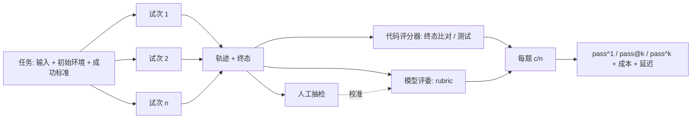

# 评测与 Benchmark

> 层级：通用层 · 预计 150 分钟 · 题目：[questions.md](questions.md)
> 前置：[02 Agent 架构与设计模式](../02-agent-architecture/README.md)
> 深入：[evaluation 方向](../../tracks/evaluation/01-eval-design/README.md) 的 6 章：评测设计与显著性、LLM-as-Judge、轨迹评测、Benchmark、线上与回归、评测训练闭环

## 1 这一章解决什么问题

“你怎么知道你的 Agent 变好了？”几乎每场 Agent 面试都会问。常见的回答是“看了几个例子，感觉效果不错”。这个回答有三个漏洞：

1. 同一个 Agent 跑两次，结果可能不同。看到的“变好”可能只是这次运气好。
2. Agent 说“已经办好了”，不代表环境里真的办好了。只读回复判不出对错。
3. 几十道题上差几个点，多半在噪声范围内。

本章是评测的通用入门。它讲清楚四件事：Agent 为什么难评，用什么判对错，怎么报“稳不稳”，单次评测的分数有多可靠。每个话题讲到能自己推导、自己写代码验证为止，更深的内容链接到 evaluation 方向。

学完这一章，你应该能：

- 用任务、试次、轨迹、评分器、终态五个词描述一次评测，说清 Agent 比单轮模型难评在哪；
- 推出 pass@k 和 pass^k 的无偏估计，说明为什么不能用 p̂^k，为什么要先按题算再平均；
- 说出代码、模型、人工三类评分器的取舍，知道怎么组合，并能算评分器之间的一致率；
- 估算单次评测的波动，判断“差 5 个点”是不是噪声；
- 说出主流 Benchmark 测什么、怎么判、局限在哪；
- 讲清离线评测、线上评测和发布门禁的关系。

**符号表**

| 符号 | 含义 |
|---|---|
| N | 评测集里的任务（题）数 |
| n | 每道题跑的试次数 |
| c | 一道题 n 个试次里成功的次数 |
| k | pass@k、pass^k 里的 k：假想部署时连续尝试的次数 |
| p、p_i | 一道题（第 i 道题）单个试次的真实成功率，看不到，只能估计 |
| p̂ | 用 c/n 估计出的单次成功率 |
| C(a, b) | 组合数，从 a 个里选 b 个的方法数；b > a 时为 0 |
| q | 多步任务里单步做对的概率 |
| T | 一个任务需要的步数 |

## 2 为什么 Agent 难评

单轮模型评测的套路是：给输入，拿一个输出，和标准答案比。Agent 评测在这条路上处处碰壁：

| 难点 | 原因 | 对应做法 |
|---|---|---|
| 输出不确定 | 同一任务每次走的路径不同，结果也可能不同 | 每题跑多次，报成功率和稳定性 |
| 正确答案不唯一 | 修 bug、写报告都有多种合理做法 | 判终态或用 rubric，不比对固定答案 |
| 过程有副作用 | Agent 会改数据库、发邮件、改文件 | 在隔离环境里跑，检查环境的最终状态 |
| 多轮交互 | 客服类任务要和用户来回对话 | 用模型模拟用户 |
| 成本和延迟也是指标 | 同样做对，一个 3 步一个 30 步 | 和质量一起报 |

下面先统一术语，再分别讲“不确定”和“多步”这两个最根本的难点从哪来。

### 2.1 术语

Anthropic 的 [Demystifying evals for AI agents](https://www.anthropic.com/engineering/demystifying-evals-for-ai-agents)（2026-01）给了一套好用的术语，全库沿用：

- **任务（task）**：一个测试用例，有确定的输入和成功标准；
- **试次（trial）**：对任务的一次尝试。输出有随机性，所以通常跑多次；
- **评分器（grader）**：给某一方面打分的逻辑。一个任务可以有多个评分器，一个评分器里可以有多条检查；
- **轨迹（transcript / trajectory）**：一次试次的完整步骤，包括输出、工具调用、推理和中间结果；
- **终态（outcome）**：试次结束时环境的最终状态。文章的例子是：Agent 说“机票已订好”，终态要看数据库里是否真有这条预订。

文章还区分了两个容易混的“harness”：**评测 harness** 是端到端跑评测的基础设施；**Agent harness**（脚手架）是让模型成为 Agent 的那套系统。评测测到的永远是“模型 + Agent harness”的组合，换了 harness 分数就不能直接比。Agent harness 本身见 [harness/01](../../tracks/harness/01-loop-and-harness/README.md)。

一次评测的数据流：



### 2.2 不确定性从哪来

同一个任务跑两次结果不同，原因不止一个。排查时要分开：

| 来源 | 例子 | 能不能消掉 |
|---|---|---|
| Agent 采样 | 温度大于 0，同一上下文采出不同的工具调用 | 能降低，但温度 0 也不保证确定，见下 |
| 推理服务 | 温度 0 时，服务端批大小随负载变化，数值结果跟着变，见 [core/01 第 6 节](../01-llm-foundations/README.md#6-解码策略) | 需要批不变的推理内核，一般用户控制不了 |
| 模拟用户 | τ-bench 里 Agent 温度为 0，模拟用户温度为 1，同一个任务每次对话都不同 | 这是有意保留的随机性，用来测 Agent 应对不同说法的能力 |
| 环境 | 真实网页变了、外部 API 超时、日期过期 | 用 mock 或固定快照；做不到就记录工具结果，便于回放 |
| 试次之间的共享状态 | 上一次试次留下的文件或缓存 | 必须消掉：每个试次从干净环境开始 |
| 评分器 | 模型评委本身有随机性 | 固定评委版本，必要时多评几次 |

前四种是被评系统真实存在的随机性，评测要测出它，不是消掉它。第五种是评测 harness 的 bug。Anthropic 的文章提到一个例子：之前试次留下的 git 历史让 Claude 在后续试次里占了便宜。第六种是测量误差，要和前四种分开估计。

需要复现某一次失败时，不要指望重跑。记录完整轨迹再回放工具结果，见 [Trace 与回放](../../tracks/harness/06-tracing-replay/README.md)。

### 2.3 多步让小误差连乘

单轮任务只有一次出错的机会。Agent 任务要走很多步，每一步都可能出错。

推导用一个最简模型：任务要走 T 步，每步独立地以概率 q 做对，任何一步做错且没被纠正，整题失败。那么

```text
P(成功) = q^T
q = 0.95, T = 20  →  0.95^20 ≈ 0.358
q = 0.99, T = 50  →  0.99^50 ≈ 0.605
```

单步 95% 听起来很高，20 步后只剩约 36%。如果 Agent 能发现自己的错误，一步做错后以概率 r 被纠正，等效单步成功率变成 q + (1 − q) r。q = 0.95、r = 0.6 时等效 0.98，20 步后约 67%。

这个模型很粗。真实任务里步与步不独立，有的步骤错了也不影响终态。它说明了两件事：

1. 长任务的成功率对单步错误率很敏感。单步从 95% 到 98%，20 步任务从 36% 到 67%。所以“单步评测都对”不代表整体能完成。
2. 纠错能力和单步准确率一样重要。只评单步，测不到纠错。

这也是为什么多数 Agent 评测判终态，而不是逐步打分：终态把“做错了又改回来”算作成功，逐步打分会把它算作失败。长程任务的中间检查点和部分得分见 [evaluation/03 第 5 节](../../tracks/evaluation/03-trajectory-eval/README.md#5-长程任务的中间检查点)。

下面的代码用蒙特卡洛核对这两个数。

```python
import numpy as np

# 简化模型：一题要走 T 步，每步独立以概率 q 做对；任何一步错了又没被纠正，整题失败
def task_success(q, T):
    return q ** T

assert abs(task_success(0.95, 20) - 0.358) < 1e-3   # 单步 95%，20 步只剩约 36%
assert abs(task_success(0.99, 50) - 0.605) < 1e-3   # 单步 99%，50 步约 61%

# 允许纠错：一步做错后，有 r 的概率被发现并改对，等效单步成功率 q + (1-q) r
def task_success_with_recovery(q, r, T):
    return (q + (1 - q) * r) ** T

assert abs(task_success_with_recovery(0.95, 0.6, 20) - 0.98 ** 20) < 1e-12   # ≈ 0.668

# 蒙特卡洛核对。step_ok、fixed 形状都是 (试次数 R, 步数 T)
rng = np.random.default_rng(0)
R, T, q, r = 200_000, 20, 0.95, 0.6
step_ok = rng.random((R, T)) < q
fixed = rng.random((R, T)) < r
sim_plain = step_ok.all(axis=1).mean()
sim_recover = (step_ok | fixed).all(axis=1).mean()
assert abs(sim_plain - task_success(q, T)) < 0.005
assert abs(sim_recover - task_success_with_recovery(q, r, T)) < 0.005
print(f"无纠错 {sim_plain:.3f}，有纠错 {sim_recover:.3f}")
```

## 3 终态与轨迹

一次试次留下两样东西：轨迹和终态。评分器可以看其中任何一样。

| 评什么 | 做法 | 适合 | 代价 |
|---|---|---|---|
| 终态 | 检查环境最终状态：测试是否通过、数据库是否等于目标状态 | 有明确目标状态的任务 | 做对但违反规则的情况看不出来；终态检查本身可能写错 |
| 轨迹 | 检查过程：调了哪些工具、参数对不对、有没有违规动作、步数多少 | 要求过程合规，或要定位失败原因 | 合理路径不唯一，按固定路径打分会误伤 |
| 单步 | 给定上下文，判断下一步工具调用是否正确 | 调工具选择和参数生成 | 单步都对不代表整体能完成（第 2.3 节） |

**终态的具体样子**。τ-bench 的单次奖励是 r = r_action × r_output，只取 0 或 1。r_action 要求对话结束时数据库和标注的唯一目标状态完全一致；r_output 要求必须告诉用户的信息以子串形式出现在回复里。中间调了哪些读操作、对话怎么说，每次可以不同。这就是“只管结果、不管路径”。

**终态的盲区**。τ-bench 论文自己指出，r = 1 是成功的必要条件，不是充分条件。例如 Agent 没有得到用户明确确认就办了退货，终态可能仍然对，但违反了政策。

**一般的组合**：终态决定对不对，轨迹用来查规则和定位问题。轨迹上只写不依赖路径的规则，例如“写操作前必须有用户确认”“不能调某个危险工具”“步数不超预算”。Anthropic 的文章建议评 Agent 产出了什么，而不是它走了哪条路；规定工具调用顺序太脆，会误伤另一条正确路径。

轨迹评测的规则怎么写、工具调用怎么逐项检查、失败怎么归因，见 [轨迹与长程任务评测](../../tracks/evaluation/03-trajectory-eval/README.md)。

## 4 评分器与 LLM-as-Judge

### 4.1 三类评分器

| 评分器 | 例子 | 优点 | 缺点 |
|---|---|---|---|
| 代码 | 字符串或正则匹配、单元测试、数据库状态比对、工具调用检查 | 快、便宜、客观、可复现、好调试 | 对合理的变体太严；判不了主观质量 |
| 模型 | 按 rubric 打分、成对比较、多评委共识 | 灵活、可规模化，能评开放式输出和细微差别 | 有随机性；比代码贵；要用人工校准才准 |
| 人工 | 专家打分、抽检、A/B | 质量最高，最接近专家用户的判断 | 贵、慢、难找到足够的专家 |

这三类的分法和优缺点来自上文 Anthropic 的文章。

**取舍的原则**：能用代码判的就用代码判，剩下的交给模型评委，模型评委再用人工抽检校准。理由是三类评分器的错误性质不同：

- 代码评分器的错误是**系统性**的：检查写错了，每次都错在同一个地方，读几条轨迹就能发现。
- 模型评委的错误一部分是**随机**的（同一条样本评两次可能不同），一部分是**系统偏差**（偏爱长回答等）。随机部分可以多评几次平均掉，系统偏差只能靠和人工比来发现。
- 人工是参照系，但人与人之间也不完全一致。人与人的一致率是评委能达到的上限参考。

### 4.2 怎么组合

常见的组合有三种：

1. **分工**：同一个任务挂多个评分器，各管一个方面。终态用代码判，“回复语气是否得体、有没有编造”用评委判，写操作前是否确认用轨迹规则判。最后“全部通过才算通过”，或者分项报告。
2. **级联**：先跑便宜的代码检查，过了再跑贵的评委。格式都不对的输出不必花评委的钱。
3. **校准**：从评委判过的样本里按层抽一部分给人工复核，算评委和人工的一致率和 kappa，拆开看放过和误杀。

分工最关键的一点：**每个评分器只判它看得见的东西**。只读最后一句回复的评委，看不到数据库，就不该让它判“办没办成”。下面的代码模拟了这个错误。

### 4.3 实现：代码评分器和“评委”的一致率

玩具任务是“改订单地址”。环境是一个字典数据库。玩具 Agent 有四种行为：真的做对；嘴上说改了但工具没调成功；改成了错的值；做对了但回复只有一个字。代码评分器比对终态。“评委”用规则模拟一个只看回复、看不到数据库的模型评委。

```python
import numpy as np

# 玩具任务：改订单地址。init 是初始数据库，goal 是目标终态
def make_tasks(n):
    return [{"oid": f"o{i}",
             "init": {f"o{i}": {"addr": "A", "status": "pending"}},
             "goal": {f"o{i}": {"addr": f"B{i}", "status": "pending"}}} for i in range(n)]

BEHAVIORS = ["correct", "claims_but_noop", "wrong_value", "correct_but_terse"]
PROBS = [0.60, 0.15, 0.15, 0.10]

def run_agent(task, rng):
    """返回 (最终数据库, 最后一句回复, 行为类型)"""
    db = {k: dict(v) for k, v in task["init"].items()}   # 每个试次从干净的初始状态开始
    oid, target = task["oid"], task["goal"][task["oid"]]["addr"]
    b = rng.choice(BEHAVIORS, p=PROBS)
    msg = f"已把订单 {oid} 的地址改为 {target}。"
    if b == "correct":
        db[oid]["addr"] = target
    elif b == "wrong_value":
        db[oid]["addr"] = target + "x"                  # 改错了，但话说得很好
    elif b == "correct_but_terse":
        db[oid]["addr"] = target; msg = "好。"           # 做对了，回复只有一个字
    # claims_but_noop：数据库没动，回复照样说“已改”
    return db, msg, b

def code_grader(task, db):          # 代码评分器：终态比对
    return db == task["goal"]

def judge(task, msg):               # 模拟一个只读回复的评委：回复里说“已”改且提到目标地址就判过
    return ("已" in msg) and (task["goal"][task["oid"]]["addr"] in msg)

rng = np.random.default_rng(7)
rows = []
for t in make_tasks(2000):
    db, msg, b = run_agent(t, rng)
    rows.append((code_grader(t, db), judge(t, msg), b))
code = np.array([r[0] for r in rows])          # (2000,) bool
jud = np.array([r[1] for r in rows])           # (2000,) bool
beh = np.array([r[2] for r in rows])

agree = (code == jud).mean()
pc, pj = code.mean(), jud.mean()
p_e = pc * pj + (1 - pc) * (1 - pj)            # 两边按各自通过率独立乱判也会有的一致
kappa = (agree - p_e) / (1 - p_e)

# 期望值：代码过 = correct + terse = 0.70；评委过 = correct + noop + wrong = 0.90；都过 = 0.60
assert abs(pc - 0.70) < 0.03 and abs(pj - 0.90) < 0.03
assert abs(agree - 0.60) < 0.03
let_through = (~code & jud).mean()             # 放过：终态错、评委判过，≈ 0.30
false_kill = (code & ~jud).mean()              # 误杀：终态对、评委判不过，≈ 0.10
assert abs(let_through - 0.30) < 0.03 and abs(false_kill - 0.10) < 0.03
assert set(beh[~code & jud]) == {"claims_but_noop", "wrong_value"}
assert set(beh[code & ~jud]) == {"correct_but_terse"}
assert kappa < 0                               # 比随机还差：它测的根本不是终态
print(f"一致率 {agree:.3f}  kappa {kappa:.3f}  放过 {let_through:.3f}  误杀 {false_kill:.3f}")

# 分工：终态交给代码，评委只管回复质量；两者都过才算过
combo = code & jud
assert abs(combo.mean() - 0.60) < 0.03
assert not combo[beh == "claims_but_noop"].any()
```

读结果：

- 一致率约 60%，kappa 约 −0.17。kappa = (p_o − p_e)/(1 − p_e)，p_o 是实际一致率，p_e 是两边按各自通过率独立随机判时的一致率。这里 p_e = 0.7 × 0.9 + 0.3 × 0.1 = 0.66，比实际一致率还高。
- 分歧拆开看更有用。放过的 30% 全是“说了没做”和“做错了”；误杀的 10% 全是“做对了但话少”。只看一致率，看不出评委错在哪一类。
- 这个评委用于判“回复是否告诉了用户结果”是合理的，用于判“任务是否完成”是错的。

真实的模型评委比这个规则评委聪明，但它同样看不到它没拿到的信息。评委的提示怎么写、偏差怎么测、kappa 的完整算例和校准流程，见 [LLM-as-Judge](../../tracks/evaluation/02-llm-as-judge/README.md)。

### 4.4 LLM-as-Judge 的三种偏差

[Zheng 等，arXiv 2306.05685](https://arxiv.org/abs/2306.05685)（2023-06）用 MT-Bench 和 Chatbot Arena 系统研究了用强模型当评委，报告 GPT-4 这类强评委和人类偏好的一致率超过 80%，与人类之间的一致率相当。它同时列出三种偏差：

| 偏差 | 表现 | 常见缓解 |
|---|---|---|
| 位置偏差 | 成对比较时偏好某个位置的回答 | 交换顺序各评一次，不一致算平局 |
| 冗长偏差 | 偏好更长的回答 | rubric 写明长度不加分；控制长度后再比 |
| 自我偏好 | 偏好自己或同系列模型生成的回答 | 换不同系列的评委；多评委 |

怎么用对照实验分别测出这三种偏差，见 [evaluation/02 第 4 节](../../tracks/evaluation/02-llm-as-judge/README.md#4-三种偏差)。

## 5 稳定性：pass@k 与 pass^k

Agent 每次结果不同，所以“跑一次对了”不够。要回答两个不同的问题：

- **pass@k**：k 次独立尝试里至少一次成功的概率。k 越大越高。适合“有一次能用就行”的场景，例如代码生成可以采多个候选，再用测试挑一个。
- **pass^k**（读作 pass hat k）：k 次独立尝试全部成功的概率，再对所有任务平均。k 越大越低。由 [τ-bench](https://arxiv.org/abs/2406.12045) 提出，衡量部署时“每次都对”的可靠性。

### 5.1 从定义出发

先看一道题。设它单次成功率为 p，k 次尝试独立：

```text
pass@k(这道题) = 1 − (1 − p)^k        至少一次成功 = 1 − 全部失败
pass^k(这道题) = p^k                  全部成功
```

整个评测集的指标是对任务取平均：pass@k = E_task[1 − (1 − p_i)^k]，pass^k = E_task[p_i^k]。k = 1 时两者都等于平均成功率 E[p_i]。τ-bench 默认把 pass^1 = pass@1 = E[c/n] 作为主指标。

Anthropic 的文章给了一个直观的数：单次成功率 75%，连续 3 次都成功的概率是 0.75³ ≈ 42%。这里隐含两个假设：每题的 p 都是 75%，试次相互独立。

### 5.2 无偏估计：为什么是组合数

p 看不到。每题跑 n 次（n ≥ k），观察到成功 c 次。两篇论文给的估计是：

```text
pass@k ≈ E_task[ 1 − C(n−c, k) / C(n, k) ]       Codex 论文（Chen 等，2021）式 1
pass^k ≈ E_task[ C(c, k) / C(n, k) ]             τ-bench（Yao 等，2024）第 3 节
```

**为什么无偏**。C(c, k)/C(n, k) 是一个抽样概率：n 次试次里有 c 次成功，从中无放回地随机抽 k 次，k 次全是成功的概率。现在把 c 看成随机变量。n 个试次独立同分布、每次以 p 成功；从中随机抽 k 个，这 k 个本身就是 k 个独立的 Bernoulli(p) 试次。于是

```text
E_c[ C(c, k) / C(n, k) ] = P(随机抽的 k 个试次全成功) = p^k
```

同理，C(n−c, k)/C(n, k) 是“抽到的 k 个全失败”的概率，期望是 (1 − p)^k，所以 1 − C(n−c, k)/C(n, k) 是 1 − (1 − p)^k 的无偏估计。Codex 论文附录 A 用二项分布展开求和写出了同一个结论。

再对任务平均，期望的线性性保证整体也无偏。

**为什么不能用 p̂^k**。直接把 p̂ = c/n 代进去，得到 p̂^k 和 1 − (1 − p̂)^k。问题在于 x^k（k ≥ 2）是凸函数，按 Jensen 不等式 E[p̂^k] ≥ (E[p̂])^k = p^k，取等号只在 p̂ 没有波动时。k = 2 时偏差有闭式：

```text
E[p̂²] − p² = Var(p̂) = p(1 − p) / n
```

所以 p̂^k 把 pass^k 估高。对 pass@k，1 − (1 − x)^k 是凹函数，代入法会估低。Codex 论文附录 A 报告：用 1 − (1 − p̂)^k 估 pass@k 会一致地低估，n > 5k 时差距也没有完全消失。

直观解释：p̂^k 相当于从 n 个试次里**有放回地**抽 k 次。同一次成功可能被抽中多次，等于把一次运气好算了好几遍。组合估计是无放回地抽，k 次各不相同。

**为什么要先按题算再平均**。还有一种更常见的错法：先算全集的平均成功率 p̄，再算 p̄^k。这在 p 随题目变化时错得更远。两个 Agent 的 pass^1 都是 75%：A 每题都是 75%，B 三题必对一题必错。A 的 pass^3 = 0.75³ ≈ 0.42，B 的 pass^3 = 0.75。pass@3 正好反过来，A 约 0.98，B 是 0.75。只报 pass^1 看不出两者的区别，用 p̄^k 也算不出来。

### 5.3 实现

```python
import numpy as np
from math import comb

def pass_at_k(n, c, k):
    """Codex 论文图 3 的数值稳定写法：1 − C(n−c,k)/C(n,k) = 1 − Π_{i=n−c+1..n} (1 − k/i)"""
    if n - c < k:
        return 1.0
    return 1.0 - float(np.prod(1.0 - k / np.arange(n - c + 1, n + 1)))

def pass_hat_k(n, c, k):
    """τ-bench 的估计 C(c,k)/C(n,k)，同样写成连乘：Π_{i=c+1..n} (1 − k/i)"""
    assert n >= k, "pass^k 至少要跑 k 次"
    if c < k:
        return 0.0
    return float(np.prod(1.0 - k / np.arange(c + 1, n + 1)))

# 1) 连乘写法和组合数写法逐项相同
for n in range(1, 13):
    for c in range(n + 1):
        for k in range(1, n + 1):
            assert abs(pass_at_k(n, c, k) - (1 - comb(n - c, k) / comb(n, k))) < 1e-12
            assert abs(pass_hat_k(n, c, k) - comb(c, k) / comb(n, k)) < 1e-12

# 2) 精确期望：c ~ Binom(n, p)，对 c 求和。组合估计的期望等于真值；p̂^k 偏高，1−(1−p̂)^k 偏低
def expect(f, n, p):
    return sum(comb(n, c) * p**c * (1 - p)**(n - c) * f(c) for c in range(n + 1))

n, p, k = 8, 0.75, 3
assert abs(expect(lambda c: pass_hat_k(n, c, k), n, p) - p**k) < 1e-12
assert abs(expect(lambda c: pass_at_k(n, c, k), n, p) - (1 - (1 - p)**k)) < 1e-12
assert expect(lambda c: (c / n)**k, n, p) > p**k
assert expect(lambda c: 1 - (1 - c / n)**k, n, p) < 1 - (1 - p)**k
# k = 2 时偏差的闭式：E[p̂²] − p² = p(1−p)/n
assert abs(expect(lambda c: (c / n)**2, n, p) - p**2 - p * (1 - p) / n) < 1e-12

# 3) 蒙特卡洛：一道真实成功率 p 的题，跑 n 次，重复 R 遍，看两种估计的平均
rng = np.random.default_rng(1)
R = 200_000
cs = rng.binomial(n, p, size=R)                                  # (R,)
table = np.array([pass_hat_k(n, c, k) for c in range(n + 1)])    # (n+1,)
mc_hat, mc_plug = table[cs].mean(), ((cs / n) ** k).mean()
assert abs(mc_hat - p**k) < 0.003                                # 0.4219 附近
assert mc_plug - p**k > 0.02                                     # p̂^k 明显偏高，约 0.47
print(f"真值 {p**k:.4f}  组合估计 {mc_hat:.4f}  p̂^k {mc_plug:.4f}")

# 4) 正文的数
assert abs(0.75**3 - 0.421875) < 1e-12                           # 75% → 3 次全对约 42%
assert abs(pass_hat_k(8, 6, 4) - 15 / 70) < 1e-12                # n=8, c=6, k=4 → 0.214
assert abs(0.75**4 - 0.316) < 1e-3                               # 而 p̂^4 ≈ 0.316
assert pass_at_k(8, 6, 1) == pass_hat_k(8, 6, 1) == 0.75         # k = 1 时都等于 c/n
```

下面这段验证“先按题算再平均”。

```python
import numpy as np

# 6 道题各自的真实单次成功率，形状 (6,)；平均 0.75
p = np.array([1.0, 1.0, 1.0, 0.5, 0.25, 0.75])
k = 3
mean_p = p.mean()
by_task_hat, by_task_at = (p**k).mean(), (1 - (1 - p)**k).mean()
pooled_hat, pooled_at = mean_p**k, 1 - (1 - mean_p)**k

assert abs(mean_p - 0.75) < 1e-12
assert by_task_hat > pooled_hat    # 题间差异大时，用平均成功率求幂低估 pass^k
assert by_task_at < pooled_at      # 同时高估 pass@k
print(f"pass^3 按题 {by_task_hat:.3f} / 按总体 {pooled_hat:.3f}；"
      f"pass@3 按题 {by_task_at:.3f} / 按总体 {pooled_at:.3f}")

# 两个 Agent 的 pass^1 都是 75%，可靠性完全不同
A = np.full(4, 0.75)                 # 每题都 75%
B = np.array([1.0, 1.0, 1.0, 0.0])   # 三题必对、一题必错
assert A.mean() == B.mean() == 0.75
assert abs((A**3).mean() - 0.4219) < 1e-4 and (B**3).mean() == 0.75
assert (1 - (1 - A)**3).mean() > 0.98 and (1 - (1 - B)**3).mean() == 0.75
```

τ-bench 主结果每题至少跑 3 次；附录图 7 为了得到可靠的单题成功率，每题跑了至少 40 次。n 越大，C(c,k)/C(n,k) 的方差越小。报 pass^k 时写明 n 和估计方法。显著性、置信区间和样本量见 [evaluation/01 第 6 节](../../tracks/evaluation/01-eval-design/README.md#6-统计显著性与样本量)。

**怎么选**：面向用户、每次只给一个结果的 Agent（客服、自动执行写操作）看 pass^k，用户不会接受“十次里有一次对”。能多次采样再用验证器挑选的任务（代码生成、RL 训练时看“模型有没有能力采到正确解”）看 pass@k。两者一起画成随 k 变化的曲线，最能看出“能力上限”和“稳定性”之间的差距。

## 6 离线评测：单次分数有多可靠

### 6.1 一次评测的波动

第 5 节说的是一道题跑多次。反过来看整个评测集：每题只跑一次，得到一个通过率，这个数本身有多大的波动？

**推导**。N 道题，第 i 题单次成功率 p_i，每题跑一次，结果 X_i ~ Bernoulli(p_i) 相互独立。通过率 S = (1/N) Σ X_i 的方差是

```text
Var(S) = (1/N²) Σ p_i (1 − p_i)          只来自试次的随机性
```

每题跑 K 次取平均，这部分方差变成 1/K。但还有另一部分：评测集里的 N 道题本身是从“所有可能的任务”里抽出来的。换一批题，真实分数 E[p_i] 也会变，这部分方差约为 Var(p)/N，多跑试次消不掉，只能加题。

下面的代码模拟一个 50 题的评测集。

```python
import numpy as np

rng = np.random.default_rng(3)
N = 50
p = rng.beta(2, 1, size=N)                    # 50 道题的真实成功率，难度不一，形状 (N,)
true_score = p.mean()

R = 20_000                                    # 把“每题跑 1 次的评测”重复 R 遍
scores = (rng.random((R, N)) < p).mean(axis=1)   # (R,)

# 单次评测的标准差和推导一致：sqrt(Σ p_i(1−p_i)) / N
sd_theory = np.sqrt((p * (1 - p)).sum()) / N
assert abs(scores.std() - sd_theory) < 0.002
assert abs(scores.mean() - true_score) < 0.002

# 同一个版本跑两次，什么都没改，两次分数差 ≥ 5 个点的概率
diff = scores[: R // 2] - scores[R // 2:]
p_gap5 = (np.abs(diff) >= 0.05 - 1e-9).mean()
assert p_gap5 > 0.4
print(f"单次评测标准差 {scores.std():.3f}，同版本两次差 ≥5 点的概率 {p_gap5:.2f}")

# 每题跑 K 次取平均：试次带来的标准差按 1/√K 缩小
K = 8
scoresK = (rng.random((R // 4, N, K)) < p[None, :, None]).mean(axis=(1, 2))   # (R/4,)
assert abs(scoresK.std() - sd_theory / np.sqrt(K)) < 0.002

# 题目抽样的方差不会因为多跑而消失：从同一个题库再抽 50 题，真实分数本身就在变
p_pool = rng.beta(2, 1, size=100_000)
sd_task = rng.choice(p_pool, size=(20_000, N)).mean(axis=1).std()
assert abs(sd_task - p_pool.std() / np.sqrt(N)) < 0.002
assert sd_task > scoresK.std()                # 每题跑 8 次之后，换题的噪声已经是大头
print(f"每题 8 次的标准差 {scoresK.std():.3f}；换一批题的标准差 {sd_task:.3f}")
```

结果说明三件事：

1. 50 道题、每题跑一次，单次评测的标准差约 5.6 个点。同一个版本跑两次，约一半的情况两次分数差 5 个点以上。所以“改了 prompt 涨了 5 个点”在这个规模上什么也说明不了。
2. 每题跑 8 次，试次的噪声降到约 2 个点。
3. 再多跑也只能压低试次噪声。换一批题带来的约 3.3 个点不会因为多跑而变小。要比较两个版本，就在同一批题上做配对比较，把题目难度这部分抵消掉。配对检验和样本量公式见 [evaluation/01 第 6 节](../../tracks/evaluation/01-eval-design/README.md#6-统计显著性与样本量)。

这里的数是本节的模拟结果，不是论文结论。真实评测集的 p_i 分布不同，波动大小要用自己的历史结果估。

### 6.2 评测集怎么搭

离线评测集的构造要点如下，细节见 [评测设计](../../tracks/evaluation/01-eval-design/README.md)：

| 问题 | 做法 | 代价 |
|---|---|---|
| 不知道从哪开始 | 从几十条真实使用中的任务起步，早期改动效果大，小样本就看得出 | 效果变小后小样本分不出差别，要扩样本（第 6.1 节） |
| 分数掩盖了短板 | 按难度、任务类型、是否需要工具分层统计 | 每层样本变少，噪声变大 |
| 题目本身有错 | 人工复核标准答案和检查逻辑；多次试次全失败的题先查题 | 人力成本 |
| 只测了正例 | 加入应该拒绝、应该追问、应该转人工的题 | 判分规则更复杂 |
| 评测集被过拟合 | 留出不公开的测试集；定期从线上补新题 | 维护成本 |

Anthropic 的文章还区分了两类评测集：**能力评测**从通过率低的题开始，瞄准 Agent 做不好的事；**回归评测**的通过率应该接近 100%，用来防止退化。能力集里的题被稳定做对后，可以“毕业”进回归集。

**两个版本差几个点算不算提升**：先看噪声有多大。同一版本跑多次，看分数的波动范围；两版本在同一批题上做配对比较。差距小于噪声，就不能下结论。

## 7 主流 Benchmark 测什么

只讲测什么、怎么判、局限在哪。不同论文和榜单的设置差别很大，分数不能直接横比。各 Benchmark 的细节见 [主流 Agent Benchmark](../../tracks/evaluation/04-benchmarks/README.md)。

| Benchmark | 测什么 | 怎么判对错 | 局限 |
|---|---|---|---|
| [SWE-bench](https://arxiv.org/abs/2310.06770)（2023-10） | 给代码仓库和 GitHub issue，改代码修复问题。2294 个任务，来自 12 个 Python 仓库 | 打上补丁后跑测试：原来失败该通过的测试（FAIL_TO_PASS）和原来通过的测试（PASS_TO_PASS）全部通过才算解决 | 测试可能拒绝合理的其他实现；题目来自公开仓库，有污染风险 |
| [SWE-bench Verified](https://openai.com/index/introducing-swe-bench-verified/)（2024-08） | SWE-bench 中人工审核过的 500 题子集 | 同上，并改用 Docker 环境 | 见下文 OpenAI 2026 年的停用说明 |
| [τ-bench](https://arxiv.org/abs/2406.12045)（2024-06） | 零售、航空两个客服场景，Agent 用领域 API 并遵守政策，和模拟用户多轮对话 | 对话结束时数据库状态与目标状态一致，且回复里包含必需信息 | 终态对不代表过程合规；模拟用户本身有随机性 |
| [GAIA](https://arxiv.org/abs/2311.12983)（2023-11） | 通用助手任务：推理、多模态、浏览网页、使用工具。466 题 | 答案短，和标准答案比对；300 题的答案不公开，用于排行榜 | 题量有限；网页内容会变化 |
| [BrowseComp](https://arxiv.org/abs/2504.12516)（2025-04） | 浏览网页找难找的信息，考坚持和搜索策略。1266 题 | 答案短，和参考答案比对 | 不覆盖需要长答案或需要澄清歧义的真实查询 |
| [OSWorld](https://arxiv.org/abs/2404.07972)（2024-04） | 在真实操作系统里操作桌面和网页应用。369 个任务 | 每个任务有初始状态配置和执行检查脚本，检查机器的最终状态 | 环境搭建重；跑一次慢 |

把这张表按判分方式归类，就是三种：跑测试（SWE-bench）、检查环境终态（τ-bench、OSWorld）、比对短答案（GAIA、BrowseComp）。遇到没见过的 Benchmark，先问它怎么判分，局限基本能从判分方式推出来：跑测试的怕测试不全或太窄，查终态的看不到过程，比短答案的只能出“有唯一短答案”的题。

**Benchmark 会过时**。OpenAI 在 [Why we no longer evaluate SWE-bench Verified](https://openai.com/index/why-we-no-longer-evaluate-swe-bench-verified/)（2026-02）里说明停报的原因：在审计的 138 道难题里，至少 59.4% 有实质问题（测试有缺陷或题面不清），多数会拒绝功能正确的提交；受测的前沿模型都能在部分任务上复述标准补丁或题目细节，说明训练时见过。这两个问题让分数更多反映“见没见过”，而不是能力。教训是：公开 Benchmark 适合粗筛，最终要看和自己业务一致的私有评测集。

污染怎么检测、Benchmark 为什么会饱和，见 [evaluation/04 第 7 节](../../tracks/evaluation/04-benchmarks/README.md#7-污染与饱和)。

## 8 线上评测与发布门禁

离线评测回答“新版本在已知题上是否更好”，线上回答“真实用户是否更满意”。两者要接起来。细节见 [线上评测、A/B 与回归门禁](../../tracks/evaluation/05-online-regression/README.md)。

| 阶段 | 做法 | 看什么 |
|---|---|---|
| 离线回归 | 每次改 prompt、模型、工具都跑评测集 | 质量不降、成本和延迟在预算内 |
| 影子流量 | 新版本处理真实请求但不返回给用户 | 和旧版本的差异，有无报错 |
| 灰度 / A/B | 小比例真实流量给新版本 | 任务完成率、转人工率、用户反馈，以及护栏指标（投诉、违规） |
| 全量后 | 监控和抽检 | 线上失败样本回流进评测集 |

**两者的关系**。离线评测可控、可重复、便宜，但只覆盖你想到的题。线上覆盖真实分布，但没有标准答案，信号稀疏、有噪声、滞后，例如用户不点“差评”不代表满意。所以离线做门禁，挡住已知的退化；线上做最终验证，发现离线没覆盖的问题。线上失败样本回流进离线集，让两边逐渐对齐。回流时要先归因，决定它进评测集还是训练集，以及怎么防止评测集被过拟合，见 [评测与训练闭环](../../tracks/evaluation/06-eval-training-loop/README.md)。

## 9 数值例子：一张结果矩阵算全部指标

5 道题，每题跑 8 次，终态评分器给出 0/1。逐题数成功次数 c：

| 题 | 8 个试次 | c | C(c,3)/C(8,3) | 1 − C(8−c,3)/C(8,3) |
|---|---|---|---|---|
| t1 | 1 1 1 1 1 1 1 1 | 8 | 1 | 1 |
| t2 | 1 1 1 1 1 1 1 1 | 8 | 1 | 1 |
| t3 | 1 0 1 1 1 0 1 1 | 6 | 20/56 ≈ 0.357 | 1 |
| t4 | 0 1 0 0 1 0 0 1 | 3 | 1/56 ≈ 0.018 | 1 − 10/56 ≈ 0.821 |
| t5 | 0 0 0 0 0 0 0 0 | 0 | 0 | 0 |

C(8,3) = 56。手算：

- pass^1 = (8 + 8 + 6 + 3 + 0) / 40 = 0.625。
- pass^3 = (1 + 1 + 0.357 + 0.018 + 0) / 5 ≈ 0.475。
- pass@3 = (1 + 1 + 1 + 0.821 + 0) / 5 ≈ 0.764。
- 错法一：每题 p̂³ 再平均，(1 + 1 + 0.422 + 0.053 + 0) / 5 ≈ 0.495，比 0.475 高。
- 错法二：总体 0.625³ ≈ 0.244，差了将近一半。

t5 八次全失败。Anthropic 的文章提醒，多次试次都是 0（例如 pass@100 为 0）多半说明题坏了，而不是 Agent 不行。先读这道题的轨迹和评分器。如果确认是坏题并剔除，pass^1 从 0.625 变成 25/32 ≈ 0.781。

最后算标准误。统计单位是题，不是试次：同一道题的 8 次运行高度相关，当成 40 个独立样本会把区间算窄。

```python
import numpy as np
from math import comb

# 5 道题 × 8 个试次的结果矩阵，1 = 终态评分器判通过。形状 (5, 8)
R = np.array([
    [1, 1, 1, 1, 1, 1, 1, 1],   # t1 c=8
    [1, 1, 1, 1, 1, 1, 1, 1],   # t2 c=8
    [1, 0, 1, 1, 1, 0, 1, 1],   # t3 c=6
    [0, 1, 0, 0, 1, 0, 0, 1],   # t4 c=3
    [0, 0, 0, 0, 0, 0, 0, 0],   # t5 c=0
])
n = R.shape[1]
c = R.sum(axis=1)                                   # (5,)
assert c.tolist() == [8, 8, 6, 3, 0]

def hat(n, c, k): return comb(c, k) / comb(n, k)
def at(n, c, k): return 1 - comb(n - c, k) / comb(n, k)

k = 3
p1 = c.mean() / n
p_hat3 = np.mean([hat(n, ci, k) for ci in c])
p_at3 = np.mean([at(n, ci, k) for ci in c])
plug3 = np.mean((c / n) ** k)                       # 错法一：每题 p̂^3 再平均
pooled3 = p1 ** k                                   # 错法二：总体成功率的 3 次方

assert abs(p1 - 0.625) < 1e-12
assert abs(p_hat3 - (1 + 1 + 20/56 + 1/56 + 0) / 5) < 1e-12 and abs(p_hat3 - 0.475) < 1e-3
assert abs(p_at3 - (1 + 1 + 1 + (1 - 10/56) + 0) / 5) < 1e-12 and abs(p_at3 - 0.764) < 1e-3
assert abs(plug3 - 0.495) < 1e-3 and plug3 > p_hat3
assert abs(pooled3 - 0.244) < 1e-3
print(f"pass^1 {p1:.3f}  pass@3 {p_at3:.3f}  pass^3 {p_hat3:.3f}  p̂^3 {plug3:.3f}  总体^3 {pooled3:.3f}")

# t5 八次全错：先查题。确认是坏题并剔除后
keep = c > 0
assert abs(c[keep].sum() / (keep.sum() * n) - 25 / 32) < 1e-12    # 0.625 → 0.781

# 标准误按题算：先求每题平均分，再对 5 道题求标准误
per_task = c / n
se_task = per_task.std(ddof=1) / np.sqrt(len(c))
se_wrong = np.sqrt(p1 * (1 - p1) / R.size)          # 误把 40 次运行当独立样本
assert se_task > 2 * se_wrong
print(f"按题 SE {se_task:.3f}，误当 40 个独立样本 SE {se_wrong:.3f}")
```

按题算的标准误约 0.19，误算成 40 个独立样本只有约 0.08。5 道题的评测集，95% 区间宽到几乎不能用，这本身就是结论：题太少。

## 10 工程细节与常见坑

**坑 1：试次之间共享状态**

- 现象：同一题后面的试次成功率明显高于前面的；或者打乱运行顺序后分数变了。
- 原因：上一个试次留下的文件、git 历史、缓存、数据库写入被后面的试次看到。失败也会相互关联：一次把环境弄坏，后面几次全失败。
- 排查：按试次序号画成功率；对比“每次重建环境”和“复用环境”两种跑法的分数。
- 处理：每个试次从同一个干净快照开始（容器、数据库事务回滚、临时目录）。

**坑 2：Agent 说做了就算做了**

- 现象：评委打分很高，用户投诉“说改了其实没改”。第 4.3 节的玩具里，评委放过了 30% 的终态错误。
- 原因：评分器只读回复，看不到环境。
- 排查：抽一批评委判过的样本，用代码查终态，算放过率。
- 处理：“办没办成”只用终态判；评委只判它看得到的东西（语气、是否告知结果、有没有编造）。

**坑 3：pass^k 用 p̂^k 算，或者 n < k**

- 现象：同一个 Agent，每题跑 4 次和跑 16 次报出的 pass^3 不一样，跑得少时更高。
- 原因：p̂^k 有偏，偏差随 n 增大而减小（第 5.2 节，k = 2 时偏差是 p(1 − p)/n）。n < k 时组合估计无定义，有人退回用 p̂^k。
- 排查：看代码里是不是 `(c/n)**k`；检查 n 和 k。
- 处理：用组合估计，要求 n ≥ k，报告里写明 n。

**坑 4：用总体成功率算 pass^k**

- 现象：pass^k 曲线下降得比实际快很多，或者两个 pass^1 相同的版本 pass^k 也“相同”。
- 原因：先平均再求幂，抹掉了题与题之间成功率的差异（第 5.2 节的 A、B 两个 Agent）。
- 排查：看是否对每题单独算了 c。
- 处理：逐题算组合估计，再对题平均。

**坑 5：把所有试次当独立样本算区间**

- 现象：每题跑 10 次后，“置信区间”窄到看起来什么差异都显著；但换一批题结论就翻。
- 原因：同一题的多次运行高度相关。第 9 节的例子里，误算的标准误只有正确值的 40%。
- 排查：看标准误的分母是题数还是运行次数。
- 处理：先算每题平均分，再按题算标准误；比较两个版本时配对。

**坑 6：多次全失败的题当成能力不足**

- 现象：某几道题跑多少次都是 0，团队反复改 prompt 也没用。
- 原因：题坏了。题面没说清、评分器检查了题面没要求的东西、参考答案错、环境依赖过期。
- 排查：读这几道题的轨迹和评分器逻辑；让人照题面做一遍；看空操作 Agent 是否反而能过（能过说明评分器什么都没检查）。
- 处理：修题或剔除，记录在案。不要为了这些题改 Agent。

**坑 7：只看平均分，不读轨迹**

- 现象：分数稳定上涨，线上体验没变好，或者出现奇怪的新失败。
- 原因：Agent 学会了评分器的漏洞，例如终态检查只看某个字段，Agent 只改那个字段。
- 排查：每次评测都抽读一批成功和失败的轨迹。Anthropic 的文章说，不读大量试次的轨迹和打分，就不知道评分器是否在正常工作。
- 处理：发现漏洞就补检查，并把这类样本加进评测集。

**坑 8：模拟用户的随机性算到 Agent 头上**

- 现象：pass^k 很低，但读轨迹发现很多失败是模拟用户没按设定说话，或者给了矛盾的信息。
- 原因：模拟用户本身是一个有随机性的模型。τ-bench 模拟用户温度为 1。
- 排查：给失败轨迹标注责任方；固定 Agent、只换模拟用户的随机种子，看方差有多大。
- 处理：报告里分开写；模拟用户的问题去改用户指令。τ-bench 作者人工检查 40 条失败轨迹时，发现其中 4 条是用户指令有错字或歧义造成的，随后修正了指令。

## 11 对比与取舍

**三类评分器**

| | 代码 | 模型评委 | 人工 |
|---|---|---|---|
| 单次成本 | 几乎为 0 | 一次模型调用 | 最贵 |
| 可复现 | 完全 | 有随机性 | 人与人不一致 |
| 错误性质 | 系统性，读几条就能发现 | 随机误差加系统偏差 | 参照系，本身也有噪声 |
| 适合 | 终态、格式、测试、工具调用参数 | 语气、开放式回答、rubric 打分 | 校准评委、关键样本、定义标准 |
| 不适合 | 主观质量、多种合理表述 | 它看不到的事实（如数据库状态） | 每次回归都跑 |

**三个指标**

| | pass^1 | pass@k | pass^k |
|---|---|---|---|
| 回答的问题 | 平均做对多少 | 多试几次能不能做出来 | 每次都能做对吗 |
| 随 k 变化 | 不涉及 | 上升 | 下降 |
| 估计 | c/n 对题平均 | 1 − C(n−c,k)/C(n,k) 对题平均 | C(c,k)/C(n,k) 对题平均 |
| 适合 | 主指标、趋势跟踪 | 可采样多次再挑选的任务；RL 的能力上限 | 面向用户、每次只给一个结果的 Agent |

**终态与轨迹**

| | 终态 | 轨迹 |
|---|---|---|
| 允许多条正确路径 | 是 | 只写路径无关的规则时是 |
| 能发现违规过程 | 否 | 是 |
| 能定位失败步骤 | 否 | 是 |
| 维护成本 | 低 | 高 |

**离线与线上**

| | 离线 | 线上 |
|---|---|---|
| 有标准答案 | 有 | 没有，靠反馈、行为和抽检 |
| 覆盖 | 想得到的题 | 真实分布 |
| 速度 | 每次改动都能跑 | 要等流量和时间 |
| 作用 | 门禁，挡已知退化 | 最终验证，发现未知问题 |

## 12 自测清单

- [ ] 用任务、试次、评分器、轨迹、终态五个词描述一次评测
- [ ] 列出同一任务结果不同的几种来源，说出哪些该测出来、哪些是评测 harness 的 bug
- [ ] 用 q^T 解释单步 95% 的 Agent 为什么 20 步任务只有约 36%
- [ ] 举例说明终态对但轨迹违规的情况
- [ ] 说出三类评分器各自的优缺点，以及分工、级联、校准三种组合
- [ ] 解释一个只读回复的评委为什么一致率可以很低、kappa 可以为负
- [ ] 写出 pass@k 和 pass^k 的定义和无偏估计，用“无放回抽 k 个”解释为什么无偏
- [ ] 解释 p̂^k 为什么偏高，写出 k = 2 时的偏差
- [ ] 举出两个 pass^1 相同、pass^3 不同的 Agent
- [ ] 50 道题每题跑一次，估计分数的波动；说出多跑试次能消掉哪部分噪声、消不掉哪部分
- [ ] 手算第 9 节结果矩阵的 pass^1、pass^3、pass@3
- [ ] 说出 SWE-bench、τ-bench、GAIA 各测什么、怎么判
- [ ] 讲清 SWE-bench Verified 被停报的两个原因
- [ ] 画出离线回归 → 影子 → 灰度 → 全量的门禁流程

## 资料

- 论文精读：[SWE-bench](../../papers/09-swe-bench.md)、[τ-bench](../../papers/10-tau-bench.md)
- Anthropic（Grace、Hadfield、Olivares、De Jonghe），[Demystifying evals for AI agents](https://www.anthropic.com/engineering/demystifying-evals-for-ai-agents)，2026-01-09：术语、三类评分器、pass@k 与 pass^k 的 75% → 42% 例子、干净环境、能力集与回归集、pass@100 为 0 多半是坏题
- Chen 等，[Evaluating Large Language Models Trained on Code](https://arxiv.org/abs/2107.03374)，arXiv 2107.03374，2021-07：pass@k 无偏估计（式 1）、数值稳定实现（图 3）、1 − (1 − p̂)^k 低估的证明（附录 A）
- Yao、Shinn、Razavi、Narasimhan，[τ-bench: A Benchmark for Tool-Agent-User Interaction in Real-World Domains](https://arxiv.org/abs/2406.12045)，arXiv 2406.12045，2024-06：pass^k 定义与估计、r = r_action × r_output、Agent 温度 0 与用户温度 1、每题至少 3 次试次
- Zheng 等，[Judging LLM-as-a-Judge with MT-Bench and Chatbot Arena](https://arxiv.org/abs/2306.05685)，arXiv 2306.05685，2023-06
- Jimenez 等，[SWE-bench: Can Language Models Resolve Real-World GitHub Issues?](https://arxiv.org/abs/2310.06770)，arXiv 2310.06770，2023-10
- OpenAI，[Introducing SWE-bench Verified](https://openai.com/index/introducing-swe-bench-verified/)，2024-08-13
- OpenAI，[Why we no longer evaluate SWE-bench Verified](https://openai.com/index/why-we-no-longer-evaluate-swe-bench-verified/)，2026-02-23
- Mialon 等，[GAIA: a benchmark for General AI Assistants](https://arxiv.org/abs/2311.12983)，arXiv 2311.12983，2023-11
- Wei 等，[BrowseComp: A Simple Yet Challenging Benchmark for Browsing Agents](https://arxiv.org/abs/2504.12516)，arXiv 2504.12516，2025-04
- Xie 等，[OSWorld: Benchmarking Multimodal Agents for Open-Ended Tasks in Real Computer Environments](https://arxiv.org/abs/2404.07972)，arXiv 2404.07972，2024-04
