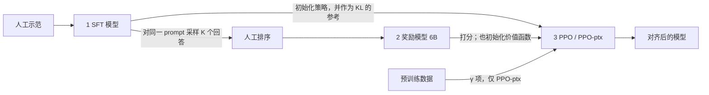

# 后训练入门：SFT 与偏好优化

> 层级：通用层 · 预计 180 分钟 · 题目：[questions.md](questions.md)
> 前置：[01 LLM 与 Transformer 基础](../01-llm-foundations/README.md)（自回归语言模型、交叉熵 loss、注意力）
> 相关：[12 强化学习入门](../12-rl-basics/README.md)（PPO、KL 约束）、[training/02 DPO 及其变体](../../tracks/training/02-preference-optimization/README.md)、[training/07 训练系统](../../tracks/training/07-training-systems/README.md)（显存估算）

## 1 这一章解决什么问题

预训练得到的基座模型只会续写文本。要让它按指令回答、按格式调用工具、在两种答法里选更好的那种，要靠后训练。Agent 岗的面试官常问：“你的模型是怎么从基座变成能对话、会调工具的？” 追问通常落在四处：

- SFT 的 loss 到底算在哪些 token 上，代码里怎么对齐；
- LoRA 为什么省显存，为什么 B 初始化为 0，α/r 有什么用；
- InstructGPT 的奖励模型和 PPO 目标长什么样；
- DPO 怎么从 RLHF 的目标推出来，为什么训练时 chosen 的概率也会下降。

学完这一章，你应该能：

- 写出带 loss mask 的交叉熵，说清 label 为什么要错位一位，packing 时还要改什么；
- 写出 LoRA 的前向、梯度和合并，解释初始化和缩放的作用，说出 QLoRA 的 NF4 怎么构造；
- 写出 Bradley-Terry 奖励模型的 loss 和梯度，说清 InstructGPT 为什么把 C(K,2) 对放进同一个 batch 元素；
- 在白板上从 KL 约束的奖励最大化逐步推到 DPO loss，写出梯度的权重项；
- 用 numpy 验证上面这些结论，知道训练出问题时看哪些指标。

DPO 的变体（IPO、KTO、SimPO、ORPO）和长度偏差在 [training/02](../../tracks/training/02-preference-optimization/README.md)；Agent 轨迹数据的合成与配比在 [training/01](../../tracks/training/01-trajectory-data/README.md)；PPO 本身在 [12 强化学习入门](../12-rl-basics/README.md)。本章只链接，不展开。

**符号表**

| 符号 | 含义 |
|---|---|
| x | prompt（含 system、user、历史轮次） |
| y, y_t | 回答，以及回答的第 t 个 token |
| π_θ | 正在训练的策略（语言模型），参数为 θ |
| π_ref, π^SFT | 参考策略，通常就是 SFT 模型 |
| m_t | loss mask，第 t 个 token 计入 loss 为 1，否则为 0 |
| W₀, A, B, r, α | LoRA：冻结的原权重、两个低秩矩阵、秩、缩放常数 |
| r_θ(x, y) | 奖励模型给 (x, y) 打的标量分 |
| y_w, y_l | 同一 prompt 下更好（chosen）和更差（rejected）的回答 |
| σ(z) | sigmoid，1/(1+e^(−z)) |
| β | KL 约束的强度；DPO 里也是隐式奖励的缩放 |
| Z(x) | 配分函数，Σ_y π_ref(y\|x)·exp(r(x,y)/β) |
| r̂_θ(x, y) | DPO 的隐式奖励，β·log(π_θ(y\|x)/π_ref(y\|x)) |

## 2 后训练的几个阶段

| 阶段 | 输入 | 学到什么 | 代价 |
|---|---|---|---|
| SFT | (prompt, 标准回答) | 格式、语气、按指令做事、调用工具的写法 | 只模仿示范，不知道“哪个更好” |
| 奖励模型 | (prompt, 好回答, 差回答) | 一个给回答打分的模型 | 打分有偏，会被策略钻空子 |
| RL（如 PPO） | prompt + 奖励信号 | 在奖励上优化策略，同时不偏离 SFT 太远 | 要在线采样，要维护多个模型，调参难 |
| DPO | (prompt, 好回答, 差回答) | 直接从偏好对学策略 | 离线数据，受数据分布限制 |

一句话：SFT 教“怎么答”，偏好优化教“哪种答法更好”。LoRA 和 QLoRA 不是独立的阶段，它们是任何一个阶段都能用的“只训练一小部分参数”的方式。

## 3 SFT：chat template、loss mask 与 packing

### 3.1 目标：只在要学的 token 上做最大似然

一条 SFT 样本是一段多轮对话，每条消息带角色：`system`、`user`、`assistant`，Agent 场景还有工具调用和工具结果。拼成 token 序列 x_1 … x_T 后，loss 是带 mask 的负对数似然：

```text
loss = − Σ_t m_t · log p_θ(x_t | x_<t)  /  Σ_t m_t          m_t ∈ {0, 1}
```

m_t 决定第 t 个 token 是不是“要学的目标”。分母是参与的 token 数，不是序列长度。两种 mask 的取法差别很大：

| 做法 | 计入 loss 的 token | 问题 |
|---|---|---|
| 全序列 | 所有 token | 模型也在学“怎么写用户的话”，浪费容量，可能学会替用户说话 |
| 只算最后一轮回答 | 最后一个 assistant 消息 | 多轮样本前面几轮的回答白白浪费 |
| 只算所有 assistant 消息 | 每一轮 assistant 的 token，含结束符 | 主流做法 |
| Agent：assistant 消息，屏蔽工具结果 | 模型生成的思考和工具调用 | 工具结果是环境给的，不该让模型去“预测” |

结束符必须在 m_t = 1 的位置里。它是模型学“什么时候停”的唯一信号。Agent 轨迹里失败调用、工具模拟器等特殊情况的 mask 规则见 [training/01 第 7 节](../../tracks/training/01-trajectory-data/README.md)。

### 3.2 chat template：训练和推理必须逐字一致

chat template 把消息列表拼成模型实际看到的 token 序列，插入角色标记和结束符。不同模型的模板不同，同一个基座微调出的模型也可能不同。Hugging Face 文档用 Mistral-7B-Instruct 和 Zephyr-7B 举例：两者都从 Mistral-7B 微调，前者用 `[INST]` 和 `[/INST]` 包住用户消息，后者用 `<|user|>` 和 `<|assistant|>` 标记角色。文档的原话是，用错控制 token，模型效果会明显变差。

训练时的三个细节（依据 Hugging Face [Chat templates](https://huggingface.co/docs/transformers/main/en/chat_templating) 文档和 `apply_chat_template` 的源码注释）：

- **`add_generation_prompt`**：训练预处理设 `False`。它在末尾追加“助手开始回答”的标记（例如 `<|im_start|>assistant`），推理时需要，训练时多余。推理时漏掉它，模型可能接着用户的话往下写。有的模型（文档举了 Llama）在助手回答前没有特殊标记，这个参数对它们没有作用。
- **特殊 token 不要加两次**：模板已经包含 BOS/EOS。先用 `tokenize=False` 拼字符串、再分词时，要设 `add_special_tokens=False`，否则开头会多出一个 BOS。
- **assistant mask 可以由模板给出**：`apply_chat_template(..., tokenize=True, return_dict=True, return_assistant_tokens_mask=True)` 会返回一个 mask，assistant 生成的 token 为 1。前提是模板里用 `` 标出了 assistant 的范围；不支持的模板拿不到这个 mask。自己按字符位置切片再映射到 token 容易错，原因见第 9 节第 2 条。

### 3.3 loss mask 的实现：错位一位和 ignore_index

自回归模型在位置 t 输出的 logits 预测的是第 t+1 个 token。所以 logits 和 labels 要错开一位：

```text
input_ids:   x_1   x_2   x_3   …   x_{T−1}   x_T
logits:      ℓ_1   ℓ_2   ℓ_3   …   ℓ_{T−1}   ℓ_T     ← ℓ_t 预测 x_{t+1}
对齐后：     (ℓ_1, x_2), (ℓ_2, x_3), …, (ℓ_{T−1}, x_T)   最后一个 ℓ_T 没有目标，丢掉
```

屏蔽的实现方式是把不要学的 label 换成一个忽略值。PyTorch 的 `CrossEntropyLoss` 默认 `ignore_index=-100`，`reduction="mean"` 时只在未被忽略的目标上平均。这就是公式里的 Σ m_t 分母。

错位由谁来做，是最常见的 bug 来源。Hugging Face 的 `ForCausalLMLoss` 在函数内部做错位：先在 labels 末尾补一个 −100，再取 `labels[..., 1:]`。所以传给模型的 `labels` 应当和 `input_ids` 对齐、不错位。如果数据处理代码里已经错过一次，再交给这个 loss，监督的就变成“隔一个 token 预测”。loss 照样会下降，只是模型学到的东西不对。

还有一个反直觉的地方：mask 是加在**目标**上的。预测 assistant 第一个 token 的是 user 消息的最后一个 token（通常是“助手开始”标记）。这个位置的 label 是 −100，但它的 logits 参与 loss。下面的代码把这些都检查了一遍。

```python
import numpy as np

IGNORE = -100
# 一条 Agent 样本，按片段给出 (角色, token id 列表)。id 是虚构的，2 当作结束符 <eos>
segments = [
    ("system",    [11, 12]),
    ("user",      [21, 22, 23]),
    ("assistant", [31, 32, 2]),        # 工具调用，含结束符
    ("tool",      [41, 42, 43, 44]),   # 工具结果，环境给的
    ("assistant", [51, 52, 53, 2]),    # 最终回答，含结束符
]
input_ids = np.array([t for _, ids in segments for t in ids])          # (T,)
train_on = np.array([role == "assistant" for role, ids in segments for _ in ids])
labels = np.where(train_on, input_ids, IGNORE)                        # (T,)，和 input_ids 对齐，还没错位
T, V = len(input_ids), 64

def masked_ce(logits, labels):
    """logits: (T, V)，位置 t 预测第 t+1 个 token；labels: (T,) 未错位。返回 (平均 loss, 参与的位置)。"""
    shift_logits = logits[:-1]                     # (T-1, V)：最后一个位置没有下一个 token
    shift_labels = labels[1:]                      # (T-1,)：错位一位
    keep = shift_labels != IGNORE
    z = shift_logits - shift_logits.max(axis=1, keepdims=True)
    logp = z - np.log(np.exp(z).sum(axis=1, keepdims=True))           # log-softmax
    nll = -logp[np.arange(T - 1), np.where(keep, shift_labels, 0)]
    return (nll * keep).sum() / keep.sum(), np.flatnonzero(keep)

rng = np.random.default_rng(0)
logits = rng.normal(size=(T, V))
loss, pos = masked_ce(logits, labels)

# 1) 参与平均的 token 数 = assistant token 数（两段共 7 个，含两个结束符）
assert len(pos) == train_on.sum() == 7
# 2) 参与的“预测位置” t，其目标 input_ids[t+1] 全是 assistant token
assert np.all(train_on[pos + 1])
assert (input_ids[pos + 1] == 2).sum() == 2          # 两个结束符都算进了 loss
# 3) 预测 assistant 第一个 token 的位置是 user 的最后一个 token（位置 4）：
#    它的 logits 要参与 loss，虽然它本身的 label 是 -100
assert 4 in pos and labels[4] == IGNORE
# 4) 改动“不参与”位置的 logits，loss 不变；改动参与位置的 logits，loss 变
lg = logits.copy()
others = np.setdiff1d(np.arange(T), pos)
lg[others] += rng.normal(size=(len(others), V)) * 5
assert np.isclose(masked_ce(lg, labels)[0], loss)
lg[pos[0]] += 3.0 * np.eye(V)[input_ids[pos[0] + 1]]
assert masked_ce(lg, labels)[0] < loss

# 5) 常见错位 bug：自己先错位一次，再交给“内部还会错位”的 loss（例如 HF 的 ForCausalLMLoss）
double_shifted = np.append(labels[1:], IGNORE)
_, pos_bad = masked_ce(logits, double_shifted)
assert not np.all(train_on[pos_bad + 1])              # 目标和输入差了两位，监督的不再是“下一个 token”
assert np.all(input_ids[pos_bad + 2] == double_shifted[pos_bad + 1])
print("loss =", round(loss, 4), "参与位置：", pos.tolist())
```

几个检查点：参与平均的恰好是 7 个 assistant token，两个结束符都在里面；预测位置 4（user 最后一个 token）的 logits 参与 loss；改动不参与位置的 logits，loss 不变；先错位再交给会错位的 loss，监督目标变成了后两位的 token。

### 3.4 packing：吞吐、交叉污染和平均方式

**为什么要 packing**。SFT 样本长短差别很大。按 batch 内最长样本补齐，padding 会占掉大量算力。Krell 等（arXiv 2107.02027）统计过常见 NLP 数据集，padding 最多可占全部 token 的 50%。packing 把多条短样本首尾拼进一条长序列，几乎不补齐。

**交叉污染（cross-contamination）**。只用普通的因果 mask，拼在后面的样本能看见前面样本的 token。它的输出不再等于单独跑时的输出。这篇论文把这个现象叫交叉污染，并指出加分隔符不能解决它。修法有两处：

1. **注意力 mask 改成块对角**：位置 i 只能看同一条样本内、不晚于自己的 j。
2. **位置编码按样本重置**：每条样本的位置从 0 重新数。论文的消融里，只改 mask、不改位置嵌入时，BERT 的 loss 和准确率几乎跟上，但准确率停在 71.8%，到不了目标 72.1%；两处都不改时，loss 和准确率明显变差，训更久也追不回来。

Hugging Face 的 `DataCollatorWithFlattening` 是这种做法的一个实现：把整个 mini-batch 拼成形状 [1, total_tokens] 的一条序列，`position_ids` 在每条样本开头重新从 0 数，每条样本 labels 的第一个位置写成 `separator_id`（默认 −100）。FlashAttention 的变长接口拿到每条样本的边界（`cu_seq_lens`，可以从重置的 `position_ids` 推出来）后，只在样本内部算注意力。这依赖具体的注意力后端。换成不认 `position_ids` 边界的实现，就退回到只有因果 mask 的情况，代码不会报错。

**边界上的 label**。错位之后，第一条样本最后一个 token（结束符）的“下一个 token”是第二条样本的开头。这个位置不能产生 loss，否则模型在学“结束符后面接另一段对话的开头”。上面那个 collator 把每条样本的首个 label 置为 −100，就是为了这一点。

```python
import numpy as np

rng = np.random.default_rng(1)
V, D = 32, 8
E = rng.normal(size=(V, D))                     # 词嵌入
P = rng.normal(size=(64, D)) * 0.5              # 绝对位置嵌入（可学习表的简化）
Wq, Wk, Wv = (rng.normal(size=(D, D)) / np.sqrt(D) for _ in range(3))

def attn(ids, pos, allowed):
    """单头注意力。ids, pos: (T,)；allowed: (T, T) 布尔，allowed[i, j] 表示 i 能看 j。返回 (T, D)。"""
    x = E[ids] + P[pos]
    q, k, v = x @ Wq, x @ Wk, x @ Wv
    s = q @ k.T / np.sqrt(D)
    s = np.where(allowed, s, -np.inf)
    a = np.exp(s - s.max(axis=1, keepdims=True))
    a /= a.sum(axis=1, keepdims=True)
    return a @ v

seq1 = np.array([3, 7, 9, 2])                   # 第一条样本，2 是结束符
seq2 = np.array([5, 6, 8, 1, 2])                # 第二条样本
L1, L2 = len(seq1), len(seq2)
causal = lambda T: np.tril(np.ones((T, T), dtype=bool))
ref2 = attn(seq2, np.arange(L2), causal(L2))    # 单独跑第二条：正确答案

packed = np.concatenate([seq1, seq2])           # (9,)
T = L1 + L2
seg = np.array([0] * L1 + [1] * L2)             # 每个 token 属于哪条样本
pos_cont = np.arange(T)                         # 位置不重置
pos_reset = np.concatenate([np.arange(L1), np.arange(L2)])
block = causal(T) & (seg[:, None] == seg[None, :])   # 块对角的因果 mask

out_a = attn(packed, pos_cont, causal(T))[L1:]  # 只有因果 mask：第二条能看见第一条
out_b = attn(packed, pos_cont, block)[L1:]      # 隔开了样本，但位置没重置
out_c = attn(packed, pos_reset, block)[L1:]     # 隔开样本 + 重置位置

assert not np.allclose(out_a, ref2)             # 交叉污染：输出被前一条样本改变
assert not np.allclose(out_b, ref2)             # 绝对位置不一样，输出也不一样
assert np.allclose(out_c, ref2)                 # 两件事都做，和单独跑完全一致

# 边界处的 label：packed 序列错位后，第一条最后一个 token（结束符）的“下一个 token”是第二条的开头。
# 这个位置不该训练，否则模型在学“结束符后面接另一段对话的开头”。
labels = packed.copy()
labels[L1] = -100                               # 每条样本第一个 token 的 label 置为忽略
shift = labels[1:]
assert shift[L1 - 1] == -100                    # 预测位置 L1-1（结束符）不产生 loss

# 平均方式：一条 1 个有效 token 的短样本和一条 9 个有效 token 的长样本
nll_short, nll_long = np.array([2.0]), np.full(9, 0.5)
per_sample = (nll_short.mean() + nll_long.mean()) / 2              # 先样本内平均再平均：1.25
per_token = np.concatenate([nll_short, nll_long]).mean()          # packing 后整体按 token 平均：0.65
assert np.isclose(per_sample, 1.25) and np.isclose(per_token, 0.65)
# 按 token 平均时，短样本的权重从 1/2 降到 1/10
print("max |污染误差| =", np.abs(out_a - ref2).max().round(3))
```

结果：只有因果 mask 时，第二条样本的输出被第一条改变（最大误差约 2.2）；隔开了样本但位置没重置，输出仍不同；两件事都做，和单独跑完全一致。

**平均方式会变**。不 packing 时，很多实现先在每条样本内按 token 平均，再在 batch 内平均，每条样本权重相同。packing 后整条长序列按 token 平均，每个 token 权重相同，长样本整体权重更大。代码最后一段：一条 1 个有效 token、一条 9 个有效 token，两种平均分别是 1.25 和 0.65，短样本的权重从 1/2 降到 1/10。哪种对取决于你想要什么，要点是切换 packing 时知道它变了。这和 GRPO 的长度偏差是同一类问题，见 [training/03 第 3 节](../../tracks/training/03-grpo-family/README.md#3-dr-grpo去掉两处归一化)。梯度累积时，每个 micro-batch 除以自己的 token 数再求平均，也会变成按 micro-batch 平均，原因和修法在 training/03 的第 8 节第 9 条。

## 4 LoRA 与 QLoRA：只训一个低秩增量

出处：[Hu 等，LoRA，arXiv 2106.09685](https://arxiv.org/abs/2106.09685)，2021-06，第 4 节。

### 4.1 全参微调贵在哪

混合精度 Adam 下，每个参数要存 FP16 权重、FP16 梯度、FP32 主权重和两份 FP32 动量，合计约 16 字节（推导见 [training/07 第 2.1 节](../../tracks/training/07-training-systems/README.md)）。推理只要 2 字节。所以全参微调的模型状态是推理权重的约 8 倍，而且每个任务都要存一份完整权重。

LoRA 冻结原权重，只训一小组新参数。冻结的参数不需要梯度和优化器状态。

### 4.2 前向、初始化与梯度

对一个权重 W₀ ∈ R^{d×k}（输入维度 k，输出维度 d），LoRA 把更新写成低秩分解：

```text
h = W₀x + (α/r)·BAx          B ∈ R^{d×r},  A ∈ R^{r×k},  r ≪ min(d, k)
```

- **前向的算法**：先算 Ax（r 维），再乘 B。额外计算量是 r(d+k) 次乘加，比 dk 小得多。
- **参数量**：一层从 dk 变成 r(d+k)。
- **初始化**：论文写的是 A 随机高斯、B 为 0，所以开始时 BA = 0，模型和原来完全一样。Hugging Face PEFT 的默认实现里 A 用 kaiming-uniform（和 `nn.Linear` 默认一样），B 仍为 0；关键点是 B = 0，A 用哪种随机分布是次要的。

**为什么是 B = 0，而不是两个都随机，或两个都为 0**。设上游梯度 G = ∂L/∂h，对两个矩阵求导：

```text
∂L/∂B = (α/r) · G · (Ax)ᵀ          含 A
∂L/∂A = (α/r) · Bᵀ · G · xᵀ        含 B
```

- 两个都随机：BA ≠ 0，训练第一步之前模型就被加了一个随机扰动。
- 两个都为 0：两个梯度都含另一个矩阵，都恒为 0，永远训不动。
- A 随机、B = 0：起点等于原模型；∂L/∂B 不为 0，B 先动起来；B 离开 0 之后 A 才有梯度。

**α/r 的作用**。论文的说法是：用 Adam 时，调 α 和调学习率大致等价（前提是初始化尺度合适），所以他们把 α 设成第一个尝试的 r，之后不再调；这个缩放让改变 r 时少重调超参数。可以这样理解：Adam 的更新幅度近似是“学习率 × 符号”，和梯度大小无关。B 的每个元素第一步都移动约 lr，输出的改变量约是 lr·(α/r)·‖Ax‖₁。‖Ax‖₁ 有 r 个分量，大约随 r 线性增长。乘上 1/r 正好抵消，r 从 4 改成 64 时，第一步对输出的影响量级不变（这是推导，下面的代码验证）。PEFT 里 `scaling = lora_alpha / r`；打开 `use_rslora` 时改为 `lora_alpha / sqrt(r)`。

### 4.3 合并：推理不加延迟

训练完可以算出 W = W₀ + (α/r)·BA，替换原权重，推理和原模型一样快。换任务时减掉 (α/r)·BA，再加另一个任务的增量。不合并也可以：一个基座同时挂多个 adapter，每个请求选自己的那组，代价是每次多一次小矩阵乘。论文提到合并之后，不同 adapter 的请求就不能放进同一个 batch。

```python
import numpy as np

rng = np.random.default_rng(0)
d, k, r, alpha = 64, 48, 8, 16
W0 = rng.normal(size=(d, k)) / np.sqrt(k)        # 冻结的原权重
A = rng.normal(size=(r, k)) / np.sqrt(k)         # 高斯初始化
B = np.zeros((d, r))                             # 零初始化
s = alpha / r                                    # 缩放 α/r
x = rng.normal(size=(k, 5))                      # 5 个输入列向量，(k, 5)

def lora_forward(x, B, A):
    return W0 @ x + s * (B @ (A @ x))            # 先算 A@x：(r, 5)，计算量 O(r(d+k))

# 1) B = 0：起点和原模型完全一样
assert np.allclose(lora_forward(x, B, A), W0 @ x)

# 2) 起点处的梯度：设上游梯度 G = ∂L/∂h，(d, 5)
G = rng.normal(size=(d, 5))
gB = s * G @ (A @ x).T                           # ∂L/∂B，(d, r)
gA = s * B.T @ G @ x.T                           # ∂L/∂A，(r, k)
assert np.allclose(gA, 0) and np.abs(gB).max() > 0   # 第一步只有 B 在动；A 要等 B 离开 0 才有梯度
# A、B 都为 0：∂L/∂B 含 A，∂L/∂A 含 B，两个梯度都恒为 0，永远训不动
Z_A, Z_B = np.zeros((r, k)), np.zeros((d, r))
assert np.allclose(s * G @ (Z_A @ x).T, 0) and np.allclose(s * Z_B.T @ G @ x.T, 0)

# 3) 训练几步后合并：W = W0 + s·BA，前向逐元素相等；减回去恢复原权重
B = rng.normal(size=(d, r)) * 0.1                # 假装训练过
W_merged = W0 + s * B @ A
assert np.allclose(W_merged @ x, lora_forward(x, B, A))
assert np.allclose(W_merged - s * B @ A, W0)
assert np.linalg.matrix_rank(s * B @ A) <= r     # 增量的秩不超过 r

# 4) 参数量：一层 d×k 的全参是 dk，LoRA 是 r(d+k)
assert d * k == 3072 and r * (d + k) == 896

# 5) α/r 的作用。Adam 第一步的更新约等于 −lr·sign(梯度)，大小和梯度尺度无关。
#    此时输出改变量 = lr·scale·‖Ax‖₁，‖Ax‖₁ 大约正比于 r
def first_step_change(r, scale, k=1024, lr=1e-3, seeds=50):
    out = []
    for seed in range(seeds):
        g = np.random.default_rng(seed)
        A = g.normal(size=(r, k)) / np.sqrt(k)
        x = g.normal(size=k)
        delta = g.normal(size=64)                # ∂L/∂h，d = 64
        dB = -lr * np.sign(scale * np.outer(delta, A @ x))
        change = np.abs(scale * dB @ (A @ x)).mean()
        assert np.isclose(change, lr * scale * np.abs(A @ x).sum())
        out.append(change)
    return np.mean(out)

c4, c64 = first_step_change(4, 16 / 4), first_step_change(64, 16 / 64)
n4, n64 = first_step_change(4, 1.0), first_step_change(64, 1.0)
assert 0.8 < c64 / c4 < 1.25                     # 乘 α/r：r 从 4 到 64，第一步改变量基本不变
assert 12 < n64 / n4 < 20                        # 不缩放：改变量随 r 线性增长（约 16 倍）
# 同一个 r 下，α 翻倍和学习率翻倍效果相同（sign 更新下精确相等）
assert np.isclose(first_step_change(8, 32 / 8), first_step_change(8, 16 / 8, lr=2e-3))
print("乘 α/r：", c4.round(5), c64.round(5), "；不缩放：", n4.round(5), n64.round(5))
```

结果：B = 0 时输出和原模型一致，第一步只有 B 有梯度；合并后前向逐元素相等。不缩放时，r 从 4 改到 64，第一步对输出的改变量约放大 16 倍；乘 α/r 后基本不变。

### 4.4 数值例子：GPT-3 175B 上的 10000 倍从哪来

GPT-3 175B 有 96 层，d_model = 12288（GPT-3 论文表 2.1）。论文 4.2 节的设置是 r = 4，只在 Wq 和 Wv 上加 LoRA，两者都按 12288 × 12288 处理。

- 每个矩阵的 LoRA 参数：r(d+k) = 4 × (12288 + 12288) = 98304。
- 全模型：96 层 × 2 个矩阵 × 98304 ≈ 1887 万，和论文 7.1 节说的 18M 预算一致。
- FP16 存储：1887 万 × 2 字节 ≈ 37.7 MB，论文写约 35 MB。
- 175B / 1887 万 ≈ 9272，就是摘要里“可训练参数减少约 10000 倍”的来源。

论文还报告了另外两个数：训练显存从 1.2 TB 降到 350 GB（约 3 倍），训练速度比全参快约 25%，因为大部分参数不用算权重梯度。显存只降 3 倍而不是 10000 倍，是因为冻结的 350 GB FP16 权重和激活都还在。部署 100 个任务时，只需 350 GB + 35 MB × 100 ≈ 354 GB，全参微调要 35 TB。

### 4.5 QLoRA：基座量化成 4 bit，梯度穿过它

出处：[Dettmers 等，QLoRA，arXiv 2305.14314](https://arxiv.org/abs/2305.14314)，2023-05，第 3 节和附录 E。

LoRA 之后，显存大头是冻结的 16 bit 基座。QLoRA 把基座存成 4 bit，摘要报告可在单张 48GB GPU 上微调 65B 模型。它有三件东西：

**1. 4-bit NormalFloat（NF4）**。思路来自分位数量化：让每个量化格子里落入的值一样多。估计任意张量的分位数很贵；但预训练权重大致是零均值正态分布，标准正态的分位数可以事先算好。做法：

1. 取标准正态 N(0, 1) 的一组分位点作为码值，归一化到 [−1, 1]；
2. 权重按块（块大小 64）做 absmax 缩放，除以块内绝对值最大值，落到 [−1, 1]；
3. 每个值取最近的码值，存 4 bit 索引；每块另存一个缩放常数。

对称地取分位点没法精确表示 0。论文的修法是负半边取 2^(k−1) 个、正半边取 2^(k−1)+1 个分位点，合并后去掉重复的 0，得到 7 个负值、0、8 个正值，共 16 个。论文称它对零均值正态分布的数据是“信息论意义上最优”的，指的是每个格子的期望值数量相等。

**2. 双重量化（Double Quantization）**。块大小 64、缩放常数用 FP32 时，每个参数平均多出 32/64 = 0.5 bit。QLoRA 把这些常数再用 FP8、块大小 256 量化一次，开销降到 8/64 + 32/(64·256) ≈ 0.127 bit，每参数省 0.373 bit，65B 模型上约 3 GB。

**3. 分页优化器（Paged Optimizers）**。用 NVIDIA 统一内存，在显存不足时把优化器状态自动换出到 CPU 内存，用来避开长序列 mini-batch 在梯度检查点（gradient checkpointing）时出现的显存尖峰。另外，QLoRA 在每一层的线性层上都加 adapter，而不是只加在 Wq、Wv 上。

**前向和反向**。QLoRA 有一种存储类型（NF4）和一种计算类型（BF16）。每次用到权重时，先反量化成 BF16 再做矩阵乘。反向时，误差对输入的梯度要穿过反量化后的基座权重，但只对 LoRA 参数算权重梯度，基座不更新。式子是：

```text
Y = X · doubleDequant(c₁, c₂, W_NF4) + X · L₁ · L₂          （QLoRA 式 5，全部在 BF16 下算）
```

下面的代码按 bitsandbytes 的 `create_normal_map` 重算 NF4 码值，和论文附录 E 逐个比对，再算双重量化的开销。

```python
import numpy as np
from statistics import NormalDist

# 按 bitsandbytes create_normal_map 的构造重算 NF4 的 16 个值（scipy 换成标准库 NormalDist）
ppf = NormalDist().inv_cdf
offset = 0.9677083                                   # 最外侧分位点，截掉正态的尾部
pos = [ppf(p) for p in np.linspace(offset, 0.5, 9)[:-1]]     # 8 个正值
neg = [-ppf(p) for p in np.linspace(offset, 0.5, 8)[:-1]]    # 7 个负值
nf4 = np.sort(np.array(pos + [0.0] + neg))
nf4 /= nf4.max()                                     # 归一化到 [−1, 1]

# 和 QLoRA 附录 E 给出的值逐个比对
appendix_e = np.array([-1.0, -0.6961928009986877, -0.5250730514526367, -0.39491748809814453,
    -0.28444138169288635, -0.18477343022823334, -0.09105003625154495, 0.0, 0.07958029955625534,
    0.16093020141124725, 0.24611230194568634, 0.33791524171829224, 0.44070982933044434,
    0.5626170039176941, 0.7229568362236023, 1.0])
assert len(nf4) == 16 and np.allclose(nf4, appendix_e, atol=1e-6)
assert (nf4 < 0).sum() == 7 and (nf4 > 0).sum() == 8 and 0.0 in nf4   # 非对称，精确表示 0

def quantize_blockwise(w, levels, block=64):
    """w: (n,)，按 block 个一组做 absmax 缩放，再取最近的码值。返回反量化结果。"""
    wb = w.reshape(-1, block)
    c = np.abs(wb).max(axis=1, keepdims=True)        # 每块一个量化常数（absmax）
    idx = np.abs((wb / c)[..., None] - levels).argmin(axis=-1)   # 4 bit 索引
    return (levels[idx] * c).reshape(-1)

rng = np.random.default_rng(0)
w = rng.normal(0, 0.02, size=64 * 2000)              # 近似正态的“预训练权重”
int4 = np.linspace(-1, 1, 16)                        # 对照：均匀的 16 个码值
err_nf4 = np.mean((quantize_blockwise(w, nf4) - w) ** 2)
err_int4 = np.mean((quantize_blockwise(w, int4) - w) ** 2)
assert err_nf4 < err_int4                            # 正态数据上，按分位点放码值的误差更小
print("MSE  NF4 / 均匀 4bit =", round(err_nf4 / err_int4, 3))

# 量化常数的开销（论文 3 节）：块大小 64、FP32 常数 → 每参数 0.5 bit；
# 双重量化：常数再用 FP8、块大小 256 量化 → 8/64 + 32/(64·256)
assert 32 / 64 == 0.5
dq = 8 / 64 + 32 / (64 * 256)
assert round(dq, 3) == 0.127 and round(0.5 - dq, 3) == 0.373
# 65B 模型上省下 0.373 bit/参数 ≈ 3 GB，和论文“约 3 GB”一致
assert round(65e9 * (0.5 - dq) / 8 / 1e9, 1) == 3.0
# 65B 的 4 bit 权重本身约 32.5 GB，加双重量化后的常数约 1 GB，放得进 48GB 的卡
assert 65e9 * (4 + dq) / 8 / 1e9 < 34
```

码值和附录 E 一致到 1e-6。正态数据上，NF4 的均方误差约是均匀 16 级码值的 0.83 倍。这只是这组模拟数据上的结果，不代表模型效果。代码里的 offset = 0.9677083 来自 bitsandbytes 源码，论文正文的式 4 没有给出这个值。

QLoRA 省的是基座权重的显存。激活、LoRA 的梯度和优化器状态不变；每次用到权重都要先反量化，比 16 bit LoRA 多一步计算（这是推断，论文没有给出两者每步速度的对比）。量化方法本身（GPTQ、AWQ 等推理侧量化）见 [inference/04 量化](../../tracks/inference/04-quantization/README.md)。

## 5 RLHF：InstructGPT 的三步

出处：[Ouyang 等，InstructGPT，arXiv 2203.02155](https://arxiv.org/abs/2203.02155)，2022-03，第 3.5 节和附录 C。



论文里的数据规模：SFT 约 13k 条训练 prompt，奖励模型 33k，PPO 31k。

### 5.1 第 1 步：SFT

在人工示范上做监督微调。论文训了 16 个 epoch；验证集 loss 在 1 个 epoch 后就开始过拟合，但多训几个 epoch 对奖励模型分数和人工偏好都有帮助。最终按验证集上的奖励模型分数选 SFT 模型。这说明 SFT 的验证 loss 不是选模型的唯一依据。

### 5.2 第 2 步：奖励模型与 Bradley-Terry loss

**结构**。从 SFT 模型出发，去掉最后的反嵌入层（unembedding），换成输出一个标量的头。输入 (x, y)，输出 r_θ(x, y)。论文只用 6B 奖励模型，理由是省算力，而且 175B 奖励模型训练可能不稳定，不适合拿来初始化 PPO 的价值函数。

**偏好模型**。Bradley-Terry 模型假设 y_w 胜过 y_l 的概率只取决于两者的奖励差：

```text
p(y_w ≻ y_l | x) = exp(r(x,y_w)) / ( exp(r(x,y_w)) + exp(r(x,y_l)) ) = σ( r(x,y_w) − r(x,y_l) )
```

对人工标注做最大似然，就是对每一对最小化 −log σ(r_w − r_l)。对奖励差 Δ = r_w − r_l 求导：

```text
d/dΔ [ −log σ(Δ) ] = −(1 − σ(Δ)) = −σ(−Δ)
```

已经排对且拉得很开的对（Δ 很大）梯度接近 0；排错的对（Δ < 0）梯度接近 −1。DPO 梯度里的权重项就是这同一个 σ(−Δ)，见 6.3 节。

**K 选 C(K,2) 对**。标注员一次看 K 个回答（论文里 K 在 4 到 9 之间）并排序，一个排序能拆出 C(K,2) 个两两比较。损失是论文式 1：

```text
loss(θ) = − 1/C(K,2) · E_{(x, y_w, y_l)~D} [ log σ( r_θ(x, y_w) − r_θ(x, y_l) ) ]
```

为什么把一个 prompt 的 C(K,2) 对放进**同一个 batch 元素**，而不是打散成独立样本：

- **过拟合**：同一个排序拆出来的对高度相关。打散后，每个回答会出现在 K−1 对里，被用于 K−1 次独立的梯度更新。论文观察到，打散的数据只过一遍奖励模型就会过拟合。
- **算力**：成组时 K 个回答各前向一次；打散时 C(K,2) 对每对要两次前向。K = 9 时是 9 次对 72 次。
- 附录 C.2 的规模：batch 大小 64 指的是 64 个不同的 prompt，一个 batch 最多 64 × C(9,2) = 2304 对；平局的对被丢掉；只训 1 个 epoch，多个 epoch 会很快过拟合。

**奖励只定义到一个常数**。loss 只看奖励差，所有奖励加同一个常数，loss 不变。论文在 RL 之前加了一个偏置，让人工示范的平均分为 0。

下面在玩具数据上训一个线性奖励模型：隐藏一个真实偏好方向，按“真实奖励 + Gumbel 噪声”生成排序（这正好对应 Bradley-Terry 的推广 Plackett-Luce 模型），然后用式 1 训练。

```python
import itertools
import numpy as np

rng = np.random.default_rng(0)
D = 5
w_true = rng.normal(size=D)                          # 隐藏的“真实偏好”，奖励 = w_true · φ

def make_prompts(n):
    """每个 prompt 有 K∈[4,9] 个回答，按 Plackett-Luce（真实奖励 + Gumbel 噪声）排序。"""
    data = []
    for _ in range(n):
        K = rng.integers(4, 10)
        phi = rng.normal(size=(K, D))                # 每个回答的特征，(K, D)
        noisy = phi @ w_true + rng.gumbel(size=K)
        rank = np.argsort(-noisy)                    # 标注员的排序，好的在前
        pairs = np.array(list(itertools.combinations(rank, 2)))   # (C(K,2), 2)，每对 [胜, 负]
        data.append((phi, pairs))
    return data

train, test = make_prompts(300), make_prompts(300)
assert all(len(p) == len(phi) * (len(phi) - 1) // 2 for phi, p in train)   # C(K,2) 对

def loss_and_grad(w, data):
    """InstructGPT 式 1：每个 prompt 的 C(K,2) 对作为一个 batch 元素，组内乘 1/C(K,2)。"""
    L, g = 0.0, np.zeros(D)
    for phi, pairs in data:
        r = phi @ w                                  # K 个回答各前向一次，不是每对各两次
        diff = r[pairs[:, 0]] - r[pairs[:, 1]]       # r(y_w) − r(y_l)
        L += np.mean(np.logaddexp(0, -diff))         # −log σ(diff)，数值稳定写法
        coef = -1 / (1 + np.exp(diff))               # d(−log σ)/d diff = −(1 − σ)
        g += (coef[:, None] * (phi[pairs[:, 0]] - phi[pairs[:, 1]])).mean(axis=0)
    return L / len(data), g / len(data)

def pair_acc(w, data):
    hits = [np.mean(phi[p[:, 0]] @ w > phi[p[:, 1]] @ w) for phi, p in data]
    return np.mean(hits)

w = np.zeros(D)
L0, _ = loss_and_grad(w, train)
assert np.isclose(L0, np.log(2))                     # 初始奖励全为 0，loss = log 2

# 数值梯度检查
w_chk = rng.normal(size=D)
_, g_chk = loss_and_grad(w_chk, train)
h = 1e-6
num = [(loss_and_grad(w_chk + h * e, train)[0] - loss_and_grad(w_chk - h * e, train)[0]) / (2 * h)
       for e in np.eye(D)]
assert np.allclose(num, g_chk, atol=1e-7)

for _ in range(300):
    L, g = loss_and_grad(w, train)
    w -= 1.0 * g
cos = w @ w_true / np.linalg.norm(w) / np.linalg.norm(w_true)
assert L < 0.85 * L0 and cos > 0.98                  # 学到的方向和真实偏好一致；标签有噪声，loss 降不到 0
assert abs(pair_acc(w, test) - pair_acc(w_true, test)) < 0.02   # 留出集上接近“真实奖励”的上限

# 奖励只在差里出现：整体加常数，loss 不变。所以 RL 前要另外定一个偏置
#（InstructGPT 让示范回答的平均分为 0）
assert np.isclose(loss_and_grad(w, train)[0],
                  np.mean([np.mean(np.logaddexp(0, -((phi @ w + 3.0)[p[:, 0]] - (phi @ w + 3.0)[p[:, 1]])))
                           for phi, p in train]))

# 规模：K=9 时一个 prompt 有 36 对；batch 64 个 prompt 最多 2304 对（论文附录 C.2）
assert len(list(itertools.combinations(range(9), 2))) == 36 and 64 * 36 == 2304
# 打平成独立样本时，K=9 要做 2·36 = 72 次前向，按 prompt 成组只要 9 次；每个回答出现在 K−1 = 8 对里
assert 2 * 36 == 72 and sum(1 for a, b in itertools.combinations(range(9), 2) if 0 in (a, b)) == 8
print("cos =", round(cos, 4), "留出集准确率 =", round(pair_acc(w, test), 3), "/", round(pair_acc(w_true, test), 3))
```

几个检查点：初始 loss 恰为 log 2；解析梯度和数值梯度一致；学到的方向和真实偏好的余弦相似度约 0.997；留出集上两两比较的准确率约 0.705，和用真实奖励排序的 0.706 几乎一样。准确率到不了 1，因为标签本身有噪声。真实奖励模型也一样：标注员之间本来就不完全一致，验证集准确率有一个由标注噪声决定的上限，不能指望它接近 1（这是推断，模拟只说明了噪声标签下的情况）。

### 5.3 第 3 步：PPO 与 PPO-ptx

**环境**。论文把它写成一个 bandit 环境：给一个 prompt，策略生成一个回答，奖励模型打分，回合结束。

**目标**。论文式 2：

```text
objective(φ) = E_{(x,y)~π_φ^RL} [ r_θ(x,y) − β · log( π_φ^RL(y|x) / π^SFT(y|x) ) ]
             + γ · E_{x~D_pretrain} [ log π_φ^RL(x) ]
```

逐项看：

- **r_θ(x, y)**：奖励模型的分数，只在回答结尾给一次。
- **−β · log(π^RL/π^SFT)**：论文说的是在每个 token 上加对 SFT 模型的 KL 惩罚，用来减轻对奖励模型的过度优化。奖励模型只在 SFT 分布附近训练过；策略跑远了，奖励模型的分数就不可信，策略会去钻它的空子（reward hacking）。这一项把策略拉在奖励模型可信的区域里。在采样到的 y 上，它的期望就是 β 倍的 KL(π^RL ‖ π^SFT)。KL 的几种加法见 [12 第 6 节](../12-rl-basics/README.md#6-kl-约束三种别走太远)。
- **γ · E[log π^RL(x)]**：在预训练数据上的对数似然，即混进预训练的语言模型梯度。带这一项的叫 PPO-ptx，γ = 0 时就是普通 PPO。论文里 InstructGPT 默认指 PPO-ptx。

**为什么要 γ 项**。只做 PPO 时，模型在 SQuADv2、DROP 等公开 NLP 任务上会掉点，论文称为“对齐税”（alignment tax）。附录 E 做了两个消融：

- 加大 γ：1.3B 模型上 γ ≥ 20 时这些任务的退化可以恢复；γ = 27.8 在 1.3B 到 175B 上都好用；验证集奖励会下降，但人工评分对 γ 的具体取值不敏感。
- 只加大 β、不加 γ：即使 β 加到 2.0（默认值的 100 倍），退化也补不回来，而验证集奖励明显下降。

结论是 KL 项拉不住通用能力，要直接混入预训练分布的数据。

**论文里的超参数**（附录 C.4）：β = 0.02；γ = 27.8；预训练样本数是 RL 回合数的 8 倍；共 256k 个回合，约 31k 个不同 prompt；batch 512、minibatch 64，只跑 1 个内层 epoch；PPO clip 0.2；采样温度 1；GAE 不打折扣；价值函数从奖励模型初始化。

**结果**。人工评测里，1.3B 的 PPO-ptx 模型的输出比 175B 的 GPT-3 更受偏好（论文报告）。

PPO 本身（clip、GAE、价值函数）在 [12 强化学习入门](../12-rl-basics/README.md#5-ppo限制每次更新的幅度)展开。整个流程要同时放策略、参考、奖励、价值四个模型，这是 DPO 想去掉的东西。

## 6 DPO：从 RLHF 目标推出分类 loss

出处：[Rafailov 等，Direct Preference Optimization，arXiv 2305.18290](https://arxiv.org/abs/2305.18290)，2023-05，第 4 节、附录 A.1 和 A.2。精读见 [papers/07](../../papers/07-dpo.md)。

**问题**。RLHF 要训奖励模型、在线采样，同时维护策略、参考、奖励、价值多个模型，复杂且不稳定。DPO 的想法是：KL 约束的奖励最大化有闭式解，可以把“奖励”换成“策略”来表示，于是直接在偏好数据上训练策略。

### 6.1 推导：每一步写出来

**第 1 步：目标**。和 RLHF 相同（DPO 式 3、附录式 11），对每个 x：

```text
max_π  E_{y~π(·|x)} [ r(x,y) ] − β · D_KL[ π(·|x) ‖ π_ref(·|x) ]
```

π 在这里是任意分布，不限于某个参数化的模型（论文说的 non-parametric policy class）。

**第 2 步：把 KL 展开，合并成一个期望**：

```text
  E_{y~π} [ r(x,y) − β · log( π(y|x) / π_ref(y|x) ) ]
= −β · E_{y~π} [ log( π(y|x) / π_ref(y|x) ) − r(x,y)/β ]
```

最大化它等于最小化方括号里的期望。

**第 3 步：引入配分函数**。定义

```text
Z(x)     = Σ_y π_ref(y|x) · exp( r(x,y)/β )
π*(y|x)  = π_ref(y|x) · exp( r(x,y)/β ) / Z(x)
```

π* 非负、对 y 求和为 1，是一个合法分布。Z(x) 只依赖 x 和 π_ref，不依赖要优化的 π。取对数：log π*(y|x) = log π_ref(y|x) + r(x,y)/β − log Z(x)。所以

```text
log( π(y|x) / π_ref(y|x) ) − r(x,y)/β = log( π(y|x) / π*(y|x) ) − log Z(x)
```

**第 4 步：目标变成一个 KL**。代回第 2 步：

```text
E_{y~π} [ r ] − β · D_KL[ π ‖ π_ref ] = −β · D_KL[ π ‖ π* ] + β · log Z(x)
```

第二项和 π 无关。KL 非负，当且仅当两个分布相同时为 0（Gibbs 不等式）。所以最优解就是 π*，最优值是 β·log Z(x)：

```text
π_r(y|x) = (1/Z(x)) · π_ref(y|x) · exp( r(x,y)/β )                 （DPO 式 4）
```

**第 5 步：反解出奖励**。对式 4 两边取对数再整理：

```text
r(x,y) = β · log( π_r(y|x) / π_ref(y|x) ) + β · log Z(x)            （DPO 式 5）
```

这一步把“奖励”换成了“最优策略和参考策略的对数比”，代价是多出一个算不出的 β·log Z(x)。Z(x) 要对所有可能的回答求和，回答空间是指数级的。

**第 6 步：代入 Bradley-Terry，Z(x) 抵消**。Bradley-Terry 只依赖奖励差。两个回答 y_w、y_l 共用同一个 x，β·log Z(x) 相同，相减就消掉了：

```text
p*(y_w ≻ y_l | x) = σ( r*(x,y_w) − r*(x,y_l) )
                  = σ( β·log(π*(y_w|x)/π_ref(y_w|x)) − β·log(π*(y_l|x)/π_ref(y_l|x)) )   （DPO 式 6）
```

**第 7 步：最大似然**。把 π* 换成参数化的 π_θ，对偏好数据集 D 做最大似然，就得到 DPO loss：

```text
L_DPO(π_θ; π_ref) = − E_{(x, y_w, y_l)~D} [ log σ( β·log(π_θ(y_w|x)/π_ref(y_w|x)) − β·log(π_θ(y_l|x)/π_ref(y_l|x)) ) ]   （DPO 式 7）
```

它和奖励模型的 Bradley-Terry loss 形式完全一样，只是奖励换成了**隐式奖励**：

```text
r̂_θ(x, y) = β · log( π_θ(y|x) / π_ref(y|x) )
```

论文副标题“你的语言模型其实是一个奖励模型”指的就是它。这个奖励比真实奖励少了 β·log Z(x)。这不影响任何东西：论文引理 1、2 说明，奖励加一个只依赖 x 的函数，Bradley-Terry 的偏好分布和 KL 约束下的最优策略都不变。

**实现**。π_θ(y|x) 是整句概率，log 概率是回答里每个 token 的 log 概率之和，只在回答的 token 上求和（mask 规则和 SFT 一样）。π_ref 的 log 概率在训练前算一次就够，参考模型不需要梯度。论文附录 B 的 PyTorch 代码就是 `-F.logsigmoid(beta * (pi_logratios - ref_logratios))`。

下面的代码在一个只有 6 个回答的离散问题上验证第 3 到第 6 步。

```python
import numpy as np

rng = np.random.default_rng(0)
Y, beta = 6, 0.5                                     # 一个 prompt 只有 6 种可能回答
pi_ref = rng.dirichlet(np.ones(Y))                   # 参考策略
r = rng.normal(size=Y)                               # 任意奖励

def objective(pi):
    """式 (1)：E_π[r] − β·KL(π ‖ π_ref)"""
    return pi @ r - beta * np.sum(pi * np.log(pi / pi_ref))

# (2) 闭式最优解：π* ∝ π_ref·exp(r/β)
Z = np.sum(pi_ref * np.exp(r / beta))
pi_star = pi_ref * np.exp(r / beta) / Z
assert np.isclose(pi_star.sum(), 1)

# 中间式：目标 = −β·KL(π ‖ π*) + β·log Z，所以 π* 处取最大值 β·log Z
for _ in range(1000):
    pi = rng.dirichlet(np.ones(Y) * 0.5)
    kl_star = np.sum(pi * np.log(pi / pi_star))
    assert np.isclose(objective(pi), -beta * kl_star + beta * np.log(Z))
    assert objective(pi) <= objective(pi_star) + 1e-12
assert np.isclose(objective(pi_star), beta * np.log(Z))

# (3) 反解奖励：r = β·log(π*/π_ref) + β·log Z
assert np.allclose(r, beta * np.log(pi_star / pi_ref) + beta * np.log(Z))

# (4) Bradley-Terry 只看奖励差：用“隐式奖励” β·log(π*/π_ref)（少了 β·log Z）算出的偏好概率完全相同
sig = lambda z: 1 / (1 + np.exp(-z))
r_hat = beta * np.log(pi_star / pi_ref)
for w, l in [(0, 1), (2, 5), (4, 3)]:
    assert np.isclose(sig(r[w] - r[l]), sig(r_hat[w] - r_hat[l]))

# 等价类（DPO 引理 2）：奖励加任意只依赖 x 的常数，最优策略不变
r2 = r + 7.3
pi_star2 = pi_ref * np.exp(r2 / beta) / np.sum(pi_ref * np.exp(r2 / beta))
assert np.allclose(pi_star, pi_star2)

# β 的作用：β 越大越贴近 π_ref，越小越集中到最高奖励的回答
def opt(b):
    p = pi_ref * np.exp(r / b)
    return p / p.sum()
kl = lambda p: np.sum(p * np.log(p / pi_ref))
assert kl(opt(5.0)) < kl(opt(0.5)) < kl(opt(0.05))
assert opt(0.01).argmax() == r.argmax() and opt(0.01).max() > 0.99
print("max objective =", round(objective(pi_star), 4), "= β·log Z =", round(beta * np.log(Z), 4))
```

几个检查点：1000 个随机分布上，目标都等于 −β·KL(π‖π*) + β·log Z，且都不超过 π* 处的值；反解出的奖励和原奖励一致；用少了 β·log Z 的隐式奖励算 Bradley-Terry 概率，结果完全相同；β 越小，最优策略离 π_ref 越远，β → 0 时集中到奖励最高的回答上。

### 6.2 为什么不直接用闭式解

式 4 已经给出了最优策略，看起来不需要训练。实际有两个障碍。一是 Z(x) 要对所有回答求和，算不出来，所以没法直接采样或算概率。二是式 4 需要知道真实奖励 r，而我们手里只有偏好对。DPO 的做法是绕开两者：用偏好对做最大似然，Z(x) 在比较里抵消。

### 6.3 梯度与权重项

记 m = r̂_θ(x, y_w) − r̂_θ(x, y_l)（隐式奖励差，也叫 margin）。L = −log σ(m)，dL/dm = −σ(−m)。m 对 θ 的导数是 β(∇log π_θ(y_w|x) − ∇log π_θ(y_l|x))。合起来就是论文第 4 节的梯度：

```text
∇_θ L_DPO = − β · E [ σ( r̂_θ(x,y_l) − r̂_θ(x,y_w) ) · ( ∇_θ log π_θ(y_w|x) − ∇_θ log π_θ(y_l|x) ) ]
```

读这个式子：

- **方向**：提高 y_w 的 log 概率，压低 y_l 的 log 概率。
- **权重 σ(r̂(y_l) − r̂(y_w)) = σ(−m)**：隐式奖励排错了（m < 0）时接近 1；已经排对且拉开（m 很大）时接近 0。它和奖励模型 Bradley-Terry 梯度里的 σ(−Δ) 是同一个东西。起点 π_θ = π_ref 时 m = 0，权重都是 1/2。
- **论文的消融**：去掉这个权重，就是“提高 y_w、压低 y_l”的 unlikelihood 式目标。论文报告这种朴素版本会让模型退化，附录表 3 列出了 TL;DR 上的退化样本，回答变成重复的词。权重的作用是：已经学会的对不再继续推，避免无限压低 y_l。
- **对 chosen 和 rejected 的梯度大小相等、方向相反**：loss 只看两者 log 比的差，不关心各自的绝对值。下一节的问题就从这里来。

### 6.4 chosen 的概率为什么会下降

训练 DPO 时常看到：rejected 的 log 概率在降，chosen 的 log 概率也在降，只是降得慢一些。loss 仍然在下降。

**原因一：loss 只约束差**。m = β[(log π_θ(y_w) − log π_ref(y_w)) − (log π_θ(y_l) − log π_ref(y_l))]。chosen 降 5 nats、rejected 降 20 nats，m 就增加 1.5（β = 0.1）。loss 下降，而 chosen 的概率比参考模型还低。Pal 等（arXiv 2402.13228，2024-02，第 3 节）指出了这一点：只要 rejected 降得足够多，chosen 的似然比 π_θ/π_ref 掉到 1 以下也能得到很低的 loss。

**原因二：编辑距离小的偏好对**。Pal 等分析了只在一个 token 上不同的偏好对，例如“2+2=4”和“2+2=5”。设两者在第 p 个 token 不同，其余 token 相同：

- 差异 token 之前的位置，两条序列的前缀相同，梯度互相抵消。
- 差异 token 之后的位置 k，两条序列的目标 token 相同，但前缀不同，所以条件分布不同。记 s_w、s_l 是两种前缀下的 softmax 概率。对位置 k 的 logits 求导，log π(y_w) − log π(y_l) 的梯度是 s_l − s_w（论文式 2；目标 token 的 onehot 在相减时抵消）。
- SFT 之后，模型在“正确”的前缀下通常更确定正确的 token，即 s_w 在正确 token 上的概率大于 s_l。所以这个梯度会**压低正确 token 的 logit**，抬高其他 token。论文的结论是：在 DPO 下，差异 token 之后所有位置输出正确 token 的概率，相对 π_ref 都会降低。

这是论文对 logits 的分析，不是对参数的完整证明。论文观察到，这个问题在 chosen 和 rejected 编辑距离小的数据集上最明显，并提出 DPO-Positive（DPOP），在 σ 里面加一项惩罚：

```text
L_DPOP = − E [ log σ( β · ( log(π_θ(y_w)/π_ref(y_w)) − log(π_θ(y_l)/π_ref(y_l)) − λ · max(0, log(π_ref(y_w)/π_θ(y_w))) ) ) ]
```

chosen 的似然比不低于 1 时惩罚为 0；低于 1 时，chosen 每掉 1 nat，margin 就被扣 λ。论文实验默认 β = 0.3、λ = 50。在 DPO 后面加 chosen 上的 NLL 项是同方向的补救，见 [training/02](../../tracks/training/02-preference-optimization/README.md)。

**什么时候真的有害**。原始 RLHF 只说 y_w 比 y_l 好，没说 y_w 本身令人满意，所以“两者都降”在建模上不算错。但现在很多偏好数据的 chosen 本身就是合格答案（例如强模型蒸馏、把有标准答案的数据改造成偏好对）。这时 chosen 概率下降意味着模型在离开好答案，生成质量会受影响。

下面的代码验证梯度和权重，构造 chosen 和 rejected 同时下降但 loss 下降的例子，并复现 Pal 等在 logits 上的论证。

```python
import numpy as np

sig = lambda z: 1 / (1 + np.exp(-z))
beta = 0.1

def dpo(lw, ll, rw, rl):
    """lw, ll: π_θ 下 chosen / rejected 整句 log 概率，(N,)；rw, rl: π_ref 下的。
    返回 (loss, ∂loss/∂lw, ∂loss/∂ll, 每对的权重)。"""
    m = beta * ((lw - rw) - (ll - rl))               # 隐式奖励差 r̂(y_w) − r̂(y_l)
    loss = np.mean(np.logaddexp(0, -m))              # −log σ(m)
    weight = sig(-m)                                 # σ(r̂(y_l) − r̂(y_w))：排错时大
    return loss, -beta * weight / len(m), beta * weight / len(m), weight

rng = np.random.default_rng(0)
N = 4
rw, rl = rng.uniform(-60, -20, N), rng.uniform(-60, -20, N)

# 1) π_θ = π_ref 时：loss = log 2，权重全是 1/2
loss0, gw, gl, w0 = dpo(rw, rl, rw, rl)
assert np.isclose(loss0, np.log(2)) and np.allclose(w0, 0.5)

# 2) 解析梯度对数值梯度
lw, ll = rw + rng.normal(0, 3, N), rl + rng.normal(0, 3, N)
_, gw, gl, w = dpo(lw, ll, rw, rl)
h = 1e-6
for i in range(N):
    e = np.eye(N)[i] * h
    assert np.isclose((dpo(lw + e, ll, rw, rl)[0] - dpo(lw - e, ll, rw, rl)[0]) / (2 * h), gw[i])
    assert np.isclose((dpo(lw, ll + e, rw, rl)[0] - dpo(lw, ll - e, rw, rl)[0]) / (2 * h), gl[i])
# 对 chosen 和 rejected 的梯度大小相等、方向相反：loss 只看两者的差
assert np.allclose(gw, -gl)

# 3) 权重：已经排对且拉开的对几乎不更新，排错的对权重接近 1
_, _, _, w_easy = dpo(np.array([-10.]), np.array([-90.]), np.array([-50.]), np.array([-50.]))
_, _, _, w_hard = dpo(np.array([-90.]), np.array([-10.]), np.array([-50.]), np.array([-50.]))
assert w_easy[0] < 0.001 and w_hard[0] > 0.999

# 4) chosen 和 rejected 的 log 概率同时下降，loss 照样下降
lw0, ll0, rw1, rl1 = np.array([-40.]), np.array([-42.]), np.array([-40.]), np.array([-42.])
before = dpo(lw0, ll0, rw1, rl1)[0]
lw1, ll1 = lw0 - 5, ll0 - 20                         # chosen 掉 5 nats，rejected 掉 20 nats
after = dpo(lw1, ll1, rw1, rl1)[0]
assert lw1 < lw0 and ll1 < ll0 and after < before
assert np.isclose(after, np.logaddexp(0, -beta * 15))   # 只取决于 margin = 15
# 极端情况：chosen 下降 100 nats，rejected 下降 200 nats，loss 比起点低得多
assert dpo(lw0 - 100, ll0 - 200, rw1, rl1)[0] < 0.01 * before

# 5) Pal 等（2024）的机制：chosen 和 rejected 只在第 1 个 token 不同，后面 token 相同。
#    看后面某个位置 k 的 logits θ（共享前缀不同，所以两条序列在 k 处的分布不同）。
#    ∇_θ [log π(y_w) − log π(y_l)] 在位置 k 上 = s_l − s_w（推导：两边目标 token 相同，onehot 抵消）
V, tgt = 8, 0
theta_w = rng.normal(size=V); theta_w[tgt] += 3.0    # chosen 前缀下，模型已经很确定正确 token
theta_l = theta_w + rng.normal(0, 0.5, V); theta_l[tgt] -= 1.0   # rejected 前缀下没那么确定
softmax = lambda z: np.exp(z - z.max()) / np.exp(z - z.max()).sum()
s_w, s_l = softmax(theta_w), softmax(theta_l)
grad_diff = (np.eye(V)[tgt] - s_w) - (np.eye(V)[tgt] - s_l)   # = s_l − s_w
assert np.allclose(grad_diff, s_l - s_w)
# 只要 s_w[tgt] > s_l[tgt]，梯度上升会降低正确 token 的 logit
assert s_w[tgt] > s_l[tgt] and grad_diff[tgt] < 0
# 共享这些 logits 的参数沿“拉开 margin”的方向走一步：两条序列在位置 k 选对 token 的概率都下降
step = 0.5 * grad_diff
assert softmax(theta_w + step)[tgt] < s_w[tgt] and softmax(theta_l + step)[tgt] < s_l[tgt]

# 6) DPOP（Pal 等式 3）：chosen 掉到参考以下时，max(0, log π_ref/π_θ) 进到 σ 里面施加惩罚
def dpop_loss(lw, ll, rw, rl, lam=50.0, b=0.3):
    m = b * ((lw - rw) - (ll - rl) - lam * np.maximum(0, rw - lw))
    return np.mean(np.logaddexp(0, -m))
assert dpop_loss(lw1, ll1, rw1, rl1) > dpop_loss(lw0, ll0, rw1, rl1)   # 情况 4 在 DPOP 下 loss 反而上升
print("before =", round(before, 4), "after =", round(after, 4))
```

几个检查点：起点 loss 恰为 log 2，权重都是 1/2；对 chosen 和 rejected 的梯度大小相等、方向相反；排对且拉开的对权重小于 0.001，排错的对大于 0.999；chosen 降 5、rejected 降 20 时，loss 从 0.6931 降到 0.2014；chosen 降 100、rejected 降 200 时 loss 更低；在 logits 上，拉开 margin 的那一步让两条序列在同一位置选对 token 的概率都下降；换成 DPOP 后，同一个“都下降”的更新让 loss 上升。

**参数与实践**。论文默认 β = 0.1，TL;DR 摘要任务用 0.5；batch 64，RMSprop，学习率 1e-6，前 150 步线性预热。π_ref 优先用 SFT 模型，因为偏好数据是从它采的；没有 SFT 模型时，先在偏好数据的 chosen 上做一次最大似然微调，即“Preferred-FT”，以减小真实参考分布和所用 π_ref 之间的分布偏移。

## 7 数值例子：奖励模型一步和 DPO 四种状态

**奖励模型**。一个 prompt 有 K = 4 个回答，人工排序 A > B > C > D，奖励模型当前给出 r = [2, 1, 0.5, −1]。

| 对 | 奖励差 Δ | −log σ(Δ) | 梯度权重 σ(−Δ) |
|---|---|---|---|
| A > B | 1.0 | 0.3133 | 0.2689 |
| A > C | 1.5 | 0.2014 | 0.1824 |
| A > D | 3.0 | 0.0486 | 0.0474 |
| B > C | 0.5 | 0.4741 | 0.3775 |
| B > D | 2.0 | 0.1269 | 0.1192 |
| C > D | 1.5 | 0.2014 | 0.1824 |

- 6 对的平均 loss 是 0.2276，这就是式 1 里的 1/C(K,2) 平均。
- B 和 C 分得最开不够（Δ = 0.5），梯度权重最大；A 和 D 已经拉开 3 分，权重只有 0.047。
- 每个回答收到的梯度系数加起来是 0：奖励加一个常数 loss 不变，梯度也就不会推动整体平移。

**DPO**。β = 0.1。参考模型下 chosen 和 rejected 的整句 log 概率分别是 −40 和 −42。隐式奖励 r̂ = β·(log π_θ − log π_ref)。

| 状态 | log π_θ(y_w) | log π_θ(y_l) | r̂(y_w) | r̂(y_l) | margin m | loss | 权重 σ(−m) |
|---|---|---|---|---|---|---|---|
| 起点 | −40 | −42 | 0 | 0 | 0 | 0.6931 | 0.5 |
| 健康 | −38 | −44 | 0.2 | −0.2 | 0.4 | 0.5130 | 0.4013 |
| 都下降 | −45 | −62 | −0.5 | −2.0 | 1.5 | 0.2014 | 0.1824 |
| 排错 | −36 | −36 | 0.4 | 0.6 | −0.2 | 0.7981 | 0.5498 |

读表：

- “都下降”的 loss 比“健康”还低。chosen 掉了 5 nats，概率只剩参考模型的 e^(−5) ≈ 0.7%。只看 loss 和 margin，会把它当成更好的训练状态。
- “排错”里两者的概率都上升了，但 rejected 涨得更多，margin 为负，权重大于 1/2，梯度最强。
- 所以监控 DPO 时要分开看 r̂(y_w) 和 r̂(y_l)，不能只看 margin。

```python
import itertools
import numpy as np

sp = lambda z: np.logaddexp(0, -z)                  # −log σ(z)
sig = lambda z: 1 / (1 + np.exp(-z))

# 奖励模型：K = 4 个回答，排序 A > B > C > D，当前奖励 [2, 1, 0.5, −1]
r = np.array([2.0, 1.0, 0.5, -1.0])
pairs = list(itertools.combinations(range(4), 2))   # C(4,2) = 6 对，前者是胜者
diff = np.array([r[i] - r[j] for i, j in pairs])
assert np.allclose(diff, [1.0, 1.5, 3.0, 0.5, 2.0, 1.5])
assert np.allclose(sp(diff).round(4), [0.3133, 0.2014, 0.0486, 0.4741, 0.1269, 0.2014])
assert np.isclose(sp(diff).mean(), 0.2276, atol=1e-4)            # 式 1：组内乘 1/C(K,2)
w = sig(-diff)                                                   # 每对的梯度权重
assert w.argmax() == 3 and w.argmin() == 2                       # (B,C) 差最小权重最大；(A,D) 最小
# 每个回答收到的梯度系数（∂loss/∂r_i，已乘 1/6）：胜场推高，负场压低
g = np.zeros(4)
for (i, j), wk in zip(pairs, w):
    g[i] -= wk / 6
    g[j] += wk / 6
assert np.isclose(g.sum(), 0)                                    # 加常数不变：梯度和为 0
assert g[0] < 0 and g[3] > 0                                     # 梯度下降：A 的分上升，D 的分下降

# DPO：β = 0.1，参考模型下 chosen / rejected 的整句 log 概率是 −40 / −42
beta, rw, rl = 0.1, -40.0, -42.0
cases = {"起点": (-40, -42), "健康": (-38, -44), "都下降": (-45, -62), "排错": (-36, -36)}
out = {}
for name, (lw, ll) in cases.items():
    m = beta * ((lw - rw) - (ll - rl))
    out[name] = (round(beta * (lw - rw), 3), round(beta * (ll - rl), 3), round(m, 3),
                 round(float(sp(m)), 4), round(float(sig(-m)), 4))
assert out["起点"] == (0.0, 0.0, 0.0, 0.6931, 0.5)
assert out["健康"] == (0.2, -0.2, 0.4, 0.513, 0.4013)
assert out["都下降"] == (-0.5, -2.0, 1.5, 0.2014, 0.1824)
assert out["排错"] == (0.4, 0.6, -0.2, 0.7981, 0.5498)
# “都下降”的 loss 比“健康”更低：只看 loss 会把它当成更好的训练状态
assert out["都下降"][3] < out["健康"][3]
for k, v in out.items():
    print(k, v)
```

## 8 偏好数据怎么来

| 来源 | 做法 | 代价 |
|---|---|---|
| 人工排序 | 同一 prompt 采多个回答，人排序或两两比较 | 贵、慢；标注员之间一致性有限 |
| 模型当评委 | 用更强模型按评分标准打分或比较 | 继承评委的偏好，例如冗长偏差、偏爱某个位置 |
| 规则或可验证结果 | 代码跑测试、答案可比对，通过的当 chosen | 只适用于能自动判对错的任务 |
| 自采样 + 打分 | 用当前策略采样，挑最高和最低分组成对 | 更贴近当前策略分布；打分器的偏差会被放大 |

构造时的检查点：

- **chosen 和 rejected 要来自相近的分布**。如果 chosen 全是强模型写的、rejected 全是弱模型写的，模型可能只学到“风格差异”。
- **控制长度差**。好回答系统性更长时，模型会学到“写长一点”。成因和对策见 [training/02 第 3 节](../../tracks/training/02-preference-optimization/README.md)。
- **注意编辑距离**。两者只差几个 token 的对（例如把正确答案改一个数字当 rejected）信息集中，但正是 6.4 节里 chosen 概率下降最明显的情况。用这类数据时要监控 chosen 的 log 概率，或改用 DPOP、加 NLL 项。
- **去掉两者几乎一样或标签矛盾的对**，平局直接丢弃（InstructGPT 的奖励模型也是这么做的）。
- **和评测集去重**，避免污染。

## 9 工程细节与常见坑

先列监控指标。SFT：训练和验证 loss、参与 loss 的 token 数、生成长度、停止率（生成以结束符结束的比例）。奖励模型：验证集两两准确率和 log loss。PPO：奖励、KL、生成长度、公开任务回归。DPO：chosen 和 rejected 的隐式奖励（各自看，不只看差）、margin、排序准确率、chosen 的 log 概率。TRL 的 `DPOTrainer` 默认记录 `rewards/chosen`、`rewards/rejected`、`rewards/margins`、`rewards/accuracies`、`logps/chosen`、`logps/rejected`，对应的就是这些量。

以下每条按“现象 → 原因 → 排查 → 处理”写。现象和排查方法大多是工程经验；原因有论文出处的，括注了出处。

**1. 推理时停不下来**

- 现象：回答写完之后继续往下写，开始编造下一轮 user 消息，或一直写到长度上限。
- 原因：结束符的 label 是 −100，模型没学过什么时候停；或者训练用的结束符和推理时生成配置里的停止 token 不是同一个。
- 排查：取一条训练样本，打印每个 token 和它的 label，看结束符那一位是不是有效 label；对比 tokenizer 的 eos 和生成配置的停止 token。
- 处理：让每一轮 assistant 的结束符计入 loss；推理端的停止 token 和模板里的结束符对齐。

**2. loss mask 和 token 边界错位**

- 现象：loss 正常下降，但模型开头总是多出或少掉一个角色标记的碎片，或在 assistant 开头重复 user 的最后几个字。
- 原因：按字符位置切 assistant 片段，再映射到 token。分词器可能把角色标记和后面的文字合成一个 token，导致 mask 多盖或少盖一位。
- 排查：把 label 不是 −100 的 token 单独 decode，检查是不是恰好等于每一轮 assistant 的内容加结束符。
- 处理：用模板的 `` 加 `return_assistant_tokens_mask`；或者逐条消息分别分词再拼接，在 token 序列上直接打 mask。

**3. 错位做了两次，或一次都没做**

- 现象：做了两次时，loss 能降但生成像“跳字”，质量差；一次都没做时，loss 很快降到接近 0（模型在预测自己的输入），生成完全不可用。
- 原因：数据处理已经把 labels 左移了一位，模型的 loss 函数内部又移了一位；或者自己写的 loss 直接拿 `logits[t]` 和 `labels[t]` 比。
- 排查：看 loss 函数的实现。HF 的 `ForCausalLMLoss` 在内部错位，传入的 labels 应和 input_ids 对齐。3.3 节的代码可以拿来对照。
- 处理：只在一个地方错位，并加一个单元测试：labels 全复制 input_ids 时，参与的位置数应为 T−1。

**4. 训练和推理的模板不一致**

- 现象：离线评测（用训练脚本里的拼接方式）分数正常，上线（用服务端的模板）明显变差；或者微调后的模型在某些客户端里格式错乱。
- 原因：两边用了不同版本的模板，或者一边多了 BOS，或者推理漏了 `add_generation_prompt=True`。
- 排查：把训练样本和推理请求都 decode 成字符串，逐字对比角色标记、换行、BOS/EOS。
- 处理：模板随模型权重一起保存和发布，训练和服务都从同一个 tokenizer 配置读取。

**5. packing 后效果变差，但没有报错**

- 现象：打开 packing 后吞吐提高，同样步数下验证 loss 变高，或者短样本的效果明显变差。
- 原因：注意力后端只做了因果 mask，没有按样本隔开（交叉污染）；或者位置没有按样本重置；或者 packing 改变了 loss 的平均方式。
- 排查：取一条 packed 序列，对其中第二条样本单独前向一次，比较两次的 logits（3.4 节代码的做法）；检查 `position_ids` 是否在每条样本开头归零；统计开关 packing 前后每条样本的有效权重。
- 处理：使用支持变长注意力的后端并传入样本边界；样本首个 label 置为 −100；明确选择按样本还是按 token 平均。

**6. 改了 LoRA 的 r，训练行为变了**

- 现象：只把 r 从 8 改成 64，其他不变，loss 曲线的下降速度明显不同，有时变得不稳定。
- 原因：增量的尺度由 α/r 决定。很多配置里 α 写死，改 r 就等于改了缩放；如果实现没有乘 α/r，r 变大时第一步的改变量随 r 线性增长（4.3 节的代码）。
- 排查：打印实际使用的 scaling 值，确认是 α/r 还是 α/√r（rsLoRA）。
- 处理：比较不同 r 时固定 α/r 的约定，或者同时重新调学习率。

**7. 奖励模型验证准确率先升后降**

- 现象：奖励模型训练 loss 持续下降，验证集准确率和 log loss 在第一个 epoch 后变差。
- 原因：同一个排序拆出的 C(K,2) 对高度相关；打散成独立样本、或多跑几个 epoch，模型会背住训练集（InstructGPT 3.5 节和附录 C.2）。
- 排查：看样本是按 prompt 成组还是打散；看验证曲线在 epoch 边界有没有拐点。
- 处理：按 prompt 成组放进同一个 batch 元素，只训 1 个 epoch。

**8. PPO 奖励一直涨，人工评价不涨**

- 现象：奖励模型分数持续上升，KL 也持续上升；抽样看回答，出现套话、过长、讨好式的表达。
- 原因：reward hacking。策略找到了奖励模型打高分但人不认可的区域，那里离 SFT 分布远，奖励模型不可信。
- 排查：画奖励和 KL 的关系；固定一组 prompt 定期人工看；用一个没参与训练的奖励模型或评委交叉打分。
- 处理：调大 β；提前停止；用新策略的样本补标数据重训奖励模型。InstructGPT 的消融说明，β 管不住公开任务上的退化，那要靠 γ 项（5.3 节）。

**9. DPO 训练中 chosen 的 log 概率持续下降**

- 现象：`rewards/margins` 和 `rewards/accuracies` 都在涨，`logps/chosen` 和 `rewards/chosen` 却在降；生成开始变短、变怪，或在有标准答案的任务上准确率下降。
- 原因：6.4 节的两个原因。loss 只约束差；编辑距离小的偏好对会让差异位置之后的正确 token 概率下降。
- 排查：分开画 chosen 和 rejected 的隐式奖励；按编辑距离把偏好对分桶，看问题是否集中在小编辑距离的桶里。
- 处理：减小学习率或提前停止；换 DPOP，或在 loss 里加 chosen 上的 NLL 项；把编辑距离过小的对降权或改造。

**10. DPO 一开始就很不稳定**

- 现象：前几百步 margin 剧烈震荡，或者 loss 很快接近 0 而生成质量变差。
- 原因：DPO 论文给出的是分布偏移：偏好数据不是从 π_ref 采的，π_ref 和真实的采样分布不一致。另一个常见原因是学习率按 SFT 的习惯设得太大，论文用的是 1e-6（这一条是工程经验）。
- 排查：统计偏好数据在 π_ref 下的平均每 token log 概率，和 π_ref 自己采样的回答比较。
- 处理：先在 chosen 上做一次 SFT（Preferred-FT）再拿它当 π_ref；降低学习率。

**11. 整句 log 概率写成了按 token 平均**

- 现象：训练行为和论文不同，长度变化的趋势相反。
- 原因：DPO 的 log π(y|x) 是回答里所有 token 的 log 概率之和。写成平均就变成了长度归一化的另一种目标，接近 SimPO 的做法。
- 排查：看 logps 的量级。求和时是几十到几百的负数，平均时是 −1 左右。
- 处理：按需要明确选择。长度归一化的取舍见 [training/02](../../tracks/training/02-preference-optimization/README.md)。

**12. 对齐之后通用能力下降**

- 现象：目标任务提升了，但通用问答、代码或数学的留出集掉点。
- 原因：InstructGPT 说的对齐税。后训练数据分布窄，模型偏离了预训练分布。
- 排查：每个检查点都跑一组固定的通用能力回归集，和基座、SFT 模型对比。
- 处理：混入通用 SFT 数据或预训练数据（PPO-ptx 的思路）；降低学习率或训练步数。评测方法见 [09 评测](../09-evaluation/README.md)。

## 10 对比与取舍

### 10.1 全参、LoRA、QLoRA

| | 全参微调 | LoRA | QLoRA |
|---|---|---|---|
| 训练的参数 | 全部 | 每个目标矩阵 r(d+k) 个 | 同 LoRA，论文在所有线性层上加 |
| 基座权重 | 16 bit，参与更新 | 16 bit，冻结 | NF4 4 bit，冻结，用时反量化成 BF16 |
| 梯度和优化器状态 | 全部参数 | 只有 LoRA 参数 | 只有 LoRA 参数，可分页到 CPU |
| 激活和计算 | 基线 | 基本不变 | 基本不变，外加反量化 |
| 推理 | 原样 | 合并后原样；不合并可多 adapter 共享基座 | 基座是 4 bit，增量是 16 bit，直接相加得不到 4 bit 权重；要合并得先把基座反量化（工程上的推断，论文没有讨论） |
| 表达能力 | 不受限 | 增量的秩 ≤ r | 同 LoRA，基座有量化误差 |
| 适合 | 数据多、要大改行为、显存够 | 大多数指令微调和偏好优化 | 显存非常紧，单卡要训大模型 |

### 10.2 PPO 式 RLHF 与 DPO

| | PPO 式 RLHF | DPO |
|---|---|---|
| 奖励模型 | 显式训练，Bradley-Terry loss | 不需要，隐式奖励 β·log(π_θ/π_ref) |
| 训练时采样 | 要，在线 | 不要，离线偏好对 |
| 同时加载的模型 | 策略、参考、奖励、价值 | 策略、参考（参考的 log 概率可预先算好） |
| 和 KL 约束的关系 | 显式加在每个 token 的奖励里 | 推导时已用到，体现在 β 里 |
| 奖励来源 | 奖励模型、规则、Verifier 都可以 | 只能来自已有的偏好对 |
| 主要代价 | 工程复杂、调参难、reward hacking | 只能学数据里出现过的对比；数据离当前策略越远效果越差；chosen 概率可能下降 |

**怎么选**：

- 已经有一批质量不错的偏好对，想低成本地调风格和取舍：DPO。
- 奖励可以程序判定（单元测试、答案比对），或者需要在当前策略的分布上持续探索：在线 RL。GRPO 一类方法去掉了价值模型，见 [training/03](../../tracks/training/03-grpo-family/README.md)。
- 中间路线：用当前策略反复采样、打分、组成新的偏好对再跑 DPO（迭代或在线 DPO），见 [training/02 第 5 节](../../tracks/training/02-preference-optimization/README.md)。

DPO 和 RLHF 的等价只在最优解层面成立：两者优化同一个 KL 约束目标。实际效果还取决于数据分布和优化过程，不能说两者在所有情况下等价。

### 10.3 怎么判断后训练有效

- **目标能力**：在目标任务的留出集上比较训练前后，例如指令遵循率、工具调用参数的正确率。
- **通用能力回归**：在通用任务上检查有没有掉点，即对齐税。
- **训练曲线**：SFT 的验证 loss 不是选模型的唯一依据，InstructGPT 的 SFT 在验证 loss 过拟合后仍在变好（5.1 节）；DPO 分开看 chosen 和 rejected 的隐式奖励。
- 评测方法本身见 [09 评测](../09-evaluation/README.md)。

## 11 自测清单

- [ ] 说出 SFT、奖励模型、PPO、DPO 各自的输入和学到的东西
- [ ] 解释 chat template 不一致会怎样，`add_generation_prompt` 训练和推理各设什么
- [ ] 写出带 mask 的交叉熵，说清 logits 和 labels 为什么错一位，HF 的 loss 在哪里错位
- [ ] 说出预测 assistant 第一个 token 的是哪个位置，它的 label 是什么
- [ ] 说出 packing 要改的两处（注意力 mask、位置），以及边界上的 label 怎么处理
- [ ] 写出 LoRA 的前向和两个梯度，解释 B = 0 和“两个都为 0”的区别
- [ ] 解释 α/r 为什么让改 r 时少调学习率，算出 GPT-3 175B 上 r = 4 的 LoRA 参数量
- [ ] 说出 NF4 的构造步骤和双重量化省了多少
- [ ] 写出 Bradley-Terry loss 和它对奖励差的导数，说明 C(K,2) 对为什么放在同一个 batch 元素里
- [ ] 写出 PPO-ptx 的目标，说出 β 项和 γ 项各防什么
- [ ] 不看书，从 KL 约束的奖励最大化逐步推到 DPO loss，指出 Z(x) 在哪一步消掉
- [ ] 写出 DPO 的梯度，解释权重项的含义，以及去掉它会怎样
- [ ] 构造一个 chosen 和 rejected 都下降、loss 仍下降的例子，说出 Pal 等的编辑距离论证
- [ ] 说出至少 6 个训练中的现象和各自的排查方法

## 资料

- 论文精读：[DPO](../../papers/07-dpo.md)
- Ouyang 等，[Training language models to follow instructions with human feedback](https://arxiv.org/abs/2203.02155)，arXiv 2203.02155，2022-03。奖励模型式 1 和 RL 目标式 2 见 3.5 节；数据规模见 3.2 节；超参数见附录 C.2、C.4；γ 和 β 的消融见附录 E
- Rafailov 等，[Direct Preference Optimization: Your Language Model is Secretly a Reward Model](https://arxiv.org/abs/2305.18290)，arXiv 2305.18290，2023-05。推导见第 4 节和附录 A.1、A.2；梯度见第 4 节；引理 1、2 见第 5 节；超参数和代码见附录 B；unlikelihood 退化样本见附录 C.3 表 3
- Pal 等，[Smaug: Fixing Failure Modes of Preference Optimisation with DPO-Positive](https://arxiv.org/abs/2402.13228)，arXiv 2402.13228，2024-02。失效模式见第 3 节式 2；DPOP 见第 4 节式 3；β、λ 取值见第 5 节
- Hu 等，[LoRA: Low-Rank Adaptation of Large Language Models](https://arxiv.org/abs/2106.09685)，arXiv 2106.09685，2021-06。前向、初始化、α/r、合并见 4.1 节；显存和存储见 4.2 节；18M 参数预算见 7.1 节
- Dettmers 等，[QLoRA: Efficient Finetuning of Quantized LLMs](https://arxiv.org/abs/2305.14314)，arXiv 2305.14314，2023-05。NF4、双重量化、分页优化器和式 5 见第 3 节；NF4 码值见附录 E
- Krell 等，[Efficient Sequence Packing without Cross-contamination](https://arxiv.org/abs/2107.02027)，arXiv 2107.02027，2021-07（v2 2022-10）。padding 比例见第 2 节；mask 和位置调整见 3.2 节；消融见 4.2.1 节
- Brown 等，[Language Models are Few-Shot Learners](https://arxiv.org/abs/2005.14165)，arXiv 2005.14165，2020-05。GPT-3 175B 的层数和 d_model 见表 2.1
- Rajbhandari 等，[ZeRO: Memory Optimizations Toward Training Trillion Parameter Models](https://arxiv.org/abs/1910.02054)，arXiv 1910.02054，2019-10。混合精度 Adam 每参数 16 字节见 3.1 节
- Hugging Face，[Chat templates](https://huggingface.co/docs/transformers/main/en/chat_templating)，Transformers 文档（main 分支），访问于 2026-11
- Hugging Face Transformers 源码（main 分支，访问于 2026-11）：`src/transformers/loss/loss_utils.py` 的 `ForCausalLMLoss`；`src/transformers/data/data_collator.py` 的 `DataCollatorWithFlattening`；`tokenization_utils_base.py` 中 `apply_chat_template` 的 `return_assistant_tokens_mask` 参数说明
- Hugging Face PEFT 源码，`src/peft/tuners/lora/layer.py`（main 分支，访问于 2026-11）：初始化和 `scaling`
- bitsandbytes 源码，`bitsandbytes/functional.py` 的 `create_normal_map`（main 分支，访问于 2026-11）
- PyTorch 文档，[CrossEntropyLoss](https://pytorch.org/docs/stable/generated/torch.nn.CrossEntropyLoss.html)，`ignore_index` 默认 −100
