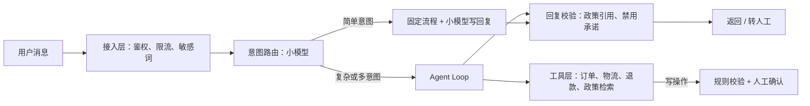

# Agent 系统设计方法

> 层级：通用层 · 预计 180 分钟 · 题目：[questions.md](questions.md)
> 前置：[02 Agent 架构与设计模式](../02-agent-architecture/README.md)、[09 评测与 Benchmark](../09-evaluation/README.md)、[10 安全与可靠性](../10-safety-reliability/README.md)

## 1 这一章解决什么问题

“设计一个 XX Agent”是 Agent 岗二面、三面的常见题，通常 30 到 45 分钟。面试官不期待标准答案，看的是三件事：你会不会先问清约束，你的每个组件是不是为某个约束服务，你能不能讲清失败时会发生什么。

常见的差答法有两种。一种是一上来就画“LLM + 向量库 + 工具”的大框图。这样的图放在任何题目下都成立，说明没有从需求出发。另一种是估算只报一个 QPS，说不出它推出了什么设计决定。

Agent 和普通后端服务的差别，正好落在估算上。一轮对话要调多次模型；每次输入几千 token，大部分是重复的系统提示和工具定义；单次调用耗时是秒级；任何一步都可能做错。所以成本、并发、延迟、成功率都要按“调用”和“步”来算，按“请求”算会差几倍。

本章先给六步框架（第 2 节），再讲估算背后的四笔账（容量、成本、延迟、可靠性）和一条架构演进规则（第 3 节），用四段可运行的模拟验证（第 4 节），最后用电商售后客服题把数字前后串起来（第 5 节）。

学完你应该能：

- 用六步框架在 40 分钟内讲完一道设计题，知道每一步面试官在看什么、你要交出什么东西；
- 面试官不给数字时，从轮次量、每轮调用次数、输入输出 token 和缓存命中率，推出峰值调用率、在途并发、每分钟 token 和每轮成本；
- 给关键路径做延迟预算，说清串行、并行各怎么算，为什么 p99 不能相加；
- 估算多步流程的整体成功率，说清校验和重试各自能救哪类失败；
- 从最简单的方案开始，说清每次加复杂度的理由；
- 接住常见追问。

**本章符号**（后文沿用）：

| 符号 | 含义 |
|---|---|
| λ | 到达率：每秒多少轮（或多少次调用） |
| W | 平均停留时间：一轮或一次调用从开始到结束的秒数 |
| L | 在途数：同一时刻正在处理的轮次或调用数 |
| c | 每轮平均模型调用次数 |
| I、O | 每次调用的输入、输出 token 数 |
| S | 输入里能命中前缀缓存的稳定前缀 token 数 |
| h | 前缀缓存命中率 |
| m_r、m_w | 缓存读取、缓存写入单价相对基础输入单价的倍数 |
| P_in、P_out | 基础输入、输出单价（美元 / 百万 token），本章都用示例价格 |
| p | 一步单次做对的概率 |
| d | 一步做错时被校验发现的概率 |
| k | 发现错误后最多重做的次数 |

“轮”指用户发一条消息到 Agent 给出回复。一轮里可能有多次模型调用和工具调用。

## 2 六步框架

### 2.1 顺序从哪来

| 步 | 讲什么 | 建议时间 | 这一步的产出 |
|---|---|---|---|
| 1 澄清 | 用户、任务、错误代价、延迟、规模、已有系统 | 3-5 分钟 | 约束清单，每条标明影响哪个决定 |
| 2 估算 | 流量、调用次数、token、成本、并发，延迟和成功率的初始预算 | 3-5 分钟 | 估算表和两三条结论 |
| 3 架构 | 一个请求按执行顺序经过哪些模块 | 8-10 分钟 | 数据流图、模块-约束表、版本演进表 |
| 4 深挖 | 面试官选一两个模块往下问 | 10-15 分钟 | 关键模块的细节、风险表 |
| 5 权衡 | 你放弃了什么，为什么 | 3-5 分钟 | 取舍表 |
| 6 评测与上线 | 怎么知道它是好的，怎么灰度、回滚 | 5 分钟 | 指标表（离线、灰度、线上）和回滚开关 |

**顺序的理由是因果依赖**。错误代价决定要不要人工确认、写操作要不要规则校验；延迟上限决定同步还是异步、关键路径上能放几次模型调用；规模决定要不要做路由和缓存、配额要多少。先画图再问需求，图往往要推倒重来。

**节奏**：面试官打断时，直接跳到他关心的那一步，讲完再回主线。框架是讲述顺序，不是死流程。时间紧时，宁可把失败处理和评测讲透，也不要每步各说一句。

开口三句话可以记住：

> 我先确认几个问题：用户是谁、要完成什么任务、出错的代价有多大。
> 然后说哪部分需要 Agent，哪部分用固定流程就够了。
> 最后按一个请求的执行顺序讲架构，再讲失败降级和评测上线。

### 2.2 每一步面试官在看什么

下表是每一步的打分视角。“产出”是你讲完这一步时白板上应该留下的东西，第 5 节的例题每一步都给了对应的样子。

| 步 | 面试官在看什么 | 常见扣分点 | 要产出的具体东西 |
|---|---|---|---|
| 1 澄清 | 能否找出决定架构的那几个约束；问题有没有优先级 | 问了十几个问题却不说各影响什么；没问错误代价；没问有没有已有系统可复用 | 约束清单：每行“问题、假设的回答、影响哪个决定”；最后一句复述题目的性质 |
| 2 估算 | 假设是否说出口；能否按调用而不是按请求算；数字有没有变成结论 | 只算 QPS 不算 token；忘了峰均比；用平均步数算容量；算完不说结论 | 估算表：峰值轮次率、峰值调用率、在途并发、每分钟输入/输出 token、每轮成本；两三条“所以要……” |
| 3 架构 | 是否从最简单的方案起步；每个模块是否服务某个约束；图是不是数据流 | 一上来画多 Agent；图是组件清单不是执行顺序；说不出为什么不做更复杂的版本 | 一张按执行顺序的数据流图；模块-约束表；V0 到 Vn 的演进表，含“为什么不做下一版” |
| 4 深挖 | 能否讲到可落地的细节；失败有没有终点 | 只讲正常链路；重试不区分读写；“加个护栏”这种空话 | 被问到模块的接口和校验点；风险表：每行“失败、发现方式、处理、终点” |
| 5 权衡 | 是否知道自己放弃了什么 | 只说优点；罗列一堆取舍都不深 | 取舍表：两三行“选择、放弃了什么、什么信号出现时改变选择” |
| 6 评测与上线 | 怎么证明它是好的；出事能不能止损 | 只有离线评测就全量；指标只有准确率；没有回滚粒度 | 离线、灰度、线上三层的指标表；版本化对象清单；功能开关 |

### 2.3 估算要产出哪几个数

估算的目的不是精确，而是让数量级推出设计决定。一道 Agent 设计题，最少要给出下面这些数，每个数都对应一个决定：

| 数 | 怎么算 | 推出什么 |
|---|---|---|
| 峰值轮次率 λ | 日轮次 / 86400 × 峰均比 | 接入层容量、限流阈值 |
| 峰值调用率 | λ × c | 上游 RPM 配额或自建推理集群的请求容量 |
| 在途并发 L | λ × W（Little 定律，第 3.1 节） | 连接池、推理并发槽位、会话状态存储 |
| 每分钟输入/输出 token | 峰值调用率 × I（或 O）× 60 | ITPM、OTPM 配额；缓存命中率要不要作为容量指标 |
| 每轮成本 | Σ c × (计费输入 × P_in + O × P_out) | 要不要路由到小模型、要不要做缓存、预算够不够 |
| 关键路径延迟 | 串行相加、并行取最大，p99 用分布算（第 3.4 节） | 关键路径上能放几次模型调用、哪些要并行或预取 |
| 整体成功率 | 各步成功率连乘，再看校验和重试（第 3.5 节） | 哪一步要加校验、转人工率大约多少 |

Agent 的调用次数不固定，容量按 P95 步数估，成本按平均步数估。重试、降级和转人工带来的额外调用也要算进去。

## 3 原理：四笔账和一条演进规则

### 3.1 容量：从到达率到在途并发

**定义**。Little 定律：一个稳定的系统里，长期平均的在途数 L 等于平均到达率 λ 乘以每个对象的平均停留时间 W。

```text
L = λ · W
```

它不要求到达服从泊松分布，也不要求处理时间服从某种分布，只要求系统稳定（来的和走的长期持平）。这是 Little 在 1961 年给出的证明（见资料）。

**为什么 Agent 的并发高**。普通接口 W 是几十毫秒，λ 再大 L 也不大。Agent 一轮的 W 是秒级，一个任务的 W 可能是分钟级。同样每秒 23 轮，W = 50 ms 时 L ≈ 1；W = 4.9 s 时 L ≈ 113。

**按调用和按轮次分开算**。一轮里有 c 次模型调用，模型侧的到达率是 λ·c。模型侧的在途数按“模型调用的总耗时”算：

```text
L_轮次 = λ · W_轮次                      （决定会话状态、连接数）
L_模型 = λ · c · W_调用 = λ · W_轮次里花在模型上的时间    （决定推理并发槽位）
```

第二个等号成立，是因为 c · W_调用 就是一轮里花在模型调用上的总时间。如果一轮里两次调用串行，模型侧在途数小于轮次在途数，差额是工具调用、校验等不占模型的时间。

**三个常见错误**：

1. 用平均值配容量。L 是长期平均，瞬时在途数会围绕它波动。到达近似泊松、各轮互不影响时，在途数近似服从均值为 λW 的泊松分布（M/G/∞ 队列的结论），p99 大约在 λW + 2.33·√(λW)。均值 113 时是 113 + 2.33 × 10.6 ≈ 138，第 4.2 节的模拟得到 141，差别来自采样和近似。
2. 用整轮上限代替平均停留时间。用 10 秒上限算出 L = 231，是保守上界，不是期望值。两者都可以报，但要说清哪个是哪个。
3. 忘了 W 会随负载变长。推理服务排队时 W 变大，L 跟着变大，形成正反馈。Little 定律只描述稳态，不告诉你系统会不会失稳。所以限流阈值要按“排队开始变长”的点设，不按理论上限设。

推理服务内部的批处理和排队见 [inference/02](../../tracks/inference/02-batching-pd/README.md)，网关配额和容量规划见 [harness/05 第 8 节](../../tracks/harness/05-gateway-reliability/README.md)。

### 3.2 成本：按调用拆，缓存有盈亏点

**每次调用的成本**。一次调用的输入 I 里，有 S 个 token 是每轮都一样的稳定前缀（系统提示、工具定义、政策片段）。前缀缓存命中时，这段按读取价计；未命中时，这段按写入价计（写入比普通输入贵）。剩下 I − S 个 token 按基础输入价计。

```text
计费输入 = (I − S) + S · [ h · m_r + (1 − h) · m_w ]          （单位：按基础输入价折算的 token）
单次成本 = 计费输入 × P_in + O × P_out
每轮成本 = Σ_调用类型 f · c · 单次成本                      （f 是这类调用覆盖的轮次比例）
```

Anthropic 的文档给出的倍数是：5 分钟 TTL 的缓存写入是基础输入价的 1.25 倍，1 小时 TTL 是 2 倍，缓存读取一般是 0.1 倍（个别模型更低，以文档为准）。本章用 m_w = 1.25、m_r = 0.1。

**盈亏点（推导）**。只看 S 这一段：不用缓存时成本是 S，用缓存时是 S · [h·m_r + (1−h)·m_w]。缓存省钱的条件是方括号小于 1：

```text
h · m_r + (1 − h) · m_w < 1
⇔  h > (m_w − 1) / (m_w − m_r)
```

代入 m_w = 1.25、m_r = 0.1，得 h > 0.25 / 1.15 ≈ 21.7%。[03 第 6.2 节](../03-prompt-context/README.md#62-成本模型命中率和盈亏点) 用逐轮装配的模拟验证过同一个盈亏点。命中率低于这个值，打缓存断点反而更贵。命中率主要由两件事决定：前缀是否真的稳定（每轮改一个时间戳就全部失效），以及同一前缀的两次请求间隔是否在 TTL 内。

**缓存同时影响容量**。Anthropic 文档说，默认的 ITPM（每分钟输入 token）限额只计未缓存的输入和缓存写入，缓存读取不计。所以命中率从 90% 掉到 50%，计费和配额会同时变坏。命中率要作为容量指标监控，不只是成本指标。其他服务商或自建推理的计法不同，以所用服务的文档为准。

**省下的钱从哪来**。缓存只压输入。输入压下去后，输出在成本里的占比会上升（例题里从 25% 升到 41%，第 4.1 节），下一步该看输出长度和调用次数。路由把简单意图交给小模型或固定流程，压的是“谁来调”和“调几次”。这两件事是乘在一起的，所以先看成本分布在哪类请求、哪一步，再决定先做哪个。

前缀缓存在推理侧怎么实现、为什么 Agent 场景收益大，见 [inference/05](../../tracks/inference/05-agent-serving/README.md)；KV 显存见 [inference/01](../../tracks/inference/01-kv-cache-memory/README.md)。

### 3.3 架构演进：从最简单的方案开始

先说最简单的方案，再说为什么不够、加了什么。Anthropic 在 [Building effective agents](https://www.anthropic.com/engineering/building-effective-agents) 里也建议先找最简单的方案，只在复杂度能证明带来收益时再加。

这条规则可以写成一个检查：每加一个模块，都要能回答两个问题。

1. 它服务哪个约束（成本、延迟、错误代价、规模、合规）？
2. 不加它时，第 3.1、3.2、3.4、3.5 节的哪个数会超出预算？

答不出第二个问题的模块，就是“看起来更完整”的模块，应该删掉或者放进“以后再做”。多 Agent 的取舍见 [08 多 Agent](../08-multi-agent/README.md)。

### 3.4 延迟：串行相加、并行取最大，p99 不能相加

**关键路径**。用户感知的延迟由关键路径决定：从消息到达到第一个字（首字延迟），以及到整轮写完。关键路径上的步骤分两类：

```text
串行：  T = T_1 + T_2 + ... + T_n
并行：  T = max(T_a, T_b, ...)        （无依赖的工具调用同时发出，等最慢的那个）
```

**均值可以相加，分位数不能**。期望是线性的，E[T_1 + T_2] = E[T_1] + E[T_2] 总成立。分位数没有这个性质。各步独立时，几个步骤同时落在各自 p99 的概率远小于 1%，所以“各步 p99 之和”会高估整体 p99。第 4.3 节的模拟里，各步 p99 之和 6.6 秒，整体 p99 只有 4.3 秒。

反过来也有两个方向会让整体变差：

1. **并行取最大值会放大尾部**。max(T_a, T_b) 的 p99 大于两者各自的 p99：只要有一个慢，整体就慢。n 个并行分支各有 1% 的概率慢，整体慢的概率是 1 − 0.99^n。Dean 和 Barroso 在 The Tail at Scale 里举的例子：单台服务器 1% 的请求慢，一个请求要等 100 台都返回时，63% 的请求会慢。
2. **步骤相关时尾部会叠加**。同一个推理集群、同一个流量高峰，会让路由、决策、回复几次调用一起变慢。相关性越强，整体 p99 越接近各步 p99 之和。第 4.3 节里，相关系数 0.9 时整体 p99 从 4.3 秒升到 6.4 秒。

所以做延迟预算的正确方法是：给每步一个分布（至少是中位数和尾部宽度），用模拟或线上 Trace 算整体分位数；各步 p99 之和只能当最坏情况的上界。

**降延迟的四个手段**，按对关键路径的作用排：

| 手段 | 作用在哪 | 代价 |
|---|---|---|
| 移出关键路径（预取、异步） | 会话开始时预取订单和物流，决策时直接用 | 预取的数据可能用不上，多花下游调用 |
| 并行无依赖的调用 | 两个工具串行变并行，T 从和变成最大值 | 尾部被 max 放大；下游并发翻倍 |
| 缩短单步 | 前缀缓存缩短 Prefill；小模型；限制输出长度 | 小模型可能做错；输出截断 |
| 流式返回 | 首字延迟只到第一个 token，整轮时长不变 | 回复校验要么流式做，要么延后首字 |

最后一条有个常被忽略的冲突：如果回复要先过校验再发给用户，流式就只能流到校验之后。常见折中是先流式发出不含承诺的部分，含政策说法或金额的句子校验后再发。对冲请求（hedged request，等到 p95 还没返回就再发一份）能压尾部，Dean 和 Barroso 报告这样只多发约 5% 的请求；但对模型调用它是双倍花钱，写操作则绝对不能这样做。

### 3.5 可靠性：连乘、校验和重试

**连乘**。任务要走 n 步，每步独立地以概率 p 做对，任何一步错了都算失败，整体成功率是 p^n。6 步、每步 97%，整体只有 83%。多步误差连乘的推导和蒙特卡洛核对见 [09 评测第 2.3 节](../09-evaluation/README.md)，这里只讲设计里怎么用。

**三种结局，不是两种**。设计时要把一步的结局分成三类，因为它们的代价完全不同：

| 结局 | 用户看到什么 | 代价 |
|---|---|---|
| 做对 | 正确结果 | 无 |
| 做错且被发现 | 转人工或“需要确认” | 人工成本、等待时间 |
| 做错且没被发现 | 一个看起来正常的错误答复，或一笔错误退款 | 投诉、资损，最贵 |

校验（schema 校验、规则检查、引用检查）的作用是把“没被发现”变成“被发现”。重试的作用是把“被发现”变回“做对”。两者解决的是不同的问题。

**一步的三种概率（推导）**。一步单次做对概率 p，做错时被校验发现的概率 d，发现后最多重做 k 次，假设每次重做独立、成功率仍是 p：

```text
第 j 次尝试（j = 0..k）发生的概率 = [(1 − p) · d]^j
做对       = p · Σ_{j=0..k} [(1 − p)d]^j
没被发现   = (1 − p)(1 − d) · Σ_{j=0..k} [(1 − p)d]^j
转人工     = [(1 − p) d]^{k+1}
```

由此能读出三个设计结论：

1. **发现率 d 是上限**。k → ∞ 时，做对的概率趋向 p / (1 − (1 − p)d)。p = 0.95、d = 0.9 时上限是 99.48%。剩下的部分是校验发现不了的错误，重试多少次都救不回来。要提高上限，只能提高 d 或 p。
2. **重试只救瞬时失败**。上面的式子假设重做时成功率还是 p。如果某类输入每次都会错（p = 0，确定性失败），重做只是在浪费调用。而且每多做一次，错误就多一次机会骗过校验：p = 0、d = 0.9 时，不重做“没被发现”是 10%，重做 5 次后升到约 47%（第 4.4 节）。所以重试前要判断失败是不是瞬时的：超时、429、网络错误是；schema 校验连续失败、同一参数被同一规则拒绝通常不是。
3. **校验把错误转成人工量**。加校验后整体“没被发现”下降，“转人工”上升。第 4.4 节的例子里，悄悄出错从 12.4% 降到 2.7%，转人工从 0.9% 升到 2.2%。面试时把这笔交换说出来，比只说“加校验”有说服力。

**稳定性用 pass^k 衡量**。同一任务跑多次，平均成功率相同，稳定性可能差很多：一组任务每个都 7/8 成功，另一组有的总成功、有的一半成功。τ-bench 用 pass^k（k 次独立试次全部成功的概率，再对任务平均）衡量这一点。定义和无偏估计见 [09 评测第 5 节](../09-evaluation/README.md)。客服场景里“偶尔成功”不够，要的是稳定。

**依赖的可用性也是连乘**。关键路径上串行依赖 4 个下游 API，各 99.9% 可用，整体 0.999^4 ≈ 99.6%。所以要么并行、要么给读操作做降级（物流查不到时先给缓存的最近状态），否则整体可用性被依赖数拖低。

## 4 实现：验证估算的最小模拟

下面四段代码各自能单独运行，只用标准库和 numpy。数字都是第 5 节例题的假设，价格是示例价格，不是任何厂商的报价。

### 4.1 容量与成本估算器

估算器按“调用类型”累加：每类调用给出覆盖的轮次比例 f、每轮次数 c、输入输出 token、可缓存前缀和命中率。它算出峰值调用率、每分钟 token、计入配额的输入、每轮成本，并验证第 3.2 节的缓存盈亏点。

```python
from dataclasses import dataclass

@dataclass
class Call:
    """一类模型调用。单价单位：美元 / 百万 token。默认值是示例价格，不是任何厂商的报价。"""
    calls_per_turn: float      # c：每轮平均调用次数
    input_tokens: int          # I：每次输入 token
    output_tokens: int         # O：每次输出 token
    price_in: float            # P_in：基础输入单价
    price_out: float           # P_out：输出单价
    cacheable: int = 0         # S：输入里可缓存的稳定前缀 token 数
    hit_rate: float = 0.0      # h：前缀缓存命中率
    read_mult: float = 0.1     # m_r：缓存读取价 / 基础输入价
    write_mult: float = 1.25   # m_w：缓存写入价 / 基础输入价（5 分钟 TTL）

    def billed_input(self) -> float:
        """按基础输入价折算后的输入 token 数：(I − S) + S·(h·m_r + (1 − h)·m_w)。"""
        S, h = self.cacheable, self.hit_rate
        return (self.input_tokens - S) + S * (h * self.read_mult + (1 - h) * self.write_mult)

    def uncached_input(self) -> float:
        """计入 ITPM 的输入：未缓存部分 + 缓存写入部分，缓存读取不计（以所用服务的文档为准）。"""
        return self.input_tokens - self.hit_rate * self.cacheable

    def cost(self) -> float:
        return (self.billed_input() * self.price_in + self.output_tokens * self.price_out) / 1e6

def estimate(turns_per_day, peak_ratio, mix):
    """mix：[(该类调用覆盖的轮次比例 f, Call)]。返回峰值速率、每分钟 token、成本。"""
    avg = turns_per_day / 86400                       # λ_avg
    peak = avg * peak_ratio                           # λ_peak
    w = lambda g: sum(f * c.calls_per_turn * g(c) for f, c in mix)   # 每轮加权求和
    return dict(
        avg_tps=avg, peak_tps=peak,
        call_rate=peak * w(lambda c: 1),                              # 峰值调用次数/秒
        itpm_total=peak * w(lambda c: c.input_tokens) * 60,           # 全部输入 token/分钟
        itpm_uncached=peak * w(lambda c: c.uncached_input()) * 60,    # 计入配额的输入
        otpm=peak * w(lambda c: c.output_tokens) * 60,
        daily_tokens=turns_per_day * w(lambda c: c.input_tokens + c.output_tokens),
        per_turn=w(lambda c: c.cost()),
        per_day=turns_per_day * w(lambda c: c.cost()))

TURNS = 100_000 * 4                               # 10 万会话/天 × 每会话 4 轮
BIG = dict(price_in=3.0, price_out=15.0)          # 大模型，示例价格
SMALL = dict(price_in=1.0, price_out=5.0)         # 小模型，示例价格
agent = Call(2, 3000, 200, **BIG)                 # V1：每轮 2 次大模型调用
agent_c = Call(2, 3000, 200, **BIG, cacheable=2000, hit_rate=0.9)

v1 = estimate(TURNS, 5, [(1.0, agent)])
v1c = estimate(TURNS, 5, [(1.0, agent_c)])
v2 = estimate(TURNS, 5, [
    (1.0, Call(1, 800, 10, **SMALL)),                                   # 每轮先过小模型路由
    (0.6, Call(1, 1500, 100, **SMALL)),                                 # 60% 简单意图：固定流程 + 小模型写回复
    (0.4, Call(2.75, 3000, 200, **BIG, cacheable=2000, hit_rate=0.9)),  # 40% 复杂意图进 Agent
])

# 1) 流量：平均 4.6 轮/秒，峰值 23 轮/秒、46 次大模型调用/秒
assert round(v1["avg_tps"], 2) == 4.63 and round(v1["peak_tps"], 1) == 23.1
assert round(v1["call_rate"], 1) == 46.3
assert v1["daily_tokens"] == 2.56e9                           # 约 26 亿 token/天
# 2) 每分钟 token：输入 833 万，输出 56 万；缓存后计入配额的输入降到 333 万
assert round(v1["itpm_total"] / 1e6, 2) == 8.33 and round(v1["otpm"] / 1e6, 2) == 0.56
assert round(v1c["itpm_uncached"] / 1e6, 2) == 3.33
# 3) 成本：V1 每轮 $0.024、每天 $9600；加缓存后每轮 $0.01458，省 39%
assert round(v1["per_turn"], 4) == 0.024 and round(v1["per_day"]) == 9600
assert round(v1c["per_turn"], 5) == 0.01458 and round(v1c["per_day"]) == 5832
assert round(1 - v1c["per_turn"] / v1["per_turn"], 2) == 0.39
# 缓存之后，输出从占成本的 25% 升到 41%：下一步该看输出长度
assert round(200 * 15 / (agent.cost() * 1e6), 2) == 0.25
assert round(200 * 15 / (agent_c.cost() * 1e6), 2) == 0.41
# 4) V2 路由 + 缓存：每轮约 $0.0101、每天约 $4028，比 V1 省 58%
#    V1 里简单意图平均 1.5 次调用、复杂意图 2.75 次，加权正好是 2 次
assert abs(0.6 * 1.5 + 0.4 * 2.75 - 2.0) < 1e-12
assert round(v2["per_turn"], 4) == 0.0101 and round(v2["per_day"]) == 4028
assert round(1 - v2["per_turn"] / v1["per_turn"], 2) == 0.58
big_rate = v2["peak_tps"] * 0.4 * 2.75                       # V2 里大模型的峰值调用率
assert round(big_rate, 1) == 25.5
assert round(big_rate * (3000 - 0.9 * 2000) * 60 / 1e6, 2) == 1.83   # 大模型计入 ITPM 的输入约 183 万/分钟
# 5) 缓存的盈亏点：h·m_r + (1 − h)·m_w < 1 才省钱 → h > (m_w − 1) / (m_w − m_r)
h_star = (1.25 - 1) / (1.25 - 0.1)
assert round(h_star, 3) == 0.217
assert Call(1, 3000, 0, 3, 15, 2000, 0.20).cost() > Call(1, 3000, 0, 3, 15).cost()   # 命中 20%：更贵
assert Call(1, 3000, 0, 3, 15, 2000, 0.25).cost() < Call(1, 3000, 0, 3, 15).cost()   # 命中 25%：更省
# 1 小时 TTL 写入是 2 倍：盈亏点升到 52.6%，只有间隔长、复用多的前缀才值得
assert round((2 - 1) / (2 - 0.1), 3) == 0.526
# 6) Little 定律：在途数 = 到达率 × 平均停留时间（耗时取第 4.3 节模拟的复杂意图：整轮 4.9 秒，其中模型 4.1 秒）
assert round(v1["peak_tps"] * 4.9) == 113                    # 在途轮次
assert round(v1["peak_tps"] * 10) == 231                     # 按整轮上限 10 秒算的保守上界
assert round(v1["peak_tps"] * 4.1) == 95                     # 在途的大模型调用
# 7) 每会话的总成本要算上转人工：转人工 10%、每次人工 $1.5（假设）
model_per_session = v2["per_turn"] * 4
human_per_session = 0.10 * 1.5
assert round(model_per_session, 3) == 0.040 and human_per_session > 3 * model_per_session
print({k: round(v, 4) for k, v in v2.items()})
```

这段代码验证了几件正文要用的事：

- V1 每轮 2 次大模型调用，峰值 46 次/秒，每分钟输入 833 万 token；加缓存后计入 ITPM 的输入降到 333 万。
- 缓存省 39%，路由加缓存省 58%。路由前后每轮平均调用次数都是 2 次，省钱来自“谁来调”。
- 缓存的盈亏点在命中率 21.7%：命中率 20% 时缓存更贵，25% 时更省。
- 每会话模型成本约 $0.04，10% 转人工、每次 $1.5 时人工成本是它的 3 倍以上。降转人工率往往比再压模型成本更值。

### 4.2 Little 定律与在途数的波动

泊松到达、对数正态停留时间的模拟。它验证 L = λW 在处理时间不是指数分布时也成立，并说明为什么不能按均值配容量。

```python
import numpy as np

rng = np.random.default_rng(0)
lam, T = 23.15, 4000.0                       # 峰值到达率（轮/秒），模拟 4000 秒
n = rng.poisson(lam * T)
arrive = np.sort(rng.uniform(0, T, n))
sigma = 0.5                                   # 每轮耗时：对数正态，均值 4.9 秒（第 4.3 节模拟的整轮均值）
dur = rng.lognormal(np.log(4.9) - sigma**2 / 2, sigma, n)
leave = arrive + dur

# 每 0.1 秒采样一次“正在处理的轮次数”，丢掉前 100 秒的爬坡
t = np.arange(100, T - 50, 0.1)
inflight = np.searchsorted(arrive, t) - np.searchsorted(np.sort(leave), t)
L, W = inflight.mean(), dur.mean()
print(round(L, 1), round(lam * W, 1), np.percentile(inflight, [50, 99, 99.9]))
assert abs(L - lam * W) / (lam * W) < 0.03          # Little 定律：L = λW
p99 = np.percentile(inflight, 99)
assert 130 <= p99 <= 145                           # 均值约 113，p99 约 138
# 到达是泊松、处理时间任意分布时（M/G/∞），在途数服从均值 λW 的泊松分布
assert abs(p99 - (lam * W + 2.33 * np.sqrt(lam * W))) < 4
```

在途轮次均值约 113，p99 约 141，p99.9 约 151。容量按均值配，高峰时约有一半时间不够用。按 p99 或 p99.9 配，再留出 W 变长的余量。

### 4.3 延迟预算：为什么 p99 不能相加

复杂意图一轮的关键路径：路由 → 决策调用 → 查订单和查物流并行 → 回复首 token → 回复写完 → 回复校验。每步用对数正态分布，中位数和宽度都是假设。`rho` 控制各步共享负载的程度。

```python
import numpy as np

rng = np.random.default_rng(1)
N = 400_000

def lognorm(median, sigma, z):
    """给定中位数和对数标准差的对数正态样本；z 是标准正态噪声，方便做相关性实验。"""
    return median * np.exp(sigma * z)

# 复杂意图一轮的关键路径（中位数，秒）：路由 → 决策调用 → 两个工具并行 → 回复首 token → 回复写完 → 回复校验
steps = {"route": (0.2, 0.4), "decide": (0.8, 0.5), "order": (0.15, 0.6),
         "ship": (0.3, 0.8), "ttft": (0.5, 0.5), "gen": (2.5, 0.3), "check": (0.1, 0.5)}

def sample(rho):
    """rho：各步共享的负载因子占比。rho=0 各步独立；rho=1 一起变慢。"""
    shared = rng.standard_normal(N)
    out = {}
    for k, (m, s) in steps.items():
        z = np.sqrt(rho) * shared + np.sqrt(1 - rho) * rng.standard_normal(N)
        out[k] = lognorm(m, s, z)
    return out

p = lambda x, q=99: float(np.percentile(x, q))
x = sample(0.0)
tools = np.maximum(x["order"], x["ship"])                  # 并行：取最大值
first = x["route"] + x["decide"] + tools + x["ttft"]       # 用户看到第一个字
total = first + x["gen"] + x["check"]

# 1) 中位数大致可以相加（这里各步是正偏分布，和的中位数略大于中位数之和）
med_sum = 0.2 + 0.8 + 0.3 + 0.5
print("首字 p50/p95/p99:", round(p(first, 50), 2), round(p(first, 95), 2), round(p(first), 2))
assert 1.8 < p(first, 50) < 2.3

# 2) p99 不能直接相加：独立时，各步 p99 之和明显高估整体 p99
sum_p99 = p(x["route"]) + p(x["decide"]) + p(tools) + p(x["ttft"])
print("各步 p99 之和:", round(sum_p99, 2), "整体 p99:", round(p(first), 2))
assert sum_p99 > 1.3 * p(first)

# 3) 并行取最大值：max 的 p99 大于两者 p99 的较大者
assert p(tools) > max(p(x["order"]), p(x["ship"]))

# 4) 各步共享负载（同一个推理集群、同一个高峰）时，整体 p99 向“p99 之和”靠拢
y = sample(0.9)
first_c = y["route"] + y["decide"] + np.maximum(y["order"], y["ship"]) + y["ttft"]
print("相关时整体 p99:", round(p(first_c), 2))
assert p(first_c) > p(first) and p(first_c) > 0.8 * sum_p99

# 5) 首字 2 秒的预算：中位数刚好卡线，p95 已经超了
print("首字超 2 秒的比例:", round(float((first > 2).mean()), 3))
assert (first > 2).mean() > 0.4

# 6) Tail at Scale 的扇出例子：单台 1% 慢，等 100 台全部返回，63% 的请求会慢
assert round(1 - 0.99 ** 100, 2) == 0.63

# 7) 优化后：会话打开时预取订单和物流（移出关键路径），决策调用命中前缀缓存（中位数 0.8 → 0.5 秒）
z = sample(0.0)
first_opt = z["route"] + lognorm(0.5, 0.5, rng.standard_normal(N)) + z["ttft"]
print("优化后首字 p50/p95/p99:", round(p(first_opt, 50), 2), round(p(first_opt, 95), 2), round(p(first_opt), 2))
assert 2.0 < p(first_opt, 95) < 2.3 and (first_opt > 2).mean() < 0.1   # 超 2 秒的比例从 51% 降到 8%

# 8) 整轮：均值 4.9 秒（第 4.1、4.2 节的 Little 定律用这个数），p95 约 6.8 秒，在 10 秒上限内
assert round(float(total.mean()), 1) == 4.9 and 6.5 < p(total, 95) < 7.1 and p(total) < 10
```

读这段输出要看四组数：

| 情形 | 首字 p50 | 首字 p95 | 首字 p99 |
|---|---|---|---|
| 各步独立 | 2.0 s | 3.4 s | 4.3 s |
| 各步 p99 直接相加 | — | — | 6.6 s（高估） |
| 各步强相关（rho = 0.9） | — | — | 6.4 s |
| 预取 + 决策调用缓存 | 1.3 s | 2.2 s | 2.7 s |

结论是：独立时 p99 之和高估约 50%；负载相关时它又接近真实值。所以不能用一个固定的经验公式，要用 Trace 里的真实分布做模拟。首字 2 秒的预算下，原方案一半的轮次超线；把工具调用移出关键路径、决策调用命中缓存后，超线比例降到 8%。

### 4.4 可靠性：校验、重试与转人工

每步给出 (p, d, k)，算三种结局的概率，再用蒙特卡洛核对。

```python
import numpy as np

def step_outcome(p, d, k):
    """一步的三种结局。p：单次做对的概率；d：做错时被校验发现的概率；
    k：发现后最多重做几次（假设失败是瞬时的，重做时成功率仍是 p）。
    返回 (做对, 发现了但重做次数用完 → 转人工, 没被发现 → 带着错误往下走)。"""
    ok, silent, alive = 0.0, 0.0, 1.0          # alive：还在尝试的概率
    for _ in range(k + 1):
        ok += alive * p
        silent += alive * (1 - p) * (1 - d)
        alive *= (1 - p) * d                   # 做错且被发现，才进入下一次尝试
    return ok, alive, silent

def pipeline(steps):
    """串行流水线：任何一步转人工就停；没发现的错误不再被后面的步骤发现（保守假设）。"""
    human, silent, reach = 0.0, 0.0, 1.0
    for p, d, k in steps:
        ok, h, s = step_outcome(p, d, k)
        human += reach * h
        silent += reach * s
        reach *= ok
    return reach, human, silent

# 售后客服复杂意图（退款）路径，每步的数字都是假设
no_check = [(0.97, 0, 0), (0.95, 0, 0), (0.99, 1.0, 0), (0.95, 0, 0)]
with_check = [(0.97, 0.6, 0),   # 意图路由：低置信度时转人工，不重试（再问一遍结果相同）
              (0.95, 0.9, 1),   # 参数提取：schema 校验 + 订单归属校验，失败重做 1 次
              (0.99, 1.0, 2),   # 工具调用：错误码可见，读操作重试 2 次
              (0.95, 0.8, 1)]   # 回复生成：回复校验检查政策引用，失败重写 1 次

a0, h0, s0 = pipeline(no_check)
a1, h1, s1 = pipeline(with_check)
print([round(v, 4) for v in (a0, h0, s0)], [round(v, 4) for v in (a1, h1, s1)])
assert abs(a0 + h0 + s0 - 1) < 1e-12 and abs(a1 + h1 + s1 - 1) < 1e-12
# 没有校验：自动完成 86.7%，悄悄出错 12.4%（用户拿到错误答复，最坏的结局）
assert round(a0, 3) == 0.867 and round(s0, 3) == 0.124
# 加校验和有限重试：自动完成 95.1%，悄悄出错降到 2.7%，代价是转人工从 0.9% 升到 2.2%
assert round(a1, 3) == 0.951 and round(s1, 3) == 0.027 and round(h1, 3) == 0.022

# 重试只救瞬时失败：某类输入每次都错（确定性失败）时，重做 k 次也没用，只能靠校验转人工
# 而且每多重做一次，错误就多一次机会骗过校验：不重做时悄悄出错 10%，重做 5 次后升到 47%
ok0, h0_, s0_ = step_outcome(0.0, 0.9, 0)
assert ok0 == 0 and abs(h0_ - 0.9) < 1e-12 and abs(s0_ - 0.1) < 1e-12
ok_hard, h_hard, s_hard = step_outcome(0.0, 0.9, 5)
assert ok_hard == 0 and round(s_hard, 2) == 0.47 and round(h_hard, 2) == 0.53
# 校验发现率 d 是上限：重试无限多次，单步成功率也只到 p / (1 − (1 − p)·d)
p, d = 0.95, 0.9
assert abs(step_outcome(p, d, 60)[0] - p / (1 - (1 - p) * d)) < 1e-12
assert round(p / (1 - (1 - p) * d), 4) == 0.9948

# 蒙特卡洛核对 with_check 的三个比例
rng = np.random.default_rng(0)
R = 200_000
state = np.zeros(R, dtype=int)            # 0 自动通过，1 转人工，2 悄悄出错；形状 (R,)
for p, d, k in with_check:
    trying = state == 0                   # 这一步还在尝试的试次
    for attempt in range(k + 1):
        ok = rng.random(R) < p
        found = rng.random(R) < d
        state[trying & ~ok & ~found] = 2              # 错了且没被发现
        if attempt == k:
            state[trying & ~ok & found] = 1           # 发现了但重做次数用完
        trying = trying & ~ok & found                 # 只有“错了且被发现”的才重做
sim = [(state == s).mean() for s in (0, 1, 2)]
assert all(abs(a - b) < 0.003 for a, b in zip(sim, (a1, h1, s1)))
print("蒙特卡洛:", [round(float(v), 4) for v in sim])
```

| 方案 | 自动完成 | 转人工 | 悄悄出错 |
|---|---|---|---|
| 无校验、无重试 | 86.7% | 0.9% | 12.4% |
| 每步校验 + 有限重试 | 95.1% | 2.2% | 2.7% |

剩下的 2.7% 来自校验发现不了的错误。要继续压它，靠提高 d（更严的规则、引用检查），不是增加 k。

## 5 数值例子：电商售后客服 Agent

下面用一道虚构的题走完六步。场景和数字都是演示用的假设，后面各节用第 4 节的代码核对过，前后一致。

### 5.1 澄清

| 问题 | 假设的回答 | 影响哪个设计决定 |
|---|---|---|
| 用户是谁 | 买家，通过 App 内文字聊天 | 输入是自然语言，不能假设用户会给订单号 |
| 要做什么 | 查物流、改地址、退货退款、答政策问题 | 前两类只读或低风险，退款是写操作 |
| 出错代价 | 答错政策会引发投诉；错误退款直接损失钱 | 退款必须过规则校验，大额和特殊情形转人工 |
| 延迟 | 首字 2 秒内，整轮 10 秒内 | 同步对话，不需要队列；关键路径上只能放一两次模型调用 |
| 规模 | 日均 10 万会话，每会话 4 轮，峰均比 5 | 要做路由和前缀缓存控制成本；峰值容量按 23 轮/秒 |
| 已有系统 | 订单、物流、退款都有内部 API；有人工客服后台 | 工具层包现有 API，不直接连库；失败可以转人工 |

复述一遍：“所以这是一个低延迟、有写操作、错误代价不对称的对话 Agent，现有系统已经齐全，难点在成本和错误写操作。” 这句话决定了后面的架构。

### 5.2 估算

```text
轮次：10 万会话 × 4 轮 = 40 万轮/天
平均 λ = 40 万 / 86400 ≈ 4.6 轮/秒；峰值 λ_peak = 4.6 × 5 ≈ 23 轮/秒
每轮调用 c = 2 次（一次决策工具调用，一次生成回复）→ 峰值 46 次调用/秒
每次输入 I = 3000 token，其中稳定前缀 S = 2000（系统提示、工具定义、政策片段），输出 O = 200
每天 token：40 万 × 2 × 3200 = 25.6 亿
峰值每分钟：输入 833 万 token，输出 56 万 token
在途：λ_peak × W = 23 × 4.9 ≈ 113 轮；按整轮上限 10 秒算是 231 的上界
成本（示例价格：大模型 P_in = $3、P_out = $15 每百万）：每轮 $0.024，每天 $9600
```

三个结论直接进入架构：

1. 输入是输出的 15 倍，而且 2000 token 的前缀每轮重复，前缀缓存的收益最大。命中率 90% 时每轮 $0.01458，每天 $5832，省 39%。
2. 缓存之后输出占成本的 41%。下一步该压输出长度和调用次数。
3. 一半以上的轮次是查物流这类简单意图。把它们路由到小模型或固定流程，能和缓存乘起来：路由加缓存后每轮约 $0.0101，每天约 $4028，比 V1 省 58%。

注意路由后大模型的调用率没降多少：0.4 × 2.75 = 1.1 次/轮，峰值仍有 25.5 次/秒，计入 ITPM 的输入约 183 万/分钟。省的是钱，不是大模型的并发配额，因为进 Agent 的复杂意图调用次数更多（平均 2.75 次）。

### 5.3 架构：从 V0 开始

| 版本 | 做法 | 为什么不够（哪个数超了） | 加了什么 |
|---|---|---|---|
| V0 | 一次模型调用 + 政策检索 | 不能查订单、不能办退款，任务完不成 | 工具 |
| V1 | 单 Agent 循环调用工具 | 每轮 $0.024、每天 $9600 超预算；退款没有确定性校验，悄悄出错的代价不可接受 | 路由 + 规则校验 |
| V2 | 路由在前：简单意图走固定流程，复杂意图进 Agent；写操作过规则和人工确认 | 本题够用：每轮约 $0.010，关键路径首字 p95 约 2.2 秒 | — |
| V3 | 按业务拆多个专职 Agent | 不需要：工具只有十来个，单 Agent 上下文装得下；拆分会增加交接出错 | 不做 |

主动说出“为什么不做 V3”，比直接画多 Agent 图更有说服力。判断多 Agent 是否值得的条件见 [08 多 Agent](../08-multi-agent/README.md)，设计题里怎么论证见第 6 节。

V2 的执行顺序：



每个模块要能回答“它为哪个约束服务、不加它哪个数会超”：

| 模块 | 服务的约束 | 不加会怎样 |
|---|---|---|
| 意图路由 | 成本 | 每轮 $0.024，超预算；简单意图也占大模型并发 |
| 工具层包装现有 API | 安全与正确性 | 模型直接连库，权限和审计无法收敛；可复用现有幂等和事务 |
| 规则校验 + 人工确认 | 错误代价不对称 | 悄悄出错的退款直接造成资损 |
| 回复校验 | 政策答错会投诉 | 模型凭记忆答政策，错误答复不会被发现 |
| 转人工 | 兜底 | 模型、工具都失败时用户没有出口 |
| 前缀缓存 | 成本与配额 | 每天多花约 $3768；计入 ITPM 的输入是 2.5 倍 |

### 5.4 深挖：工具、上下文与风险表

**工具设计**。粒度按业务动作切，不按数据库表切。`apply_refund(order_id, reason)` 比让模型自己组合三个底层接口安全。参数里的 `order_id` 在服务端再校验一次归属，不信任模型给的值。写操作带幂等键，重试不会退两次款。工具描述写清什么情况下不该调用，比堆参数说明更能减少错调。见 [04 工具调用](../04-tool-use-mcp/README.md)。

**上下文**。系统提示和政策放在最前面且保持不变，便于前缀缓存；对话历史超过预算时压缩早期轮次，保留订单号等关键实体；工具结果只留需要的字段，物流接口返回的整段 JSON 可能上千 token。见 [03 Context Engineering](../03-prompt-context/README.md) 和 [harness/02 上下文压缩](../../tracks/harness/02-context-compaction/README.md)。

**风险表**。深挖时要能一格一格填出来，任何一格空白都是扣分点：

| 失败 | 发现方式 | 处理 | 终点 | 对哪个数的影响 |
|---|---|---|---|---|
| 模型超时或 5xx | 客户端超时、状态码 | 退避重试一次，再切备用模型；只对瞬时错误重试 | 转人工，并告诉用户 | 成功率；重试增加调用量和成本 |
| 工具超时（读） | 超时 | 重试一次；仍失败则给最近缓存状态并标注“可能不是最新” | 部分结果 + 说明 | 首字延迟；缓存数据过期风险 |
| 工具超时（写） | 超时但状态未知 | 用幂等键查执行状态；查不到就标记待确认，不直接重试 | 异步对账 + 通知用户 | 错误写操作；重复执行 |
| 参数提取错 | schema 校验、订单归属校验 | 重做一次；连续失败转人工 | 转人工 | 错误写操作 |
| Agent 循环不收敛 | 步数上限（如 8 步）、token 预算、重复调用检测 | 停止循环，带上已收集信息 | 转人工 | 成本尾部；延迟尾部 |
| 检索不到政策 | 检索分数低于阈值 | 不让模型凭记忆回答 | 回复“需要确认”，转人工 | 错误答复率 |
| 用户诱导越权 | 工具层按会话身份校验 | 拒绝并记录 | 拒绝 | 数据泄露 |
| 前缀缓存命中率骤降 | 缓存读取 token 占比监控 | 检查前缀是否被动态内容破坏、TTL 是否太短 | 告警，成本上升 | 成本与 ITPM 配额 |

步数上限等具体数字要说明是初始值，上线后按轨迹统计调整。Loop 控制见 [harness/01](../../tracks/harness/01-loop-and-harness/README.md)，网关和降级见 [harness/05](../../tracks/harness/05-gateway-reliability/README.md)，失败重试的通用模式见 [10 安全与可靠性](../10-safety-reliability/README.md)。

**可靠性数字**。复杂意图（退款）路径四步：路由、参数提取、工具调用、回复生成。按第 4.4 节的假设，无校验时自动完成 86.7%、悄悄出错 12.4%；每步加校验和有限重试后，自动完成 95.1%、转人工 2.2%、悄悄出错 2.7%。成本估算里每会话 10% 的转人工是全部意图合计：简单意图的人工兜底、政策查不到、用户主动要人工都算在内；第 4.4 节的 2.2% 只是退款路径里由校验和重试带动的那一部分，两者不是同一个口径，报数时要说清。

### 5.5 权衡

挑两三个说清楚，不要罗列：

| 取舍 | 选择 | 放弃了什么 | 什么信号出现时改变选择 |
|---|---|---|---|
| 单 Agent 还是多 Agent | 单 Agent + 路由 | 每类业务的提示词不能独立迭代；换来更少的交接错误和更好调试 | 工具数超过单模型能稳定选择的规模、上下文装不下，或团队需要独立发布 |
| 退款由模型决定还是规则决定 | 模型提取意图和参数，规则决定能不能退 | 灵活性：特殊情况都转人工，人工量多一些 | 规则覆盖率低到人工量承受不了时，再引入分级授权 |
| 大模型还是小模型 | 路由后简单意图用小模型或固定流程 | 路由本身会分错，要监控分错率并留回退通道 | 分错率超过阈值时，扩大大模型覆盖范围 |
| 首字优先还是校验优先 | 先流式输出不含承诺的部分，含金额和政策说法的句子校验后再发 | 实现复杂；用户可能先看到半句 | 误发风险高到不能接受时，改为整段校验后一次发出 |

### 5.6 评测与上线

| 阶段 | 做什么 | 看什么 |
|---|---|---|
| 离线 | 从历史工单抽样脱敏，构造带标准结局的测试集；用模拟用户跑多轮对话；对退款路径单独造边界用例（金额上限、重复退款、他人订单） | 任务完成率、错误写操作数（目标为 0）、转人工率、平均步数、每轮成本、pass^k |
| 灰度 | 影子模式：Agent 只给建议，人工客服决定是否采用；再放 1% 到 5% 真实流量 | 建议采纳率、人工改写率、和人工客服对比解决率 |
| 线上 | 全量后持续抽检、收集差评轨迹回流测试集 | 解决率、投诉率、转人工率（按原因分桶）、每会话成本、首字 P95、缓存命中率 |

回滚：提示词、模型版本、工具配置都版本化，出问题按版本回滚；写操作类功能单独开关，可以只关退款而保留查询。离线回归和线上门禁见 [evaluation/05 线上回归](../../tracks/evaluation/05-online-regression/README.md)。

**成本指标要能对账**。每次调用按会话、模型、步骤记下四类 token（未缓存输入、缓存写、缓存读、输出）和单价版本，才能回答“一个会话平均花多少钱、钱花在哪一步”。只看账单总额，无法判断是路由失灵还是缓存失效。

## 6 常见追问清单

每条给答题方向，不要只背一句结论。追问通常连着问两层，第二层才是区分度。

| 追问 | 第一层回答 | 第二层（面试官常接着问） |
|---|---|---|
| 为什么用 Agent，不用固定流程 | 多意图混在一轮、用户描述不规范时，步骤不能提前枚举；简单意图仍走固定流程 | 怎么定这条分界线？→ 用历史工单标注哪些轮次需要多步工具调用和决策，按比例和成本算；分错的两边都要有兜底 |
| 怎么防提示注入 | 权限在工具层按会话身份控制；写操作过规则；外部内容当数据不当指令 | 政策文档里被人塞了指令怎么办？→ 检索内容不进入决策指令区，工具白名单固定，写操作仍需规则确认。见 [10 安全](../10-safety-reliability/README.md) |
| 成本降一半怎么做 | 先看成本分布在哪类请求、哪一步，再按收益排：路由到小模型、前缀缓存、压缩历史、减少工具调用 | 为什么是先缓存不是先换小模型？→ 缓存不改变输出质量、命中率可监控；换模型要重新评测。用第 4.1 节的估算器算两者各能省多少 |
| 延迟太高怎么办 | 流式返回、并行无依赖工具、预取、简单意图走快路径、限制步数 | 为什么 p99 不能直接加？→ 分位数不可加；独立时相加是高估，负载相关时接近。要做 Trace 采样后模拟。见第 3.4 节 |
| 怎么知道上线后变好还是变坏 | 版本化 + 线上指标 + 抽检；新版本先影子再灰度，和基线同评测集对比 | 指标涨了 2 个点，是真的吗？→ 看评测集大小和置信区间，用配对比较。见 [09 评测](../09-evaluation/README.md) |
| 出了一次错误退款怎么排查 | 按会话 ID 取完整轨迹：每步输入、模型输出、工具调用和结果，定位是哪一步错；样本补进测试集 | 怎么防止再犯？→ 若属某类输入就错，加规则或校验；若属偶发，加校验提高发现率 d，而不是无限重试。见 [harness/06](../../tracks/harness/06-tracing-replay/README.md) |
| 记忆要不要做 | 先问有没有跨会话需求；售后场景大多数信息在订单系统里，查工具比做长期记忆可靠 | 什么场景才需要？→ 跨会话的偏好、未完结工单的上下文；且要有过期和纠错机制。见 [06 记忆](../06-memory/README.md) |
| 规模扩大 100 倍哪里先撑不住 | 模型服务的并发配额和成本；其次是下游 API 限流和会话状态存储 | 怎么隔离？→ 按租户或业务线拆配额，避免一个场景的高峰挤占其他；缓存命中率作为容量指标。见 [inference/05](../../tracks/inference/05-agent-serving/README.md) |
| 为什么不做多 Agent | 上下文装得下、子任务不能独立并行、无需权限隔离；拆分会带来交接丢信息、成本叠加和难定位 | 什么信号出现再拆？→ 工具数超出单模型稳定选择范围、上下文放不下、需要独立权限边界；用同一评测集和单 Agent 基线比过再拆。见 [08 多 Agent](../08-multi-agent/README.md) |
| 怎么证明这个估算可信 | 每个假设说出口、标明是假设；用线上数据校准 | 校准哪几个数？→ 平均步数 c、输入 token I、缓存命中率 h、停留时间 W 四个最敏感；上线后按 Trace 回填，估算表随版本更新 |

## 7 和设计题的关系

本章讲方法，[kb/design 的 8 道设计题](../../design/README.md) 是练习场：企业知识库问答、仓库级 Coding Agent、Deep Research、Agent 评测平台、多租户推理服务、端云协同助理、Agentic RL 平台、工具调用后训练。每题都按“题面 → 澄清 → 估算 → 架构 → 深挖 → 评测上线 → 追问 → 评分要点”展开，约束各不相同，本章不重复题目内容。

用本章的方法练这几道题时，重点练三个地方：

1. 每道题的澄清问题不一样。知识库问答要问权限和引用要求，推理服务要问 SLO 和租户隔离，端云协同要问隐私和离线可用。同一个“错误代价”问题，在不同题里指向不同的模块。
2. 每道题的主估算量不一样。知识库问答估检索延迟和 token，推理服务估显存和 batch，RL 平台估 rollout 吞吐。本章的估算器只适用于按轮计费的对话类；其他题的估算方法在对应章节。
3. 深挖的两个模块不一样。答题时优先深挖“这道题特有”的模块，通用模块（限流、日志）一句带过。

子领域的细节只给链接，不在本章展开：工具设计与 MCP 见 [04](../04-tool-use-mcp/README.md)，上下文与压缩见 [03](../03-prompt-context/README.md)，记忆见 [06](../06-memory/README.md)，评测与 pass^k 见 [09](../09-evaluation/README.md)，安全、权限和失败处理见 [10](../10-safety-reliability/README.md)，多 Agent 见 [08](../08-multi-agent/README.md)，推理容量、前缀缓存和显存见 [inference/01](../../tracks/inference/01-kv-cache-memory/README.md) 与 [inference/05](../../tracks/inference/05-agent-serving/README.md)。

## 8 自测清单

- [ ] 说出六步框架、每步的产出，以及每步最常见的扣分点
- [ ] 不看本章，对售后客服题列出至少 5 个澄清问题，并说出各自影响哪个决定
- [ ] 从轮次量推到峰值调用率、在途并发、每分钟 token 和每轮成本，写出 Little 定律并说明它为什么在 Agent 上数字很大
- [ ] 写出缓存盈亏点的推导，算出 5 分钟 TTL 和 1 小时 TTL 下的阈值，并说明命中率为什么也是容量指标
- [ ] 说清串行、并行、相关三种情况下整体 p99 怎么算，为什么各步 p99 之和不能直接用
- [ ] 写出一步的三种结局概率，说明重试救哪种失败、校验把什么变成了什么
- [ ] 讲出 V0 到 V2 的演进，每个版本是因为哪个数超了才加的
- [ ] 填出至少 6 行风险表，每行有发现方式和终点
- [ ] 把框架套到另一道题（如编程助手）上，说出约束和主估算量怎么变

## 资料

- Little，[A Proof for the Queuing Formula: L = λW](https://doi.org/10.1287/opre.9.3.383)，*Operations Research* 9(3):383–387，1961（第 3.1 节的 L = λW）
- Dean 和 Barroso，[The Tail at Scale](https://cacm.acm.org/research/the-tail-at-scale/)，*Communications of the ACM* 56(2):74–80，2013（1% 慢请求与 100 路扇出、对冲请求；第 3.4 节）
- Anthropic，[Prompt caching](https://platform.claude.com/docs/en/build-with-claude/prompt-caching)，2026-11 查阅（缓存写入 1.25×（5 分钟）/ 2×（1 小时）、读取 0.1× 的倍数，5 分钟默认 TTL，可缓存最小长度按模型不同）
- Anthropic，[Rate limits](https://platform.claude.com/docs/en/api/rate-limits)，2026-11 查阅（RPM、ITPM、OTPM；默认 ITPM 只计未缓存输入和缓存写入）
- Anthropic，[Building effective agents](https://www.anthropic.com/engineering/building-effective-agents)，2024-12-19（先找最简单的方案）
- Yao 等，[τ-bench: A Benchmark for Tool-Agent-User Interaction in Real-World Domains](https://arxiv.org/abs/2406.12045)，arXiv 2406.12045，2024-06（pass^k 的定义与无偏估计；v1 日期 2024-06-17）
- 本章第 3.2、3.5 节的盈亏点、三种结局概率是推导；第 4 节的数字由代码算出，假设均为演示值
