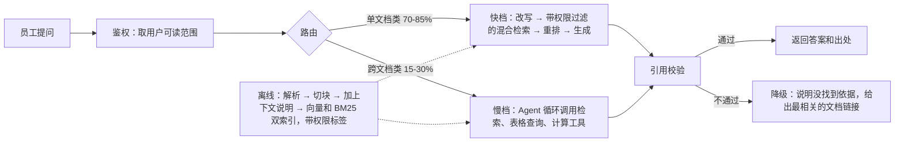

# 设计题：企业知识库问答 Agent

> 设计题 · harness、evaluation · 限时 45 分钟 · 追问题：[questions.md](questions.md)
> 前置：[core/07 RAG、搜索与 Deep Research](../../core/07-rag-search/README.md)、[core/10 安全与可靠性](../../core/10-safety-reliability/README.md)、[core/13 系统设计方法](../../core/13-system-design/README.md)

## 1 题面

“公司有几十万份内部文档：制度、产品手册、技术方案、会议纪要。设计一个问答助手，员工用自然语言提问，它给出带出处的答案。”

这道题看起来是 RAG，真正的考点在三处：**权限**（不同员工能看的文档不同）、**正确性**（答案要能对上原文）、**评测**（怎么证明它比搜索框好用）。只画一条“检索 → 生成”链路的回答，拿不到高分。

三个考点各自对应的追问：

| 考点 | 面试官真正在测什么 | 一个只能答到这里的回答 |
|---|---|---|
| 权限 | 你知不知道“检索后再删”会同时损失召回和安全性，两件事的代价各是多少 | “检索完过滤一下就行” |
| 正确性 | 你知不知道引用校验会把正确回答误杀，误杀率乘上人工复核单价是多少钱 | “让模型标注出处” |
| 评测 | 你有没有无答案题和权限测试这两层，它们的分母怎么来 | “找几道题测一下准确率” |

面试官在等的是三件具体的东西：**一条能算出钱的成本线**（快慢两档各花多少、为什么必须路由）、**一个能算出损失的概率**（权限过滤丢多少召回、校验误杀多少条）、**一个说得出触发条件的演进**（什么指标到什么程度才加下一层复杂度）。只讲组件不讲这些数，就是“看起来很完整”的答案。

## 2 澄清

先问清楚这些，再动笔。括号里是本题采用的假设，面试时要说出“我先假设……”。

| 问题 | 为什么要问 | 本题假设 |
|---|---|---|
| 用户是谁，多少人 | 决定流量和权限模型 | 2 万名员工，按部门和项目分权限 |
| 文档有哪些格式，更新多频繁 | 决定切块和增量索引 | PDF、Word、Wiki、表格；每天新增或修改约 2,000 份 |
| 问题主要是什么类型 | 决定要不要多步 | 七成单文档就能答（“报销上限多少”），三成要跨文档比较或汇总；其中约一半用“快档多路检索 + 一次汇总”就够，真正要慢档的约 15% |
| 答错的代价 | 决定校验和拒答策略 | 制度、合规类答错代价高，宁可说“没找到” |
| 有没有现成的搜索和权限系统 | 决定复用还是自建 | 有统一身份系统，每份文档带可读人群列表 |
| 延迟要求 | 决定能不能多步 | 简单问题 3 秒内出首字，复杂问题允许 20 秒 |
| 一个用户能看到的文档占多少 | 决定权限过滤的代价，后面所有估算都用它 | 部门文档加公共文档，约占全库 5% |
| 能不能接受“没找到” | 决定拒答率和人工兜底的工作量 | 可以，但每次拒答要给出最相关的几篇文档链接 |

最后一行那个 5% 是本题最容易被漏掉的假设。它决定了权限过滤是“稍微麻烦”还是“架构级问题”：5% 意味着匿名检索 20 条只剩 1 条，而后面 5.1 节会看到，这个数字直接决定向量库怎么选。

复述一遍约束：“所以这是一个**读多写少、错误代价不对称、权限粒度细到人**的检索问答系统。数据量不是瓶颈，权限过滤的召回损失和慢档的 token 成本才是。”这句话决定了后面每个模块存在的理由。

## 3 估算

全部数字来自下面的代码，价格是示例值，不是任何厂商的报价。运行需要 numpy。

```python
"""企业知识库问答：规模、容量、成本估算。

假设：30 万份文档、每份 20 页、每页 600 token；2 万员工、每天 3 次查询；
快档 85%、慢档 15%。单价为示例值（美元 / 百万 token），量级对齐 2026 年的公开定价。
"""
import math

# ---------- 参数（改这里就能重算全文所有数字） ----------
DOCS, PAGES, TOK_PAGE = 300_000, 20, 600
CHUNK, DIM, BYTES_F32, META_BYTES = 500, 1024, 4, 100
DAILY_NEW, DAILY_MOD = 1_000, 1_000
EMPLOYEES, QUERY_PER_DAY, PEAK_RATIO = 20_000, 3, 5
P_IN_S, P_OUT_S = 0.25, 1.25          # 小模型：快档、索引
P_IN_L, P_OUT_L = 3.00, 15.00         # 大模型：慢档
CACHE_W, CACHE_R = 1.25, 0.1          # 缓存写入 / 读取价相对基础输入价的倍数
P_EMB = 0.02                          # 嵌入，美元 / 百万 token

# ---------- 规模 ----------
total_tok = DOCS * PAGES * TOK_PAGE
chunks = total_tok // CHUNK
vec_f32 = chunks * DIM * BYTES_F32 / 1e9
vec_i8 = chunks * DIM / 1e9
meta_gb = chunks * META_BYTES / 1e9
assert total_tok == 3_600_000_000 and chunks == 7_200_000
assert 29.4 < vec_f32 < 29.6 and 7.3 < vec_i8 < 7.5 and 0.7 < meta_gb < 0.8

daily_tok = (DAILY_NEW + DAILY_MOD) * PAGES * TOK_PAGE
daily_chunks = daily_tok // CHUNK
assert daily_tok == 24_000_000 and daily_chunks == 48_000

# ---------- 查询流量 ----------
q_day = EMPLOYEES * QUERY_PER_DAY
q_peak = q_day * PEAK_RATIO / 86400
assert q_day == 60_000 and 3.4 < q_peak < 3.6

# ---------- 单次成本 ----------
def billed(i, s, h):
    """I 输入里有 S 是稳定前缀，命中率 h；返回按基础输入价折算的 token 数。"""
    return (i - s) + s * (h * CACHE_R + (1 - h) * CACHE_W)

FAST_IN, FAST_OUT, FAST_PRE, FAST_HIT = 6_000, 300, 1_000, 0.7
fast_bi = billed(FAST_IN, FAST_PRE, FAST_HIT)
fast_cost = fast_bi * P_IN_S / 1e6 + FAST_OUT * P_OUT_S / 1e6
assert 0.0017 < fast_cost < 0.0018                     # 约 $0.00174 / 次

SLOW_R, SLOW_IN, SLOW_OUT, SLOW_PRE, SLOW_HIT = 4, 8_000, 400, 2_000, 0.5
slow_bi = SLOW_R * billed(SLOW_IN, SLOW_PRE, SLOW_HIT)
slow_cost = slow_bi * P_IN_L / 1e6 + SLOW_R * SLOW_OUT * P_OUT_L / 1e6
assert 0.11 < slow_cost < 0.12                         # 约 $0.1122 / 次

# ---------- 快慢分档的账 ----------
def month(fast_share):
    d = q_day * fast_share * fast_cost + q_day * (1 - fast_share) * slow_cost
    return d, d * 30

d70, m70 = month(0.70)
d85, m85 = month(0.85)
assert 2_000 < d70 < 2_200 and 60_000 < m70 < 65_000   # 七成快档：$2093/天，$6.3 万/月
assert 1_000 < d85 < 1_200 and 32_000 < m85 < 34_000   # 八成五：$1098/天，$3.3 万/月
assert 28_000 < m70 - m85 < 31_000                     # 路由把每月省下约 $2.98 万

# ---------- 每天 token：慢档只占 15%，token 却和快档相当 ----------
fast_tok = q_day * 0.85 * (FAST_IN + FAST_OUT)
slow_tok = q_day * 0.15 * SLOW_R * (SLOW_IN + SLOW_OUT)
assert 320e6 < fast_tok < 325e6 and 300e6 < slow_tok < 305e6
assert 620e6 < fast_tok + slow_tok < 630e6             # 合计约 6.24 亿 token / 天

# ---------- 并发与配额 ----------
W_FAST, W_SLOW = 4.7, 20.0                             # 一次请求的停留时间（秒，假设）
L = q_peak * 0.85 * W_FAST + q_peak * 0.15 * W_SLOW
assert 23 < L < 26                                     # 在途请求约 24.3

GEN_FAST, GEN_SLOW = 3.6, 12.0                         # 其中花在模型生成上的时间
L_gen = q_peak * 0.85 * GEN_FAST + q_peak * 0.15 * GEN_SLOW
L_gen_p99 = L_gen + 2.33 * math.sqrt(L_gen)            # M/G/∞ 的泊松近似
assert 16 < L_gen < 18 and 25 < L_gen_p99 < 28         # 生成并发 p99 约 26.4

itpm_fast = q_peak * 0.85 * fast_bi * 60
itpm_slow = q_peak * 0.15 * slow_bi * 60
otpm = q_peak * 0.85 * FAST_OUT * 60 + q_peak * 0.15 * SLOW_R * SLOW_OUT * 60
assert 0.9e6 < itpm_fast < 1.0e6 and 0.9e6 < itpm_slow < 1.0e6
assert 100e3 < otpm < 110e3
```

把上面算完，得到这张表。最后一行是整道题最该先说的结论。

| 量 | 值 | 推出的决定 |
|---|---|---|
| 文档总量 | 36 亿 token，720 万块 | 单库，不需要分片 |
| 向量存储 | 29.5 GB（float32）/ 7.4 GB（int8）/ 0.72 GB 元数据 | 单机能放下；**存储不是瓶颈** |
| 每天增量 | 2,400 万 token，4.8 万块 | 增量重建分钟级，全量重建 30 小时（100 并发） |
| 峰值查询 | 3.5 次 / 秒 | 请求量很小，**并发不是瓶颈** |
| 在途 / 生成并发 p99 | 24.3 / 26.4 | 自建推理按每实例 8 并发只需 4 个，留到 5 个 |
| 单次成本 | 快档 $0.00174，慢档 $0.1122，**相差 65 倍** | 路由是唯一能把成本压下来的手段 |
| 每月成本 | 七成快档 $6.3 万；八成五 $3.3 万 | 把跨文档问题的一部分留在快档，每月省 $2.98 万 |
| 每天 token | 6.24 亿（快档 3.21 亿 + 慢档 3.02 亿） | 慢档只占 15% 的请求，token 却和快档持平 |

三个结论直接进入架构：

1. **成本几乎全在慢档**。85% 的请求花掉 $89 / 天，15% 的请求花掉 $1009 / 天。所以“把请求留在快档”不是优化项，是主设计。判断一道题该走哪档的分界线要能被评测，不能拍脑袋。
2. **存储和并发都不值得优化**。720 万块放单机、3.5 QPS 的流量，多买一台机器就能解决。时间要花在权限过滤和引用校验上。
3. **慢档的 token 花在重复读上下文上**。4 轮各 8000 token，其中前几轮的内容在下一轮又读一遍。前缀缓存命中率 50% 时单次 $0.1122；命中率掉到 0，涨到 $0.1260，每月多 $3,726（15% 流量 × $0.0138 × 30 天）。命中率要当容量指标监控，它同时是成本和 ITPM 配额的一环。

## 4 架构



| 模块 | 职责 | 关键设计 | 失败时怎样 |
|---|---|---|---|
| 索引 | 解析、切块、嵌入、建索引 | 每块带文档 ID、版本、可读人群；按文档更新时间增量重建 | 落后时答案引用旧版本；旧块按文档版本号成对删除 |
| 鉴权 | 把用户身份换成可读范围 | 实时从身份系统取组，不落库 | 身份系统超时：拒绝检索，不降级成“看全部” |
| 路由 | 判断走快档还是慢档 | 规则加小模型；快档检索置信度低时自动升级 | 分错只影响成本和质量，不影响正确性；两侧都有兜底 |
| 快档 | 一次检索、一次生成 | 混合检索加重排，见 [core/07 第 4、5 节](../../core/07-rag-search/README.md#4-混合检索与融合) | 检索为空：直接拒答，不让模型凭记忆答 |
| 慢档 | 多步检索和汇总 | 设步数和 token 预算，见 [harness/01](../../tracks/harness/01-loop-and-harness/README.md) | 撞预算：带已收集证据提前收口，交给引用校验 |
| 引用校验 | 每条结论都要对上引用片段 | 逐句判定，删句不删整答 | 校验器超时：按“未校验”处理，降级成列出文档链接 |
| 结果缓存 | 相同问题不重复算 | 键含查询、权限范围、文档版本 | 键设计错会串权限，见 5.1 和 6 |

先讲快档。面试官追问“复杂问题怎么办”时再引出慢档，这比一开始就画多 Agent 更有说服力。每个模块都要能回答“它服务哪个约束、不加它哪个数会超预算”：路由服务成本（不加则每月 $6.3 万），鉴权服务合规（不加则泄露），校验服务正确性（不加则悄悄答错）。

## 5 深挖

四节，每节一个面试官必问的问题，每节至少一段能跑的模拟。

### 5.1 权限：过滤放在检索时，代价是多少

**问题**：最省事的做法是先检索、再把用户无权看的结果删掉。这有两个漏洞：删完可能一条不剩，答案质量骤降；更严重的是，如果删除逻辑有 bug，或者无权文档的内容已经进了缓存、摘要或慢档的中间笔记，就会泄露。

**方案**：
- 每个块存可读人群标签（组或角色，不存个人）。检索时把用户可读范围作为过滤条件交给向量库和 BM25，召回阶段就只看得到有权文档。
- 缓存按“查询 + 权限范围”做键，不同权限的人不共用缓存结果。
- 慢档 Agent 的检索工具由服务端注入用户身份，模型不能自己传身份参数。

**推导一：事后过滤会剩几条**。用户可见占比 p，匿名检索取 N 条，剩下的条数服从二项分布 B(N, p)。要求至少 k = 10 条，概率是 Σ_{i≥k} C(N,i) p^i (1−p)^{N−i}。

```python
import math

def p_at_least(p, n, k):
    """从 n 条匿名结果里，至少有 k 条对该用户可见的概率。"""
    return sum(math.comb(n, i) * p ** i * (1 - p) ** (n - i) for i in range(k, n + 1))

def expected_kept(p, n):
    return n * p

for p in (0.5, 0.2, 0.05, 0.01):
    e20, e200 = expected_kept(p, 20), expected_kept(p, 200)
    q20, q200 = p_at_least(p, 20, 10), p_at_least(p, 200, 10)
    print(f"p={p}: 取 20 条剩 {e20:.2f} 条，够 10 条的概率 {q20:.4f}；"
          f"取 200 条剩 {e200:.1f} 条，够 10 条的概率 {q200:.4f}")

# 本题的 p = 0.05：取 20 条，期望只剩 1 条，凑够 10 条的概率约等于 0
assert round(expected_kept(0.05, 20), 2) == 1.0
assert p_at_least(0.05, 20, 10) < 1e-6
# 想靠“多取”补救，要取到 200 条：概率 0.55，还是不保险；300 条才超过 0.9
assert 0.5 < p_at_least(0.05, 200, 10) < 0.6
assert p_at_least(0.05, 300, 10) > 0.9
# 可见占比 50% 时，取 20 条也只有 59% 的概率凑够 10 条：平均够不等于每次够
assert 0.55 < p_at_least(0.5, 20, 10) < 0.62

# 取 200 条再删，重排成本按条数线性上涨：10 条变 200 条，贵 20 倍
assert 200 / 10 == 20
```

这张表就是“事后过滤”的全部问题：p = 0.05 时取 20 条平均剩 1 条，取 200 条才有一半机会凑够 10 条，而重排成本涨了 20 倍。更要命的是剩下那几条的**质量**也变了——它们不是最相关的可见块，只是“在无关块堆里挤出来的可见块”。

**推导二：检索时过滤丢多少召回**。正确做法是把过滤条件交给向量库。但这也不是免费的：近似最近邻（ANN）是在一张图上贪心游走，每一步只看邻居。图是按“全体块”建的，过滤后可见的块在图上是散落的孤岛，游走几步就找不到更多可见点了。

下面这张模拟用 3000 个 16 维随机向量建一张 16 近邻的图，查询 = 某个向量加噪声，随机让每个点以概率 p 可见，比较两种策略的 recall@10：

- `skip`：游走时遇到不可见的点就跳过（主流向量库的默认做法）。
- `hop`：遇到不可见的点，也展开它的邻居（ACORN-1 的做法，见本节末的资料）。

```python
import numpy as np

rng = np.random.default_rng(3)
N, D, M, K, EF, NQ = 3000, 16, 16, 10, 64, 120

X = rng.standard_normal((N, D)).astype(np.float32)
sq = (X ** 2).sum(1)
T = sq[:, None] + sq[None, :] - 2 * X @ X.T
np.fill_diagonal(T, np.inf)
NBR = np.argsort(T, axis=1)[:, :M].astype(np.int32)     # 每点的 M 个近邻，邻接表
QIDX = rng.integers(N, size=NQ)
Q = X[QIDX] + 1.0 * rng.standard_normal((NQ, D)).astype(np.float32)


def search(q, visible, hop=0):
    """在图上贪心游走。结果池保留 EF 个，最后取前 K。
    hop=0：跳过不可见点；hop>0：不可见点也展开它最近 hop 个邻居。"""
    dist = ((X - q) ** 2).sum(1)
    entry = int(rng.integers(N))
    cand = [(float(dist[entry]), entry)]     # 待展开的候选，按距离排序
    seen = np.zeros(N, bool)
    seen[entry] = True
    out = []
    for _ in range(EF * 8):                  # 游走步数上限，防止图不连通时死循环
        if not cand:
            break
        cand.sort()
        dc, c = cand.pop(0)
        if len(out) >= EF and dc > out[-1][0]:
            break
        starts = [c] if visible[c] else list(NBR[c])[:hop]
        for s in starts:
            for m in NBR[s]:
                m = int(m)
                if seen[m]:
                    continue
                seen[m] = True
                dm = float(dist[m])
                if visible[m]:
                    out.append((dm, m))
                    out.sort()
                    out = out[:EF]
                if len(cand) < EF:
                    cand.append((dm, m))
                elif dm < cand[-1][0]:
                    cand[-1] = (dm, m)
    return [i for _, i in sorted(out)[:K]]


def recall(p, hop):
    tot = 0.0
    for qi in range(NQ):
        c = int(QIDX[qi])
        vis = rng.random(N) < p
        vis[c] = False
        dist = ((X - Q[qi]) ** 2).sum(1)
        truth = sorted([int(i) for i in np.argsort(dist) if vis[i]], key=lambda i: dist[i])[:K]
        tot += len(set(search(Q[qi], vis, hop)) & set(truth)) / K
    return tot / NQ


base = recall(1.0, 0)                       # 不过滤时的基线召回
skip = [recall(p, 0) for p in (0.2, 0.05, 0.01)]
hopv = [recall(p, 16) for p in (0.2, 0.05, 0.01)]
print("基线", round(base, 3), "跳过", [round(v, 3) for v in skip],
      "扩邻居", [round(v, 3) for v in hopv])

assert base > 0.7                                      # 小图，游走本身就不完美
assert skip[0] < 0.15 * base                           # p=0.2：掉到基线的一成
assert skip[1] < 0.01 * base and skip[2] < 0.01 * base # p=5%、1%：基本归零
assert all(h > 0.85 for h in hopv)                     # 扩一跳邻居后恢复到 0.9 以上
assert hopv[1] > 10 * skip[1]                          # p=5%：差两个数量级
```

跑出来是这样：

| 可见占比 p | 跳过被过滤点 | 展开一跳邻居 |
|---|---|---|
| 1.0（基线） | 0.784 | — |
| 0.20 | 0.080 | 0.906 |
| 0.05 | 0.000 | 0.948 |
| 0.01 | 0.000 | 0.968 |

结果和公开的基准测试方向一致：过滤越严，跳过策略崩得越快；让游走穿过被过滤的点、再看它的邻居，能把召回救回来。Qdrant 的对照实验（100 万条 96 维向量，单字段过滤，ef=64）报告：普通 HNSW 在 20% 选择性下 recall 62.9%、10% 下 20.6%、1% 下 0.1%；开了 filter-aware 的索引后分别是 94.8%、99.0%、99.8%（该页只对单字段过滤给出这组数，两字段 AND 过滤时其自身的召回也会掉到 63.7%–70.8%，需要再叠加 ACORN 一类策略）。所以工程上要分三种情况：

| 可见占比 | 现象 | 做法 |
|---|---|---|
| 20% 以上 | 掉到基线 7%，但绝对召回还够 | 普通过滤可用，配合把 ef 调大 |
| 5% 左右 | 跳过策略基本归零 | 必须开 filter-aware 或 ACORN，成本是每步多看一跳邻居 |
| 远低于 1% | 图上根本没有足够的可见邻居 | 退化成对可见集合做精确扫描，或按部门分库 |

**代价**：带过滤的近邻检索比不带过滤慢，过滤很严时召回质量也会下降。上面第二种情况要看两跳邻居，每步的距离计算量翻倍；第三种情况退化成全扫，720 万块的 5% 是 36 万次距离计算，按 1024 维要几十毫秒，只能靠按部门分片解决。权限变更（有人换部门）要能快速生效，标签要和身份系统同步——这条做不好就是 6 节里的第一个失败模式。

**推导三：缓存按权限分键贵多少**。缓存能省重复计算，但键里必须带权限范围，否则甲的问题会命中乙的答案。加了权限这一维，键的空间放大，命中率下降。下面模拟一天 6 万次查询、3000 个不同问题（近似 Zipf 分布）、200 个权限分组；30% 的问题是公共文档（所有人可见，可以共用键），70% 按部门分。

```python
from collections import OrderedDict
import numpy as np

rng = np.random.default_rng(0)
NQ, N_SCOPES, DAY, GLOBAL_SHARE = 3000, 200, 60_000, 0.3

w = 1 / np.arange(1, NQ + 1)
qs = rng.choice(NQ, DAY, p=w / w.sum())              # 问题按 Zipf 采样
scoped = np.where(rng.random(DAY) < GLOBAL_SHARE, -1, rng.integers(N_SCOPES, size=DAY))


def lru_hit(cap, keys):
    """定容 LRU 的命中率。"""
    c, hit = OrderedDict(), 0
    for k in keys:
        if k in c:
            hit += 1
            c.move_to_end(k)
        else:
            c[k] = 1
            if len(c) > cap:
                c.popitem(last=False)
    return hit / len(keys)


single = lru_hit(5000, list(qs))                     # 只按问题做键（会串权限）
keyed = lru_hit(5000, list(zip(qs, scoped)))         # 按“问题 + 权限范围”做键
mixed = lru_hit(5000, [q if s == -1 else (q, s) for q, s in zip(qs, scoped)])

print(f"单一键 {single:.3f}  全部分键 {keyed:.3f}  公共问题共用键 {mixed:.3f}")
assert single > 0.9 and keyed < 0.45                 # 分权限后命中率掉一半以上
assert single - keyed > 0.5
# 30% 的公共问题仍共用键，但容量 5000 装得下这 3000 个键，命中率几乎不变：
# “只给公共问题共用键”在这一档容量下救不回多少，要救命中率得靠别的办法
assert mixed < single and abs(mixed - keyed) < 0.02

# 转移成钱：一次快档 $0.00174，未命中就要真算一次
FAST = 0.00174
for name, h in (("单一键", single), ("分权限", keyed), ("混合", mixed)):
    print(f"{name}: 每天缓存未命中 {(1-h)*DAY:.0f} 次，${(1-h)*DAY*FAST:.1f}/天")
assert (single - keyed) * DAY * FAST > 50            # 分键每天多花 50 美元以上
```

代价说清楚了：不管权限地共用缓存，命中率 95%、每天约 $5；严格按权限分键，命中率 40%、每天约 $63，一年差 $2 万——这是**只管生成那一段**的账。若把整个快档（检索 + 生成）都算进去，缓存省的是更大的一块，因为检索本身也要钱。前面提的“只给公共文档共用键”在这个容量下几乎救不回来（公共问题只有 3000 个键，本来就全在缓存里），要让命中率回来得靠两件事：**加大缓存容量**，或者**缓存检索结果而不是最终答案**。

后者值得多说一句：键只用查询，命中后按当前用户权限过滤块 ID 列表。块 ID 不是正文，过滤是纯计算，不泄露内容；但条数不够时仍要回源补取，等于把 5.1 的召回问题搬到了缓存层。所以它省的是生成成本、不省检索成本，而且要额外维护“块 ID → 版本”的映射，文档更新时按块失效。这三种做法的取舍要能一口气说完。

**何时不该用**：如果 doc 权限只有一个粗粒度（比如全公司一份知识库，只有“全员”和“管理层”两档），可见占比不会低于 20%，上面这些复杂度都不需要，直接过滤即可。分库、filter-aware 索引、分级缓存的成本只有在权限粒度细到“部门 × 项目”时才值得。

### 5.2 正确性：引用校验的误杀率和人工成本

**问题**：模型会把两份文档的内容拼在一起，或者引用了 A 文档却写了 B 文档的数字。制度类问题答错，员工会照着做。

**方案**：
- 要求模型按“结论 + 引用编号”输出，引用对应具体的块。
- 校验每条结论能否在被引用的块里找到依据：先做字符串和数字比对，再让一个小模型判断“这段原文是否支持这句话”。
- 对不上的结论删掉；全部对不上就拒答，并给出最相关的几篇文档链接。
- 文档有多个版本时，优先最新版本，答案里注明版本日期。

**推导：校验器的阈值怎么定**。把校验器看成一个二分类器：句子「被引用块支持」为正类。设每个答案有 n = 5 条结论，其中 12% 是无依据的编造。校验器给每条结论打一个分，正类分数 ~ N(SIG, 1)，负类 ~ N(0, 1)，阈值 z 之上判为“支持”。于是：

```text
误杀率 f（好句子被判不支持）= 1 − Φ(z − SIG)
检出率 d（坏句子被拦下）    = 1 − Φ(z)
```

要压 f 就得抬高 z，抬 z 就掉 d。这两个数不能同时好，只能按业务选。关键在于**误杀一条句子和拒答整个答案的代价差很多**：

```python
import math

def Phi(x):
    return 0.5 * (1 + math.erf(x / math.sqrt(2)))

def z_for(f_tol):
    """求阈值 z，使误杀率 = 1 − Φ(z − SIG) 不超过 f_tol。"""
    lo, hi = -10.0, 10.0
    for _ in range(200):
        mid = (lo + hi) / 2
        if 1 - Phi(mid) > f_tol:      # 尾部概率还太大，z 往上走
            lo = mid
        else:
            hi = mid
    return (lo + hi) / 2

N_CLAIMS, P_BAD = 5, 0.12             # 每答 5 条结论，12% 无依据
SIG = 2.0                             # 校验器的分离度（标准分），假设值

print("误杀上限  z    检出d  整条拒答:误拒 漏过 | 逐句删:误删句 残留坏句")
for ft in (0.30, 0.20, 0.10, 0.05):
    z = z_for(ft)
    d = 1 - Phi(z - SIG)              # 坏句子被拦下的概率
    miss = 1 - d
    p_any_bad = 1 - (1 - P_BAD) ** N_CLAIMS          # 这个答案至少有一条坏句子
    p_bad_flagged = 1 - (1 - P_BAD * miss) ** N_CLAIMS
    p_good_flagged = 1 - (1 - ft) ** N_CLAIMS
    whole_false = p_good_flagged * (1 - p_any_bad)   # 好答案被整条拒掉
    leak = p_any_bad * (1 - p_bad_flagged)           # 有坏句子的答案整条放过
    print(f"{ft:<8} {z:>5.2f} {d:>6.2f}  {whole_false:>9.3f} {leak:>5.2f} |"
          f" {N_CLAIMS*ft*(1-P_BAD):>7.2f} {N_CLAIMS*miss*P_BAD:>8.2f}")

# 逐句删 vs 整条拒答：同样的阈值，整条拒答的误杀率高一个量级
z = z_for(0.10)
d = 1 - Phi(z - SIG)
p_good_flagged = 1 - (1 - 0.10) ** N_CLAIMS
assert 0.65 < d < 0.85                        # 误杀 10% 时检出率约 76%
assert 0.3 < p_good_flagged < 0.5             # 一条好句子被误杀的概率 10%，五条就有一半答案中招
# 全部删光才拒答：好答案被拒的概率只有 f^n，几乎为零
assert 0.10 ** N_CLAIMS < 1e-4
# 漏掉的坏句子数：每答 0.6 条坏句子，检出 76% → 残留 0.14 条
assert 0.10 < N_CLAIMS * (1 - d) * P_BAD < 0.20
```

读这张表得到一个反直觉的结论：**“有一条对不上就整条拒答”是错误的设计**。误杀一条好句子的概率只有 10%，但 5 条结论里至少一条被误杀的概率是 41%（0.1 的四次项可忽略时约等于 1 − 0.9⁵ = 0.41）。整条拒答时，好答案被拒的概率是 21.6%，而不是 41%：因为一个答案可能本来就有坏句子，那些答案本来就该被拦，不该算进“误杀”。改成逐句删、全删光才拒答，误拒率掉到万分之一，代价是每答平均误删 0.44 句、漏掉 0.14 句坏结论。

人工复核的成本决定这条线画在哪：

```python
# 每个答案送人工复核的成本：复核 3 分钟、时薪 $60（假设）
MIN_PER_REVIEW, COST_PER_HOUR, Q_DAY = 3, 60, 60_000
review_cost = COST_PER_HOUR / 60 * MIN_PER_REVIEW      # $3 / 次

for name, rate in (("整条拒答", 0.216), ("逐句删", 0.0001), ("逐句删 + 合规题整条拦", 0.05)):
    n = Q_DAY * rate
    print(f"{name}: 每天 {n:>6.0f} 次复核，{n*MIN_PER_REVIEW/60:>7.1f} 人时，"
          f"${n*review_cost:>8.0f}/天")
assert review_cost == 3.0
# 整条拒答：每天 1.3 万次复核、648 人时——约 80 个全职人力，不可行
assert abs(Q_DAY * 0.216 * MIN_PER_REVIEW / 60 - 648) < 3
# 逐句删：每天 6 次
assert Q_DAY * 0.0001 < 10
```

这就是为什么方案里写“对不上的结论删掉”而不是“对不上就拒答”。整条拒答不是更保守，是把校验器 10% 的误杀放大成 21.6% 的无效回答，再乘上 6 万次/天，得到一个人力上做不到的复核量。

**拒答阈值怎么定**：与校验器并列的还有第二道闸——检索分数。检索最高分低于阈值时不生成，直接说“没找到”。这两个阈值共同决定精度/覆盖的取舍：

| 策略 | 有答案题被误拒 | 无答案题被正确拒答 | 适用 |
|---|---|---|---|
| 只看检索分（阈值高） | 高 | 高 | 合规、制度问答，宁可不说 |
| 只看校验（逐句删） | 极低 | 低，模型会硬答 | 一般产品文档 |
| 两道都上 | 中 | 高 | 本题的默认：制度题严格、产品题宽松 |

阈值不能拍。做法是拿评测集扫一遍阈值，画出“误拒率 – 无答案题正确拒答率”曲线，按题目分层各取一个点：制度层选误拒 15%、拒答 95% 的点，产品层选误拒 5%、拒答 70% 的点。分层阈值这件事本身就是一个得分点。

**代价**：校验增加一次模型调用和几百毫秒延迟；拒答率会上升，要在评测里同时看“答错率”和“拒答率”。校验器 5 条结论一次调用，按小模型算约 $0.0004/次，每天 6 万次是 $24，比慢档便宜得多。

**何时不该用**：闲聊类、非事实类问题不需要引用校验，加了只会误杀。校验器本身要有标注集测过放过率和误杀率——用没测过的校验器，等于用一个不知道精度的小模型替代已知的模型，是把不确定性换了个地方。

### 5.3 检索质量：切块、上下文说明与增量索引

**问题**：制度文档里常见“本条款不适用于第三章所述情形”，切块后这一块单独看不懂。块的边界还决定召回：切得碎，主语和事实分开；切得大，一个块里混几个话题，向量被稀释。

**方案**：按标题层级切块，块里带上所在章节的标题路径；再用 Contextual Retrieval 的做法，给每块生成一段简短的上下文说明，一起建向量和 BM25 索引，见 [core/07 第 3 节](../../core/07-rag-search/README.md#3-切块)。

**推导一：块大小和“主语与事实同块”的概率**。设一个块 c token，事实出现在主语之后 g token 处（g 服从均值 150 的指数分布，即多数事实紧跟在主语后、少数隔很远）。固定长度切块时，两者同块的概率约等于 P(g < c) 再乘上“切口没正好落在中间”的修正，取一阶近似 P(g < c) = 1 − e^{−c/150}。上下文说明的作用是把这个概率推到接近 1——因为说明里写清了“这一块讲的是 X200 的保修条款”，主语不再依赖同块。

```python
import math
import numpy as np

rng = np.random.default_rng(0)
MEAN_GAP = 150                     # 事实距主语的 token 数，指数分布均值
K, N_DOC = 10, 20_000

gaps = rng.exponential(MEAN_GAP, N_DOC)

def containment(c):
    """固定长度切块，主语和事实落在同一块的比例（一阶近似）。"""
    return float((gaps < c).mean())

rows = []
for c in (250, 500, 1000):
    ctx_tok = K * c                                     # 送进模型的 k 块上下文 token
    rows.append((c, containment(c), ctx_tok))
    print(f"块 {c:>4} token：同块率 {containment(c):.3f}，上下文 {ctx_tok:>5} token")

assert rows[0][1] < rows[1][1] < rows[2][1]             # 块越大同块率越高
assert 0.78 < rows[0][1] < 0.84                         # 块 250：约 0.81
assert rows[2][1] > 0.99                                # 块 1000：约 0.999
# 块从 250 涨到 1000，同块率涨 0.19，但上下文 token 涨 4 倍
assert 4.0 == 1000 / 250
assert rows[2][2] / rows[0][2] == 4

# 加上下文说明后，主语不再需要在同一块：同块率对块大小不敏感，可以选小块
ctx_containment = 0.98                                  # 假设：说明能覆盖 98% 的指代
assert ctx_containment > rows[0][1] and ctx_containment > rows[1][1]
assert ctx_containment < rows[2][1]                     # 极大块已经把主语和事实包在一起，说明不再加分

# 换算式：块 500 + 上下文说明，上下文 5000 + 1000 token；块 1000 无说明，上下文 10000 token
assert K * 500 + K * 100 < K * 1000                     # 带说明的小块比不带说明的大块更省上下文
```

这张表读出来的结论和直觉相反：**单看“主语和事实同块”，把块从 250 涨到 500 就够了**（0.81 → 0.97），再涨到 1000 只多 0.03，上下文却翻倍。所以选 500 而不是 1000。上下文说明的作用在另一处——块 250 只有 0.81，说明能把它补到 0.98，于是可以选更小的块来提高检索精度，而每块只多 100 token。core/07 引用 Anthropic 的 Contextual Retrieval 报告（2024-09，几个知识领域取平均）：基线 top-20 召回失败率 5.7%，加上下文嵌入降到 3.7%，再加上下文 BM25 降到 2.9%，再加重排降到 1.9%。方向是“上下文说明值得做”，幅度是那篇文章在它自己数据上的结果，本题要自己测。

注意这个模型只算了“主语和事实同块”，没算“块太大导致向量被稀释”。真实的块大小要在评测集上扫，见 [core/07 第 3 节](../../core/07-rag-search/README.md#3-切块) 的结论：切块大小没有通用最优值，固定其他环节、只换切块方式，用 Recall@k 比。

**推导二：加上下文说明要花多少钱、多少时间**。720 万块，每块一次模型调用。关键是有没有缓存文档前缀——一篇 12000 token 的文档切 24 块，24 次调用共享同一段文档前缀。

```python
DOC_TOK, CPD, CHUNK = 12_000, 24, 500       # 每篇 12000 token，切 24 块
INSTR, CTX_OUT = 50, 100                     # 指令 50 token，生成 100 token 说明
P_IN, P_OUT = 0.25, 1.25                     # 小模型示例价
WRITE, READ = 1.25, 0.1

# 有缓存：文档写一次（1.25 倍），每块再读一次（0.1 倍）+ 自己的块和指令
with_cache_in = DOC_TOK * WRITE + CPD * (DOC_TOK * READ + CHUNK + INSTR)
with_cache = (with_cache_in * P_IN + CPD * CTX_OUT * P_OUT) / 1e6

# 无缓存：每块都把整篇文档重发一遍
no_cache_in = CPD * (DOC_TOK + CHUNK + INSTR)
no_cache = (no_cache_in * P_IN + CPD * CTX_OUT * P_OUT) / 1e6

print(f"每篇：有缓存 ${with_cache:.4f}，无缓存 ${no_cache:.4f}，差 {no_cache/with_cache:.1f} 倍")

assert 0.015 < with_cache < 0.020
assert 4 < no_cache / with_cache < 5
# 全库一次性建索引：300000 篇
assert 4_000 < with_cache * 300_000 < 6_000          # 约 $5,200
# 每天 2000 篇增量
daily = with_cache * 2_000
assert 30 < daily < 40                               # 约 $35 / 天，$12.6k / 年

# 用 core/07 的假设复算它报的每百万文档 token 价格：8k 文档、800 块、10 块
doc2, cpd2, ch2 = 8_000, 10, 800
in2 = doc2 * WRITE + cpd2 * (doc2 * READ + ch2 + INSTR)
per_mdoc = (in2 * P_IN + cpd2 * CTX_OUT * P_OUT) / 1e6 / (doc2 / 1e6)
assert 0.9 < per_mdoc < 1.1                          # 约 $0.98，与文章报的 $1.02 一致
```

最后一条是个好用的核对：用 $0.25 / $1.25 的单价代进去，算出的每百万文档 token 成本是 $0.98，正好对上那篇文章报的 $1.02。这说明文章用的是小模型价格（换用 $3 / $15 的大模型，同一条式子算出 $11.8，差一个数量级）。自己复算一遍再引用，比只报一个数可信。

索引的时间成本：

```python
CHUNKS, DAILY_CHUNKS = 7_200_000, 48_000
THROUGHPUT_S, CONCURRENCY = 1.5, 100        # 每次调用 1.5 秒，100 并发（假设）

full_h = CHUNKS * THROUGHPUT_S / CONCURRENCY / 3600
daily_min = DAILY_CHUNKS * THROUGHPUT_S / CONCURRENCY / 60
assert 25 < full_h < 35                       # 全量重建约 30 小时
assert 10 < daily_min < 15                    # 每天增量约 12 分钟

# 嵌入本身很便宜：720 万块 × 600 token × $0.02/M
assert 80 < CHUNKS * 600 * 0.02 / 1e6 < 95    # 约 $86，一次性
```

结论：全量重建 30 小时，不能每天做；增量 12 分钟，可以每 15 分钟跑一批。这条数决定了索引架构必须是**文档级增量**：每篇文档带版本号，改过的文档删旧块、写新块，一步完成。做不到“一步完成”就会出现 6 节里的“索引落后”和“脏数据”。

**代价**：索引时每块多一次模型调用，全库一次 $5.2k、每年 $12.6k；增量每天 12 分钟窗口。切块小，块数多，向量库检索的候选也更多。用便宜的模型并加缓存，增量更新时只处理改过的文档。

**何时不该用**：知识库小于 20 万 token（约 500 页）时不用做 RAG，直接全放进上下文（core/07 引的同一篇文章给了这个经验值）。文档没有结构（大量扫描件、无标题会议纪要）时，标题路径切块失效，要先做版面解析或 OCR，否则“按结构切”只是把噪声切得更整齐。

### 5.4 容量：快慢两档各要多少实例

**问题**：3.5 次/秒听上去很小，为什么还要讲容量？因为慢档一次请求 20 秒、4 次模型调用，在途数和成本都在尾部。

**推导：在途数与实例数**。用 Little 定律 L = λ · W：

```python
import math
import numpy as np

Q_PEAK = 3.47                     # 峰值请求率（次 / 秒）
W_FAST, W_SLOW = 4.7, 20.0        # 停留时间（秒）
GEN_FAST, GEN_SLOW = 3.6, 12.0    # 其中花在模型生成上的时间

L_fast = Q_PEAK * 0.85 * W_FAST
L_slow = Q_PEAK * 0.15 * W_SLOW
assert 13 < L_fast < 15 and 10 < L_slow < 11
assert 23 < L_fast + L_slow < 26                       # 在途请求约 24.3

L_gen = Q_PEAK * 0.85 * GEN_FAST + Q_PEAK * 0.15 * GEN_SLOW
p99 = L_gen + 2.33 * math.sqrt(L_gen)                  # M/G/∞ 的泊松近似
assert 16 < L_gen < 18 and 25 < p99 < 28               # 生成并发 p99 约 26

PER_INSTANCE = 8                                        # 每实例 8 个并发生成（假设）
instances = math.ceil(p99 / PER_INSTANCE)
assert instances == 4
with_spare = instances + 1
assert with_spare == 5                                  # 再加一台冗余

# 检索层：每次快档 1 次稠密 + 1 次 BM25 + 50 对重排
RERANK_PER_S = 500                                      # 单卡每秒 50 对的重排吞吐（假设）
need = Q_PEAK * 50 / RERANK_PER_S
assert 0.3 < need < 0.4                                 # 一台重排卡够用，加一台冗余
```

四个结论：**模型生成是唯一需要认真扩容的环节**（p99 26 并发），检索和重排各一台就够，加冗余共 2 台。这一条和 3 节的“存储与并发都不是瓶颈”是一致的——真正要花心思的是成本，不是机器。

**慢档的步数预算**。Agent 每步以一定概率收口，步数近似几何分布。设每步收口概率 0.35、上限 10 步，模拟 20 万次：

```python
import numpy as np

rng = np.random.default_rng(0)
P_STOP, MAX_STEPS, N = 0.35, 10, 200_000
TOK_IN, TOK_OUT, P_IN, P_OUT = 8_000, 400, 3.0, 15.0

u = rng.random(N)
steps = np.minimum(np.ceil(np.log(1 - u) / np.log(1 - P_STOP)), MAX_STEPS).astype(int)
assert 2.7 < steps.mean() < 2.9                         # 平均 2.8 步（几何分布均值 1/p）
assert np.percentile(steps, 95) == 7
assert np.percentile(steps, 99) == MAX_STEPS

cost = steps * (TOK_IN * P_IN + TOK_OUT * P_OUT) / 1e6
assert 0.08 < cost.mean() < 0.09                        # 均值 $0.084
assert 2.4 < np.percentile(cost, 95) / cost.mean() < 2.6 # p95 是均值的 2.5 倍
assert 3.4 < np.percentile(cost, 99) / cost.mean() < 3.7 # p99 是均值的 3.6 倍
assert 0.015 < (steps == MAX_STEPS).mean() < 0.03       # 2% 打满上限

# 容量按 P95 步数算，成本按均值算：两者的比值就是尾部系数
assert np.percentile(steps, 95) / steps.mean() > 2.4
```

成本分布右偏：均值 $0.084，p99 $0.30，3.6 倍。所以**容量按 P95 步数（7 步）配，成本按均值（2.8 步）估**，反过来做会同时算错两头。2% 打满上限的请求要单独看——它们往往是问题本身无解（文档里就没有），会反复检索。这类请求的止损不是加步数，是让检索工具在连续两次返回同质结果时提前返回“没找到”。

**代价**：给慢档设 10 步上限，会有 2% 的复杂问题被截断；不设上限，成本尾部没有界，一次会话可能烧掉几十美元。预算要同时限步数和 token，只限步数挡不住单步超长的情况。

**何时不该用**：如果跨文档问题只占 5% 以下，慢档每天约 $340、每月约 $1 万，为它建 Agent 循环、工具层、独立评测（一套流程几周人力）不划算，用“快档多路检索 + 一次汇总生成”就够了。本题 15% 的假设（慢档 $1009/天）是上慢档的理由；这个比例要问清楚，不能默认。

## 6 失败模式

每条写触发信号、影响面、检测方式、止损动作。前五条是本题特有的。

| 失败 | 触发信号 | 影响面 | 检测方式 | 止损动作 |
|---|---|---|---|---|
| 权限标签不同步 | 员工调岗后仍能搜到旧部门文档；标签表最后更新时间落后身份系统 | 数据泄露，最严重 | 用“离职/调岗名单”做影子查询，差异数应为 0；比对标签更新时间戳 | 身份系统变更事件驱动重建；未同步期间按更严的旧范围放行；标签落后超阈值时全局降级为只查公共库 |
| 缓存串权限 | 同一问题不同身份拿到相同答案 ID，而两个身份可见集合不同 | 数据泄露 | 缓存键做静态检查（必须含 scope 与文档版本）；评测里放“同问不同身份”的成对用例 | 立刻清空缓存；缓存键加 scope 前先下掉缓存功能（开关） |
| 索引落后 | 文档已更新，答案仍引用旧版本号；增量任务队列积压 | 答案过期，制度类照旧执行出错 | 文档版本号与索引版本号对账；索引最大延迟做 SLI | 文档更新时同步写“最新版本指针”，答案强制标注版本日期；积压超阈值暂停新文档入库并告警 |
| 向量库超时 | 检索 P99 超过 1 秒；向量库 5xx 或连接池耗尽 | 全部查询变慢或失败 | 检索层超时率、连接池占用 | 降级为只用 BM25（关键词检索）；再失败则返回“服务繁忙”并给文档目录页 |
| 慢档步数失控 | 单次请求步数接近上限、token 超预算、同一工具连续两次返回相同结果 | 成本尾部、延迟尾部 | 每次请求记步数和 token，按分位看 | 步数 + token 双预算；连续两次同质结果提前收口；超预算直接转“给出文档链接” |
| 依赖超时（重排/身份/模型） | 下游 P99 上升、超时错误率抬头 | 首字延迟、拒答率上升 | 按下游分别统计超时率 | 重排超时跳过重排（退化为 RRF 排序）；身份超时拒绝而非放行；模型超时切备用 |
| 级联过载 | 向量库变慢后上游连接堆积，重试放大流量 | 全站不可用 | 重试率与在途数同时上升 | 只在网关一层重试（见 [harness/05](../../tracks/harness/05-gateway-reliability/README.md)）；熔断降级到 BM25；对慢档限并发 |
| 脏数据（解析错） | 表格、扫描件解析出乱码；同一文档切出大量 3 token 的碎块 | 召回到垃圾块，答案变差 | 块长度分布监控；抽样人工看解析结果 | 解析失败进死信队列人工处理；异常短的块丢弃；表格走结构化解析而不是切文本 |
| 配额耗尽 | 上游 429、花费到月上限、租户预算用尽 | 全部门查询失败 | 配额余量与消耗速率告警 | 慢档降级为快档；非高峰任务挪到批处理；按部门设预算而不是全公司一个池 |
| 状态不一致（索引写入半途） | 文档新块已写入、旧块未删，检索到同一段两个版本 | 答案自相矛盾 | 同一文档的版本号去重检查 | 删旧写新放在一个事务/一次批量操作里；发现有重复版本时按最新版本号过滤 |

这张表要能当场填出至少六行，每行都有“发现方式”和“终点”。只写“加监控”“加校验”不算。

## 7 演进路线

每一版都由一个数触发，不是为了更完整。

| 版本 | 做法 | 触发条件（指标到什么程度） | 新增组件 | 新增成本 | 回滚方式 |
|---|---|---|---|---|---|
| V0 单档 RAG | 一次检索 + 一次生成，检索时带权限过滤，答案附出处 | — | 索引、鉴权、检索、生成 | 全部请求按快档算，约 $3.1k/月 | — |
| V1 路由 + 引用校验 | 规则加小模型分流；逐句校验，删句不删答 | 跨文档问题占比 > 10%，或快档答案正确率低于 80%；且引用准确率低于 90% | 路由、校验器、结果缓存 | 校验 $24/天；路由让小模型多一次调用，约 $0.0002/次 | 路由开关切回全快档；校验开关切回“只附出处不校验” |
| V2 慢档 Agent + 增量索引 | 15–30% 请求进多步循环；文档级增量重建，15 分钟一批 | 慢档预算被批准（每月 $3 万量级）；且跨文档问题占比 > 25%、V1 在这层的正确率低于 70% | Agent 循环、工具层（检索、表格查询、计算）、增量索引管线 | 慢档 $1009/天；索引 $12.6k/年 | 慢档并发限为 0（等于回 V1）；增量索引回退到每日全量中的“变更集重建” |

三个版本的分界线用数字写清楚：

- **V0 → V1 的触发**是“路由能省的钱 > 建路由和校验的成本”。按 3 节，七成快档省 $2.98 万/月，建这两块的人力是几周，明显划算。反过来，如果跨文档问题只有 5%，慢档成本只有 $300/天，而路由分错会伤质量，这时不升级。
- **V1 → V2 的触发**是“V1 在跨文档层的正确率低于 70%”，不是“想做 Agent”。这个数从评测集的分层统计里来，见第 8 节。
- **V2 之后不再加**：不做多 Agent 拆分（工具只有十来个，单 Agent 上下文装得下）、不做 GraphRAG（本题的问题以条款查询为主，不是“这批文档的主题是什么”）。主动说出“为什么不做”比画出来更有说服力。

## 8 评测与上线

**离线评测集**（方法见 [evaluation/01](../../tracks/evaluation/01-eval-design/README.md)）：

- 按问题类型分层：单文档事实、跨文档比较、表格数值、无答案问题（知识库里本来就没有）。
- 按风险分层：制度和合规类单独一层，单独统计答错率。
- 每题标注标准答案和应引用的文档。无答案问题的标准行为是拒答。
- 权限层：同一道题用 5 个不同身份问，其中至少 3 个身份无权看到答案文档。这一层的期望结果是“看不到”，不是“答对”。

规模建议：每层 200 题起，权限层 100 组（20 题 × 5 身份）。200 题的 95% 置信区间半宽约 ±6 个百分点，够判断 5 个点以上的差异；要判断 2 个点的差异得上千题，见 [core/09 评测](../../core/09-evaluation/README.md) 的样本量推导。

**指标**：

| 指标 | 怎么算 | 门禁 |
|---|---|---|
| 检索召回 | 应引用文档出现在前 k 个结果里的比例 | 单文档层 ≥ 85%（k=10） |
| 答案正确率 | 评委按标准答案判，人工抽检校准评委 | 总体 ≥ 80%；制度层 ≥ 90% |
| 引用准确率 | 引用的块确实支持对应结论的比例 | ≥ 95% |
| 拒答是否得当 | 无答案题拒答的比例，有答案题被误拒的比例 | 拒答 ≥ 90%；误拒 ≤ 10% |
| 权限测试 | 用不同身份问同一题，结果里不能出现无权文档 | **必须是 0，一项不过就不发版** |
| 版本时效 | 引用块是文档最新版本的比例 | ≥ 98% |
| 延迟和成本 | 分快慢档统计 P50、P95 和单次 token | 快档 P95 ≤ 3 秒；单次成本不超过预算 20% |

权限测试和版本时效不是“准确率指标”，是**门禁**：它们是 0/1 的，不参与平均。把它们混进总正确率里，一个 0.5% 的泄露会被 99% 的正确率稀释掉。

**灰度**：先灰度给一个部门（约 500 人，占 2.5%），跑两周。
- 第一周只读影子模式：系统给出答案，不展示给用户，人工比对“如果用了它会不会更好”。
- 第二周对 10% 的真实流量开放，保留搜索框作为并行入口。

**线上信号**：
- “有用 / 没用”反馈率、点开出处比例、点开后的停留时长。
- 拒答率按层分桶（无答案题该高、有答案题该低）。
- 快档升级到慢档的比例（路由分错率的代理指标）。
- 缓存命中率（成本指标兼容量指标）。
- 索引最大延迟、权限标签同步延迟。

**回滚**：提示词、模型版本、路由规则、校验阈值、缓存开关都版本化。回滚粒度到单个开关：路由可单独关（全走快档，省钱变贵但安全），校验可单独关（快但错得多），缓存可单独关（贵但不串权限）。权限相关的开关默认关，出问题第一时间关缓存。

**没用的样本回流到评测集**，见 [evaluation/06](../../tracks/evaluation/06-eval-training-loop/README.md)。

## 9 常见追问

- **为什么不直接把文档塞进长上下文？** 30 万份放不下；即使放得下，成本高、权限没法做，模型对长上下文中间的信息利用也差（Lost in the Middle）。给一条数：全库 36 亿 token，按 $0.25/M 一次也要 $900，且每次提问都付。
- **表格类问题怎么办？** 表格单独解析成结构化数据，慢档里给一个查询工具，不要把表格切成文本块硬检索。切成文本块后，“第三季度毛利率”这种聚合问题永远检索不到，因为答案不在任何一块里。
- **文档更新后旧答案还在缓存里怎么办？** 缓存键里带上被引用文档的版本号，文档更新时让相关缓存失效。这叫版本化缓存键，比按时间 TTL 更准：TTL 短了命中率低，长了答案过期。
- **怎么证明比原来的搜索框好？** 同一批问题，比较“找到答案的比例”和“找到答案的时间”；搜索框是基线。搜索框的“找到”由用户自己判断（点开并停留），助手的是“答对且被采纳”，两个口径都报。
- **员工问到别人的隐私（工资、绩效）怎么办？** 权限过滤是第一道线；另外对敏感类别的问题做意图识别，直接拒答并提示正确渠道。这类文档的可读范围往往就是“本人 + HR”，占比不到 0.1%，检索时过滤后经常一条不剩——正好是应当拒答的信号，见 5.1 的 p 值讨论。
- **换了 embedding 模型要不要重建索引？** 要，全库 30 小时。所以 embedding 模型版本要和索引版本绑在一起，切换时双写两套索引、灰度切换，不要原地覆盖。
- **怎么知道路由分错了？** 快档的检索最高分低于阈值时自动升级，统计升级率；升级后慢档答对的样本就是“本可以更早升级”的证据，回流成路由的训练数据。
- **规模扩大 100 倍哪里先撑不住？** 慢档的 token 预算和向量库的过滤召回。前者线性涨钱，后者在权限占比不变时块数涨 100 倍，过滤搜索的代价从毫秒级涨到需要分片。

## 10 评分要点

六个维度，每项 0-2 分。0 分是“没提到或说错”，1 分是“提到了但没数”，2 分是“有数且能推出决定”。

| 维度 | 0 分 | 1 分 | 2 分 |
|---|---|---|---|
| 澄清与估算 | 直接画架构；不问用户量和错误代价 | 问了权限和问题类型；给了文档规模，但没把数变成决定 | 主动问权限粒度、答错代价、问题类型分布；给出规模、流量、单次成本，并说出“慢档占 15% 却花 92% 的钱，所以必须路由” |
| 架构 | 一上来画多 Agent；图是组件清单不是执行顺序 | 画出检索→生成主链，有路由但没有版本演进 | 先给 V0 单档 RAG，再用成本和正确率的数引出 V1、V2；每个模块说出“不加它哪个数会超” |
| 权限 | 只说“过滤一下”，或把过滤放在生成之后 | 知道要在检索时过滤，提到缓存要隔离 | 指出事后过滤的两个代价（返回条数不足、召回质量下降）并给出比例；说清缓存分键的命中率损失和中间路；权限测试是 0 容忍门禁 |
| 正确性 | 只要求“附上出处”，不校验 | 有引用校验和拒答，但没提误杀 | 区分逐句删和整条拒答，给出误拒率差一个量级；拒答阈值按题目分层，说得出精度/覆盖的取舍点 |
| 评测 | 只有一个总正确率 | 评测集分层，指标覆盖检索和答案 | 分层含无答案题和权限测试；说清权限测试是门禁不是平均分；给出样本量和门禁阈值 |
| 权衡 | 只讲优点，或罗列一堆取舍都不深 | 能说出两三条代价 | 每条设计都说得出代价和触发回退的指标；能说“什么情况下不该做”（知识库小于 500 页、跨文档问题少于 5% 时不上慢档） |

打分时的常见分布：把 6 个维度都答到 1 分，大约是“能过一面”的水平；要到 2 分，每一格都要有一个数。这不是要求背数，是要求每个结论都能当场推出来——面试官会问“这个 15% 哪来的”，答不上来就等于没算。

## 资料

- Anthropic，[Introducing Contextual Retrieval](https://www.anthropic.com/news/contextual-retrieval)，2024-09-19（上下文说明的做法与 5.7% → 3.7% → 2.9% → 1.9% 的失败率；5.3 节用它做方案依据，成本用本文自己的式子复算）
- Anthropic，[Building effective agents](https://www.anthropic.com/engineering/building-effective-agents)，2024-12-19（先找最简单的方案，只在复杂度能证明收益时再加）
- Liu 等，[Lost in the Middle: How Language Models Use Long Contexts](https://arxiv.org/abs/2307.03172)，arXiv 2307.03172，2023-07（长上下文中段信息利用差，第 9 节引用）
- Qdrant，[Filtering in Vector Search: When to Use What](https://qdrant.tech/documentation/search-design/vector-search-filtering/)，2026-11 查阅（后过滤丢失 top-k、预过滤全扫的代价、filterable HNSW 与 ACORN 的适用条件、`full_scan_threshold` 与 `max_selectivity` 的默认值）
- Qdrant，[Filtered Vector Search: What ACORN Fixes, and What Fixes ACORN](https://qdrant.tech/articles/filtered-vector-search-acorn/)，2026-11 查阅（5.1 节引用的选择性–召回对照数字：普通 HNSW 在 20% / 10% / 1% 选择性下 recall 62.9% / 20.6% / 0.1%，filter-aware 后 94.8% / 99.0% / 99.8%）

第 3、5 节的数字由代码算出，参数集中在代码开头并标注了来源或“假设”；5.1 的二项分布、5.2 的校验器阈值、5.3 的成本复算、5.4 的在途数与步数分布是本文自己的推导。
