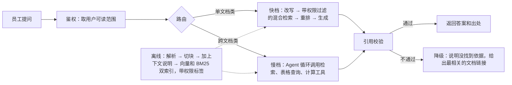

# 设计题：企业知识库问答 Agent

> 设计题 · harness、evaluation · 限时 45 分钟 · 追问题：[questions.md](questions.md)
> 前置：[core/07 RAG、搜索与 Deep Research](../../core/07-rag-search/README.md)、[core/10 安全与可靠性](../../core/10-safety-reliability/README.md)、[core/13 系统设计方法](../../core/13-system-design/README.md)

## 1 题面

“公司有几十万份内部文档：制度、产品手册、技术方案、会议纪要。设计一个问答助手，员工用自然语言提问，它给出带出处的答案。”

这道题看起来是 RAG，真正的考点在三处：**权限**（不同员工能看的文档不同）、**正确性**（答案要能对上原文）、**评测**（怎么证明它比搜索框好用）。只画一条“检索 → 生成”链路的回答，拿不到高分。

## 2 澄清

先问清楚这些，再动笔。括号里是本题采用的假设，面试时要说出“我先假设……”。

| 问题 | 为什么要问 | 本题假设 |
|---|---|---|
| 用户是谁，多少人 | 决定流量和权限模型 | 2 万名员工，按部门和项目分权限 |
| 文档有哪些格式，更新多频繁 | 决定切块和增量索引 | PDF、Word、Wiki、表格；每天新增或修改约 2,000 份 |
| 问题主要是什么类型 | 决定要不要多步 | 七成单文档就能答（“报销上限多少”），三成要跨文档比较或汇总 |
| 答错的代价 | 决定校验和拒答策略 | 制度、合规类答错代价高，宁可说“没找到” |
| 有没有现成的搜索和权限系统 | 决定复用还是自建 | 有统一身份系统，每份文档带可读人群列表 |
| 延迟要求 | 决定能不能多步 | 简单问题 3 秒内出首字，复杂问题允许 20 秒 |

## 3 估算

```
文档：30 万份 × 平均 20 页 × 每页约 600 token ≈ 36 亿 token
切块：每块约 500 token → 约 720 万块
向量：720 万 × 1024 维 × 4 字节（float32）≈ 29.5 GB；用 int8 或二值量化可再小几倍
每天增量：2,000 份 × 20 页 × 600 token ≈ 2,400 万 token 需要重新切块和嵌入

查询：2 万人，每人每天约 3 次 → 6 万次/天；高峰按日均 5 倍，约 3.5 次/秒
单次成本（快档）：输入约 6,000 token（10 个块 + 提示），输出约 300 token
单次成本（慢档）：平均 4 轮，每轮输入约 8,000 token，总输入约 3 万 token
```

结论：向量规模单机能放下，瓶颈不在检索存储，而在**权限过滤的正确性**和**慢档的 token 成本**。所以要用路由把大部分请求留在快档。

## 4 架构



| 模块 | 职责 | 关键设计 |
|---|---|---|
| 索引 | 解析、切块、嵌入、建索引 | 每块带文档 ID、版本、可读人群；按文档更新时间增量重建 |
| 鉴权 | 把用户身份换成可读范围 | 检索时作为过滤条件传入，不靠事后过滤 |
| 路由 | 判断走快档还是慢档 | 规则加小模型；快档检索置信度低时自动升级 |
| 快档 | 一次检索、一次生成 | 混合检索加重排，见 [core/07 第 4、5 节](../../core/07-rag-search/README.md#4-混合检索与融合) |
| 慢档 | 多步检索和汇总 | 设步数和 token 预算，见 [harness/01](../../tracks/harness/01-loop-and-harness/README.md) |
| 引用校验 | 每条结论都要对上引用片段 | 对不上的结论删掉或改为“未找到依据” |

先讲快档。面试官追问“复杂问题怎么办”时再引出慢档，这比一开始就画多 Agent 更有说服力。

## 5 深挖

### 5.1 权限：过滤要在检索时做

**问题**：最省事的做法是先检索、再把用户无权看的结果删掉。这有两个漏洞：删完可能一条不剩，答案质量骤降；更严重的是，如果删除逻辑有 bug，或者无权文档的内容已经进了缓存、摘要或慢档的中间笔记，就会泄露。

**方案**：
- 每个块存可读人群标签。检索时把用户可读范围作为过滤条件交给向量库和 BM25，召回阶段就只看得到有权文档。
- 缓存按“查询加权限范围”做键，不同权限的人不共用缓存结果。
- 慢档 Agent 的检索工具由服务端注入用户身份，模型不能自己传身份参数。

**代价**：带过滤的近邻检索比不带过滤慢，过滤条件很严时召回质量也会下降。权限变更（有人换部门）要能快速生效，标签要和身份系统同步。

### 5.2 正确性：引用校验和拒答

**问题**：模型会把两份文档的内容拼在一起，或者引用了 A 文档却写了 B 文档的数字。制度类问题答错，员工会照着做。

**方案**：
- 要求模型按“结论 + 引用编号”输出，引用对应具体的块。
- 校验每条结论能否在被引用的块里找到依据：先做字符串和数字比对，再让一个小模型判断“这段原文是否支持这句话”。
- 对不上的结论删掉；全部对不上就拒答，并给出最相关的几篇文档链接。
- 文档有多个版本时，优先最新版本，答案里注明版本日期。

**代价**：校验增加一次模型调用和几百毫秒延迟；拒答率会上升，要在评测里同时看“答错率”和“拒答率”。

### 5.3 检索质量：切块和上下文说明

**问题**：制度文档里常见“本条款不适用于第三章所述情形”，切块后这一块单独看不懂。

**方案**：按标题层级切块，块里带上所在章节的标题路径；再用 Contextual Retrieval 的做法，给每块生成一段简短的上下文说明，一起建向量和 BM25 索引，见 [core/07 第 3 节](../../core/07-rag-search/README.md#3-切块)。

**代价**：索引时每块多一次模型调用。按第 3 节的估算有 720 万块，要用便宜的模型并加缓存，增量更新时只处理改过的文档。

## 6 评测与上线

**离线评测集**（方法见 [evaluation/01](../../tracks/evaluation/01-eval-design/README.md)）：
- 按问题类型分层：单文档事实、跨文档比较、表格数值、无答案问题（知识库里本来就没有）。
- 按风险分层：制度和合规类单独一层，单独统计答错率。
- 每题标注标准答案和应引用的文档。无答案问题的标准行为是拒答。

**指标**：

| 指标 | 怎么算 |
|---|---|
| 检索召回 | 应引用文档出现在前 k 个结果里的比例 |
| 答案正确率 | 评委按标准答案判，人工抽检校准评委 |
| 引用准确率 | 引用的块确实支持对应结论的比例 |
| 拒答是否得当 | 无答案题拒答的比例，有答案题被误拒的比例 |
| 权限测试 | 用不同身份问同一题，结果里不能出现无权文档；这一项必须是 0 |
| 延迟和成本 | 分快慢档统计 P50、P95 和单次 token |

**上线**：先灰度给一个部门；线上收集“有用 / 没用”反馈和“点开出处”的比例；没用的样本回流到评测集，见 [evaluation/06](../../tracks/evaluation/06-eval-training-loop/README.md)。

## 7 常见追问

- **为什么不直接把文档塞进长上下文？** 30 万份放不下；即使放得下，成本高、权限没法做，模型对长上下文中间的信息利用也差。
- **表格类问题怎么办？** 表格单独解析成结构化数据，慢档里给一个查询工具，不要把表格切成文本块硬检索。
- **文档更新后旧答案还在缓存里怎么办？** 缓存键里带上被引用文档的版本号，文档更新时让相关缓存失效。
- **怎么证明比原来的搜索框好？** 同一批问题，比较“找到答案的比例”和“找到答案的时间”；搜索框是基线。
- **员工问到别人的隐私（工资、绩效）怎么办？** 权限过滤是第一道线；另外对敏感类别的问题做意图识别，直接拒答并提示正确渠道。

## 8 评分要点

面试官大致按下面打分，每项 0-2 分：

| 维度 | 2 分的表现 |
|---|---|
| 澄清与估算 | 主动问权限、答错代价和问题类型；给出文档规模和查询量的估算 |
| 架构 | 先给最简单可行方案，再用路由引出多步；模块职责清楚 |
| 权限 | 指出事后过滤的漏洞，过滤放在检索时，缓存按权限隔离 |
| 正确性 | 有引用校验和拒答，能说出它对延迟和拒答率的代价 |
| 评测 | 评测集分层（含无答案题和权限测试），指标覆盖检索、答案、引用、拒答 |
| 权衡 | 每个设计都能说出代价，知道什么时候不该加复杂度 |

## 资料

- Anthropic，[Introducing Contextual Retrieval](https://www.anthropic.com/news/contextual-retrieval)，2024-09-19
- Anthropic，[Building effective agents](https://www.anthropic.com/engineering/building-effective-agents)，2024-12-19
- Liu 等，[Lost in the Middle: How Language Models Use Long Contexts](https://arxiv.org/abs/2307.03172)，arXiv 2307.03172，2023-07
