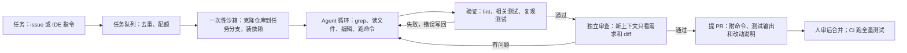

# 设计题：仓库级 Coding Agent

> 设计题 · harness、evaluation · 限时 45 分钟 · 追问题：[questions.md](questions.md)
> 前置：[harness/07 Coding Agent 与 Computer-Use Agent](../../tracks/harness/07-coding-agent/README.md)、[harness/03 权限、审批与沙箱隔离](../../tracks/harness/03-sandbox-permissions/README.md)、[harness/02 上下文装配、压缩与断点续跑](../../tracks/harness/02-context-compaction/README.md)、[core/13 系统设计方法](../../core/13-system-design/README.md)

## 1 题面

“公司有一个约 200 万行代码的大仓库。设计一个 Coding Agent：开发者在 issue 或 IDE 里描述一个任务，比如修一个 bug、加一个接口参数，Agent 自己读代码、改代码、跑测试，最后提一个 PR 等人审。”

这道题的考点不在“模型会不会写代码”，而在四处：**上下文**（仓库装不进窗口，怎么找到该改的代码）、**隔离**（Agent 要跑任意命令，怎么不伤到别的东西）、**验证**（怎么证明改对了，而不是模型自己说对了）、**评测**（怎么知道换了模型或改了提示后是变好还是变坏）。只画“模型 + 工具”一个循环的回答，拿不到高分。

## 2 澄清

| 问题 | 为什么要问 | 本题假设 |
|---|---|---|
| 用户是谁，多少人用 | 决定并发和沙箱数量 | 1,500 名开发者，日活约三成，每人每天约 2 个任务（假设） |
| 任务是什么类型 | 决定自主程度 | 以小 bug 修复、小功能、改测试和重构为主；跨多个服务的大改动先不做 |
| 结果交付到哪 | 决定错误代价 | 只提 PR，不直接合入主干，不碰部署。合并前必须人审 |
| 测试情况 | 决定验证手段 | 有单元测试，覆盖不全；全量测试跑一次约 15 分钟（假设） |
| 能访问什么 | 决定沙箱和凭据 | 只能访问内部包镜像和代码托管平台，不能访问生产环境和外网 |
| 延迟要求 | 决定同步还是异步 | 异步任务，20 分钟内出 PR 可以接受（假设）；IDE 里的小改动另走同步模式，本题不展开 |

问完复述一遍：“这是一个异步、在隔离环境里执行任意命令、产出要人审的 Agent。最大风险是改错代码却声称完成，以及执行了越界的命令。”

## 3 估算

```
仓库：200 万行 × 每行约 10 token ≈ 2,000 万 token，远超任何上下文窗口
任务量：1,500 × 30% × 2 ≈ 900 个任务/天
高峰：工作时间按 10 小时算，平均 90 个/小时；高峰按 2 倍，约 180 个/小时
并发沙箱：每个任务约 20 分钟 → 180 × 20 / 60 ≈ 60 个同时运行
单任务 token：平均 40 步，每步输入约 3 万 token → 约 120 万输入 token；输出 40 × 500 = 2 万
每天输入：900 × 120 万 ≈ 10.8 亿 token；前缀缓存命中按八成算，未命中约 2.2 亿
沙箱时长：900 × 20 分钟 ≈ 300 沙箱小时/天
测试：全量 15 分钟，一个任务跑 3 次就要 45 分钟，超过 20 分钟的预算
```

结论有三条：
- 仓库装不下，**代码定位**是第一关，要靠检索而不是堆上下文。
- 输入 token 远大于输出，而且每步都重发历史。**前缀缓存**和**旧工具结果折叠**是主要的降本手段。
- 全量测试太慢，循环里只能跑**相关测试**，全量测试留给提 PR 前一次，或交给 CI。

## 4 架构



| 模块 | 职责 | 关键设计 |
|---|---|---|
| 任务队列 | 接任务、限流、按用户和团队配额 | 同一 issue 不重复起任务 |
| 沙箱 | 每个任务一个一次性容器 | 网络只通包镜像；没有长期凭据；用完销毁，见 [harness/03](../../tracks/harness/03-sandbox-permissions/README.md) |
| 工具 | 搜索、查看、编辑、运行命令 | 搜索结果限量；编辑用查找替换且要求唯一匹配；路径用绝对路径，见 [harness/07 第 4 节](../../tracks/harness/07-coding-agent/README.md) |
| 上下文 | 规则文件、目录树、工具结果 | 稳定前缀放前面；旧工具结果折叠；接近阈值时压缩，见 [harness/02](../../tracks/harness/02-context-compaction/README.md) |
| 验证 | 静态检查和测试 | 循环里跑相关测试；结束前跑一次受影响模块的全部测试 |
| 审查 | 看不到原对话的独立上下文 | 只报影响正确性的问题，限定范围 |
| 交付 | 提 PR，写说明 | 附上运行过的命令和输出，不接受“测试都过了”这种空话 |

**最简单可行版**：单 Agent，一个容器，四个工具，测试失败就把错误写回，循环有步数和 token 上限，最后提 PR。不做向量索引，不做多 Agent。

**什么时候升级**：

| 信号 | 升级做法 | 代价 |
|---|---|---|
| 失败轨迹里大量时间花在“找不到代码” | 加目录树或 repo map；只知道功能描述时补语义检索 | 索引要随代码更新，Agent 改过的文件索引会过期 |
| 提出的 PR 常被审出明显问题 | 加独立审查步骤 | 多一次模型调用和几分钟延迟 |
| 高价值任务、有可执行验证 | 并行生成几个补丁，用测试筛选 | 成本按补丁数线性增加 |
| 任务能按模块拆开 | 多个 Agent 各用一个 worktree 或容器并行 | 合并冲突；拆分不好时并行没用 |

先讲最简单版。面试官问到“大任务怎么办”“PR 质量不够怎么办”时，再按上表加。

## 5 深挖

### 5.1 代码上下文：先 grep，再补索引

**问题**：2,000 万 token 的仓库装不进窗口。SWE-bench 论文还发现，塞进更多检索到的文件，即使召回了正确文件，效果也会下降。所以目标是放对，不是放多。

**方案**：
- 开头给一份全局视图：仓库规则文件（构建命令、测试命令、不能动的目录）和目录树或 repo map。
- 已知名字（报错信息、函数名、配置键）就 grep 或跳转定义。grep 直接读当前文件，不会过期。
- 只知道功能描述时，用语义检索找入口，再用 grep 和引用关系展开。
- 搜索结果限量。结果太多时提示模型把查询写具体，大结果写进文件分页读。
- 读过的大文件和旧测试输出，在后续步骤里折叠成一行摘要，原文留在日志里。

几种方式的分工见 [harness/07 第 2 节](../../tracks/harness/07-coding-agent/README.md)，规则文件的发现和加载顺序见同章第 3 节。

**代价**：符号索引和向量索引要维护，大仓库的增量更新是一项工程。规则文件是上下文不是约束，必须拦住的动作要写成权限规则或 hook。

### 5.2 沙箱与凭据：Agent 能跑任意命令

**问题**：Agent 要装依赖、跑测试、执行脚本。模型可能写错命令，也可能被 issue 里的文字或第三方依赖里的说明诱导。

**方案**：
- 每个任务一个一次性容器，用完销毁，不复用。启动慢用预热池掩盖。
- 文件和网络都要隔离。网络默认断开，只放行内部包镜像和代码托管平台。只做其中一个，另一个就是出口。
- 容器里没有长期凭据。推送代码经 git 代理：沙箱拿一个范围受限的临时凭据，代理检查“只能推到本任务分支”，再换成真实 token 转发。
- 高危动作单独拦：删除远程分支、改 CI 配置、改权限文件、使用任务中偶然发现的凭据。
- issue 文本、依赖包里的说明、网页都是不可信输入。读过之后，对外动作的权限收紧一档。

这几条的出处和隔离技术选型见 [harness/03](../../tracks/harness/03-sandbox-permissions/README.md)。

**代价**：断网后很多“顺手查一下文档”的操作做不了，要提前把常用文档放进镜像或内部代理。每个容器都要装依赖，冷启动可能要几分钟，要做依赖缓存和镜像分层。

### 5.3 验证闭环：不信模型说的“完成了”

**问题**：模型经常在没跑测试、或测试没真正覆盖改动时就宣布完成。全量测试又太慢，循环里跑不起。

**方案**：
- **先复现**。修 bug 先写或找到一个在原代码上失败的测试。复现不了的任务，在 PR 里写明“未复现”，交给人判断。
- **跑相关测试**。按改动文件找对应的测试文件和依赖它的模块，循环里只跑这些。提 PR 前跑一次受影响模块的全部测试，全量测试交给 CI。
- **测试输出要省**。只回写失败的用例名和几行错误，完整输出写进日志文件。
- **完成要有证据**。结束前检查：有 diff、相关测试通过、复现测试从失败变通过。检查写在 Harness 里，不满足就不让 Agent 结束。
- **审查测试改动**。Agent 改了或删了已有测试，审查和 PR 说明里要单独标出，防止“改测试让它通过”。
- **独立审查**。用看不到原对话的新上下文，只给需求和 diff，只报影响正确性的问题。

**代价**：相关测试会漏掉远处的回归，这部分靠 CI 兜底。复现测试和审查都要多花步数。审查者总能挑出点什么，范围不写清，会引入多余改动。

## 6 评测与上线

**离线评测集**（方法见 [evaluation/01](../../tracks/evaluation/01-eval-design/README.md)，SWE-bench 的判法和局限见 [evaluation/04](../../tracks/evaluation/04-benchmarks/README.md)）：
- 用自己仓库的历史构造题：找“修复提交前某些测试失败、修复后通过”的提交，issue 描述作为题面，修复提交里的测试作为隐藏测试。这些题没有公开过，污染风险小。
- 判分照 SWE-bench：FAIL_TO_PASS 证明修好了，PASS_TO_PASS 证明没改坏。
- 人工抽查题目：题面要能推出测试检查的行为。测试要求题面没提的实现细节，就是坏题。
- 按任务类型（bug、功能、重构）、改动规模（单文件、多文件）、模块分层报分。
- 公开 Benchmark 只做粗筛，最终看自建集合。

**指标**：

| 指标 | 怎么算 |
|---|---|
| 解决率 | 隐藏测试全过的比例，每题跑多次 |
| 稳定性 | pass^k，同一题连续 k 次都解决的概率 |
| 成本和时长 | 每任务 token、步数、沙箱分钟；报“每解决一题的成本” |
| 过程违规 | 改测试、越界命令、超预算的次数 |
| 线上 PR 采纳率 | 提出的 PR 被合并的比例 |
| 人工改动量 | 合并前审查者又改了多少行 |
| 合并后回退率 | 合并后一段时间内被回退或引发故障的比例 |

**上线**：先给一个团队试用；每次发布记版本指纹（模型、提示、工具集、镜像）；线上被拒的 PR 和回退的提交读轨迹归因，再回流成评测题，见 [evaluation/06](../../tracks/evaluation/06-eval-training-loop/README.md)。新版本先在离线集上配对比较，再小流量灰度，PR 采纳率或回退率越线就回滚。

## 7 常见追问

- **为什么不直接把整个仓库塞进长上下文？** 装不下；装得下也贵，而且上下文越长定位越差。检索加按需读取更准、更省。
- **Agent 把测试改了让它通过怎么办？** 测试改动单独标出、单独审查；评测里隐藏测试不对 Agent 可见；必要时把测试目录设为只读，只允许新增测试文件。
- **两个任务同时改同一个模块怎么办？** 每个任务在自己的分支和容器里工作，互不干扰；冲突在合并时解决，合并后由 CI 跑全量测试兜底。
- **需求写得不清楚怎么办？** 先让 Agent 在 issue 里写出它的理解和计划，等人确认再动手；或者只做能确定的部分，在 PR 里列出待确认点。
- **模型变强以后这套还需要吗？** 流程可以放松，工具和隔离不能放松。验证和审查的强度按错误代价定，不按模型强弱定。

## 8 评分要点

| 维度 | 2 分的表现 |
|---|---|
| 澄清与估算 | 问清交付方式、测试情况和可访问范围；算出仓库 token 量、并发沙箱数，并指出全量测试进不了循环 |
| 架构 | 先给单 Agent 加四个工具的最简版，按失败信号再加索引、审查、并行；模块职责清楚 |
| 代码上下文 | 说出 grep、符号索引、语义检索的分工，强调限量和折叠旧结果，不堆文件 |
| 隔离与权限 | 一次性容器；文件和网络都隔离；凭据不进沙箱，推送经代理；指出 issue 文本是不可信输入 |
| 验证 | 先复现、跑相关测试、完成要有证据、独立审查，并处理“改测试让它通过” |
| 评测 | 用自己仓库历史构造带隐藏测试的题，分层报分，线上看采纳率和回退率，并说出各项代价 |

## 资料

- Jimenez 等，[SWE-bench: Can Language Models Resolve Real-World GitHub Issues?](https://arxiv.org/abs/2310.06770)，arXiv 2310.06770，2023-10
- Yang 等，[SWE-agent: Agent-Computer Interfaces Enable Automated Software Engineering](https://arxiv.org/abs/2405.15793)，arXiv 2405.15793，2024-05
- Xia 等，[Agentless: Demystifying LLM-based Software Engineering Agents](https://arxiv.org/abs/2407.01489)，arXiv 2407.01489，2024-07
- Anthropic，[Raising the bar on SWE-bench Verified with Claude 3.5 Sonnet](https://www.anthropic.com/engineering/swe-bench-sonnet)，2025-01
- Anthropic（David Dworken、Oliver Weller-Davies），[Beyond permission prompts: making Claude Code more secure and autonomous](https://www.anthropic.com/engineering/claude-code-sandboxing)，2025-10
- Anthropic，[Best practices for Claude Code](https://code.claude.com/docs/en/best-practices)，Claude Code 文档，查阅于 2026-11
- OpenAI，[Why we no longer evaluate SWE-bench Verified](https://openai.com/index/why-we-no-longer-evaluate-swe-bench-verified/)，2026-02
