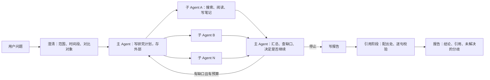

# 设计题：Deep Research 研究助手

> 设计题 · harness、evaluation · 限时 45 分钟 · 追问题：[questions.md](questions.md)
> 前置：[core/07 RAG、搜索与 Deep Research](../../core/07-rag-search/README.md)、[core/08 多 Agent 系统](../../core/08-multi-agent/README.md)、[harness/02 上下文装配、压缩与断点续跑](../../tracks/harness/02-context-compaction/README.md)、[core/13 系统设计方法](../../core/13-system-design/README.md)

## 1 题面

“设计一个研究助手。用户给一个开放问题，比如‘比较三种储能技术未来五年的成本趋势’，它自己上网搜索、阅读几十个来源，十几分钟后交回一份带引用的研究报告。”

这道题看起来是“搜索 + 总结”，真正的考点在四处：**计划**（问题怎么拆）、**并行**（什么时候值得用多个子 Agent）、**停止**（什么时候算查够了）、**事实核查**（报告里每句话能不能对上来源）。只画一个“搜索 → 生成”循环的回答，讲不出停止条件和引用校验，拿不到高分。

## 2 澄清

| 问题 | 为什么要问 | 本题假设 |
|---|---|---|
| 用户是谁，问什么 | 决定来源和深度 | 分析师和产品经理；问题以行业、技术、政策比较为主 |
| 量有多大 | 决定成本和并发 | 每天约 2,000 份报告（假设） |
| 能接受多久 | 决定同步还是异步 | 异步任务，10 到 20 分钟可以接受；期间展示进度 |
| 来源范围 | 决定检索工具 | 公开网页加内部文档库；内部文档要按用户权限过滤，做法同 [01 企业知识库问答](../01-enterprise-kb-qa/README.md) |
| 答错的代价 | 决定核查强度 | 报告会被拿去做决策引用；编造数字或引用对不上的代价高 |
| 交付形式 | 决定输出结构 | 一份报告：结论、分节论证、每句话的引用、未解决的分歧 |

问完复述：“这是一个异步、高 token 消耗、对引用准确性要求高的研究任务。难点在于决定查到什么程度停下，以及证明每个结论有出处。”

## 3 估算

```
一份报告（假设）：主 Agent 派 5 个子 Agent，每个约 15 次工具调用
每次工具结果：裁剪后约 3,000 token；单个子 Agent 读进约 15 × 3,000 = 4.5 万 token
子 Agent 每步都重发历史，平均上下文约 2 万 → 15 步累计输入约 30 万 token
单份报告输入：5 × 30 万 + 主 Agent 和引用阶段约 20 万 ≈ 170 万 token
每天：2,000 × 170 万 ≈ 34 亿输入 token；搜索和抓取调用 2,000 × 75 = 15 万次
延迟（只算工具，单次约 3 秒）：串行 75 × 3 ≈ 225 秒；5 个子 Agent 并行后约 15 × 3 = 45 秒
核查：每份报告约 40 条带引用的结论，每天约 8 万次“结论-来源”校验
```

结论：
- 成本主要在子 Agent 反复重发的历史上。**工具结果裁剪**和**按问题复杂度决定派几个子 Agent**是最大的成本杠杆。
- 并行主要省的是等待时间，不省 token。
- 每天 8 万次校验，不能每次都用大模型，要先做便宜的字符串和数字比对。

## 4 架构



| 模块 | 职责 | 关键设计 |
|---|---|---|
| 澄清 | 问清范围再开始 | 一到两个问题，不问就按默认假设并写进报告 |
| 计划 | 拆成子问题，每个写明要找的证据 | 计划写进外部存储，上下文被截断或压缩后能取回 |
| 子 Agent | 独立上下文里搜索、阅读 | 交接写清目标、输出格式、工具和来源范围、什么时候停 |
| 笔记 | 子 Agent 的产物 | 写进外部存储，只把引用和摘要交回主 Agent |
| 汇总 | 合并结论、找缺口和冲突 | 按计划逐项检查覆盖情况 |
| 引用与核查 | 每句话配来源并校验 | 对不上的句子删掉或改成“未找到依据” |

**最简单可行版**：单 Agent 循环。先写计划，再按子问题依次搜索，笔记写进文件，按预算停，最后带引用写报告。对简单事实问题，这已经够了。

**什么时候升级**：

| 信号 | 升级做法 | 代价 |
|---|---|---|
| 子问题之间独立，串行太慢 | 派并行子 Agent | token 成倍增加；交接会丢信息 |
| 单个上下文装不下读过的资料 | 子 Agent 隔离上下文，只交回摘要和引用 | 主 Agent 看不到细节，汇总时可能误读 |
| 引用经常对不上 | 单独的引用和核查阶段 | 多一轮模型调用和抓取 |
| 一个慢的子 Agent 卡住整批 | 子任务设超时，超时用部分结果或重派 | 部分结果要在报告里注明 |

Anthropic 公开的研究系统用的是“主 Agent 规划、派并行子 Agent、最后由引用 Agent 配出处”的结构，并按复杂度分配投入：简单事实查询 1 个 Agent、3 到 10 次工具调用；直接比较 2 到 4 个子 Agent；复杂研究 10 个以上，见 [core/07 第 8 节](../../core/07-rag-search/README.md#8-deep-research)。这说明“派几个子 Agent”本身就是计划的一部分，不是固定配置。

## 5 深挖

### 5.1 并行子 Agent：什么时候拆，怎么交接

**问题**：多 Agent 能并行、能读更多资料，但 token 用量成倍增加，交接还会丢信息。Anthropic 那篇报告，多 Agent 系统比聊天多用约 15 倍 token。

**方案**：
- 只在子问题之间依赖弱、能独立回答时才拆。比较三种技术，按技术拆成三个子 Agent；需要层层推导的问题，不拆。
- 交接内容写四件事：目标、输出格式、可用工具和来源范围、什么时候停。只写“去研究一下电池成本”，几个子 Agent 会查重复的内容。
- 子 Agent 返回结构化结果：结论、证据引用、没查到的部分。原文和长笔记写进外部存储，只交回引用。
- 每个子任务设超时和调用上限。超时就用已有结果，或换一个范围更小的子任务重派。

拓扑选择、交接模板和失败模式见 [core/08](../../core/08-multi-agent/README.md)。

**代价**：成本按子 Agent 数线性增长，只适合价值够高的问题。主 Agent 同步等一批子 Agent 时，一个慢的会卡住全部；改成异步又要处理状态一致性。评测时要和同等 token 预算的单 Agent 比，否则分不清收益来自结构还是来自多花的 token。

### 5.2 停止条件：什么时候算查够了

**问题**：研究没有天然的终点。停早了，报告漏掉关键证据；停晚了，成本失控，而且后面几轮常常只是重复已知信息。

**方案**：同时设四类条件，任何一类触发都停，见 [core/07 第 8 节](../../core/07-rag-search/README.md#8-deep-research)：

| 条件 | 怎么判定 |
|---|---|
| 预算上限 | token、工具调用次数、时间三项，任一到顶就停 |
| 覆盖 | 计划里每个子问题至少有一个可靠来源支持 |
| 收益递减 | 连续几轮搜索没有带来新的事实或新来源 |
| 冲突处理 | 来源矛盾时，再查一次权威来源；还矛盾就停，在报告里写出分歧 |

覆盖和收益递减最好由代码判，不只靠模型说“我觉得够了”。做法是在外部存储里维护一张“子问题 → 已找到的证据”表，主 Agent 每轮更新，Harness 检查空格子和新增条数。

长任务还要防上下文溢出。计划和阶段结论写在上下文外，压缩或重置后从存储里读回，见 [harness/02](../../tracks/harness/02-context-compaction/README.md)。Anthropic 那篇提到，主 Agent 先把计划存进记忆，因为上下文超过 20 万 token 会被截断。

**代价**：预算设紧了，难题只能交半成品。所以报告要写明“哪些子问题没查到”，而不是假装完整。“新信息”的判定本身有误差，同一个事实换种说法也可能被当成新的。

### 5.3 事实核查：引用要对得上

**问题**：报告附了引用，但引用的网页并不支持那句话；或者数字抄错了年份和单位。来源本身也可能质量低，Anthropic 那篇提到早期的 Agent 会偏好 SEO 内容农场，而不是权威但排名靠后的来源。

**方案**：
- 抓到的每个来源存一份快照，带稳定 ID、URL 和抓取时间。报告要求每句话标来源 ID。
- 逐句校验：先比对数字、日期、专有名词是否出现在被引用的段落里；比对不上的，再让小模型判断“这段原文是否支持这句话”。
- 对不上的句子删掉或改成“未找到依据”；关键结论只有一个来源时，标成“单一来源”。
- 来源质量过滤：在提示和工具层加规则，优先官方文件、论文、一手数据；低质量站点降权。
- 报告单列“分歧”一节，写清哪些来源说法不同。

引用与可溯源的做法见 [core/07 第 9 节](../../core/07-rag-search/README.md#9-引用与可溯源)。

**代价**：校验每天要跑几万次，增加延迟和成本。快照要存储，还有版权和保留期限的问题。严格校验会删掉一些对的但表述不同的句子，报告看起来更单薄。

## 6 评测与上线

**离线评测集**（方法见 [evaluation/01](../../tracks/evaluation/01-eval-design/README.md)）分两类：
- **有短答案的题**：难找、好验证的事实题，用于测检索的坚持程度，判法类似 BrowseComp，见 [evaluation/04 第 5 节](../../tracks/evaluation/04-benchmarks/README.md#5-研究与信息检索gaiabrowsecomp)。
- **开放报告题**：按真实请求分层采样，每题写一份要点清单（必须覆盖的论点和关键事实）。

**判分**：

| 指标 | 怎么算 |
|---|---|
| 关键事实覆盖 | 要点清单里被报告覆盖的比例 |
| 引用准确率 | 抽出“结论-来源”对，判断来源是否支持结论；DeepResearch Bench 的 FACT 框架是同一思路 |
| 来源质量 | 一手来源和权威来源的占比 |
| 报告质量 | 评委按 rubric 逐项判：完整性、准确、结构、是否写出分歧；评委先和人工校准，见 [evaluation/02](../../tracks/evaluation/02-llm-as-judge/README.md) |
| 成本和时长 | 每份报告的 token、工具调用、分钟数 |
| 过程问题 | 子 Agent 重复查询率、超时率、因预算截断的比例 |

Anthropic 那篇的起步做法可以借鉴：从约 20 个代表真实用法的查询开始，用一个评委按 rubric 打分，维度包括事实准确、引用准确、完整、来源质量、工具效率；再用人工测试补评委发现不了的问题。

**上线**：先灰度给一个团队；线上看“报告被导出或分享的比例”“用户追问补查的比例”；用户标出的错误引用回流成评测题，见 [evaluation/06](../../tracks/evaluation/06-eval-training-loop/README.md)。长任务更新版本时，新旧版本同时运行，流量逐步切换，不打断正在跑的任务。

## 7 常见追问

- **为什么不直接用一个长上下文模型把所有网页塞进去？** 网页数量不定，装不下；上下文越长，中间的信息利用越差；成本随步数近似平方增长。
- **子 Agent 搜到的结论互相矛盾怎么办？** 主 Agent 再派一次针对冲突点的查询，优先权威来源；还矛盾就在报告里写出分歧和各自来源。
- **搜索结果里有注入指令怎么办？** 网页内容当数据不当指令；研究 Agent 只给只读工具，没有对外发送和写操作。
- **用户中途关掉页面怎么办？** 任务是异步的，计划、笔记和进度都在外部存储；进程崩溃从检查点恢复，已抓取的来源不重抓。
- **怎么证明多 Agent 比单 Agent 好？** 同一题集上和同等 token 预算的单 Agent 比，同时报质量、成本和时长。

## 8 评分要点

| 维度 | 2 分的表现 |
|---|---|
| 澄清与估算 | 问清来源范围、延迟和答错代价；估出单份报告的 token 量，指出并行省时间不省 token |
| 架构 | 先给单 Agent 加外部笔记的最简版，再按信号引出并行子 Agent 和引用阶段；投入随问题复杂度变化 |
| 并行与交接 | 说清什么时候拆、什么时候不拆；交接四要素；结构化返回和外部存储 |
| 停止条件 | 同时给出预算、覆盖、收益递减、冲突四类条件，并说明怎样用代码判覆盖 |
| 事实核查 | 来源快照带 ID，逐句校验，对不上就删，单列分歧；考虑来源质量 |
| 评测 | 分短答案题和开放报告题；指标覆盖要点、引用、来源质量、成本；评委先校准，并和同预算单 Agent 对照 |

## 资料

- Anthropic（Hadfield 等），[How we built our multi-agent research system](https://www.anthropic.com/engineering/multi-agent-research-system)，2025-06-13
- Cognition（Walden Yan），[Don't Build Multi-Agents](https://cognition.com/blog/dont-build-multi-agents)，2025-06-12
- Wei 等，[BrowseComp: A Simple Yet Challenging Benchmark for Browsing Agents](https://arxiv.org/abs/2504.12516)，arXiv 2504.12516，2025-04
- Du 等，[DeepResearch Bench: A Comprehensive Benchmark for Deep Research Agents](https://arxiv.org/abs/2506.11763)，arXiv 2506.11763，2025-06
- Liu 等，[Lost in the Middle: How Language Models Use Long Contexts](https://arxiv.org/abs/2307.03172)，arXiv 2307.03172，2023-07
- Anthropic（Prithvi Rajasekaran 等），[Effective context engineering for AI agents](https://www.anthropic.com/engineering/effective-context-engineering-for-ai-agents)，2025-09
