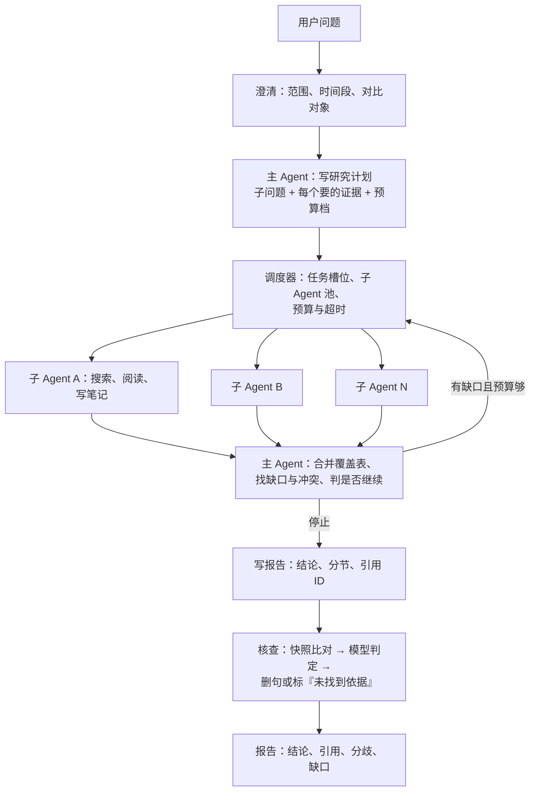

# 设计题：Deep Research 研究助手

> 设计题 · harness、evaluation · 限时 45 分钟 · 追问题：[questions.md](questions.md)
> 前置：[core/07 RAG、搜索与 Deep Research](../../core/07-rag-search/README.md)、[core/08 多 Agent 系统](../../core/08-multi-agent/README.md)、[harness/02 上下文装配、压缩与断点续跑](../../tracks/harness/02-context-compaction/README.md)、[core/13 系统设计方法](../../core/13-system-design/README.md)

## 1 题面

“设计一个研究助手。用户给一个开放问题，比如‘比较三种储能技术未来五年的成本趋势’，它自己上网搜索、阅读几十个来源，十几分钟后交回一份带引用的研究报告。”

这道题看起来是“搜索 + 总结”，真正的考点在三处：

1. **容量与调度**：一个任务跑十几分钟、内部几十次模型调用，按请求算 QPS 会差两个数量级。要能说出同时有多少个任务在跑、多少个模型调用在途、配额够不够、排多长的队。
2. **停止条件**：研究没有天然终点。停早了漏证据，停晚了成本失控。要给出可计算的阈值，不是“模型觉得够了”。
3. **事实核查**：报告每句话都要对得上来源，而校验本身有召回和误拒，要在成本和“删掉的正确句子”之间做选择。

只画一个“搜索 → 生成”循环、只报一个 QPS、只要求模型“附上出处”的回答，拿不到高分。

## 2 澄清

| 问题 | 为什么要问 | 本题假设 |
|---|---|---|
| 用户是谁，问什么 | 决定来源范围和深度 | 分析师和产品经理；问题以行业、技术、政策比较为主 |
| 量有多大 | 决定并发、配额和成本 | 每天 2,000 个研究任务（假设），80% 落在 10 个工作小时内 |
| 单任务多长 | 决定在途数和排队 | 5 到 20 分钟，均值按 12 分钟算 |
| 派几个子 Agent | 决定并发子 Agent 数和延迟上界 | 每任务 3 到 5 个，均值 5 个、分两批（3 个 + 2 个）派出 |
| 能接受多久 | 决定同步还是异步 | 异步任务；超过 20 分钟要有部分结果和进度 |
| 来源范围 | 决定检索工具 | 公开网页加内部文档库；内部文档按用户权限过滤，做法同 [01 企业知识库问答](../01-enterprise-kb-qa/README.md) |
| 答错的代价 | 决定核查强度 | 报告会被拿去做决策引用；编造数字或引用对不上代价高 |
| 交付形式 | 决定输出结构 | 结论、分节论证、每句话的引用、未解决的分歧、查不到的项 |
| 预算 | 决定档位和截断 | 单任务成本上限按复杂度分档，最贵一档不超过均值的三倍 |

问完复述：“这是一个异步、高 token 消耗、对引用准确性要求高、内部有并行的长任务。难点一是算清并发和配额，二是决定查到什么程度停下，三是证明每个结论有出处，并且知道这套核查自己会错多少。”

## 3 估算

全部数字写在下段代码里，正文与之逐项对应。参数集中在开头，单价是示例价，不是任何厂商的报价。

### 3.1 容量：在途任务、并发子 Agent、模型配额

```python
import math
import numpy as np

# ---- 参数（本题假设） ----
TASKS, BUSY_H, BUSY_SHARE, PEAK = 2000, 10.0, 0.8, 4.0   # 每天任务数、工作小时、落在其中的比例、峰均比
W = 720.0                       # 平均停留 12 分钟（5-20 分钟的中点）
K, STEPS = 5, 15                # 每任务 5 个子 Agent，每个 15 次工具调用
CALL_S, TOOL_S = 12.0, 4.0      # 一次模型调用 / 一次工具调用（含抓取）的耗时
MAIN_CALLS, CITE_CALLS = 6, 10  # 主 Agent 各轮合计 6 次调用；引用阶段 10 次

lam_pk = TASKS * BUSY_SHARE / (BUSY_H * 3600) * PEAK    # 峰值到达率，任务/秒
L = lam_pk * W                                          # Little 定律：在途任务数
L99 = L + 2.33 * math.sqrt(L)                           # M/G/∞ 在途数的 p99
calls = K * STEPS + MAIN_CALLS + CITE_CALLS             # 每任务调用次数
rate = lam_pk * calls                                   # 峰值模型调用率
sub_slots = lam_pk * K * STEPS * (CALL_S + TOOL_S)      # 平均并发子 Agent 数

assert round(lam_pk, 4) == 0.1778 and round(lam_pk * 3600) == 640   # 峰值 640 任务/小时
assert L == 128.0 and round(L99) == 154
assert calls == 91 and round(rate, 2) == 16.18 and round(rate * 60) == 971
assert round(rate * CALL_S) == 194          # 模型侧在途调用
assert round(sub_slots) == 213              # 平均并发子 Agent
assert L * K == 640                         # 上界：全部在途任务同时派满 5 个子 Agent

# ---- 队列：c 个任务槽位，服务时间 W ----
def erlang_c(c, a):
    """M/M/c 的等待概率。用递推算 a^i/i!，避免大 c 时阶乘溢出。"""
    s, term = 1.0, 1.0
    for i in range(1, c):
        term *= a / i
        s += term
    term *= a / c
    return (term * c / (c - a)) / (s + term * c / (c - a))

def wait_md_c(c, lam, service, horizon=60_000, seed=0):
    """M/D/c：固定服务时长、先到先服务。返回 (平均排队, p95 排队)，秒。"""
    import heapq
    rng = np.random.default_rng(seed)
    arrive = np.sort(rng.uniform(0, horizon, rng.poisson(lam * horizon)))
    free = [0.0] * c
    heapq.heapify(free)
    waits = np.empty(len(arrive))
    for i, t in enumerate(arrive):
        s = heapq.heappop(free)
        start = max(s, t)
        waits[i] = start - t
        heapq.heappush(free, start + service)
    return waits.mean(), float(np.percentile(waits, 95))

rho140 = L / 140
wq140 = erlang_c(140, L) / (140 / W - lam_pk)      # M/M/c 平均排队时间
md_mean, md_p95 = wait_md_c(140, lam_pk, W)
assert round(rho140, 3) == 0.914 and 10 < wq140 < 14          # 12.7 秒
assert md_mean < wq140                                        # 服务时间固定，排队比指数假设短
assert round(erlang_c(150, L) / (150 / W - lam_pk), 1) == 1.2  # 150 个槽位，排队 1.2 秒
# 单槽位对照：M/D/1 的排队时间 = ρτ / (2(1−ρ))，ρ→1 时发散
assert abs(0.8 * W / (2 * 0.2) - 1440) < 1e-9
```

读出来的结论：

| 量 | 值 | 推出什么 |
|---|---|---|
| 峰值到达率 | 640 任务/小时（0.178/秒） | 一天 2,000 个任务的峰均比不是 1。按日均配容量，高峰时排队会爆 |
| 在途任务 | 128（p99 约 154） | 任务槽位按 160 配，where 128 是均值 |
| 并发子 Agent | 均值 213，上界 640 | 子 Agent 池按 250 配，超出部分排队；上界说明为什么必须限流 |
| 峰值模型调用 | 16.2 次/秒，约 970 RPM | 对上模型的 RPM 配额，这是硬上限 |
| 模型侧在途调用 | 约 194 | 自建推理的并发槽位不能低于它；留出排队余量后按 250 配 |
| 排队时间 | 140 槽位下 M/M/c 12.7 秒，M/D/c 约 7 秒 | 排队不是瓶颈：12 秒相对 720 秒只有 1.8% |

注意 128 和 640 的关系：Little 定律给的是**平均**在途任务，640 是“所有在途任务恰好同时在派子 Agent”的上界。两者差 5 倍，说明并发控制不能按最坏情况配，而要按均值配池子、用队列吸收突发。突发吸收不了时，任务在槽位外排队，等待时间由 Erlang C 决定。

**三个容易算错的地方**：

1. **按天平均算 QPS**。2,000/86,400 = 0.023 任务/秒，推出在途 16.7 个任务、并发子 Agent 28 个。这个数在高峰时段会差 8 倍，配额按它买一定不够。
2. **把子 Agent 数和模型调用数混为一谈**。并发子 Agent 是 213，模型侧在途调用是 194，两者接近但不是一回事：子 Agent 有工具调用时间不占模型。按前者买推理配额会高估，按后者买子 Agent 池会不够。
3. **用 M/M/1 排队**。多槽位系统的排队远小于单队列模型，M/M/1 在 ρ = 0.9 时给 3,240 秒排队，多槽位 M/M/c 在 ρ = 0.914 只给 12.7 秒。排队模型要和系统形状对上。

### 3.2 成本：每任务 token 与金额

单价用示例值：输入 $3、输出 $15 每百万 token（假设）。缓存写入按 1.25 倍、读取按 0.1 倍（倍数见 [core/13 第 3.2 节](../../core/13-system-design/README.md#32-成本按调用拆缓存有盈亏点)）。

```python
TASKS = 2000
K, STEPS = 5, 15
CTX, NEW = 20_000, 3_500        # 子 Agent 平均上下文；每步新增（工具结果裁剪后）
HIT = 0.8                       # 稳定前缀（系统提示、工具定义、任务约束）的缓存命中率
MAIN_CALLS, CITE_CALLS = 6, 10
PIN, POUT = 3.0, 15.0           # 示例单价，美元/百万 token

def billed(ctx, new, hit=HIT):
    """一次调用的计费等效输入：新增原价，命中前缀 0.1 倍，未命中按写入 1.25 倍。"""
    return new + hit * 0.1 * (ctx - new) + (1 - hit) * 1.25 * (ctx - new)

main_ctx = [9000 + 7500 * i for i in range(MAIN_CALLS)]     # 主 Agent 上下文逐步变长
raw = K * STEPS * CTX + sum(main_ctx) + CITE_CALLS * 5000   # 不计缓存的原始输入
b_in = K * STEPS * billed(CTX, NEW) + sum(billed(c, 7500) for c in main_ctx) + CITE_CALLS * 5000
out_tok = K * STEPS * 300 + MAIN_CALLS * 800 + CITE_CALLS * 200

cost_raw = (raw * PIN + out_tok * POUT) / 1e6
cost = (b_in * PIN + out_tok * POUT) / 1e6

assert raw == 1_716_500 and round(cost_raw, 2) == 5.59
assert round(b_in) == 805_970 and round(cost, 2) == 2.86
assert round(1 - cost / cost_raw, 2) == 0.49
assert round(cost * TASKS) == 5715 and round(cost_raw * TASKS) == 11178

# 计入 ITPM 的只算“未缓存 + 缓存写”，是总输入的 1/3
rate = 16.18
itpm = rate * (NEW + (1 - HIT) * (CTX - NEW)) * 60
assert round(itpm / 1e6, 2) == 6.60 and round(rate * CTX * 60 / 1e6, 1) == 19.4
assert out_tok == 29_300 and round(out_tok * POUT / 1e6 * TASKS) == 879
```

单任务 $2.86、每天约 $5,700；不开缓存是 $5.59 和 $11,178。三条结论：

- 输入占成本的 84%（$2.40 / $2.86），输出只占 16%。**先压输入**：裁剪工具结果、折叠旧结果、提高缓存命中率。
- 缓存把输入压到 47%，每天省 $5,400。但它同时改变配额：计入 ITPM 的输入从 1,940 万/分钟降到 660 万/分钟。命中率跌到 0.3 时，计费和配额会同时变坏，所以命中率是容量指标，不只是成本指标。
- 引用阶段的 10 次调用只占成本的 1%。**核查不该省**，该省的是前面反复重发的历史。

### 3.3 成本随轮次增长：主 Agent 读全部摘要

主 Agent 每轮把上一轮的子 Agent 摘要全部读进来，第 r 轮的输入是 `B + r·(K·O + A)`。这是二次增长。

```python
B = 6000                  # 主 Agent 起始上下文（计划、目标、任务描述）
K, O, A = 4, 1200, 600    # 每轮 4 份子 Agent 摘要，每份 1200 token；本轮新笔记 600
STEPS, CTX, NEW = 15, 20_000, 3_500
PIN, POUT = 3.0, 15.0

def main_input(R):
    """前 R 轮主 Agent 的原始输入。"""
    return sum(B + r * (K * O + A) for r in range(R))

def main_billed(R, hit=0.8, stable=2000):
    """同样的输入按缓存计价。"""
    total = 0.0
    for r in range(R):
        ctx = B + r * (K * O + A)
        total += (ctx - stable) + stable * (hit * 0.1 + (1 - hit) * 1.25)
    return total

sub_per_round = K * STEPS * (NEW + 0.8 * 0.1 * (CTX - NEW))    # 缓存后的计费等效
sub_per_round_raw = K * STEPS * CTX

cost = {}
for R in (5, 10, 20):
    b = main_billed(R) + sub_per_round * R
    out = R * K * STEPS * 300 + R * 300 + 3000
    cost[R] = (b, (b * PIN + out * POUT) / 1e6)

assert round(main_input(5)) == 84_000
assert round(main_input(10)) == 303_000
assert round(main_input(20)) == 1_146_000
assert round(main_input(20) / main_input(5), 1) == 13.6    # 轮次 4 倍，主 Agent 输入 13.6 倍
assert [round(cost[R][1], 2) for R in (5, 10, 20)] == [5.99, 12.33, 26.24]
assert round(main_billed(5) / cost[5][0], 3) == 0.051      # 5 轮时主 Agent 占 5%
assert round(main_billed(20) / cost[20][0], 3) == 0.162    # 20 轮时占 16%
assert B + 19 * (K * O + A) == 108_600                     # 第 20 轮的输入是第 1 轮的 18 倍
assert round((B + 19 * (K * O + A)) / B, 1) == 18.1
assert round(cost[5][0] / (main_input(5) + sub_per_round_raw * 5), 2) == 0.25  # 缓存压到 1/4
```

| 轮次 | 主 Agent 原始输入 | 计费等效总输入 | 单任务金额 |
|---|---|---|---|
| 5 | 84,000 | 152 万 | $5.99 |
| 10 | 303,000 | 318 万 | $12.33 |
| 20 | 1,146,000 | 690 万 | $26.24 |

三点：

1. **二次项在 20 轮时才明显**。5 轮时主 Agent 只占 5.1%，20 轮升到 16.2%。轮次越多，读数越贵——第 20 轮的主输入是第 1 轮的 18 倍，而它带来的常常是重复信息。
2. **子 Agent 部分是线性的**，每轮约 29 万计费 token。所以“多跑几轮”的成本近似 `R × 29 万 + 主 Agent 的二次项`。
3. **这决定了预算要按轮数上限给**。窗口在 5 到 20 轮之间，价格差 4.4 倍。按平均成本定价的产品，会被长尾任务吃掉利润：如果 10% 的任务跑到 20 轮，它们的成本接近总成本的 40%。

会话摘要交回主 Agent 的格式要短：每份 1,200 token 已是上限，更长就该压缩成“结论 + 引用 ID”。

### 3.4 延迟：分轮 + 等最慢的子 Agent

```python
import math
import numpy as np

rng = np.random.default_rng(7)
N = 200_000
# 每个子 Agent：15 步，每步中位 16 秒（12 秒模型 + 4 秒工具），对数标准差 0.5
def batch_max(n, trials=N):
    step = rng.lognormal(math.log(16), 0.5, (trials, n, 15))
    return step.sum(2).max(1)                    # 每批 n 个子 Agent，取最慢的

single = batch_max(1)
a3, a2 = batch_max(3), batch_max(2)
T = 60 + a3 + a2 + 90 + 40                       # 计划 60 + 两批 + 写报告 90 + 引用 40
assert round(single.mean()) == 272 and round(np.percentile(single, 95)) == 337
assert round(a3.mean()) == 304 and round(a2.mean()) == 293
assert round(T.mean()) == 787 and round(T.mean() / 60, 1) == 13.1
assert round(np.percentile(T, 95) / 60, 1) == 14.5
# 两批串行比一批 5 个并行慢：max(3)+max(2) 的均值大于 max(5)
def max5():
    return rng.lognormal(math.log(16), 0.5, (N, 5, 15)).sum(2).max(1).mean()
assert a3.mean() + a2.mean() > max5()
# 某一步碰上超时重试（耗时 ×4）：中位数涨 19%，p90 涨 23%，尾部被拉长的比例更大
slow = rng.lognormal(math.log(16), 0.5, (N, 15)); slow[:, 7] *= 4
assert round(np.median(slow.sum(1)) / np.median(single), 2) == 1.19
assert np.percentile(slow.sum(1), 90) > 1.2 * np.percentile(single, 90)
```

| 段 | 均值 | p95 | 说明 |
|---|---|---|---|
| 计划 | 60 s | — | 一次长调用 |
| 批次 1（3 个并行） | 304 s | 361 s | 等最慢的那个 |
| 批次 2（2 个并行） | 293 s | 353 s | 同上 |
| 写报告 | 90 s | — | 一次长输出 |
| 引用核查 | 40 s | — | 40 条句子批量校验 |
| **合计** | **787 s（13.1 分）** | **868 s（14.5 分）** | 落在 5 到 20 分钟的目标内 |

由此得到“5 到 20 分钟”这个题面约束怎么满足：均值 13 分钟，p95 不到 15 分钟，20 分钟是硬超时。**批次串行是延迟的主要来源**：两批串行的耗时约 600 秒，一批 5 个并行约 330 秒。分批是为了复用第一批的结果做第二批的计划，用延迟换覆盖质量；如果问题够简单，就一批派完。

`E[max]` 的解析式和截止时间的取舍在第 5.1 节。

### 3.5 存储和校验量

- 每任务约 40 个来源，每个存一份抓取快照，平均 150 KB：6 MB/任务，每天 12 GB，保留 30 天约 360 GB。快照要带稳定 ID、URL、抓取时间和内容哈希。
- 每份报告约 40 条带引用的句子：每天 8 万条校验。先过规则层（抽数字、日期、专名去被引段落里找），45% 的坏句子在这一层被拦下，剩下的 4.4 万条才进模型判定，每条约 1,200 token，每天约 5,300 万 token、$160。相对报告本身 $5,700/天，核查只占 3%。

## 4 架构



| 模块 | 职责 | 关键设计 | 失败时怎样 |
|---|---|---|---|
| 澄清 | 问清范围再开始 | 一到两个问题，不问就按默认假设并写进报告 | 问不出就用默认值，报告注明假设 |
| 计划 | 拆成子问题，每个写明要找的证据和预算档 | 计划写进外部存储，带版本号 | 计划生成失败重试一次，仍失败退回单 Agent |
| 调度器 | 派子 Agent、限并发、记预算和超时 | 任务槽位 + 子 Agent 池两层令牌桶；每个子任务有 deadline | 池满时排队；deadline 到点收部分结果 |
| 子 Agent | 独立上下文里搜索、阅读 | 交接四要素：目标、输出格式、工具和来源范围、什么时候停 | 超时用部分结果；连续两次工具失败就交回“未完成” |
| 笔记 | 子 Agent 的产物 | 写外部存储，只把引用和 1,200 token 摘要交回 | 摘要写失败重写；原文始终在存储里可回读 |
| 覆盖表 | “子问题 → 证据 → 来源质量” | 每轮更新，由代码判空格子，不靠模型自述 | 表损坏时从笔记重建 |
| 汇总 | 合并结论、找缺口和冲突 | 按计划逐项检查；冲突单独列表 | 汇总结论不收敛时按覆盖表强制停 |
| 引用与核查 | 每句话配来源并校验 | 快照 + 稳定 ID；规则层 → 模型判定 | 对不上的删掉或标“未找到依据” |

**最简单可行版（V0）**：单 Agent 循环。先写计划，再按子问题依次搜索，笔记写进文件，按预算停，最后带引用写报告。对简单事实问题，这已经够了。

**什么时候升级**：

| 信号 | 升级做法 | 代价 |
|---|---|---|
| 子问题之间独立，串行太慢 | 派并行子 Agent | token 成倍增加；交接会丢信息 |
| 单个上下文装不下读过的资料 | 子 Agent 隔离上下文，只交回摘要和引用 | 主 Agent 看不到细节，汇总时可能误读 |
| 引用经常对不上 | 单独的核查阶段 | 多一轮模型调用和抓取 |
| 一个慢的子 Agent 卡住整批 | 子任务设超时，到点用部分结果 | 部分结果要在报告里注明 |
| 长尾任务吃预算 | 按复杂度分档的预算调度 | 要维护分档规则和评测拐点 |

Anthropic 公开的研究系统是“主 Agent 规划、派并行子 Agent、最后由引用 Agent 配出处”的结构，按复杂度分配投入：简单事实查询 1 个 Agent、3 到 10 次工具调用；直接比较 2 到 4 个子 Agent、每个 10 到 15 次；复杂研究 10 个以上。它同时报告主 Agent 一次派 3 到 5 个子 Agent、每个子 Agent 并发调 3 个以上工具。见 [core/07 第 8 节](../../core/07-rag-search/README.md#8-deep-research)。这说明“派几个子 Agent”本身就是计划的一部分，不是固定配置。

## 5 深挖

### 5.1 并行子 Agent：交接协议与最慢者决定延迟

**问题**：并行省的是等待时间，不省 token。主 Agent 同步等一批子 Agent 时，这一批的耗时是 max(T₁…T_N)，不是均值。任务越并行，被最慢者拖住的比例越大。

**方案**：

- **交接四要素**：目标、输出格式、可用工具和来源范围、什么时候停。Anthropic 的文中提到，早期只写“研究半导体短缺”这样一句话，一个子 Agent 去查 2021 年汽车芯片危机，另外两个重复查 2025 年供应链。四要素不清，重复检索率会很高。
- **结构化返回**：结论、证据引用（快照 ID）、没查到的部分、消耗的调用数。原文写存储，只交回引用。
- **超时与部分成功**：每个子任务有 deadline D。到点收已完成的结果，未完成的标记为缺失；重派只在缺口落在高权重子问题上时才做。
- **最慢者定价**：报告延迟时按 E[max] 报，不按均值报。

**推导：E[max] 的解析式**。N 个独立同分布的服务时间，若服从均值 μ 的指数分布（无记忆性），最小值期望 μ/N，去掉最快的以后剩下 N−1 个仍是指数分布，依此类推：

```text
E[max] = μ/N + μ/(N−1) + … + μ/1 = μ · H_N,    H_N ≈ ln N + 0.577
```

所以 N = 5 时平均要等单个均值的 2.28 倍。真实子 Agent 的耗时是长尾（对数正态），最大值增长比指数假设慢，但仍显著。

```python
import math
import numpy as np

def harmonic(n):
    return sum(1 / k for k in range(1, n + 1))

assert round(harmonic(5), 2) == 2.28 and round(harmonic(10), 2) == 2.93
assert round(harmonic(10) / harmonic(5), 2) == 1.28     # 5 加到 10，期望只多 28%

rng = np.random.default_rng(0)
N = 200_000
med, sigma = 90.0, 0.45        # 单个子 Agent 的中位耗时与对数标准差（假设）

def batch(n):
    t = rng.lognormal(math.log(med), sigma, (N, n))
    return t.mean(), t.max(1)

one_mean, _ = batch(1)
_, mx5 = batch(5)
_, mx10 = batch(10)
assert round(one_mean) == 100                       # 长尾把均值从 90 拉到 100
assert round(mx5.mean()) == 159 and round(mx10.mean()) == 186
assert mx5.mean() < 100 * harmonic(5)               # 长尾下的 max 比指数假设小
assert round(mx5.mean() / one_mean, 2) == 1.60      # 5 个并行，平均等 1.6 个

# 截止时间 D：完成个数期望 = n·P(T ≤ D)
for D, exp_done, exp_all in ((150, 4.4, 0.50), (180, 4.7, 0.73), (240, 4.9, 0.93)):
    done = (rng.lognormal(math.log(med), sigma, (N, 5)) <= D).sum(1)
    assert round(done.mean(), 1) == exp_done and abs((done == 5).mean() - exp_all) < 0.02
# D=180 只比“等到全部完成”的期望 159 秒多 21 秒，就多拿 0.7 个子 Agent 的结果
assert 180 - mx5.mean() < 25

# 部分成功能不能接受，取决于缺的是谁
weights = {"成本": 0.4, "技术路线": 0.3, "政策": 0.2, "供应链": 0.1}
assert round(1 - weights["供应链"], 1) == 0.9      # 缺低权重方向：覆盖 90%，可以交付
assert round(1 - weights["成本"], 1) == 0.6        # 缺高权重方向：覆盖 60%，要重派
```

**代价**：

- 同步等待下，一个慢子 Agent 拖住整批。D = 180 秒时平均完成 4.7/5，五成概率有一项缺失。
- 改异步能提并发，但要处理结果协调、状态一致性和错误传播——Anthropic 文中把同步等待列为当前瓶颈，也把异步的代价列为原因。
- 子 Agent 越多，重复检索和交接损耗越多。重复检索率要作为过程指标盯。

**何时不该用并行**：子问题强依赖（后一步要读前一步的结论）、要求前后判断一致（同一份报告的论证口径），或者任务简单到单 Agent 20 步内能做完。这些情况下并行只会增加交接噪声和成本。

### 5.2 停止条件：四种信号给可计算阈值

**问题**：研究没有天然终点。模型自己判断“够了”会出错：早期系统给简单查询派 50 个子 Agent，也会为不存在的来源没完没了地搜。

**方案**：四种信号，任一触发就停，阈值都写成可判定的数：

| 信号 | 判定式 | 阈值（假设） | 停下后做什么 |
|---|---|---|---|
| 预算 | `tokens ≥ B_t` 或 `calls ≥ B_c` 或 `wall ≥ B_w` | 按档位：简单 100 万 token，复杂 200 万 | 交半成品，列出未覆盖项 |
| 覆盖 | `|covered| ≥ |planned|` | 计划里每个子问题至少一个高质来源 | 正常结束 |
| 收益递减 | 连续 P 轮 `|新事实| < F_min` | P = 2，F_min = 3 | 停止追查，写“已尽力” |
| 冲突未消解 | `conflicts / claims ≥ R` | R = 0.10，且已重查过权威来源 | 停止追查，报告单列“分歧” |

```python
from dataclasses import dataclass, field

@dataclass
class State:
    planned: int
    covered: set = field(default_factory=set)     # 已有可用来源的子问题
    facts: set = field(default_factory=set)       # 归一化后的事实 ID
    sources: set = field(default_factory=set)
    claims: int = 0
    conflicts: int = 0                            # 重查后仍未消解的冲突数
    tokens: int = 0
    calls: int = 0
    stale: int = 0                                # 连续“新事实不足”的轮次

MAX_TOKENS, MAX_CALLS = 2_000_000, 150
MIN_NEW_FACTS, PATIENCE = 3, 2
CONFLICT_RATIO = 0.10

def stop_reason(s):
    if s.tokens >= MAX_TOKENS or s.calls >= MAX_CALLS:
        return "budget"
    if s.claims and s.conflicts / s.claims >= CONFLICT_RATIO:
        return "conflict"
    if len(s.covered) >= s.planned:
        return "coverage"
    if s.stale >= PATIENCE:
        return "diminishing"
    return None

def run(rounds, s):
    """rounds：每轮 (新事实, 命中子问题, 新来源数, 新增未消解冲突, token, 调用数)。"""
    for facts, hit, n_src, confl, tok, calls in rounds:
        fresh = set(facts) - s.facts
        s.facts |= fresh
        s.sources |= {f"src{i}" for i in range(n_src)}
        s.covered |= set(hit)
        s.claims += len(facts)
        s.conflicts += confl
        s.tokens += tok
        s.calls += calls
        s.stale = 0 if len(fresh) >= MIN_NEW_FACTS else s.stale + 1
        r = stop_reason(s)
        if r:
            return r
    return "exhausted"

SUBQ = 3
ok = run([({"f1", "f2", "f3", "f4"}, {"成本"}, 3, 0, 300_000, 40),
          ({"f5", "f6", "f7"}, {"技术"}, 2, 0, 500_000, 40),
          ({"f8", "f9", "f10"}, {"政策"}, 2, 0, 700_000, 40)], State(SUBQ))
assert ok == "coverage"
dim = run([({"f1", "f2", "f3", "f4"}, {"成本"}, 3, 0, 300_000, 40),
           ({"f4"}, {"成本"}, 1, 0, 500_000, 40),
           ({"f2", "f4"}, set(), 0, 0, 700_000, 40)], State(SUBQ))
assert dim == "diminishing"
bud = run([({"f1", "f2", "f3", "f4"}, {"成本"}, 3, 0, 1_100_000, 60),
           ({"f5", "f6", "f7"}, {"技术"}, 2, 0, 2_100_000, 90)], State(SUBQ))
assert bud == "budget"
assert round(4 / 30, 3) == 0.133
con = run([({"f1", "f2", "f3"}, {"成本"}, 2, 4, 300_000, 40)], State(SUBQ, claims=27))
assert con == "conflict"
assert stop_reason(State(SUBQ, claims=27, conflicts=2, tokens=300_000, calls=40)) is None
# 预算按档位给：同一个任务在简单档被截断，在复杂档继续
def stop_with_budget(s, max_tokens):
    return "budget" if s.tokens >= max_tokens else stop_reason(s)
tight = State(SUBQ, facts={"f1"}, covered={"成本"}, claims=1, tokens=1_050_000, calls=40)
assert stop_with_budget(tight, 2_000_000) is None
assert stop_with_budget(tight, 1_000_000) == "budget"
```

**推导：为什么阈值要这样定**。

- **收益递减的 F_min 由重复率定**。子 Agent 换一个说法搜到同一篇文章不算新信息。新事实要先去重（数字归一化、实体对齐、同义表述合并）再计数。F_min 太小，任务会在真有空白的题上早停；F_min 太大，长期达不到，等于只按预算停。经验起点：一轮正常检索带来 5 到 10 条新事实，取 3 就相当于“明显低于正常”。
- **PATIENCE = 2 的道理**：单轮没新东西可能是这一轮查偏了，连续两轮才说明这个方向已经查到底。PATIENCE 与预算耦合：上面 `dim` 的例子，PATIENCE 设成 3 就会多跑一轮才停。
- **冲突阈值 R 的推导**：未消解冲突超过论断的 10%，说明来源之间系统性矛盾，继续查不会收敛。R 太高会把实质分歧当噪声，R 太低会让正常题反复重查。重查一次权威来源后再算，是把这个信号和“检索不足”区分开。

**代价**：

- 预算设紧，难题只能交半成品。报告必须写明“哪些子问题没查到”，而不是假装完整。
- 覆盖条件依赖“可靠来源”的判定。来源质量评分本身有误差，评低了会误判为没覆盖。
- 收益递减的判定有噪声：政策文本里同一事实换个表述，归一化没合上就算“新”。归一化要做，但做不到完美，所以阈值要留余量。

**何时不该用代码判**：判断“这个子问题算不算已回答”常需要语义判断（“成本趋势”被一段价格预测回答了吗），这层留给模型，代码只判“有没有至少一个高质量来源 + 结论里有对应句子”。代码判结构，模型判内容。

### 5.3 事实核查：快照、逐句校验、误判

**问题**：报告附了引用，但引用的网页并不支持那句话；或者数字抄错年份和单位。来源本身也可能质量低——Anthropic 的文中提到早期的 Agent 会偏好 SEO 内容农场，而不是权威但排名靠后的来源。

**方案**：

- **快照**：每个抓到的来源存一份快照，带稳定 ID、URL、抓取时间、内容哈希。网页会变，快照是可复核的唯一依据。
- **两层校验**：规则层抽数字、日期、专名，查它们是否出现在被引段落；没通过的进模型判定“这段原文是否支持这句话”。规则层便宜，挡掉大部分明显不对的。
- **处置**：对不上的句子删掉或改成“未找到依据”；关键结论只有一个来源时标“单一来源”；冲突单列一节。
- **快照保留**：版权和保留期限要定，超期的快照只留哈希和摘录。

**推导：串联两层的召回与误拒**。设规则层召回 r₁、误拒 f₁，模型层 r₂、f₂。任一层的否定就拦下、就删句：

```text
总召回   = 1 − (1 − r₁)(1 − r₂)
总误拒   = 1 − (1 − f₁)(1 − f₂)
报告精确度 = 保留的真句子 / (保留的真句子 + 漏网的假句子)
```

```python
import numpy as np

RULE_R, RULE_F = 0.45, 0.01       # 规则层
MODEL_R, MODEL_F = 0.80, 0.12     # 模型层（假设，上线前用标注集测）

def combined(r1, f1, r2, f2):
    return 1 - (1 - r1) * (1 - r2), 1 - (1 - f1) * (1 - f2)

recall, false_rej = combined(RULE_R, RULE_F, MODEL_R, MODEL_F)
assert round(recall, 4) == 0.8900 and round(false_rej, 4) == 0.1288

N_CLAIM, BAD = 40, 0.15            # 每份报告 40 条引用，其中 15% 真有问题
good, bad = N_CLAIM * (1 - BAD), N_CLAIM * BAD
kept_good, kept_bad = good * (1 - false_rej), bad * (1 - recall)
assert round(kept_good, 1) == 29.6 and round(kept_bad, 2) == 0.66
assert round(kept_good / (kept_good + kept_bad), 3) == 0.978

# 加严模型层换召回，误拒随之上升：漏网从 0.66 条降到 0.17 条，正确句子从 29.6 条掉到 23.6 条
for r, f in ((0.80, 0.12), (0.90, 0.20), (0.95, 0.30)):
    rc, fr = combined(RULE_R, RULE_F, r, f)
    print(f"r={r} f={f}: 漏网 {bad * (1 - rc):.2f} 条，保留 {good * (1 - fr):.1f} 条")
assert good * (1 - combined(RULE_R, RULE_F, 0.95, 0.30)[1]) < good * (1 - false_rej)

# 每天的校验量：8 万条，规则层拦下 45%，进模型的 4.4 万条
assert N_CLAIM * 2000 == 80_000 and round(80_000 * (1 - RULE_R)) == 44_000
assert round(44_000 * 1200 / 1e6, 1) == 52.8      # 模型判定输入约 53M token/天
```

| 方案 | 总召回 | 总误拒 | 每份报告漏网 | 保留正确句子 |
|---|---|---|---|---|
| 只规则层 | 0.45 | 0.01 | 3.3 条 | 39.6 条 |
| 规则 + 模型（r=0.8, f=0.12） | 0.89 | 0.13 | 0.66 条 | 29.6 条 |
| 规则 + 严模型（r=0.95, f=0.3） | 0.97 | 0.31 | 0.17 条 | 23.6 条 |

这张表就是取舍本身：把漏网坏句子从 0.66 压到 0.17（省 0.5 条/报告），代价是删掉 6 条本来对的句子。**误拒的代价不是钱，是报告变薄**：用户看到的关键结论被删，会认为助手没查到位。

**代价**：

- 每天 5 万多次模型判定、$160，延迟 40 秒。核查放在写报告之后、交付之前，40 秒相对 13 分钟可以接受。
- 规则层的召回依赖文本形态：数字、日期、专名好抽，定性表述（“显著增长”）抽不出，只能靠模型。
- 误拒要有出口：被删的句子记进“未通过校验”清单，资深用户能看到，也用于后续调参。

**何时不该用严格模式**：探索性内部讨论、时间紧的简报，可以只跑规则层，在报告首页标注“未逐句校验”。对外发布的决策材料必须全量核查。

## 6 失败模式

| 失败 | 触发信号 | 影响面 | 检测方式 | 止损动作 |
|---|---|---|---|---|
| 子 Agent 编造来源 | 引用 ID 在快照库里查不到；URL 能打开但内容哈希对不上 | 报告出现假证据，最严重 | 交付前 100% 查引用 ID 存在性；哈希不符直接删句 | 删除该句；该子 Agent 本轮结果整体降权；连续两次出现的子 Agent 模板下线重训提示 |
| 摘要丢关键事实 | 子 Agent 笔记里有、交回主 Agent 的摘要里没有；覆盖表判“未覆盖”但笔记里有相关段落 | 结论漏项，报告看起来不完整 | 抽查时把摘要和笔记原文比对，算“摘要遗漏率” | 摘要模板改为强制填写“结论 / 证据 ID / 未查到”；覆盖表发现空白时回读原文 |
| 成本失控 | 单任务 token 超过档位 P95；日总成本超过预算曲线 | 毛利被长尾任务吃掉 | 按任务记 token 四项，按轮次画成本曲线；超 2 倍均值告警 | 硬预算截断；降到低档；问题复杂度分档重新校准 |
| 任务卡死 | 单步无进展超过 N 分钟；同一工具连续失败；子 Agent 无输出 | 用户等 20 分钟拿到超时 | 心跳 + 每步进度写存储；watchdog 扫超过 deadline 的任务 | 到点收部分结果，标“未完成”；重派只在关键缺口上做 |
| 重复检索 | 不同子 Agent 命中同一 URL 集合；同一查询被多次发出 | 成本翻倍、覆盖没增加 | 查询和 URL 去重统计，算重复率 | 交接时按维度切范围；共享已访问 URL 集合；重复率高时减少并行批次数 |
| 配额耗尽（429） | 上游 429 比例上升；retry-after 变长 | 所有任务一起变慢 | 网关层按模型组监控 429 和剩余配额 | 降级到备用模型组；低档任务排队；把引用核查延后到非高峰 |
| 来源全部失效 | 抓取成功率低于阈值 | 覆盖表大面积为空 | 抓取失败率监控 | 换检索源；报告标“来源不可达”；不静默降级为参数知识 |
| 状态不一致 | 任务重启后计划、笔记、覆盖表对不上 | 重复抓取、重复扣预算 | 每个阶段产物有版本号和任务 ID；启动时校验 | 以存储为准回滚到最近一致点；幂等键防重复计费 |
| 提示注入 | 网页里出现“忽略以上指令”类文本 | 被诱导调用越权工具或编造结论 | 输入侧过滤 + 输出侧异常引用检测 | 研究 Agent 只给只读工具；外部内容一律当数据；见 [core/10](../../core/10-safety-reliability/README.md) |

失败里的依赖超时、级联失败、重试只放一层的通用做法见 [harness/05](../../tracks/harness/05-gateway-reliability/README.md)，多 Agent 的失败分类（MAST）见 [core/08 第 5.2 节](../../core/08-multi-agent/README.md#52-mast-失败分类)。

## 7 演进路线 V0 → V1 → V2

| 版本 | 做法 | 触发升级的指标 | 新增组件 | 新增成本 | 回滚方式 |
|---|---|---|---|---|---|
| V0 | 单 Agent 串行：写计划 → 逐个搜索 → 笔记存文件 → 预算停 → 写报告 | — | 无 | 基线：单任务约 40 万 token、20 分钟内 | — |
| V1 | 并行子 Agent + 摘要交回 + 覆盖表 | 队列等待或耗时 p95 超过 15 分钟；子问题互相独立比例超过 60%；单任务覆盖不足率高 | 子 Agent 池、调度器、覆盖表、外部笔记存储 | token 约 3 到 4 倍；并发子 Agent 池按 250 配 | 关并行开关，退回单 Agent；已完成的笔记仍然可用 |
| V2 | 事实核查阶段 + 预算/超时分档调度 | 引用准确率低于门禁；长尾任务成本超过均值 2 倍的比例超过 5% | 快照库、两层核查、预算档位、watchdog | 每任务 +10% token、+40 秒；快照存储 12 GB/天 | 核查降级为只跑规则层；预算退回单档 |

三版的差别可以用一组数说清：

- **V0 到 V1 换的是时间，不是钱**。单任务 token 从约 40 万涨到 150 万以上，但关键路径从 40 分钟级降到 13 分钟级。升级的前提是“这个问题的价值撑得起 4 倍成本”，否则不该拆。
- **V1 到 V2 换的是可信度**。核查把每份报告的漏网坏引用压到 1 条以内，代价是 3% 的成本和 40 秒延迟。这一步的门槛应该是引用准确率的门禁，不是“想做得更好”。
- **每一版都要能单独关掉**。并行的开关、核查的开关、预算档位的开关互相独立，出问题时按版本回滚，而不是整题回滚。

## 8 评测与上线

**离线评测集**（方法见 [evaluation/01](../../tracks/evaluation/01-eval-design/README.md)）分两类：

- **有短答案的题**：难找、好验证的事实题，用于测检索的坚持程度，判法类似 BrowseComp。
- **开放报告题**：按真实请求分层采样，每题写一份要点清单（必须覆盖的论点和关键事实）。DeepResearch Bench 用 100 道博士级题、覆盖 22 个领域，按参考报告打分，是可借鉴的形状。

**判分**：

| 指标 | 怎么算 | 门禁（假设） |
|---|---|---|
| 关键事实覆盖 | 要点清单里被覆盖的比例 | ≥ 0.85 |
| 引用准确率 | 抽“结论-来源”对，判断来源是否支持结论 | ≥ 0.92 |
| 有效引用数 | 每任务被支持的论断数（DeepResearch Bench 的 E. Cit.） | ≥ 15 |
| 来源质量 | 一手来源和权威来源的占比 | ≥ 0.5 |
| 报告质量 | 评委按 rubric 判：完整、准确、结构、是否写出分歧 | 与人工校准后使用 |
| 成本和时长 | 每任务 token、调用、分钟数 | P95 ≤ 2 × 均值 |
| 过程问题 | 重复查询率、超时率、预算截断比例、摘要遗漏率 | 截断率 ≤ 10% |

DeepResearch Bench 的两个框架值得借鉴：RACE 用参考报告 + 任务自适应权重，从全面性、深度、指令遵循、可读性四个维度打分，最终分是目标报告相对参考报告的比例；FACT 把报告拆成句子-URL 对，去重后逐对判断是否被支持，算引用准确率（每任务支持占比的平均）和平均有效引用数。前者的分数是“相对参考报告”的，所以参考报告换了分数会变；后者只判支持关系，可复现性更好。两者都靠评委，评委与人工的一致率要单独测。

**上线**：先灰度给一个团队。

| 阶段 | 做什么 | 看什么 |
|---|---|---|
| 离线 | 两类题集 + 过程指标 | 覆盖、引用准确率、成本、时长、截断率 |
| 灰度 | 一个小团队的内部请求；报告只在内部分享 | 导出/分享比例、追问补查比例、用户标出的错误引用 |
| 线上 | 全量后抽检 + 错误引用回流成评测题 | 引用准确率抽检、每任务成本分布、p95 时长、429 比例、快照抓取成功率 |

回滚：提示词、计划模板、子 Agent 交接模板、核查阈值都版本化；长任务更新版本时新旧版本并行，正在跑的任务不打断，按任务 ID 固定版本。成本或时长超标时先降并行度，再关核查的模型层。

## 9 常见追问

- **为什么不直接用一个长上下文模型把所有网页塞进去？** 网页数量不定，装不下；上下文越长，中间的信息利用越差；成本随步数近似平方增长。见 [core/07 第 9.1 节](../../core/07-rag-search/README.md#91-上下文排布lost-in-the-middle)。
- **子 Agent 搜到的结论互相矛盾怎么办？** 主 Agent 再派一次针对冲突点的查询，优先权威来源；还矛盾就按冲突阈值停，在报告里写出分歧和各自来源。
- **怎么估并发？为什么不是按天平均算？** Little 定律：L = λW，λ 取峰值、W 取 12 分钟，得在途 128 个任务；按天平均算只有 17 个，高峰时会差 8 倍。见第 3.1 节。
- **排队要排多久？** 多槽位排队用 Erlang C 或模拟。140 个槽位、ρ = 0.914 时平均排队 12.7 秒；150 个槽位降到 1.2 秒。不能用 M/M/1，单队列模型会把排队放大两个数量级。
- **20 轮和 5 轮差多少钱？** 约 4.4 倍（$26 对 $6），主要是主 Agent 每轮重读全部摘要的二次项。所以预算要按轮数上限给，不能只按平均。
- **引用核查会不会把对的删掉？** 会。两层串联的总误拒约 13%，每份报告少约 10 条正确句子。要按“漏网坏句子”和“误删正确句子”两条曲线选阈值，把删掉的句子留档。
- **搜索结果里有注入指令怎么办？** 网页内容当数据不当指令；研究 Agent 只给只读工具，没有对外发送和写操作。
- **用户中途关掉页面怎么办？** 任务是异步的，计划、笔记、覆盖表和预算都在外部存储；进程崩溃从检查点恢复，已抓取的来源不重抓。
- **怎么证明多 Agent 比单 Agent 好？** 同一题集上和同等 token 预算的单 Agent 比，同时报质量、成本和时长。不同预算的对比分不清收益来自结构还是来自多花的 token。

## 10 评分要点

| 维度 | 0 分 | 1 分 | 2 分 |
|---|---|---|---|
| 澄清与估算 | 不问需求，直接画图 | 问了用户和规模，但估算只报一个 QPS 或只算“读了多少网页” | 问清来源范围、延迟和答错代价；从峰值到达率推出在途任务、并发子 Agent、模型配额，指出并行省时间不省 token |
| 架构 | 一上来就画多 Agent 大图，没有最简版 | 给了流水线架构，但说不出每个模块服务哪个约束 | 先给单 Agent 加外部笔记的 V0，再按信号引出并行与核查；投入随复杂度变化 |
| 并行与交接 | 只说“并行更快” | 说清什么时候拆，但交接只有“目标”一项 | 交接四要素；结构化返回；说出 E[max] 和截止时间的取舍；部分成功如何标注 |
| 停止条件 | 只设一个最大步数 | 给了预算和覆盖两类，但覆盖靠模型自述 | 四类信号都给可计算阈值；说明阈值怎么定；预算触发后交半成品并列出缺口 |
| 事实核查 | 只要求模型“附上出处” | 有快照和逐句校验，但没考虑校验自身的错 | 快照带 ID 和哈希；两层校验的召回/误拒推导；说出删正确句子的代价和出口 |
| 评测与演进 | 只有离线评测 | 有指标但没有门禁和灰度 | 分层题集 + 门禁阈值 + 灰度指标 + V0→V2 的触发条件和回滚开关；和同预算单 Agent 对照 |

## 11 资料

- Anthropic（Hadfield 等），[How we built our multi-agent research system](https://www.anthropic.com/engineering/multi-agent-research-system)，2025-06-13（规划存记忆、3 到 5 个并行子 Agent、按复杂度分配投入、交接四要素、引用 Agent、SEO 内容农场问题、同步等待的瓶颈）
- Cognition（Walden Yan），[Don't Build Multi-Agents](https://cognition.com/blog/dont-build-multi-agents)，2025-06-12（上下文共享与决策一致性；本题第 5.1 节“何时不该用并行”的对照观点）
- Wei 等，[BrowseComp: A Simple Yet Challenging Benchmark for Browsing Agents](https://arxiv.org/abs/2504.12516)，arXiv 2504.12516，2025-04
- Du 等，[DeepResearch Bench: A Comprehensive Benchmark for Deep Research Agents](https://arxiv.org/abs/2506.11763)，arXiv 2506.11763，2025-06（RACE 四维参考式打分；FACT 的 C. Acc. 与 E. Cit. 定义在附录 E）
- Liu 等，[Lost in the Middle: How Language Models Use Long Contexts](https://arxiv.org/abs/2307.03172)，arXiv 2307.03172，2023-07
- Anthropic（Prithvi Rajasekaran 等），[Effective context engineering for AI agents](https://www.anthropic.com/engineering/effective-context-engineering-for-ai-agents)，2025-09
- 第 3 节的容量、成本、延迟公式（Little 定律、Erlang C、E[max]、缓存计价）是推导，数字由代码算出；参数均为演示假设，单价是示例价。
- 第 5.3 节的召回/误拒公式是推导；r、f 的取值是假设，上线前要用标注集测。
