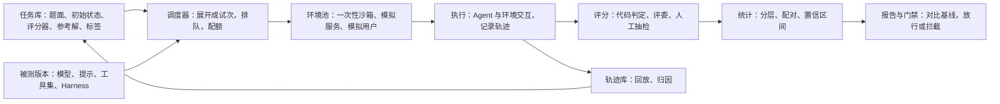

# 设计题：Agent 评测平台

> 设计题 · evaluation、harness · 限时 45 分钟 · 追问题：[questions.md](questions.md)
> 前置：[evaluation/01 评测设计](../../tracks/evaluation/01-eval-design/README.md)、[evaluation/05 线上评测与回归门禁](../../tracks/evaluation/05-online-regression/README.md)、[harness/06 Trace 与回放](../../tracks/harness/06-tracing-replay/README.md)、[training/06 训练环境](../../tracks/training/06-environments/README.md)、[core/13 系统设计方法](../../core/13-system-design/README.md)

## 1 题面

“公司里有十几个团队在做 Agent：客服、编程助手、数据分析。每个团队都自己写脚本跑评测，结果没法比，也没人敢根据分数决定上不上线。设计一个统一的 Agent 评测平台。”

这道题考的不是“跑一遍测试集”。考点在四处：**任务与环境**（每次试次能不能从干净、可复现的状态开始）、**评分器**（代码、评委、人工怎么组合，评委怎么校准）、**统计**（差 3 个点算不算提升）、**门禁**（分数怎么接进发布流程）。只画“数据集 → 跑模型 → 算准确率”一条线的回答，拿不到高分。

## 2 澄清

| 问题 | 为什么要问 | 本题假设 |
|---|---|---|
| 谁用，用来做什么 | 决定接口和报表 | Agent 开发团队；三个用途：日常迭代、发布门禁、选模型 |
| 被测的是什么 | 决定接入方式 | 被测单元是“模型 + Harness”的整体，以版本号接入 |
| 任务类型 | 决定环境种类 | 对话加工具调用、代码仓库、网页操作三类 |
| 题量和频率 | 决定算力 | 每个团队回归集约 2,000 题（假设）；每次合并跑快门禁，每天跑一次全量 |
| 每题跑几次 | 决定成本和统计口径 | 全量每题 5 个试次（假设），报 pass^k |
| 结果多快要出来 | 决定并发 | 快门禁 10 分钟内；全量 2 小时内（假设） |
| 数据是否敏感 | 决定隔离和保留 | 部分题来自线上脱敏数据；轨迹按团队隔离，有保留期限 |

问完复述：“这是一个多团队共用、要给发布决策提供可信证据的平台。可信比快更重要：环境不干净、评分器没校准、不报置信区间，分数就没人敢用。”

## 3 估算

```
一次全量（单个团队）：2,000 题 × 5 试次 = 1 万个试次
每试次（假设）：25 步，每步输入约 1.5 万 token
模型调用：1 万 × 25 = 25 万次；输入 token：25 万 × 1.5 万 ≈ 37.5 亿
沙箱：每试次约 10 分钟 → 1 万 × 10 / 60 ≈ 1,667 沙箱小时
2 小时跑完需要的并发：1,667 / 2 ≈ 830 个沙箱
轨迹存储：每试次约 10 万 token × 4 字节 ≈ 400 KB → 每次全量约 4 GB

统计分辨率：2,000 题、通过率约 50% 时，95% 区间半宽 ≈ 1.96 × sqrt(0.25 / 2000) ≈ 2.2 个点
检出 3 个点（α = 0.05 双侧，把握 80%）：
  不配对，通过率约 80%：n ≈ 7.84 × 0.32 / 0.03² ≈ 2,800 题
  配对，假设差值方差 0.1：n ≈ 7.84 × 0.1 / 0.03² ≈ 870 题
```

结论：
- 全量一次就是几十亿 token 和上千沙箱小时。平台要有**预算和配额**，快门禁只能用小题集。
- 2,000 题也只能分辨约 2 到 3 个点的差距。平台必须**默认配对比较、报置信区间**，否则团队会追噪声。
- 沙箱并发是瓶颈，要有**环境池和调度**，环境故障要和 Agent 失败分开统计。

## 4 架构



| 模块 | 职责 | 关键设计 |
|---|---|---|
| 任务库 | 存题、环境定义、评分器 | 题有版本号；每题有参考解，能通过所有评分器；带难度、场景、风险标签 |
| 被测版本 | 描述一次运行的被测对象 | 版本指纹：模型、提示、工具集、Harness、镜像，全部写进结果 |
| 调度器 | 把“题 × 试次 × 版本”展开排队 | 按团队配额；失败的环境故障自动重跑，不计入 Agent 失败 |
| 环境池 | 提供干净、可复现的初始状态 | 每个试次从干净环境开始；外部依赖用快照或模拟服务，见 [training/06](../../tracks/training/06-environments/README.md) |
| 评分 | 给试次打分 | 能用代码判的不用评委；评委先和人工校准 |
| 统计 | 把试次变成结论 | 按题聚合后算标准误；同一批题配对比较 |
| 门禁 | 接进发布流程 | 回归集不退化；高风险层单独判 |
| 轨迹库 | 存每一步，支持回放和归因 | 结构和回放方式见 [harness/06](../../tracks/harness/06-tracing-replay/README.md) |

**最简单可行版**：一个任务格式（题面、初始状态、评分器）加一个命令行，按题并行跑、记轨迹、输出分层通过率和置信区间。先接一个团队。开源的 Inspect 就是这个思路：把一次评测写成 Task，由 Dataset、Solver、Scorer 组成，支持 Docker 等沙箱，支持每题跑多个 epoch 并用 `mean`、`pass_at_k` 等 reducer 合并。可以直接用它起步，不必一开始就自建。

**什么时候升级**：

| 信号 | 升级做法 | 代价 |
|---|---|---|
| 多个团队接入，分数口径不一 | 统一任务格式和指标定义，平台出标准报表 | 要迁移各团队的旧脚本 |
| 全量跑不完 | 环境池、调度、配额；快门禁和全量分开 | 要维护资源池和优先级 |
| 团队开始按分数做发布决定 | 门禁接 CI，报配对差值和区间 | 阈值要标定，误拦会被绕过 |
| 评委分数和人工感觉对不上 | 校准集、人工抽检队列 | 持续的标注成本 |

## 5 深挖

### 5.1 任务与环境：每个试次从干净状态开始

**问题**：试次之间共享状态，失败会相互关联，分数也可能虚高。Anthropic 的评测工程文章举过例子：Agent 读到了之前试次留下的 git 历史。环境还会漂移：网页改版、依赖升级、日期过期，几个月后题就坏了。

**方案**：
- 每道题写明初始状态：镜像版本、数据库快照、文件、当前时间。每个试次从这个状态新建环境，用完销毁。
- 外部依赖分三档：能模拟就用模拟服务；要真实数据就用固定快照；必须接真实世界的题单独成集，不进硬门禁。
- 多轮对话题用模拟用户。模拟器给隐藏目标，信息被问到才说，并抽样人工检查它的错误率，见 [training/06 第 4 节](../../tracks/training/06-environments/README.md#4-用户模拟器构建与校准)。
- 环境故障单独分类：超时、容器崩溃、限流、工具 5xx。自动重跑，不计入 Agent 失败，但要统计故障率。
- 每题有参考解，CI 定期跑参考解，再跑一个什么都不做的空 Agent。参考解不过，或空 Agent 也能过，说明环境或评分器坏了，题先下线。Terminal-Bench 建题时就要求参考解能通过、空 Agent 会失败；定期重跑是本设计加的，见 [evaluation/04 第 6 节](../../tracks/evaluation/04-benchmarks/README.md#6-环境类网页桌面终端)。

**代价**：一次性环境让成本和启动时间上升，要做预热池和镜像分层。模拟服务越简单，和线上差距越大，所以要保留一份接真实工具的集合检查迁移。

### 5.2 评分器：代码优先，评委要校准

**问题**：开放输出代码判不了；评委有位置偏差、冗长偏差和自我偏好；评委的口径不校准，就只是它自己的口味。

**方案**：
- 一个题可以挂多个评分器。终态、格式、数值、工具调用参数用代码判；完整性、语气这类软指标才用评委。关键项二值且必须全过，其余加权。
- 终态为主，轨迹规则为辅。不规定工具调用顺序，只写不依赖路径的规则：禁止的工具、写操作前必须确认、步数和 token 上限，见 [evaluation/03](../../tracks/evaluation/03-trajectory-eval/README.md)。
- 评委逐项判、先给证据、允许返回“不确定”，“不确定”送人工。
- 平台维护每个评委的校准集。上线前算和人工的一致率和 kappa，拆开看放过率和误杀率；评委模型或 rubric 一改就重测，见 [evaluation/02](../../tracks/evaluation/02-llm-as-judge/README.md)。
- 评分器也有版本。换了评分器等于换了尺子，新旧分数不能直接比，要在同一批轨迹上重新评分。

轨迹库存着完整轨迹，所以换评分器时不用重跑 Agent，只需对旧轨迹重新评分。

**代价**：每加一个评委维度，成本线性增加。校准集要人工持续维护。评委被频繁使用后，团队可能开始迎合评委的措辞，要用确定性校验和人工抽检盯住。

### 5.3 统计与门禁：差 3 个点算不算提升

**问题**：题少、每题有随机性。按第 3 节的估算，2,000 题的区间半宽约 2 个点。团队拿着“涨了 2 个点”来申请上线，平台要能说清这是不是噪声。

**方案**：
- **按题聚合**。每题跑多个试次时，先算每题的平均分，再按题算标准误。把 1 万个试次当成独立样本，会低估方差。同一文档派生的题按簇算。
- **默认配对**。新旧版本跑同一批题，逐题求差。报告里列出“翻转题”：旧版对、新版错的题逐条可点开轨迹。
- **报 pass^k**。面向用户的任务看连续 k 次都成功的概率，用组合估计，不用 p̂ 取幂，见 [evaluation/01 第 5 节](../../tracks/evaluation/01-eval-design/README.md#5-指标体系)。
- **门禁分层**。主指标不低于基线减噪声范围；高风险层单独要求不退化；安全类违规是一票否决。不稳定的题标出来，移出硬门禁另行观察。
- **防过拟合**。开发集随便看，回归集卡门禁，holdout 只在关键决策前跑；holdout 被拿来调过方案，就降级为开发集，见 [evaluation/06](../../tracks/evaluation/06-eval-training-loop/README.md)。

快门禁、全量门禁、Shadow、灰度的分层和回滚条件见 [evaluation/05 第 4 节](../../tracks/evaluation/05-online-regression/README.md#4-回归评测与发布门禁)。平台负责前两关，后三关接线上系统。

**代价**：配对比较要求两边用同一题集版本和同一评分器版本，平台要锁版本。门禁太严，误报多，团队会绕过或刷题；太松，退化直接放行。阈值要用线上版本多次重跑得到的噪声范围标定，换题集时重新标定。

## 6 评测与上线

平台自己也要被评测。它的“正确”指的是：分数可信、可复现、能抓到真实退化。

| 指标 | 怎么算 |
|---|---|
| 可复现性 | 同一版本重跑多次，各层分数的波动在区间内 |
| 环境故障率 | 被判为环境故障的试次比例，按环境类型统计 |
| 评分器质量 | 每个评委和人工的 kappa、放过率、误杀率 |
| 题目健康度 | 参考解通过率；跑很多次都是 0 分的题（多半是坏题）的数量 |
| 抓退化的能力 | 故意注入已知退化的版本（例如去掉一个工具），看门禁能否拦住 |
| 和线上的一致性 | 评测分数和线上抽检、采纳率的变化方向是否一致 |
| 成本和耗时 | 每次全量的 token、沙箱小时、墙钟时间 |

接入新题集前，可以用 Agentic Benchmark Checklist 从任务设置和奖励设计两方面审一遍，见 [evaluation/04 第 7.3 节](../../tracks/evaluation/04-benchmarks/README.md#73-判分本身的可信度)。

**上线**：先接一个团队，用它的旧脚本结果做对照，确认分数口径一致；再逐个团队迁移。线上失败轨迹经归因后回流成新题，过时的题定期淘汰。

## 7 常见追问

- **为什么不直接用公开 Benchmark？** 公开题可能被训练数据见过，任务分布也和业务不同。它适合粗筛，门禁要用自建的、不公开的题。
- **评测太贵怎么办？** 快门禁用几十道高价值题；全量按天跑；每题的试次数按波动定，稳定的题少跑；轨迹存下来，换评分器时只重评不重跑。
- **团队针对评测集调提示怎么办？** 每个修复要说出对哪一类问题有效，用同类新题验证；holdout 少看；定期从线上补新题。
- **多 Agent 系统怎么接入？** 被测单元仍是整体版本；每个子 Agent 的输入输出单独记录，方便归因；和同等 token 预算的单 Agent 基线对照。
- **轨迹里有用户数据怎么办？** 题和轨迹都先脱敏；按团队隔离访问；设保留期限；导出要审计。

## 8 评分要点

| 维度 | 2 分的表现 |
|---|---|
| 澄清与估算 | 问清用途、被测单元和出结果时限；算出全量的 token、沙箱小时和并发，并算出题集能分辨多大的差距 |
| 架构 | 先给“任务格式 + 命令行 + 分层报告”的最简版，再按多团队、跑不完、接门禁等信号升级；模块职责清楚 |
| 任务与环境 | 每个试次从干净状态开始；外部依赖分档；环境故障和 Agent 失败分开；参考解定期验证 |
| 评分器 | 代码优先、终态为主；评委逐项、先证据、可返回不确定；评委有校准集，评分器有版本 |
| 统计与门禁 | 按题聚合算标准误；默认配对并列出翻转题；报 pass^k；门禁分层，高风险一票否决 |
| 权衡与可信度 | 说出平台自身怎么被评测（可复现、抓退化、和线上一致），以及防过拟合和成本控制的做法 |

## 资料

- Anthropic（Grace、Hadfield、Olivares、De Jonghe），[Demystifying evals for AI agents](https://www.anthropic.com/engineering/demystifying-evals-for-ai-agents)，2026-01
- UK AI Security Institute、Meridian Labs，[Inspect](https://inspect.aisi.org.uk/)，官方文档；[Scoring Metrics：Reducing Epochs](https://inspect.aisi.org.uk/metrics.html)，查阅于 2026-11
- Evan Miller，[Adding Error Bars to Evals: A Statistical Approach to Language Model Evaluations](https://arxiv.org/abs/2411.00640)，arXiv 2411.00640，2024-11
- Yao、Shinn、Razavi、Narasimhan，[τ-bench: A Benchmark for Tool-Agent-User Interaction in Real-World Domains](https://arxiv.org/abs/2406.12045)，arXiv 2406.12045，2024-06
- Zheng 等，[Judging LLM-as-a-Judge with MT-Bench and Chatbot Arena](https://arxiv.org/abs/2306.05685)，arXiv 2306.05685，2023-06
- Zhu 等，[Establishing Best Practices for Building Rigorous Agentic Benchmarks](https://arxiv.org/abs/2507.02825)，arXiv 2507.02825，2025-07
- Merrill 等，[Terminal-Bench: Benchmarking Agents on Hard, Realistic Tasks in Command Line Interfaces](https://arxiv.org/abs/2601.11868)，arXiv 2601.11868，2026-01
