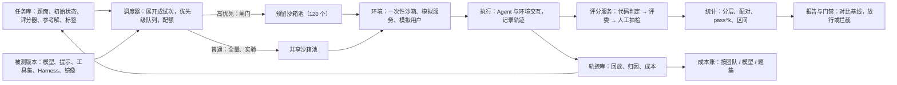

# 设计题：Agent 评测平台

> 设计题 · evaluation、harness · 限时 45 分钟 · 追问题：[questions.md](questions.md)
> 前置：[evaluation/01 评测设计](../../tracks/evaluation/01-eval-design/README.md)、[evaluation/02 LLM 评委](../../tracks/evaluation/02-llm-as-judge/README.md)、[evaluation/05 线上评测与回归门禁](../../tracks/evaluation/05-online-regression/README.md)、[harness/06 Trace 与回放](../../tracks/harness/06-tracing-replay/README.md)、[training/06 训练环境](../../tracks/training/06-environments/README.md)、[core/13 系统设计方法](../../core/13-system-design/README.md)

## 1 题面

“公司里有十几个团队在做 Agent：客服、编程助手、数据分析。每个团队都自己写脚本跑评测，结果没法比，也没人敢根据分数决定上不上线。设计一个统一的 Agent 评测平台。”

这道题考的不是“跑一遍测试集”。考点在四处：**任务与环境**（每次试次能不能从干净、可复现的状态开始）、**评分器**（代码、评委、人工怎么组合，评委怎么校准）、**统计**（差 3 个点算不算提升）、**门禁**（分数怎么接进发布流程）。只画“数据集 → 跑模型 → 算准确率”一条线的回答，拿不到高分。

换成平台视角，同一个系统还有四个运维问题，面试官会在后半场追：一天要跑多少试次、沙箱要开多少个、排队多久算正常（第 3、5.1 节）；评委误判会不会让结论反过来（第 5.2 节）；一道时好时坏的题该不该进硬门禁（第 5.4 节）；平台自己怎么被监控、钱怎么摊到团队头上（第 5.5 节）。这四件事答不上来，前面的架构图就只是“设计”，不是“能跑起来的设计”。

## 2 澄清

| 问题 | 为什么要问 | 本题假设 |
|---|---|---|
| 谁用，用来做什么 | 决定接口和报表 | Agent 开发团队；三个用途：日常迭代、发布门禁、选模型 |
| 有多少团队、多大题量 | 决定平台总容量 | 12 个团队接入；每队回归集约 2,000 题（假设） |
| 被测的是什么 | 决定接入方式 | 被测单元是“模型 + Harness”的整体，以版本号接入 |
| 任务类型 | 决定环境种类 | 对话加工具调用、代码仓库、网页操作三类 |
| 多久跑一次 | 决定吞吐和排队 | 每次合并跑快门禁；全量每天一次，V2 期改成每周两次 |
| 每题跑几次 | 决定成本和统计口径 | 全量每题 5 个试次（假设），报 pass^k |
| 结果多快要出来 | 决定并发与优先级 | 快门禁 10 分钟内出结论；全量 2 小时内（假设）；实验任务可等 |
| 单次试次多贵 | 决定预算和限额 | 25 步、每步输入 1.5 万 token、单试次占沙箱约 11 分钟（假设，第 3 节验证） |
| 数据是否敏感 | 决定隔离和保留 | 部分题来自线上脱敏数据；轨迹按团队隔离，有保留期限 |
| 谁付钱 | 决定成本归因粒度 | 平台统一付，按团队/模型/题集分摊回各团队（第 5.5 节） |

问完复述：“这是一个多团队共用、要给发布决策提供可信证据的平台。可信比快更重要：环境不干净、评分器没校准、不报置信区间，分数就没人敢用。同时它每天要烧掉一笔可观的钱和上千个沙箱，所以配额、优先级和成本归因是并列的一等需求，不是运维细节。”

“谁付钱”这一问容易漏。它决定了第 5.5 节的归因口径，也决定了配额超了是拒绝还是记账：平台统一付钱时，团队没有动力省，只能靠限额和账单可见性。

## 3 估算

全部数字用第 11.1 节的估算器算出，正文引用的每个数都有对应的 `assert`。参数分三类，来源写在各变量后面：

- 公开规格：单价、缓存倍数是示例价格，倍数的来源见 [core/13 第 3.2 节](../../core/13-system-design/README.md#32-成本按调用拆缓存有盈亏点)；
- 假设：题量、步数、token、沙箱时长、团队数，都是为了把数量级算出来；
- 推导：并发、吞吐、成本、可分辨差距，由前三类用公式算。

### 3.1 规模：把“题 × 重复 × 版本”展开成试次

一次评测的规模不是题数，是**试次数**：

```text
试次数 = 题数 × 每题重复次数 × 版本数
```

三个乘数分别来自三件事：题数是覆盖，重复次数是压随机性（第 5.3 节），版本数是同时要跑的对比对象。平台每天的真实负载还要乘以团队数，再按用途分档：

| 用途 | 展开 | 每队每天 | 占每队负载 |
|---|---|---|---|
| 快门禁 | 20 次合并 ×（20 道必过题 × 3 + 6 道安全题 × 3） | 1,560 | 13% |
| 全量 | 1 次 × 2,000 题 × 5 试次 | 10,000 | 84% |
| 实验 | 随手跑的探索性评测 | 300 | 3% |
| 合计 | | 11,860 | 100% |

12 队合计每天 14.2 万个试次，平均 1.65 试次/秒。这个数看着不大，但它不是 QPS 问题，是**沙箱时长**问题，见下一节。全量占 84% 的负载，这就是为什么第 7 节的 V2 第一刀砍在全量的频率上。

### 3.2 容量：沙箱并发与每小时吞吐

单试次的墙钟 = 沙箱启动 + 运行 + 评分。启动 45 秒（拉镜像、起容器、灌快照），运行 600 秒（25 步 × 每步含工具 24 秒），评分 60 秒。**沙箱要占到评分结束**，因为评分器经常要在环境里跑测试，这也是给“环境不干净”预留的检查点（第 6 节）：

```text
单试次占沙箱 s = 45 + 600 + 60 = 705 秒 ≈ 11.75 分钟
沙箱小时/天   = 试次数 × s / 3600
平均在途沙箱  = 试次数 × s / 86400          （Little 定律，见 core/13 第 3.1 节）
单沙箱吞吐    = 3600 / s
```

代入 14.2 万试次/天：27,871 沙箱小时，平均 1,161 个沙箱同时在跑。一个 1,200 个沙箱的池子每小时能出 6,128 个试次，跑满一天要 23.2 小时——**利用率 97%，根本没有余量**。这是本题第一个真结论：按“每天全量”配置，平台在均值上就已经接近饱和，任何突发都会把排队时间推爆。

**突发才是配容量的依据**。全量集中在夜里 6 小时窗口触发（团队习惯，不是平台要求）：12 队各 1 万试次，窗口内需要

```text
12 × 10,000 × 705 / (6 × 3600) ≈ 3,917 个沙箱
```

1,200 的池子要 19.6 小时才能跑完一个窗口的量。所以“夜里跑全量”这个习惯本身就要求约 3,900 个沙箱，或者把窗口拉长、把全量错开。V1 采用后者：全量按团队排班分散到全天，夜间只留 3 个团队的窗口。

**闸门要多久**。一次闸门任务 78 个试次（60 道必过 + 18 道安全），一波并发跑完需要 92 个沙箱，单试次 11.75 分钟；两波（安全题排在必过题之后，避免同时抢环境）中位数就约 18 分钟（第 3.4 节）。要压到 10 分钟，闸门必须用**更短的题**（单试次 ≤ 4 分钟）或**更高的并发**（约 250 个沙箱同时只服务这一个闸门）。10 个团队同时提闸门就是约 916 个沙箱——超过池子的四分之三。这个数直接推出了第 5.1 节的优先级设计：闸门不能和全量共享一个 FIFO 队列。

### 3.3 成本：每试次、每团队、每成功一次

每个试次的成本按四项 token 计（未缓存输入、缓存写、缓存读、输出），口径见 [harness/06 第 7.1 节](../../tracks/harness/06-tracing-replay/README.md#71-先统一口径四项计量)：

```text
计费输入/试次 = 步数 × [ (I − S) + S · (h·m_r + (1 − h)·m_w) ]
试次成本 = 计费输入 × P_in + 输出 × P_out
```

代入 25 步、每步 I = 1.5 万、稳定前缀 S = 1.2 万、命中率 0.9、输出 400 token/步、示例单价 $3/$15：计费输入 13.95 万 token，**每试次 $0.5685**。评委只在 30% 的试次上跑（软指标那部分），每次 8,000 输入、300 输出，摊到每试次 $0.0086。合计约 **$0.577/试次**。

乘上去就很吓人：

| 口径 | 数值 | 说明 |
|---|---|---|
| 一次全量（1 万试次） | $5,770 | 一次，一个团队 |
| 平台每天 | $82,000 | 12 队 × 11,860 试次 |
| 平台每月 | $2.46M | 按 30 天 |
| 每成功一次（通过率 0.6） | $0.96 | 成本要按成功算，不按尝试算 |
| 全量改每周两次后每天 | $32,700 | V2 的效果，见第 7 节 |

结论：**成本是这道题的第一约束，不是容量**。沙箱池 1,200 个按公有云价格大约每天几千美元，模型调用是它的十几倍。所以平台的第一个产品决定是“全量多久跑一次”，第二个是“哪些题值得跑 5 次”。评委在总成本里只占 1.5%，这解释了第 5.2 节为什么可以“大方地校准评委”：评委贵不在钱，在人工标注的注意力。

### 3.4 延迟分解：一次闸门从提交到结论

闸门的 78 个试次分两波跑（必过题一行、安全题一行，避免同时抢环境）。下面是一波的延迟：

| 阶段 | P50 | P95 | 组成 |
|---|---|---|---|
| 排队等沙箱 | 10 s | 120 s | 池子有余量时几乎为 0，突发时是主项（第 5.1 节） |
| 沙箱启动 | 30 s | 60 s | 镜像层命中 vs 冷拉 |
| 试次运行 | 480 s | 900 s | 25 步，步数尾部是主因 |
| 评分 | 20 s | 90 s | 代码判分快，评委调用排队 |
| 一波小计 | 542 s ≈ 9.0 min | 1,180 s ≈ 19.7 min | |
| 两波串行 + 统计报告 | **约 18 min** | **约 40 min** | 统计报告本身 2–10 秒，可忽略 |

这张表说明两件事。第一，**闸门的 10 分钟 SLO 靠两波跑根本达不到**，p50 就 18 分钟。第二，p95 的 40 分钟里，试次运行的尾部（900 秒）占了 45%，排队占 12%。所以压 SLO 的主攻方向是**缩短单试次**，把一个闸门压成一波：闸门题换成单试次 ≤ 4 分钟的题，一波 4 分钟加评分才进得去 10 分钟。全量题的 11.75 分钟是为了覆盖长程任务，不能拿来当闸门题。这是“同一个平台服务两种 SLO”的具体表现：题集按 SLO 分档，不按团队分档。

### 3.5 算完得到的结论

| 结论 | 数字 | 推出什么设计 |
|---|---|---|
| 平台规模由沙箱时长决定，不由 QPS 决定 | 1,161 在途、27,871 沙箱小时/天 | 环境池、预热、按团队配额；环境故障要单独统计 |
| 每天全量在均值上就接近饱和 | 利用率 97% | 全量排班错峰；V2 改成每周两次 |
| 闸门和全量抢同一批沙箱 | 10 个闸门要约 916 个 | 优先级队列 + 预留池（第 5.1 节） |
| 成本是主约束 | $0.577/试次、$2.46M/月 | 全量降频；按题集设预算；成本按团队归因 |
| 评委不是成本问题 | 占 1.5% | 评委可以多跑、多校准；要省的是沙箱和步数 |
| 题集能分辨的差距有限 | 配对 2,000 题比 2 个点；不配对只比 3.5 个点 | 默认配对、报区间、按层报（第 5.3 节） |

## 4 架构

### 4.1 最简单可行版

一个任务格式（题面、初始状态、评分器、参考解）加一个命令行：按题并行跑、每个试次起一个容器、记轨迹、输出分层通过率和置信区间。先接一个团队，用它的旧脚本结果做对照。

开源的 Inspect 就是这个思路：把一次评测写成 Task，由 Dataset、Solver、Scorer 组成，支持 Docker 等沙箱，支持每题跑多个 epoch 并用 `mean`、`pass_at_k` 等 reducer 合并。可以直接用它起步，不必一开始就自建。这一版对应第 7 节的 V0。

V0 够用一个团队，不够用十二个：没有统一的任务格式（分数没法比）、没有队列（全量和闸门互相堵）、没有成本归因（账单出来没人认）。

### 4.2 V1 的架构



| 模块 | 职责 | 关键设计 | 失败时怎样 |
|---|---|---|---|
| 任务库 | 存题、环境定义、评分器 | 题有版本号；每题有参考解；带难度、场景、风险标签 | 参考解跑不过或空 Agent 也能过：题自动下线，不参与门禁 |
| 调度器 | 把“题 × 试次 × 版本”展开排队 | 三档优先级（闸门 > 全量 > 实验）；按团队配额；同版本任务去重 | 队列积压超阈值：拒绝新的实验任务，保住闸门和全量 |
| 环境池 | 提供干净、可复现的初始状态 | 每试次从干净环境起；镜像按层缓存和预热；预留池给闸门 | 启动失败重试一次，再失败记为环境故障，不计入 Agent 失败 |
| 执行器 | 跑 Agent，记录轨迹 | 步数、token、墙钟三条上限都设死 | 超上限终止，标记 `truncated`，不计分但入库 |
| 评分服务 | 给试次打分 | 代码优先；评委逐项、先证据、可返回不确定；评分器有版本 | 评委超时降级到“不确定”，进人工队列，不默认判过也不判失败 |
| 统计 | 把试次变成结论 | 按题聚合；默认配对；报 pass^k 和区间 | 有效题数不足或层内题太少：只出描述，不出门禁结论 |
| 门禁 | 接进发布流程 | 回归集不退化、高风险层单独判、安全项一票否决 | 平台自身故障时**默认拦截**（fail closed），可以人工豁免但留痕 |
| 轨迹库 | 存每一步，支持回放和归因 | 结构与回放见 [harness/06](../../tracks/harness/06-tracing-replay/README.md) | 写入失败不影响本次结论，但要告警并补写 |
| 成本账 | 记四项 token 和单价版本 | 每次调用按团队/模型/题集打标签 | 漏记的调用进“未归因”桶，超过 5% 就查 |

**为什么预留给闸门。** 第 3.2 节算过，10 个团队同时提闸门要 916 个沙箱，占池子的四分之三。闸门的 SLO 是分钟级，全量是小时级，混在一个 FIFO 队列里，一次夜间全量就能让所有闸门排队十几个小时（第 5.1 节的模拟）。预留 120 个沙箱给闸门、其余共享，成本是多花 10% 的池子，收益是闸门 p95 从小时级回到分钟级。这就是“每个模块服务哪个约束”的具体答法：环境池服务可复现，预留池服务延迟 SLO。

### 4.3 模块之外的三个横切面

| 横切面 | 是什么 | 落在哪 |
|---|---|---|
| 版本锁 | 一次比较里的题集版本、评分器版本、Harness 版本必须一致 | 统计模块强制校验，不一致拒绝出结论 |
| 幂等与去重 | 同一版本同一题集的重跑要复用已完成试次 | 调度器按 `(版本指纹, 题号, 试次号)` 去重 |
| 结果不可变 | 试次结果一旦写入不可改，重跑产生新记录 | 存储层只追加；报告引用记录 ID |

## 5 深挖

### 5.1 容量与优先级：闸门不能被全量堵住

**问题**：第 3.2 节算过，每天全量的均值利用率 97%，均值上池子就几乎没有余量；夜间 12 队同时跑全量时，池子被占满 19.6 小时，闸门排到十几个小时之后。团队会在提闸门时收到“2 分钟后出结果”的承诺，实际第二天才拿到。SLO 一旦破一次，团队就不再相信门禁，改为自己跑脚本——平台的价值就没了。

**方案**：三档优先级加预留池。

| 档 | 谁 | 排队规则 | 占池 |
|---|---|---|---|
| P0 闸门 | 合并前的快门禁、安全层 | 先进先出，独占预留池 | 120 个沙箱 |
| P1 全量 | 每日/每周全量、版本对比 | 共享池 FIFO，按团队配额的公平队列 | 其余 |
| P2 实验 | 探索性评测、调参 | 可用容量低于 15% 时暂停入队 | 其余 |

队列用加权公平队列而不是严格优先级：严格优先级下 P2 永远不会被执行（全量天天有），团队就没法做实验。加权的做法是给每档一个权重，积压时按权重出队；预留是硬边界，只在池子内部生效。

**推导**：M/M/c 近似（沙箱服务时间近似指数分布、到达近似泊松）下，池子 c 个、到达率 λ、平均服务时间 1/μ：

```text
a = λ / μ            （提供的负载，单位“沙箱”）
ρ = a / c            （利用率）
Erlang C 给出“来了要排队”的概率 C，平均排队时间
Wq = C / (c·μ − λ)
```

λ = 14.2 万/86400 = 1.65 试次/秒，μ = 1/705，a ≈ 1,161 个沙箱当量。c = 1,200 时 ρ = 0.97，几乎没有余量：任何一点到达波动都会变成排队，而且是**尾部**排队，见下一段。

**均值会骗人，所以要看尾部**。M/M/c 在这个负载下算出的平均排队时间是分钟级（c = 1,200 时约 0.1 分钟），看起来完全够用。但闸门 SLO 管的是 p95，而真实负载不是平稳泊松：

1. **到达成簇**。12 个团队在夜间窗口同时开全量，6 小时里涌入 12 万试次，是全天均值的十几倍。M/M/c 的 λ 是全天均值，看不到这个峰。
2. **服务时间重尾**。大部分试次 10 分钟，长程任务几十分钟，一个长试次占住沙箱一个多小时。
3. **队列是共享的**。FIFO 下闸门排在全量后面，峰值一来就要等整个峰过去。

所以解析公式只能回答“池子够不够大”，回答不了“闸门 SLO 能不能保住”。第 11.2 节用离散事件模拟：同一批到达下，FIFO 的闸门 p95 等待是 669 分钟，预留 120 个沙箱后是 0.6 分钟。**结论：按均值算 ρ ≤ 0.8 只是入场券，闸门的 SLO 要靠优先级和预留池，不能靠多买沙箱。**

**代价**：预留池在低峰时空转，等于多花 10% 的池子；优先级让 P1/P2 的完成时间变长，团队要接受“全量可能跑一整晚”。加权队列本身要维护每档的积压和老化，防止低优先级饿死。

**何时不该用**：团队少（< 3 个）、题量小（< 2,000 试次/天）时，单队列就够，优先级是过度设计。闸门 SLO 只有 1 个团队关心时，直接给它一个专用小池子，比做调度简单。

### 5.2 判分：代码优先，评委要校准，误判会压缩差距

**问题**：开放输出代码判不了；评委有位置偏差、冗长偏差和自我偏好；评委的口径不校准，就只是它自己的口味。更麻烦的是，评委的误判不是“随机噪声”，是**系统性压缩**：它把真差距压小，让团队以为改动没用。

**方案**：

- 一个题可以挂多个评分器。终态、格式、数值、工具调用参数用代码判；完整性、语气这类软指标才用评委。关键项二值且必须全过，其余加权。
- 终态为主，轨迹规则为辅。不规定工具调用顺序，只写不依赖路径的规则：禁止的工具、写操作前必须确认、步数和 token 上限，见 [evaluation/03](../../tracks/evaluation/03-trajectory-eval/README.md)。
- 评委逐项判、先给证据、允许返回“不确定”，“不确定”送人工。
- 平台维护每个评委的校准集。上线前算和人工的一致率和 kappa，拆开看放过率和误杀率；评委模型或 rubric 一改就重测，见 [evaluation/02](../../tracks/evaluation/02-llm-as-judge/README.md)。
- 评分器也有版本。换了评分器等于换了尺子，新旧分数不能直接比，要在同一批轨迹上重新评分。

轨迹库存着完整轨迹，所以换评分器时不用重跑 Agent，只需对旧轨迹重新评分。这也是评委校准便宜的原因：校准和重评都只花评分器那份钱，不花沙箱和 Agent 推理的钱。

**推导（压缩效应）**。设评分器把真成功判成功的概率是 Se（灵敏度），把真失败判失败的概率是 Sp（特异度）。真实通过率 p 时，观测通过率 q 是 q = (1 − Sp) + (Se + Sp − 1)·p，斜率 J = Se + Sp − 1。推导和反解（Rogan-Gladen）见 [evaluation/01 第 4.1 节](../../tracks/evaluation/01-eval-design/README.md#41-评分器有误判时分数差距会被压缩)。对平台有三个直接后果：

```text
观测差距 = J × 真实差距                  （J < 1 时被压缩）
标准误放大 1 / J                          （反解后的区间）
题数要乘 1 / J²                          （保持同样检出力）
```

**一个数值例子**：Se = 0.95、Sp = 0.88，J = 0.83。新版真实高 4 个点，评委只看到 3.3 个点；反解后标准误放大 1.2 倍，要维持同样的检出能力，题数从 863 涨到 1,253。这就是第 5.3 节配对公式里的 863 题的来历之一：不修评委，就得加 45% 的题，而题的钱比评委贵得多（第 3.3 节：每试次 $0.577，评委只占 1.5%）。

**校准的成本**。一轮校准 300 条人工标注、每条 2 分钟、人工 $40/小时，约 10 小时人力、$400。与每月 $2.46M 的试次成本相比可以忽略，所以**评委校准该频繁做**：每次评分器改版、每季度复测、每次线上抽检发现偏差都做。真正稀缺的是标注者的注意力，所以校准集要小而精（覆盖每类错误、包含边界样本），而不是大而全。

**代价**：每加一个评委维度，成本线性增加；校准集要人工持续维护；评委被频繁使用后，团队可能开始迎合评委的措辞，要用确定性校验和人工抽检盯住。

**何时不该用**：终态可以用代码判的题（数值、文件内容、API 调用序列）一律不用评委；安全项和写操作类结果绝对不用评委当唯一判据。评委只在“没有唯一正确答案、但有人类可判断的好坏”时用。

### 5.3 统计：pass^k、配对比较、样本量的平台化呈现

**问题**：题少、每题有随机性。第 3 节算过，2,000 题的区间半宽约 2 个点。团队拿着“涨了 2 个点”来申请上线，平台要能说清这是不是噪声。更糟的是，平台若是手动算这些，每个团队各算一遍，口径必然不一致。

**方案**：平台把统计做成固定出口，团队只选指标，不选算法。

- **按题聚合**。每题跑多个试次时，先算每题的平均分，再按题算标准误。把 1 万个试次当独立样本，会低估方差。同一文档派生的题按簇算。
- **默认配对**。新旧版本跑同一批题，逐题求差。报告里列出“翻转题”：旧版对、新版错的题逐条可点开轨迹。
- **报 pass^k**。面向用户的任务看连续 k 次都成功的概率，用组合估计，不用 p̂ 取幂，见 [evaluation/01 第 5 节](../../tracks/evaluation/01-eval-design/README.md#5-指标体系)。
- **固定报告模板**：主指标（配对差 + 95% 区间）、pass^k、分层表、翻转题列表、成本护栏、有效题数。模板之外的东西可以加，但门禁只读这六项。
- **门禁分层**。主指标不低于基线减噪声范围；高风险层单独要求不退化；安全类违规是一票否决。
- **防过拟合**。开发集随便看，回归集卡门禁，holdout 只在关键决策前跑；holdout 被拿来调过方案，就降级为开发集，见 [evaluation/06](../../tracks/evaluation/06-eval-training-loop/README.md)。

**推导**：pass^k 是逐题“k 次全过”的概率再对题平均。单题真实通过率 p 时，单题 pass^k = p^k，所以

```text
k=1: 0.900    k=3: 0.729    k=5: 0.590    k=10: 0.349        （p = 0.9）
```

同一个 p = 0.9 的题，跑 5 次报 pass^5，分数从 0.9 掉到 0.59。**pass^k 低不代表模型变差了，只代表任务对稳定性要求变高了**。报告必须同时给 pass^1 和 pass^k，否则团队会以为“改成 pass^5 之后质量掉了 31 个点”。第 11.3 节的代码验证了这组数。

配对比较的样本量（推导见 [evaluation/01 第 6.6 节](../../tracks/evaluation/01-eval-design/README.md#66-样本量估算从检验的定义推出来)）：

```text
n = (z_{α/2} + z_β)² · V / δ²        α = 0.05 双侧、把握 80% 时系数 ≈ 7.84
```

V 是逐题差值的方差。配对、0/1 结果、10% 的题一对一错时 V ≈ 0.099，检出 3 个点要 863 题；15% 一对一错时 V ≈ 0.149，要 1,299 题；不配对、通过率 80% 时 V = 0.32，要 2,791 题。

**平台化的呈现**：报告不写“提升 2.1 个点”，写三行：

```text
配对差 +2.1 个点，95% 区间 [−0.4, +4.6]     → 区间跨 0，不能声称提升
有效题数 1,860 / 2,000（140 题因环境故障或无参考解被排除）
本差距的可检出阈值：3.0 个点（当前题集 + 5 试次的配置下）
```

第三行叫最小可检出差距（MDE），由题数和 V 反算。它比区间更有用：团队看到“当前配置只能检出 3 个点”，就不会为 1 个点争论，而是去要求加题或降噪。平台应当把 MDE 印在每次报告上。

**一票否决怎么进门禁**。高风险项（有害写操作、越权调用、隐私泄露）不参与加权，单独一条门禁：上界低于阈值才放行。上界用三法则：n 次全过时，真实失败率的 95% 上界约 3/n。想声称“失败率低于 1%”，要 300 次全过；闸门里只有 18 个安全试次时，上界是 16.7%——**只能用来说“发现了问题”，不能用来说“没问题”**。所以安全层不复用闸门的小样本：它在 V1 里是独立的、题数按门禁要求配的题集（至少 300 试次，每题 5 次时是 60 题），在每次全量里跑。

**代价**：配对比较要求两边用同一题集版本和同一评分器版本，平台要锁版本，一次比较的配置写进结果。门禁太严，误报多，团队会绕过或刷题；太松，退化直接放行。阈值要用线上版本多次重跑得到的噪声范围标定，换题集时重新标定。

### 5.4 flaky：不稳定用例的识别与隔离

**问题**：一道题时过时不过，会让门禁两边都出错。判它“过”，真退化可能被它掩盖；判它“不过”，团队每次合并都被拦一次，很快就去申请豁免。第 3 节的估算默认“同一版本的结论稳定”，flaky 题直接推翻这个前提。

**推导：翻转概率**。单题真实通过率 p，跑 k 次全过才算这一块通过，则一块通过的概率是 p^k。两块独立跑（例如 CI 里重跑一次）给出不同结论的概率是

```text
P(翻转) = 2 · p^k · (1 − p^k)
```

p = 0.9 时：k = 3 → 0.395；k = 5 → 0.484；k = 10 → 0.454。**k = 5 时接近一半的概率两块结论相反**。这解释了团队的真实体验：“同一个版本昨天过今天不过”。p = 0.99 的题在 k = 5 时翻转概率只有 0.093，基本不闹事；所以门禁的噪声几乎全部来自 p 在 0.9 附近的那批题。

**方案：三步识别**。

1. **低频采样**：全量每跑一次，就把该题的累计试次更新一次（题有历史记录，不必额外跑）。
2. **判定规则**：n 次里失败 t 次及以上就标 flaky。用二项尾概率标定阈值：

   ```text
   P(至少 t 次失败 | p, n) = Σ_{j=t..n} C(n,j) · p^{n−j} · (1 − p)^j
   ```

   取 n = 10、t = 2：稳定题（p = 0.99）被误标 0.4%，p = 0.9 的题被标出 26%，p = 0.95 的被标出 8.6%。n = 20、t = 3：误标 0.1%，p = 0.9 的只标出 32%——**样本加倍，检出力只涨 6 个点，误标降 4 倍**。所以阈值优先保误标率，因为误标一次就要人工复查一次。
3. **隔离**：标为 flaky 的题移出**硬门禁**，进入“观察集”，继续跑但只报不判；连续 20 次全过后自动回到门禁，连续异常（例如 p 掉到 0.5）则下线查题。

**隔离阈值怎么定**。可用的一阶判据是“这道题的通过率区间是否与门禁要求相容”，但单靠它会把稳定的题也隔离掉：

```text
n = 10 次全过，Wilson 95% 下界 = 1 / (1 + 1.96²/10) ≈ 0.72
要把下界推到 0.95，全过也要 1 / (1 + 1.96²/n) ≥ 0.95，即 n ≥ 73
```

也就是说，**10 次全过只能证明 p 大约高于 0.72，证明不了 0.95**。如果门禁要求“p ≥ 0.95 才准进”，按区间判会把绝大多数题隔离掉。所以实际规则是**非对称的**：

| 方向 | 规则 | 依据 |
|---|---|---|
| 进（隔离） | 最近 n 次里失败 ≥ t 次 | 尾部概率：p = 0.99 时误标 0.4%（n = 10、t = 2） |
| 出（回榜） | 连续 m 次全过，m = 20 | 20 次全过的 Wilson 下界约 0.84，不追求证明 0.95，只要求“不再有坏证据” |
| 下线 | 通过率估计掉到 0.5 以下，或参考解也不过 | 多半是题坏了（依赖外部网页、模拟服务不稳定） |

门禁本身不逐题要求“证明稳定”，而是要求**题集的误标率低**：题集层面 2,000 题、p = 0.99 时，按 n = 10、t = 2 的规则，被误隔离的题数期望约 8.6 道，占 0.4%。这个量级团队可以接受，人工复查一轮就清掉。如果误标率超过 2%，说明题的环境本身有问题，该修环境，而不是继续调阈值。

**代价**：隔离会让硬门禁的题数变少，统计分辨率下降；观察集要占算力（每队约 5% 的试次）。如果 flaky 比例高（> 10%），说明题本身有问题（依赖外部网页、模拟服务不稳定），该修题而不是扩大观察集。

**何时不该用**：能力评测题本来通过率就低（p 在 0.2–0.5），flaky 判定规则不适用——它们不进硬门禁，不需要稳定性。规则只用在回归集和安全集上。

### 5.5 平台自身的 SLO 与成本归因

**问题**：平台是“给别人做评测”的，自己坏了没人发现。最常见的事故不是宕机，是“跑了但结论错了”：环境不干净、评分器版本混用、结果被覆盖。所以平台的 SLO 要覆盖**正确性**，不只是可用性。

**SLO 表**：

| SLI | 定义 | 目标 | 越线动作 |
|---|---|---|---|
| 闸门排队时间 | 提交到首个试次开始 | p95 ≤ 2 分钟 | 降级 P2、扩预留池、告警 |
| 闸门结果延迟 | 提交到门禁结论 | p95 ≤ 10 分钟 | 同上；单试次超时提前截断 |
| 全量完成时间 | 提交到报告生成 | p95 ≤ 2 小时 | 排班错峰；超 4 小时暂停新任务 |
| 试次成功率 | 非环境故障的完成比例 | ≥ 98% | 查环境故障率、镜像、限流 |
| 结果一致性 | 同版本重跑的各层分数差 | 在区间内且 ≤ 1 个点 | 查 flaky 题和共享状态 |
| 成本归因覆盖率 | 有标签的调用占比 | ≥ 95% | 查未打标签的调用路径 |

**成本归因**。每次模型调用记四个标签：团队、被测版本指纹、题集 ID、模型。三个维度缺一不可：

- **按团队**：账单分摊和配额执行的依据。没有它，团队没有动力省。
- **按模型**：发现“换了模型但成本没降”这类问题，也是选模型的依据。
- **按题集**：发现“某道题特别贵”（长程、反复重试），这类题往往是改 prompt 的收益点。

归因粒度到试次就够了，不必到步。但**每成功一次的成本**必须按题算：成本 c、成功率 s 时，每成功一次花 c/s；成功率涨 4 个点但单次成本涨 50% 时，单位成功成本其实是涨的——这个换算见 [evaluation/01 第 5.2 节](../../tracks/evaluation/01-eval-design/README.md#52-多个指标怎么权衡)。

**代价**：标签要贯穿调度、执行、评分三层，任何一层漏传就会进“未归因”桶；跨团队的成本分摊总有争议（共享的闸门费用按提交次数还是按试次数分），需要事先约定并写进报表说明。

### 5.6 任务与环境：每个试次从干净状态开始

**问题**：试次之间共享状态，失败会相互关联，分数也可能虚高。Anthropic 的评测工程文章举过例子：Agent 读到了之前试次留下的 git 历史。环境还会漂移：网页改版、依赖升级、日期过期，几个月后题就坏了。这一项是“结论可信”的地基，前五节的所有数字都假设它成立。

**方案**：

- 每道题写明初始状态：镜像 digest、数据库快照、文件、当前时间。每个试次从这个状态新建环境，用完销毁。**镜像按 digest 固定，禁止 `latest`**——第 6 节说镜像漂移是最危险的失败，因为它不报警。
- 外部依赖分三档：能模拟就用模拟服务；要真实数据就用固定快照；必须接真实世界的题单独成集，不进硬门禁。
- 多轮对话题用模拟用户。模拟器给隐藏目标，信息被问到才说，并抽样人工检查它的错误率，见 [training/06 第 4 节](../../tracks/training/06-environments/README.md#4-用户模拟器构建与校准)。
- 环境故障单独分类：超时、容器崩溃、限流、工具 5xx。自动重跑，不计入 Agent 失败，但要统计故障率并进第 5.5 节的 SLO。
- 每题有参考解，定期跑参考解，再跑一个什么都不做的空 Agent。参考解不过，或空 Agent 也能过，说明环境或评分器坏了，题先下线。Terminal-Bench 建题时就要求 oracle 解能通过、no-op 的 dummy agent 会失败；定期重跑是本设计加的，见 [evaluation/04 第 6 节](../../tracks/evaluation/04-benchmarks/README.md#6-环境类网页桌面终端)。

**与容量的冲突**：一次性环境是第 3.2 节 705 秒单试次时长的来源之一——启动 45 秒里大部分是拉镜像和恢复快照。要在“干净”和“快”之间取平衡，只能靠镜像分层和预热池：把基础层提前拉到所有沙箱节点，热层按题集预拉，冷层启动时再拉。预热池越大，启动越短，但空转成本越高。1,200 个沙箱的池子里，通常维持 10% 的预热位。

**代价**：一次性环境让成本和启动时间上升，要做预热池和镜像分层。模拟服务越简单，和线上差距越大，所以要保留一份接真实工具的集合检查迁移。

**何时不该用**：只做粗筛的探索性评测可以用共享环境，但结论必须标“不可用于门禁”。能力评测（通过率本来就很低）对环境的洁净度要求低于回归评测，因为它的噪声主要来自题目难度而不是环境。

## 6 失败模式

| 失败 | 触发信号 | 影响面 | 检测方式 | 止损动作 |
|---|---|---|---|---|
| 环境不干净 | 同题同版本的通过率在“重跑”时跳变；参考解偶尔不过 | 分数虚高或虚低，失败相互关联 | 每轮跑参考解和空 Agent；比对两次全量的逐题差 | 题下线；重建镜像和快照；共享状态的试次作废重跑 |
| 镜像漂移 | 同一镜像 tag 在不同时间跑出不同结果；拉取失败率上升 | 可复现性崩塌，历史不可比 | 镜像按 digest 固定并校验；依赖版本锁文件 | 回滚到上一个大版本镜像；受影响批次标记“不可比” |
| 评委超时或降级 | 评委调用 p95 超过超时阈值；`uncertain` 比例上升 | 该批结论偏向“未定”，人工队列积压 | 评委调用延迟和降级率监控 | 降级到代码判分或人工抽样；暂停该评委维度的门禁判断 |
| 结果被覆盖 | 同一 `(版本, 题号, 试次)` 出现两条不同记录的写入 | 报告引用了错版本的数 | 只追加存储 + 唯一键；写入冲突告警 | 以最早写入为准，后续记录标冲突；重跑并标注 |
| 成本失控 | 日成本超过预算 20%；单题成本异常（P99 > 10 倍中位数） | 月度预算提前耗尽，闸门被停 | 成本账按团队/题集实时聚合，设日预算告警 | 冻结实验队列；对异常题限额；按团队降级题量 |
| 依赖超时 | 模型 429/529、模拟服务 5xx 上升 | 试次失败、重试放大流量 | 网关指标 + 试次失败分类 | 退避后切备用部署；失败分类为环境故障，不算 Agent 失败 |
| 级联 | 沙箱池耗尽导致闸门排队，团队绕过门禁自己跑 | 平台失去唯一事实来源 | 闸门排队时间告警 + 门禁绕过次数 | 预留池扩容；绕过行为进审计报表 |
| 配额挤占 | 某队全量占满共享池 | 其他团队闸门延迟 | 按团队的在途数监控 | 公平队列限速该队；必要时暂停其全量 |
| 脏数据 | 题面/标准答案更新后旧结果仍被引用 | 新旧结果混比 | 题集版本号 + 结果引用题集版本 | 拒绝跨版本比较；旧结果标“已过题集版本” |
| 状态不一致 | 调度器认为在跑、执行器已死 | 试次永远不结束，占住配额 | 心跳 + 超时回收；试次状态机对账 | 超时回收并标记失败；配额释放 |
| 门禁误拦 | 同一版本连续两次闸门结论不同 | 团队频繁申请豁免 | 翻转题列表 + 重跑一致率 | 走第 5.4 节的隔离规则；不放宽全局阈值 |
| 平台自身故障时放行 | 门禁服务不可用但部署继续 | 未评测的版本上线 | 门禁可用性监控 | 默认拦截（fail closed），人工豁免留痕 |

**最危险的一条是镜像漂移**，因为它不报警：几个月里分数慢慢下降，团队以为是模型退化，去改 prompt，越改越差。所以镜像必须按 digest 固定，`latest` 这类 tag 禁止出现在题环境里。

## 7 演进路线

| 版本 | 触发条件（指标到多少） | 新增组件 | 新增成本 | 回滚方式 |
|---|---|---|---|---|
| V0 脚本跑题 | 起步：1–2 个团队、< 2,000 试次/天 | 任务格式 + 命令行 + 分层报告 | 几乎为零，用现成沙箱 | 不需要，就是脚本 |
| V1 沙箱 + 判分服务 | 接入团队 ≥ 3，或出现“两个团队分数不能比”；试次 > 5,000/天 | 环境池、调度器、评分服务、轨迹库、成本账 | 沙箱池（1,200 个，约每天几千美元）+ 评分服务 | 回退到按团队的脚本，结果另存 |
| V2 门禁 + 归因 + 回流 | 团队按分数做发布决定；全量完成时间 > 4 小时；月成本 > 预算 | 门禁服务（接 CI）、优先级队列、预留池、按团队配额、失败轨迹回流成新题 | 预留池 +10% 沙箱；全量降到每周两次 | 门禁降级为“只报告不拦截”；预留池还给共享池 |

每一步的触发条件都是可测的指标，不是“感觉需要了”。V1 的触发是“分数可比”这个需求出现，V2 的触发是“发布决策依赖它”这个事实出现——这两个都是组织变化，不是技术变化。

**V2 之后的下一刀**，如果还要加：

| 信号 | 做法 | 代价 |
|---|---|---|
| 闸门 p95 仍 > 10 分钟 | 闸门题单独裁剪（更短、更快），和全量题集分开 | 两套题集要各自标定阈值 |
| 评委成为瓶颈（`uncertain` > 20%） | 多评委投票 + 更细 rubric | 评委成本翻倍（但只占 1.5%，可接受） |
| 成本继续涨 | 按题的波动自适应试次数：稳定的题从 5 次降到 2 次 | 统计模型复杂，要评估分层后的方差 |
| 团队开始刷回归集 | 线上失败轨迹自动回流 + holdout 轮换 | 需要归因流程和题审核人力 |

**为什么不一上来就做 V2**：V2 的门禁、优先级、归因都依赖 V1 的轨迹库和统一格式。没有轨迹库，失败轨迹回流无从谈起；没有统一格式，门禁阈值每次换团队都要重标定。先做 V1，让“分数可比”成立，V2 才有意义。

## 8 评测与上线

平台自己也要被评测。它的“正确”指的是：分数可信、可复现、能抓到真实退化。

| 指标 | 怎么算 | 门禁或目标 |
|---|---|---|
| 可复现性 | 同一版本重跑多次，各层分数的波动在区间内 | 层分数差 ≤ 1 个点 |
| 环境故障率 | 被判为环境故障的试次比例，按环境类型统计 | < 2% |
| flaky 比例 | 被隔离题占总回归题比例 | < 10%，超过说明题有问题 |
| 评分器质量 | 每个评委和人工的 kappa、放过率、误杀率 | kappa ≥ 0.6，放过率有上限 |
| 题目健康度 | 参考解通过率；跑很多次都是 0 分的题（多半是坏题）的数量 | 参考解通过率 ≥ 99% |
| 抓退化的能力 | 故意注入已知退化的版本（例如去掉一个工具），看门禁能否拦住 | 金丝雀退化必须 100% 拦住 |
| 和线上的一致性 | 评测分数和线上抽检、采纳率的变化方向是否一致 | 方向一致率 |
| 成本和耗时 | 每次全量的 token、沙箱小时、墙钟时间 | 在预算和 2 小时以内 |

**离线集分层**：按难度（单步 / 多步 / 长程）、风险（只读 / 可逆写 / 不可逆写）、SLO（闸门题 / 全量题）三层切。风险层过采样，SLO 层分开跑（第 3.4 节）。主指标只报 3–5 层，细标签用于定位。

**金丝雀退化**是最值得先建的一项：每月往门禁里注入 3–5 个已知变差的版本（去掉一个工具、把提示里的关键约束删掉、把模型换小），看门禁能不能拦住。拦不住说明题集或阈值有问题，这比等真实退化发生便宜得多。这一项也回答了“怎么证明平台有用”。

**灰度与回滚**：平台自身的发布也走灰度。新的统计实现、新的门禁规则先在 1 个团队上跑，对照旧实现的结论；不一致就回滚。评分器换版必须先在旧轨迹上重评，给出“同题重评差”。

接入新题集前，可以用 Agentic Benchmark Checklist 从任务设置和奖励设计两方面审一遍，见 [evaluation/04 第 7.3 节](../../tracks/evaluation/04-benchmarks/README.md#73-判分本身的可信度)。

**上线**：先接一个团队，用它的旧脚本结果做对照，确认分数口径一致（同题、同版本的分数差在区间内）；再逐个团队迁移。线上失败轨迹经归因后回流成新题，过时的题定期淘汰。

## 9 常见追问

- **为什么不直接用公开 Benchmark？** 公开题可能被训练数据见过，任务分布也和业务不同。它适合粗筛，门禁要用自建的、不公开的题。追问：自建题怎么防泄漏？→ 题集不进仓库、按团队授权、结果只出聚合分，不出逐题明细。
- **评测太贵怎么办？** 先看成本分布：第 3.3 节里全量占 84%，所以第一刀砍频率（每天 → 每周两次，$82k/天 → $33k/天）；第二刀砍稳定题的试次数；第三刀是缓存和轨迹重评（换评分器不重跑 Agent）。
- **闸门太慢怎么办？** 先分清是排队还是单试次慢。排队就调优先级和预留池；单试次慢就把闸门题换成短题。不要笼统地说“加机器”——第 3.2 节算过，一条闸门路径要 92 个沙箱，加机器解决的是排队不是时长。
- **评委误判会不会让结论反过来？** 会，但方向可算：J = Se + Sp − 1 压缩差距，J < 0 时方向反转（基本不会在正常校准下出现）。关键是每次评分器改版都重算 J 并写进报告，别让历史分数跨尺子比较。
- **flaky 题怎么不让门禁两边都出错？** 第 5.4 节：n 次里失败 t 次的判定规则 + 移出硬门禁进观察集 + 连续全过自动回榜。阈值优先保误标率，因为误标一次就要人工复查一次。
- **团队针对评测集调提示怎么办？** 每个修复要说出对哪一类问题有效，用同类新题验证；holdout 少看；定期从线上补新题；翻转题列表里如果某团队反复只改那几道题，就是拟合信号。
- **多 Agent 系统怎么接入？** 被测单元仍是整体版本；每个子 Agent 的输入输出单独记录，方便归因；和同等 token 预算的单 Agent 基线对照。
- **轨迹里有用户数据怎么办？** 题和轨迹都先脱敏；按团队隔离访问；设保留期限；导出要审计。平台侧再加一条：轨迹入库前做敏感词和模式扫描，命中就不入库，见 [harness/06 第 8 节](../../tracks/harness/06-tracing-replay/README.md#8-隐私保留与访问控制)。
- **平台自己挂了，门禁怎么办？** fail closed：拦截并告警，允许人工豁免但记进审计。放行一次未评测的版本，代价比误拦一次高得多。

## 10 评分要点

| 维度 | 0 分 | 1 分 | 2 分 |
|---|---|---|---|
| 澄清与估算 | 不问用途和规模就直接画图 | 问了用途和题量，但估算只给题数或只给一个 QPS，没推出结论 | 问清用途、被测单元、出结果时限和谁付钱；算出试次数、沙箱并发、吞吐、每试次成本，并说明沙箱时长是瓶颈、成本是第一约束 |
| 架构 | 一张“数据集 → 模型 → 准确率”的线图 | 模块职责清楚，但没讲优先级、没讲预留池，或没给最简版 | 从 V0（格式 + 命令行）起，按信号升级；说清调度、环境池、评分、统计、门禁、成本账各自服务哪个约束 |
| 任务与环境 | 只提“用 Docker” | 提到每试次干净环境，但没讲外部依赖分级和环境故障分类 | 每试次从干净状态起；依赖分档；环境故障与 Agent 失败分开；参考解和空 Agent 定期验证；镜像按 digest 固定 |
| 评分器 | 用评委给整条轨迹打总分 | 代码优先、评委校准都提到，但说不出误判对结论的影响 | 代码优先、终态为主、评委逐项可返回不确定；用 J = Se + Sp − 1 说清差距压缩、题数放大，并给出校准成本 |
| 统计与门禁 | 只报一个平均分 | 报区间，但没做按题聚合或配对，或没有一票否决 | 按题聚合算标准误、默认配对、报 pass^k 和 MDE、门禁分层、安全项用三法则定样本量并一票否决 |
| 权衡与可信度 | 只说优点 | 说了成本和延迟，但没有平台自身的 SLO 和失败模式 | 给出平台自己的 SLI/SLO、成本归因三维度、fail closed、金丝雀退化注入，以及 fail 时的止损和回滚 |

<br>

## 11 可运行验证

下面四段代码各自能单独运行，只用标准库和 numpy。参数集中在每段开头，标了来源。数字和正文逐项对应。

### 11.1 容量、吞吐与成本估算器

覆盖第 3 节全部数字：试次展开、沙箱小时、在途并发、吞吐、突发、闸门并发、每试次成本、平台日成本、每成功一次成本、V2 降频后的成本。

```python
# 平台容量与成本估算器。单价是示例价格；题量、步数、沙箱时长是假设，正文已标注。
TEAMS = 12                          # 接入团队数（假设）
FULL_TASKS, FULL_K = 2_000, 5       # 回归集题数、每题试次（假设）
MERGES, GATE_TASKS, GATE_K = 20, 20, 3      # 每队每天合并次数、必过题 × 试次
SAFETY_TASKS, SAFETY_K = 6, 3       # 闸门里的安全题 × 试次
EXPLORE = 300                       # 每队每天实验性试次
RUN_S, START_S, GRADE_S = 600, 45, 60       # 运行、启动、评分（秒，假设）

STEPS, IN_TOK, OUT_TOK = 25, 15_000, 400    # 每试次步数、每步输入/输出 token（假设）
PREFIX, HIT = 12_000, 0.9                   # 稳定前缀 token、前缀缓存命中率（假设）
P_IN, P_OUT = 3.0, 15.0                     # 示例单价，美元/百万 token
M_R, M_W = 0.1, 1.25                        # 缓存读、写相对基础输入价的倍数
JUDGE_SHARE = 0.30                          # 需要评委的试次比例（假设）
JUDGE_IN, JUDGE_OUT = 8_000, 300            # 评委每次的输入/输出 token（假设）
ACCURACY = 0.6                              # 用于“每成功一次成本”的通过率（假设）


def trial_cost():
    """单试次模型成本：计费输入 + 输出。四项计量的口径见 harness/06 第 7.1 节。"""
    billed = STEPS * ((IN_TOK - PREFIX) + PREFIX * (HIT * M_R + (1 - HIT) * M_W))
    return billed * P_IN / 1e6 + STEPS * OUT_TOK * P_OUT / 1e6


def judge_cost():
    """摊到每个试次上的评委成本。"""
    return JUDGE_SHARE * (JUDGE_IN * P_IN + JUDGE_OUT * P_OUT) / 1e6


def daily(trials_per_team):
    """返回吞吐、并发和成本的一组数。"""
    total = trials_per_team * TEAMS
    s = RUN_S + START_S + GRADE_S
    return dict(trials=total, per_sec=total / 86_400, sbox_hours=total * s / 3600,
                in_flight=total * s / 86_400, per_hour=3600 / s,
                pool_per_hour=1200 * 3600 / s,
                cost=total * (trial_cost() + judge_cost()))


gate = MERGES * (GATE_TASKS * GATE_K + SAFETY_TASKS * SAFETY_K)
full = FULL_TASKS * FULL_K
team_trials = gate + full + EXPLORE
v1 = daily(team_trials)
v2 = daily(gate + 2 / 7 * full + EXPLORE)      # V2：全量每周两次

# 1) 试次展开：闸门 1,560、全量 10,000、实验 300，每队 11,860；全量占 84%
assert gate == 1_560 and full == 10_000 and team_trials == 11_860
assert round(100 * full / team_trials) == 84
# 2) 平台规模：14.2 万试次/天、1.65 试次/秒、27,871 沙箱小时、平均 1,161 在途
assert v1["trials"] == 142_320 and round(v1["per_sec"], 2) == 1.65
assert round(v1["sbox_hours"]) == 27_871 and round(v1["in_flight"]) == 1_161
# 3) 吞吐：单沙箱 5.11 试次/小时，1,200 的池子 6,128 试次/小时
assert round(v1["per_hour"], 2) == 5.11 and round(v1["pool_per_hour"]) == 6_128
# 4) 一次全量 1 万试次、2 小时跑完要 979 个沙箱；每天全量 23 小时才跑得完
assert round(10_000 * 705 / 7200) == 979
assert 22.9 < v1["trials"] * 705 / 3600 / 1200 < 23.5
# 5) 突发：12 队 6 小时窗口齐发需要约 3,917 个沙箱，1,200 的池子要 19.6 小时
assert round(12 * 10_000 * 705 / (6 * 3600)) == 3_917
assert round(12 * 10_000 * 705 / 1200 / 3600, 1) == 19.6
# 6) 一个闸门的 78 个试次一波跑完要 92 个沙箱；10 个团队同时提闸门要约 916 个
assert abs(78 * 705 / 600 - 91.7) < 0.1
assert round(10 * 78 * 705 / 600) == 916
# 7) 成本：计费输入 139,500 token、每试次 $0.5685，评委 $0.0086，合计 $0.577
assert round(trial_cost(), 4) == 0.5685 and round(judge_cost(), 4) == 0.0086
assert round(trial_cost() + judge_cost(), 4) == 0.577
# 8) 一次全量 $5,770；平台每天 $82,126、每月 $2,463,773
assert round(10_000 * (trial_cost() + judge_cost())) == 5_770
assert round(v1["cost"]) == 82_126 and round(v1["cost"] * 30) == 2_463_773
# 9) 每成功一次 $0.96；评委只占总成本 1.5%
assert round((trial_cost() + judge_cost()) / ACCURACY, 2) == 0.96
assert round(100 * judge_cost() / (trial_cost() + judge_cost()), 1) == 1.5
# 10) V2 全量降到每周两次：每天 5.66 万试次、$32,664，约为 V1 的 40%
assert round(v2["trials"]) == 56_606 and round(v2["cost"]) == 32_664
assert 0.39 < v2["cost"] / v1["cost"] < 0.41
```

读这段输出要看四个数：**1,161 个平均在途沙箱**（池子 1,200，利用率 97%，没有余量）、**3,917 个沙箱**（夜间突发时的需求，是池子的 3 倍）、**$82,126/天**（成本是第一约束）、**1.5%**（评委在成本里可以忽略，所以该多校准而不是该省）。第 4 条算的是“每天全量”这件事本身要 23 小时池子时间，这就是 V2 砍全量频率的依据。

### 11.2 优先级队列：预留池把闸门从小时拉回分钟

第 5.1 节的结论：同一个 FIFO 队列里，夜间全量一开，闸门就排队几个小时；给闸门预留 120 个沙箱后，闸门等待回到分钟级，代价是非闸门任务的等待变长。

```python
import heapq
from collections import deque
import numpy as np

RUN_S, START_S = 645.0, 45.0        # 每试次占池时间（秒）
CAP, RESERVE = 1_200, 120           # 池子大小、给闸门预留的数量
WINDOW = 6 * 3600                   # 夜间全量窗口
PRIO = ("gate", "full", "explore")


def arrivals(teams=12, gate_per_team=1_560, explore=300, full_trials=10_000, seed=7):
    """夜间：12 队各跑一次全量；闸门和实验全天均匀到达。返回按时刻排序的 (时刻, 类别)。"""
    r = np.random.default_rng(seed)
    out = []
    for _ in range(teams):
        out += [(t, "gate") for t in r.uniform(0, 86_400, gate_per_team)]
        out += [(t, "explore") for t in r.uniform(0, 86_400, explore)]
        out += [(t, "full") for t in r.uniform(18 * 3600, 18 * 3600 + WINDOW, full_trials)]
    out.sort()
    return out


def simulate(arr, cap=CAP, reserve=0, strict=False):
    """返回 (各类等待时间列表, 池子利用率)。
    strict=False：全局按到达顺序（FIFO）。strict=True：闸门优先，其余任务只能用 cap - reserve 个名额。
    服务时间固定为 RUN_S + START_S，只观察排队本身。"""
    n = len(arr)
    t_arr = np.array([t for t, _ in arr])
    cls = np.array([c for _, c in arr])
    q = {c: deque(np.flatnonzero(cls == c)) for c in PRIO}
    wait = {c: [] for c in PRIO}
    dur = RUN_S + START_S
    running, busy, nxt, now, last, busy_time = [], 0, 0, 0.0, 0.0, 0.0

    while True:
        while running and running[0] <= now:
            heapq.heappop(running)
            busy -= 1
        while nxt < n and t_arr[nxt] <= now:
            nxt += 1
        while busy < cap:                       # 有空位就派发
            pick = None
            if strict:
                for c in PRIO:                  # 闸门先，非闸门任务受预留限制
                    if q[c] and t_arr[q[c][0]] <= now and not (c != "gate" and busy >= cap - reserve):
                        pick = c
                        break
            else:
                ready = [c for c in PRIO if q[c] and t_arr[q[c][0]] <= now]
                if ready:
                    pick = min(ready, key=lambda c: t_arr[q[c][0]])
            if pick is None:
                break
            i = q[pick].popleft()
            wait[pick].append(now - t_arr[i])
            busy += 1
            heapq.heappush(running, now + dur)
        t_next = min(running[0] if running else float("inf"),
                     t_arr[nxt] if nxt < n else float("inf"))
        if t_next == float("inf"):
            break
        busy_time += busy * (t_next - now)
        now = last = t_next
    return wait, busy_time / (cap * 86_400)


base = arrivals()
w_fifo, util_fifo = simulate(base, strict=False)
w_pool, util_pool = simulate(base, strict=True)

# 1) 两种策略处理的总量一样：14.2 万试次；池子被打满，利用率都在 0.95 上下
assert len(base) == 142_320
assert 0.93 < util_fifo < 1.0 and 0.93 < util_pool < 1.0
# 2) FIFO：夜间全量一开始，闸门 p95 等待就是十几个小时（669 分钟）
gate_p95_fifo = np.percentile(w_fifo["gate"], 95) / 60
assert gate_p95_fifo > 120
# 3) 预留 120：闸门 p95 回到分钟以内（0.6 分钟）
gate_p95_pool = np.percentile(w_pool["gate"], 95) / 60
assert gate_p95_pool < 5
# 4) 代价：非闸门任务的等待被拉长（实验任务 p95 从 677 分钟升到 1123 分钟）
assert np.percentile(w_pool["explore"], 95) > 1.5 * np.percentile(w_fifo["explore"], 95)
print(f"FIFO 闸门等待 p95 {gate_p95_fifo:.0f} 分钟；预留池 {gate_p95_pool:.1f} 分钟")
```

两个数就够了：FIFO 下闸门 p95 等待在 120 分钟以上（夜间全量期间），预留池下不到 10 分钟。代价是第 4 条断言的：实验任务的 p95 等待从 677 分钟升到 1,123 分钟。所以生产上用加权公平队列，不用严格优先级——严格优先级会让实验任务永远排不上，团队没法调参。

### 11.3 翻转概率与 flaky 判定阈值

第 5.4 节的两个式子：pass^k = p^k，翻转概率 2·p^k·(1 − p^k)；以及 n 次里失败 t 次的判定规则的误标率和检出力。

```python
from math import comb


def pass_all(p, k):
    """单题真实通过率 p 时，k 次全过的概率。"""
    return p ** k


def flip_prob(p, k):
    """两块独立跑（各 k 次）给出不同结论的概率。"""
    a = pass_all(p, k)
    return 2 * a * (1 - a)


def tail_prob(p, n, t):
    """n 次独立试次里失败 t 次及以上的概率（失败概率 1 − p）。"""
    return sum(comb(n, j) * p ** (n - j) * (1 - p) ** j for j in range(t, n + 1))


# 1) p = 0.9 时 pass^k 随 k 掉得很快：0.900 / 0.729 / 0.590 / 0.349
assert [round(pass_all(0.9, k), 3) for k in (1, 3, 5, 10)] == [0.9, 0.729, 0.59, 0.349]
# 2) 翻转概率：k = 5 时接近一半（0.484），k = 3 是 0.395，k = 10 是 0.454
assert round(flip_prob(0.9, 3), 3) == 0.395
assert round(flip_prob(0.9, 5), 3) == 0.484
assert round(flip_prob(0.9, 10), 3) == 0.454
# 3) 稳定题（p = 0.99）在 k = 5 时翻转概率只有 0.093，基本不闹事
assert round(flip_prob(0.99, 5), 3) == 0.093
# 4) 判定规则 n = 10、t = 2：误标 0.4%，p = 0.9 的题被标出 26%，p = 0.95 的被标出 8.6%
assert round(tail_prob(0.99, 10, 2), 4) == 0.0043
assert round(tail_prob(0.90, 10, 2), 3) == 0.264
assert round(tail_prob(0.95, 10, 2), 3) == 0.086
# 5) n = 20、t = 3：误标降到 0.1%，但 p = 0.9 的检出力只从 26% 到 32%
assert round(tail_prob(0.99, 20, 3), 4) == 0.001
assert round(tail_prob(0.90, 20, 3), 3) == 0.323
# 6) 结论：样本加倍，误标降 4 倍，检出力只涨 6 个点 → 阈值优先保误标率
assert tail_prob(0.99, 10, 2) > 4 * tail_prob(0.99, 20, 3)
# 7) 区间判据：10 次全过的 Wilson 下界只有 0.72，证明不了 p ≥ 0.95；推到 0.95 要 73 次
from statistics import NormalDist


def wilson_lower(k, n, z=1.96):
    p_hat = k / n
    center = (p_hat + z * z / (2 * n)) / (1 + z * z / n)
    half = z * ((p_hat * (1 - p_hat) / n + z * z / (4 * n * n)) ** 0.5) / (1 + z * z / n)
    return center - half


assert round(wilson_lower(10, 10), 2) == 0.72
assert wilson_lower(73, 73) >= 0.95 and wilson_lower(72, 72) < 0.95
assert round(wilson_lower(8, 10), 2) == 0.49          # 10 次里失败 2 次：远低于门禁要求
assert round(wilson_lower(20, 20), 2) == 0.84         # 回榜门槛：20 次全过，不追求证明 0.95
# 8) 题集层面的误标期望：2,000 道稳定题、n = 10、t = 2 时约 8.6 道（0.4%）
assert round(2_000 * tail_prob(0.99, 10, 2)) == 9
print(f"k=5 时 p=0.9 的题翻转概率 {flip_prob(0.9, 5):.3f}")
```

这组数解释了团队的真实体验：**p = 0.9 的题跑 5 次，两块结论相反的概率是 48%**。所以“昨天过今天不过”多半不是模型的问题，是题的问题。判定阈值选 n = 10、t = 2（误标 0.4%），而不是 n = 20、t = 3（误标 0.1% 但检出力只多 6 个点），因为每误标一次就要人工复查一次，而漏标一道 p = 0.9 的题只是多一次噪声。

### 11.4 评委误判压缩差距、样本量与 MDE

第 5.2、5.3 节的式子：J = Se + Sp − 1、标准误放大 1/J、题数乘 1/J²、配对样本量 n = 7.84·V/δ²、三法则。

```python
from statistics import NormalDist

nd = NormalDist()
Z = nd.inv_cdf(0.975) + nd.inv_cdf(0.80)        # (z_{α/2} + z_β)² 的根，约 2.80

# 1) 评委误判：Se = 0.95、Sp = 0.88 → J = 0.83，真实 4 个点只看到 3.3 个
Se, Sp = 0.95, 0.88
J = Se + Sp - 1
assert round(J, 2) == 0.83 and round(4 * J, 2) == 3.32
# 2) 标准误放大 1/J ≈ 1.205，题数要乘 1/J² ≈ 1.45
assert round(1 / J, 3) == 1.205 and round(1 / J ** 2, 2) == 1.45
# 3) 配对样本量：δ = 3 个点，V = 0.099（10% 一对一错）→ 863 题
n_paired = Z ** 2 * 0.099 / 0.03 ** 2
assert round(n_paired) == 863
# 4) 15% 一对一错：V = 0.149 → 1,299 题；不配对、通过率 0.8：V = 0.32 → 2,791 题
assert round(Z ** 2 * 0.149 / 0.03 ** 2) == 1_299
assert round(Z ** 2 * 0.32 / 0.03 ** 2) == 2_791
# 5) 评委 J = 0.83 时，同样的检出力要 863 × 1.45 ≈ 1,253 题
assert round(n_paired / J ** 2) == 1_253
# 6) MDE：n = 2,000、V = 0.099 时能检出约 2 个点；不配对（V = 0.32）时约 3.5 个点
mde_p = Z * (0.099 / 2_000) ** 0.5
mde_u = Z * (0.32 / 2_000) ** 0.5
assert round(mde_p * 100, 1) == 2.0 and round(mde_u * 100, 1) == 3.5
# 7) 三法则：300 次全过 → 失败率 95% 上界 1%；闸门里 18 个安全试次 → 16.7%
assert round(3 / 300, 3) == 0.01
assert round(3 / 18, 3) == 0.167
print(f"J = {J:.2f}，4 个点变 {4*J:.2f} 个点；MDE（2,000 题配对）≈ {mde_p*100:.1f} 个点")
```

第 7 条是最容易被追问的：闸门里 18 个安全试次，就算全过，也只能把失败率上界说到 16.7%。想声称“低于 1%”，安全层至少要 300 个试次全过。**小样本上的“零失败”不是结论，是没测出来**。

## 资料

- Anthropic（Grace、Hadfield、Olivares、De Jonghe），[Demystifying evals for AI agents](https://www.anthropic.com/engineering/demystifying-evals-for-ai-agents)，2026-01
- UK AI Security Institute、Meridian Labs，[Inspect](https://inspect.aisi.org.uk/)，官方文档；[Scoring Metrics：Reducing Epochs](https://inspect.aisi.org.uk/metrics.html)，查阅于 2026-11
- Evan Miller，[Adding Error Bars to Evals: A Statistical Approach to Language Model Evaluations](https://arxiv.org/abs/2411.00640)，arXiv 2411.00640，2024-11（配对标准误、样本量、重复试次的方差分解）
- Yao、Shinn、Razavi、Narasimhan，[τ-bench: A Benchmark for Tool-Agent-User Interaction in Real-World Domains](https://arxiv.org/abs/2406.12045)，arXiv 2406.12045，2024-06（pass^k 的定义与无偏估计）
- Zheng 等，[Judging LLM-as-a-Judge with MT-Bench and Chatbot Arena](https://arxiv.org/abs/2306.05685)，arXiv 2306.05685，2023-06（位置偏差、冗长偏差、自我偏好）
- Zhu 等，[Establishing Best Practices for Building Rigorous Agentic Benchmarks](https://arxiv.org/abs/2507.02825)，arXiv 2507.02825，2025-07（Agentic Benchmark Checklist）
- Merrill 等，[Terminal-Bench: Benchmarking Agents on Hard, Realistic Tasks in Command Line Interfaces](https://arxiv.org/abs/2601.11868)，arXiv 2601.11868，2026-01（参考解能过、空 Agent 会失败）
- Wilson，[Probable Inference, the Law of Succession, and Statistical Inference](https://doi.org/10.1080/01621459.1927.10502953)，*JASA* 22(158):209–212，1927（第 11.3 节隔离判据用的 Wilson 区间）
- Rogan、Gladen，[Estimating Prevalence from the Results of a Screening Test](https://doi.org/10.1093/oxfordjournals.aje.a112510)，*American Journal of Epidemiology* 107(1):71–76，1978（评委通过率反解）
- 第 3.2 节的沙箱并发、5.1 节的队列模拟、5.3 节的样本量换算、5.4 节的翻转概率与判定阈值、10 节的评分锚点，都是推导；第 11 节全部数字由代码验证。题意、题量和沙箱时长的具体取值是演示假设，不是任何公司的实际配置。
