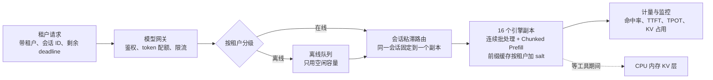

# 设计题：多租户 Agent 推理服务

> 设计题 · inference、harness · 限时 45 分钟 · 追问题：[questions.md](questions.md)
> 前置：[inference/01 KV Cache 与显存估算](../../tracks/inference/01-kv-cache-memory/README.md)、[inference/02 批处理与 PD 分离](../../tracks/inference/02-batching-pd/README.md)、[inference/05 面向 Agent 的推理](../../tracks/inference/05-agent-serving/README.md)、[harness/05 模型网关](../../tracks/harness/05-gateway-reliability/README.md)、[core/13 系统设计方法](../../core/13-system-design/README.md)

## 1 题面

“你有 16 张 H100，要用一个开源 8B 模型给公司内三个业务提供推理：一个编码 Agent、一个客服 Agent、一个离线评测任务。前两个是多轮 Agent 流量，要满足首 token 和出字速度的 SLO。设计这个推理服务。”

这道题的考点不在“装一个 vLLM”。面试官想看三件事：**容量账**（KV 显存能放多少会话，Prefill 和 Decode 各要多少卡）、**前缀复用**（Agent 多轮的成本大头在重复 Prefill）、**租户隔离**（离线任务不能拖垮在线 SLO，缓存不能跨租户泄露）。

## 2 澄清

| 问题 | 为什么要问 | 本题假设 |
|---|---|---|
| 模型和精度 | 决定权重和每 token KV | Qwen3-8B，BF16，单卡一个副本（TP=1） |
| 硬件 | 决定显存、带宽、算力 | 2 台机器 × 8 张 H100 SXM 80 GB，共 16 张 |
| 流量形态 | Agent 和聊天负载差别很大 | 在线两个租户合计高峰每秒 3 个任务；每个任务 10 轮模型调用 |
| 每轮的 token | 决定 Prefill 和 KV | 系统提示加工具定义 6,000 token；每轮新增 1,500 token；每轮输出约 300 token |
| 工具等待 | 决定会话在显存里空闲多久 | 每轮模型约 3 秒，之后等工具平均 5 秒 |
| SLO | 决定调度和要不要分离 | 在线租户 TTFT P95 ≤ 1 秒，TPOT P95 ≤ 50 ms；离线评测只要求当天跑完 |
| 隔离要求 | 决定缓存和配额怎么做 | 不同租户的数据和缓存不能互相看到；每个租户有 token 配额 |

问完复述：“这是一个前缀很长、输出很短、中间要等工具的多轮负载，在线和离线混部，SLO 只约束在线租户。”

## 3 估算

模型配置和 KV 公式见 [inference/01 第 3 节](../../tracks/inference/01-kv-cache-memory/README.md#3-显存估算权重kv激活)，Prefill 和 Decode 的下界算法见 [inference/02 第 4 节](../../tracks/inference/02-batching-pd/README.md#4-prefill-与-decode-的计算特点)。

```
单卡 KV 预算（沿用 inference/01 的假设：引擎用 90%，预留 4 GB）：
  72 − 16.4（权重）− 4 ≈ 51.6 GB
每 token KV：2 × 36 × 8 × 128 × 2 B = 147,456 B

一个任务的上下文：第 k 轮 = 6,000 + 1,500 × (k − 1)，最后一轮 19,500 token
  平均上下文 ≈ (6,000 + 19,500) / 2 = 12,750 token
  一个会话平均占 KV：12,750 × 147,456 ≈ 1.88 GB
  单卡能常驻：51.6 / 1.88 ≈ 27 个会话

在途会话（Little 定律）：
  每个任务停留 10 × (3 + 5) = 80 秒
  3 任务/秒 × 80 秒 = 240 个会话
  全部常驻要 240 / 27 ≈ 9 张卡的 KV；16 张卡总预算约 826 GB，需求约 451 GB
  同时在跑模型的调用：30 次/秒 × 3 秒 = 90 个，其余 150 个在等工具

Prefill（按 H100 稠密 BF16 约 990 TFLOPS、有效利用率 50% 假设）：
  单卡 ≈ 990e12 × 0.5 / (2 × 8.2e9) ≈ 3 万 token/秒
  模型调用 30 次/秒
  不复用：30 × 12,750 = 382,500 token/秒 → 约 12.7 张卡
  完美复用（每轮只算新增 1,500 token，首轮 6,000 token，平均 1,950）：
          30 × 1,950 = 58,500 token/秒 → 约 1.9 张卡

Decode：30 × 300 = 9,000 token/秒
  每卡在途约 90 / 16 ≈ 6 个请求
  一步要读权重加 KV：(16.4 GB + 6 × 1.88 GB) / 3.35 TB/s ≈ 8.3 ms
  每卡约 6 / 8.3 ms ≈ 730 token/秒，16 卡约 1.2 万 token/秒
TTFT 下界：命中前缀只算 1,950 token ≈ 65 ms；全部未命中 12,750 token ≈ 0.42 秒
```

结论有三条：

1. **前缀复用决定要几张卡做 Prefill**：复用与否差 12.7 和 1.9 张卡。命中率是容量指标，不是锦上添花。
2. **KV 能放下，但很紧**：全部会话常驻要占一半以上的 KV 预算，等工具的 150 个会话最容易被淘汰。
3. **TPOT 有余量，TTFT 靠命中**：Decode 每步约 8 ms，离 50 ms 很远；未命中的长请求 TTFT 才可能超标。

这些都是下界估算。上线前要用真实流量压测。

## 4 架构



| 模块 | 职责 | 关键设计 |
|---|---|---|
| 模型网关 | 鉴权、配额、限流 | 请求桶加 token 桶，按实际用量退还，见 [harness/05 第 3 节](../../tracks/harness/05-gateway-reliability/README.md#3-配额与限流) |
| 租户分级 | 区分在线和离线 | 在线高优先级；离线只在队列空闲时放入，可被抢占 |
| 路由 | 把同一会话发到同一副本 | 先用会话粘滞，副本过载时退回最少负载，见 [inference/05 第 5 节](../../tracks/inference/05-agent-serving/README.md#5-会话粘滞与-kv-复用) |
| 引擎副本 | 批处理和前缀缓存 | 单卡一个副本；`max_num_batched_tokens` 偏小保 TPOT |
| KV 分层 | 接住等工具的会话 | 显存不够时换到 CPU，不直接丢 |
| 计量与监控 | 计费和容量规划 | 按租户记未缓存输入、缓存命中、输出 token |

**最简单可行版本**：16 个独立副本，网关做会话粘滞和配额，引擎开前缀缓存和 Chunked Prefill。上面的估算说明它在假设流量下够用。

**什么时候升级**：

| 信号 | 升级 | 理由 |
|---|---|---|
| 命中前缀的会话 TTFT 也超标，且长 Prefill 让 TPOT 抖动 | PD 分离 | 两阶段分别配卡；但本题命中后 Prefill 很轻，先确认干扰来源，见 [inference/02 第 8 节](../../tracks/inference/02-batching-pd/README.md#8-怎么选) |
| 不同会话共享系统提示多，粘滞命中仍低 | 前缀感知路由 | 选缓存了最长前缀的副本 |
| KV 不够，等工具的会话频繁被淘汰 | FP8 KV、CPU 层扩容 | 每元素减半，并发约翻倍；要回归长上下文任务 |
| 低负载时段 TPOT 是体验瓶颈 | 投机解码，按负载开关 | 大 batch 时收益变小，见 [inference/03 第 6 节](../../tracks/inference/03-speculative-decoding/README.md#6-和大批量服务的冲突) |
| 单会话上下文超过单卡 KV | TP=2 或换长上下文部署 | 一条 128K 会话约 19.3 GB |

## 5 深挖

### 5.1 前缀复用：命中率怎么保住

**问题**：估算里的 85% 节省有两个前提：每轮前缀逐 token 不变；等工具的 5 秒里缓存没被淘汰。多副本时还有第三个：下一轮要回到同一个副本。

**方案**：
- **Harness 侧保前缀稳定**：系统提示和工具定义固定顺序，时间戳、请求 ID 放到末尾，历史只追加不改写，见 [inference/05 第 5 节](../../tracks/inference/05-agent-serving/README.md#5-会话粘滞与-kv-复用)。这条要写进接入规范，否则业务方一改提示，命中率就掉。
- **路由侧保同副本**：网关按会话 ID 粘滞。副本故障或过载时迁移会话，接受一次完整 Prefill。
- **引擎侧保不被淘汰**：等工具的会话引用计数为 0，处在可淘汰状态。显存紧时把它的块换到 CPU 内存。150 个等待会话约 282 GB，两台机器的主机内存通常放得下（主机内存大小是假设）。换回的代价远低于重算：重算 12,750 token 约 0.42 秒。
- **把命中率当容量指标监控**：按租户看“命中的 prompt token / prompt token 总数”。命中率从 85% 掉到 50%，Prefill 需求变成约 6.3 张卡，是原来的 3 倍多。

**代价**：粘滞会造成热点，一个副本上碰巧聚集多个长会话就会过载；CPU 层要引擎支持，换入换出占 PCIe 带宽；工具等待时间长于几分钟时，换出也不划算，直接接受重算。

### 5.2 租户隔离：SLO、配额和缓存

**问题**：离线评测一次塞进大量长 prompt，会占满 batch 和 KV，在线租户的 TTFT 和 TPOT 一起变差。共享的前缀缓存还可能让一个租户推断另一个租户的内容。

**方案**：
- **准入**：网关给每个租户一个 token 桶，在线租户的配额按 SLO 下的容量分，离线租户拿剩余部分。超配额直接 429，不进引擎队列。
- **调度优先级**：vLLM 的 `--scheduling-policy priority` 按请求的优先级值调度，值越小越先处理，同值按到达顺序。在线请求给高优先级，离线给低优先级。显存不够需要抢占时，先抢占离线请求（这是本设计的策略，要确认引擎版本的抢占顺序）。
- **限制单步 Prefill**：`max_num_batched_tokens` 设小，长 Prefill 被切块，不会让同一步的 Decode 卡住，见 [inference/02 第 6 节](../../tracks/inference/02-batching-pd/README.md#6-chunked-prefill)。
- **离线和在线分开计 SLO**：离线只看完成时间，可以集中到夜间，或固定放到两三张卡上跑。
- **缓存隔离**：按租户给请求加 `cache_salt`，只有同一个 salt 的请求能复用缓存块，见 [harness/03 第 6 节](../../tracks/harness/03-sandbox-permissions/README.md#6-多租户隔离)。代价是不同租户之间即使系统提示相同也不能共享，这里本来就不同，损失很小。

**代价**：抢占离线请求会丢掉它的 KV，重跑浪费算力；静态配额会让空闲配额闲置，可以允许离线租户借用、在线回来时归还；优先级调度会让离线请求饿死，要设最长等待时间或保底份额。

### 5.3 卡怎么分：混部还是分离

**问题**：16 张卡要同时承担 Prefill、Decode、离线任务。分得不对，要么 TTFT 超标，要么卡闲着。

**方案**：先混部。按第 3 节，复用后 Prefill 只要约 2 张卡的算力，Decode 每卡只有 6 个请求，混在一起干扰小。拿到真实流量后按 goodput 评估：同时满足 TTFT 和 TPOT 的请求速率。只有当长 prompt 占比上升、命中率下降，Chunked Prefill 也压不住 TPOT 尾部时，再考虑同节点内的 PD 分离，走 NVLink 传 KV。

**代价**：PD 分离每次要传 KV。一条 12,750 token 的上下文约 1.88 GB，按 inference/02 的网络口径，100 Gb/s 要约 0.15 秒，直接加到 TTFT 上。还要维护两类实例和两套调度。本题的负载不值得一开始就做。

## 6 评测与上线

**离线压测**：
- 从各租户脱敏后的真实轨迹里抽样回放，保留轮数、每轮 token 和工具等待时间的分布，不用均匀随机的合成请求。
- 逐步加压，记录 goodput 曲线：在 SLO 内的最大任务到达率。
- 单独测三种坏情况：离线任务突增、一个副本宕机后会话迁移、工具等待变长到分钟级。

**线上指标**：

| 指标 | 怎么看 |
|---|---|
| TTFT、TPOT | 按租户分 P50、P95、P99；在线租户对 SLO 报警 |
| 前缀命中率 | 按租户看命中 token 比例；突然下降先查业务是否改了提示 |
| KV 占用和淘汰 | 看被淘汰后又回来的会话比例 |
| 抢占次数 | 离线被抢占多是正常的；在线被抢占要报警 |
| 每任务 token 和成本 | 按租户汇总，用于配额和计费 |

**灰度与回滚**：引擎版本和调度参数按副本灰度，先切 1-2 个副本，比较同时段的 TTFT 和命中率。量化或 FP8 KV 这类会改变输出的改动，先跑各租户的任务评测，再灰度，见 [inference/04 第 8 节](../../tracks/inference/04-quantization/README.md#8-量化对-agent-能力的影响)。回滚靠保留旧版本副本和路由开关。

## 7 常见追问

- **为什么不用 TP=8 跑一个大副本？** 8B 模型单卡放得下。TP 每层都要通信，小模型上通信占比高；16 个独立副本故障面也更小。
- **一个租户要跑 128K 上下文怎么办？** 一条会话约 19.3 GB KV，单卡只能放两条。给它单独的副本组，必要时 TP=2，配额单独算。
- **客户想用自己的 LoRA？** 同一副本加载多个 LoRA。前缀缓存的块哈希包含 LoRA ID，不同 LoRA 不会误用彼此的缓存。
- **流量翻倍怎么办？** 先看哪项先到上限：KV 常驻、Prefill 还是 Decode。按本题假设，KV 会最先吃紧，先做 FP8 KV 和 CPU 层，再加卡。
- **网关和引擎各管什么？** 网关管准入、配额、路由、计量；引擎管批处理、缓存、抢占。重试只放在网关一层，见 [harness/05 第 5 节](../../tracks/harness/05-gateway-reliability/README.md#5-熔断降级与故障恢复)。

## 8 评分要点

面试官大致按下面打分，每项 0-2 分：

| 维度 | 2 分的表现 |
|---|---|
| 澄清与估算 | 问出轮数、每轮 token、工具等待和 SLO；算出单卡 KV 能放几个会话、在途会话数、复用前后的 Prefill 卡数 |
| 架构 | 先给独立副本加会话粘滞的最简方案，按信号说出什么时候上 PD 分离、FP8 KV、投机解码 |
| 前缀复用 | 说出命中的三个前提（前缀稳定、同副本、不被淘汰），以及等工具时的淘汰问题和换出方案 |
| 租户隔离 | 配额准入、优先级调度、离线可抢占、缓存按租户加 salt，四项都提到 |
| SLO 与调度 | 说清 TTFT 和 TPOT 分别由什么决定，Chunked Prefill 的参数怎么影响两者，用 goodput 评估 |
| 权衡 | 每个升级都说出代价，例如粘滞造成热点、PD 分离的 KV 传输、抢占浪费算力 |

## 资料

- vLLM，[Engine Arguments](https://docs.vllm.ai/en/latest/configuration/engine_args.html)（`--scheduling-policy`、`--kv-cache-dtype`、`--max-num-seqs`），2026-11 查阅
- vLLM，[Automatic Prefix Caching 设计文档](https://docs.vllm.ai/en/latest/design/prefix_caching.html)，2026-11 查阅
- Zhong 等，[DistServe: Disaggregating Prefill and Decoding for Goodput-optimized Large Language Model Serving](https://arxiv.org/abs/2401.09670)，arXiv 2401.09670，2024-01
- Zheng 等，[SGLang: Efficient Execution of Structured Language Model Programs](https://arxiv.org/abs/2312.07104)，arXiv 2312.07104，2023-12
- Qwen 团队，[Qwen3-8B 模型卡与 config.json](https://huggingface.co/Qwen/Qwen3-8B)，Hugging Face，2026-11 查阅
- NVIDIA，[H100 Tensor Core GPU 产品页](https://www.nvidia.com/en-us/data-center/h100/)，2026-11 查阅
