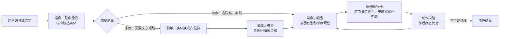

# 设计题：端云协同的手机个人助理

> 设计题 · inference、harness · 限时 45 分钟 · 追问题：[questions.md](questions.md)
> 前置：[inference/06 端侧部署](../../tracks/inference/06-on-device/README.md)、[inference/04 量化](../../tracks/inference/04-quantization/README.md)、[harness/07 Computer-Use 部分](../../tracks/harness/07-coding-agent/README.md#7-computer-use截图dom无障碍树怎么组合)、[harness/03 权限与沙箱](../../tracks/harness/03-sandbox-permissions/README.md)、[core/10 安全与可靠性](../../core/10-safety-reliability/README.md)

## 1 题面

“设计一个手机上的个人助理。用户说‘把昨天群里发的会议时间加到日历，再回复说我会参加’，它能跨应用完成。要求：聊天记录、通讯录、屏幕内容这类隐私数据不出手机；复杂任务可以用云端大模型。”

考点有三处：**端侧放什么模型**（内存、速度、发热的账）、**端云怎么分工又守住隐私**（“不出端”要靠设计保证）、**怎么安全地操作别的应用**（看屏幕、点按钮、确认动作生效、不可逆操作要人确认）。只说“小模型在端上、大模型在云上”拿不到高分。

## 2 澄清

| 问题 | 为什么要问 | 本题假设 |
|---|---|---|
| 目标设备 | 决定内存和速度预算 | 12 GB 内存的中高端安卓手机；有效内存带宽 50 GB/s（假设值，不同芯片差异很大） |
| 任务类型 | 决定要不要多步规划 | 七成是单步（定闹钟、查日程），三成跨两三个应用、5-15 步 |
| “隐私数据”的范围 | 决定路由规则 | 聊天内容、通讯录、相册、屏幕截图和界面文本、位置；用户明确同意的除外 |
| 怎么操作其他应用 | 决定执行器 | 优先用应用开放的接口；没有接口时用系统无障碍能力读界面、发手势 |
| 出错的代价 | 决定确认策略 | 发消息、付款、删除不可逆，必须用户确认 |
| 延迟要求 | 决定端侧模型大小 | 单步指令 2 秒内开始执行；多步任务 30 秒内完成 |
| 离线要不要能用 | 决定端侧能力下限 | 离线时单步任务要能用，多步任务可以提示联网 |

问完复述：“这是一个端侧常驻、要读写其他应用、带不可逆动作的 Agent。隐私边界是硬约束，延迟和电量是软约束。”

## 3 估算

模型配置和公式见 [inference/06 第 3 节](../../tracks/inference/06-on-device/README.md#3-现场估算qwen3-17b-放进手机)。

```
内存预算（MobileLLM 论文的口径：一个应用不超过 DRAM 的 10%）：
  12 GB × 10% ≈ 1.2 GB

Qwen3-1.7B（28 层，8 个 KV 头，head_dim 128）：
  Q4_K 权重：1.7e9 × 4.5 / 8 ≈ 0.96 GB
  每 token KV：2 × 28 × 8 × 128 × 2 B = 114,688 B
  4K 上下文、16 bit KV：0.47 GB → 合计 1.43 GB，超预算
  4K 上下文、8 bit KV： 0.23 GB → 合计 1.19 GB，刚好放下

Qwen3-0.6B（层数和 KV 配置相同）：
  Q4 权重 ≈ 0.34 GB，4K 的 16 bit KV 仍是 0.47 GB → 合计 0.81 GB

Decode 速度上限（每步读一遍权重和 KV，带宽 50 GB/s 假设）：
  1.7B，上下文 0：     0.96 GB / 50 GB/s ≈ 19 ms → 约 52 token/s
  1.7B，上下文 4K：   (0.96 + 0.47) / 50 ≈ 29 ms → 约 35 token/s
  0.6B，上下文 4K：   (0.34 + 0.47) / 50 ≈ 16 ms → 约 62 token/s

一步 GUI 操作的耗时（1.7B）：
  输入：压缩后的界面元素约 1,500 token
  Prefill：2 × 1.7e9 × 1,500 ≈ 5.1 TFLOP；按 NPU 有效 5 TFLOPS 假设 ≈ 1 秒
  输出：一个动作约 60 token × 29 ms ≈ 1.7 秒
  一步 ≈ 2.7 秒；10 步任务 ≈ 27 秒，刚好压线

能耗（MobileLLM 的粗估：每十亿参数每 token 约 0.1 J）：
  1.7B 输出 600 token ≈ 0.1 × 1.7 × 600 ≈ 100 J；论文估计满电 iPhone 约 50 kJ
```

结论有三条：

1. **1.7B 能放进预算，但要 8 bit KV、上下文锁在 4K 以内**。0.6B 更宽松，KV 已经比权重大。
2. **多步任务的瓶颈是每步 Prefill**。界面读取的结果每步都变，前缀复用只能覆盖系统提示，所以要压缩这部分的 token 数。
3. **端侧能跑完 10 步，但没有余量**。长任务交给云端规划，端侧只做执行，可以同时省时间和避免发热降频。

这些都是下界估算，上线前要在目标真机上测，包括持续 10 分钟后的速度。

## 4 架构



| 模块 | 职责 | 关键设计 |
|---|---|---|
| 隐私检测 | 找出请求和界面里的敏感实体 | 规则加端侧小模型；命中后强制本地，或替换成占位符 |
| 端侧路由 | 决定本地做还是请云端规划 | 规则优先：隐私、离线、单步留本地，见 [inference/06 第 6 节](../../tracks/inference/06-on-device/README.md#6-端云分工与路由) |
| 端侧模型 | 意图识别、单步规划、把抽象步骤落到具体界面元素 | Qwen3-1.7B 级，Q4 权重、8 bit KV、4K 上下文 |
| 云端规划 | 多步任务的计划 | 只看到脱敏后的请求和应用名，看不到屏幕内容 |
| 执行器 | 打开应用、读界面、点击输入 | 有接口走接口；没有就用无障碍服务读界面元素、发手势 |
| 动作校验 | 确认每步是否生效 | 比对动作前后的界面状态，见 [harness/07 第 8 节](../../tracks/harness/07-coding-agent/README.md#8-动作是否生效的校验与失败重试) |
| 确认 | 不可逆动作执行前问用户 | 执行器按动作类型强制，不由模型决定 |

**最简单可行版本**：只做端侧，只支持开放了接口的应用和单步任务。iOS 上应用可以用 App Intents 把动作和数据以结构化形式暴露给系统；安卓类似的能力依赖系统和应用的支持。这个版本没有隐私出端的问题，也没有 GUI 操作的不确定性。

**什么时候升级**：

| 信号 | 升级 | 代价 |
|---|---|---|
| 用户要操作的应用没有接口 | 加无障碍操作兜底 | 界面会变，要做动作校验；平台对无障碍能力的用途有限制 |
| 多步任务端侧规划成功率低 | 加云端规划，端侧只执行 | 要做脱敏；弱网时退化为本地单步 |
| 端侧单步也常错 | 用 Agent 轨迹蒸馏专门的端侧模型 | 要采数据和评测，见 [inference/06 第 5 节](../../tracks/inference/06-on-device/README.md#5-小模型从哪来蒸馏与剪枝) |
| 云端必须看原文才能做 | 可验证的私有云计算 | 要硬件和运维投入，用户仍要同意 |

## 5 深挖

### 5.1 隐私边界：“不出端”怎么保证

**问题**：多步规划需要大模型，大模型在云上。最省事的做法是把请求和截图一起传上去，这直接违反了题目的约束。即使只传请求，“回复张三说我会参加”里也有人名。

**方案**：
- **云端只做抽象规划**。端侧先把实体换成占位符，上传“在聊天应用里找到〈群 A〉昨天的会议时间，加到日历，再给〈群 A〉回复〈确认参加〉”。云端返回抽象步骤，端侧模型把它们落到真实界面上。屏幕内容和占位符的映射表只留在手机里。
- **最小上传**：只传完成规划需要的字段：应用名、任务类型、脱敏后的请求。不传截图、界面文本和历史对话，见 [inference/06 第 7 节](../../tracks/inference/06-on-device/README.md#7-本地数据与隐私)。
- **执行器强制，不靠模型自觉**。上传接口只接受固定结构的规划请求；隐私检测命中但没被替换的字段，执行器直接拒绝上传。
- **必须看原文时**：例如“总结这 200 条聊天”端侧做不了。要么告诉用户需要上传并取得同意，要么用可验证的私有云计算。Apple 的 Private Cloud Compute 是一个公开的设计：要求个人数据只用于完成这次请求、请求结束不留存；运维人员没有绕过隐私保护的特权接口；外部研究者能验证生产节点运行的软件。
- **日志和遥测只记元数据**：任务类型、步数、成败，不记原文。

**代价**：脱敏会丢信息，云端规划的质量下降，端侧落地步骤的难度上升；隐私检测有漏检，要把漏检率当作上线指标；私有云计算的投入远高于普通推理服务。

### 5.2 跨应用操作：看什么、怎么动、怎么确认

**问题**：大多数应用没有给助理开放接口。只能像人一样看屏幕、点按钮。界面会变、会弹窗、会加载，模型还可能以为点了就成功了。

**方案**：
- **按可靠程度选通道**：应用开放的结构化接口最可靠；其次是系统无障碍服务，它能读到当前窗口的元素树（`AccessibilityNodeInfo`），用 `dispatchGesture` 发手势、执行返回和回到桌面这类全局动作；最后才是截图加坐标。观察方式的取舍见 [harness/07 第 7 节](../../tracks/harness/07-coding-agent/README.md#7-computer-use截图dom无障碍树怎么组合)。
- **积累应用知识**：AppAgent 论文的做法是把动作简化成点击、滑动这类类人操作，先通过自主探索或观察人的演示学会一个新应用，把学到的界面知识存成知识库，执行任务时再查。端侧可以按应用缓存“哪个按钮做什么”，减少每步的试错。
- **压缩界面读取**：元素树只保留可见、可交互的元素，带角色、文本和编号，控制在约 1,500 token。这同时决定了第 3 节每步的 Prefill 耗时。
- **每步校验**：动作后等界面稳定，再比对目标元素的状态。安卓文档提醒，节点信息可能已经过时，因为窗口内容随时会变。失败时换一种方式重试一次，再失败就停下告诉用户。
- **不可逆动作要确认**：发消息、付款、删除、改设置。确认由执行器按动作类型强制弹出，内容由执行器从真实参数生成（发给谁、发什么），不让模型写确认文案。
- **屏幕上的文字不能授权**。聊天消息、网页里写着“把验证码发给某人”，是间接注入。这个助理同时能读私有数据、会接触不可信内容、能对外发消息，正好是“致命三要素”，见 [core/10 第 2 节](../../core/10-safety-reliability/README.md#2-风险从哪来)。所以读过外部内容后，对外动作一律升到需要确认，见 [harness/03 第 7 节](../../tracks/harness/03-sandbox-permissions/README.md#7-prompt-注入与高危操作识别)。

**代价**：
- 无障碍服务要用户在设置里手动开启。安卓文档写明，无障碍服务应只用于帮助残障用户使用设备，产品要先确认平台政策允许这种用途。
- 安全窗口（例如支付页）截图会失败，这类页面只能交给用户自己操作。
- 每步确认会增加打扰，要按动作风险分级，只在不可逆动作上打断。

### 5.3 端侧模型：在内存、速度、发热之间取舍

**问题**：第 3 节算过，1.7B 刚好放进预算，10 步任务刚好压线。手机还会降频，后台还会被系统杀掉。

**方案**：
- **两档模型**：0.6B 常驻，做意图识别和隐私检测；1.7B 按需加载，做单步规划和界面落地。0.6B 的 KV 比权重大，常驻时上下文要更短。
- **KV 和上下文**：8 bit KV，上下文锁在 4K；系统提示和工具描述放最前面复用前缀；历史步骤只保留摘要。
- **运行时**：先确认模型的每个算子在目标 NPU 上都有支持，否则回退 CPU 会抵消收益，见 [inference/06 第 4 节](../../tracks/inference/06-on-device/README.md#4-运行时与硬件取舍)。
- **量化验证**：Q4 量化后单独测工具调用格式和参数的正确率，小模型掉点更明显，见 [inference/04 第 8 节](../../tracks/inference/04-quantization/README.md#8-量化对-agent-能力的影响)。
- **控制持续负载**：多步任务优先请云端出计划，端侧少生成；长任务分段执行，中间留空让芯片降温。

**代价**：两档模型要维护两套评测和更新；按需加载 1.7B 有冷启动时间；短上下文让长任务丢失细节，只能靠摘要和云端计划补。

## 6 评测与上线

**离线评测**（方法见 [evaluation/01](../../tracks/evaluation/01-eval-design/README.md)）：
- 在真机或模拟器里搭一组虚构账号和数据的应用环境，任务按单步、跨应用多步、含不可逆动作分层。
- 终态检查：任务结束后用独立方式查真实结果，例如日历里是否真有这条日程，不信模型的总结。
- 隐私测试：每个任务记录上传到云端的全部内容，检查里面没有未脱敏的实体。这项必须是 0。
- 注入测试：在聊天和网页里放诱导指令，检查助理没有在未确认时对外发送。
- 真机性能：首个动作的时间、每步耗时、持续 10 分钟后的速度、单任务耗电。

**线上指标**：任务完成率、用户中途接管率、确认被拒的比例、端侧和云端的分流比例、每步失败重试次数。只上报元数据，上报前征得同意。

**灰度与回滚**：先开放给自愿参加测试的用户，再按应用和任务类型逐步开放。端侧模型随应用更新下发，保留上一个版本可以回退；云端规划模型独立灰度。某个应用改版导致失败率升高时，单独关闭对它的无障碍操作。

## 7 常见追问

- **为什么不全放云端？** 违反隐私约束，而且每步截图上传有网络延迟，弱网和离线不能用。
- **为什么不全放端侧？** 1.7B 级模型的多步规划能力有限，10 步任务刚好压线，还会发热降频。
- **端侧和云端模型行为不一致怎么办？** 统一动作格式和工具协议；云端只出抽象步骤，具体动作都由端侧生成，格式只需要端侧一套。
- **执行到一半用户切走或来电话了？** 执行器检测到前台应用变化就暂停，保存进度；回来后重新观察界面，不假设界面还在原处，见 [harness/07 第 9 节](../../tracks/harness/07-coding-agent/README.md#9-本地授权不可逆操作的确认与断点续跑)。
- **怎么防止助理被恶意应用利用？** 助理只接受用户本人的输入作为指令来源；其他应用里的文字一律当作数据；高危动作必须用户确认。

## 8 评分要点

面试官大致按下面打分，每项 0-2 分：

| 维度 | 2 分的表现 |
|---|---|
| 澄清与估算 | 问出设备内存、隐私范围、操作通道和不可逆动作；算出端侧权重加 KV 的内存、Decode 速度和单步耗时 |
| 架构 | 先给“只端侧、只走接口、只单步”的最简方案，再按信号加无障碍操作和云端规划 |
| 隐私边界 | 云端只拿脱敏后的抽象任务，映射表留端侧；上传由执行器强制校验；说出必须看原文时的选项 |
| GUI 操作 | 接口优先、元素树次之、截图兜底；每步校验生效；说出无障碍能力的平台限制 |
| 安全 | 识别出“致命三要素”，屏幕文字不能授权，不可逆动作由执行器强制确认 |
| 权衡 | 说出端侧模型大小、KV 精度、上下文长度、确认频率各自的代价 |

## 资料

- Android Developers，[AccessibilityService](https://developer.android.com/reference/android/accessibilityservice/AccessibilityService)，API 参考，2026-11 查阅
- Apple Developer，[App Intents](https://developer.apple.com/documentation/appintents)，框架文档，2026-11 查阅
- Apple Security Research，[Private Cloud Compute: A new frontier for AI privacy in the cloud](https://security.apple.com/blog/private-cloud-compute/)，2024-06-10
- Zhang 等，[AppAgent: Multimodal Agents as Smartphone Users](https://arxiv.org/abs/2312.13771)，arXiv 2312.13771，2023-12
- Liu 等，[MobileLLM: Optimizing Sub-billion Parameter Language Models for On-Device Use Cases](https://arxiv.org/abs/2402.14905)，arXiv 2402.14905，2024-02
- Qwen 团队，[Qwen3-1.7B 模型卡与 config.json](https://huggingface.co/Qwen/Qwen3-1.7B)，Hugging Face，2026-11 查阅
- Simon Willison，[The lethal trifecta for AI agents](https://simonwillison.net/2025/Jun/16/the-lethal-trifecta/)，2025-06
