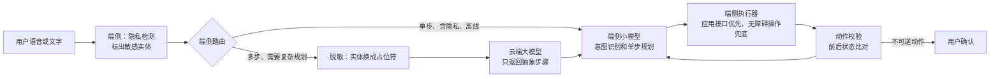

# 设计题：端云协同的手机个人助理

> 设计题 · inference、harness · 限时 45 分钟 · 追问题：[questions.md](questions.md)
> 前置：[inference/06 端侧部署](../../tracks/inference/06-on-device/README.md)、[inference/04 量化](../../tracks/inference/04-quantization/README.md)、[harness/07 Computer-Use 部分](../../tracks/harness/07-coding-agent/README.md#7-computer-use截图dom无障碍树怎么组合)、[harness/03 权限与沙箱](../../tracks/harness/03-sandbox-permissions/README.md)、[core/10 安全与可靠性](../../core/10-safety-reliability/README.md)

## 1 题面

“设计一个手机上的个人助理。用户说‘把昨天群里发的会议时间加到日历，再回复说我会参加’，它能跨应用完成。要求：聊天记录、通讯录、屏幕内容这类隐私数据不出手机；复杂任务可以用云端大模型。”

考点有三处：**端侧放什么模型**（内存、速度、发热的账）、**端云怎么分工又守住隐私**（“不出端”要靠设计保证）、**怎么安全地操作别的应用**（看屏幕、点按钮、确认动作生效、不可逆操作要人确认）。只说“小模型在端上、大模型在云上”拿不到高分。

三个考点各自有一道必须算出来的数，算不出来就只能背结论：

| 考点 | 必须算出的数 | 算它推出的决定 |
|---|---|---|
| 端侧放什么模型 | 权重 + KV + 运行时的合计，和每 token 时间 | 1.7B 只能按需加载且上下文锁在 1,600 token 内；常驻的只能是 0.6B |
| 端云怎么分工 | 级联的盈亏点 p\* 和每天上云比例 | 规划不走级联，用路由器直接分流；云端只拿脱敏后的抽象任务 |
| 怎么操作别的应用 | 三级通道的成功率连乘和每步耗时的去向 | 10 步任务是 28.6 秒，必须做增量更新，不能每步重读整棵树 |

面试官在等什么：先问约束（设备内存、隐私范围、能不能离线、出错的代价），再把约束换算成上面三个数，然后给出“端侧 0.6B 常驻 + 1.7B 按需 + 云端只做抽象规划”的分工，最后说清每一步失败时怎样降级、谁来强制确认不可逆动作。只画框图不报数，或者报了数却推不出任何设计改变，都是差答。

**评分之外看的两点**：会不会把“隐私不出端”写成执行器强制的白名单，而不是提示词里的一句要求；会不会承认无障碍服务有平台政策限制、安全窗口截不了图，而不是把 GUI 操作说成一件确定的事。

## 2 澄清

| 问题 | 为什么要问 | 本题假设 |
|---|---|---|
| 目标设备 | 决定内存和速度预算 | 12 GB 内存的中高端安卓手机；有效内存带宽 50 GB/s（假设值，不同芯片差异很大） |
| 任务类型 | 决定要不要多步规划 | 七成是单步（定闹钟、查日程），三成跨两三个应用、5-15 步 |
| “隐私数据”的范围 | 决定路由规则 | 聊天内容、通讯录、相册、屏幕截图和界面文本、位置；用户明确同意的除外 |
| 怎么操作其他应用 | 决定执行器 | 优先用应用开放的接口；没有接口时用系统无障碍能力读界面、发手势 |
| 出错的代价 | 决定确认策略 | 发消息、付款、删除不可逆，必须用户确认 |
| 延迟要求 | 决定端侧模型大小 | 单步指令 2 秒内开始执行；多步任务 30 秒内完成 |
| 离线要不要能用 | 决定端侧能力下限 | 离线时单步任务要能用，多步任务可以提示联网 |
| 装机量和日活 | 决定云端容量和账单 | 装机 200 万，每人每天 12 次任务（假设值，后面容量和成本都用它） |
| 有没有现成的开发商 | 决定 GUI 通道的覆盖率 | 头部 20 个应用愿意接结构化接口，约覆盖 25% 的常用界面（假设值） |

问完复述：“这是一个端侧常驻、要读写其他应用、带不可逆动作的 Agent。隐私边界是硬约束，延迟和电量是软约束。”

复述时要补一句范围：装机 200 万、日任务 2,400 万，这个量决定了云端要按千级 QPS 设计，而不是“先做个 demo 再说”。数字是假设，但假设必须说出口，否则后面的容量估算无处落地。

## 3 估算

模型配置和公式见 [inference/06 第 3 节](../../tracks/inference/06-on-device/README.md#3-现场估算qwen3-17b-放进手机)。

```
内存预算（MobileLLM 论文的口径：一个应用不超过 DRAM 的 10%）：
  12 GB × 10% ≈ 1.2 GB

Qwen3-1.7B（28 层，8 个 KV 头，head_dim 128）：
  Q4_K 权重：1.7e9 × 4.5 / 8 ≈ 0.96 GB
  每 token KV：2 × 28 × 8 × 128 × 2 B = 114,688 B
  4K 上下文、16 bit KV：0.47 GB → 合计 1.43 GB，超预算
  4K 上下文、8 bit KV： 0.23 GB → 合计 1.19 GB，刚好放下

Qwen3-0.6B（层数和 KV 配置相同）：
  Q4 权重 ≈ 0.34 GB，4K 的 16 bit KV 仍是 0.47 GB → 合计 0.81 GB

Decode 速度上限（每步读一遍权重和 KV，带宽 50 GB/s 假设）：
  1.7B，上下文 0：     0.96 GB / 50 GB/s ≈ 19 ms → 约 52 token/s
  1.7B，上下文 4K：   (0.96 + 0.47) / 50 ≈ 29 ms → 约 35 token/s
  0.6B，上下文 4K：   (0.34 + 0.47) / 50 ≈ 16 ms → 约 62 token/s

一步 GUI 操作的耗时（1.7B）：
  输入：压缩后的界面元素约 1,500 token
  Prefill：2 × 1.7e9 × 1,500 ≈ 5.1 TFLOP；按 NPU 有效 5 TFLOPS 假设 ≈ 1 秒
  输出：一个动作约 60 token × 29 ms ≈ 1.7 秒
  一步 ≈ 2.7 秒；10 步任务 ≈ 27 秒，刚好压线

能耗（MobileLLM 的粗估：每十亿参数每 token 约 0.1 J）：
  1.7B 输出 600 token ≈ 0.1 × 1.7 × 600 ≈ 100 J；论文估计满电 iPhone 约 50 kJ
```

结论有三条：

1. **1.7B 能放进预算，但要 8 bit KV、上下文锁在 4K 以内**。0.6B 更宽松，KV 已经比权重大。
2. **多步任务的瓶颈是每步 Prefill**。界面读取的结果每步都变，前缀复用只能覆盖系统提示，所以要压缩这部分的 token 数。
3. **端侧能跑完 10 步，但没有余量**。长任务交给云端规划，端侧只做执行，可以同时省时间和避免发热降频。

这三条结论先原样保留，下一小节用代码把它拆开重算。重算会改掉一条：**1.19 GB 那个数漏了运行时开销，加上之后 1.7B 常驻放不下**。这是这道题最容易被打断的地方——面试官必然问“运行时不要内存吗”。

### 3.1 端侧三笔账：内存、速度、能耗

上节的算式只算了权重和 KV。真机上还要一块运行时开销：激活、logits、分词器、kernel 工作区。它和上下文长度、词表大小有关，因实现而异；这里取 0.15 GB 作假设值，实际以运行时启动日志为准。把三部分一起算，再求出“给定预算还剩多少上下文”，结论会变。

```python
# 端侧三笔账：内存、每 token 速度、每步能耗。参数集中在开头，来源写在注释里。
GB = 1e9
N_SMALL, N_BIG = 0.6e9, 1.7e9      # Qwen3-0.6B / 1.7B 参数量，来自 config.json
W_BITS = 4.5                        # Q4_K：144 字节存 256 个权重，合 4.5 bit
KV_TOK = 2 * 28 * 8 * 128 * 2        # bf16 每 token 的 KV：K、V × 28 层 × 8 头 × 128 维 × 2 B
RT = 0.15 * GB                       # 运行时开销假设值，以运行时日志为准
BUDGET = 12 * GB * 0.10              # MobileLLM 口径：一个应用不超过 DRAM 的 10%
BW, FLOPS = 50e9, 5e12               # 有效带宽、NPU 有效算力，均为假设值
UI_FULL, UI_DIFF, OUT_TOK = 1500, 245, 40   # 整棵元素树、增量更新、一步动作的输出 token
CHAIN_S, VERIFY_S = 1.62, 0.30       # 降级链期望耗时、动作校验耗时（第 5.3 节）

def weights(n, bits=W_BITS):
    return n * bits / 8

def kv(context, s_kv):
    """s_kv 是 KV 每个元素的字节数：bf16 为 2，8 bit 为 1，4 bit 为 0.5。"""
    return context * KV_TOK / 2 * s_kv

def footprint(n, context, s_kv):
    return weights(n) + kv(context, s_kv) + RT

def max_context(n, s_kv):
    return int((BUDGET - weights(n) - RT) // (KV_TOK / 2 * s_kv))

def ms_per_token(n, context, s_kv):
    """batch=1 时每步把权重和全部 KV 读一遍：每 token 时间 = 每步字节 / 带宽。"""
    return (weights(n) + kv(context, s_kv)) / BW * 1e3

def step_seconds(n, obs_tokens, s_kv=1):
    """一步 = Prefill（受算力限制）+ Decode（受带宽限制）+ 通道降级链 + 校验。"""
    ctx = obs_tokens + OUT_TOK
    prefill = 2 * n * obs_tokens / FLOPS
    decode = OUT_TOK * ms_per_token(n, ctx, s_kv) / 1e3
    return prefill + decode + CHAIN_S + VERIFY_S

# 1) 内存：1.7B 常驻放不下。只算权重加 8 bit KV 是 1.19 GB（看起来刚好），
#    加上 0.15 GB 运行时就是 1.34 GB，超预算 12%
assert round(footprint(N_BIG, 4096, 2) / GB, 2) == 1.58      # 4K 上下文、bf16 KV
assert round(weights(N_BIG) / GB + kv(4096, 1) / GB, 2) == 1.19
assert round(footprint(N_BIG, 4096, 1) / GB, 2) == 1.34
assert round((footprint(N_BIG, 4096, 1) / BUDGET - 1) * 100) == 12
# 按需加载时上下文只剩 1,634 token（8 bit KV）或 3,269 token（4 bit KV）
assert max_context(N_BIG, 1) == 1634 and max_context(N_BIG, 0.5) == 3269
# 2) 0.6B 常驻：4K + bf16，或 8K + 8 bit，都是 0.96 GB，留 0.24 GB 余量
assert round(footprint(N_SMALL, 4096, 2) / GB, 2) == 0.96
assert round(footprint(N_SMALL, 8192, 1) / GB, 2) == 0.96
assert max_context(N_SMALL, 1) > 12_000                      # 12,432 token

# 3) 速度：Decode 受带宽限制，算力有十倍余量
assert round(2 / (W_BITS / 8), 1) == 3.6 and FLOPS / BW == 100
assert round(1000 / ms_per_token(N_SMALL, UI_DIFF + OUT_TOK, 1)) == 141
assert round(1000 / ms_per_token(N_BIG, UI_DIFF + OUT_TOK, 1)) == 51

# 4) 一步：1.7B 落地 2.86 s，10 步 28.6 s（压线）；读整棵树时 3.78 s，10 步 37.8 s（超）
s_big = step_seconds(N_BIG, UI_DIFF)
assert round(s_big, 2) == 2.86 and round(10 * s_big, 1) == 28.6
assert round(step_seconds(N_BIG, UI_FULL), 2) == 3.78
assert round(10 * step_seconds(N_BIG, UI_FULL), 1) == 37.8
# 0.6B 落地只要 2.26 s，但动作准确率低一截：省的不是时间，是发热和失败重试
assert round(step_seconds(N_SMALL, UI_DIFF), 2) == 2.26

# 5) 能耗：Decode 0.1 J/十亿参数/token（MobileLLM 口径），Prefill 按 2 W 芯片功率估
prefill = 2 * N_BIG * UI_DIFF / FLOPS
decode_s = OUT_TOK * ms_per_token(N_BIG, UI_DIFF + OUT_TOK, 1) / 1e3
e_decode, e_prefill = 0.1 * OUT_TOK * N_BIG / 1e9, 2.0 * prefill
assert abs(e_decode - 6.8) < 0.01 and abs(e_prefill - 0.33) < 0.02
e_step = e_decode + e_prefill
assert round(e_step, 1) == 7.1
# 一天 12 个任务、平均 4 步：约 340 J，是 50 kJ 电池的 0.7%：续航不是瓶颈
assert round(12 * 4 * e_step / 50_000 * 100, 1) == 0.7
# 但持续功率 7.6 W：连续跑 10 分钟就要按发热降频来算（第 5.1 节）
assert round(e_step / (prefill + decode_s), 1) == 7.6
print(f"1.7B 一步 {s_big:.2f} s、{e_step:.1f} J；0.6B 一步 {step_seconds(N_SMALL, UI_DIFF):.2f} s")
```

算完得到的六条结论：

| 数 | 值 | 推出的决定 |
|---|---|---|
| 1.7B 常驻（4K、8 bit KV） | 1.34 GB，超预算 12% | 1.7B 不能常驻，只能按需加载 |
| 1.7B 按需时的上下文上限 | 1,634 token（8 bit KV）/ 3,269（4 bit KV） | 每步只能送界面增量，不能送整棵树 |
| 0.6B 常驻（4K bf16 或 8K 8 bit） | 0.96 GB，余 0.24 GB | 常驻的就是它：意图识别、隐私检测、单步规划 |
| 每 token 时间 | 1.7B 19.5 ms（51 tok/s）；0.6B 7.1 ms（141 tok/s） | Decode 受带宽限制，压输出长度比压 Prefill 更值 |
| 一步耗时 | 1.7B 2.86 s，10 步 28.6 s | 10 步刚好压线，没有余量做重试 |
| 一步能耗 | 7.1 J，持续功率 7.6 W | 续航不是瓶颈，发热是 |

第三条结论要改一下：**端侧跑完 10 步是“刚好”，前提是每步只送增量**。读整棵树时 10 步 37.8 秒，超预算。所以“增量更新”不是优化项，是能不能达标的必要条件，这也决定了 V2 的做法。

### 3.2 路由账：每天多少任务上云、花多少钱

隐私是硬约束，先于成本。允许上云的任务里，再按代价选端侧还是云端。级联（先本地试、失败再上云）在延迟上划算的条件是端侧成功率高于 `t_l / t_c`（推导见 [inference/06 第 6.2 节](../../tracks/inference/06-on-device/README.md#62-代价模型级联什么时候划算)）。这道题里两个数都很差，直接决定了路由形态。

```python
# 路由账：级联的盈亏点、每天上云的比例与金额
TASKS_DAY = 24_000_000                 # 200 万装机 × 每人每天 12 次任务（假设）
MULTI = 0.30                           # 三成是多步任务（澄清表）
ESC_1STEP = 0.07                       # 端侧一下没做对的比例；校验发现后直接上云（5.3 节）
REPLAN = 0.15                          # 云端计划被界面打回、需要重规划的比例（假设）
P_IN, P_OUT = 3.0, 15.0                # 示例单价：美元/百万 token，不是任何厂商报价
PLAN_IN, PLAN_OUT = 500, 300           # 规划请求的输入输出
STEP_IN, STEP_OUT = 400, 250           # 单步救援的输入输出

def cost(i, o):
    return (i * P_IN + o * P_OUT) / 1e6

c_plan, c_step = cost(PLAN_IN, PLAN_OUT), cost(STEP_IN, STEP_OUT)
assert round(c_plan, 4) == 0.006 and round(c_step, 5) == 0.00495
# 规划的 75% 成本在输出：把输出压到 200 token 只省两成，压不出大头，得换做法

# 1) 级联的延迟盈亏点 p* = t_l / t_c：端侧规划 3.1 s（300 token 输出），云端 4.0 s
p_star = (0.38 + 3.10) / 4.00
assert 0.86 < p_star < 0.88                     # 约 0.87
# 端侧规划成功率只有 0.55：低于盈亏点，级联比直接上云更慢。规划不走级联
assert p_star > 0.55
# 单步救援不同：端侧一步 2.86 s，云端一步 0.9 s，p* > 1，级联永远不划算
assert 2.86 / 0.9 > 1.0
# 2) 每天调用量：多步任务每任务 1 次计划 × (1 + 重规划率)；单步任务只有失败那部分上云
multi = TASKS_DAY * MULTI
single = TASKS_DAY - multi
plan_calls = multi * (1 + REPLAN)
step_calls = single * ESC_1STEP
cloud = plan_calls + step_calls
assert round(plan_calls / 1e6, 2) == 8.28
assert round(step_calls / 1e6, 2) == 1.18
assert round(cloud / TASKS_DAY, 3) == 0.394         # 39.4% 的任务会碰一次云端
daily = plan_calls * c_plan + step_calls * c_step
assert round(daily / 1e4, 1) == 5.6                 # 每天约 $5.6 万
assert round(daily / TASKS_DAY, 5) == 0.00231       # 每任务 $0.0023
# 3) 对照全云端：每个任务一次规划，多步任务每步一次救援
all_cloud = TASKS_DAY * c_plan + multi * 10 * c_step
assert round(daily / all_cloud, 3) == 0.111         # 协同把账单压到全云端的 11%
# 4) 敏感性：多步任务全部上云也只到 34.5%，单步救援只占 4.9 个百分点
assert round(multi * (1 + REPLAN) / TASKS_DAY, 3) == 0.345
assert round(cloud / TASKS_DAY - 0.345, 3) == 0.049
# 5) 单价压到 1/3（输入 1、输出 5）时的账单
def cost_at(i, o, p_in, p_out):
    return (i * p_in + o * p_out) / 1e6

cheap = (plan_calls * cost_at(PLAN_IN, PLAN_OUT, 1.0, 5.0)
         + step_calls * cost_at(STEP_IN, STEP_OUT, 1.0, 5.0))
assert round(cheap / 1e4, 1) == 1.9                 # $1.85 万，正好是三分之一
```

读出来的四条：

1. **规划不能走级联**。端侧规划 3.1 秒、成功率 0.55，盈亏点是 0.87，先本地试每次都亏时间。用路由器按任务类型分流：多步规划直接上云，单步留本地。
2. **单步救援不做级联，也不做重试升级**。端侧一步失败后直接上云，因为端侧再试一次只是把 2.86 秒再花一遍。
3. **每天 39.4% 的任务会碰云端，账单 $5.6 万，是全云端的 11%**。省钱主要来自“七成单步任务根本不需要规划”，不是来自模型变小。
4. **账单对单价敏感，对比例更敏感**。单价降 2/3 只省到 $1.85 万；端侧规划成功率掉 20 个点，上云比例最多也只能涨到 34.5% + 4.9%，天花板由任务结构决定，不由模型决定。

### 3.3 容量：并发用户、云端 QPS、端侧队列

```python
# 容量：并发用户、云端 QPS、端侧队列
import math

N_USERS = 2_000_000                # 装机 200 万（假设）
TASKS_PER_USER_DAY = 12            # 每人每天 12 次任务（假设）
PEAK_RATIO = 4                     # 峰均比：任务型请求集中在早晚
TASK_S = 28.6                      # 一个多步任务的平均占用时长（3.1 节）
STEP_S = 2.86                      # 每步耗时
CLOUD_RATIO = 0.394                # 会碰云端的任务比例（3.2 节）
CLOUD_W = 4.0                      # 一次云端规划从发出到拿完计划的秒数
STREAM_PER_INSTANCE = 10           # 一台推理实例同时挂的流（假设）

tasks_day = N_USERS * TASKS_PER_USER_DAY
lam_avg = tasks_day / 86400
lam_peak = lam_avg * PEAK_RATIO
assert round(lam_avg) == 278 and round(lam_peak) == 1111        # 峰值 1,111 任务/秒

# 1) 并发用户：按“正在跑任务”的设备数算在途（Little 定律，见 core/13 第 3.1 节）
L_tasks = lam_peak * TASK_S
assert round(L_tasks) == 31_778                                 # 峰值 3.2 万台设备在跑
assert round(L_tasks / N_USERS * 100, 1) == 1.6                 # 占装机的 1.6%
# 2) 云端：峰值调用率、在途流、实例数
lam_cloud = lam_peak * CLOUD_RATIO
assert round(lam_cloud) == 438                                  # 峰值 438 次/秒
L_cloud = lam_cloud * CLOUD_W
assert round(L_cloud) == 1751                                   # 1,751 条流在途
assert math.ceil(L_cloud / STREAM_PER_INSTANCE) == 176          # 至少 176 台推理实例
assert round(lam_cloud * 500 * 60 / 1e6, 1) == 13.1             # 1,310 万输入 token/分钟
assert round(lam_cloud * 300 * 60 / 1e6, 1) == 7.9              # 790 万输出 token/分钟
# 3) 端侧队列：单设备一天 12 次任务、每次占 28.6 s，按 M/D/1 算等待
rho = TASKS_PER_USER_DAY * TASK_S / 86400
assert round(rho, 4) == 0.0040                                  # 利用率 0.4%
wq = rho / (2 * (1 - rho)) * TASK_S
assert round(wq, 2) == 0.06                                     # 平均等待 0.06 s
# 早晚高峰：5 分钟窗口里集中一次任务，该窗口到达率放大 12 倍
rho_peak = rho * 12
assert round(rho_peak, 3) == 0.048
wq_peak = rho_peak / (2 * (1 - rho_peak)) * TASK_S
assert round(wq_peak, 1) == 0.7                                 # 高峰也才 0.7 秒
# 结论：端侧不需要排队系统，只需要“同一设备同时只跑一个任务”的互斥

# 4) 云端超时与重试带来的额外负载
P_TIMEOUT, RETRY = 0.02, 1
extra = lam_cloud * P_TIMEOUT * RETRY
assert round(extra) == 9                                        # 每秒 9 次重试，占 2%
assert round(lam_cloud + extra) == 447
```

三条结论：

- **云端要按 176 台推理实例、438 次/秒规划**。这个量级下配额、限流、多副本灰度都是必须的，不是“以后再说”。重试和降级带来的额外负载按 2% 留余量。
- **端侧不排队**。利用率 0.4%，高峰 4.8%，等待是毫秒级。真正要管的是互斥（一个任务没完不能起第二个）、后台被杀后的恢复。
- **在途设备数决定会话状态存储**。3.2 万台设备同时在跑，每台一份执行进度和映射表（约 0.4 KB），合起来 13 MB 量级——小，但要按设备做粘滞和加密。

### 3.4 延迟：首动作时间和 10 步任务

```python
# 延迟预算：首动作时间、10 步任务，以及增量更新前后的对比
CHAIN_S, VERIFY_S = 1.62, 0.30      # 降级链、校验（3.1 节）

def step(tree_tok, out_tok=40):
    """一步的模型耗时：Prefill 加 Decode。加通道和校验后是整步时间。"""
    prefill = 2 * 1.7e9 * tree_tok / 5e12
    decode = out_tok * (1.7e9 * 4.5 / 8 + (tree_tok + out_tok) * 114688 / 2) / 50e9
    return prefill + decode + CHAIN_S + VERIFY_S

raw, diff = step(1500), step(245)
assert round(raw, 2) == 3.78 and round(diff, 2) == 2.86
# 1) 原始方案：路由 0.08 + 隐私检测 0.06 + 每步读全树
first_raw = 0.08 + 0.06 + raw
assert round(first_raw, 2) == 3.92                  # 首动作 3.9 s，接近 2 秒预算的两倍
assert round(10 * raw, 1) == 37.8
# 2) 增量更新 + 云端计划流式返回（第一段计划 1.10 s 到手）：首动作降到 2.4 s，10 步 28.6 s
first_opt = 0.08 + 0.06 + 1.10 + diff
assert round(first_opt, 2) == 4.10                  # 多步任务首动作
assert round(0.08 + 0.06 + diff, 2) == 3.00         # 单步任务首动作，仍超 2 s
# 3) 单步任务要进 2 秒，只能让 0.6B 常驻模型来做：一步 2.26 s，减掉不属于首动作的校验
single_small = 0.08 + 0.06 + 2.26 - VERIFY_S
assert round(single_small, 2) == 2.10
# 4) 首动作的构成：Decode 占大头，压输出比压输入更值
prefill = 2 * 1.7e9 * 245 / 5e12
decode = 40 * (1.7e9 * 4.5 / 8 + 285 * 114688 / 2) / 50e9
assert round(decode / (prefill + decode) * 100) == 82
# 5) 增量更新的 token 预算：整棵树 1,500 token，变化后只传 diff
def diff_tokens(prev, added, changed):
    return added * prev // 120 + changed * 40 + 20
assert diff_tokens(1500, 2, 5) == 245
assert round(diff_tokens(1500, 2, 5) / 1500, 2) == 0.16     # 只有整棵树的 16%
```

| 方案 | 首动作 | 10 步任务 | 是否进预算 |
|---|---|---|---|
| 每步读整棵树，1.7B 落地 | 3.92 s | 37.8 s | 都超 |
| 增量更新 + 云端计划流式 | 4.10 s（多步）/ 3.00 s（单步） | 28.6 s | 10 步进预算，首动作仍超 |
| 单步交给常驻 0.6B | 2.10 s | — | 单步进预算 |

结论：**首动作 2 秒对单步任务要靠 0.6B 才勉强达标，对多步任务做不到**。所以澄清里“单步 2 秒内开始执行”要拆成两档：单步任务 2 秒，多步任务 4 秒内给出第一段可执行计划并立刻开始第一步，并在 UI 上显示计划进度。这条如果面试时不说清，后面所有延迟讨论都会对不上。

Decode 占首动作模型时间的 82%：优化顺序是先压输出长度（少生成长思考、动作格式短），再压输入。这条和 [core/13 第 3.2 节](../../core/13-system-design/README.md#32-成本按调用拆缓存有盈亏点)里“先看输出占比”的判断一致，只是端侧换成“看 decode 占比”。

### 3.5 算完得到的结论

| 数 | 值 | 推出的设计决定 |
|---|---|---|
| 端侧内存预算 | 1.2 GB（12 GB × 10%） | 常驻 0.6B（0.96 GB），1.7B 按需加载 |
| 1.7B 按需时的上下文 | 1,634 token | 每步只送界面增量（245 token），不送整棵树 |
| 每步耗时 | 2.86 s（1.7B） | 10 步 28.6 s，没有重试余量，必须做动作校验前置判断 |
| 每年上云比例 | 39.4% 任务、9.46M 次/天 | 只送脱敏规划请求，不送界面 |
| 每天云端账单 | $5.6 万，全云端的 11% | 省钱来自任务结构，不来自模型变小；单价的敏感性是二阶 |
| 云端峰值 | 438 次/秒、1,751 条在途流 | 176 台推理实例起，配额与多副本是必须项 |
| 端侧队列 | 利用率 0.4%，高峰等待 0.7 s | 不需要排队系统，需要互斥和断点续跑 |

## 4 架构



| 模块 | 职责 | 关键设计 | 失败时怎样 |
|---|---|---|---|
| 隐私检测 | 找出请求和界面里的敏感实体 | 规则加端侧 0.6B；命中后强制本地，或替换成占位符 | 检测超时按“全部敏感”处理，整单留本地 |
| 端侧路由 | 决定本地做还是请云端规划 | 规则优先：隐私、离线、单步留本地；多步直接上云，不做级联 | 云端不可达时降为单步，并告诉用户只做了一部分 |
| 端侧模型 | 意图识别、单步规划、把抽象步骤落到具体界面元素 | 0.6B 常驻做前两件；1.7B 按需加载做落地 | 1.7B 加载失败（内存不足）时降到 0.6B，成功率降但不停 |
| 脱敏与映射表 | 把实体换成占位符，保存回填表 | 白名单上传（6 个键），映射表加密留端侧，24 小时过期 | 闸门拒绝就改走本地规划，不重传 |
| 云端规划 | 多步任务的计划 | 只看到脱敏后的请求和应用名，看不到屏幕内容；返回结构化步骤 | 超时 4 秒重试一次，再失败转本地单步 |
| 执行器 | 打开应用、读界面、点击输入 | 接口 → 无障碍树 → 截图三级降级；同一时刻只跑一个任务 | 三级都失败就停，交给用户 |
| 动作校验 | 确认每步是否生效 | 比对动作前后的界面状态：目标元素值、焦点、URL、元素树差异 | 失败换通道重试一次，再失败转人工 |
| 确认 | 不可逆动作执行前问用户 | 执行器按动作类型强制，不由模型决定；确认文案用真实参数生成 | 用户拒绝就中止并保留已完成步骤 |

**最简单可行版本**：只做端侧，只支持开放了接口的应用和单步任务。iOS 上应用可以用 App Intents 把动作和数据以结构化形式暴露给系统；安卓有 `AppFunctionService` 这类系统级入口，具体能力依赖系统和应用的支持。这个版本没有隐私出端的问题，也没有 GUI 操作的不确定性。

**什么时候升级**：

| 信号 | 升级 | 代价 |
|---|---|---|
| 用户要操作的应用没有接口 | 加无障碍操作兜底 | 界面会变，要做动作校验；平台对无障碍能力的用途有限制 |
| 多步任务端侧规划成功率低 | 加云端规划，端侧只执行 | 要做脱敏；弱网时退化为本地单步 |
| 端侧单步也常错 | 用 Agent 轨迹蒸馏专门的端侧模型 | 要采数据和评测，见 [inference/06 第 5 节](../../tracks/inference/06-on-device/README.md#5-小模型从哪来蒸馏与剪枝) |
| 云端必须看原文才能做 | 可验证的私有云计算 | 要硬件和运维投入，用户仍要同意 |

## 5 深挖

### 5.1 端侧账：内存、速度、发热三者的耦合

**问题**：3.1 节算过，1.7B 按需加载也只剩 1,634 token 上下文，10 步刚好 28.6 秒。手机还会降频，后台还会被系统杀掉。这三件事不是独立的：上下文短会逼出更多步，更多步会让芯片持续热，热了降频又让每步更慢。

**方案**：
- **两档模型，分工明确**。0.6B 常驻：意图识别、隐私检测、单步规划（2.26 秒一步，进 2 秒首动作预算）；1.7B 按需：界面落地和复杂单步（2.86 秒一步）。3.1 节的常驻预算只留 0.24 GB 余量，所以 1.7B 必须用完即卸，不能和 0.6B 共驻。
- **KV 和上下文**：8 bit KV 把上下文上限从 817 提到 1,634 token；再要长只能上 4 bit KV（3,269 token），代价是长上下文的精度要在评测集上验证，见 [inference/04 第 7 节](../../tracks/inference/04-quantization/README.md#7-kv-cache-量化)。系统提示和工具描述放最前面复用前缀；历史步骤只保留摘要。
- **增量更新界面**（第 3.4 节）：每步只传元素树的 diff，约 245 token，是整棵树的 16%。这一步同时省 Prefill（1.02 s → 0.17 s）、省上下文、省带宽。
- **控制持续负载**：单设备同时只跑一个任务；10 步任务在 3 个应用之间切换时天然有停顿，把停顿当散热窗口；超过 15 步的任务强制请云端出计划，端侧只执行。
- **运行时**：先确认模型的每个算子在目标 NPU 上都有支持，否则回退 CPU 会抵消收益，见 [inference/06 第 4 节](../../tracks/inference/06-on-device/README.md#4-运行时与硬件取舍)。

**推导：发热把 28.6 秒变成多少**。持续功率 7.6 W（3.1 节）。用一阶热模型（参数是假设，只演示机制）：环境 30 °C，热阻 6 K/W，时间常数 120 秒，超过 42 °C 开始降频，最低到半速。

```python
# 一阶热模型：持续功率 7.6 W，热阻 5 K/W，时间常数 180 s，45 °C 开始降频，最低到 85%
def simulate(power, seconds, t_amb=30.0, r=5.0, tau=180.0, t_limit=45.0, floor=0.85):
    temp, freq, speeds = t_amb, 1.0, []
    for _ in range(seconds):
        temp += (power * freq * r - (temp - t_amb)) / tau
        if temp > t_limit:
            freq = max(floor, freq - 0.01)
        elif temp < t_limit - 1:
            freq = min(1.0, freq + 0.01)
        speeds.append(freq)
    return speeds

def task_seconds(speeds, start=0, step_s=2.56, steps=10):
    """2.56 s 是模型部分的耗时（2.86 减去校验 0.30，校验不占芯片）。"""
    t, i = 0.0, start
    for _ in range(steps):
        t += step_s / speeds[min(i, len(speeds) - 1)] + 0.30
        i += 1
    return t

speeds = simulate(7.6, 900)
assert round(task_seconds(speeds), 1) == 28.6            # 冷机：和 3.1 节一致
assert round(task_seconds(speeds, 200), 1) == 33.1       # 已经热了 200 秒：超 30 秒预算
# 判据：降频到 0.85 就够把 10 步顶出预算
assert round(28.6 / 0.85, 1) == 33.6
```

结论是：**冷机 28.6 秒、热机 33.1 秒，“刚好压线”只在第一分钟内成立**。只要速度掉到 85% 就出预算，而热阻、阈值、降频策略都因机型而异，上面这组参数只是示意。所以上线指标里必须有“连续使用 10 分钟后的每步耗时”，而不是只有冷启动数字（见第 8 节）。这也解释了为什么要把多步任务的分段执行做进执行器，而不是当成优化项。

**代价**：两档模型要维护两套评测和更新；按需加载 1.7B 有冷启动时间（MobileLLM 论文在 iPhone 13 上报告 125M FP16 模型初始化约 1.36 s，1.7B 会明显更长）；短上下文让长任务丢失细节，只能靠摘要和云端计划补；增量更新要求系统能给出元素树变化，部分应用的自绘界面给不出。

**何时不该用**：如果目标设备只有 8 GB 内存（预算 0.8 GB），0.6B 加运行时也只剩 0.46 GB 给 KV，8K 上下文放不下，这时应该只做单步、把多步任务整体上云并明示用户。

### 5.2 隐私边界：白名单是一个函数，不是一句话

**问题**：“隐私数据不出手机”写到提示词里没有用。多步规划需要大模型，最省事的做法是把请求和截图一起传上去。即使只传请求，“回复张三说我会参加”里也有人名。要靠设计保证，得回答三件事：哪些字段允许出端、谁来强制、脱敏漏了怎么办。

**方案**：
- **把边界写成一个白名单函数**。云端只收 6 个键：应用包名、任务类型、步数提示、脱敏后的目标、参数、界面元素角色列表。**17 个敏感字段（聊天、通讯录、相册、屏幕、位置、日历）一个都不在白名单里**；四个可能出端的通道（规划请求、遥测、崩溃日志、本地缓存）里，17 × 4 = 68 个格子的敏感字段命中数为 0。
- **闸门在执行器里，不在模型里**。上传前过三道检查：未知键、类型不对、字符串里还残留实体。三道任一不过就拒绝上传——注意是**改走本地规划**，不是重传，否则脱敏漏检会诱导模型反复尝试直到漏过去。
- **脱敏是概率行为，要按概率算损失**。一条请求里同时有人名、手机号、日期，各自召回 0.97，全替换成功的概率是 0.97³ = 91.3%。剩下的 8.7% 被闸门拦回本地：按 3.2 节每天 9.46M 次上云算，每天约 82.5 万次降级。这不是 0，要说出口。
- **映射表只留端侧**。每个任务一张，占位符 →（原文，类型，过期时间），约 0.4 KB。生命周期比字节数是更大的代价：续跑要用不能立刻删，加密落盘，24 小时过期，用户可一键清除。映射表一旦上传，脱敏就白做了。
- **必须看原文时**（例如“总结这 200 条聊天”）：要么分段在端侧摘要、只上传用户确认过的摘要，要么明确告诉用户需要上传并取得同意，要么用可验证的私有云计算。Apple 的 Private Cloud Compute 是一个公开的设计：要求个人数据只用于完成这次请求、请求结束不留存；运维人员没有绕过隐私保护的特权接口；外部研究者能验证生产节点运行的软件。
- **日志和遥测只记元数据**：任务类型、步数、成败、通道、耗时。不上传原文、元素文本、截图。

```python
# 隐私边界：字段白名单、脱敏漏检、映射表留端侧的代价
import re

# 澄清表第 3 行的 6 类敏感数据，拆成应用里实际出现的 17 个字段
FIELDS = ("chat_sender", "chat_text", "chat_time", "contact_name", "contact_phone", "contact_note",
          "photo_thumb", "photo_meta", "screen_text", "screen_tree", "screen_shot", "screen_rect",
          "loc_gps", "loc_place", "cal_title", "cal_attendee", "cal_time")
CHANNELS = ("plan_request", "telemetry", "crash_log", "local_cache")   # 四个可能出端的通道
assert len(FIELDS) == 17 and len(FIELDS) * len(CHANNELS) == 68         # 68 个“字段 × 通道”格子

# 白名单只放六个元数据键，和 17 个敏感字段没有交集
SCHEMA = {"app_id": str, "task_kind": str, "steps_hint": int, "target": str,
          "args": dict, "ui_roles": list}
assert len(SCHEMA) == 6 and not set(SCHEMA) & set(FIELDS)
assert sum(1 for f in FIELDS for c in CHANNELS
           if (c, f) in {("plan_request", "app_id")}) == 0              # 敏感字段命中 0 个

ENTITY_RE = re.compile(r"[一-龥]{2,4}(?=说|先生|女士)|1[3-9]\d{9}|\d{4}-\d{1,2}-\d{1,2}")

def gate(payload):
    """上传闸门：未知键、类型不对、残留实体，三种都拒。拒绝不是重传，是改走本地。"""
    if set(payload) - set(SCHEMA):
        return False, "unknown field"
    for k, v in payload.items():
        if not isinstance(v, SCHEMA[k]):
            return False, f"bad type: {k}"
        if isinstance(v, str) and ENTITY_RE.search(v):
            return False, f"raw entity: {k}"
    return True, "ok"

good = {"app_id": "com.example.chat", "task_kind": "reply_then_calendar", "steps_hint": 6,
        "target": "〈群A〉昨天的会议时间", "args": {"reply": "〈确认参加〉"},
        "ui_roles": ["button", "text"]}
assert gate(good) == (True, "ok")
assert gate(dict(good, target="张三说的会议时间")) == (False, "raw entity: target")
assert gate(dict(good, screenshot="…")) == (False, "unknown field")
assert gate(dict(good, steps_hint="6")) == (False, "bad type: steps_hint")

# 脱敏漏检：三类实体各自召回 0.97，一条请求全替换成功的概率
R = 0.97
clean = R ** 3
assert round(clean, 4) == 0.9127
CLOUD_CALLS = 9_456_000                               # 3.2 节：每天上云调用数
blocked = CLOUD_CALLS * (1 - clean)
assert round(blocked / 1e4) == 83                     # 每天约 82.5 万次被闸门拦回本地
assert round(blocked / CLOUD_CALLS * 100, 1) == 8.7   # 8.7% 的规划请求降级为端侧

# 映射表：每任务一张，占位符 -> 原文、类型、过期时间
def table_bytes(slots, avg_chars=14):
    return slots * (16 + avg_chars * 3 + 8 + 1)

assert table_bytes(6) == 402                          # 0.4 KB
assert table_bytes(12) < 1024                         # 长任务翻倍也还在 1 KB 内
```

**代价**：脱敏会丢信息，云端规划的质量下降，端侧落地步骤的难度上升。8.7% 的计划请求降级为端侧规划，成功率从 0.9 级掉到 0.55 级，按 3.2 节的比例折算，约 3% 的多步任务会走端侧规划并更可能失败。隐私检测也有漏检，要把漏检率当作上线指标，目标 0（见第 8 节）。

**何时不该用**：白名单 + 占位符适合“结构化的任务描述”。如果任务是“这封邮件该不该回、怎么回”，脱敏后失去语义，云端给不出有用的计划，这时要么请用户同意上传，要么整单端侧处理。

### 5.3 GUI 操作：三级通道、降级链、动作校验

**问题**：大多数应用没有给助理开放接口。只能像人一样看屏幕、点按钮。界面会变、会弹窗、会加载，模型还可能以为点了就成功了。3.1 节说一步 2.86 秒里有 1.62 秒花在通道上，这一节拆这 1.62 秒。

**方案**：
- **按可靠程度分三级**：
  - 一级，应用开放的结构化接口（iOS 的 App Intents，安卓的 `AppFunctionService` 或应用自有 SDK）。成功率高、不耗界面 token、速度最快。假设覆盖 25% 的常用界面。
  - 二级，系统无障碍服务读当前窗口的元素树（`AccessibilityNodeInfo`），用 `dispatchGesture` 发手势。元素带角色和文本，定位不依赖坐标；但文档明确提醒“节点可能包含过时信息，因为窗口内容随时在变”，动作后必须重新读取。
  - 三级，截图加坐标。最通用，但坐标要换算、截图要吃两三千 token，安全窗口（支付页）截图会失败（`ERROR_TAKE_SCREENSHOT_SECURE_WINDOW`）。
- **降级链而不是三选一**：接口失败退元素树，元素树失败退截图。树和截图是通用水位，任何界面都能试。这样单次成功率从加权平均 0.902 提到 0.953。
- **动作校验三层**：模型自查（每步说一句看到了什么）、执行器检查（比对目标元素值、焦点、URL、元素树差异）、终态检查（任务结束后用独立方式查真实结果，例如日历里是否真有这条日程）。前两层管“这一步有没有生效”，第三层管“任务有没有做成”。做法见 [harness/07 第 8 节](../../tracks/harness/07-coding-agent/README.md#8-动作是否生效的校验与失败重试)。
- **重试要有界且换通道**：同一动作失败一次换一种方式（坐标 → 元素引用，鼠标 → 键盘快捷键），再失败就停，把控制权交还用户。不要在同一个通道上重试，那只是把同一个错误再犯一次。
- **压缩界面读取**：元素树只保留可见、可交互的元素，带角色、文本和编号，控制在约 1,500 token；随后每步只传 diff（245 token）。

```python
# GUI 操作：三级通道的覆盖率、成功率、成本，降级链，每步校验后的成功率
COVER = {"api": 0.25, "tree": 0.60, "shot": 0.15}   # 界面上最高可用的通道（假设）
P_RUN = {"api": 0.98, "tree": 0.90, "shot": 0.78}   # 单次尝试成功率（假设，需真机标定）
T_RUN = {"api": 0.40, "tree": 1.40, "shot": 3.20}   # 单次尝试耗时（秒），含读界面和发手势
OBS_TOK = {"api": 0, "tree": 1500, "shot": 2000}    # 交给模型的界面 token

# 1) 不做降级链、每步只用可用的一级：加权成功率 0.902
p_naive = sum(COVER[k] * P_RUN[k] for k in COVER)
assert abs(p_naive - 0.902) < 1e-3

def cascade():
    """降级链：接口失败 → 元素树 → 截图。树和截图是通用水位。
    api 这一档只覆盖 25% 的界面，其余界面从树开始。返回 (成功率, 期望耗时)。"""
    p = t = 0.0
    for k, fb in (("api", "tree"), ("tree", "shot"), ("shot", None)):
        succ, cost = P_RUN[k], T_RUN[k]
        if fb is not None:                       # 这一级失败还能往下走一级
            succ = 1 - (1 - P_RUN[k]) * (1 - P_RUN[fb])
            cost = P_RUN[k] * T_RUN[k] + (1 - P_RUN[k]) * (T_RUN[k] + T_RUN[fb])
        p += COVER[k] * succ
        t += COVER[k] * cost
    return p, t

p_cas, t_cas = cascade()
assert abs(p_cas - 0.9533) < 1e-3          # 降级链把单次成功率从 0.902 提到 0.953
assert round(t_cas, 2) == 1.62             # 代价：每次多花约 0.2 s 的失败尝试

def step_outcome(p, d=0.95, k=1):
    """单步三种结局：做对、漏错（校验没发现）、转人工。d 是校验召回，k 是发现失败后的重试次数。"""
    ok = silent = 0.0
    alive = 1.0
    for _ in range(k + 1):
        ok += alive * p
        silent += alive * (1 - p) * (1 - d)
        alive *= (1 - p) * d
    return ok, alive, silent

ok, human, silent = step_outcome(p_cas)
assert round(ok, 4) == 0.9956 and round(silent, 4) == 0.0024 and round(human, 4) == 0.0020
# 2) 10 步连乘：端到端 95.7%，约 2.4% 的任务有一步悄悄错了
assert round(ok ** 10, 3) == 0.957
assert round(1 - (1 - silent) ** 10, 3) == 0.024
assert round(p_naive ** 10, 3) == 0.357    # 既不降级也不校验时只剩 35.7%
# 3) 校验召回率是上限：d 从 0.95 掉到 0.80，单步漏错从 0.24% 涨到 0.97%，10 步端到端掉到 89.5%
ok2, _, silent2 = step_outcome(p_cas, d=0.80)
assert round(silent2, 4) == 0.0097 and round(ok2 ** 10, 3) == 0.895
# 4) 三级通道的 Prefill 成本：读树 1,560 token 要 1.06 s，读截图 2,060 token 要 1.40 s
assert round(2 * 1.7e9 * (OBS_TOK["tree"] + 40) / 5e12, 2) == 1.05
assert round(2 * 1.7e9 * (OBS_TOK["shot"] + 40) / 5e12, 2) == 1.39
assert round(OBS_TOK["tree"] / OBS_TOK["shot"], 2) == 0.75
```

| 做法 | 单步成功率 | 10 步端到端 | 单步漏错 | 期望耗时 |
|---|---|---|---|---|
| 只用一级通道，不校验 | 0.902 | 35.7% | 9.8% | 0.87 s |
| 加降级链，不校验 | 0.953 | 61.9% | 4.7% | 1.62 s |
| 降级链 + 校验 + 换通道重试 1 次 | 0.9956 | 95.7% | 0.24% | 1.62 s |

代价：降级链每次多花约 0.2 秒的失败尝试；校验要求每个动作后重新读界面，**这本身就是增量更新的来源**——读过一次，下一次只传 diff。校验召回率从 0.95 掉到 0.80，10 步端到端从 95.7% 掉到 89.5%，所以校验规则要按应用逐个标定，不能一套规则走天下。

**何时不该用**：安全窗口（支付页、密码框）截图会失败，元素树也可能只给空壳，这类页面只能交给用户自己操作。同理，无障碍服务要用户在设置里手动开启，安卓文档写明它“应只用于帮助残障用户使用设备”，产品要先确认平台政策允许这种用途，否则这条通道不能作为主路径。

### 5.4 端云路由：规划为什么不能级联

**问题**：3.2 节算出多步规划不能走级联，但“为什么”要给式子；“每天多少任务上云”要能对着参数变。

**方案**：级联的延迟比直接上云低，条件是 `t_l + (1 − p)·r·t_c < t_c`，即 `p > t_l / t_c`（推导见 [inference/06 第 6.2 节](../../tracks/inference/06-on-device/README.md#62-代价模型级联什么时候划算)）。端侧规划 3.48 秒（路由 0.38 + 规划 3.10），云端 4.00 秒，盈亏点 p\* = 0.87；端侧规划成功率 0.55，**先本地试每次都多花约 1.5 秒**。所以规划用路由器：多步直接上云，单步留本地。

单步救援则相反：端侧一步 2.86 秒，云端一步 0.9 秒，p\* 大于 1，级联在任何成功率下都不划算，端侧失败就直奔云端。

**推导：比例对参数的弹性**。每天上云比例 = 多步比例 × (1 + 重规划率) + 单步比例 × 端侧失败率。

```python
# 上云比例对三个参数的敏感性
def ratio(multi, replan, esc):
    return multi * (1 + replan) + (1 - multi) * esc

base = ratio(0.30, 0.15, 0.07)
assert round(base, 3) == 0.394
# 重规划率从 0.15 降到 0.05：比例降 3 个百分点，账单降 8%
assert round(base - ratio(0.30, 0.05, 0.07), 3) == 0.030
assert round(1 - ratio(0.30, 0.05, 0.07) / base, 2) == 0.08
# 多步比例从 0.30 涨到 0.40：比例涨 10.8 个百分点，账单涨 27%
assert round(ratio(0.40, 0.15, 0.07) - base, 3) == 0.108
assert round(ratio(0.40, 0.15, 0.07) / base - 1, 2) == 0.27
# 端侧失败率从 0.07 降到 0.03：比例只降 2.8 个百分点
assert round(base - ratio(0.30, 0.15, 0.03), 3) == 0.028
```

**结论**：账单的最大杠杆是**降低重规划率**（把计划做得更抽象、更不依赖具体界面），其次是**任务结构**（多步任务比例，产品侧决定）。把端侧模型的失败率再压一半，只省 2.8 个百分点，不值得为此换更大的端侧模型。

**代价**：路由会分错。多步任务被误判成单步，端侧规划失败后才上云，等于多花一次；单步任务被送上云，多花一次、多 1 秒网络。分错率要当指标盯，并保留用户手动切换的入口。

**何时不该用**：如果某类任务端侧成功率稳定高于 0.87（例如“按联系人群发节日祝福”这类模板化多步任务），可以给它单开级联规则——但要按任务类型标定，不能全局开。

## 6 失败模式

每条失败模式都要回答三个问题：怎么发现、影响谁、止损动作是什么。前五条是这道题特有的，后三条覆盖依赖超时、级联、脏数据、配额耗尽、状态不一致这五类通用故障；通用的重试与熔断见 [core/13 第 3.5 节](../../core/13-system-design/README.md#35-可靠性连乘校验和重试)、[harness/05 第 5 节](../../tracks/harness/05-gateway-reliability/README.md#5-熔断降级与故障恢复)。

**1. 端侧 OOM**

- 触发信号：`onTrimMemory` 收到 `TRIM_MEMORY_RUNNING_LOW` 以上；进程被系统回收，重启后 `ApplicationExitInfo` 里 `getReason()` 是 `REASON_LOW_MEMORY`。
- 注意平台变化：`TRIM_MEMORY_RUNNING_*` 从 API 34 起不再通知应用，API 35 标注废弃；可靠的是 `TRIM_MEMORY_UI_HIDDEN` 和 `TRIM_MEMORY_BACKGROUND`，以及进程死后读 `ApplicationExitInfo`。另外文档说明部分设备不支持上报 `REASON_LOW_MEMORY`，这时表现为 `REASON_SIGNALED` 加 SIGKILL。
- 影响面：单个设备上正在跑的任务全部丢失。
- 止损：任务开始时按“当前可用内存”决定加载 1.7B 还是只用 0.6B；收到 `UI_HIDDEN` 就卸掉 1.7B 只留 0.6B；任务进度每步落盘，重启后从 checkpoint 续跑（不重放已完成步骤）。

**2. 模型 OTA 版本不兼容**

- 触发信号：加载后自检（一个固定输入的输出哈希、工具调用格式的 schema 校验）与发布时记录的不一致；或 App 启动日志里运行时版本低于模型要求的最低版本。
- 影响面：全量设备，比 OOM 严重得多。
- 止损：模型文件带 `min_runtime_version` 和自检用例，不匹配就不加载并回退到上一版模型；App 更新和模型更新分开下发，模型走灰度（1% → 10% → 50%），失败自动回滚到上一版；量化方案变了要重跑 Agent 评测，至少覆盖工具调用格式正确率和参数正确率。

**3. 界面改版导致选择器失效**

- 触发信号：某应用的“三级全失败”率或“校验失败率”在小时级窗口里突升（例如从 3% 到 20%）。
- 影响面：只影响该应用。
- 止损：按应用单独关闭自动操作，改为“仅建议”（模型给出步骤，用户自己点）；选择器优先用角色 + 文本 + 相对结构，不用坐标和绝对索引，这样改版存活率更高（见下）；失败样本自动回流成录制，用于修选择器。

**4. 断网降级**

- 触发信号：网络探测失败或云端 4 秒超时。
- 影响面：多步任务全部，单步任务不受影响。
- 止损：多步任务在计划已到手时继续执行（计划在端侧），只影响重规划；计划没到手时降级为“做第一步并告诉用户剩下的需要联网”；已进入执行的任务继续，因为执行全在端侧。

**5. 云端超时**

- 触发信号：4 秒无首字节。
- 影响面：单个任务的规划。
- 止损：重试一次（带幂等键，避免重复计费），再失败转端侧规划，成功率从 0.9 级掉到 0.55 级并告诉用户“计划质量下降”；连续超时触发熔断，熔断期间所有规划走端侧，见 [harness/05 第 5 节](../../tracks/harness/05-gateway-reliability/README.md#5-熔断降级与故障恢复)。

**选择器存活率的推导**。假设一年 6 次大改版，每种定位方式在单次改版后仍然可用的概率不同：坐标 0.4（布局一动就废），角色 + 文本 0.9，资源 ID 0.85。那么一年后的存活率：

```python
# 选择器存活率：n 次改版后仍然可用
def survive(p_survive_per_release, releases=6):
    return p_survive_per_release ** releases

assert round(survive(0.40), 3) == 0.004      # 纯坐标：6 次改版后基本全废
assert round(survive(0.90), 2) == 0.53       # 角色 + 文本：还剩一半
assert round(survive(0.85), 2) == 0.38       # 资源 ID：改版常改 ID，比文本差
assert survive(0.90) > 100 * survive(0.40)   # 高两个数量级
```

这就是为什么降级链里坐标在第三级，而元素树在第一级：不是因为树更准，是因为**树更耐久**。代价是文本可能重名，要靠“可见 + 唯一 + 相对结构”过滤，重名时要求模型重新读取而不是猜。

| 失败 | 触发信号 | 影响面 | 检测方式 | 止损动作 |
|---|---|---|---|---|
| 端侧 OOM | `UI_HIDDEN`/`BACKGROUND` trim、`REASON_LOW_MEMORY` | 单设备任务全丢 | 退出原因统计、每设备内存曲线 | 降级到 0.6B、卸 1.7B、checkpoint 续跑 |
| 模型 OTA 不兼容 | 自检哈希不符、运行时版本低于下限 | 全量设备 | 启动自检、灰度期崩溃率 | 回退上一版、模型灰度、分开下发 |
| 界面改版 | 某应用失败率突升 | 单应用 | 按应用分桶的失败率 | 关闭该应用自动操作，改仅建议 |
| 断网 | 网络探测失败、4 s 超时 | 多步任务 | 网络状态、云端超时率 | 用已到手的计划继续；没计划就做第一步 |
| 云端超时 | 4 s 无首字节 | 单任务规划 | 首字节延迟分布 | 重试一次 → 端侧规划 → 熔断 |
| 脱敏漏检 | 闸门拒绝计数 | 8.7% 规划降级 | 闸门拒绝率（应为个位数） | 改走本地，不重传；补规则或召回模型 |
| 不受信任内容诱发越权 | 读过外部内容后出现对外动作 | 单任务 | 污点标记 + 动作类型 | 升级为强制确认；验证码类内容禁止外发 |
| 脏数据：占位符回填错 | 校验时写入值与映射表不一致 | 单任务，可能写错内容 | 回填后比对映射表类型和长度 | 停下不就错写，重读界面；映射表版本不一致时整单重做 |
| 配额耗尽 | 云端 429 / RPM、TPM 打满；每设备日预算到顶 | 一类任务或单用户 | 429 率、配额水位、单用户调用数 | 排队重试（读）或降级端侧规划（写）；按用户配额隔离 |
| 状态不一致 | checkpoint 的步数与界面实际不符；不可逆动作结果未知 | 单任务 | 续跑前重新观察界面、幂等键查执行状态 | 以界面为准重放未完成步；结果未知的不可逆动作先查证，查不清交给人 |
| 依赖超时（接口 / 无障碍服务无响应） | 读界面超时、手势回调 `onCancelled` | 单步 | 每步超时率、调用取消率 | 换通道（接口 → 树 → 截图）；连续失败就停 |

## 7 演进路线

### 7.1 V0：纯云端

**做法**：App 只做录音转文字和结果展示，全部规划与执行建议都在云端。执行仍在手机上（用户点确认后由 App 执行接口类动作）。

**为什么先做这个**：没有任何端侧模型，能最快验证“任务完成率”这个核心指标，也能收集真实任务分布（单步/多步比例、应用覆盖、步数分布）——这些正是第 3 节所有数字的来源。

**这个版本过不去的门槛**：隐私（截图和聊天原文必须上传）、离线（完全不可用）、单步延迟（一次网络往返 1～4 秒，首动作进不了 2 秒）。

**触发进 V1 的条件**：任一成立即启动——① 30% 以上的用户拒绝上传屏幕内容；② 单步任务的首动作 p95 超过 2 秒且用户投诉集中在这一类；③ 离线场景的任务占比超过 5%。

**回滚方式**：V1 上线后台端开关切回 V0 的路径保留一个版本周期，服务端仍然能处理纯云端请求。

### 7.2 V1：端侧单步 + 云端规划

**做法**：0.6B 常驻（0.96 GB）做意图识别、隐私检测、单步规划；多步任务脱敏后请云端规划；执行走三级通道，每步读整棵树。

**新增组件**：0.6B 运行时、隐私检测与脱敏闸门、执行器与动作校验、云端规划服务（176 台实例起）。

**新增成本**：端侧模型 0.34 GB 权重 + 预测 0.96 GB 峰值占用；云端 $5.6 万/天（3.2 节）；App 包体增加。

**这个版本过不去的门槛**：3.1 节算过，每步读整棵树时 1.7B 落地 3.78 秒、10 步 37.8 秒，超 30 秒预算；同时 0.6B 的落地准确率在复杂界面上不够，失败重试把耗时推得更高。

**触发进 V2 的条件**：① 多步任务完成率低于 80%，且失败原因里“超时/步数耗尽”占三成以上；② 平均每步界面 token 超过 1,200（说明整棵树送得太满）；③ 热机（连续使用 10 分钟）每步耗时比冷机高 20% 以上（5.1 节的降频）。

**回滚方式**：执行器保留“每步读整棵树”的开关，V2 的增量更新出问题时按应用回退到全量读取。

### 7.3 V2：端侧多步 + 增量更新

**做法**：1.7B 按需加载做界面落地；界面改为增量更新（245 token/步），10 步降到 28.6 秒（冷机）；云端计划改为流式返回，第一段计划到手就开始执行第一步；本地缓存“应用界面知识”（某个按钮做什么），减少每步的规划负担。

**新增组件**：1.7B 按需加载管理器（内存预算仲裁）、元素树 diff 生成器、应用级界面知识缓存、云端计划流式协议。

**新增成本**：1.7B 权重 0.96 GB 常驻在磁盘、按需占用内存；冷启动时间；两套模型要维护两套评测；界面知识缓存要按应用做失效和版本管理。

**这个版本的剩余风险**：热机 33.1 秒（5.1 节），仍超预算。所以 V2 之后要解决的不是模型，是**任务分段**：把 10 步任务拆成 2～3 段，段间让出 30～60 秒给芯片降温，并把进度展示给用户。这一步的触发条件是“热机耗时 p95 超过 32 秒”。

| 版本 | 端侧模型 | 云端角色 | 每天成本 | 关键指标 | 回滚粒度 |
|---|---|---|---|---|---|
| V0 | 无 | 规划 + 执行建议 | 全云端量级 | 任务完成率 | 按用户切回纯云端 |
| V1 | 0.6B 常驻 | 只做多步规划 | $5.6 万 | 单步首动作 p95、多步完成率 | 按用户关掉端侧规划 |
| V2 | 0.6B 常驻 + 1.7B 按需 | 规划（流式） | $5.6 万，重规划率降则降 | 每步耗时、热机降频 | 按应用回退全量读取 |

## 8 评测与上线

**离线评测**（方法见 [evaluation/01](../../tracks/evaluation/01-eval-design/README.md)）：

- 在真机或模拟器里搭一组虚构账号和数据的应用环境，任务按四层：单步接口类、单步 GUI 类、跨应用多步、含不可逆动作。
- **终态检查**：任务结束后用独立方式查真实结果，例如日历里是否真有这条日程，不信模型的总结。
- **隐私测试**：每个任务记录上传到云端的全部内容，检查里面没有未脱敏的实体。这项必须是 0。同时统计闸门拒绝率，预期 8.7%（5.2 节），偏高说明脱敏召回在掉。
- **注入测试**：在聊天和网页里放诱导指令，检查助理没有在未确认时对外发送。这项必须是 0。
- **真机性能**：首个动作的时间、每步耗时、连续 10 分钟后的速度（热机）、单任务耗电、OOM 次数。
- **选择器鲁棒性**：对每个覆盖的应用造两版界面（改版前后），看选择器存活率和降级到截图的次数。

**门禁阈值**（初始值，上线后按轨迹统计调整）：

| 指标 | 门槛 | 不达标怎么办 |
|---|---|---|
| 隐私泄露（上传内容含未脱敏实体） | 0 | 阻断发布 |
| 未确认的对外动作 | 0 | 阻断发布 |
| 单步首动作 p95 | ≤ 2.5 s | 检查是否走了 1.7B 而不是 0.6B |
| 多步任务完成率 | ≥ 80% | 拆步、补应用覆盖 |
| 10 步端到端成功率（离线） | ≥ 90% | 查校验召回和降级链命中率 |
| 热机每步耗时 / 冷机 | ≤ 1.15 | 分段执行、降频窗口 |
| 每任务云端成本 | ≤ $0.005 | 查重规划率和脱敏降级率 |

灰度与回滚：先开放给自愿参加测试的用户，再按应用和任务类型逐步开放。端侧模型随应用更新下发，保留上一个版本可以回退；云端规划模型独立灰度。某个应用改版导致失败率升高时，单独关闭对它的无障碍操作。**三件东西分别版本化**：端侧模型、选择器/应用知识、云端计划提示词，任何一件出问题都能单独回滚。

**线上信号**：任务完成率、用户中途接管率、确认被拒的比例、端侧和云端的分流比例、每步失败重试次数、按应用分桶的失败率、热机降速比、OOM 率。只上报元数据，上报前征得同意。

## 9 常见追问

- **为什么不全放云端？** 违反隐私约束，而且每步截图上传有网络延迟，弱网和离线不能用。算一笔账：单步任务要一次往返（1～4 秒），进不了 2 秒首动作预算。
- **为什么不全放端侧？** 1.7B 常驻超内存预算 12%，按需加载上下文只剩 1,634 token；多步规划成功率 0.55 低于级联盈亏点 0.87，规划本来就该在云端。
- **端侧和云端模型行为不一致怎么办？** 统一动作格式和工具协议；云端只出抽象步骤，具体动作都由端侧生成，格式只需要端侧一套。接口约定用 schema 校验，两端都跑同一套校验器。
- **执行到一半用户切走或来电话了？** 执行器检测到前台应用变化就暂停，保存进度；回来后重新观察界面，不假设界面还在原处，见 [harness/07 第 9 节](../../tracks/harness/07-coding-agent/README.md#9-本地授权不可逆操作的确认与断点续跑)。结果未知的不可逆动作先查证，查不清交给用户。
- **怎么防止助理被恶意应用利用？** 助理只接受用户本人的输入作为指令来源；其他应用里的文字一律当作数据；高危动作必须用户确认。读过外部内容后，对外动作一律升级为确认，见 [core/10 第 2 节](../../core/10-safety-reliability/README.md#2-风险从哪来)。
- **1.7B 每次加载要多久，用户能接受吗？** 冷启动是秒级（MobileLLM 论文在 iPhone 13 上报告 125M FP16 模型初始化约 1.36 秒，1.7B 明显更长）。做法是任务开始前预加载、任务结束后延迟卸载，并在加载期间用 0.6B 先做意图识别和隐私检测，把等待藏进用户说话的时间里。
- **无障碍服务被平台限制怎么办？** 两条路：头部应用逐个接结构化接口（覆盖 25% 但最可靠），其余应用降级为“仅建议”模式；如果平台明确不允许非辅助用途，Android 还有 `AppFunctionService` 这类系统级入口，但它依赖应用主动实现。
- **云端账单怎么会这么高？** 因为 2,400 万任务/天里有 39.4% 会碰一次云端。降账单的杠杆是重规划率（15% → 5% 省 8%）和任务结构，不是把规划模型的输出砍短（只省两成里的一部分）。

## 10 评分要点

面试官大致按下面打分，每项 0-2 分。1 分档是“说出了名词但没换算成数”，0 分档是“没说或说错”。

| 维度 | 0 分 | 1 分 | 2 分 |
|---|---|---|---|
| 澄清与估算 | 不问设备内存和隐私范围，直接画图 | 问了设备内存和隐私范围，但只报一个“1 GB 左右” | 问出设备内存、隐私范围、操作通道、不可逆动作和装机量；算出权重 + KV + 运行时的合计（并指出 1.19 GB 漏了运行时）、每 token 时间和一步耗时；结论落成“1.7B 只能按需加载” |
| 架构 | 一上来画多 Agent 或全云端 | 给出端云分工，但说不出为什么常驻的是 0.6B 而不是 1.7B | 先给“只端侧、只走接口、只单步”的最简方案，再按信号加无障碍操作和云端规划；每个模块能回答“不加它哪个数会超” |
| 隐私边界 | 只说“敏感数据不上传” | 说了脱敏和占位符，但没说是谁强制、漏检怎么办 | 云端只拿脱敏后的抽象任务，映射表留端侧并说清生命周期；上传由执行器白名单强制（6 个键、17 个敏感字段命中 0）；算出 8.7% 的脱敏降级并说出必须看原文时的选项 |
| GUI 操作 | 以为点了就成功，不做校验 | 说了接口优先、元素树次之，但说不清成功率和降级 | 三级通道 + 降级链（0.902 → 0.953）、每步校验、换通道重试有界；算出 10 步端到端 95.7% 和漏错 0.24%；说出无障碍的平台限制和安全窗口限制 |
| 安全 | 没识别注入风险 | 说了“注意提示注入”，但没有执行器层面的拦截 | 识别出“致命三要素”，屏幕文字不能授权，不可逆动作由执行器强制确认；验证码类内容规则拦截，不依赖模型判断 |
| 权衡 | 只罗列优点 | 说了取舍但没有信号 | 说出端侧模型大小、KV 精度、上下文长度、确认频率各自的代价，并给出“什么指标到什么程度就换选择”，例如重规划率 15% → 5% 省 8% 账单、热机超 32 秒就做任务分段 |

## 资料

- Android Developers，[AccessibilityService](https://developer.android.com/reference/android/accessibilityservice/AccessibilityService)，API 参考，2026-11 查阅（`AccessibilityNodeInfo` 可能过时、`dispatchGesture`、`ERROR_TAKE_SCREENSHOT_SECURE_WINDOW`、“应只用于帮助残障用户”）
- Android Developers，[ComponentCallbacks2](https://developer.android.com/reference/android/content/ComponentCallbacks2)，API 参考，2026-11 查阅（`TRIM_MEMORY_UI_HIDDEN`、`TRIM_MEMORY_BACKGROUND`；`RUNNING_*` 自 API 34 起不再通知、API 35 废弃）
- Android Developers，[ApplicationExitInfo](https://developer.android.com/reference/android/app/ApplicationExitInfo)，API 参考，2026-11 查阅（`REASON_LOW_MEMORY` 及部分设备退化为 `REASON_SIGNALED` + SIGKILL）
- Apple Developer，[App Intents](https://developer.apple.com/documentation/appintents)，框架文档，2026-11 查阅（把应用动作和数据声明给系统）
- Apple Security Research，[Private Cloud Compute: A new frontier for AI privacy in the cloud](https://security.apple.com/blog/private-cloud-compute/)，2024-06-10
- Zhang 等，[AppAgent: Multimodal Agents as Smartphone Users](https://arxiv.org/abs/2312.13771)，arXiv 2312.13771，2023-12
- Liu 等，[MobileLLM: Optimizing Sub-billion Parameter Language Models for On-Device Use Cases](https://arxiv.org/abs/2402.14905)，arXiv 2402.14905，2024-02（10% DRAM 口径、每十亿参数每 token 约 0.1 J、50 kJ 电池、125M 模型初始化约 1.36 s）
- Qwen 团队，[Qwen3-1.7B 模型卡与 config.json](https://huggingface.co/Qwen/Qwen3-1.7B)，Hugging Face，2026-11 查阅（28 层、8 个 KV 头、head_dim 128、tied embeddings）
- Simon Willison，[The lethal trifecta for AI agents](https://simonwillison.net/2025/Jun/16/the-lethal-trifecta/)，2025-06
- 第 3.1 节的内存上限、每 token 时间和能耗，第 3.2 节的盈亏点和账单，第 3.3 节的容量，第 5.1 节的热模型、第 5.4 节的弹性、第 6 节的选择器存活率，都是本章推导，由代码验证；单价、覆盖率、成功率、召回率均为假设值。
