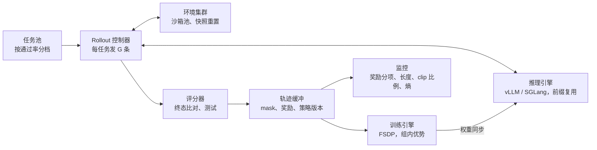

# 设计题：Agentic RL 训练平台

> 设计题 · training、inference · 限时 45 分钟 · 追问题：[questions.md](questions.md)
> 前置：[training/04 Agentic RL](../../tracks/training/04-agentic-rl/README.md)、[training/06 训练环境](../../tracks/training/06-environments/README.md)、[training/07 RL 训练框架](../../tracks/training/07-training-systems/README.md)、[core/13 系统设计方法](../../core/13-system-design/README.md)

## 1 题面

“团队要用 RL 训练一个 8B 模型做多轮工具调用任务：查业务 API、跑代码、多步完成任务。给你 64 张 80 GB 的卡。设计一个训练平台，要求能扩到上千个并发环境。”

这道题考的不是 GRPO 公式。考点在四处：**rollout 和训练怎么协同**（谁等谁）、**环境怎么规模化**（上千个沙箱怎么起、怎么重置）、**奖励从哪来**、**训练怎么不崩**。只画“采样 → 打分 → 更新”三个框的回答拿不到高分。

## 2 澄清

| 问题 | 为什么要问 | 本题假设 |
|---|---|---|
| 模型多大，什么结构 | 决定显存、并行方式和推理吞吐 | 8B 稠密模型，配置同 Qwen3-8B：36 层、GQA 8 个 KV 头、head_dim 128 |
| 任务长什么样 | 决定轨迹长度和环境类型 | 每条轨迹最多 6 轮；系统提示加工具定义 2,000 token；每轮策略输出 300 token，工具结果 700 token |
| 奖励能不能程序判定 | 决定要不要评委或奖励模型 | 能：比对沙箱终态或跑测试（假设） |
| 工具是什么 | 决定环境成本 | 模拟业务 API 加代码沙箱，每次调用平均 1 秒（假设） |
| 每步多大 batch | 决定吞吐和环境并发 | 128 个任务 × 每组 G = 8 条轨迹 = 1,024 条（假设） |
| 有没有 SFT 冷启动模型 | 决定 RL 一开始有没有信号 | 有，已经会按格式调用工具 |
| 卡型 | 决定带宽和算力口径 | H100 SXM 80 GB，带宽 3.35 TB/s，稠密 BF16 约 990 TFLOPS |

问完复述一句：“这是一个同步瓶颈在 rollout、环境要上千并发、奖励可以程序判定的 RL 系统。”

## 3 估算

所有数字都基于第 2 节的假设。显存口径和 [training/07](../../tracks/training/07-training-systems/README.md) 一致，KV 口径和 [inference/01](../../tracks/inference/01-kv-cache-memory/README.md) 一致。

```
一条轨迹：2,000 + 6 × 300 + 5 × 700 = 7,300 token；其中策略 token 1,800
每步：1,024 条轨迹 → 解码 1,024 × 1,800 ≈ 184 万 token，训练 1,024 × 7,300 ≈ 748 万 token

Rollout（解码受带宽限制，单卡跑一个副本）：
  每 token KV = 2 × 36 × 8 × 128 × 2 B = 147,456 B ≈ 144 KiB
  单卡并发 16 条，平均上下文 4,600 token：KV ≈ 16 × 4,600 × 147,456 B ≈ 10.9 GB
  每步解码至少读一遍权重和 KV：(16.4 + 10.9) GB / 3.35 TB/s ≈ 8.1 ms
  每条序列上限约 123 token/s；按 50% 效率（假设）取约 60 token/s，单卡约 980 token/s
  一条轨迹：1,800 / 60 ≈ 30 秒解码 + 5 次工具 × 1 秒 ≈ 35 秒
  Prefill：复用前缀时每条只算 2,000 + 5 × 700 = 5,500 token；不复用要 27,000 token，约 5 倍

训练（前向 + 反向 6N，再加旧策略和参考模型各一次前向 2N，共约 10N 每 token）：
  10 × 8.2e9 × 748 万 ≈ 6.1e17 FLOPs
  按 40% MFU（假设），约 396 TFLOPS/卡 → 约 1,550 卡·秒；64 卡约 24 秒，32 卡约 48 秒

训练显存（每卡，全分片到 64 卡）：
  模型状态 16Ψ / 64 = 131 GB / 64 ≈ 2 GB
  激活（s = 8,192，FlashAttention，不重计算）：34 × s × h × L ≈ 1.14 GB × 36 ≈ 41 GB
  全量重计算：2 × s × h × L ≈ 2.4 GB；logits（V = 151,936，FP32）≈ 5 GB

环境：
  1,024 条并发 → 1,024 个沙箱；每个 0.5 vCPU、1 GB 内存（假设）→ 512 vCPU、1 TB 内存
  工具调用：1,024 × 5 / 35 秒 ≈ 150 次/秒；4,096 并发时约 600 次/秒
```

结论：

- 一步里 rollout 约 35 秒加长尾，训练约 24 秒，两者同一量级。只优化训练没用，**rollout 的长尾和等工具**决定了步时。
- 显存不是瓶颈。8B 全分片后模型状态只有约 2 GB 每卡，激活靠 FlashAttention 和重计算控制。
- 环境是 CPU 和内存问题，不是 GPU 问题。要单独的环境集群，不能和训练节点抢 CPU。
- 前缀不复用，Prefill 多算约 5 倍。推理引擎要保留多轮之间的 KV。

估算口径：6N 来自 Kaplan 等的非嵌入计算量，没算注意力的 s² 项；激活的 34sbh 按 GPT 式 4h MLP 推出，Qwen3 的 MLP 结构不同，系数只作量级参考。

## 4 架构



| 模块 | 职责 | 关键设计 |
|---|---|---|
| 任务池 | 存任务、初始状态和判定标准 | 记录每题近期通过率，过滤全对或全错的组（DAPO 的 Dynamic Sampling） |
| Rollout 控制器 | 驱动多轮：生成到调用结束标记就停，执行工具，接回结果 | 动作上限、超时；环境故障的轨迹丢弃或重跑，不给负奖励 |
| 推理引擎 | 生成 | 多轮之间保留 KV；用训练引擎重算旧策略 log 概率 |
| 环境集群 | 执行工具、维护状态 | 每条轨迹独立状态；同一组 G 条从同一快照出发 |
| 评分器 | 结束时打分 | 判定材料对策略只读；能程序判的不交给评委 |
| 轨迹缓冲 | 存 token、loss mask、奖励、生成时的策略版本 | 工具结果 mask = 0；版本号用来控制滞后 |
| 训练引擎 | 算优势和 loss，更新 | GRPO 系，token 级聚合；KL 和比率用同一个 mask |

**最简单可行的版本（V0）**：verl 一类框架，64 卡共卡，同步训练。生成完一整批再训练，训练完同步权重。按估算，一步约 35 秒 rollout 加 24 秒训练，再加切换开销。HybridFlow 的实验观察是 16 到 64 卡上全部模型共卡最好，这个规模先不拆。

**什么时候升级**：

| 信号 | 升级 | 代价 |
|---|---|---|
| 长尾让 GPU 空转，rollout 时间远超平均轨迹 | 部分 rollout：给每轮 token 预算，没写完的下轮接着写 | 同一轨迹的片段来自不同策略版本 |
| 卡数上到几百、工具等待长 | 分离部署加完全异步，训练和采样并行 | 样本滞后，要限步数并修正目标 |
| 并发环境超过单个集群调度能力 | 环境服务化，按镜像分池，独立扩缩 | 多一层网络调用和故障面 |

## 5 深挖

### 5.1 同步还是异步：谁等谁

**问题**：同步训练里，一批要等最慢的轨迹。多轮场景轨迹长短差几倍，又要等工具。共卡时 rollout 阶段训练状态闲置，训练阶段推理权重闲置。

**方案**：
- 先用共卡同步跑通，量出 rollout 时间分布：P50、P99 轨迹时长，以及最后 10% 轨迹占了多少时间。
- 长尾明显时上部分 rollout（Kimi k1.5 的做法）：超预算的轨迹存进缓冲，下轮接着写。
- 卡数大、工具慢时上完全异步（AReaL 的做法）：采样端持续生成，训练端凑满一批就更新。每条样本记录生成时的策略版本，限制最大滞后步数。
- 滞后的监控看 clip 比例和 KL，见 [training/04 第 5 节](../../tracks/training/04-agentic-rl/README.md#5-异步-rollout-与长尾)。

**代价**：异步让样本变成 off-policy。滞后越多，重要性比率偏离 1 越远，被 clip 的 token 越多，有效梯度越少。部分 rollout 还让一条轨迹混了多个版本，复现和排查都更难。

### 5.2 环境规模化：上千个沙箱

**问题**：1,024 个并发沙箱，每个都要能重置、能复现、互不污染。冷启动一个容器要几秒，和 35 秒的轨迹相比开销不小。工具故障率高时，奖励里混进环境噪声。

**方案**：
- **镜像共享**：一类环境一个镜像，任务只是镜像里的不同初始状态。这是 SWE-smith 的思路：按仓库共享镜像，把 5 万个任务的环境压到 295 GB。
- **沙箱池**：预热一批容器，轨迹结束后回滚到快照再复用，不每次新建。
- **同组同起点**：GRPO 的一组 G 条轨迹从同一快照出发，比较才公平，见 [training/06](../../tracks/training/06-environments/README.md)。
- **区分故障**：工具超时、容器崩溃记为环境故障，轨迹丢弃或重跑，不当成策略失败。按故障率报警。
- **评分材料只读**：测试文件和标准终态不让策略写。

**代价**：模拟业务 API 和真实服务有差距，策略可能学会依赖模拟器的“好脾气”。要保留一份接真实工具的评测集检查迁移。沙箱池要按镜像分池，空闲容器占内存。

### 5.3 训练稳定性：奖励和 mask

**问题**：多轮 RL 比单轮更容易崩。工具结果混进梯度、奖励被钻空子、熵塌缩，都会表现为“奖励先涨后掉”。

**方案**：
- **mask 对齐**：工具结果的 mask 为 0，在 token 序列上做，不按字符切。旧策略、新策略 log 概率和 KL 用同一个 mask。Search-R1 的消融里，不屏蔽检索 token 明显变差，见 [training/04 第 3 节](../../tracks/training/04-agentic-rl/README.md#3-工具返回的-loss-mask)。
- **聚合方式**：token 级聚合，避免样本级平均的长度偏差，见 [training/03](../../tracks/training/03-grpo-family/README.md)。
- **奖励先简单**：主奖励用程序判定的终态；格式和效率项小权重或门控。每加一项都做对抗测试，见 [training/05](../../tracks/training/05-reward-verifier/README.md)。
- **监控面板**：奖励分项、平均轮数和长度、熵、clip 比例、组内奖励方差、环境故障率。RAGEN 报告的 Echo Trap 表现为奖励方差突然下降、梯度出现尖峰。

**代价**：监控和对抗测试要人力。发现 reward hacking 后，已学到的行为不会自己消失，通常回到 hack 出现前的检查点重训。

## 6 评测与上线

**离线评测**（方法见 [evaluation/06](../../tracks/evaluation/06-eval-training-loop/README.md)）：
- 训练奖励和评测不完全相同。评测集和训练任务按来源隔离，另留一份 holdout，只在选检查点时跑。
- 同一题跑多个试次，报平均成功率和 pass^k。题数和区间按 [evaluation/01](../../tracks/evaluation/01-eval-design/README.md) 估算。
- 除了任务成功，还看平均调用次数、非法调用率、轨迹长度。
- 保留一份接真实工具的集合，检查模拟环境里的提升能否迁移。

**平台本身的指标**：

| 指标 | 看什么 |
|---|---|
| 步时分解 | rollout、训练、权重同步、等待各占多少 |
| GPU 利用率 | 推理端和训练端分开看 |
| 长尾 | 轨迹时长的 P50 和 P99 |
| 环境 | 并发数、冷启动时间、故障率 |
| 样本滞后 | 异步时每批的平均和最大滞后步数 |

**上线**：训练产出的检查点先过离线门禁，再接影子流量，最后灰度。平台每次改版本（框架、引擎、环境镜像）都用一个固定的小任务跑回归，确认奖励曲线和旧版本对得上。

## 7 常见追问

- **为什么不用 PPO？** PPO 要多训一个 critic，显存多一份 16Ψ。奖励可程序判定时，GRPO 一类更省。Search-R1 的结论是 PPO 更稳，GRPO 收敛快但长训可能崩，要看监控。
- **推理引擎和训练引擎概率对不上怎么办？** 用训练引擎重算旧策略的 log 概率，再算重要性比率。
- **组内全对或全错怎么办？** 优势全为 0，没有梯度。按通过率筛题，或者过采样后过滤这样的组。
- **权重同步多久一次？** 同步训练每步一次；异步时按滞后上限决定，同步期间推理端可以短暂暂停或双缓冲。
- **环境要接线上真实 API 吗？** 训练不接：不可复现、有副作用、有费用。评测留一份接真实工具的集合。
- **怎么扩到 4,096 个并发环境？** 增大 batch 或开异步，同时在途的轨迹变多；环境集群按 CPU 和内存线性扩，工具调用约 600 次/秒，要给工具服务做限流和缓存。

## 8 评分要点

面试官大致按下面打分，每项 0-2 分：

| 维度 | 2 分的表现 |
|---|---|
| 澄清与估算 | 问清轨迹长度、batch、奖励来源；算出 rollout 吞吐、训练 FLOPs、显存和环境资源，并得出“瓶颈在 rollout 长尾”的结论 |
| 架构 | 先给共卡同步的最简版本，说出升级到部分 rollout、异步的信号；模块职责清楚 |
| rollout 与训练协同 | 讲清同步长尾、部分 rollout、完全异步的区别，说出滞后的代价和监控方法 |
| 环境规模化 | 镜像共享、沙箱池、同组同起点、故障与策略失败分开处理 |
| 稳定性与奖励 | 工具结果 mask、token 级聚合、程序判定优先、监控面板和 hack 后的处理 |
| 权衡 | 每次加复杂度都能说出代价，知道 64 卡规模下不该一开始就上完全异步 |

## 资料

- Jin 等，[Search-R1: Training LLMs to Reason and Leverage Search Engines with Reinforcement Learning](https://arxiv.org/abs/2503.09516)，arXiv 2503.09516，2025-03
- Kimi Team，[Kimi k1.5: Scaling Reinforcement Learning with LLMs](https://arxiv.org/abs/2501.12599)，arXiv 2501.12599，2025-01
- Fu 等，[AReaL: A Large-Scale Asynchronous Reinforcement Learning System for Language Reasoning](https://arxiv.org/abs/2505.24298)，arXiv 2505.24298，2025-05
- Sheng 等，[HybridFlow: A Flexible and Efficient RLHF Framework](https://arxiv.org/abs/2409.19256)，arXiv 2409.19256，2024-09
- Wang 等，[RAGEN: Understanding Self-Evolution in LLM Agents via Multi-Turn Reinforcement Learning](https://arxiv.org/abs/2504.20073)，arXiv 2504.20073，2025-04
- Yang 等，[SWE-smith: Scaling Data for Software Engineering Agents](https://arxiv.org/abs/2504.21798)，arXiv 2504.21798，2025-04
- [DAPO: An Open-Source LLM Reinforcement Learning System at Scale](https://arxiv.org/abs/2503.14476)，arXiv 2503.14476，2025-03
- Kaplan 等，[Scaling Laws for Neural Language Models](https://arxiv.org/abs/2001.08361)，arXiv 2001.08361，2020-01（第 2.1 节：C ≈ 6N 每训练 token）
- Qwen，[Qwen3-8B config.json](https://huggingface.co/Qwen/Qwen3-8B/blob/main/config.json)，访问于 2026-11
