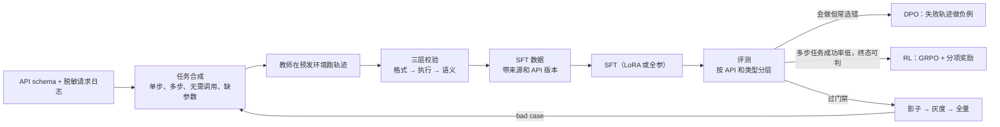

# 设计题：让开源模型学会调用企业内部工具

> 设计题 · training、evaluation · 限时 45 分钟 · 追问题：[questions.md](questions.md)
> 前置：[core/04 工具调用与 MCP](../../core/04-tool-use-mcp/README.md)、[core/11 后训练入门](../../core/11-post-training-basics/README.md)、[training/01 轨迹数据](../../tracks/training/01-trajectory-data/README.md)、[core/13 系统设计方法](../../core/13-system-design/README.md)

## 1 题面

“公司有几十个内部 API：查订单、查库存、建工单、改配置。数据不能出内网，只能用开源 8B 模型。要让它学会正确调用这些 API。从数据到上线，你怎么做？”

考点在四处：**先确认要不要训练**（提示词和工具描述能不能解决）、**训练数据从哪来、怎么验证**、**SFT、DPO、RL 各在什么时候上**、**怎么证明它能上线**。直接说“收集数据做 LoRA 微调”的回答拿不到高分。

## 2 澄清

| 问题 | 为什么要问 | 本题假设 |
|---|---|---|
| 有多少 API，多少是写操作 | 决定数据规模和安全要求 | 40 个 API，其中 12 个是写操作（假设） |
| API 有没有规范的 schema | 决定能不能自动合成和校验 | 都有 OpenAPI 描述，但部分字段说明不全 |
| 有没有测试环境 | 决定能不能执行验证 | 有预发环境，可以造数据、可以回滚 |
| 有没有真实调用日志 | 决定种子数据来源 | 有脱敏后的历史请求，但没有成形的多轮轨迹 |
| 任务要几步 | 决定单轮还是多轮训练 | 六成一次调用就够，四成要 2 到 4 次串联 |
| 能用强模型当教师吗 | 决定数据合成方式 | 可以在内网部署一个更大的开源模型当教师（假设） |
| API 多久改一次 | 决定数据更新和评测节奏 | 每月有几个 API 改字段 |

复述：“这是一个工具数量中等、有写操作、有可执行测试环境、API 会持续变化的工具调用后训练问题。”

## 3 估算

```
先不训练的基线：40 个工具定义 × 每个约 250 token ≈ 1 万 token 进上下文
  按场景路由后每次只给 8 个工具 → 约 2,000 token。OpenAI 的建议是一轮可用函数少于 20 个

SFT 数据量：
  每个 API 约 400 条单步样本 + 每个场景组合约 200 条多步样本（假设）
  40 × 400 + 70 个组合 × 200 ≈ 3 万条
  按难度和类型补齐：无需调用、缺参数要追问、工具报错后恢复，各占一成左右（假设）
  教师通过率按 40% 算（假设）：要生成约 3 万 / 0.4 = 7.5 万条候选

SFT 训练（全参，8 张 80 GB 卡）：
  3 万条 × 3,000 token × 3 epoch = 2.7 亿 token
  6N × token = 6 × 8.2e9 × 2.7e8 ≈ 1.3e19 FLOPs
  40% MFU，约 396 TFLOPS/卡 → 约 9.3 卡·时；8 卡约 1.2 小时
  模型状态 16Ψ = 131 GB → ZeRO-3 切到 8 卡，每卡约 16.4 GB
  LoRA：冻结的基座只要 2Ψ ≈ 16.4 GB，单卡可训

RL（GRPO，每步 64 题 × G = 8 = 512 条轨迹，每条 3,000 token、策略 token 400）：
  训练：10N × 512 × 3,000 ≈ 1.3e17 FLOPs → 约 320 卡·秒
  rollout：512 × 400 ≈ 20 万 token，按单卡约 1,000 token/s → 约 200 卡·秒
  200 步 ≈ 200 × 520 / 3,600 ≈ 29 卡·时
```

结论：训练算力不是瓶颈，一次 SFT 只要一两个小时。成本花在**造数据和验证数据**、**搭可执行的测试环境**、**反复评测**上。所以设计的重心是数据流水线和评测，不是训练配方。

估算口径：6N 每 token 来自 Kaplan 等；RL 的 10N 是 6N 加旧策略和参考模型各一次前向，和 [design/07](../07-agentic-rl-platform/README.md) 一致；显存口径见 [training/07](../../tracks/training/07-training-systems/README.md)。

## 4 架构



| 模块 | 职责 | 关键设计 |
|---|---|---|
| 任务合成 | 从 schema 和日志生成用户请求 | 按 API × 任务类型分格定配额，不让高频 API 占满数据 |
| 教师轨迹 | 在预发环境真实执行 | 记录教师版本、提示版本、API 版本 |
| 三层校验 | 过滤错误样本 | 格式和执行用程序，语义用评委加人工抽检 |
| 训练 | SFT 打底，按需加 DPO 或 RL | chat template 和线上推理完全一致；工具结果不计 loss |
| 评测 | 决定下一步做什么、能不能上线 | 留出 API 和留出场景，写操作单独统计 |
| 上线 | 影子、灰度、回滚 | 写操作在服务端二次校验，不信任模型给的参数 |

**最简单可行的版本（V0）**：不训练。改工具描述、按场景路由减少可见工具、用约束解码保证参数合法，先建评测集测出基线。很多“不会调用”其实是描述写得不清，见 [core/04 第 9 节](../../core/04-tool-use-mcp/README.md#9-工具选择错误的排查)。

**什么时候升级**：

| 评测现象 | 上什么 | 理由 |
|---|---|---|
| 格式错、参数名错、不会串联固定流程 | SFT | 缺的是“怎么调”，示范就能教 |
| 格式对了，但该追问时乱填参数、该拒绝时硬调用 | DPO | 模型会做但常选错；失败轨迹做负例、修正轨迹做正例 |
| 多步任务成功率低，且终态可以程序判定 | RL | 偏好对覆盖不了多步的轨迹空间，见 [training/02 第 6 节](../../tracks/training/02-preference-optimization/README.md#6-什么时候从-dpo-换到-rl) |
| 0/N 的题很多，SFT 加轮次也不涨 | 换更大的基座或补教师数据 | 能力底子不够，RL 也采不到正样本 |

## 5 深挖

### 5.1 数据：合成和校验

**问题**：没有现成的多轮轨迹。教师模型会编参数、调错工具、把没返回的内容写进回答。错误样本进了 SFT，模型照着学。

**方案**：
- **任务合成**：从 schema 和脱敏日志生成请求。覆盖单步、多步串联、无需调用（问了不相关的事）、缺必填参数要追问、工具报错后恢复。
- **三层校验**，参考 APIGen 的格式检查、真实执行、语义验证，以及 ToolACE 的规则层加模型层：

| 层 | 检查什么 | 怎么查 |
|---|---|---|
| 格式 | 工具名存在、必填参数齐全、类型和格式合法、角色顺序对 | 程序按 schema 校验 |
| 执行 | 调用在预发环境能跑通，返回符合预期 | 真实执行；写操作执行后回滚 |
| 语义 | 参数值来自用户请求而不是编的；回答完成了用户任务 | 评委逐项判，人工抽检校准评委 |

- **去重和配额**：按 API × 类型分格，同模板换实体的样本去重，见 [training/01 第 4 节](../../tracks/training/01-trajectory-data/README.md#4-合成轨迹的质量控制)。
- **混通用数据**：只训工具轨迹，通用对话会退化。AgentTuning 的做法是混入通用指令数据。

**代价**：执行验证要一个可造数据、可回滚的预发环境，搭建成本往往比训练高。评委过滤会带入评委偏好。教师的坏习惯（多余调用）也会被继承，要在过程校验里卡步数。

### 5.2 SFT 之后：DPO 还是 RL

**问题**：SFT 只模仿示范。模型没见过“错了会怎样”，遇到缺参数时可能照着示范的样子编一个值。

**方案**：
- **DPO**：从评测和影子流量里收集失败轨迹做 rejected，人工或教师修正后的轨迹做 chosen。适合“会做但常选错”：该追问没追问、该拒绝没拒绝。参考模型用 SFT 模型，β 从 0.1 起调，见 [core/11 第 6 节](../../core/11-post-training-basics/README.md#6-dpo从-rlhf-目标推出分类-loss)。
- **RL**：多步任务终态可判时，用 GRPO。奖励参考 ToolRL：格式奖励加正确性奖励，正确性按工具名、参数名、参数值分别比对，权重大于格式。ToolRL 的消融显示，把正确性压到和格式同一尺度会变差，见 [training/05 第 5 节](../../tracks/training/05-reward-verifier/README.md#5-多奖励融合)。
- **写操作的奖励**：比对预发环境终态，同时检查有没有改不该改的东西。没得到确认就执行写操作要扣分。

**代价**：DPO 的偏好对来自旧模型，分布会过时，要迭代收集。RL 要一个能并发重置的环境，工程量最大；奖励漏洞会被系统性利用，例如只填参数不管结果。所以顺序是先 SFT 打底，只在评测指出具体问题时再加一步，一次只改一个变量。

### 5.3 API 会变：泛化和数据过期

**问题**：每月有 API 改字段。模型如果“背下了” API，改了就调错。新增 API 也不能每次都重训。

**方案**：
- **工具定义始终放在上下文里**，训练和推理一致。模型学的是“读定义再调用”，不是记住参数。
- **训练时扰动定义**：同一 API 换描述措辞、调换参数顺序、改参数名，逼模型看定义。
- **评测留出 API**：留几个 API 完全不进训练，单独看这一层，检验对新 API 的泛化。
- **数据带版本**：每条样本记录 API 版本。API 改了，按版本找出受影响的样本，重新生成或删除。

**代价**：扰动太大，模型对真实定义的熟练度下降。留出 API 会少一部分训练数据。改动频繁时，评测集也要跟着改，不然评测在测旧接口。

## 6 评测与上线

**离线评测**（方法见 [evaluation/01](../../tracks/evaluation/01-eval-design/README.md)）：

| 层 | 内容 | 指标 |
|---|---|---|
| 单步调用 | 每个 API 的典型请求 | 工具名、参数名、参数值的匹配率；参照 BFCL 的 AST 检查 |
| 执行 | 在预发环境真跑 | 执行成功率、返回是否达到预期 |
| 多步任务 | 2 到 4 次调用串联 | 终态正确率；多次试次的 pass^k |
| 无需调用 | 请求和所有工具都无关 | 误调用率，参照 BFCL 的 relevance detection |
| 缺参数 | 必填信息不全 | 追问率、编造参数率 |
| 写操作 | 退款、改配置一类 | 错误写操作数，目标为 0 |
| 留出 API | 从未进训练的 API | 同上，单独报 |
| 通用能力 | 通用对话和指令遵循 | 和基座比是否退化 |

评测集和训练数据按来源隔离，做去污染，见 [evaluation/06](../../tracks/evaluation/06-eval-training-loop/README.md)。

**上线**：
- **影子模式**：模型生成调用但不执行，和现有流程或人工的操作比对。
- **灰度**：先放只读 API；写操作走服务端二次校验，高风险操作要用户确认。
- **线上指标**：解析失败率、工具报错率、任务完成率、人工接管率、P95 延迟。
- **回滚**：保留上一版模型和路由配置，指标越过阈值自动切回。
- **回流**：线上失败按 [evaluation/06](../../tracks/evaluation/06-eval-training-loop/README.md#3-bad-case-回流) 先归因。是工具描述的问题就改描述，是模型行为的问题才进训练数据。

## 7 常见追问

- **LoRA 还是全参？** 先用 LoRA：显存小、可以一个基座挂多个 adapter、回滚方便。ToolACE 在 8B 模型上用 LoRA 做 SFT。LoRA 学不进时再试全参，并对比通用能力是否退化。
- **为什么不直接用 Prompt + 大模型？** 数据不能出内网、成本和延迟要求高时才训 8B。先用大模型跑出基线，它也是教师和评测的参照。
- **工具结果要不要算 loss？** 不算。算了模型会学着编工具结果，见 [training/01 第 7 节](../../tracks/training/01-trajectory-data/README.md#7-agent-sft-的-loss-mask)。
- **参数总是格式错怎么办？** 先上约束解码或 `strict` 模式保证语法，训练只管语义。
- **怎么防止模型乱执行写操作？** 权限和参数校验放在服务端；写操作返回确认请求，由用户或规则决定，模型不能绕过。
- **新增一个 API 要重训吗？** 先只加定义，看留出 API 那层的评测；不达标再补少量数据做增量训练，并回归全部 API。

## 8 评分要点

面试官大致按下面打分，每项 0-2 分：

| 维度 | 2 分的表现 |
|---|---|
| 澄清与估算 | 问清 API 数、写操作、测试环境、变化频率；估出数据量和训练成本，得出“成本在数据和评测”的结论 |
| 先不训练的基线 | 先改描述、路由、约束解码并测基线，说清什么证据说明必须训练 |
| 数据流水线 | 任务类型覆盖无需调用、缺参数、报错恢复；格式、执行、语义三层校验；带版本可回溯 |
| 训练路线 | 讲清 SFT、DPO、RL 各解决什么问题，按评测现象决定下一步，能说出 RL 的奖励设计 |
| 评测与上线 | 按 API 和任务类型分层，含留出 API 和写操作安全；影子、灰度、回滚、回流 |
| 权衡 | 说出 LoRA 与全参、扰动定义、留出 API 等选择的代价 |

## 资料

- Liu 等，[APIGen: Automated Pipeline for Generating Verifiable and Diverse Function-Calling Datasets](https://arxiv.org/abs/2406.18518)，arXiv 2406.18518，2024-06
- Liu 等，[ToolACE: Winning the Points of LLM Function Calling](https://arxiv.org/abs/2409.00920)，arXiv 2409.00920，2024-09（第 2.3 节双层校验，表 5 LoRA 超参）
- Qian 等，[ToolRL: Reward is All Tool Learning Needs](https://arxiv.org/abs/2504.13958)，arXiv 2504.13958，2025-04
- Zeng 等，[AgentTuning: Enabling Generalized Agent Abilities for LLMs](https://arxiv.org/abs/2310.12823)，arXiv 2310.12823，2023-10
- Qin 等，[ToolLLM: Facilitating Large Language Models to Master 16000+ Real-world APIs](https://arxiv.org/abs/2307.16789)，arXiv 2307.16789，2023-07
- Gorilla 团队，[Berkeley Function-Calling Leaderboard 博客](https://gorilla.cs.berkeley.edu/blogs/8_berkeley_function_calling_leaderboard.html)，2024-08-19 更新，访问于 2026-11
- Xu 等，[Is DPO Superior to PPO for LLM Alignment? A Comprehensive Study](https://arxiv.org/abs/2404.10719)，arXiv 2404.10719，2024-04
- Kaplan 等，[Scaling Laws for Neural Language Models](https://arxiv.org/abs/2001.08361)，arXiv 2001.08361，2020-01
- OpenAI，[Function calling 指南](https://developers.openai.com/api/docs/guides/function-calling)，访问于 2026-11
