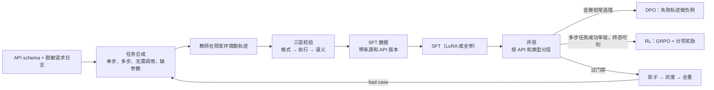

# 设计题：让开源模型学会调用企业内部工具

> 设计题 · training、evaluation · 限时 45 分钟 · 追问题：[questions.md](questions.md)
> 前置：[core/04 工具调用与 MCP](../../core/04-tool-use-mcp/README.md)、[core/11 后训练入门](../../core/11-post-training-basics/README.md)、[training/01 轨迹数据](../../tracks/training/01-trajectory-data/README.md)、[core/13 系统设计方法](../../core/13-system-design/README.md)

## 1 题面

“公司有几十个内部 API：查订单、查库存、建工单、改配置。数据不能出内网，只能用开源 8B 模型。要让它学会正确调用这些 API。从数据到上线，你怎么做？”

考点在四处：**先确认要不要训练**（提示词和工具描述能不能解决）、**训练数据从哪来、怎么验证**、**SFT、DPO、RL 各在什么时候上**、**怎么证明它能上线**。直接说“收集数据做 LoRA 微调”的回答拿不到高分。

拆成三个真正的考点：

1. **训练的盈亏**。这道题的正确答案可能是不训练。要能算出“每天多少任务、成功率提升几个点，才抵得上造数据的一次性投入和维护”，而不是默认训练。
2. **数据的可信度**。合成轨迹是自洽的：参数在格式上合法、工具返回看起来合理，但和真实世界不符。三层校验各能挡掉多少、挡不掉什么，要说得出来。
3. **API 会变**。每月有几个接口改字段。模型一旦“背下”API，改了就错；重训太贵，只改描述又未必够。要能给出判定条件和恢复手段。

面试官在等三样东西：一个带数字的“不值得训练”基线；一条能说出过滤率和最终可用量的数据流水线；一个按评测现象选 SFT/DPO/RL 的决策表，而不是三个都上。

## 2 澄清

| 问题 | 为什么要问 | 本题假设 |
|---|---|---|
| 有多少 API，多少是写操作 | 决定数据规模和安全要求 | 40 个 API，其中 12 个是写操作（假设） |
| API 有没有规范的 schema | 决定能不能自动合成和校验 | 都有 OpenAPI 描述，但部分字段说明不全 |
| 有没有测试环境 | 决定能不能执行验证 | 有预发环境，可以造数据、可以回滚 |
| 有没有真实调用日志 | 决定种子数据来源 | 有脱敏后的历史请求，但没有成形的多轮轨迹 |
| 任务要几步 | 决定单轮还是多轮训练 | 六成一次调用就够，四成要 2 到 4 次串联 |
| 能用强模型当教师吗 | 决定数据合成方式 | 可以在内网部署一个更大的开源模型当教师（假设） |
| 每天多少任务 | 决定训练值不值 | 日均 2 万次任务，峰均比 6（假设） |
| 出错谁来兜 | 决定“提升一个点”值多少钱 | 失败转人工，一次约 5 分钟、1.5 美元（假设） |
| API 多久改一次 | 决定数据更新和评测节奏 | 每月有几个 API 改字段 |

复述：“这是一个工具数量中等、有写操作、有可执行测试环境、API 会持续变化的工具调用后训练问题。因为数据不能出内网，模型能力的上限只能靠训练抬，不能换成更大的闭源模型。”

最后这句是本题的关键约束。如果数据可以出内网，第一选择是直接用大模型加提示，不必训练。[core/13 第 5 节](../../core/13-system-design/README.md) 的“先问最简方案”在这里就体现为：训不训练先看账。

## 3 估算

先算推理侧，再算训练侧。两笔账的口径不同：推理按调用算，训练按 token 算。所有数字集中在代码开头，标了来源或“假设”；单价是示例价，不是任何厂商的报价。

### 3.1 推理侧：容量、延迟、每任务成本

```python
import numpy as np

# 本题全部数字：除注明出处外都是假设；单价是示例价，不是任何厂商的报价
APIS, WRITE_APIS, VISIBLE = 40, 12, 8      # 全部 API、其中写操作、路由后一次可见的工具数
TOK_TOOL = 250                             # 一个工具定义（名称、描述、参数 schema）的 token
TASKS_DAY, PEAK_RATIO = 20_000, 6
SHARE_SINGLE = 0.6                         # 六成任务一次工具调用就够
CALLS_SINGLE, CALLS_MULTI = 2, 3           # 单步：1 次工具 + 1 次回答；多步平均 2 次工具 + 1 次回答
IN_SYS, IN_USER, IN_HIST = 300, 200, 500   # 系统提示、用户请求、前几轮留下的工具结果
OUT_CALL, OUT_ANSWER = 60, 120
PREFILL_TPS_NODE, DECODE_TPS_NODE = 60_000, 4_000   # 8 卡节点的合计吞吐（假设）
NODE_USD_H = 16.0
PREFILL_TPS_1, TPOT = 12_000, 0.025        # 单请求 prefill 速度、每 token 解码间隔（40 token/秒）

calls = SHARE_SINGLE * CALLS_SINGLE + (1 - SHARE_SINGLE) * CALLS_MULTI
tools = SHARE_SINGLE * (CALLS_SINGLE - 1) + (1 - SHARE_SINGLE) * (CALLS_MULTI - 1)
in_call = VISIBLE * TOK_TOOL + IN_SYS + IN_USER + IN_HIST
in_all = APIS * TOK_TOOL + IN_SYS + IN_USER + IN_HIST
in_task = calls * in_call
out_task = calls * OUT_CALL + (OUT_ANSWER - OUT_CALL)

# 1) 规模：每个任务平均 2.4 次模型调用、1.4 次工具调用，输入 7,200 token
assert abs(calls - 2.4) < 1e-9 and abs(tools - 1.4) < 1e-9
assert in_call == 3_000 and in_all == 11_000
assert round(in_all / in_call, 2) == 3.67         # 不路由，输入涨到 3.67 倍
assert round(in_task) == 7_200 and round(out_task) == 204

# 2) 工具定义是输入的大头：路由到 8 个占 2/3，全给 40 个占 91%
assert round(VISIBLE * TOK_TOOL / in_call, 3) == 0.667
assert round(APIS * TOK_TOOL / in_all, 3) == 0.909

# 3) 容量：日均只要约一个 8 卡节点的一成
day_in, day_out = TASKS_DAY * in_task, TASKS_DAY * out_task
node_s = day_in / PREFILL_TPS_NODE + day_out / DECODE_TPS_NODE
assert round(day_in) == 144_000_000 and round(day_out) == 4_080_000
assert round(node_s) == 3_420                     # 3,420 秒 = 0.95 节点·时
assert round(node_s / 3600 * NODE_USD_H, 1) == 15.2

# 4) 峰值（峰均比 6）：prefill 只占节点 1/6，decode 占 1/20
lam = TASKS_DAY / 86_400
peak_call = lam * PEAK_RATIO * calls
assert round(lam * PEAK_RATIO, 3) == 1.389        # 峰值 1.39 任务/秒
assert round(peak_call, 2) == 3.33                # 峰值 3.33 次模型调用/秒
assert round(peak_call * in_call) == 10_000       # 峰值 1.0 万 prefill token/秒，而节点有 6 万
assert round(peak_call * OUT_CALL) == 200         # 峰值 200 decode token/秒，而节点有 4,000

# 5) 前缀复用：一个任务内，前一次的“工具定义 + 系统提示 + 用户请求”2,500 token 不变。
#    没有复用时每任务要 7,200 prefill token；复用时 2,500 + 2.4 × 500 = 3,700
assert round(2_500 + calls * 500) == 3_700
assert round(1 - 3_700 / in_task, 2) == 0.49      # prefill 少一半，成本从 15.2 降到 10.0 美元/天

# 6) 每任务成本 0.00076 美元。对照：闭源大模型按示例价每百万输入 3 美元、输出 15 美元
usd_task = node_s / TASKS_DAY * NODE_USD_H / 3600
api_task = (in_task * 3 + out_task * 15) / 1e6
assert round(usd_task, 5) == 0.00076
assert round(api_task, 4) == 0.0247 and round(api_task / usd_task) == 32

# 7) 延迟：每次调用 = prefill + 解码；工具调用串行。用对数正态抖动模拟 20 万个任务
rng = np.random.default_rng(0)
N, SIG = 200_000, 0.30

def decode(n_tok):
    """解码时间：对数正态抖动，均值正好是 n_tok × TPOT。"""
    return n_tok * TPOT * np.exp(SIG * rng.standard_normal(N) - SIG**2 / 2)

def call_lat():
    return in_call / PREFILL_TPS_1 + decode(OUT_CALL)

answer_lat = in_call / PREFILL_TPS_1 + decode(OUT_ANSWER)
tool_lat = 0.3 * np.exp(0.7 * rng.standard_normal(N) - 0.245)     # 均值 0.3 秒

single = call_lat() + answer_lat + tool_lat                       # 1 次工具 + 1 次回答
multi = 2 * call_lat() + answer_lat + 2 * tool_lat                # 2 次工具 + 1 次回答

# 单步：0.25 + 1.5 + 0.25 + 3.0 + 0.3 ≈ 5.3 秒；多步再加一次调用和一次工具
assert abs(float(single.mean()) - 5.3) < 0.05
assert abs(float(multi.mean()) - 7.35) < 0.1
W = SHARE_SINGLE * float(single.mean()) + (1 - SHARE_SINGLE) * float(multi.mean())
assert abs(W - 6.12) < 0.05                       # 加权平均停留时间 6.1 秒

# 分位数从模拟取：每个任务串了 2 到 3 次解码，尾部被拉长
lat = np.concatenate([single[: int(N * SHARE_SINGLE)], multi[int(N * SHARE_SINGLE):]])
p = lambda q: float(np.percentile(lat, q))
assert 5.5 < p(50) < 6.5 and 8.3 < p(95) < 11.5 and 10.0 < p(99) < 13.5

# 8) Little 定律：在途任务数 = 峰值到达率 × 平均停留时间
assert round(lam * PEAK_RATIO * W, 1) == 8.5      # 同时只有 8 到 9 个任务在跑
print("P50/P95/P99 秒:", round(p(50), 1), round(p(95), 1), round(p(99), 1))
print("每任务推理成本 美元:", round(usd_task, 5))
```

### 3.2 训练侧：数据量、GPU 小时、人力

```python
# 训练侧：一次性投入和它的构成。单价仍是示例价
N_SFT, TOK_SAMPLE, EPOCH = 30_000, 3_460, 3     # 样本数、每条 token（3.1 节第 5 段给出构成）、轮数
N_PARAM, MFU, CARD_TFLOPS = 8.2e9, 0.40, 990    # 8B 稠密模型；H100 稠密 BF16 约 990 TFLOPS
CARD_USD_H = 2.0

# 1) 训练算力：30,000 × 3,460 × 3 = 3.1 亿 token；6N 每 token（Kaplan 等）
tokens = N_SFT * TOK_SAMPLE * EPOCH
flops = 6 * N_PARAM * tokens
card_h = flops / (CARD_TFLOPS * 1e12 * MFU) / 3600
assert round(tokens / 1e8, 2) == 3.11
assert round(flops / 1e19, 2) == 1.53
assert round(card_h) == 11                        # 约 11 卡·时
assert round(card_h / 8, 1) == 1.3                # 8 卡 1.3 小时，约 21 美元

# 2) 教师造数据：按保守的 40% 通过率，3 万条可用样本要 7.5 万条候选
N_CAND, TOK_CAND, TEACH_TPS = 75_000, 3_300, 1_200   # 候选数、每条 token、教师吞吐（假设）
teacher_node_h = N_CAND * TOK_CAND / TEACH_TPS / 3600
assert round(teacher_node_h) == 57 and round(teacher_node_h * 16) == 917

# 3) 人力：抽检 5% 的样本、每条 3 分钟；预发环境搭 25 人日；评测集 400 题、每题 8 分钟
HUMAN_USD_H, ENV_DAYS = 40, 25
spot_h = N_SFT * 0.05 * 3 / 60
eval_h = 400 * 8 / 60
assert round(spot_h) == 75 and round(spot_h * HUMAN_USD_H) == 3_000
assert round(eval_h) == 53 and round(eval_h * HUMAN_USD_H) == 2_133
assert round(ENV_DAYS * 8 * 80) == 16_000          # 环境是人日的大头

C0 = round(21 + 917 + 3_000 + 2_133 + 16_000)
assert C0 == 22_071                                # 一次性约 2.2 万美元，环境占七成
assert round(16_000 / C0, 2) == 0.72

# 4) 推理侧每天 15.2 美元，训练侧一次性 2.2 万美元：训练成本不是算力，是环境、抽检和评测
assert C0 / (15.2 * 365) > 3                       # 一次性投入相当于 4 年的推理成本
print("训练 FLOPs {:.2e}，卡·时 {}，一次性成本 {} 美元".format(flops, round(card_h), C0))
```

### 3.3 算完得到的结论

| 量 | 数字 | 推出什么 |
|---|---|---|
| 每任务模型调用 | 2.4 次，工具 1.4 次 | 每任务 7,200 输入 token 对 204 输出，优化点在输入 |
| 每次调用输入 | 3,000 token，工具定义占 2/3 | 按场景路由把工具从 40 个降到 8 个，省 63% 输入 |
| 日均 prefill | 1.44 亿 token，0.95 节点·时 | 容量不是约束，一张 8 卡节点跑全量还有 10 倍余量 |
| 每任务推理成本 | 0.00076 美元 | 比一次转人工（1.5 美元）便宜约 2,000 倍 |
| 延迟 | P50 5.9 秒、P95 9.0 秒 | 解码占八成以上，工具串行只占 0.3 秒；缩短输出比换快工具有效 |
| 训练一次性成本 | 2.2 万美元，环境占 72% | 训练便宜，造数据和搭环境贵 |
| 一次训练算力 | 11 卡·时，8 卡 1.3 小时 | 算力两天就能做完，来回试数据要几周 |

三条结论直接决定架构：

1. **不训练也能跑**：推理成本可忽略，所以“省推理钱”不是训练的理由。训练的理由只能是成功率——把 38% 的转人工压下去。
2. **价值全在成功率**：一次转人工 1.5 美元，一个任务推理 0.08 美分。成功率每提高 1 个点，每天省 20,000 × 0.01 × 1.5 = 300 美元。
3. **瓶颈是数据和环境**：2.2 万美元的一次性投入里，GPU 占 0.1%，预发环境占 72%。所以设计的重心是数据流水线和可执行环境，不是训练配方。

估算口径：6N 每 token 来自 Kaplan 等；显存口径见 [training/07](../../tracks/training/07-training-systems/README.md#21-模型状态每参数-16-字节)；RL 的 10N 和 rollout 口径与 [design/07](../07-agentic-rl-platform/README.md) 一致。延迟和容量按单库单卡顺序算，批处理和 PD 分离的细节见 [inference/05](../../tracks/inference/05-agent-serving/README.md)。

## 4 架构



| 模块 | 职责 | 关键设计 | 失败时怎样 |
|---|---|---|---|
| 任务合成 | 从 schema 和日志生成用户请求 | 按 API × 任务类型分格定配额，不让高频 API 占满数据 | 某格配额不足就补种子，不降标准 |
| 教师轨迹 | 在预发环境真实执行 | 记录教师版本、提示版本、API 版本 | 教师出错率高时先换教师，不硬训 |
| 三层校验 | 过滤错误样本 | 格式和执行用程序，语义用评委加人工抽检 | 执行环境故障的样本单独打标，不混进负例 |
| 训练 | SFT 打底，按需加 DPO 或 RL | chat template 和线上推理完全一致；工具结果不计 loss | 训练崩了回上一个检查点，数据不动 |
| 评测 | 决定下一步做什么、能不能上线 | 留出 API 和留出场景，写操作单独统计 | 评测集坏了自己先报警，不放行新模型 |
| 上线 | 影子、灰度、回滚 | 写操作在服务端二次校验，不信任模型给的参数 | 指标越线自动切回上一版模型和路由配置 |

**最简单可行的版本（V0）**：不训练。改工具描述、按场景路由减少可见工具、用约束解码保证参数合法，先建评测集测出基线。很多“不会调用”其实是描述写得不清，见 [core/04 第 9 节](../../core/04-tool-use-mcp/README.md#9-工具选择错误的排查)。V0 的数字在 5.1 节。

**什么时候升级**：

| 评测现象 | 上什么 | 理由 |
|---|---|---|
| 格式错、参数名错、不会串联固定流程 | SFT | 缺的是“怎么调”，示范就能教 |
| 格式对了，但该追问时乱填参数、该拒绝时硬调用 | DPO | 模型会做但常选错；失败轨迹做负例、修正轨迹做正例 |
| 多步任务成功率低，且终态可以程序判定 | RL | 偏好对覆盖不了多步的轨迹空间，见 [training/02 第 6 节](../../tracks/training/02-preference-optimization/README.md#6-什么时候从-dpo-换到-rl) |
| 0/N 的题很多，SFT 加轮次也不涨 | 换更大的基座或补教师数据 | 能力底子不够，RL 也采不到正样本 |

## 5 深挖

### 5.1 先不训练的基线：少样本能到多少，什么时候值得训练

**问题**：所有训练方案都要先回答“不训会怎样”。如果提示词加少样本就能到 90%，两万美元的数据流水线就是白花的。面试里先给这条基线，后面的每个训练步骤才有理由。

**方案**：V0 只做四件事——按场景路由把可见工具从 40 个压到 8 个、把工具描述写到“实习生能看懂”、给 3 个少样本、上约束解码保证 JSON 合法。然后在前一天就建好的评测集（400 题、按 API 和任务类型分层）上测。

**少样本的边际收益会饱和**。示例越多，模型越懂格式和惯例，但第 8 个示例带来的提升远小于第 1 个。用一条饱和曲线描述：

```text
p(k) = a + b · (1 − e^(−k/τ))
```

p 是任务成功率，k 是示例数，a 是零样本的下限，a + b 是这份提示能到的上限，τ 是饱和的快慢。三个参数都从自己的评测集上拟合，下面的值只是示意图。

```python
import math

# 少样本收益的饱和曲线：p(k) = a + b·(1 − e^(−k/τ))，三个参数是假设
a, b, tau = 0.62, 0.14, 2.5
p = lambda k: a + b * (1 - math.exp(-k / tau))
assert [round(p(k), 3) for k in (0, 1, 3, 8, 20, 50)] == \
       [0.62, 0.666, 0.718, 0.754, 0.76, 0.76]

# 每个示例约 220 token，prefill 12,000 token/秒
TOK_FEW, PREFILL_TPS = 220, 12_000
gain = lambda k0, k1: (p(k1) - p(k0)) * 100
ms = lambda k0, k1: (k1 - k0) * TOK_FEW / PREFILL_TPS * 1000

# 前 3 个示例换 9.8 个点、加 55 毫秒；第 8 到 20 个换 0.6 个点、加 220 毫秒
assert round(gain(0, 3), 1) == 9.8 and round(ms(0, 3)) == 55
assert round(gain(3, 8), 1) == 3.6 and round(ms(3, 8)) == 92
assert round(gain(8, 20), 1) == 0.6 and round(ms(8, 20)) == 220
assert round(gain(0, 3) / ms(0, 3), 2) == 0.18    # 每 100 毫秒换 0.18 个点
assert round(gain(8, 20) / ms(8, 20), 3) == 0.003 # 每 100 毫秒换 0.003 个点，低了 50 倍

# 盈亏：一次性 C0、每月维护 MAINT；相对“不训练”提升 Δs，每次失败转人工省 1.5 美元
C0, MAINT, SAVE = 22_071, 1_500, 1.5
def break_even(ds):
    """月摊 C0/12 加维护，除以每月每任务省下的钱：每天要多少任务才回本。"""
    return (C0 / 12 + MAINT) / (ds * SAVE * 30)

assert round(break_even(0.158)) == 470
assert round(break_even(0.08)) == 928
assert round(break_even(0.05)) == 1_484
assert round(break_even(0.02)) == 3_710
# 日均 2 万任务、提升 5 个点：15 天回本；日均 500 任务时，同样的提升永远回不了本
assert round(C0 / (0.05 * SAVE * 20_000)) == 15
assert break_even(0.05) > 500 * 2

# 反过来说：日均 500 任务时，训练要提升多少才回本
assert round(break_even(0.158) / 500, 2) == 0.94   # 提升 15.8 个点，也才刚好
print("少样本 3 → 8：+3.6 个点；训练要 +5 个点才值得，且日均 >1,484 任务")
```

**什么时候该训练**，用三个条件同时判断：

1. **V0 的失败分布**。把 400 题的错误分成四类：格式/解析、工具名选错、参数值错、该追问却编造。前两类靠描述和约束解码能解决；后两类靠 SFT；只有“选对了工具、参数格式也对，但语义选错”才是 DPO 的活。分类不出来的错误，训练也无从下手。
2. **日均任务量**。低于约 1,500 次时，五万分之一的一次性投入摊不平。这时应该扩大小模型的使用范围，或者接受转人工。
3. **教师能不能稳定超过学生**。SFT 的天花板是教师单次正确率（5.3 节的 (1 − e)^k）。教师只比 V0 高两三个点时，训练出来的模型不会更好。

**代价**：这条基线要出 400 道题、约 50 人时的标注，再加一天调提示。它的价值是省掉后面几周的无用功，也给出后续每一步的对照。不做基线的团队会在数据上花两个月，最后发现提升来自描述改写。

### 5.2 数据：三层校验的过滤率、最终可用量、覆盖

**问题**：没有现成的多轮轨迹。教师模型会编参数、调错工具、把没返回的内容写进回答。错误样本进了 SFT，模型照着学。三层校验各挡掉多少、一共能留下多少，决定了要造多少候选，也决定了预算。

**方案**：任务合成加三层校验，参考 APIGen 的格式检查、真实执行、语义验证，以及 ToolACE 的规则层加模型层。每层的作用不同：

| 层 | 检查什么 | 怎么查 | 挡不掉什么 |
|---|---|---|---|
| 格式 | 工具名存在、必填参数齐全、类型和格式合法、角色顺序对 | 程序按 schema 校验 | 参数值编造、工具选错 |
| 执行 | 调用在预发环境能跑通，返回符合预期 | 真实执行；写操作执行后回滚 | 合法但没意义的值（查了一个不存在的客户，工具返回空） |
| 语义 | 参数值来自用户请求而不是编的；回答完成了用户任务 | 评委逐项判，人工抽检校准评委 | 自洽但和真实业务不符的返回（模拟器和真实系统的差异） |

**关键一点**：三层不独立。质量差的候选往往三层一起挂——模板本身有问题，格式歪、执行报错、语义也不通。按独立相乘估可用量会低估；反过来，按“每层 90%”随口估会高估。下面的模拟对比两种估法。

```python
import numpy as np

# 候选来自三档质量的模板：好 50%、中 35%、差 15%（假设）。
# 每层通过率按档给定：质量差的候选三层一起挂，所以各层高度相关
TIERS = np.array([0.50, 0.35, 0.15])
PASS = {"格式": np.array([0.99, 0.92, 0.62]),
        "执行": np.array([0.96, 0.80, 0.35]),
        "语义": np.array([0.93, 0.70, 0.22])}

# 每层的边际通过率：格式 91%、执行 81.2%、语义 74.3%
marg = {k: float(TIERS @ v) for k, v in PASS.items()}
assert {k: round(v, 3) for k, v in marg.items()} == {"格式": 0.91, "执行": 0.812, "语义": 0.743}

# 若三层独立，可用率是三者的乘积；实际三层共享同一个“质量”潜变量，联合通过率更高
naive = float(np.prod([marg[k] for k in PASS]))
joint = float(TIERS @ np.prod([PASS[k] for k in PASS], axis=0))
assert round(naive, 3) == 0.549 and round(joint, 3) == 0.629
assert round(joint / naive, 2) == 1.15            # 正相关让可用量比独立估计高 15%

# 逐层幸存数（每 10 万候选）：要看前面剩了多少，不能只看边际
surv, run = TIERS.copy(), []
for k in ("格式", "执行", "语义"):
    surv = surv * PASS[k]
    run.append(round(1e5 * surv.sum()))
assert run == [91_000, 76_535, 62_942]
# 第二层实际只损耗 14,465 条，不是 1e5 × (1 − 0.812) = 18,750：边际率是对全体算的
assert round(1e5 * (1 - marg["执行"])) == 18_750

# 去重：模板换实体造成的近重复占 18%（假设）
DEDUP = 0.18
usable = joint * (1 - DEDUP)
assert round(usable, 3) == 0.516
assert round(30_000 / usable) == 58_126           # 要 3 万条可用样本，需要 5.8 万条候选
# 用保守的 40% 通过率估：留出教师更差、评委更严时的余量，得到 7.5 万
assert 30_000 / 0.40 == 75_000

# 覆盖：40 个 API × 6 类任务 = 240 格。API 热度按 Zipf(1.2) 分布
APIS, TYPES = 40, 6
cells = APIS * TYPES
w = 1.0 / np.arange(1, APIS + 1) ** 1.2
w = np.repeat(w / w.sum(), TYPES)
rng = np.random.default_rng(1)
draw = rng.multinomial(30_000, w / w.sum())

# 随机抽 3 万条：头部一格 1,621 条，尾部 18 格不到 20 条，最少只有 10 条
assert draw.sum() == 30_000
assert int(draw.max()) == 1_621 and int(draw.min()) == 10 and int((draw < 20).sum()) == 18
assert round(draw.max() / 30_000, 3) == 0.054
assert 30_000 / cells == 125                      # 按格配额：每格 125 条，尾部也有足够样本
# 125 条时，单格准确率 80% 的 95% 区间半宽约 7 个点（见 evaluation/01），够看趋势不够判门禁
print("每 10 万候选：格式后 91,000，执行后 76,535，语义后 62,942，去重后 51,600")
```

**从这张表读三件事**：

1. **格式层最便宜、挡得最多**。一条 10 万候选、通过率 91% 的格式检查，就能省下 9 万次执行和语义判断。三层的顺序按“便宜的先做”排，越贵的检查跑的量越少。
2. **语义层是唯一能挡“自洽但错误”的一层，也最贵**。它漏掉的是“参数合法、执行成功、答案通顺，但业务上是错的”——比如查了别人的订单。这类错误在预发环境里跑得通，只能靠评委加人工抽检。示例里它从 76,535 条里再留下 62,942 条，损耗 18%，但漏网的比例也要单独量：用 500 条人工标注的样本测评委的放过率和误杀率。
3. **数据量和覆盖是两个约束**。3 万条按 Zipf 抽能做到 18 格不足 20 条，尾部 API 等于没训。按格配额（每格 125 条）能保证覆盖，代价是高频 API 的比例被压下来，模型在自己最常用的工具上反而样本更少。折中是按格设下限、剩下的量按线上频率分。

**去重和配额**：按 API × 类型分格，同模板换实体的样本去重，见 [training/01 第 4 节](../../tracks/training/01-trajectory-data/README.md#44-去重minhash-与-lsh)。多样性也要在生成阶段设计进去，不要让高频 API 占满数据，见同章第 4.5 节。

**混通用数据**：只训工具轨迹，通用对话会退化。AgentTuning 的做法是混入通用指令数据。

**代价**：执行验证要一个可造数据、可回滚的预发环境，搭建成本往往比训练高（3.2 节里 72% 的一次性投入在环境）。评委过滤会带入评委偏好。教师的坏习惯（多余调用）也会被继承，要在过程校验里卡步数。

### 5.3 训练路线：SFT → DPO → RL 的选择条件

**问题**：SFT 只模仿示范。模型没见过“错了会怎样”，遇到缺参数时可能照着示范的样子编一个值。什么时候该上 SFT、什么时候 DPO 就够、什么时候必须 RL，要看评测现象，而不是按顺序都上一遍。

**先讲一条样本的形状**。一条成功的多步样本是这样拼起来的：工具定义（8 × 250）+ 系统提示 + 用户请求 + 两次工具返回 + 两次 assistant 输出。**只有 assistant 的输出计 loss**，工具结果不计——算了模型会学着编工具结果，见 [training/01 第 7 节](../../tracks/training/01-trajectory-data/README.md#7-agent-sft-的-loss-mask)。

| 片段 | token | 计 loss | 原因 |
|---|---|---|---|
| 工具定义 × 8 | 2,000 | 否 | 每轮都一样，是上下文不是行为 |
| 系统提示 + 用户请求 | 420 | 否 | 模型不需要学写提示 |
| 工具结果 × 2 | 800 | 否 | 不是模型的行为；算了会编造结果 |
| assistant 的调用 + 回答 | 240 | 是 | 要学的就是这段 |

**SFT 的天花板由教师的错误率决定**。教师每次调用有 e 的概率出错，一条平均 k 次调用的任务，示范全对的概率是 (1 − e)^k。这个数就是 SFT 模型单次正确率的上界——模仿只能到示范的水平。

```python
# (1) 一条 SFT 样本的 token 构成
TOK_TOOL, TOK_SYS, TOK_USER, TOK_RESULT = 250, 300, 120, 400
TOK_CALL, TOK_ANSWER, n_tools, n_results = 90, 150, 8, 2
total = n_tools * TOK_TOOL + TOK_SYS + TOK_USER + n_results * TOK_RESULT + TOK_CALL + TOK_ANSWER
supervised = TOK_CALL + TOK_ANSWER
assert total == 3_460 and supervised == 240
# 只有 6.9% 的 token 计 loss；把工具结果也计 loss，监督部分变成 30.1%，且模型会学着编结果
assert round(supervised / total, 3) == 0.069
assert round((supervised + n_results * TOK_RESULT) / total, 3) == 0.301

# (2) SFT 天花板：教师每次调用错 e，任务平均 2.4 次调用
K = 2.4
ceiling = lambda e: (1 - e) ** K
assert [round(ceiling(e), 3) for e in (0.02, 0.05, 0.10)] == [0.953, 0.884, 0.777]
# 教师错误率从 10% 压到 2%，单步成功率上界从 77.7% 抬到 95.3%
assert round(ceiling(0.02) - ceiling(0.10), 3) == 0.176

# (3) 负样本比例：生产轨迹里“至少一次调用错”的比例
p_err = lambda e: 1 - (1 - e) ** K
assert [round(p_err(e), 3) for e in (0.04, 0.06, 0.10)] == [0.093, 0.138, 0.223]
# 线上每次调用 6% 出错 → 13.8% 的轨迹里有失败。SFT 里纠错样本低于这个数，
# 模型没见过“报错之后怎么办”；远高于它，模型会学到“先犯错再纠正”
assert round(p_err(0.06) * 100, 1) == 13.8

# (4) DPO 的样本量：400 道评测题每题留 4 条分支，平均 1.7 条失败
TASKS, FAIL = 400, 1.7
pairs = int(TASKS * FAIL * 1.2)                   # 每条失败配 1 到 2 个修正正例（假设）
assert pairs == 816
assert 500 < pairs < 2_000                         # DPO 几百到一两千对就够

# (5) GRPO 的零方差组：8 条全对或全错时组内优势全为 0，没有梯度
zero = lambda p: p**8 + (1 - p)**8
assert [round(zero(p), 3) for p in (0.05, 0.3, 0.5, 0.9)] == [0.663, 0.058, 0.008, 0.43]
# SFT 刚结束、通过率 30% 的题只有 6% 的组白采；通过率 5% 的难题有 66% 白采
assert round(zero(0.3), 3) == 0.058 and round(zero(0.05), 3) == 0.663
print("SFT 监督占比 6.9%；教师错 6% 时天花板 86.2%；纠错样本约占 14%")
```

**三条路线各自的触发条件**：

| 路线 | 什么时候上 | 评测信号 | 数据形态 | 代价 |
|---|---|---|---|---|
| SFT | 格式错、参数名错、不会固定流程 | 解析失败率 > 2%，或某几个 API 的单步正确率明显低于其他 | 成功轨迹，带少量纠错；工具结果 mask | 最容易；但天花板被教师锁住 |
| DPO | 格式对了，该追问时编参数、该拒绝时硬调用 | 语义错误集中在“不该调用也调了”一类，且能被规则判定 | 同一前缀下的失败/修正对，几百到两千对 | 偏好对来自旧模型，分布会过时，要迭代收集 |
| RL | 多步任务成功率低，终态可程序判定 | 单步 90%+，多步只有 40%，失败多在中间步骤 | 在线采样，按通过率筛题 | 要能并发重置的环境，工程量最大 |

**为什么负样本比例要贴近线上**。教师示范全是成功轨迹时，模型只见过“一路顺利”的状态。线上 14% 的轨迹会遇到工具报错，模型却从没学过报错之后怎么做。所以 SFT 里要保留约 14% 的纠错样本——错误的那次调用 mask 掉（不计 loss），只训纠错动作。这个数字来自 p_err(0.06) = 13.8%，不是拍脑袋的“各占一成”。

**多轮样本怎么构造**：

- 单步种子 → 串联：把 A 的输出 ID 作为 B 的输入，在预发环境里真跑一遍，保证状态一致。不能像纯文本合成那样“假装”A 返回了一个订单号。
- 工具结果 mask，assistant 段计 loss，段落按 token 拼而不是按字符切，见 [training/04 第 2.3 节](../../tracks/training/04-agentic-rl/README.md#23-mask-的构造在-token-上做按段拼)。
- 失败的调用按原因分类：模型自己的错（参数错、工具名错）mask 掉只训纠错；环境的错（超时、5xx）保留并计 loss，因为调用本身是对的。

**三条路线各自的配方**：

- **DPO**：从评测和影子流量里收集失败轨迹做 rejected，人工或教师修正后的轨迹做 chosen。参考模型用 SFT 模型，β 从 0.1 起调，见 [core/11 第 6 节](../../core/11-post-training-basics/README.md#6-dpo从-rlhf-目标推出分类-loss)。
- **RL**：多步任务终态可判时用 GRPO。奖励参考 ToolRL：格式奖励加正确性奖励，正确性按工具名、参数名、参数值分别比对，权重大于格式。ToolRL 的消融显示，把正确性压到和格式同一尺度会变差，见 [training/05 第 5 节](../../tracks/training/05-reward-verifier/README.md#5-多奖励融合)。
- **写操作的奖励**：比对预发环境终态，同时检查有没有改不该改的东西。没得到确认就执行写操作要扣分。

**代价**：DPO 的偏好对来自旧模型，策略变了信号就偏，要按迭代轮次重新收集。RL 要一个能并发重置的环境，工程量最大；奖励漏洞会被系统性利用，例如只填参数不管结果。所以顺序是先 SFT 打底，只在评测指出具体问题时再加一步，一次只改一个变量。

### 5.4 API 漂移：失配概率与恢复手段

**问题**：每月有几个 API 改字段。模型如果“背下了”API，改了就调错。新增 API 也不能每次都重训。重训一次两万多美元，改描述一次几百美元，两者差两个数量级，所以要先算“改描述能救回多少”。

**失配概率怎么估**。把模型的调用分成两类：看定义再调（比例 1 − m），和凭记忆调（比例 m）。前者改了定义会跟着改；后者改了还是错。改完描述后能救回的比例记为 r（别名、字段映射、错误信息里提示新名字都算）。那么一次 schema 变更后的失配率是：

```text
失配率 = m · (1 − r)
```

m 和 r 都从“同一条请求在旧定义和新定义下的调用差异”里实测：拿 200 条覆盖该 API 的请求，改定义后重跑，看有多少调用变了。

```python
# 漂移：schema 改完后没重训的模型有多大比例失配
# m：不看定义、凭记忆答的比例（假设 35%）；r：改描述/加别名后救回的比例（假设 85%）
m, r = 0.35, 0.85
mismatch = m * (1 - r)
assert round(mismatch, 3) == 0.053
assert round(m * (1 - 0.95), 4) == 0.0175          # 描述里写明“旧字段已改名”，失配降到 1.75%

# 每个改动窗口：影响 3/40 的流量、每次失配多一次转人工（1.5 美元）、日均 2 万任务
TASKS_DAY, SAVE, CHANGES, APIS = 20_000, 1.5, 3, 40
window_cost = TASKS_DAY * 30 * SAVE * mismatch * (CHANGES / APIS)
assert round(window_cost) == 3_544                 # 一个改动月损失约 3,500 美元

# 四种应对的年度成本：重训 19,000 美元/次、改描述 400 美元/次、别名与校验引擎 4,000 美元
C_RETRAIN, C_PATCH, C_ENGINE = 19_000, 400, 4_000
def yearly(retrain_every, recovery):
    """每 retrain_every 个月重训一次；两次之间靠改描述把恢复率提到 recovery。
    每个改动窗口内平均暴露 retrain_every / 2 个月。"""
    n = 12 // retrain_every
    worst = TASKS_DAY * 30 * SAVE * m * (1 - recovery) * (CHANGES / APIS)
    return n * C_RETRAIN + 36 * C_PATCH + C_ENGINE + n * worst * retrain_every / 2

assert round(yearly(1, 0.85)) == 267_662           # 每月重训
assert round(yearly(3, 0.85)) == 115_662           # 每季重训
assert round(yearly(12, 0.85)) == 58_662           # 每年重训
# 一年重训一次、平时靠改描述和别名：恢复率 0.90 时 51,575，比每季重训便宜一半
assert round(yearly(12, 0.90)) == 51_575
# 恢复率只有 0.5（语义变了，别名救不了）：年度成本从 58,662 涨到 108,275
assert round(yearly(12, 0.50)) == 108_275
# 语义变更时 r 掉到 0.5：一年只重训一次（108,275）比每季重训（115,662）仍略便宜，
# 但两者都远高于 r = 0.85 时的 58,662——这时该把重训周期缩到 1 到 3 个月，或改协议
assert round(yearly(12, 0.50)) > round(yearly(12, 0.85))
print("年度漂移成本：每月重训 {:,}、每季 {:,}、每年 {:,}、只改描述 {:,}".format(
    yearly(1, 0.85), yearly(3, 0.85), yearly(12, 0.85), yearly(12, 0.90)))
```

**读这张表**：漂移的代价主要由 m · (1 − r) 决定，重训周期只在 r 很低时才起作用。r = 0.85 时，一年重训一次加常改描述比每月重训省 80%。r 掉到 0.5 时，所有方案都变贵，最好的那档也从 51,575 涨到 108,275。所以工程重心应该放在**提高 r**，而不是缩短重训周期：

| 手段 | 作用 | r 大约提到 | 代价 |
|---|---|---|---|
| 工具描述版本化 | 新定义里写明“字段 X 已改名为 Y” | 0.6 → 0.85 | 描述要维护，版本多了模型看到的是哪版要一致 |
| 服务端别名 | 旧字段名仍然接收，内部映射到新字段 | 0.85 → 0.95 | 旧字段不能删，要留一个弃用期 |
| 错误信息可操作 | 返回“未知字段 old_name，应为 new_name” | 0.85 → 0.95 | 错误信息泄露内部字段名的风险（见第 6 节） |
| 训练时扰动定义 | 同一 API 换措辞、调参数顺序、改参数名 | 提高对定义变化的鲁棒性 | 扰动太大，模型对真实定义的熟练度下降 |
| 留出 API 评测 | 几个 API 完全不进训练 | — | 少一部分训练数据，但能量出“读定义再调用”的能力 |

**什么时候必须重训**：不是“改了就重训”，而是三个条件之一：

1. **语义变了**（字段含义、取值范围、默认值），别名救不了，r 掉到 0.5 以下，年度成本翻倍；
2. **新增了一整类 API**（不是改字段），留出 API 层的评测掉超过 5 个点；
3. **累积漂移**：连续改了几次之后，训练数据里大部分样本的 API 版本已经过期，重训比逐条补数据便宜。

**代价**：留出 API 会少一部分训练数据，也要维护“这些 API 永不进训练”的纪律。扰动定义会让模型在真实定义上的熟练度下降，扰动的幅度要按评测调。别名留弃用期意味着服务端要同时支持两套字段名，长期是技术债。

## 6 失败模式

每一行都要能说出“怎么发现的”和“发现之后先做什么”，否则只是列举。

| 失败 | 触发信号 | 影响面 | 检测方式 | 止损动作 |
|---|---|---|---|---|
| 合成数据自洽但错误 | 评委通过率高、线上同类请求的转人工率也高 | 模型学到“看起来对”的调用，错误写操作 | 人工抽检 500 条，比对“评委通过”和“人工通过”的差值 | 下调评委阈值；这类模板整批回炉，不逐条修 |
| 工具描述泄露内部字段 | 描述里出现内部表名、主键格式、服务名 | 越权猜测、数据外泄；也可能被提示注入利用 | 上线前扫描描述里的内部标识符；对比公开文档 | 描述与实现分离，只暴露调用需要的字段；回滚描述版本 |
| 模型学会跳过校验 | 参数校验失败率下降，但执行后的业务错误率上升 | 绕过服务端校验，写入脏数据 | 同时监控“校验拒绝率”和“业务错误率”，两者背离即报警 | 服务端校验不依赖模型；把这类轨迹收进评测集 |
| schema 版本错配 | 某个 API 的调用错误率在定义更新后跳升 | 该 API 全线失败，可能误写 | 按 API 分桶监控错误率；定义更新时自动比对训练数据版本 | 回滚定义或开别名；按 5.4 节判定是否重训 |
| 依赖超时（工具/教师） | 工具调用 P99 超过预算；教师轨迹大面积失败 | 数据质量下降、线上任务卡住 | 按工具分桶的 P99 和失败率 | 读操作重试一次；写操作先查幂等键再决定，不盲目重试 |
| 级联失败 | 一个下游 API 变慢，多个场景的成功率同时下降 | 整条链路成功率下降 | 按 API 分桶的成功率相关性 | 场景级熔断；只读场景降级到缓存，写操作转人工 |
| 脏数据回流 | bad case 回流后同题再现率不降 | 训练集被污染，评测集失真 | 回流样本的来源标记与去重 | 回流先进评测集，确认归因后再进训练，见 [evaluation/06](../../tracks/evaluation/06-eval-training-loop/README.md#3-bad-case-回流) |
| 配额耗尽 | 教师或线上推理的 RPM/TPM 打满 | 造数据中断、线上 429 | 网关的三维令牌桶监控，见 [harness/05](../../tracks/harness/05-gateway-reliability/README.md) | 训练与线上分池；批量造数据走离线配额 |
| 状态不一致 | 写操作成功但后续查询看不到；预发环境回滚不干净 | 评测失真、重复执行 | 每次执行后校验终态；回滚后断言初始状态 | 写操作单独的环境池，按轨迹重置；不一致的样本整条丢弃 |

最该防的是前两条。**自洽但错误**是合成数据的通病：格式对、执行通、语义通顺，就是业务上错。**描述泄露**是内部工具的常见事故：开发者把表结构直接贴进描述，模型于是学会猜主键。两者的共同点是“程序检查不出来”，只能靠人工抽检和上线前的扫描。

## 7 演进路线

| 版本 | 做什么 | 触发条件 | 新增组件 | 新增成本 | 回滚方式 |
|---|---|---|---|---|---|
| V0 提示工程 | 路由到 8 个工具、改写描述、3 个少样本、约束解码 | 起点 | 评测集、路由、schema 校验 | 1 天 + 400 题标注 | 改回旧描述，无模型依赖 |
| V1 SFT | LoRA 打底，工具结果 mask，14% 纠错样本 | V0 成功率卡在 62% 到 72% 之间、语义类错误占一半以上，且日均 > 1,500 任务 | 数据流水线、预发执行环境、训练脚本 | 一次性约 2.2 万美元，运行维护 1,500/月 | 切回基座加 V0 提示；adapter 按版本挂载 |
| V2 偏好优化 + 在线 RL | 先 DPO（几百对），多步任务仍低再上 GRPO | DPO 后多步成功率仍低于 60%，且终态可程序判定 | 偏好数据收集、可并发重置的环境、奖励评分器 | 环境扩容 + 奖励开发，约 3 人月 | 保留 SFT 检查点；RL 权重与推理配置一起回滚 |

每一步的触发条件都用同一个评测集判，不要换尺子。V1 到 V2 的门槛要写清楚：DPO 只能解决“会做但选错”，多步任务的成功率上不去时，先看是不是 SFT 的样本里多步轨迹占比太低（5.2 节的配额），再考虑 RL。

## 8 评测与上线

**离线评测**（方法见 [evaluation/01](../../tracks/evaluation/01-eval-design/README.md)）：

| 层 | 内容 | 指标 | 门禁 |
|---|---|---|---|
| 单步调用 | 每个 API 的典型请求 | 工具名、参数名、参数值的匹配率；参照 BFCL 的 AST 检查 | 参数正确率 ≥ 90% |
| 执行 | 在预发环境真跑 | 执行成功率、返回是否达到预期 | ≥ 85% |
| 多步任务 | 2 到 4 次调用串联 | 终态正确率；多次试次的 pass^k | ≥ 60%，且 pass^2 不低于单次的 80% |
| 无需调用 | 请求和所有工具都无关 | 误调用率，参照 BFCL 的 relevance detection | ≤ 3% |
| 缺参数 | 必填信息不全 | 追问率、编造参数率 | 编造率 ≤ 1% |
| 写操作 | 退款、改配置一类 | 错误写操作数、目标为 0 | 300 题全通过（失败率 < 1%） |
| 留出 API | 从未进训练的 API | 同上，单独报 | 与训练 API 的差距 ≤ 10 个点 |
| 通用能力 | 通用对话和指令遵循 | 和基座比是否退化 | 不下降超过 3 个点 |

评测集和训练数据按来源隔离，做去污染，见 [evaluation/06 第 4 节](../../tracks/evaluation/06-eval-training-loop/README.md#4-评测集与训练集隔离)。

**这些阈值怎么定**，取决于题数和区间宽度。400 题时，观测 86% 的 95% 区间是 [82.3%, 89.1%]，半宽 3.4 个点；比这个更小的提升看不出来。写操作要“零失败”，300 题全过只能说明失败率低于 1%（三法则）。

```python
import math

# 1) Wilson 区间：400 题、观测 86%
def wilson(k, n, z=1.96):
    p = k / n
    d = 1 + z * z / n
    c = (p + z * z / (2 * n)) / d
    h = z * math.sqrt(p * (1 - p) / n + z * z / (4 * n * n)) / d
    return c - h, c + h

lo, hi = wilson(344, 400)
assert round(lo, 3) == 0.823 and round(hi, 3) == 0.891
assert round((hi - lo) / 2, 3) == 0.034            # 半宽 3.4 个点：更小的提升测不出来

# 2) 配对比较：同一批 400 题，40 题新版对旧版错、24 题反过来
b, c, n = 40, 24, 400
d = (b - c) / n
se = math.sqrt((b + c) - (b - c) ** 2 / n) / n
assert round(d, 3) == 0.040 and round(se, 4) == 0.0199
assert round(d / se, 2) == 2.01                    # z ≈ 2.0，刚好在 0.05 显著边缘
# 要稳定检出 2 个点：不配对要约 6,272 题；配对、15% 不一致时约 2,920 题
assert round((1.96 + 0.84) ** 2 * 0.32 / 0.02**2) == 6_272
assert round((1.96 + 0.84) ** 2 * 0.149 / 0.02**2) == 2_920

# 3) 写操作门禁：0/300 只能说明失败率低于 1%
assert round(1 - 0.05 ** (1 / 300), 3) == 0.010

# 4) pass^k：单次 90% 的任务，4 次全对只有 66%
for p in (0.5, 0.7, 0.8, 0.9):
    assert [round(p**k, 2) for k in (1, 2, 4)] == {
        0.5: [0.5, 0.25, 0.06], 0.7: [0.7, 0.49, 0.24],
        0.8: [0.8, 0.64, 0.41], 0.9: [0.9, 0.81, 0.66]}[p]

# 5) 灰度：写操作每天约 3,300 次（12 个写 API 占三成流量），
#    1% 灰度每天 33 次，发现一次“错误写”平均要等几天；所以写操作不能靠小流量灰度
write_day = 20_000 * 0.3 * 0.55
assert round(write_day) == 3_300
assert round(write_day * 0.01) == 33
assert round(write_day * 0.10) == 330
print("400 题半宽 3.4 点；1% 灰度每天只有 33 次写操作，写操作要先影子再阶梯放量")
```

**上线四步**：

1. **影子**：模型生成调用但不执行，和现有流程或人工操作比对。看“建议一致率”和“建议更优率”，不看准确率——影子阶段没有正确答案执行。
2. **只读灰度**：先放 1% 到 5% 的只读 API。读操作错了只是答错，可以纠正；写操作错了是资损。
3. **写操作阶梯**：写操作不走 1% 的小流量。按 10%、30%、100% 三档，每档至少放一天，且每天至少 330 次调用；错一次就停。高风险写操作（退款、改配置）始终要服务端二次校验加用户确认。
4. **全量与回流**：全量后持续抽检轨迹，失败按 [evaluation/06](../../tracks/evaluation/06-eval-training-loop/README.md#3-bad-case-回流) 先归因——是工具描述的问题就改描述，是模型行为的问题才进训练数据。

**线上指标**：解析失败率、工具报错率（按 API 分桶）、任务完成率、人工接管率、P95 延迟、每任务 token。

**回滚**：保留上一版模型、adapter、提示词和工具描述四个版本号，任一项越线都能单独回滚。写操作类功能单独开关，可以只关退款而保留查询。

## 9 常见追问

- **LoRA 还是全参？** 先用 LoRA：显存小、可以一个基座挂多个 adapter、回滚方便。ToolACE 在 8B 模型上用 LoRA 做 SFT。LoRA 学不进时再试全参，并对比通用能力是否退化。合并后推理不加延迟（[core/11 第 4.3 节](../../core/11-post-training-basics/README.md#43-合并推理不加延迟)）。
- **为什么不直接用 Prompt + 大模型？** 数据不能出内网、成本和延迟要求高时才训 8B。先用大模型跑出基线，它也是教师和评测的参照。反过来，能用闭源模型时不要训。
- **工具结果要不要算 loss？** 不算。算了模型会学着编工具结果。一条成功样本里只有 6.9% 的 token 计 loss，把工具结果放开会让这个数变成 30%，且模型开始模仿工具返回的格式去“造”结果。
- **参数总是格式错怎么办？** 先上约束解码或 `strict` 模式保证语法，训练只管语义，见 [core/04 第 3.7 节](../../core/04-tool-use-mcp/README.md#37-strict-模式与约束解码)。
- **怎么防止模型乱执行写操作？** 权限和参数校验放在服务端；写操作返回确认请求，由用户或规则决定，模型不能绕过。训练侧的检查是“没得到确认就执行写操作要扣分”。
- **新增一个 API 要重训吗？** 先只加定义，看留出 API 那层的评测；不达标再补少量数据做增量训练，并回归全部 API。改字段的情形按 5.4 节算 m · (1 − r)。
- **合成数据的错误率怎么估？** 抽 500 条人工标，和评委的判定做混淆矩阵，得到评委的放过率和误杀率；再用它反推全量的真实通过率。不要用评委自己的通过率当真实通过率。
- **教师比学生强多少才值得蒸馏？** 至少要把单次正确率的差距做到 (1 − e) 的天花板之上。教师只强两三个点时，SFT 的输出不会比提示工程好，见 5.3 节。

## 10 评分要点

面试官大致按下面打分，每项 0-2 分。

| 维度 | 0 分 | 1 分 | 2 分 |
|---|---|---|---|
| 澄清与估算 | 不问 API 数量、写操作、测试环境，直接开方案 | 问了关键问题，但估算只有一句话，数字不落到设计上 | 问清 API 数、写操作、环境、变化频率、日均任务；算出每任务 token、成本、延迟，并得出“成本在数据和环境”的结论 |
| 先不训练的基线 | 跳过基线直接训练 | 提到先改描述，但说不出能到多少、什么信号说明要训练 | 给出少样本饱和曲线和边际收益，算出训练的盈亏点（日均任务 × 提升点数），用失败分布决定是否训练 |
| 数据流水线 | 只说“合成数据 + 清洗” | 说出三层校验，但没有过滤率和最终可用量 | 说出各层通过率、联合通过率与独立估计的差、去重后的可用量，按格配额保证覆盖，样本带版本 |
| 训练路线 | 三个都上，或只说 SFT | 知道 SFT/DPO/RL 各解决什么，但选择条件含糊 | 按评测现象选路线，说清天花板 (1 − e)^k、负样本比例、工具结果 mask、多轮样本怎么构造 |
| 漂移与演进 | 认为改 API 就重训 | 提到留出 API 和定义扰动，没算代价 | 用 m·(1 − r) 算失配率，比较重训/改描述/版本化的年度成本，说清什么条件下必须重训 |
| 评测与上线 | 只报总准确率 | 分层报指标，但没定门禁和灰度粒度 | 分层指标 + 区间宽度定阈值 + 写操作零失败门禁 + 影子到阶梯灰度 + 四类版本可单独回滚 |

## 资料

- Liu 等，[APIGen: Automated Pipeline for Generating Verifiable and Diverse Function-Calling Datasets](https://arxiv.org/abs/2406.18518)，arXiv 2406.18518，2024-06（3,673 个 API、21 类、6 万条数据；格式/执行/语义三层校验）
- Liu 等，[ToolACE: Winning the Points of LLM Function Calling](https://arxiv.org/abs/2409.00920)，arXiv 2409.00920，2024-09（26,507 个 API；规则层加模型层的双层校验；8B 上用 LoRA）
- Qian 等，[ToolRL: Reward is All Tool Learning Needs](https://arxiv.org/abs/2504.13958)，arXiv 2504.13958，2025-04（格式加正确性的分项奖励）
- Zeng 等，[AgentTuning: Enabling Generalized Agent Abilities for LLMs](https://arxiv.org/abs/2310.12823)，arXiv 2310.12823，2023-10（混入通用指令数据防止退化）
- Xu 等，[Toucan: Synthesizing 1.5M Tool-Agentic Data from Real-World MCP Environments](https://arxiv.org/abs/2510.01179)，arXiv 2510.01179，2025-10（从约 500 个真实 MCP 合成 150 万条轨迹）
- Qin 等，[ToolLLM: Facilitating Large Language Models to Master 16000+ Real-world APIs](https://arxiv.org/abs/2307.16789)，arXiv 2307.16789，2023-07
- Patil 等，[Gorilla: Large Language Model Connected with Massive APIs](https://arxiv.org/abs/2305.15334)，arXiv 2305.15334，2023-05（用文档检索适配测试时的文档变化）
- Gorilla 团队，[Berkeley Function-Calling Leaderboard 博客](https://gorilla.cs.berkeley.edu/blogs/8_berkeley_function_calling_leaderboard.html)，2024-08-19 更新，访问于 2026-11
- Xu 等，[Is DPO Superior to PPO for LLM Alignment? A Comprehensive Study](https://arxiv.org/abs/2404.10719)，arXiv 2404.10719，2024-04
- Kaplan 等，[Scaling Laws for Neural Language Models](https://arxiv.org/abs/2001.08361)，arXiv 2001.08361，2020-01（第 2.1 节：C ≈ 6N 每训练 token）
- OpenAI，[Function calling 指南](https://developers.openai.com/api/docs/guides/function-calling)，访问于 2026-11（一轮开始时可用函数少于 20 个；strict 模式）
- Anthropic，[Writing effective tools for agents](https://www.anthropic.com/engineering/writing-tools-for-agents)，2025-09-11（四类工具错误、返回值写法、按工具数实测）
- 本章第 3 节的容量、成本、延迟，第 5.1 节的盈亏点、5.2 节的联合通过率、5.3 节的天花板、5.4 节的失配率都是推导；数字由各节代码算出，参数除注明外均为演示假设。
