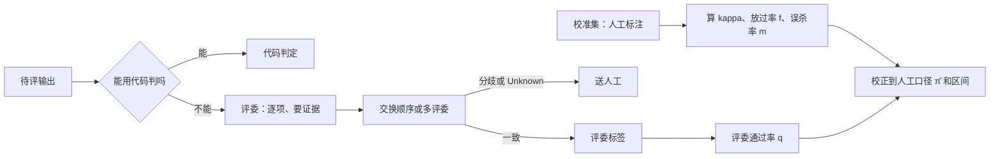

# LLM-as-Judge：偏差、校准与一致性

> 层级：垂类 · evaluation · 预计 150 分钟 · 题目：[questions.md](questions.md)
> 前置：[01 评测设计](../01-eval-design/README.md)（成功标准、标注、置信区间）、[core/09 评测与 Benchmark](../../../core/09-evaluation/README.md)
> 相关：[training/05 奖励与 Verifier](../../training/05-reward-verifier/README.md)（评委当训练奖励时的问题）、[03 轨迹评测](../03-trajectory-eval/README.md)

## 1 这一章解决什么问题

开放式输出没有唯一答案，代码判不了，人工又慢又贵，于是用一个模型来评另一个模型的输出，这个模型叫评委（LLM-as-Judge）。面试官问到这里，一定会追：评委有哪些偏差？怎么证明评委可信？评委说通过率 80%，真实通过率是多少？什么时候不能用评委？

之前常见的做法有两种，各有缺陷。一种是直接让评委打 1-10 分，把平均分当质量。分数没法解释，两次打分常差一两分，评委自己的口味混在分数里。另一种是拿评委和人工算一个一致率，88% 就说“评委可信”。一致率会被类别比例抬高，而且它不告诉你评委错在哪个方向。

这一章回答四件事：评委怎么写，评委会偏在哪、怎么测，怎么用人工标注把评委分数换算到人工口径，多个评委怎么组合。

学完你应该能：

- 说出单答打分、成对比较、参考答案三种评审方式各适合什么，写出逐项、带证据、能返回“不确定”的评委提示；
- 说出位置偏差、冗长偏差、自我偏好的测法和对策，推导交换顺序、不一致记平局为什么能消除位置偏差，以及它的代价；
- 从定义推导 Cohen's kappa，说明它为什么比一致率好、它自己又会在哪里失效；
- 用放过率和误杀率把评委通过率校正到人工口径，并给出包含校准集误差的区间；
- 推导多数投票的准确率随评委数怎么变，说明评委错误相关时投票为什么有上限；
- 判断哪些场景不该交给 LLM 评委。

**本章符号**（后文沿用）：

| 符号 | 含义 |
|---|---|
| π | 按人工口径的真实通过率，是我们想知道的量 |
| q | 评委在待评集上判“通过”的比例 |
| f | 放过率：人工判不过的样本里，评委判过的比例，P(评委过 \| 人工不过) |
| m | 误杀率：人工判过的样本里，评委判不过的比例，P(评委不过 \| 人工过) |
| J | 1 − f − m，评委区分好坏的能力；J = 0 等于乱猜 |
| p_o | 两个标注者的实际一致率 |
| p_e | 偶然一致率：两边各按自己的类别比例独立乱判时的一致率 |
| κ | Cohen's kappa |
| u, v | 成对比较时，评委选中“排在第一个位置的答案”的概率（u 对应 X 在前，v 对应 Y 在前） |
| n | 评委个数；p 是单个评委的正确率 |

下图是一次评委评测的数据流。后面各节分别讲图里的一个环节。



## 2 评委放在哪：三类评分器

Anthropic 的评测工程文章（2026-01）把评分器（grader）分成三类：

| 类型 | 优点 | 缺点 | 适合 |
|---|---|---|---|
| 代码判定 | 快、便宜、客观、可复现、好调试 | 对合理的写法变化很脆，难评开放输出 | 终态、格式、数值、工具调用参数 |
| 模型判定 | 灵活，能评开放输出 | 有随机性，更贵，要和人工校准 | 完整性、相关性、语气、推理质量 |
| 人工判定 | 质量最高，用来校准模型判定 | 贵、慢，专家难扩规模 | 校准集、抽检、高风险样本 |

**原则**：能用代码判的不用模型。一个任务可以挂多个评分器，关键项用二值（必须全过），其余项加权。这样评委的偏差只影响软指标，碰不到事实对错。评分器在 Agent 评测里怎么组合见 [core/09 第 4 节](../../../core/09-evaluation/README.md#4-评分器与-llm-as-judge)。

## 3 评审方式与评委提示

### 3.1 三种评审方式：单答打分、成对比较、参考答案

MT-Bench 论文（Zheng 等，2023）第 3.1 节把 LLM 评委分成三种用法，可以单用也可以组合：

| 方式 | 评委看到什么 | 输出 | 论文指出的优缺点 |
|---|---|---|---|
| 单答打分（single answer grading） | 问题 + 一个回答 | 一个分数或通过 / 不通过 | 扩展性好，每个回答评一次；分辨不出两个回答的细微差别；评委模型一换，绝对分数比相对结论波动更大 |
| 成对比较（pairwise comparison） | 问题 + 两个回答 | A 好、B 好或平局 | 对细微差别更敏感；参赛系统多时，配对数按平方增长；有位置偏差 |
| 参考答案（reference-guided grading） | 问题 + 回答 + 参考解 | 分数或对错 | 有标准解的题（数学、推理）上失败最少；要先有可靠的参考解 |

怎么选：

- **门禁和回归**用单答打分。每条回答独立判，结果能和人工逐条对齐，能直接算通过率。这一章后面的 kappa、放过率、校正公式都建立在单答二值判定上。
- **两个版本谁更好**用成对比较。它回答的是“相对好坏”，适合模型选型、prompt 改版对比。代价是要处理位置偏差（第 4.1 节），而且结论只对这一对系统成立，加一个新系统要重新配对。
- **有标准解但写法不唯一**用参考答案。例如答案对、推理步骤可以不同的数学题，或要点清单明确的问答。参考解本身错了，评委会跟着错，参考解要人工核对过。

MT-Bench 论文报告，在它的数据上 GPT-4 的单答打分和成对比较、和人工的一致率都很高，作者据此认为单答打分“更可扩展”，代价是有时比成对比较略差、平局更多。

### 3.2 评委提示与评分标准

**问题**：只让评委“给这个回答打 1-10 分”，分数没法解释，两次打分常差一两分，也没法和人工逐项对齐。

**做法**：

| 设计 | 做法 | 理由 |
|---|---|---|
| 逐项判 | rubric 拆成几个维度，每项单独判 | 分歧能定位到具体维度 |
| 一维一调用 | 每个维度单独一次评委调用 | Anthropic 文章的建议，用相互隔离的评委逐维评，避免一个评委同时管所有维度 |
| 二值优先 | 能写成“通过 / 不通过”就不用 1-10 分 | 边界清楚，和人工更容易对齐；也是第 5 节校正公式的前提 |
| 先给证据 | 要求引用被评回答的原文，再下结论 | 降低被自信语气说服的概率；Wang 等的 Multiple Evidence Calibration 也是先写评估理由再打分，理由是自回归模型先写结论时，后写的解释支撑不了结论 |
| 允许“不确定” | 信息不够时返回 Unknown | Anthropic 文章的建议，给评委一条退路，减少编结论；Unknown 单独统计送人工 |
| 给参考答案 | 有标准解时放进提示 | MT-Bench 论文中参考引导的评委在数学题上失败最少 |
| 结构化输出 | 用 schema 约束；解析失败算评测失败 | 否则评委一挂，门禁就默认放行 |

一个单维度、二值、带证据和 Unknown 的评委提示骨架：

```text
你在评估客服回复的一个维度：是否告知了用户下一步要做什么。
只判这一项，不考虑语气、长度和其他维度。回答长不加分。

[对话]
{conversation}

步骤：
1. 从回复里逐字摘出和“下一步操作”有关的句子；没有就写“无”。
2. 判断摘出的句子是否让用户知道具体要做什么（去哪里、点什么、等多久）。
3. 对话信息不足以判断时，结论写 Unknown。

只输出 JSON：
{"evidence": ["摘句1", ...], "reason": "一句话", "verdict": "PASS" | "FAIL" | "Unknown"}
```

**代价**：维度拆得越细、调用越多，成本线性上涨。rubric 一改就是换了尺子，旧分数不能直接比，要在同一批样本上重跑旧版本。

### 3.3 G-Eval：先生成评估步骤，再按概率加权打分

G-Eval（Liu 等，2023）解决的是“直接让模型打 1-5 分”的两个问题。论文第 2 节写道：一是某个分数常常占绝大多数（例如 1-5 分里几乎都是 3），分数方差小，和人工的相关性低；二是即使要求输出小数，模型通常也只给整数，出现大量平局。

它的做法分三步：

1. **自动生成评估步骤**。提示里只给任务说明和评价标准，加一行“Evaluation Steps:”，让模型自己写出评估步骤（思维链）。
2. **按表单填分**。把任务说明、生成的步骤、原文和待评文本一起给模型，让它按表单输出分数。
3. **概率加权**。不取模型输出的那个整数，而是用每个分数 token 的概率做加权和：

```text
score = Σ_{i=1..n} p(s_i) × s_i
s_i：预设的分数（例如 1 到 5）；p(s_i)：模型输出这个分数 token 的概率
```

加权分是连续值，能分开两个“都是 3 分”的回答。拿不到 token 概率的模型，论文设 n = 20、temperature = 1、top_p = 1 采样 20 次来估计概率。采样估计有误差：第 8.5 节的代码算出，在一个两条回答加权分只差 0.15 的例子里，20 次采样的估计约有四分之一会排反或打平。

论文第 4 节还做了一个偏差实验：把人写的摘要和模型写的摘要放在一起，按人工偏好分三组。即使人工更偏好人写的摘要，G-Eval 也总是给模型写的摘要更高分。作者提醒，用 LLM 指标做训练信号可能让模型自我强化。

**代价**：概率加权要 logprob 接口；没有就靠多次采样，成本按采样次数增长。自动生成的评估步骤每次可能不同，要把生成好的步骤固定下来，作为 rubric 的一部分做版本管理。

## 4 三种偏差

主要证据来自 MT-Bench 论文（Zheng 等，2023）第 3.3、3.4 节和附录 D.1。偏差指评委的判断随着和质量无关的因素系统性地变化。随机波动可以靠多评几次平均掉，偏差不行，因为它每次都偏同一个方向。

### 4.1 位置偏差

**现象**：成对比较时，评委偏好某个位置的答案，常见是第一个。

**测法**：同一对答案正序、倒序各评一次，结论不变的比例叫交换一致率（consistency）。MT-Bench 论文用 GPT-3.5 对 MT-Bench 每道第一轮问题以 temperature 0.7 生成两份相近的答案，测了三个评委模型，默认提示下一致率只有 23.8% 到 65.0%；多数评委偏向第一个位置。把助手改名后再测（“rename” 提示），还发现有一个评委偏向“Assistant A”这个名字。附录 D.1 按类别拆开：写作、人文类的一致率是 42%、36%，数学、代码都是 86%。按模型对拆开：两个系统水平越接近，偏差越明显，水平差得很远时偏差几乎消失。

Wang 等（2023）的标题就是“Large Language Models are not Fair Evaluators”。以 ChatGPT 做评委时，只调换顺序，Vicuna-13B 就能在 80 道题中的 66 道上胜过 ChatGPT。同一个评委在交换顺序后给出矛盾结论的比例（论文叫 conflict rate），以 ChatGPT 为评委、Vicuna-13B 对 ChatGPT 这一对上是 66/80（论文表 2）。

**对策**：

- 交换顺序各评一次，两次都选同一个答案才算赢，结论翻转记平局（MT-Bench 的保守做法）。
- 把两次分数平均（Wang 等的 Balanced Position Calibration，BPC）。和 Multiple Evidence Calibration 合起来，每对答案正倒序各采 k 次，取 2k 个分数的平均。
- 规模很大时随机分配位置，让偏差在总体上抵消（MT-Bench 说的激进做法）。
- 结论翻转多的样本送人工。Wang 等的 Human-in-the-Loop Calibration 用 2k 次结果（胜 / 平 / 负）的熵（BPDE）挑样本，熵高说明评委自己拿不准。论文报告，在它的 80 题标注集上，只人工标 20% 的样本，评委的对齐程度就能接近或超过人工平均水平。
- 翻转比例高的场景，改成单答打分。

**为什么交换顺序、翻转记平局能消除位置偏差（推导）**。对一对答案 X、Y，记评委在顺序 (X, Y) 下选 X 的指示量为 a，在顺序 (Y, X) 下选 Y 的指示量为 c，都取 0 或 1。X 的得分（赢 1、平 0.5、输 0）：

```text
X 赢：a = 1 且 c = 0；X 输：a = 0 且 c = 1；其余记平
score_swap = a(1 − c) + 0.5 · [ a·c + (1 − a)(1 − c) ]
           = 0.5 · ( a + (1 − c) )
```

右边的 a 是“只评一次、X 在前”时 X 的得分，1 − c 是“只评一次、Y 在前”时 X 的得分。所以交换后记平局的得分，逐样本等于两种顺序单次得分的平均。随机分配位置的期望也是这个平均。三种做法期望相同，区别只在方差和成本。

再看平均为什么能抵消偏差。设评委按 logistic 模型判：选中第一个位置的概率是 σ(αΔ + b)。Δ 是第一个答案减第二个答案的真实质量差，α 是评委对质量差的敏感度，b 是偏向第一个位置的强度，σ(x) = 1/(1 + e^(−x))。对 X、Y 的质量差 Δ：

```text
E[a]     = σ(αΔ + b)                  X 在前，选第一个
E[1 − c] = 1 − σ(−αΔ + b) = σ(αΔ − b) Y 在前，不选第一个（用了 1 − σ(x) = σ(−x)）
E[score_swap] = 0.5 · [ σ(αΔ + b) + σ(αΔ − b) ]
```

- Δ = 0 时，σ(b) + σ(−b) = 1，得分正好 0.5。质量相同的两个系统不会因为谁在前而分出胜负。
- Δ ≠ 0 时，σ(αΔ + b) + σ(αΔ − b) − 1 = σ(αΔ + b) − σ(b − αΔ)。σ 单调，这个差大于 0 当且仅当 αΔ + b > b − αΔ，即 Δ > 0。所以方向一定对。
- 只评一次时，E[a] = σ(αΔ + b)。只要 b 足够大，即使 Δ < 0 也能大于 0.5，结论被位置决定。

**代价（推导）**：b 越大，两项越往两头分开，平均值越靠近 0.5。偏差被消掉了，分辨率也跟着丢了：真实质量差没变，得分却更接近平局。第 8.2 节的模拟里 α = 1、Δ 的均值为 0.3，b 从 0.5 增大到 2，一致率从约 0.62 降到约 0.35，X 的得分从 0.554 降到 0.535。另外这个得分是“评委眼里的胜率”，不等于真实胜率（模拟里真实胜率 0.584）。要得到人工口径的胜率，还是要和人工校准。评委成本翻倍。

**适用条件**：推导假设位置偏差是加在 logit 上的常数 b，和答案内容无关。如果评委只在某类题上偏（例如写作类），按类别分别看一致率，不要只看总体。

### 4.2 冗长偏差

**现象**：评委偏好更长、更啰嗦的回答，即使长回答并不更清楚、更准确。

**测法**：MT-Bench 论文的“重复列表”攻击。从 MT-Bench 选 23 个含编号列表的回答，让模型把列表改写一遍、不加任何新信息，插到原列表前面。例如原来 5 条，新回答有 10 条，前 5 条是改写。评委认为加长版更好就算攻击成功。论文表 3：两个较弱的评委失败率都是 91.3%，最强的那个是 8.7%。作为对照，三个评委对两份完全相同的回答都能正确判平局。

通用的测法是做**成对对照样本**：同一个回答，只改长度、不改信息，看评委的判断变不变。变了多少，就是冗长偏差有多大。

**对策**：rubric 写明长度不加分；按要点覆盖判，不按篇幅；在校准集里放“短而全”和“长而空”的对照样本，单独看评委在这类样本上的放过率和误杀率。

**冗长偏差为什么比位置偏差难处理**：位置可以交换，长度不能交换。冗长偏差没有对称的“正序倒序”可以抵消，只能靠 rubric、对照样本和人工校准。被评系统如果知道评委偏爱长回答（例如用评委做训练奖励），它会越写越长，见 [training/05 第 6 节](../../training/05-reward-verifier/README.md#6-reward-hacking规律模式与防御)。

### 4.3 自我偏好

**现象**：评委偏好自己生成的文本。

MT-Bench 论文把它叫 self-enhancement bias。论文图 3(b) 里，和人工相比，有两个评委给自己的胜率分别高约 10% 和 25%，但它们也偏好别的模型，另一个评委则不偏好自己。作者明确说数据有限、差异小，不能确定是否存在自我偏好，而且很难做对照实验，因为没法只改风格不改质量。

Panickssery 等（2024）做了对照研究，在两个摘要数据集上发现：

1. 三个模型做评委时，都不成比例地偏好自己写的摘要，胜过其他模型和人写的。
2. 不微调时，三个模型区分“自己写的”和“别人写的”准确率都超过 50%。
3. 用 500 个样本微调后，自我识别准确率超过 90%。
4. 用微调改变自我识别能力，自我偏好的强度和自我识别能力近似线性相关（论文图 1）。

测量时，论文对每个成对样本交换顺序各问一次，取两次置信度的平均，用来抵消位置偏差。论文报告，三个评委交换顺序后偏好反转的比例分别约为 25%、58%、89%。这说明测任何一种偏差时，都要先把位置偏差控制住，否则测到的是两种偏差的混合。

G-Eval 论文第 4 节也有相关观察：评委给模型写的摘要打分高于人写的，即使人工偏好人写的。

**测法**：拿评委给各来源输出的胜率，和人工在同一批样本上的胜率比。高出的部分是偏好的上界估计（里面可能混有其他偏差）。

**对策**：评委和被评系统用不同模型；或用多个不同来源的评委取多数。

**为什么只看分数发现不了**：自我偏好每次都偏同一个方向，同一评委内部的分数看不出任何异常。用第 5.4 节的话说，它让评委在“自家输出”这一层上放过率更高。只有分层算放过率，或者和人工比，才看得出来。

### 4.4 还有两类问题

- **被答案带偏**：MT-Bench 论文发现，评委自己能做对的数学题，看了被评答案之后会被带着判错。论文表 4 在 10 道数学题、交换顺序共 20 次判断上测失败次数：默认提示 14/20，让评委先独立解题的 CoT 提示 6/20，先单独生成评委自己的答案、再作为参考答案插入提示 3/20。CoT 提示仍会犯和被评答案一样的错，说明评委会被上下文带偏，所以参考答案要在看到被评答案之前生成。
- **谄媚与被说服**：回答里写“经过仔细验证，以上完全正确”，评委更容易放过。对策还是要求逐项给证据，并在校准集里放这类对抗样本。

**少样本示例能修偏差吗**：MT-Bench 论文用 3 个示例（A 好、B 好、平局各一）把一个评委的一致率从 65.0% 提到 77.5%，但提示变长让调用贵了约 4 倍。作者也提醒，一致率高不等于准确率高，示例还可能引入新偏差。

## 5 与人工对齐：一致率、kappa、校准与校正

**问题**：评委自己说的分数没有意义，可信度只能通过和人工比来证明。比完之后还有两个问题：用什么指标比，比出来的结果怎么用到评委的分数上。

### 5.1 校准集怎么建

1. 抽一个校准集，覆盖各层和难样本，不只抽容易判的。
2. 人工先两人独立标，算人与人的一致性，作为评委能达到的上限参考。MT-Bench 论文的 58 位专家标注里，不计平局时 GPT-4 和人工的一致率是 85%，人与人之间是 81%（论文表 5 的 S2 设置）。注意论文的一致率定义是“随机挑一个人和评委、在随机一道题上意见相同的概率”，人与人的一致率按这个定义会被低估，论文附录 D.3 专门讨论了这一点。
3. 算评委和人工的一致率、Cohen's kappa，再拆开看放过率和误杀率（下面三小节）。
4. 读分歧样本。多数分歧来自 rubric 含糊，就改 rubric；少数是人工标错，就修标注。改完重算。
5. 定期复测。评委模型升级、rubric 改动、被评系统大改之后都要重新校准。

样本量和置信区间的算法见 [01 第 6 节](../01-eval-design/README.md#6-统计显著性与样本量)。校准集太小，一致率本身误差就很大：30 条里差 3 条，一致率就差 10 个点。

### 5.2 一致率为什么不够：偶然一致

一致率 p_o 是两边标签相同的比例。它的问题是：两个完全不看内容、各自乱判的标注者，也会有不低的一致率。

设人工判“通过”的比例是 π，评委判“通过”的比例是 q。两边互相独立时，同时判过的概率是 π·q，同时判不过的概率是 (1 − π)(1 − q)。偶然一致率是两者之和：

```text
p_e = π·q + (1 − π)(1 − q)
多类别时：p_e = Σ_k P(人工判 k) · P(评委判 k)
```

π = q = 0.8 时，p_e = 0.64 + 0.04 = 0.68。也就是说，一个和人工毫无关系、只是同样“八成判过”的评委，一致率期望就有 68%。一个全判通过的评委（q = 1），一致率正好等于 π。

### 5.3 Cohen's kappa：从定义推导

Cohen（1960）的想法：一致率里有一部分是偶然的，只看超出偶然的部分。超出偶然的一致是 p_o − p_e，最多能超出 1 − p_e（p_o = 1 时）。kappa 是实际超出量占最大可能超出量的比例：

```text
κ = (p_o − p_e) / (1 − p_e)
```

- κ = 1：完全一致。
- κ = 0：和两个独立乱判的人一样，评委没带来任何超出偶然的信息。
- κ < 0：比乱判还差，评委和人工系统性地反着判。

二分类时可以写成 2×2 表的闭式。记 a 是两边都判过，b 是人工过、评委不过，c 是人工不过、评委过，d 是两边都不过，N = a + b + c + d：

```text
p_o = (a + d)/N
p_e = [ (a + b)(a + c) + (c + d)(b + d) ] / N²
分子分母同乘 N²，展开后 a²、d²、ab、ac、bd、cd 都消掉：
N(a + d) − (a + b)(a + c) − (c + d)(b + d) = 2(ad − bc)
N² − (a + b)(a + c) − (c + d)(b + d)       = (a + b)(b + d) + (a + c)(c + d)
κ = 2(ad − bc) / [ (a + b)(b + d) + (a + c)(c + d) ]
```

分子 ad − bc 是 2×2 表的“交叉积差”，两边独立时它的期望为 0。这就是 kappa 能扣掉偶然一致的原因。

**例**：100 条，人工判通过 80 条。评委判 82 条通过，其中 75 条人工也判通过。

| | 评委过 | 评委不过 |
|---|---|---|
| 人工过 | 75 | 5 |
| 人工不过 | 7 | 13 |

- p_o = (75 + 13) / 100 = 0.88
- p_e = 0.8 × 0.82 + 0.2 × 0.18 = 0.692
- κ = (0.88 − 0.692) / 0.308 ≈ 0.61；用闭式：2(75·13 − 5·7) / (80·18 + 82·20) = 1880 / 3080 ≈ 0.61

88% 的一致率看着不错，但人工判不过的 20 条里，评委放过了 7 条。一个全判“通过”的评委，一致率也有 80%，kappa 却是 0。

**kappa 为什么比一致率好**：它扣掉了由类别比例带来的偶然一致，“全判通过”“按比例乱判”这类没用的评委得到 0，而不是 80%、68%。

**kappa 自己的局限（推导）**：kappa 仍然依赖类别比例。设评委的放过率 f、误杀率 m 固定为 10%，只改人工通过率 π：

```text
p_o = π(1 − m) + (1 − π)(1 − f)
q   = π(1 − m) + (1 − π)f
π = 0.5：p_o = 0.9，q = 0.5，p_e = 0.5，κ = 0.80
π = 0.95：p_o = 0.9，q = 0.86，p_e ≈ 0.824，κ ≈ 0.43
```

同一个评委、同样的错误率，换一个通过率更高的数据集，kappa 从 0.80 掉到 0.43。所以 kappa 适合在同一个数据集上比较不同评委，不适合跨数据集比较，也不适合当“评委本身的属性”。评委本身的属性是 f 和 m。第 8.1 节的代码验证了这几个数字。

### 5.4 拆开两类错误：放过率和误杀率

放过（人工不过、评委过）决定会不会漏掉坏答案，误杀（人工过、评委不过）决定会不会冤枉好答案。两者的分母不同：

```text
放过率 f = c / (c + d)     分母是人工判不过的条数
误杀率 m = b / (a + b)     分母是人工判过的条数
```

上面的例子里 f = 7/20 = 0.35，m = 5/80 = 0.0625。用医学检测的话说，1 − m 是灵敏度，1 − f 是特异度。

f 和 m 是按人工标签条件化的，所以它们不随数据集的通过率变化（前提是评委在各类样本上的行为不变）。这是它们比 kappa 更适合当“评委属性”的原因，也是下一节校正公式能成立的原因。

**按场景设门槛**：高风险场景（放过一次代价大）单独设放过率上限；用户体验场景（误杀会让好版本发不出去）关注误杀率。两者都要报置信区间，校准集里人工判不过的样本往往少，f 的区间通常最宽。

### 5.5 把评委通过率换算到人工口径

**问题**：评委在 2000 条新输出上判出 80% 通过。按人工口径，真实通过率 π 是多少？

**推导**。对一条随机抽的样本，评委判过有两条路：人工本来就过、评委没误杀；人工不过、评委放过了。按全概率公式：

```text
q = P(评委过)
  = P(评委过 | 人工过)·P(人工过) + P(评委过 | 人工不过)·P(人工不过)
  = (1 − m)·π + f·(1 − π)
  = f + (1 − f − m)·π
```

q 是 π 的线性函数，斜率是 J = 1 − f − m。解出 π：

```text
π̂ = (q − f) / (1 − f − m)
```

这个形式在流行病学里用来从筛查阳性率估计真实患病率，常称 Rogan-Gladen 估计（Rogan、Gladen，1978）。用灵敏度 Se = 1 − m、特异度 Sp = 1 − f 写，就是 π̂ = (q + Sp − 1) / (Se + Sp − 1)。

从推导能直接读出几件事：

- **直接报 q 有系统偏差**：q − π = f(1 − π) − mπ。放过多就偏高，误杀多就偏低。π = 0.7、f = 0.3、m = 0.08 时，q 偏高 0.09 − 0.056 = 0.034。
- **J 是评委的分辨力**：J = 0 时评委不管好坏都以同样概率判过，q 里不含 π 的信息，没法校正。J 越小，校正后的方差越大（分母小）。
- **比较两个版本时，差距被压缩**：同一评委下 q_B − q_A = J·(π_B − π_A)。f、m 不变时，方向是对的，但真实差 5 个点、J = 0.62 时评委只看到约 3.1 个点。如果新版本改变了出错方式（例如回答变长，冗长偏差让 f 变大），f、m 就不再相同，方向也可能错。
- **π̂ 可能落到 [0, 1] 之外**：q < f 或 q > 1 − m 时会这样，通常截断到边界，并把它当作“校准集和待评集不匹配”的信号去排查。

**区间（推导）**。q̂、f̂、m̂ 分别来自待评集（N 条）、校准集里人工不过的 n₀ 条和人工过的 n₁ 条，三者独立。对 π̂ = (q − f)/J 求偏导：

```text
∂π̂/∂q = 1/J
∂π̂/∂f = [ −J + (q − f) ] / J² = −(1 − π)/J
∂π̂/∂m = (q − f) / J²       = π/J
```

用 delta 方法（一阶泰勒展开后按独立变量加方差）：

```text
Var(π̂) ≈ [ q(1−q)/N + (1−π)²·f(1−f)/n₀ + π²·m(1−m)/n₁ ] / J²
95% 区间：π̂ ± 1.96·√Var(π̂)
```

例子里 q = 0.80、N = 2000，f = 0.35、n₀ = 20，m = 0.0625、n₁ = 80：π̂ ≈ 0.766，区间约 [0.654, 0.878]。三项里第二项最大，误差主要来自只有 20 条人工判不过的样本。第 9 节用这组数字走一遍，第 8.3 节的代码用模拟验证了校正的无偏性和区间的覆盖率。

**另一种做法：prediction-powered inference（PPI）**。Angelopoulos 等（2023）给出的均值估计是：

```text
θ̂_PP = (1/N) Σ 评委标签（待评集） − (1/n) Σ (评委标签 − 人工标签)（有人工标注的样本）
```

第二项叫 rectifier，估计评委标签相对真值的平均偏差。它不假设评委的错误结构，但要求有人工标注的样本和待评集来自同一分布。两种做法的前提不同：

| | Rogan-Gladen 式校正 | PPI 均值估计 |
|---|---|---|
| 假设 | 评委的 f、m 在校准集和待评集上相同 | 有人工标注的样本是待评集分布的随机样本 |
| 校准集可以分层、多抽难样本吗 | 可以，f、m 按人工标签条件估计 | 不行，抽样比例要和待评集一致，否则有偏 |
| 被评系统换版本后 | 评委出错方式不变就能复用 | 要从新版本输出里重新抽样标注 |
| 失效方式 | 评委在新分布上 f、m 变了（例如新版本回答更长） | 校准集和待评集分布不同 |

第 8.3 节的代码对比了这一点：校准集随机抽样时两者都接近真值；校准集来自通过率不同的旧版本时，Rogan-Gladen 式校正仍成立，直接套 PPI 偏了约 7 个点。

**不做这一步时**，评委分数只适合比较同一评委下的两个版本（而且要假设两个版本的出错方式相近），不适合作为“系统准确率”对外宣称。

### 5.6 评委给出概率时：置信度校准

上面的“校准”指让评委的结论和人工对齐。还有一层意思：评委如果输出概率（例如 G-Eval 的加权分、或用“通过”token 的概率），这个概率准不准。检查方法是分桶：把评委说“0.8 概率通过”的样本放一桶，看人工判过的比例是不是接近 80%。

概率校准好的评委有两个用处：可以按概率设阈值，在放过率和误杀率之间取舍；可以把概率居中（例如 0.4 到 0.6）的样本送人工，比按“交换后翻转”挑样本更细。概率校准得不好时，只用它排序，不用它的绝对值。

## 6 一致性与多评委

### 6.1 三种“一致”别混

| 概念 | 衡量什么 | 能说明什么 |
|---|---|---|
| 自一致（同一输入评多次） | 评委稳不稳 | 只说明稳定，不说明对 |
| 交换一致（换顺序） | 位置偏差有多大 | 低说明两两比较不可用 |
| 评委与人工一致 | 评委准不准 | 这才是能否使用的依据 |

自一致高、和人工一致低，说明评委稳定地错，通常是 rubric 和人工的理解不同，或者评委有系统偏差。自一致低，说明评委在这类样本上拿不准，多次采样取多数能有帮助。

### 6.2 多数投票为什么有用：独立的情况（推导）

设 n 个评委（n 为奇数），每个在某条样本上判对的概率都是 p，彼此独立。多数投票判对，当且仅当判对的评委超过一半。判对的个数 K 服从二项分布 Binomial(n, p)：

```text
P(多数判对) = P(K > n/2) = Σ_{k=(n+1)/2}^{n} C(n, k) · p^k · (1 − p)^(n−k)
```

p = 0.75 时：n = 1 是 0.75，n = 3 是 0.844，n = 5 是 0.896，n = 9 是 0.951。

同一个二项式也出现在 [core/05 第 2.2 节](../../../core/05-planning-reasoning/README.md#22-self-consistency投票能把正确率推到多高)（Self-Consistency）和 [core/08 第 5.4 节](../../../core/08-multi-agent/README.md#54-错误独立与相关串联和投票的成功率)（多 Agent 投票），这里投票的是评委。

n = 3 可以手算：至少 2 个判对的概率 = 3p²(1 − p) + p³ = 3 × 0.5625 × 0.25 + 0.4219 ≈ 0.844。

p > 0.5 时，n 增大，K/n 按大数定律集中到 p，超过 1/2 的概率趋向 1。这就是 Condorcet 陪审团定理。反过来，p < 0.5 时 K/n 集中到 p < 1/2，投票越多越确定地判错。所以单个评委在某类样本上系统性判错时（例如冗长偏差让它在“长而空”样本上的正确率低于一半），加评委只会把错误放大。

偶数个评委会出平票。要求严格多数时，4 个评委的正确率（0.738）反而低于 3 个（0.844），因为 2:2 平票全算没判对。用奇数个评委，或把平票送人工。

### 6.3 错误相关时：投票有上限（推导）

真实的评委错误不独立。同一个模型多次采样，错在同一类样本上；同一家族的几个模型，有相同的盲区和偏差。用一个最简单的模型描述相关：每条样本以概率 c 落在“共同盲区”，这时所有评委给出同一个判断，判对的概率是 p；以概率 1 − c 落在其他地方，评委独立判。

```text
P(多数判对) = c · p + (1 − c) · P(Binomial(n, p) > n/2)
n → ∞ 时上限 = c · p + (1 − c)
```

c = 0.5、p = 0.75 时，n = 9 只到 0.851，上限是 0.875。从 9 个评委加到 15 个，独立时正确率涨约 3.2 个点，相关时只涨约 1.6 个点。共同盲区里的错误，投多少票都去不掉。

这解释了两条工程经验：

- **同一评委多次采样**只能消掉“随机”那部分错误（自一致低的部分），消不掉偏差。
- **不同来源的评委**错误相关性更低，c 更小，投票的收益更大。用同一家族的几个模型投票，以为对冲了自我偏好，实际上 c 很大。

第 8.4 节的代码模拟了独立和相关两种情况，验证了上面的公式和数字。

### 6.4 多评委的做法和代价

- 同一评委采样多次，取多数，降低随机性；
- 不同模型做评委，取多数或平均，对冲自我偏好；
- 评委意见不一致的样本送人工。评委分歧本身是一个有用的信号，和 Wang 等用 BPDE 挑样本是同一个思路。
- 高风险样本不取多数，任何一个评委判不过就送人工。这相当于用误杀率换放过率。

**代价**：成本按评委数线性增加，收益却按上面的公式递减，相关时还有上限。实用做法是先用 2 到 3 个不同来源的评委，只对分歧样本加评委或送人工。

**降级要注意**：主评委限流时换备用评委，备用评委也要和人工校准过；换评委等于换尺子，f、m 不同，前后分数不能直接比。

## 7 什么时候不能用 LLM 评委

| 场景 | 为什么不行 | 用什么 |
|---|---|---|
| 答案可被确定性判定（数值、终态、测试） | 评委只会引入噪声和偏差 | 代码判定 |
| 评委自己不会做的题 | 评不了，还会被答案带偏 | 参考答案 + 代码判定，或专家 |
| 需要外部事实核验，评委拿不到来源 | 只能凭印象判真假 | 给评委检索到的来源，或人工 |
| 高风险决定（安全、合规、不可逆操作） | 放过一次代价很高，校准集里坏样本少，f 的区间太宽 | 规则一票否决 + 人工复核 |
| 用评委分数直接做训练奖励 | 策略会学会讨好评委，分数涨、质量不涨；冗长偏差会被放大成越写越长 | 规则奖励为主，评委定期和人工对齐，见 [training/05](../../training/05-reward-verifier/README.md) |
| 被评系统和评委是同一个模型 | 自我偏好让放过率偏高，单看分数发现不了 | 换不同来源的评委，或人工 |
| 没有做过任何人工校准 | 评委口径就是它自己的口味，J 和 f、m 都未知 | 先建校准集 |

最后一条可以用第 5.5 节的公式说清：没有 f、m，就没法从 q 推回 π，也不知道两个版本的分差被压缩了多少。

## 8 实现：只用 numpy 验证上面的结论

下面每段代码都能单独运行，结尾用 assert 检查正文的结论或数字。标签约定：1 或 True 是“通过”，0 或 False 是“不通过”；人工标签记 h，评委标签记 j，形状都是 (样本数,)。

### 8.1 Cohen's kappa：偶然一致时 kappa 约为 0

验证第 5.3 节的算例和闭式、全判通过的评委 kappa 为 0、两个独立乱判的标注者一致率 0.68 而 kappa 约为 0，以及同样的错误率下 kappa 随通过率变化。

```python
import numpy as np

def cohen_kappa(a, b):
    """a, b: (n,) 两个标注者给同一批样本的标签。返回 (p_o, p_e, kappa)。"""
    a, b = np.asarray(a), np.asarray(b)
    labels = np.union1d(a, b)
    p_o = np.mean(a == b)                                      # 实际一致率
    p_e = sum(np.mean(a == k) * np.mean(b == k) for k in labels)  # 按各自边际独立判的一致率
    if np.isclose(p_e, 1.0):
        raise ValueError("两边都只用了同一个类别，kappa 无定义")
    return p_o, p_e, (p_o - p_e) / (1 - p_e)

# 1) 正文 5.1 的 2×2 表：人工过 80 条，评委过 82 条，两边都过 75 条
a, b, c, d = 75, 5, 7, 13          # a 都过，b 人工过评委不过，c 人工不过评委过，d 都不过
human = np.array([1] * a + [1] * b + [0] * c + [0] * d)
judge = np.array([1] * a + [0] * b + [1] * c + [0] * d)
p_o, p_e, k = cohen_kappa(human, judge)
assert np.isclose(p_o, 0.88) and np.isclose(p_e, 0.692) and abs(k - 0.610) < 0.001
# 二分类的闭式写法：2(ad − bc) / ((a+b)(b+d) + (a+c)(c+d))
assert np.isclose(k, 2 * (a * d - b * c) / ((a + b) * (b + d) + (a + c) * (c + d)))
# 放过率和误杀率：分母分别是人工判不过、人工判过的条数
assert np.isclose(c / (c + d), 0.35) and np.isclose(b / (a + b), 0.0625)

# 2) 全判通过的评委：一致率等于正样本比例 0.80，kappa 正好是 0
p_o, p_e, k = cohen_kappa(human, np.ones(100, dtype=int))
assert np.isclose(p_o, 0.80) and np.isclose(k, 0.0)

# 3) 偶然一致：评委和人工各自以 0.8 的概率判过、互相独立
rng = np.random.default_rng(0)
pos, ks = [], []
for _ in range(2000):
    h = rng.random(200) < 0.8
    j = rng.random(200) < 0.8
    p_o, _, k = cohen_kappa(h, j)
    pos.append(p_o)
    ks.append(k)
assert abs(np.mean(pos) - 0.68) < 0.01     # 0.8·0.8 + 0.2·0.2，看着不低
assert abs(np.mean(ks)) < 0.01             # 扣掉偶然一致后什么都不剩

# 4) kappa 还随正样本比例变：放过率、误杀率都是 10%，只改人工通过率 π
def kappa_from_rates(pi, miss, false_pass):
    """pi: 人工通过率；miss: 误杀率；false_pass: 放过率。返回期望 kappa。"""
    p_o = pi * (1 - miss) + (1 - pi) * (1 - false_pass)
    q = pi * (1 - miss) + (1 - pi) * false_pass             # 评委通过率
    p_e = pi * q + (1 - pi) * (1 - q)
    return (p_o - p_e) / (1 - p_e)

k_half, k_skew = kappa_from_rates(0.5, 0.1, 0.1), kappa_from_rates(0.95, 0.1, 0.1)
assert np.isclose(k_half, 0.8) and abs(k_skew - 0.43) < 0.01
print(f"偶然一致：平均一致率 {np.mean(pos):.3f}，平均 kappa {np.mean(ks):+.4f}")
print(f"同样 10%/10% 的错误率：π=0.5 时 kappa={k_half:.2f}，π=0.95 时 kappa={k_skew:.2f}")
```

结果：独立乱判时平均一致率 0.680，平均 kappa 约 −0.001；同样 10% 的放过率和误杀率，π = 0.5 时 kappa = 0.80，π = 0.95 时只有 0.43。

### 8.2 带位置偏差的评委：交换顺序、翻转记平局

评委按第 4.1 节的 logistic 模型判：选中第一个位置的概率是 σ(αΔ + b)。两个系统各答 n 道题，每题质量是系统均值加标准正态噪声。

```python
import numpy as np

rng = np.random.default_rng(1)

def judge_first(q_first, q_second, alpha, b, rng):
    """有位置偏差的评委：返回 True 表示选了第一个位置的答案。
    q_first, q_second: (n,) 两份答案的真实质量；alpha: 对质量差的敏感度；b: 偏向第一个位置的强度。"""
    p = 1 / (1 + np.exp(-(alpha * (q_first - q_second) + b)))
    return rng.random(q_first.shape) < p

def evaluate(mu_x, mu_y, b, n=200_000, alpha=1.0):
    """X、Y 两个系统各答 n 道题，返回几种计分方式下 X 的得分（赢 1，平 0.5）。"""
    qx = mu_x + rng.normal(0, 1, n)
    qy = mu_y + rng.normal(0, 1, n)
    xy = judge_first(qx, qy, alpha, b, rng)       # 顺序 (X, Y)：True 表示选 X
    yx = judge_first(qy, qx, alpha, b, rng)       # 顺序 (Y, X)：True 表示选 Y
    x_win = xy & ~yx                              # 两个顺序都选 X
    y_win = ~xy & yx                              # 两个顺序都选 Y
    tie = ~(x_win | y_win)                        # 结论翻转，记平局
    return {
        "x_first": xy.mean(),                     # 只评一次，X 总在前
        "y_first": 1 - yx.mean(),                 # 只评一次，Y 总在前
        "swap": x_win.mean() + 0.5 * tie.mean(),  # MT-Bench 的保守做法
        "consistency": 1 - tie.mean(),            # 交换一致率
        "first_both": (xy & yx).mean(),           # 两次都选第一个位置
        "second_both": (~xy & ~yx).mean(),        # 两次都选第二个位置
        "random": np.where(rng.random(n) < 0.5, xy, ~yx).mean(),  # 每题随机决定谁在前，只评一次
        "truth": (qx > qy).mean(),                # 真实的 X 胜率
    }

# 0) 恒等式：交换顺序、翻转记平局的得分 = 两种单次顺序得分的平均（逐样本成立，不需要独立性）
r = evaluate(0.3, 0.0, b=1.0)
assert np.isclose(r["swap"], (r["x_first"] + r["y_first"]) / 2)

# 1) 两个系统质量相同、评委偏向第一个位置
r = evaluate(0.0, 0.0, b=1.0)
assert r["x_first"] > 0.6 and r["y_first"] < 0.4    # 只评一次：谁在前谁赢
assert abs(r["swap"] - 0.5) < 0.005                 # 交换顺序、翻转记平局：偏差消失
assert r["first_both"] > 5 * r["second_both"]       # 翻转的样本大多是“两次都选第一个”

# 2) X 真的更好，但位置偏差足够大时，单次评测能把结论翻过来
r = evaluate(0.3, 0.0, b=2.0)
assert r["truth"] > 0.55                            # 真实情况：X 更好
assert r["y_first"] < 0.5                           # 把 Y 放前面评一次，X 得分低于 0.5，结论变成 Y 更好
assert r["swap"] > 0.5                              # 交换后方向恢复正确

# 3) 随机分配位置：期望和交换顺序一样，都等于两种单次顺序得分的平均
r = evaluate(0.3, 0.0, b=2.0)
assert abs(r["random"] - r["swap"]) < 0.01

# 4) 代价：偏差越大，一致率越低，平局越多，分辨率越差
low, high = evaluate(0.3, 0.0, b=0.5), evaluate(0.3, 0.0, b=2.0)
assert high["consistency"] < low["consistency"] - 0.2
assert abs(high["swap"] - 0.5) < abs(low["swap"] - 0.5)    # 得分被平局往 0.5 拉
print(f"b=0.5：一致率 {low['consistency']:.2f}，X 得分 {low['swap']:.3f}")
print(f"b=2.0：一致率 {high['consistency']:.2f}，X 得分 {high['swap']:.3f}，真实胜率 {high['truth']:.3f}")
```

结果：质量相同时，只评一次谁在前谁赢（约 0.68 对 0.32），交换后得分回到 0.500；X 真的更好但 b = 2 时，把 Y 放前面评一次会得出相反结论，交换后方向恢复。代价是 b 从 0.5 增大到 2，一致率从约 0.62 降到约 0.35，得分被平局往 0.5 拉。

### 8.3 误分类校正：评委通过率换算到人工口径

验证第 5.5 节的公式、区间和两种做法的前提。待评集只有评委标签，校准集同时有人工和评委标签。

```python
import numpy as np

rng = np.random.default_rng(2)

def corrected_pass_rate(q, f, m):
    """q: 评委在待评集上的通过率；f: 放过率 P(评委过|人工不过)；m: 误杀率 P(评委不过|人工过)。
    返回按人工口径的通过率估计 π̂ = (q − f) / (1 − f − m)。"""
    J = 1 - f - m
    if J <= 0:
        raise ValueError("1 − f − m ≤ 0：评委不比乱猜强，无法校正")
    return (q - f) / J

def corrected_ci(q, N, f, n_neg, m, n_pos, z=1.96):
    """delta 方法的近似 95% 区间。N: 待评集条数；n_neg / n_pos: 校准集里人工判不过 / 判过的条数。"""
    J = 1 - f - m
    pi = (q - f) / J
    var = (q * (1 - q) / N + (1 - pi) ** 2 * f * (1 - f) / n_neg + pi ** 2 * m * (1 - m) / n_pos) / J ** 2
    return pi - z * var ** 0.5, pi + z * var ** 0.5

def simulate(pi_true, f, m, N, n_cal):
    """生成一次实验：待评集 N 条只有评委标签；校准集 n_cal 条有人工和评委两种标签。"""
    def judge(human):
        u = rng.random(human.shape)
        return np.where(human, u >= m, u < f)          # 人工过的以 m 误杀，人工不过的以 f 放过
    h_pool = rng.random(N) < pi_true                    # 待评集的真实标签，估计时看不到
    j_pool = judge(h_pool)
    h_cal = rng.random(n_cal) < pi_true
    j_cal = judge(h_cal)
    return h_pool, j_pool, h_cal, j_cal

# 1) 正文 5.5 的数字：评委通过率 0.80，放过率 7/20，误杀率 5/80
q, f, m = 0.80, 7 / 20, 5 / 80
assert abs(corrected_pass_rate(q, f, m) - 0.766) < 0.001
lo, hi = corrected_ci(q, 2000, f, 20, m, 80)
assert abs(lo - 0.654) < 0.002 and abs(hi - 0.878) < 0.002      # 区间宽约 ±11 个点

# 2) 模拟：真实通过率 0.70，评委放过率 0.30、误杀率 0.08
pi_true, f_true, m_true = 0.70, 0.30, 0.08
naive, rg, ppi, cover = [], [], [], 0
for _ in range(500):
    h_pool, j_pool, h_cal, j_cal = simulate(pi_true, f_true, m_true, N=5000, n_cal=400)
    q = j_pool.mean()
    f_hat = j_cal[~h_cal].mean()                       # 校准集：人工不过里评委放过的比例
    m_hat = 1 - j_cal[h_cal].mean()                    # 校准集：人工过里评委误杀的比例
    est = corrected_pass_rate(q, f_hat, m_hat)
    lo, hi = corrected_ci(q, len(j_pool), f_hat, (~h_cal).sum(), m_hat, h_cal.sum())
    cover += lo <= h_pool.mean() <= hi
    naive.append(q)
    rg.append(est)
    # 对照：prediction-powered 的均值估计 = 评委通过率 − 校准集上的 (评委 − 人工) 平均差
    ppi.append(q - (j_cal.astype(float) - h_cal).mean())

# 直接报评委通过率：系统性偏高 (1−π)f − πm = 0.09 − 0.056 = 0.034
assert abs(np.mean(naive) - pi_true - 0.034) < 0.005
# 校正后：均值接近真实通过率
assert abs(np.mean(rg) - pi_true) < 0.005
assert abs(np.mean(ppi) - pi_true) < 0.005
# delta 方法的区间覆盖率接近名义的 95%
assert 0.92 < cover / 500 < 0.98

# 3) 校准集来自旧版本，人工通过率只有 0.5，和当前待评集（0.7）不同。
#    只要评委的 f、m 没变，按人工标签条件估计的校正仍成立
h_pool, j_pool, _, _ = simulate(pi_true, f_true, m_true, N=20000, n_cal=1)
h_cal = np.array([True] * 300 + [False] * 300)          # 人工过、不过各 300 条
u = rng.random(600)
j_cal = np.where(h_cal, u >= m_true, u < f_true)
est = corrected_pass_rate(j_pool.mean(), j_cal[~h_cal].mean(), 1 - j_cal[h_cal].mean())
assert abs(est - pi_true) < 0.04
# 同一份校准集直接套 PPI 的平均差会偏：PPI 要求校准集是当前待评集的随机样本
bad_ppi = j_pool.mean() - (j_cal.astype(float) - h_cal).mean()
assert abs(bad_ppi - pi_true) > abs(est - pi_true)
# 4) 同一评委比较两个版本：q = f + (1 − f − m)·π，评委看到的差距被压缩成 J 倍
J = 1 - f_true - m_true
_, j_a, _, _ = simulate(0.70, f_true, m_true, N=200_000, n_cal=1)
_, j_b, _, _ = simulate(0.75, f_true, m_true, N=200_000, n_cal=1)
assert abs((j_b.mean() - j_a.mean()) - J * 0.05) < 0.004        # 真实差 5 个点，评委只看到约 3.1 个点
print(f"直接报 {np.mean(naive):.3f}，校正 {np.mean(rg):.3f}，PPI {np.mean(ppi):.3f}，真实 {pi_true}")
print(f"区间覆盖率 {cover / 500:.3f}；旧版本校准集：校正 {est:.3f}，误用 PPI {bad_ppi:.3f}")
```

结果：直接报评委通过率平均 0.734，比真实的 0.70 高 3.4 个点；校正后 0.699，PPI 0.700；delta 方法的区间覆盖率约 0.96。校准集来自通过率 0.5 的旧版本时，校正得到约 0.72，误用 PPI 得到约 0.63。

### 8.4 多数投票：评委错误独立和相关

验证第 6.2、6.3 节的公式。相关用“共同盲区”模型：每条样本以概率 c 让所有评委给出同一个判断。

```python
import numpy as np
from math import comb

rng = np.random.default_rng(3)

def majority_exact(n, p):
    """n 个独立评委、每个正确率 p，奇数 n 时多数投票的正确率：P(Binomial(n, p) > n/2)。"""
    return sum(comb(n, k) * p ** k * (1 - p) ** (n - k) for k in range(n // 2 + 1, n + 1))

def simulate_vote(n, p, c, samples=200_000):
    """c: 共同错误的比例。每条样本以概率 c 让所有评委抄同一个判断（同源、同一盲区），
    否则各评委独立判。返回多数投票的正确率。形状：correct 为 (samples, n)。"""
    shared = rng.random(samples) < c                          # (samples,)
    common = rng.random(samples) < p                          # 共同判断是否正确
    indep = rng.random((samples, n)) < p                      # 各评委独立判断
    correct = np.where(shared[:, None], common[:, None], indep)
    return (correct.sum(axis=1) > n / 2).mean()

p = 0.75
ns = [1, 3, 5, 9, 15]
ind = [simulate_vote(n, p, c=0.0) for n in ns]
cor = [simulate_vote(n, p, c=0.5) for n in ns]

# 1) 独立：模拟和二项式精确值一致，评委越多越准（Condorcet 陪审团定理）
for n, acc in zip(ns, ind):
    assert abs(acc - majority_exact(n, p)) < 0.005
assert all(b > a for a, b in zip(ind, ind[1:]))
assert abs(majority_exact(9, p) - 0.951) < 0.001

# 2) 一半样本错误相关：精确值是 c·p + (1−c)·majority(n, p)
for n, acc in zip(ns, cor):
    assert abs(acc - (0.5 * p + 0.5 * majority_exact(n, p))) < 0.005
# 9 个评委只到 0.85，再加评委也越不过上限 c·p + (1−c) = 0.875
assert abs(cor[3] - 0.851) < 0.005
assert max(cor) < 0.5 * p + 0.5
# 相关时，从 9 个加到 15 个的收益不到独立时的一半
assert (cor[4] - cor[3]) < 0.5 * (ind[4] - ind[3]) + 1e-3

# 3) 偶数个评委会出平票：4 个评委严格多数的正确率反而低于 3 个
assert majority_exact(4, p) < majority_exact(3, p)
# 4) 单个评委在某类样本上正确率低于 0.5（系统性判错）：投票越多越错
assert majority_exact(9, 0.4) < 0.4 and majority_exact(15, 0.4) < majority_exact(9, 0.4)
for n, a, b in zip(ns, ind, cor):
    print(f"n={n:2d}  独立 {a:.3f}  一半样本错误相关 {b:.3f}")
```

输出：

```text
n= 1  独立 0.749  一半样本错误相关 0.749
n= 3  独立 0.844  一半样本错误相关 0.797
n= 5  独立 0.895  一半样本错误相关 0.823
n= 9  独立 0.951  一半样本错误相关 0.852
n=15  独立 0.983  一半样本错误相关 0.867
```

独立时每加评委都有收益，9 个到 0.951；一半样本错误相关时 15 个也只有 0.867，越不过 0.875。

### 8.5 G-Eval 的概率加权分和 Wang 等的 BPDE

验证第 3.3 节：只取最可能的整数分会打平，概率加权能分开；没有 logprob 时 20 次采样的估计误差有多大。再按 Wang 等的式 4 算 BPDE，看它怎么挑出拿不准的样本。

```python
import numpy as np
from collections import Counter

rng = np.random.default_rng(4)

# 1) G-Eval 的概率加权分：score = Σ_i p(s_i)·s_i
scores = np.arange(1, 6)                                 # 1 到 5 分
p_a = np.array([0.00, 0.05, 0.60, 0.30, 0.05])           # 评委对答案 A 输出各分数 token 的概率
p_b = np.array([0.00, 0.02, 0.52, 0.40, 0.06])           # 答案 B
assert scores[p_a.argmax()] == scores[p_b.argmax()] == 3 # 只取最可能的整数分：两个都是 3 分，打平
g_a, g_b = p_a @ scores, p_b @ scores
assert np.isclose(g_a, 3.35) and np.isclose(g_b, 3.50) # 加权分能分出 B 略好

# 拿不到 logprob 时，论文对 GPT-4 采样 20 次估计概率。20 次采样均值的标准误：
sd_b = np.sqrt(p_b @ scores ** 2 - g_b ** 2)
est = rng.choice(scores, size=(20000, 20), p=p_b).mean(axis=1)   # (20000,)，每行一次 20 采样估计
assert abs(est.std() - sd_b / np.sqrt(20)) < 0.005               # 约 0.15，和 A、B 的差同量级
est_a = rng.choice(scores, size=(20000, 20), p=p_a).mean(axis=1)
flip = np.mean(est_a >= est)
assert 0.2 < flip < 0.35                                          # 约四分之一的情况下排反或打平

# 2) Wang 等的 BPDE：2k 次评估结果（k 次正序、k 次倒序）的熵，越大越该送人工
def bpde(results):
    """results: 长度 2k 的列表，元素为 "win" / "tie" / "lose"，都以回答 r1 的视角记录。"""
    n = len(results)
    return -sum(c / n * np.log(c / n) for c in Counter(results).values())

steady = ["win"] * 6                                   # k = 3，6 次全判第一个回答赢
flipping = ["win"] * 3 + ["lose"] * 3                  # r1 在前时全赢、在后时全输：典型的位置偏差
messy = ["win", "win", "tie", "tie", "lose", "lose"]
assert bpde(steady) == 0
assert np.isclose(bpde(flipping), np.log(2))
assert np.isclose(bpde(messy), np.log(3))              # 三种结果各占三分之一时取最大值
print(f"G-Eval 加权分 A={g_a:.2f} B={g_b:.2f}；20 次采样估计排反或打平的比例 {flip:.2f}")
```

结果：两个回答的加权分是 3.35 和 3.50；20 次采样估计的标准误约 0.15，和两者的差同量级，约 27% 的情况下排反或打平。BPDE 在 6 次结果全一致时为 0，正倒序结论相反时为 log 2，三种结果各占三分之一时取最大值 log 3。

## 9 数值例子：从评委通过率到人工口径的区间

场景（虚构）：一个问答助手的新版本在 2000 条线上抽样输出上跑评委，评委判出 1600 条通过，q = 0.80。校准集 100 条，就是第 5.3 节的那张表。

**第 1 步：评委和人工对齐得怎么样。**

| | 评委过 | 评委不过 | 合计 |
|---|---|---|---|
| 人工过 | 75 | 5 | 80 |
| 人工不过 | 7 | 13 | 20 |

- 一致率 p_o = 0.88，偶然一致 p_e = 0.692，κ ≈ 0.61。
- 放过率 f = 7/20 = 0.35，误杀率 m = 5/80 = 0.0625。
- 分辨力 J = 1 − 0.35 − 0.0625 = 0.5875。

**第 2 步：校正点估计。**

```text
π̂ = (q − f) / J = (0.80 − 0.35) / 0.5875 = 0.45 / 0.5875 ≈ 0.766
```

评委说 80%，按人工口径约 76.6%。评委放过得多，直接报会偏高约 3.4 个点。

**第 3 步：区间。** 三个方差项：

```text
q 的项：q(1−q)/N            = 0.8 × 0.2 / 2000              = 8.0e-5
f 的项：(1−π̂)²·f(1−f)/n₀    = 0.234² × 0.35 × 0.65 / 20     ≈ 6.2e-4
m 的项：π̂²·m(1−m)/n₁        = 0.766² × 0.0625 × 0.9375 / 80 ≈ 4.3e-4
Var(π̂) ≈ (8.0e-5 + 6.2e-4 + 4.3e-4) / 0.5875² ≈ 3.28e-3
标准误 ≈ 0.057，95% 区间 ≈ 0.766 ± 0.112 = [0.654, 0.878]
```

**第 4 步：读结果，决定下一步。**

- 区间宽约 22 个点，不能用来做“通过率是否超过 75%”的决定。
- 误差的大头是 f 的项（20 条人工判不过的样本）和 m 的项，q 的项最小。再多跑 2000 条评委几乎没用，钱应该花在人工标注上。
- 只多标人工判不过的样本：n₀ 从 20 增加到 120（例如从评委判过的样本里多抽可疑的给人工），f 保持 0.35 时，区间缩到约 [0.683, 0.849]。f、m 按人工标签条件估计，所以这种有针对性的多抽不会让校正有偏。这一点 PPI 做不到，见第 5.5 节的表。
- 把 n₀、n₁ 都扩到 200，区间约 [0.707, 0.825]。

**和版本比较的关系**：同一评委下，旧版本 q = 0.77、新版本 q = 0.80，评委看到 3 个点。按 J = 0.5875 换算，人工口径的差约 3 / 0.5875 ≈ 5.1 个点，前提是两个版本的 f、m 相同。新版本如果回答明显变长，先在校准集里按版本分开算 f，确认冗长偏差没让 f 变大。

## 10 工程细节与常见坑

每条按“现象 → 原因 → 排查和处理”写。建议常驻的监控：评委解析失败率、Unknown 比例、交换一致率（成对比较时）、评委通过率、校准集上的 κ、f、m 及其区间、各层的 f。

**1. 评委通过率稳定上涨，用户投诉没降**

- 现象：几次迭代后评委通过率涨了好几个点，人工抽检和用户反馈没有变化。
- 原因：被评系统学会了讨好评委，最常见的是回答变长、加上“已仔细核对”之类的话（冗长偏差、被说服）。用评委分数做训练奖励或 prompt 自动优化时最容易发生。f 在新版本上变大了，q 涨的部分是放过。
- 排查：按版本分开算校准集上的 f；画回答长度随版本的变化；做长度对照样本（同一回答加长不加信息）看评委的判断变不变。
- 处理：rubric 写明长度不加分，按要点判；校准集加入新版本的样本重算 f、m；训练奖励改成规则奖励为主。

**2. 解析失败默认放行**

- 现象：评委接口限流或模型输出不合 schema 的那几天，通过率突然变高。
- 原因：解析失败的分支写成了“返回通过”或“跳过不计入分母”，后者在失败集中于难样本时同样抬高通过率。
- 排查：单独统计解析失败和 Unknown 的条数，按时间画出来，和通过率对比。
- 处理：解析失败算评测失败，计入分母；失败率超过阈值时这次评测作废；Unknown 单独报告并送人工。

**3. 成对比较的胜率在 50% 附近，一致率很低**

- 现象：两个版本互相比，胜率 49% 到 52%，交换一致率只有 30% 到 40%，平局占一大半。
- 原因：位置偏差大，或两个版本本来就很接近（MT-Bench 论文指出这两种情况会叠加）。交换后记平局让结论被拉向 50%（第 4.1 节的推导）。
- 排查：按类别看一致率，写作、开放类通常更低；看翻转的样本是不是大多“两次都选第一个”。
- 处理：改成单答打分各自算通过率；或在平局样本上加采样、送人工；不要把“49% 对 51%”报告成谁更好。

**4. kappa 换了数据集突然变差**

- 现象：同一个评委、同一套 rubric，在新数据集上 kappa 从 0.8 掉到 0.4 多。
- 原因：新数据集通过率高得多。kappa 依赖类别比例，同样的 f、m 在 π = 0.95 时 kappa 只有约 0.43（第 5.3 节）。
- 排查：同时看 f、m 是否变化。f、m 没变，评委本身没变差。
- 处理：报告 f、m 和区间作为评委属性；kappa 只在同一数据集上横向比评委。

**5. 校准集一致率很高，上线后评委频繁误判**

- 现象：校准集上一致率 95%，线上抽检发现评委经常放过坏答案。
- 原因：校准集只抽了容易判的样本，或者来自旧版本，和当前输出的分布差很远；坏样本太少，f 的估计只基于十几条。
- 排查：看校准集里人工判不过的条数和 f 的区间；按层算 f；把最近的线上分歧样本加进校准集重算。
- 处理：校准集分层覆盖难样本、对抗样本（长而空、自称已核对）；定期从新版本输出里补充；f 的区间宽到不能决策时，先加标注，不上门禁。

**6. 多评委投票没有提升**

- 现象：从 1 个评委加到 5 个，和人工的一致率几乎不变，成本涨了 5 倍。
- 原因：评委错误高度相关（同一模型多次采样，或同一家族的模型），第 6.3 节的 c 很大；或者评委在某类样本上正确率低于 0.5，投票把错误放大。
- 排查：算评委两两之间在错误样本上的重合度；按层看单个评委的正确率，找出低于 0.5 的层。
- 处理：换不同来源的评委；对系统性判错的层改 rubric、加参考答案或改用代码判；只对分歧样本加评委。

**7. 校正后的通过率超过 100% 或小于 0**

- 现象：π̂ = 1.04 或 −0.03。
- 原因：q > 1 − m 或 q < f。待评集和校准集的分布差太多，评委在待评集上的 f、m 和校准集不同；或者校准集太小，f、m 估计噪声大；J 很小时分母放大误差。
- 排查：看 J 和 f、m 的区间；从待评集里抽一小批人工标，看 f、m 是否一致。
- 处理：截断到 [0, 1] 只是报告用，真正要做的是补校准集；J 太小（例如低于 0.3）时，这个评委不该用于报分。

**8. 换了评委模型版本，历史曲线出现跳变**

- 现象：评委模型升级那天，所有版本的通过率一起跳了几个点。
- 原因：换评委等于换尺子，f、m 都变了。MT-Bench 论文也指出单答打分的绝对分数在评委换模型时比成对结论波动更大。
- 排查：在同一批历史输出上用新旧评委各跑一次，比较差异。
- 处理：报告里写评委版本和 rubric 版本；换评委后重新校准，历史数据用新评委重跑或按各自的 f、m 校正后再比。

**9. 参考答案引导反而让失败变多**

- 现象：加了参考答案后，某类题的评委失败率上升。
- 原因：参考答案本身有错，评委跟着错；或者参考答案是评委看过被评答案后生成的，被带偏了。
- 排查：抽查参考答案的正确率；看失败样本里评委是否在复述参考答案的错误。
- 处理：参考答案人工核对后再用；由评委生成参考答案时，在看到被评答案之前单独生成（MT-Bench 论文的做法）。

## 11 对比与取舍

### 11.1 评审方式

| | 单答打分 | 成对比较 | 参考答案 |
|---|---|---|---|
| 回答的问题 | 这条回答过不过 | 两条回答哪个好 | 这条回答和标准解是否一致 |
| 调用次数 | 每条 1 次 | 每对 2 次（交换顺序） | 每条 1 次，加生成参考解的成本 |
| 主要偏差 | 冗长偏差、自我偏好、绝对分数漂移 | 位置偏差，外加上面两种 | 被参考解带偏 |
| 能直接算通过率并校正吗 | 能 | 不能，只有相对胜率 | 能 |
| 适合 | 门禁、回归、线上抽检 | 模型选型、prompt 改版对比 | 数学、推理、有要点清单的问答 |

### 11.2 和人工对齐的指标

| 指标 | 扣掉偶然一致 | 随类别比例变 | 能说明错误方向 | 用途 |
|---|---|---|---|---|
| 一致率 p_o | 否 | 是 | 否 | 只作参考 |
| Cohen's kappa | 是 | 是 | 否 | 同一数据集上横向比评委 |
| 放过率 f、误杀率 m | 不涉及 | 否（评委行为不变时） | 是 | 评委属性；设门槛；校正通过率 |

### 11.3 把评委分数变成结论

| 做法 | 前提 | 能回答的问题 |
|---|---|---|
| 直接报评委通过率 q | 无 | 同一评委下哪个版本高（假设出错方式相近） |
| Rogan-Gladen 式校正 | 评委的 f、m 在校准集和待评集上相同 | 按人工口径的通过率和区间；校准集可以分层 |
| PPI 均值估计 | 人工标注样本是待评集的随机样本 | 按人工口径的通过率和区间；不假设评委错误结构 |
| 全量人工 | 预算 | 一切，但慢、贵 |

### 11.4 降低偏差和噪声

| 手段 | 对付什么 | 成本 | 不能解决 |
|---|---|---|---|
| 交换顺序、翻转记平局 | 位置偏差 | 调用 × 2，分辨率下降 | 冗长偏差、自我偏好 |
| 同一评委多次采样投票 | 随机错误 | 调用 × n | 任何系统偏差 |
| 不同来源评委投票 | 随机错误、部分自我偏好 | 调用 × n，多个供应商 | 所有评委共有的偏差（例如都偏爱长回答） |
| rubric 二值化、要证据 | 口径不清、被语气说服 | 调用次数随维度增加 | 评委能力不够的题 |
| 参考答案 | 评委不会做或被带偏 | 准备参考解 | 参考解本身错 |
| 分歧样本送人工 | 评委拿不准的样本 | 人工时间 | 评委自信地错（自一致高的偏差） |

## 12 自测清单

- [ ] 说出单答打分、成对比较、参考答案各自的优缺点，以及门禁该用哪种
- [ ] 写一个单维度、二值、要证据、可返回 Unknown 的评委提示
- [ ] 说出 G-Eval 的三步，写出概率加权分的公式，说明它解决了直接打分的哪两个问题
- [ ] 说出位置偏差怎么测，推导“交换后翻转记平局”的得分等于两种顺序单次得分的平均，并说明代价
- [ ] 说出 MT-Bench 论文里测冗长偏差的方法，以及冗长偏差为什么不能像位置偏差那样靠交换抵消
- [ ] 说出 Panickssery 等关于自我识别和自我偏好的结论，解释自我偏好为什么只靠看分数发现不了
- [ ] 从偶然一致推出 kappa，写出二分类的闭式，手算第 5.3 节的表
- [ ] 举例说明同一评委、同样的 f、m，kappa 为什么会随数据集变化
- [ ] 用全概率公式推出 q = f + (1 − f − m)π，解出 π̂，说出 J = 0 时为什么无法校正
- [ ] 写出 π̂ 的 delta 方法方差，说出第 9 节里误差的大头来自哪一项、该怎么花标注预算
- [ ] 说出 Rogan-Gladen 式校正和 PPI 的前提差别
- [ ] 推导多数投票的正确率，说明错误相关时为什么有上限、p < 0.5 时为什么越投越错
- [ ] 列出至少五个不该用 LLM 评委的场景
- [ ] 说出至少六个评委上线后的现象，以及各自怎么排查

## 资料

- Zheng 等，[Judging LLM-as-a-Judge with MT-Bench and Chatbot Arena](https://arxiv.org/abs/2306.05685)，arXiv 2306.05685，2023-06（NeurIPS 2023 Datasets and Benchmarks）。三种评审方式见 3.1 节；位置、冗长、自我偏好和数学判错见 3.3 节和表 2、3、4；交换顺序、少样本、参考答案见 3.4 节；一致率定义和表 5 见第 4 节与附录 D.3；按类别和模型对拆开的位置偏差见附录 D.1 表 10、11
- Wang 等，[Large Language Models are not Fair Evaluators](https://arxiv.org/abs/2305.17926)，arXiv 2305.17926，2023-05。顺序调换后的胜率和冲突率见表 2；MEC、BPC 见 3.1、3.2 节和式 2；HITLC 和 BPDE 见 3.3 节和式 3、式 4
- Liu 等，[G-Eval: NLG Evaluation using GPT-4 with Better Human Alignment](https://arxiv.org/abs/2303.16634)，arXiv 2303.16634，2023-03。直接打分的两个问题和概率加权式 1 见第 2 节；采样 20 次估计概率见 3.1 节；对模型生成文本的偏好见第 4 节
- Panickssery、Bowman、Feng，[LLM Evaluators Recognize and Favor Their Own Generations](https://arxiv.org/abs/2404.13076)，arXiv 2404.13076，2024-04。主要结论见第 1 节；交换顺序取平均见 2.2 节；顺序反转比例见 2.5 节；线性相关见图 1 和第 3 节
- Cohen，A Coefficient of Agreement for Nominal Scales，Educational and Psychological Measurement 20(1):37-46，1960-04，[doi:10.1177/001316446002000104](https://doi.org/10.1177/001316446002000104)。kappa 的原始定义
- Rogan、Gladen，Estimating prevalence from the results of a screening test，American Journal of Epidemiology 107:71-76，1978，[doi:10.1093/oxfordjournals.aje.a112510](https://doi.org/10.1093/oxfordjournals.aje.a112510)。从筛查阳性率按灵敏度和特异度校正患病率
- Angelopoulos、Bates、Fannjiang、Jordan、Zrnic，[Prediction-Powered Inference](https://arxiv.org/abs/2301.09633)，arXiv 2301.09633，2023-01。均值估计和 rectifier 见第 1 节 “Warmup: Mean estimation”
- Anthropic（Grace、Hadfield、Olivares、De Jonghe），[Demystifying evals for AI agents](https://www.anthropic.com/engineering/demystifying-evals-for-ai-agents)，2026-01。三类评分器、一维一个隔离评委、返回 Unknown、和人工专家校准
