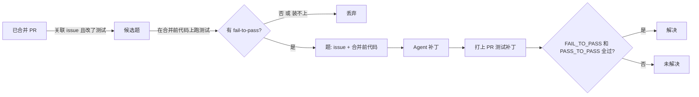

# 主流 Agent Benchmark 与它们的局限

> 层级：垂类 · evaluation · 预计 150 分钟 · 题目：[questions.md](questions.md)
> 前置：[core/09 评测与 Benchmark](../../../core/09-evaluation/README.md)、[01 评测设计](../01-eval-design/README.md)、[03 轨迹与长程任务评测](../03-trajectory-eval/README.md)

## 1 这一章解决什么问题

面试里常见的问法是：“你们用什么 Benchmark？它测的是什么？它的分数能说明什么、不能说明什么？”只背出名字和“测代码能力”这种一句话，第二层追问就答不上。

[core/09](../../../core/09-evaluation/README.md) 已经介绍过 SWE-bench、Verified、τ-bench、GAIA、BrowseComp、OSWorld 各测什么。这一章不再重复入门，而是用同一套四个问题拆每个 Benchmark：

1. 测什么能力；
2. 任务从哪来、环境怎么搭、怎么保证题目质量；
3. 怎么判分，判分的漏洞在哪；
4. 已知局限，尤其是污染和饱和。

一个 Benchmark 的分数，是“系统真实能力”经过三道过滤之后的结果：题目本身对不对，评分器判得准不准，题和答案有没有提前泄漏。第 2 节先把这三道过滤写成一个可以计算的模型，后面每个 Benchmark 都套这个模型去看。

学完你应该能：

- 说清 SWE-bench 的任务怎么从 GitHub PR 里抽出来、FAIL_TO_PASS 和 PASS_TO_PASS 怎么判；几个变体各自补的是哪个缺口；
- 用代码说明测试太窄、太宽会拒绝正确补丁，测试覆盖不全会放过错补丁；
- 算出评分器有误判时，两个系统的真实差距在分数上被压缩成多少；
- 讲清 τ-bench 与 τ²-bench 的区别，以及 BFCL 怎么判多轮工具调用；
- 对比研究类（GAIA、BrowseComp）和环境类（WebArena、OSWorld、Terminal-Bench）的出题和判分方式；
- 写一个 n-gram 污染检测，并演示它为什么查不出改写过的题；
- 用二项分布的标准误解释 Benchmark 接近上限时为什么失去区分度；
- 被问到任一 Benchmark 时，主动说出它的一两个局限。

本章不写任何模型的分数和排名。分数变化快，各家设置也不同，面试前自己去官方榜单查。文中出现的百分比，要么是论文报告的题目统计（如“审计的 138 道题里多少有问题”），要么是标明“示意值”的假设数。

**本章符号**（后文沿用）：

| 符号 | 含义 |
|---|---|
| n | 题数 |
| p | 系统的真实解决率：它真正解决了的题占多少 |
| q | 观测分：评分器判“通过”的题占多少，也就是榜单上的分数 |
| Se | 灵敏度：一份正确的提交被判通过的概率 |
| Sp | 特异度：一份错误的提交被判不通过的概率 |
| b | 坏题比例：题面或测试有问题，正确解也过不了的题占多少 |
| SE | 标准误：观测分 q 因为只抽了 n 道题而产生的抖动，SE = √(q(1−q)/n) |
| g | n-gram 的长度，13-gram 时 g = 13 |

## 2 原理：Benchmark 的分数是怎么来的

### 2.1 一张总表：按判分方式分三类

| 判分方式 | 代表 | 好处 | 会漏掉什么 |
|---|---|---|---|
| 执行测试 | SWE-bench 系列、Terminal-Bench | 对错确定，可复现 | 测试不全时错补丁也能过；测试太窄时对补丁被拒 |
| 检查环境终态 | τ-bench、τ²-bench、WebArena、OSWorld、BFCL 多轮 | 允许多条正确路径 | 过程违规看不出；终态检查本身可能写错 |
| 比对短答案 | GAIA、BrowseComp | 出题和判分都便宜 | 只能测“有唯一短答案”的任务；答案公开后容易泄漏 |

记住这张表，面试里被问到一个没见过的 Benchmark，也能先问一句“它怎么判分”，再推出它的局限。

### 2.2 把评分器看成一个会出错的分类器

不管哪种判分方式，评分器做的都是一件事：看一份提交，输出“过”或“不过”。它可以出两种错：

- **把对的判成错**（假阴性）。概率是 1 − Se。执行测试类里，这对应测试太窄或太宽；短答案类里，对应参考答案不唯一或格式归一化不全。
- **把错的判成对**（假阳性）。概率是 1 − Sp。执行测试类里，这对应测试覆盖不全；终态类里，对应终态检查写得松。

设系统真实解决了比例为 p 的题。对的那部分被判过的概率是 Se，错的那部分被判过的概率是 1 − Sp，所以观测分：

```text
q = Se · p + (1 − Sp) · (1 − p)
  = (1 − Sp) + (Se + Sp − 1) · p
```

q 是 p 的一次函数，截距 1 − Sp，斜率 Se + Sp − 1。这一行式子推出本章反复用到的三个结论（完整推导、反解和代价见 [01 第 4.1 节](../01-eval-design/README.md#41-评分器有误判时分数差距会被压缩)）：

1. **分数的上下限被挤压。** p = 0 时 q = 1 − Sp，一个什么都不会的系统也有分；p = 1 时 q = Se，一个全对的系统也拿不到满分。
2. **差距被压缩。** 两个系统的观测差 q_A − q_B = (Se + Sp − 1)(p_A − p_B)。
3. **坏题就是 Se 很低的题。** 一道题如果正确解根本过不了测试，它对所有系统都是 0 分。坏题比例为 b 时，所有系统的分数上限都只有约 1 − b。

这个模型假设评分器的错误和被测系统无关。第 2.4 节会看到，这个假设在有污染时不成立。

### 2.3 测试太窄、太宽、太松：三种漏洞的机制

执行测试类 Benchmark 的测试，通常不是为评测写的，而是原 PR 作者顺手写的回归测试。SWE-bench 选题时只要求“标准补丁能让至少一条测试从失败变成通过”（第 3 节）。这个条件保证了测试和标准补丁一致，但没有保证测试和**题面**一致。三种漏洞都出在这里：

| 漏洞 | 测试在检查什么 | 后果 | 方向 |
|---|---|---|---|
| 太窄 | 题面没要求的实现细节，比如函数名、报错文本、参数名 | 换一种实现就过不了 | Se 下降，分数低估 |
| 太宽 | 题面没要求的额外行为，比如 PR 顺手改的边界情况 | 只修题面说的 bug 过不了 | Se 下降，分数低估 |
| 太松 | 只覆盖了一部分输入 | 只修了一部分的错补丁也能过 | Sp 下降，分数高估 |

OpenAI 审计 Verified 时给过“太窄”的真实例子（论文报告）：pylint-dev__pylint-4551 的题面要 pyreverse 读出类型注解，原 PR 为此新增了一个 `get_annotation` 函数，测试直接 import 这个函数名。题面没提这个名字，很多功能正确的补丁在 import 这一步就失败了。

下面用一道玩具题把三种漏洞都跑出来。题面只说“`clamp(x, lo, hi)` 在 lo > hi 时要抛 ValueError”。标准补丁顺手改了 NaN 的处理，这一点题面没提。

```python
# 一道玩具题。题面：“clamp(x, lo, hi) 在 lo > hi 时应该抛 ValueError，现在会静默返回错的值。”
import math

def gold(x, lo, hi):            # 原 PR 的标准补丁：顺手还改了 NaN 的行为（题面没提）
    if lo > hi:
        raise ValueError("lo must be <= hi")
    if isinstance(x, float) and math.isnan(x):
        return lo
    return max(lo, min(x, hi))

def alt_correct(x, lo, hi):     # 另一个完全符合题面的补丁：报错文本不同，NaN 原样返回
    if lo > hi:
        raise ValueError("invalid bounds")
    return min(max(x, lo), hi)

def wrong_swap(x, lo, hi):      # 错补丁：不报错，把上下界交换
    if lo > hi:
        lo, hi = hi, lo
    return max(lo, min(x, hi))

def wrong_int_only(x, lo, hi):  # 错补丁：只在差值 ≥ 1 时报错，lo=1.5、hi=1.0 时漏掉
    if lo - hi >= 1:
        raise ValueError("lo must be <= hi")
    return max(lo, min(x, hi))

def raises(f, *args):
    try:
        f(*args)
    except ValueError:
        return True
    return False

def msg(f, *args):
    try:
        f(*args)
    except ValueError as e:
        return str(e)
    return None

# 四套测试。spec 是“只测题面要求的行为、并且测全”的理想测试
suites = {
    "spec":   lambda f: raises(f, 0, 3, 2) and raises(f, 0, 1.5, 1.0) and f(5, 0, 3) == 3,
    "narrow": lambda f: msg(f, 0, 3, 2) == "lo must be <= hi" and f(5, 0, 3) == 3,   # 要求题面没提的报错文本
    "wide":   lambda f: raises(f, 0, 3, 2) and f(float("nan"), 0, 1) == 0,           # 测了题面没要求的 NaN 行为
    "sparse": lambda f: raises(f, 0, 3, 2) and f(5, 0, 3) == 3,                      # 只测了整数差，覆盖不全
}
patches = {"gold": gold, "alt_correct": alt_correct,
           "wrong_swap": wrong_swap, "wrong_int_only": wrong_int_only}
verdict = {(s, p): suites[s](f) for s in suites for p, f in patches.items()}
for s in suites:
    print(f"{s:7s}", {p: verdict[(s, p)] for p in patches})

# 理想测试：两个对补丁都过，两个错补丁都不过
assert [verdict[("spec", p)] for p in patches] == [True, True, False, False]
# 太窄、太宽：都拒绝了符合题面的 alt_correct（假阴性）
assert verdict[("narrow", "alt_correct")] is False and verdict[("wide", "alt_correct")] is False
# 太松：只测整数差，错补丁 wrong_int_only 也能过（假阳性）
assert verdict[("sparse", "wrong_int_only")] is True
# 标准补丁能过所有四套测试。“标准补丁能过”这一条筛选，三种漏洞一种也筛不掉
assert all(verdict[(s, "gold")] for s in suites)
```

最后一个 assert 是这一节的重点。SWE-bench 的建题流程用标准补丁验证测试，而标准补丁在任何一套从它自己的 PR 里来的测试上都能过。要查出太窄、太宽，只能换一份**独立写的**正确解去跑测试，或者让人对照题面读测试。Verified 的人工标注、Terminal-Bench 的“测试通过当且仅当终态可接受”要求（第 6 节），做的都是这件事。

### 2.4 评分器有误判时，真实差距被压缩多少

把第 2.2 节的模型落到题目上：每道题的测试是固定的，同一道题对两个系统用同一套测试。下面设 15% 的题会拒绝正确补丁（Se = 0.85），5% 的题会放过错补丁（Sp = 0.95），都是示意值。

```python
import numpy as np

rng = np.random.default_rng(0)
n_items = 200_000                     # 题数取大，让抽样误差可以忽略，只看偏差
Se, Sp = 0.85, 0.95                   # 示意值。Se：对补丁被判过的概率；Sp：错补丁被判不过的概率
pA, pB = 0.60, 0.50                   # 两个系统的真实解决率，差 10 个点

# 测试是固定的：同一道题对哪个系统都用同一套测试。
# rejects_correct：这道题的测试太窄或太宽，会拒绝正确补丁
# accepts_wrong：这道题的测试太松，错补丁也能过
rejects_correct = rng.random(n_items) > Se
accepts_wrong = rng.random(n_items) > Sp

def observed(solved):
    passed = np.where(solved, ~rejects_correct, accepts_wrong)
    return passed.mean()

solved_A = rng.random(n_items) < pA   # 每个系统真的解决了哪些题，和测试的好坏无关
solved_B = rng.random(n_items) < pB
qA, qB = observed(solved_A), observed(solved_B)
slope = Se + Sp - 1
print(f"观测 A={qA:.3f} B={qB:.3f}，观测差={qA - qB:.3f}，理论差={slope * (pA - pB):.3f}")

# 1) 观测差被压缩成真实差的 (Se + Sp − 1) 倍：10 个点只剩约 8 个点
assert abs((qA - qB) - slope * (pA - pB)) < 0.006
# 2) 截距和上限：真实解决率 0 也有 5 分，真实 100% 也只有 85 分
assert abs((1 - Sp) - 0.05) < 1e-12 and abs((1 - Sp) + slope - Se) < 1e-12
# 3) 已知 Se、Sp 可以反解（Rogan-Gladen），误差只剩抽样误差
assert abs((qA + Sp - 1) / slope - pA) < 0.01
# 4) 校正后标准误放大 1/slope 倍，保持检出力要多约 1/slope² 倍的题
assert abs(1 / slope**2 - 1.5625) < 1e-9

# 5) 错误和系统相关时，常数斜率的模型失效。
#    A 背过一部分标准补丁：在“太窄”的题上，它照着记忆写出了测试要的函数名，于是能过
memorized = rng.random(n_items) < 0.5
passed_A_mem = np.where(solved_A, ~rejects_correct | memorized, accepts_wrong)
gap_mem = passed_A_mem.mean() - qB
print(f"A 有记忆时观测差={gap_mem:.3f}")
assert gap_mem > (pA - pB)            # 观测差反而超过了真实差，用同一个 Se 反解救不回来
```

结论分两层：

- **错误和系统无关时**，误判只是把差距按 Se + Sp − 1 等比例缩小。排序不变，但同样的题数下更难检出差距。
- **错误和系统相关时**，排序都可能错。第 5 个 assert 模拟的就是 OpenAI 在 Verified 上观察到的情形（论文报告）：django__django-14725 的测试要求一个题面没提的参数 `edit_only`，一个被审计的模型在思维链里说出了这个参数是在 Django 4.1 引入的。太窄的测试本来对所有系统都不公平，污染让它只对“背过答案”的系统公平。测试漏洞和污染在这里叠在一起。

## 3 SWE-bench 系列：同一套判法，补不同的缺口

### 3.1 原版怎么建题、怎么判

原版 SWE-bench（Jimenez 等，2023-10）的流程（论文报告）：

1. **选仓库、抓 PR**。从 12 个流行的开源 Python 仓库抓了约 9 万个 PR。选流行仓库，是因为它们维护得好、测试覆盖较高。
2. **按属性过滤**。只留关联了 issue、并且改动了测试文件的已合并 PR。
3. **按执行过滤**。在 PR 合并前的代码上装好环境，分别记录“只打测试补丁”和“再打上代码补丁”之后每条测试的状态。至少要有一条测试从失败变成通过（fail-to-pass），装不上或跑不起来的去掉。最后剩 2294 题。

每道题给 Agent 的是 issue 文本和 PR 合并前的代码库，不给测试。评测时把 Agent 的补丁打上去，再打上 PR 自带的测试补丁，然后跑两组测试：

- **FAIL_TO_PASS**：应用标准补丁前失败、之后通过的测试，检查 issue 修好没有；
- **PASS_TO_PASS**：前后都通过的测试，检查有没有改坏原有功能。

两组全部通过才算解决。论文报告的规模：issue 平均 195 词；每题至少一条 fail-to-pass 测试，40% 的题至少两条；另有中位数 51 条测试用来检查原有功能；标准补丁平均改 1.7 个文件、3.0 个函数、32.8 行。



这条流程决定了它的漏洞：测试来自原 PR，所以第 2.3 节的三种问题都会出现；题面来自 issue，写 issue 的人不知道这会被当成考题，所以常有题面不清；仓库和补丁都公开，所以有污染。

### 3.2 变体：判法基本不变，改题从哪来、怎么过滤

后续变体判法基本不变（见 [core/09](../../../core/09-evaluation/README.md#7-主流-benchmark-测什么)），改的是题从哪来、怎么过滤。

| 变体 | 规模 | 补的缺口 | 怎么做 |
|---|---|---|---|
| SWE-bench Lite | 300 测试题 + 23 开发题，来自 12 个仓库中的 11 个 | 原版跑一遍太贵 | 过滤掉题面带图片和外链、少于 40 词、改动多于一个文件或超过 3 个 hunk、增删文件、测试检查报错信息的题 |
| SWE-bench Verified | 500 题 | 原版很多题本身有问题 | 93 位开发者标注 1699 道随机抽样题，每题 3 人，取最严重的判定；题面不清或测试会拒绝正确解的题剔除，共剔除 68.3%；改用 Docker 环境 |
| SWE-bench Multimodal | 617 题，17 个 JavaScript 库 | 原版只有 Python、题面几乎全是文字 | 每题的题面或测试里至少有一张图，覆盖界面、图表、可视化等视觉类前端项目 |
| SWE-bench Multilingual | 300 题，9 种语言，40 多个仓库 | 只有 Python | 覆盖 C、C++、Go、Java、JavaScript、TypeScript、PHP、Ruby、Rust |
| SWE-bench-Live | 首发 1319 题，93 个仓库，issue 均在 2024 年及以后 | 题目老、仓库少、靠人工构造 | 自动化流水线从新 issue 建题和环境，每题带 Docker 镜像，可持续更新 |
| SWE-Bench Pro | 1865 题，41 个仓库 | 任务太短、公开题有污染 | 长程、多文件改动；分公开集（11 个仓库）、保留集（12 个）、商业集（18 个私有仓库，不公开题目） |

Lite 的过滤规则里有一条“测试检查报错信息的题去掉”，正好对应第 2.3 节玩具题里的 narrow 测试。

### 3.3 这一系列的已知局限

- **测试和题面不匹配**。OpenAI 在 2026-02 停报 Verified 的说明里（论文报告），挑出 138 道在 64 次独立运行里没有被稳定解决的题，每题至少 6 位工程师独立复核。审计的 138 道难题里，至少 59.4% 有实质问题（测试有缺陷或题面不清）：35.5% 的测试太窄（要求题面没提的实现细节），18.8% 的测试太宽（测了题面没要求的行为），另有 5.1% 是其他问题。
- **测试太少**。Zhu 等人的 Agentic Benchmark Checklist 也指出 Verified 的测试用例不足以判断解是否正确。这是第 2.3 节的“太松”。
- **记忆而非推理**。Liang 等人（The SWE-Bench Illusion，2025-06）只给模型 issue 文本、不给仓库结构，让它说出 bug 在哪个文件。模型在 Verified 上的准确率明显高于在 SWE-bench 以外仓库上的准确率，作者认为这是记住了仓库。OpenAI 的说明也报告了污染迹象，并因此建议改看 SWE-Bench Pro。
- **只看补丁能不能过测试**。原论文自己也说，只靠执行测试不足以保证生成质量，模型写的代码常常不如人写的全面、高效、可读。代码风格、可维护性、是否引入新问题，测试覆盖不到。

**面试里怎么用**：被问“SWE-bench 分数能说明什么”，可以答：它说明在公开 Python 仓库的已知 issue 上能写出过测试的补丁；不说明在私有代码库、其他语言、长程任务上的能力；分数还混有记忆成分。要看后几项，分别看 Multilingual、Pro 的保留集、Live 这类新题。
## 4 工具使用与对话：τ-bench、τ²-bench、BFCL

### 4.1 τ-bench 到 τ²-bench

τ-bench 的设定是：Agent 用领域 API、遵守政策文档，与模型扮演的用户多轮对话；判分看对话结束时数据库是否等于目标状态，以及回复里有没有必需信息（见 [core/09](../../../core/09-evaluation/README.md#7-主流-benchmark-测什么)）。

τ²-bench（Barres 等，2025-06）指出一个缺口：τ-bench 里只有 Agent 能用工具，用户只提供信息。真实的技术支持场景里，用户也要动手，比如自己去手机上重启网络。

| 对比项 | τ-bench | τ²-bench |
|---|---|---|
| 领域 | 零售、航空 | 零售（115 题）、航空（50 题）的校订版，加新的电信领域 |
| 谁能动环境 | 只有 Agent | 电信领域里用户也有工具（15 个写、15 个读），操作一台模拟手机，叫双控（dual-control） |
| 怎么出题 | 人工写 | 电信题由生成器把 15 组原子子任务组合成 2285 题，再均衡抽取 114 题 |
| 怎么判分 | 数据库状态 + 必需信息 | 在此基础上加状态断言（如检查用户手机服务已连接）、对话的自然语言断言、动作匹配；电信只用断言 |
| 消融 | 无 | No-User 模式：Agent 拿到问题摘要并控制所有工具，只测推理和工具调用；Oracle Plan 模式：给出正确调用序列，只测和用户协调的能力 |

No-User 和双控的差距，能把“不会推理”和“不会跟用户配合”分开。这是 τ²-bench 在设计上最值得借鉴的地方。

**局限**：模拟用户本身有随机性，也可能不按剧本走；终态对不代表过程合规。Agentic Benchmark Checklist 还指出 τ-bench 曾把空回复判为成功，说明判分逻辑也要被审计。

### 4.2 BFCL：单步和多轮的函数调用

BFCL（Berkeley Function Calling Leaderboard，Patil 等，ICML 2025）专测函数调用，粒度比 τ-bench 细。

| 部分 | 内容 | 怎么判 |
|---|---|---|
| 单轮：simple / multiple / parallel / parallel multiple | 一个函数、从多个函数里选、并行多次调用、两者组合 | 把调用解析成 AST，和标准调用比对函数名和参数 |
| 无关检测（irrelevance / relevance） | 给的函数都不该用，或者应当调用 | 看是否克制住不调用 |
| Live | 用户贡献的真实函数和请求 | 同单轮 |
| 多轮（v3，2024-09） | 1000 条（计分用其中 800 条），含缺参数、缺函数、长上下文等增强类别 | 每轮结束后做两项检查：状态检查（后端对象属性等于标准状态）和响应检查（模型的调用包含人工标的最小调用集合即可）；一轮超过 20 步判错 |
| v4 | 加入网页搜索等 Agent 式评测 | 见官方博客 |

总分是各子类不加权平均，所以子类构成一变，总分就不能和旧版比。

**局限**：AST 比对要求参数和标准写法一致，语义等价的写法可能判错；单轮题只测“这一步调对没有”，不测整体任务能否完成（见 [03 轨迹评测](../03-trajectory-eval/README.md)）。

## 5 研究与信息检索：GAIA、BrowseComp

两者都用“短答案 + 比对”，但出题思路不同。

| 对比项 | GAIA | BrowseComp |
|---|---|---|
| 测什么 | 推理、多模态、浏览、工具组合 | 坚持多轮搜索，找难找的事实 |
| 规模 | 466 题：一级 146、二级 245、三级 75；公开验证集 166 题，300 题不公开答案用于榜单 | 1266 题（原 1287 题，复核后删 21 题） |
| 难度怎么定 | 按标注者用了多少步、多少工具：一级至多 5 步，二级约 5-10 步且要组合工具，三级不限 | 倒着出题：从一个人或事件出发，组合几个搜索空间很大的特征，做到“难找、好验证” |
| 质量控制 | 两位新标注者独立作答，和出题人一致才保留；623 道候选里约 68% 有效 | 出题时要求当时的几个模型都答不出、5 次简单搜索第一页找不到；另一位标注者找到其他答案就要改题 |
| 判分 | 准精确匹配（quasi exact match），按字符串、数字、列表分别归一化 | 模型评委判断和参考答案是否语义等价；同时让模型报置信度，测校准 |
| 作者自述局限 | 答案要求不随时间变化，但网页会变 | 不涉及长答案、不涉及澄清歧义；只测一种窄技能；参考答案“很可能但不保证”唯一 |

**共同局限**：答案一旦公开，就能被直接搜到或背下来。GAIA 把答案藏起来，BrowseComp 用倒着出题加难度过滤，都是在延缓这个问题，而不是消除它。

**判分漏洞在哪**。套第 2.2 节的模型看：

- GAIA 的准精确匹配是规则归一化。答案写成“1,000”还是“1000”、单位带不带、列表顺序，归一化没覆盖到的写法会被判错，这是 Se 的损失。好处是不会把错答案判对，Sp 接近 1。
- BrowseComp 用模型评委判语义等价（论文用的是 Humanity's Last Exam 的评分提示）。它对写法宽容，Se 高；代价是评委本身可能把“意思接近但其实不对”的答案判对，Sp 不再是 1。评委的偏差和校准见 [02 LLM-as-Judge](../02-llm-as-judge/README.md)。
- 两者都只看最后的短答案，不看过程。蒙对、或者从泄漏的答案页面直接抄到，和真正查出来得分一样。

## 6 环境类：网页、桌面、终端

| 对比项 | WebArena（2023-07） | OSWorld（2024-04） | Terminal-Bench 2.0（2026-01） |
|---|---|---|---|
| 环境 | 自建可复现的网站：电商、论坛、代码协作、内容管理，加地图等工具 | Ubuntu 虚拟机里的真实应用：办公套件、浏览器、VS Code、GIMP、终端等 | 每题一个 Docker 容器的命令行环境 |
| 规模 | 812 题，由 241 个模板实例化 | 369 题，其中 101 题跨多个应用 | 89 题，从 93 位贡献者提交的 229 题中筛出 |
| 判分 | 问答题用 exact_match、must_include，或用模型评委做 fuzzy_match；操作题先用数据库查询或页面选择器取内容，再检查关键字 | 每题配置初始状态，任务后用 getter 取文件、cookie、无障碍树等，再用 evaluator 比对；共 134 种评测函数，可给 0-1 部分分 | 测试只检查容器的最终状态，不看命令和输出 |
| 不可完成题 | 有，要求答 N/A | 30 题，要求输出 FAIL | 无 |
| 质量控制 | 人工标注参考答案；fuzzy_match 的评委在 40 条人工核对里一致 39 条 | 2025-07 的 OSWorld-Verified 处理了约 300 条反馈，多数改评测函数而不改题面 | 每题有人写的参考解；CI 确认参考解能过、空操作 Agent 会失败；每题约 3 小时人工审核；让一个 Agent 专门找作弊方法，人工逐条看轨迹 |

**环境怎么搭、题从哪来**（论文报告）：

- **WebArena** 把开源网站软件装进 Docker 容器，一个网站一个镜像，用 gym 风格的接口交付，并提供脚本把环境重置到确定的初始状态。题由作者按标注规范写，每题是一句高层意图，不给操作步骤。不可完成题如“告诉我 OneStopShop 的联系电话”，网站上本来就没有，要求答 N/A。
- **OSWorld** 每题一份配置：先下载文件、打开应用、调整窗口，把虚拟机摆到初始状态；结束后由 getter 取出要检查的东西，再交给 evaluator 判。初始化和判分都写在配置里，所以“题目”其实是一段脚本。虚拟机的快照用来快速重置。答案随时间变化的题（如某人论文的引用数），getter 里放了爬虫，在判分那一刻去取实时值，这类题天然会受网页变化影响。
- **Terminal-Bench** 每题由四部分组成：一份 Dockerfile 搭的容器、一段任务说明、一组测试、一份人写的参考解（oracle）。题是众包的：93 位贡献者提交 229 题，按难度评估和 3 位审核者的质量评估选出 89 题。审核按三条标准：**明确**（测试通过当且仅当容器处于可接受的终态，也就是说明写全了所有正确终态，测试覆盖了所有正确终态）、**可解**（参考解能让测试全过）、**不可作弊**（比如题目涉及某个 git 提交时，要删掉之后的提交历史，免得 Agent 直接看到答案）。平均每题约 3 小时的审核时间。

Terminal-Bench 的“明确”标准，就是第 2.3 节说的 Se = 1 且 Sp = 1：太窄、太宽违反“当”，太松违反“仅当”。

**这类 Benchmark 的典型问题**：

- **环境会漂移**。OSWorld-Verified 修的问题里有网页结构变化、验证码和封 IP、预订日期过期、评测函数过严、初始化时序失败。真实网站上的任务，过几个月就可能变成坏题。
- **不可完成题会被滥用**。WebArena 论文发现，提示模型“做不到就答 N/A”后，模型会把很多能做的题也判成做不到。这就是 [01 章](../01-eval-design/README.md)说的“正反两面都要有题”。
- **判分能被钻空子**。Terminal-Bench 的找作弊 Agent 找到过改测试环境、猜答案、列出所有可能答案等手段。终态检查写得松，这些都能拿分。
- **跑得慢、贵**。OSWorld-Verified 把环境迁到云上并行，就是为了把一次评测从十几个小时压下来。


## 7 污染与饱和

### 7.1 污染从哪来，怎么查

| 来源 | 例子 | 检测办法 |
|---|---|---|
| 预训练语料 | 公开仓库、题目和答案被爬进训练数据 | 训练集和评测集做 n-gram 重叠检查 |
| 改写后的题 | 题目被换说法或翻译后混进训练数据 | n-gram 查不出。Yang 等（2023-11）用 LLM 判断改写重叠，在 RedPajama-Data-1T 和 StarCoder-Data 里发现 8%-18% 的 HumanEval 题有重叠 |
| 合成和蒸馏数据 | 教师模型见过评测题，生成的数据带着题的影子 | 同上；Yang 等也在 GPT 生成的合成数据里发现了污染 |
| 公开 issue 和补丁 | SWE-bench 的标准补丁就在 GitHub 上 | 诊断任务：只给题面，看模型能否说出文件路径、复述补丁或题面细节（SWE-Bench Illusion、OpenAI 的审计） |

**n-gram 重叠检查怎么做**。把测试题和训练语料都切成连续 g 个词的片段（g-gram），看测试题的片段有多少出现在语料里。Yang 等（2311.04850）转述了两个常见阈值：GPT-3 论文把 13-gram 重叠定义为污染，GPT-4 报告用 50 个字符的重叠。它简单、快，但只认字面。下面用一道虚构的追及问题演示：原题原样泄漏能查到，换个说法就查不到。

```python
import re

def ngrams(text, g):
    toks = re.findall(r"\w+", text.lower())
    return {tuple(toks[i:i + g]) for i in range(len(toks) - g + 1)}

def overlap(test_item, corpus_doc, g):
    """测试题的 g-gram 里，有多少比例在语料文档里出现过"""
    t = ngrams(test_item, g)
    return len(t & ngrams(corpus_doc, g)) / max(len(t), 1)

test_item = ("A train leaves the station at 3 pm traveling at 60 miles per hour. "
             "A second train leaves the same station at 4 pm traveling at 80 miles per hour "
             "in the same direction. At what time does the second train catch up with the first?")

verbatim_leak = "forum post: " + test_item + " answer: 7 pm"          # 原题原样被爬进语料
rephrased_leak = ("At three in the afternoon one locomotive departs a depot moving 60 mph. "
                  "An hour later another one sets off from that depot along the identical route at 80 mph. "
                  "When will the later locomotive draw level with the earlier one? answer: 7 pm")  # 同一道题，换了说法
unrelated = "The station opens at 6 am and the cafe sells coffee at the same station every day."

g = 13
o_v, o_r, o_u = (overlap(test_item, d, g) for d in (verbatim_leak, rephrased_leak, unrelated))
print(f"13-gram 重叠：原样={o_v:.2f}  改写={o_r:.2f}  无关={o_u:.2f}")
assert o_v == 1.0                     # 原样泄漏：全部命中
assert o_r == 0.0 and o_u == 0.0      # 改写后：和无关文本一样，一个都查不到

# 把 g 调小也救不回来：g = 2 时改写文本和无关文本的重叠一样多，分不开
for gg in (13, 8, 4, 2):
    print(gg, round(overlap(test_item, rephrased_leak, gg), 3), round(overlap(test_item, unrelated, gg), 3))
assert overlap(test_item, rephrased_leak, 4) == 0.0
assert overlap(test_item, rephrased_leak, 2) == overlap(test_item, unrelated, 2) > 0
```

改写后的题答案完全一样（下午 7 点追上），模型在训练里见过它，就等于见过原题。但 13-gram、8-gram、4-gram 都是 0；降到 2-gram 才有重叠，而无关文本的重叠一样多。g 调大漏报，g 调小误报，没有一个阈值能同时解决。Yang 等用的办法是先用嵌入检索找出相似的候选，再让一个强模型判断“这两道题是不是同一道题”。这一步要调用模型，成本远高于 n-gram，所以实践里常是 n-gram 先粗筛、模型再复核。

另一个限制是 n-gram 检查要拿到训练语料。用闭源模型的人拿不到，只能靠下面的行为检测。

**行为上的检测**：

- **新题对照**：照原分布重新出一批题。GSM1k（Zhang 等，2024-05）仿照 GSM8k 重出了 1205 道题，部分模型族在新题上掉分，且越能“背出”GSM8k 原题的模型掉得越多。
- **按时间切分**：只用模型训练截止日期之后的题。LiveCodeBench、SWE-bench-Live 都靠持续加新题。
- **保留集**：题目不公开，如 GAIA 的测试集、SWE-Bench Pro 的保留集和商业集。
- **金丝雀字符串**：Terminal-Bench 在每个文件里放 BIG-bench 的 canary GUID，方便训练方过滤。作者自己承认，仓库公开时这只是象征性的防护。

**不要把掉分全算成污染**。Recht 等（2019-02）按原流程为 CIFAR-10 和 ImageNet 重建了测试集，模型普遍掉分。但作者的结论是：掉分主要来自新题略难（分布偏移），而不是反复用同一测试集造成的过拟合。新旧题分数差要先排除“新题更难”。

### 7.2 饱和

Anthropic 的评测工程文章说：一个评测到 100% 就只能抓退化，看不出改进；接近上限时，剩下的都是最难的题，很大的能力提升只表现为很小的分数变化。

饱和和题目缺陷常常叠在一起。分数卡在某个值不动时，剩下的失败题里有多少是题坏了，是必须回答的问题。OpenAI 停报 Verified，就是审计这批“做不出的题”后得出的结论。

**用二项分布算区分度**（推导）。把 n 道题看成 n 次独立的伯努利试验，观测分 q 的标准误是：

```text
SE(q) = √( q (1 − q) / n )
```

单看这个式子，q 越接近 1，SE 越小，好像越接近上限分数越“准”。但区分度看的是“还能涨多少”和“抖动有多大”的比。坏题比例为 b 时，上限是 1 − b（第 2.2 节），剩余空间是 1 − b − q。把剩余空间用 SE 来量：

```text
剩余空间 / SE = (1 − b − q) / √( q (1 − q) / n )
```

q 从 0.5 涨向 1 − b 时，分子趋于 0，比值趋于 0。到这一步，任何真实改进的涨幅都落在抽样抖动以内。

```python
import math
import numpy as np

def se(q, n):                          # 二项分布观测分的标准误
    return math.sqrt(q * (1 - q) / n)

n = 500                                # 题数，取 Verified 的规模
# 1) 标准误在 q = 0.5 时最大：500 题、50% 时约 ±2.24 个点，95% 时约 ±0.97 个点
assert abs(se(0.5, n) - 0.02236) < 1e-4 and abs(se(0.95, n) - 0.00975) < 1e-4

# 2) 区分度看剩余空间。b 是坏题比例（示意值 6%），上限 1 − b = 94%
def headroom_in_se(q, b, n):
    return (1 - b - q) / se(q, n)

h50, h90 = headroom_in_se(0.50, 0.06, n), headroom_in_se(0.90, 0.06, n)
print(f"离上限还有几个标准误：50% 时 {h50:.1f}，90% 时 {h90:.1f}")
assert h50 > 19 and h90 < 3.1

# 3) 同样“把剩下能做的题解决一半”的提升，分数涨幅随位置缩小：50% 时涨 22 个点，90% 时涨 2 个点
def gain(q, b):
    return (1 - b - q) / 2
assert abs(gain(0.50, 0.06) - 0.22) < 1e-9 and abs(gain(0.90, 0.06) - 0.02) < 1e-9

# 4) 90% 附近 2 个点的真实差距，500 题能否检出？模拟两个独立系统、双侧 z 检验
rng = np.random.default_rng(1)
p1, p2, trials = 0.90, 0.92, 20_000
x1 = rng.binomial(n, p1, trials) / n
x2 = rng.binomial(n, p2, trials) / n
pooled = (x1 + x2) / 2
z = (x2 - x1) / np.sqrt(2 * pooled * (1 - pooled) / n)
power = (np.abs(z) > 1.96).mean()
print(f"检出率 {power:.3f}")
assert power < 0.25                    # 五次里有四次看不出差别
```

所以饱和不只是“分数高”，而是三件事一起发生：剩余空间被坏题吃掉一部分；剩下的题里坏题占比越来越高；同样的能力提升换算成的分数涨幅越来越小，掉进抽样抖动里。配对比较能把检出力提上来一些（见 [01 第 6.4 节](../01-eval-design/README.md#64-比较两个版本配对比较)），但救不回被坏题占掉的空间。这时该换 Benchmark，或者审计并修掉坏题。

### 7.3 判分本身的可信度

Zhu 等人（2025-07）整理了 Agentic Benchmark Checklist，从任务设置和奖励设计两方面检查 Benchmark。他们报告这类缺陷能让结果相对高估或低估最多 100%。用这份清单改进 CVE-Bench 后，高估减少了 33%（绝对值）。面试时可以把它当成审一个 Benchmark 的提纲。Terminal-Bench 论文附录就用这份清单给自己逐条打了分。

把第 2.2 节的模型和这份清单对应起来，审判分就是在估 Se 和 Sp：

| 要估的量 | 怎么估 | 本章的例子 |
|---|---|---|
| Sp（错的会不会被判对） | 空操作 Agent、随机答案、找作弊 Agent 去跑，看能拿多少分 | Terminal-Bench 的 CI 要求空操作失败；τ-bench 曾把空回复判成功 |
| Se（对的会不会被判错） | 拿一份独立写的正确解去跑；或者人对照题面读测试 | Verified 的人工标注；OpenAI 对 138 道难题的审计 |
| 评委一致率 | 抽一批让人判，算和评委的一致率 | WebArena 的 fuzzy_match 在 40 条里一致 39 条 |

**数值例子**：两个系统真实解决率 70% 和 65%，差 5 个点，在 500 题上不配对比较。评分器设 Se = 0.85、Sp = 0.97（示意值）。

```python
import math

z_a, z_b = 1.959964, 0.841621          # 双侧 α = 0.05，检出力 80%

def n_needed(q1, q2):
    """两个独立比例的样本量：n ≈ (z_a + z_b)² (q1(1−q1) + q2(1−q2)) / (q1 − q2)²"""
    return (z_a + z_b) ** 2 * (q1 * (1 - q1) + q2 * (1 - q2)) / (q1 - q2) ** 2

def z_stat(q1, q2, n):
    return (q1 - q2) / math.sqrt((q1 * (1 - q1) + q2 * (1 - q2)) / n)

n = 500
pA, pB = 0.70, 0.65                    # 真实解决率，差 5 个点
Se, Sp = 0.85, 0.97                    # 示意值：15% 的题拒绝正确解，3% 的题放过错解
qA = (1 - Sp) + (Se + Sp - 1) * pA
qB = (1 - Sp) + (Se + Sp - 1) * pB
print(f"观测分 A={qA:.3f} B={qB:.3f}，观测差={qA - qB:.3f}")
assert abs(qA - 0.604) < 1e-9 and abs(qB - 0.563) < 1e-9 and abs((qA - qB) - 0.041) < 1e-9

# 1) 500 题：评分器完美时 z ≈ 1.69，有误判时 z ≈ 1.32，都过不了 1.96
z_perfect, z_noisy = z_stat(pA, pB, n), z_stat(qA, qB, n)
print(f"z：完美评分器 {z_perfect:.2f}，有误判 {z_noisy:.2f}")
assert 1.6 < z_perfect < 1.75 and 1.25 < z_noisy < 1.4

# 2) 要稳定检出：完美评分器约 1374 题，有误判约 2266 题，多出约 65%
n1, n2 = n_needed(pA, pB), n_needed(qA, qB)
print(f"所需题数：完美 {n1:.0f}，有误判 {n2:.0f}，倍数 {n2 / n1:.2f}")
assert 1360 < n1 < 1385 and 2240 < n2 < 2280
# 倍数比 1/(Se+Sp−1)² ≈ 1.49 再大一点，因为观测分更靠近 0.5、方差更大
assert 1 / (Se + Sp - 1) ** 2 < n2 / n1 < 1.7
```

真实 5 个点在分数上只剩 4.1 个点。要稳定检出它，题数要从约 1370 涨到约 2270。一个 500 题的 Benchmark 在这种情况下给不出结论，榜单上相差 4 个点的两个系统，可能谁也不比谁强。

## 8 工程细节与常见坑

**坑 1：拿 Benchmark 自带的标准解验证测试，就以为测试没问题。**
- 现象：建了一套自己的 SWE 风格评测，标准补丁全过，但 Agent 的分数长期偏低，人看失败轨迹觉得“明明修对了”。
- 原因：测试和标准补丁出自同一个 PR，太窄、太宽的测试对标准补丁永远能过（第 2.3 节代码最后一个 assert）。
- 排查：抽 30 道失败题，人对照题面读测试；或者让另一个人不看标准补丁独立写一份解去跑。
- 处理：删掉测试里依赖题面没提的名字、文本的断言；题面补全测试要求的行为；补不全的题剔除。

**坑 2：测试太松，分数虚高。**
- 现象：分数不错，上线后同类问题照样出错；或者看轨迹发现补丁只修了题面例子里那一个输入。
- 原因：测试只覆盖了 issue 里给的那个例子，Sp 低。
- 排查：跑空操作和“只硬编码题面例子”的基线补丁，看能拿多少分。
- 处理：给每题补边界输入；把“空操作必须失败”写进 CI，像 Terminal-Bench 那样。

**坑 3：环境漂移让好题变坏题。**
- 现象：同一个系统、同一份配置，隔几周重跑，分数掉了几个点；失败集中在依赖外网的题。
- 原因：网页结构变了、验证码和封 IP、日期类题目过期、依赖包新版本不兼容。
- 排查：对掉分的题看初始化日志和截图；用参考解重跑，参考解也挂就是题坏了。
- 处理：能自建就自建并固定镜像（WebArena 的做法）；必须连外网的题打标签、单独报分，定期用参考解巡检。

**坑 4：把不同版本、不同子集的分数放在一起比。**
- 现象：两个系统一个报 Verified、一个报 Lite，或者 BFCL 换了子类构成后和旧分数直接比。
- 原因：题集不同，Se、Sp 和难度分布都不同；BFCL 总分是子类不加权平均。
- 排查：核对题集名称、版本、子集、试次数和 harness。
- 处理：只在同一题集、同一 harness 下比；跨版本只比相对排序变化。

**坑 5：小差距当成真差距。**
- 现象：两个配置差 2-3 个点，下一次重跑排序反过来。
- 原因：二项抽样的标准误加上评分器误判压缩，500 题分不出 3 个点（第 7.2、7.3 节）。
- 排查：算置信区间；同一配置重跑几次，看分数抖动多大。
- 处理：配对比较、加题、修评分器，三者一起用；做不到就报“无显著差异”。

**坑 6：只做 n-gram 去重就宣称“无污染”。**
- 现象：去重后分数没变，但新出的同分布题上明显掉分。
- 原因：改写、翻译、合成数据里的题 n-gram 查不出（第 7.1 节代码）。
- 排查：用嵌入检索找候选再让模型判同题；做新题对照或按时间切分。
- 处理：自建评测保留一份从不公开的题；公开题按日期分桶报分。

**坑 7：用 Benchmark 分数选型，不看任务分布。**
- 现象：选了某 Benchmark 上最高的配置，业务指标没改善。
- 原因：Benchmark 测的是它那个任务分布，比如公开 Python 仓库的单 issue，和业务的私有代码库、长程任务差得远。
- 排查：把业务任务按第 1 节的四个问题逐项和 Benchmark 对比。
- 处理：Benchmark 只用于粗筛，最终看自建评测（见 [01](../01-eval-design/README.md)、[06](../06-eval-training-loop/README.md)）。

## 9 对比与取舍

| 关注点 | SWE-bench 系列 | τ / τ²-bench | BFCL | GAIA / BrowseComp | WebArena / OSWorld | Terminal-Bench |
|---|---|---|---|---|---|---|
| 题从哪来 | GitHub 已合并 PR | 人工写 + 生成器组合 | 人工 + 用户贡献 | 人工出题、倒着出题 | 人工按模板写 | 众包 + 3 人审核 |
| 环境 | Docker 里的仓库 | 模拟数据库 + 模拟用户 | 模拟后端 | 开放网络 | 自建网站 / 虚拟机 | Docker 容器 |
| 判分 | 执行测试 | 终态 + 断言 | AST / 终态 + 最小调用集 | 短答案匹配 / 评委 | 终态检查函数 | 终态测试 |
| 主要漏洞 | 测试窄、宽、松 | 模拟用户随机；过程违规看不出 | 写法不同判错 | 答案泄漏；评委误判 | 环境漂移；评测函数写错 | 测试可被钻空子 |
| 防污染 | Live 持续加新题；Pro 保留集 | 弱 | Live 子集 | GAIA 不公开答案 | 弱 | 金丝雀字符串 |

**什么时候用哪个**：

- 做编码 Agent：SWE-bench 系列粗筛，但优先看 Pro 保留集、Live 这类新题；自建评测用私有仓库。
- 做客服、工单类对话 Agent：τ²-bench 的双控和消融最值得借鉴，判分方式可以直接搬到自建评测。
- 做工具调用底座：BFCL 的子类拆分，尤其是无关检测和多轮。
- 做深度研究：GAIA、BrowseComp 只测短答案；长报告要配 rubric 评委（见 [02](../02-llm-as-judge/README.md)）。
- 做 GUI 和终端 Agent：OSWorld、Terminal-Bench；重视空操作基线和环境巡检。

## 10 为什么面试里要能说出局限

1. **说明你读过原文**。能说出“GAIA 300 题不公开答案”“τ²-bench 有 No-User 消融”，比背分数可信。
2. **说明你会解释分数**。面试官常问“某模型在 X 上很高，你会直接选它吗”。正确思路是：X 测的任务分布和你的业务差多远、有没有污染、判分漏掉了什么、差距是否超过了抽样和误判带来的抖动。
3. **说明你会建自己的评测**。公开 Benchmark 的局限，就是你自建评测要补的地方：私有题防污染、业务化的终态检查、正反两面的题、人工审核评分器（见 [01](../01-eval-design/README.md)、[06](../06-eval-training-loop/README.md)）。

一个通用的回答模板：“它测 A 能力；题来自 B，用 C 方法保证质量；用 D 判分，D 会漏掉 E；已知问题是 F（污染、饱和或环境漂移）；所以我们用它粗筛，最终看自建的 G 集合。”

## 11 自测清单

- [ ] 写出观测分 q 和真实解决率 p 的关系，说出截距、斜率各是什么
- [ ] 用一道玩具题解释测试太窄、太宽、太松各会让分数往哪边偏
- [ ] 解释为什么“标准补丁能过测试”筛不掉太窄、太宽的测试
- [ ] 说出 SWE-bench 原版的三步建题流程和 FAIL_TO_PASS / PASS_TO_PASS 的含义
- [ ] 说出 SWE-bench Lite、Verified、Multimodal、Multilingual、Live、Pro 各补的缺口
- [ ] 说出 OpenAI 停报 Verified 时审计出的两类测试问题，以及它和污染怎么叠在一起
- [ ] 解释 τ²-bench 的双控设定和 No-User 消融有什么用
- [ ] 说出 BFCL 多轮的两项检查
- [ ] 对比 GAIA 和 BrowseComp 的出题与判分方式，各自的判分误差在 Se 还是 Sp
- [ ] 说出 Terminal-Bench 审核的三条标准，以及“明确”标准对应 Se、Sp 的什么要求
- [ ] 说出环境类 Benchmark 的三个典型问题
- [ ] 写一个 n-gram 重叠检测，说明为什么调 g 救不回改写的题
- [ ] 列出四种污染检测办法，并说明为什么新题掉分不一定是污染
- [ ] 用标准误和剩余空间解释饱和时为什么失去区分度
- [ ] 用回答模板讲一个你熟悉的 Benchmark

## 资料

- 论文精读：[SWE-bench](../../../papers/09-swe-bench.md)、[τ-bench](../../../papers/10-tau-bench.md)
- Jimenez 等，[SWE-bench: Can Language Models Resolve Real-World GitHub Issues?](https://arxiv.org/abs/2310.06770)，arXiv 2310.06770，2023-10
- SWE-bench 团队，[SWE-bench Lite](https://www.swebench.com/lite.html)、[SWE-bench Multilingual](https://www.swebench.com/multilingual.html)（Khandpur、Lieret、Jimenez、Press、Yang），官方网站，2026-11 查阅
- OpenAI，[Introducing SWE-bench Verified](https://openai.com/index/introducing-swe-bench-verified/)，2024-08（2025-02 更新）
- OpenAI，[Why we no longer evaluate SWE-bench Verified](https://openai.com/index/why-we-no-longer-evaluate-swe-bench-verified/)，2026-02
- Yang 等，[SWE-bench Multimodal: Do AI Systems Generalize to Visual Software Domains?](https://arxiv.org/abs/2410.03859)，arXiv 2410.03859，2024-10
- Zhang 等，[SWE-bench Goes Live!](https://arxiv.org/abs/2505.23419)，arXiv 2505.23419，2025-05
- Deng 等，[SWE-Bench Pro: Can AI Agents Solve Long-Horizon Software Engineering Tasks?](https://arxiv.org/abs/2509.16941)，arXiv 2509.16941，2025-09
- Liang、Garg、Zilouchian Moghaddam，[The SWE-Bench Illusion: When State-of-the-Art LLMs Remember Instead of Reason](https://arxiv.org/abs/2506.12286)，arXiv 2506.12286，2025-06
- Yao 等，[τ-bench](https://arxiv.org/abs/2406.12045)，arXiv 2406.12045，2024-06
- Barres、Dong、Ray、Si、Narasimhan，[τ²-Bench: Evaluating Conversational Agents in a Dual-Control Environment](https://arxiv.org/abs/2506.07982)，arXiv 2506.07982，2025-06
- Patil 等，The Berkeley Function Calling Leaderboard (BFCL): From Tool Use to Agentic Evaluation of Large Language Models，ICML 2025；[官方榜单](https://gorilla.cs.berkeley.edu/leaderboard.html)；[BFCL V3 多轮博客](https://gorilla.cs.berkeley.edu/blogs/13_bfcl_v3_multi_turn.html)，2024-09
- Mialon 等，[GAIA: a benchmark for General AI Assistants](https://arxiv.org/abs/2311.12983)，arXiv 2311.12983，2023-11
- Wei 等，[BrowseComp](https://arxiv.org/abs/2504.12516)，arXiv 2504.12516，2025-04
- Zhou 等，[WebArena: A Realistic Web Environment for Building Autonomous Agents](https://arxiv.org/abs/2307.13854)，arXiv 2307.13854，2023-07
- Xie 等，[OSWorld](https://arxiv.org/abs/2404.07972)，arXiv 2404.07972，2024-04
- XLANG Lab，[Introducing OSWorld-Verified](https://xlang.ai/blog/osworld-verified)，2025-07
- Merrill 等，[Terminal-Bench: Benchmarking Agents on Hard, Realistic Tasks in Command Line Interfaces](https://arxiv.org/abs/2601.11868)，arXiv 2601.11868，2026-01
- Zhu 等，[Establishing Best Practices for Building Rigorous Agentic Benchmarks](https://arxiv.org/abs/2507.02825)，arXiv 2507.02825，2025-07
- Yang、Chiang、Zheng、Gonzalez、Stoica，[Rethinking Benchmark and Contamination for Language Models with Rephrased Samples](https://arxiv.org/abs/2311.04850)，arXiv 2311.04850，2023-11
- Zhang 等，[A Careful Examination of Large Language Model Performance on Grade School Arithmetic](https://arxiv.org/abs/2405.00332)，arXiv 2405.00332，2024-05
- Jain 等，[LiveCodeBench: Holistic and Contamination Free Evaluation of Large Language Models for Code](https://arxiv.org/abs/2403.07974)，arXiv 2403.07974，2024-03
- Recht、Roelofs、Schmidt、Shankar，[Do ImageNet Classifiers Generalize to ImageNet?](https://arxiv.org/abs/1902.10811)，arXiv 1902.10811，2019-02
- Anthropic（Grace、Hadfield、Olivares、De Jonghe），[Demystifying evals for AI agents](https://www.anthropic.com/engineering/demystifying-evals-for-ai-agents)，2026-01
