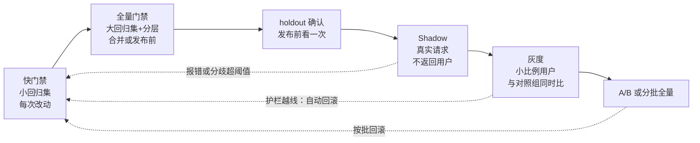

# 线上评测、A/B 与回归门禁

> 层级：垂类 · evaluation · 预计 180 分钟 · 题目：[questions.md](questions.md)
> 前置：[01 评测设计](../01-eval-design/README.md)（配对比较、样本量、多重比较、边看边停）、[03 轨迹与长程任务评测](../03-trajectory-eval/README.md)、[core/09 评测与 Benchmark](../../../core/09-evaluation/README.md)
> 相关：[02 LLM-as-Judge](../02-llm-as-judge/README.md)（线上抽检用的评委）、[06 评测与训练闭环](../06-eval-training-loop/README.md)（holdout 与 bad case 回流）、[harness/06 Trace 与回放](../../harness/06-tracing-replay/README.md)

## 1 这一章解决什么问题

离线评测集再好，也只是真实流量的一个样本。上线后会遇到三类离线看不到的问题：评测集没覆盖的请求、真实负载下的延迟和成本、用户对回答的真实反应。面试常问：“上线后怎么知道它好不好？”“A/B 怎么做？”“修了一个 bad case，怎么保证没把别的弄坏？”

只靠离线分数发版，常见的翻车方式有三种：离线涨了，线上不动；离线没变，线上投诉变多；A/B 显示“显著提升”，全量后效果消失。前两种是离线和线上的分布不一样，第三种多半是实验本身做错了：方差算错、随机化单元选错、反复看 p 值。

这一章讲离线评测之后的四件事：线上看哪些信号、A/B 怎么做才可信、怎么持续监控、怎么用回归评测和门禁挡住退化。

学完你应该能：

- 列出线上的四类信号，说出每类的偏差，尤其是重试、编辑、放弃、点踩各自会怎样骗人；
- 选随机化单元，算最小可检出效应（MDE），用 delta 方法给比例指标算方差，用 CUPED 降方差；
- 给护栏写非劣检验，说出为什么“没显著变差”不等于“没变差”；
- 说出反复看 p 值为什么不行，以及 mSPRT 怎样做到想看几次都行；
- 设计一套从快门禁到全量的发布门禁，写出灰度自动回滚的阈值；
- 修完一个 bad case 后，用配对对比和“翻转题”检查有没有引入退化。

配对比较、样本量公式、多重比较、边看边停的假阳性，在 [01 第 6 节](../01-eval-design/README.md#6-统计显著性与样本量) 已经推导过，本章只引用结论。

**符号表**

| 符号 | 含义 |
|---|---|
| n | 每组的随机化单元数（例如用户数） |
| Y | 实验期指标；X 是同一单元实验前的同一指标 |
| δ | 想检出的真实差距；MDE 是给定 n 时能以 80% 检出率检出的最小 δ |
| V | 两组差值的单位方差，独立两组时 V = 2σ²，σ² 是单个单元指标的方差 |
| z_{α/2}、z_β | 标准正态分位数；α = 0.05、检出力 80% 时分别约 1.96、0.84 |
| ρ | Y 和 X 的相关系数 |
| θ | CUPED 的回归系数 cov(Y, X)/var(X) |
| m | 非劣检验的容忍度（护栏最多允许变差多少） |
| Λ_n | mSPRT 在第 n 个样本时的混合似然比 |

## 2 线上信号：四类，各有偏差

**问题**：线上没有标准答案。能拿到的信号要么稀疏，要么有噪声，要么滞后。

| 信号 | 例子 | 优点 | 偏差和坑 |
|---|---|---|---|
| 显式反馈 | 点赞点踩、评分、投诉 | 直接反映用户态度 | 稀疏且自选择：多数人不点；点的人偏向遇到严重问题的人；用户很少说明原因 |
| 隐式行为 | 重问同一问题、中途放弃、转人工、复制或采纳代码、对生成内容的编辑量 | 量大、不需要用户额外操作 | 含义要解释：会话短可能是一次解决，也可能是放弃 |
| 系统指标 | 错误率、P95 延迟、每会话 token 和工具调用数、超时 | 实时、精确 | 不说明答案对不对 |
| 线上抽检打分 | 对采样会话跑离线同一套确定性校验和评委，关键样本人工看 | 最接近“质量” | 有成本；评委要先校准（见 [02](../02-llm-as-judge/README.md)） |

Anthropic 的评测工程文章对线上方法的评价可以直接引用：线上监控能看到真实规模的行为，但它是事后的，问题先到了用户那里你才知道，信号有噪声，也没有标准答案；用户反馈稀疏且自选择。文章的结论是“瑞士奶酪模型”：没有哪一层能拦住所有问题，自动评测管快速迭代，线上监控管真实情况，定期人工看轨迹管校准。

### 2.1 离线和线上为什么会对不上

离线评测集是某个时间点、按某种方式采的一批题。上线后有三个机制让它和线上脱节：

| 机制 | 怎么发生 | 现象 |
|---|---|---|
| 分布漂移 | 请求构成变了（新功能带来新问题、季节性、新客户群）；或者同样的请求，正确答案变了（文档更新、工具接口改版） | 离线分数稳定，线上某一类请求的失败率慢慢上升 |
| 用户行为 | 用户会适应 Agent。新版本刚上线时，用户好奇多试（新奇效应），也可能先不习惯；用户学会了换说法绕开弱点，离线题却还是旧说法 | A/B 前几天的效应和后几天不一样；离线难题在线上反而少见 |
| 反馈延迟 | “任务真的解决了吗”要等用户几天后回不回来、投不投诉。最近几天的会话还没来得及出结果（右删失） | 刚上线时指标看起来很好，过一周回落；按自然日算的指标末尾几天总是偏好 |

后两种机制决定了 A/B 至少要跑满一个完整业务周期，并且看每天的效应曲线是不是平的，而不是只看累计值。反馈延迟还有一个处理办法：主指标用短窗口可观测的代理（例如“24 小时内没有重来”），长期指标只做后验确认。

### 2.2 隐式信号：重试、编辑、放弃、点踩各自的偏差

隐式信号量大，但每个都有自己的偏差方向。用之前要先知道它往哪边偏。

| 信号 | 通常解读 | 偏差 | 什么时候会误判 |
|---|---|---|---|
| 重试（同一问题重问、点“重新生成”） | 上次答得不好 | 有人重试是想看另一种写法，不是不满意；重试按钮的位置和样式会改变重试率 | 新版界面把“重新生成”放得更显眼，重试率上升，质量其实没变 |
| 编辑（采纳后改了多少） | 改得越多越差 | 只有采纳了的人才会编辑，放弃的人没有编辑量（幸存者偏差）；用户个人风格改动和纠错混在一起 | 新版更差，更多人直接不采纳，剩下的采纳者编辑量反而下降 |
| 放弃（会话中途离开） | 失败 | 一次就解决的用户也会离开；延迟变长会直接抬高放弃率 | 新版答得更快更准，会话变短，被当成“放弃变多” |
| 点踩 | 坏回答 | 极其稀疏；点的人是少数且偏向情绪强的人；放弃的用户不点 | 新版变慢，遇到坏回答的人直接关页面，点踩率反而下降 |

最后一行可以用一段模拟看清楚。真实坏回答率上升 2 个点，点踩率却下降，因为放弃掉的人不会点踩：

```python
import numpy as np

# 点踩率 = 坏回答率 × P(点踩 | 坏) + 好回答率 × P(点踩 | 好)
# 新版变慢，一部分遇到坏回答的用户直接关掉页面，不再点踩
rng = np.random.default_rng(6)
n = 200_000

def observe(bad_rate, p_down_bad, p_down_good, p_abandon_bad):
    bad = rng.random(n) < bad_rate
    abandon = bad & (rng.random(n) < p_abandon_bad)            # 放弃的人看不到、也不会点踩
    down = np.where(bad, rng.random(n) < p_down_bad, rng.random(n) < p_down_good) & ~abandon
    return bad.mean(), down.mean(), abandon.mean()

old = observe(bad_rate=0.10, p_down_bad=0.15, p_down_good=0.005, p_abandon_bad=0.10)
new = observe(bad_rate=0.12, p_down_bad=0.15, p_down_good=0.005, p_abandon_bad=0.50)

assert new[0] > old[0]                 # 真实坏回答率上升了 2 个点
assert new[1] < old[1]                 # 点踩率反而下降
assert new[2] > 3 * old[2]             # 只有放弃率能看出问题
# 点踩率只看到坏回答的一小部分：用它当质量的绝对值会差一个数量级
assert old[1] / old[0] < 0.2
print(f"旧：坏 {old[0]:.3f} 点踩 {old[1]:.4f} 放弃 {old[2]:.3f}")
print(f"新：坏 {new[0]:.3f} 点踩 {new[1]:.4f} 放弃 {new[2]:.3f}")
```

这说明两件事。第一，点踩率只覆盖坏回答的一小部分，不能当质量的绝对值看。第二，单个隐式信号可能和质量反向，要几个信号一起看，并且先人工抽一批会话，确认信号和真实质量的方向一致。

**常见做法**：

- 一个主信号配几个解释信号。例如客服 Agent 主看“会话内解决率”，用“24 小时内重来率”“转人工率”交叉验证。
- 隐式信号先人工抽一批会话，确认它和真实质量的方向一致，再用它做指标。
- 每周固定抽样读一批轨迹，先读失败和高成本的会话。

**代价**：抽检越多越准，但花钱也越多。常见做法是按风险分层采样：高风险场景多抽，闲聊少抽。

## 3 A/B 实验：Agent 场景多出来的难点

A/B 的基本做法不变：随机分组，同时比较，事先定主指标和护栏指标。Agent 场景多了几个难点：

| 难点 | 原因 | 常见做法 |
|---|---|---|
| 方差大 | 同一请求每次输出不同；任务难度长尾，少数长会话占了大部分成本和失败 | 加大样本或延长时长；用实验前的同一指标做协变量降方差（CUPED，第 3.4 节）；按任务类型分层分析 |
| 成本是指标 | 新版本可能多调几次模型和工具，靠“更贵”换来完成率 | 每会话成本作为护栏；报“每成功一次的成本” |
| 延迟是指标 | 多步推理和工具调用拉长端到端时间 | P95 延迟和首 token 时间作为护栏 |
| 结果滞后 | 任务是否真的解决，可能要等用户几天后是否回来投诉 | 主指标选短期可观测的代理，长期指标做后验；实验跑满至少一个完整业务周期 |
| 随机化单位 | 按请求分组时，同一用户在两个版本间来回切，体验不一致，记忆和上下文也会串 | 按用户或按账号分组；企业场景可能要按组织分组（第 3.1 节） |
| 组间串扰 | 两组共享缓存、检索索引、记忆库，或一组的写操作影响另一组 | 隔离共享状态；检查有没有泄漏 |
| 有副作用 | 实验组会真的发邮件、改订单 | 先 Shadow 和小流量灰度，再做 A/B |

### 3.1 随机化单元：用户、会话还是请求

随机化单元是“按什么粒度分组”。分析单元是“指标按什么粒度算”。Deng、Knoblich、Lu（2018）指出，随机化单元不能比分析单元更细：否则一个分析单元里会同时有实验组和对照组的观测，比较就没有意义。

| 单元 | 优点 | 问题 | 适合 |
|---|---|---|---|
| 请求 | 样本最多，方差最小 | 同一用户两个版本来回切；Agent 的记忆、会话上下文、缓存在两版间串；用户学到的东西会带到另一组 | 无状态、单轮、用户感知不到差异的改动（例如检索排序的小调整） |
| 会话 | 一次对话内体验一致 | 同一用户下次会话可能换组，长期指标（留存、回访）没法算；跨会话记忆会串 | 会话之间独立的场景 |
| 用户 | 体验一致，长期指标能算 | 样本少；同一用户的多次会话不独立，方差要按用户算 | 大多数 Agent 实验的默认 |
| 组织或租户 | 避免同一团队内两种体验、共享知识库互相影响 | 单元更少，方差更大 | 企业场景；同一组织共享记忆或知识库时 |

**污染**有两种。一种是同一单元跨组：按请求分组时，用户在 A 组学会的提问方式带到 B 组。另一种是不同单元之间互相影响：实验组 Agent 往共享知识库写了一条笔记，对照组的检索也会读到。前一种靠把单元放粗解决，后一种要隔离共享状态，或者把共享这份状态的人放进同一单元。

单元放粗的代价是方差。随机化按用户、指标按会话算时，同一用户的会话相关。Deng 等给出的均等簇大小情形：每个用户 m 个会话、簇内相关为 ρ_c 时，会话均值的方差是独立情形的 1 + (m − 1)ρ_c 倍，和 [01 第 6.5 节](../01-eval-design/README.md#65-重复试次与簇统计单位是什么) 的设计效应是同一件事。簇大小不等时用第 3.3 节的 delta 方法。

### 3.2 最小可检出效应 MDE

样本量公式在 [01 第 6.6 节](../01-eval-design/README.md#66-样本量估算从检验的定义推出来) 已经推导：n = (z_{α/2} + z_β)² · V / δ²。反过来解 δ，就是固定样本量时能检出的最小差距：

```text
MDE = (z_{α/2} + z_β) · sqrt(V / n)
独立两组、每组 n 个单元、单元方差 σ²：V = 2σ²
MDE ≈ 2.80 · sqrt(2σ² / n)          （α = 0.05 双侧，检出力 80%）
```

数值例子：会话内解决率 30%，每组 1 万个用户（每人一个会话），σ² = 0.3 × 0.7 = 0.21。MDE ≈ 2.80 × sqrt(0.42 / 10000) ≈ 1.8 个点，相对值 6%。想检出 1 个点，每组要约 3.3 万用户；想检出 0.5 个点，要再乘 4。MDE 和 n 是平方根关系，效应减半样本翻四倍。

```python
import numpy as np
from statistics import NormalDist

z = NormalDist().inv_cdf
alpha, power = 0.05, 0.80
k = z(1 - alpha / 2) + z(power)          # ≈ 2.80，平方 ≈ 7.85

# 两组独立、各 n 个用户、单用户方差 σ²：差值的方差 = 2σ²/n
def mde(sigma2, n):
    return k * np.sqrt(2 * sigma2 / n)

def n_per_group(sigma2, delta):
    return int(np.ceil(k**2 * 2 * sigma2 / delta**2))

# 会话内解决率 30%，每组 1 万用户（每用户 1 个会话）
p = 0.30
m = mde(p * (1 - p), 10_000)
assert abs(m - 0.0181) < 0.0005          # 约 1.8 个点，相对 30% 是 6%

# 想检出 1 个点，要多少用户：MDE 和 n 是平方根关系
n1 = n_per_group(p * (1 - p), 0.01)
assert 32_000 < n1 < 33_500              # 约 3.3 万/组
assert abs(n_per_group(p*(1-p), 0.005) / n1 - 4) < 0.01   # 效应减半，样本 ×4

# 模拟：真实差 = MDE 时，检出率应接近 80%
rng = np.random.default_rng(0)
n, reps = 10_000, 4000
a = rng.binomial(n, p, reps) / n
b = rng.binomial(n, p + m, reps) / n
se = np.sqrt(a * (1 - a) / n + b * (1 - b) / n)
hit = np.mean((b - a) / se > z(1 - alpha / 2))
assert abs(hit - 0.80) < 0.03, hit
print(f"MDE={m:.4f}, n(1pt)={n1}, 检出率={hit:.3f}")
```

MDE 是实验设计的起点，不是事后的说法。先问“这个改动值得上线的最小提升是多少”，再看流量能不能检出它。检不出就三选一：延长时长、降方差（CUPED）、换一个更灵敏的代理指标。

### 3.3 比例指标的方差：delta 方法

很多指标是两个和的比值：会话解决率 = 解决的会话数 / 会话数，平均每会话 token = 总 token / 会话数。按用户随机时，分子分母都是用户层面的和，同一用户的会话不独立。直接把每个会话当独立样本、套 p(1 − p)/会话数，方差会被低估。

Deng、Knoblich、Lu（2018）用 delta 方法处理。记用户 i 的解决会话数为 S_i、会话数为 N_i，K 个用户。指标是 S̄ / N̄，两个独立同分布均值之比。对 f(s, n) = s/n 在 (μ_S, μ_N) 处一阶展开：

```text
S̄/N̄ ≈ μ_S/μ_N + (S̄ − μ_S)/μ_N − μ_S (N̄ − μ_N)/μ_N²
Var(S̄/N̄) ≈ (1/K) · [ σ_S²/μ_N² − 2 μ_S σ_SN / μ_N³ + μ_S² σ_N² / μ_N⁴ ]
```

这就是论文式 (6)。σ_S²、σ_N²、σ_SN 是用户层面 S_i、N_i 的方差和协方差，都能从数据直接算，不需要拟合模型。论文还指出，会话数 N_i 的方差 σ_N² 本身就是方差的重要来源：用户之间会话数差别越大，越难检出小效应。

下面的模拟里，每个用户的会话数是长尾的几何分布，每人的解决率不同。delta 方法的方差和重复实验得到的真实方差对上；朴素公式只有真实方差的一半左右，用它做检验，假阳性会远超 5%。

```python
import numpy as np

# 按用户随机分组，指标按会话算：会话解决率 = Σ解决会话 / Σ会话
# 用户 i 有 N_i 个会话，自己的解决率 μ_i 不同；同一用户的会话不独立
rng = np.random.default_rng(1)

def one_group(K):
    N = rng.geometric(0.25, K)                 # 每用户会话数，均值 4，长尾
    mu = rng.beta(2, 3, K)                     # 每用户解决率，均值 0.4
    S = rng.binomial(N, mu)                    # 每用户解决的会话数
    return S, N

def delta_var(S, N):
    # Deng 等 2018 式 (6)：Var(S̄/N̄) ≈ (1/K)(σ_S²/μ_N² − 2μ_S σ_SN/μ_N³ + μ_S² σ_N²/μ_N⁴)
    K = len(S)
    mS, mN = S.mean(), N.mean()
    vS, vN = S.var(ddof=1), N.var(ddof=1)
    cSN = np.cov(S, N, ddof=1)[0, 1]
    return (vS / mN**2 - 2 * mS * cSN / mN**3 + mS**2 * vN / mN**4) / K

def naive_var(S, N):
    # 错误做法：把每个会话当独立样本，用 p(1−p)/会话数
    p = S.sum() / N.sum()
    return p * (1 - p) / N.sum()

K = 2000
ratios, dv, nv = [], [], []
for _ in range(2000):
    S, N = one_group(K)
    ratios.append(S.sum() / N.sum())
    dv.append(delta_var(S, N))
    nv.append(naive_var(S, N))
true_var = np.var(ratios, ddof=1)

assert abs(np.mean(dv) / true_var - 1) < 0.08          # delta 方法和重复实验的真实方差对上
under = np.mean(nv) / true_var
assert under < 0.6                                       # 朴素公式低估方差
print(f"真实方差 {true_var:.2e}，delta {np.mean(dv):.2e}，朴素 {np.mean(nv):.2e}（只有真实的 {under:.0%}）")
```

### 3.4 CUPED：用实验前数据降方差

Deng、Xu、Kohavi、Walker（WSDM 2013）提出 CUPED（Controlled-experiment Using Pre-Experiment Data）。思路来自蒙特卡洛模拟里的控制变量法：找一个和 Y 相关、期望已知的变量 X，减掉它的波动。

```text
Y_cv = Y − θ (X − E X)
Var(Y_cv) = Var(Y) + θ² Var(X) − 2θ Cov(Y, X)
对 θ 求导令其为 0：θ = Cov(Y, X) / Var(X)
代回：Var(Y_cv) = Var(Y) − Cov(Y, X)² / Var(X) = Var(Y)(1 − ρ²)
```

难点是 E X 一般不知道。论文的关键观察是：如果 X 只用实验开始前的数据算，随机分组保证两组的 E X 相同，相减时抵消。所以两组差值 Δ_cv 是无偏的，方差同样降到 Var(Δ)(1 − ρ²)。

论文给出的几条实践结论：

- **协变量选实验前同一指标**。他们比较了大量实验前变量，同一指标的实验前值通常降得最多。
- **两组用同一个 θ**，用两组合并的数据估。θ 两组分开估会引入偏差。
- **实验前窗口长一点更好**；实验期加长不一定提高缩减率。
- **新用户没有实验前数据**。加一个“是否出现在实验前”的指示变量，缺失值填常数，等于先按有无历史分层。
- 论文报告在 Bing 的实验上方差约降 50%，相当于流量翻倍或时长减半。

微软实验平台后来的文章（Cosgrove 等，2022-11）把这写成方差 × (1 − R²)、等效流量 × 1/(1 − R²)，并报告真实实验里不少指标几乎没有收益。所以先在历史数据上算 ρ，再决定用不用。ρ = 0.3 只降 9%，ρ = 0.7 降一半，ρ = 0.9 降 81%。

```python
import numpy as np

# CUPED（Deng 等 2013）：Y_cv = Y − θ(X − E X)，θ = cov(Y, X)/var(X)
# X 是实验前同一个用户的同一指标；θ 用两组合并的数据估，两组用同一个 θ
rng = np.random.default_rng(2)

def simulate(rho, n=4000, effect=0.05):
    base = rng.normal(size=2 * n)                       # 用户自身的稳定水平
    X = base                                            # 实验前指标
    noise = rng.normal(size=2 * n)
    Y = rho * base + np.sqrt(1 - rho**2) * noise        # 实验期指标，corr(Y, X) = ρ
    t = np.r_[np.ones(n), np.zeros(n)].astype(bool)
    Y = Y + effect * t
    theta = np.cov(Y, X, ddof=1)[0, 1] / X.var(ddof=1)
    Ycv = Y - theta * (X - X.mean())
    d_raw = Y[t].mean() - Y[~t].mean()
    d_cv = Ycv[t].mean() - Ycv[~t].mean()
    return d_raw, d_cv

for rho in [0.3, 0.7, 0.9]:
    res = np.array([simulate(rho) for _ in range(1500)])
    ratio = res[:, 1].var() / res[:, 0].var()
    assert abs(ratio - (1 - rho**2)) < 0.06, (rho, ratio)   # 方差降到原来的 1 − ρ²
    assert abs(res[:, 1].mean() - 0.05) < 0.005             # 仍然无偏
    print(f"ρ={rho}: 方差比 {ratio:.3f}，理论 1−ρ² = {1 - rho**2:.3f}，等效流量 ×{1/ratio:.1f}")
```

**Agent 场景的 ρ 往往不高**。会话解决率、每会话 token 这类指标，受“这次问的什么”影响大，受“这个用户是谁”影响小，实验前后的相关性弱。新用户占比高的产品，能用 CUPED 的用户本来就少。CUPED 在活跃老用户、按用户聚合的指标（每人一周会话数、每人成本）上收益最大。

### 3.5 护栏指标与非劣检验

主指标问“新版是否更好”，护栏问“新版是否没有变差超过容忍度 m”。两者的原假设方向相反：

```text
主指标（优效）：H0: δ ≤ 0       H1: δ > 0        区间下界 > 0 才算提升
护栏（非劣）：  H0: d ≥ m        H1: d < m        d 是“变差量”，单侧 95% 上界 < m 才放行
```

m 要事先定，并且是业务能接受的量：每会话成本最多多 0.02 元、P95 延迟最多慢 200 毫秒、拒答率最多高 0.5 个点。多指标的整体框架见 [01 第 5.2 节](../01-eval-design/README.md#52-多个指标怎么权衡)。

常见的错误是用普通检验当护栏：“没有显著变差就放行”。样本小时，什么都检不出，于是什么都放行。非劣检验把举证责任反过来：要证明“没变差超过 m”，样本不够就不放行。下面的模拟验证三件事：真实变差恰好等于 m 时，错放的概率不超过 5%；真实没变差时，每组约 2800 个用户才有 80% 的概率放行；普通检验在小样本下会放行一个真实超标的版本。

```python
import numpy as np
from statistics import NormalDist

# 护栏的非劣检验：H0: 新版比旧版差至少 m（差距 ≥ m），H1: 差距 < m
# 指标是“越大越差”的量（如每会话成本），d = 新 − 旧
# 规则：d̂ 的单侧 95% 上界 < m 才放行
z95 = NormalDist().inv_cdf(0.95)

def noninferior(new, old, m):
    d = new.mean() - old.mean()
    se = np.sqrt(new.var(ddof=1) / len(new) + old.var(ddof=1) / len(old))
    return d + z95 * se < m, d, d + z95 * se

rng = np.random.default_rng(3)
m, sd = 0.02, 0.30            # 容忍每会话成本多 0.02 元；单会话成本标准差 0.30 元

def pass_rate(true_d, n, reps=3000):
    ok = 0
    for _ in range(reps):
        old = rng.normal(0.50, sd, n)
        new = rng.normal(0.50 + true_d, sd, n)
        ok += noninferior(new, old, m)[0]
    return ok / reps

# 1) 真实差距恰好等于 m 时，放行概率不超过 5%：错放的概率被控制住
assert pass_rate(m, 3000) < 0.065
# 2) 真实没变差时，样本够才放得行；样本少时“没显著变差”也证明不了“没变差”
big, small = pass_rate(0.0, 3000), pass_rate(0.0, 300)
assert big > 0.78 and small < 0.3, (big, small)
# 推导：真实差 0、检出力 1−β 时，每组 n ≈ (z_α + z_β)² · 2σ² / m²，这里约 2780
n_need = (NormalDist().inv_cdf(0.95) + NormalDist().inv_cdf(0.8))**2 * 2 * sd**2 / m**2
assert 2700 < n_need < 2850

# 3) 对比常见错误：用“显著变差才拦”的普通检验当护栏
def naive_block(new, old):
    d = new.mean() - old.mean()
    se = np.sqrt(new.var(ddof=1) / len(new) + old.var(ddof=1) / len(old))
    return d / se > NormalDist().inv_cdf(0.975)
leak = np.mean([not naive_block(rng.normal(0.53, sd, 300), rng.normal(0.50, sd, 300))
                for _ in range(3000)])
assert leak > 0.6             # 真实贵了 0.03（超过容忍度），小样本下多数被放行
print(f"n=3000 放行 {big:.2f}，n=300 放行 {small:.2f}；普通检验漏放 {leak:.2f}")
```

**代价**：非劣检验要的样本不比主指标少。m 越小，样本越多，因为所需样本和 1/m² 成正比。护栏太多太严，几乎所有改动都过不了。常见做法是护栏只留几个，m 定得宽一点，只防明显的变差；硬门槛（越权、有害写操作）另外按次数一票否决，不做统计检验。

### 3.6 A/B 结果可信之前要先查的两件事

1. **样本比例不匹配（SRM）**。配置 50/50，实际两组用户数显著不等，说明分流或日志有问题。微软实验平台的文章（Fabijan 等，2020-09）建议在看任何结论前先对各组用户数做卡方检验，平台用 p < 0.0005 的保守阈值；他们报告约 6% 的 A/B 实验出现过 SRM。丢掉的用户往往正是受影响最大的那批，所以有 SRM 的结果不能信。Agent 场景里，新版本更慢导致更多用户超时离开、没被记录，就会产生 SRM。
2. **A/A 或回溯对比**。用实验前的数据比较两组，确认分组本身没有偏差。

**代价**：Anthropic 的文章把 A/B 的缺点说得很直接：要几天到几周才能显著，还要足够的流量；只能测已经部署的改动；不读轨迹就不知道指标为什么动。流量小的产品更依赖离线配对比较（见 [01](../01-eval-design/README.md)）。

### 3.7 持续监控：为什么不能反复看 p 值，可以用什么

A/B 一开就有人每天看仪表盘，看到 p < 0.05 就想停。固定样本的检验只保证“看一次”时假阳性是 5%；每看一次都多一次机会碰到噪声越线，看 10 次的假阳性约 20%（[01 第 6.7 节](../01-eval-design/README.md#67-边跑边看和多指标假阳性怎么变多)）。

可以用的办法有三类：

1. **事先定样本量，只在结束时看一次**。最简单，中途的仪表盘只用来看护栏和 bug，不用来下结论。
2. **成组序贯检验**。事先定好看几次、每次用多严的阈值，把总的 α 分到每次。最粗的分法是 Bonferroni，每次用 α/k，第 4.4 节的灰度回滚就用它。
3. **always-valid p 值（mSPRT）**。想什么时候看就什么时候看，想什么时候停就什么时候停。

Johari、Pekelis、Walsh（arXiv 1512.04922）定义了 always-valid p 值：对任意停止时间 T（可以依赖已经看到的数据），原假设下 P(p_T ≤ s) ≤ s 对所有 s 成立。他们的定理 1 说明，always-valid p 值和序贯检验一一对应：给定序贯检验，p_n 取“到第 n 步为止已经能拒绝的最小 α”。

他们用的序贯检验是混合序贯概率比检验（mSPRT，Robbins 1970）。对效应 θ 取一个混合分布 H，计算混合似然比，越过 1/α 就拒绝：

```text
Λ_n = ∫ [ f_θ(数据) / f_0(数据) ] dH(θ)          （论文式 7）
停止规则：Λ_n ≥ 1/α 时拒绝 H0                      （论文式 8）
always-valid p 值：p_n = min(1, min_{k≤n} 1/Λ_k)
```

Λ_n 在原假设下是期望为 1 的鞅，所以它在任何时刻越过 1/α 的概率不超过 α（论文引 Siegmund 1985 的鞅方法）。这就是“想看几次都行”的来源。

两组比较时，论文把用户看成成对到达，一个进实验组一个进对照组，W_i = Y_i − X_i。正态数据、方差 V 已知时，W_i ~ N(θ, V)。混合分布取 H = N(0, τ²)，下面是推导（不是论文原式，代码里用数值积分核对）：

```text
单个 θ 的似然比：exp( n(θ w̄ − θ²/2) / V )，w̄ 是前 n 对的均值
对 θ ~ N(0, τ²) 积分，配方：
Λ_n = sqrt( V / (V + nτ²) ) · exp( n² τ² w̄² / ( 2V (V + nτ²) ) )
```

τ² 是“你预期的效应有多大”。论文第 5 节给出使期望运行时间最小的混合分布；正态情形下，它大致就是和效应的先验分布匹配，最优混合方差见式 12。论文还指出，二项数据没法化成单参数指数族，只能用正态近似，α 小时模拟显示近似 always-valid，α 中等时第一类错误不一定被控制。

下面的模拟验证三件事：每 100 对看一次、共看 50 次，固定样本 z 检验的假阳性约 32%，mSPRT 不超过 5%；有真效应时 mSPRT 能提前停；但如果只在最后看一次，固定样本检验对小效应更灵敏。

```python
import numpy as np

# mSPRT（Johari 等）：配对到达的两组用户，W_i = Y_i − X_i ~ N(θ, V)，V 已知
# 混合分布 H = N(0, τ²)。对式 (7) 的正态情形积分得到闭式（推导见正文）：
#   Λ_n = sqrt(V / (V + nτ²)) · exp( n² τ² w̄² / (2V(V + nτ²)) )
# 定理 1：always-valid p 值 p_n = min(1, min_{k≤n} 1/Λ_k)
rng = np.random.default_rng(4)
V, tau2, alpha = 2.0, 0.01, 0.05

# 0) 闭式和对 θ 数值积分的式 (7) 对上
n0, w0 = 400, 0.12
th = np.linspace(-1, 1, 200001)
lr = np.exp(n0 * (th * w0 - th**2 / 2) / V)
prior = np.exp(-th**2 / (2 * tau2)) / np.sqrt(2 * np.pi * tau2)
numeric = np.sum(lr * prior) * (th[1] - th[0])
closed = np.sqrt(V / (V + n0 * tau2)) * np.exp(n0**2 * tau2 * w0**2 / (2 * V * (V + n0 * tau2)))
assert abs(numeric / closed - 1) < 1e-6
N, look_every, reps = 5000, 100, 2000
looks = np.arange(look_every, N + 1, look_every)

def run(theta):
    W = rng.normal(theta, np.sqrt(V), (reps, N))
    cs = np.cumsum(W, axis=1)[:, looks - 1]
    n = looks.astype(float)
    wbar = cs / n
    # 1) 固定样本 z 检验，每看一次就检验一次，任何一次显著就停
    zstat = wbar / np.sqrt(V / n)
    naive = np.any(np.abs(zstat) > 1.96, axis=1)
    # 2) mSPRT：Λ_n ≥ 1/α 就停；等价于 always-valid p 值 ≤ α
    logL = 0.5 * np.log(V / (V + n * tau2)) + n**2 * tau2 * wbar**2 / (2 * V * (V + n * tau2))
    p_av = np.minimum(1, np.minimum.accumulate(np.exp(-logL), axis=1))
    msprt = np.any(p_av <= alpha, axis=1)
    # 第一次停下的位置（没停记为 N）
    stop = np.where(msprt, looks[np.argmax(p_av <= alpha, axis=1)], N)
    return naive.mean(), msprt.mean(), stop

fp_naive, fp_msprt, _ = run(0.0)
assert fp_naive > 0.2               # 看 50 次，名义 5% 的检验假阳性远超 5%
assert fp_msprt <= alpha            # mSPRT 想看几次都行，假阳性不超过 α

pw_naive, pw_msprt, stop = run(0.15)
assert pw_msprt > 0.9               # 有真效应时能检出
print(f"无效应：反复看 z 检验假阳性 {fp_naive:.3f}，mSPRT {fp_msprt:.3f}")
print(f"θ=0.15：mSPRT 检出率 {pw_msprt:.3f}，停下时样本中位数 {np.median(stop):.0f}")

# 代价：只在第 N 个样本看一次的话，固定样本检验比 mSPRT 更灵敏
pw_fix_theta = 0.05
W = rng.normal(pw_fix_theta, np.sqrt(V), (reps, N))
z_end = W.mean(axis=1) / np.sqrt(V / N)
pw_fixed = np.mean(np.abs(z_end) > 1.96)
_, pw_m_small, _ = run(pw_fix_theta)
assert pw_fixed > pw_m_small + 0.1
print(f"θ=0.05：固定样本只看一次 {pw_fixed:.3f}，mSPRT 到 N 为止 {pw_m_small:.3f}")
```

**代价**：mSPRT 用灵敏度换了“随时可看”。效应大时它停得早，省流量；效应接近 MDE 时，它到同样样本量的检出率比只看一次的固定样本检验低。实验平台常常两者都给：mSPRT 给监控和提前止损用，固定样本给最终决策用。论文第 6.2 节用一个大型商业 A/B 平台上随机抽的 1 万个实验比较了两者的样本量，这里不引具体比例。

## 4 回归评测与发布门禁

### 4.1 门禁卡的是“不退化”

回归评测回答“原来会做的还会不会做”，应当接近全过。能力评测回答“新能力长出来没有”，起点低（见 [01 第 3 节](../01-eval-design/README.md#3-评测集分层难度场景风险)）。门禁用回归集，不用能力集。

### 4.2 一层一层放大暴露面



| 关 | 看什么 | 发现不了什么 | 回滚或打回条件举例 |
|---|---|---|---|
| 快门禁 | 几十道高价值回归题，几分钟跑完 | 长尾和分布问题 | 任一必过题失败且复跑仍失败 |
| 全量门禁 | 大回归集，分层报分，配对比较 | 真实负载、用户反应 | 主指标下降超过噪声范围，或任一高风险层退化 |
| holdout 确认 | 发布前在 holdout 集上跑一次，确认开发集上的提升不是拟合出来的 | 线上分布 | holdout 上的提升明显小于开发集，或高风险层退化 |
| Shadow | 新旧版本对同一真实请求的报错率、延迟、输出分歧 | 用户对新输出的反应 | 报错或超时上升；分歧率超阈值且抽检确认变差 |
| 灰度 | 小比例用户的护栏指标，和同时段对照组比 | 小流量下不出现的长尾 | 任一护栏越线自动回滚 |
| A/B / 分批全量 | 主指标和护栏 | 长期才暴露的漂移 | 同上，按批回滚 |

holdout 的口径和 [06 第 7.1 节](../06-eval-training-loop/README.md#71-节奏表) 一致：只在关键决策前看一次，结果不用来逐条调方案；根据它的结果改了系统，它就降级成开发集，另建 holdout。快门禁和全量门禁可以天天跑，holdout 不行。

**每关的关键做法**：

- **Shadow 要关掉副作用**。写库、发通知这类工具在 Shadow 里换成空操作或只读模拟，否则 Shadow 也会产生真实影响。
- **灰度要和对照组同时比**。Google SRE Workbook 的灰度发布一章强调：按版本拆开看指标，优先同时期对比而不是上线前后对比，因为时间本身（工作日和周末）就会让指标变；一次只跑一个灰度；指标挑少而准的，太多会互相打架。
- **灰度别放在低峰**。性能问题常在高负载时才出现。
- **回滚要自动**。每关写清“哪个指标到什么值就回滚”。等人看到告警再处理，影响已经扩大。

### 4.3 门禁阈值怎么定

| 定法 | 问题 |
|---|---|
| 按历史最好成绩定 | 那次有运气成分，正常版本也会被频繁拦 |
| 定得很松 | 退化直接放行 |
| 定得很严 | 误报多，团队会绕过门禁，或为了过门禁去刷题 |
| 常见做法 | 参考线上版本在同一题集上的稳定水平，减去多次重跑得到的噪声范围；总分之外，高风险层单独要求不退化；换题集时重新标定 |

**不稳定题单独处理**。一道题时过时不过，先复跑确认。确认是题本身不稳定（例如依赖外部网页），就把它标出来，移出硬门禁另行观察，而不是放松整体阈值。

### 4.4 灰度自动回滚：阈值、比例和时长

“错误率超过 1.5% 就回滚”这种写法，没说看多少个请求、看几次。请求少时 1.5% 可能只是噪声，看得多了误回滚会累积。阈值要和样本量、检查次数一起定。

设对照组错误率 p0（流量大，当作已知），灰度组累积了 n 个请求、e 个错误。单侧检验，错误数超过下面的值就回滚：

```text
e > n·p0 + z_{1−α'} · sqrt(n·p0(1 − p0))
α' = α / k                         （共检查 k 次，Bonferroni，整体误回滚 ≤ α）
```

想在错误率从 p0 升到 p1 时以 1 − β 的概率回滚，需要的灰度请求数（单样本二项检验的标准推导：拒绝线在 H1 下要落在 z_β 处）：

```text
n = [ ( z_{1−α'} · sqrt(p0(1−p0)) + z_β · sqrt(p1(1−p1)) ) / (p1 − p0) ]²
```

例子：p0 = 1%，检查 6 次，α = 0.05，想以 80% 抓到“翻倍到 2%”，需要约 1270 个灰度请求。总流量每分钟 1000 请求、灰度 5% 时，大约 25 分钟。灰度放 1% 就要两个多小时。这就是“灰度比例和时长按想检出的最小变化来定”的具体算法。

```python
import numpy as np
from statistics import NormalDist

# 灰度自动回滚：对照组错误率 p0 已知得很准（流量大），灰度组累积 n 个请求
# 每 10 分钟检查一次，共 6 次；单侧检验，每次用 α/6（Bonferroni），整体误回滚 ≤ α
nd = NormalDist()
p0, alpha, checks = 0.01, 0.05, 6
z_a = nd.inv_cdf(1 - alpha / checks)
z_b = nd.inv_cdf(0.80)

# 想在错误率翻倍（1% → 2%）时以 80% 概率回滚，需要多少灰度请求（单样本二项，推导见正文）
p1 = 0.02
n_need = ((z_a * np.sqrt(p0 * (1 - p0)) + z_b * np.sqrt(p1 * (1 - p1))) / (p1 - p0)) ** 2
assert 1200 < n_need < 1320
# 总流量 1000 请求/分钟、灰度 5% 时每分钟 50 个请求：约 25 分钟
minutes = n_need / 50
assert 24 < minutes < 27

def threshold(n):
    # 错误数超过它就回滚
    return n * p0 + z_a * np.sqrt(n * p0 * (1 - p0))

rng = np.random.default_rng(5)
per_window = 500                                     # 每 10 分钟 500 个灰度请求
def rollback_rate(p, reps=20000):
    errs = rng.binomial(per_window, p, (reps, checks)).cumsum(axis=1)
    n = per_window * np.arange(1, checks + 1)
    return np.mean(np.any(errs > threshold(n), axis=1))

false_rb = rollback_rate(0.01)
assert false_rb <= alpha                             # 新版没变差时，误回滚 ≤ 5%
true_rb = rollback_rate(0.02)
assert true_rb > 0.9                                 # 60 分钟 3000 个请求，翻倍几乎必被抓到

# 不做校正、每次都用 α = 0.05：误回滚明显超过 5%
z_naive = nd.inv_cdf(0.95)
errs = rng.binomial(per_window, 0.01, (20000, checks)).cumsum(axis=1)
n = per_window * np.arange(1, checks + 1)
naive = np.mean(np.any(errs > n * p0 + z_naive * np.sqrt(n * p0 * (1 - p0)), axis=1))
assert naive > 0.1
print(f"需 {n_need:.0f} 请求≈{minutes:.0f} 分钟；误回滚 {false_rb:.3f}（不校正 {naive:.3f}），检出 {true_rb:.3f}")
```

几条配套规则：

- **用灰度组的同期对照**，不用上线前的基线。p0 每天都在变。
- **误回滚有成本，但比漏回滚小**。自动回滚的 α 可以放宽到 0.05 甚至 0.1，人工复核后可以重新放量。
- **硬故障不等统计**。崩溃、越权、数据写错这类，出现一次就回滚。
- **延迟看分位数**。P95 不能用上面的二项公式，用“灰度组超过对照组 P95 的请求比例”转成比例检验：同分布时这个比例应为 5%。

## 5 修一个 bad case 后的退化检测

**问题**：为修一个 bad case，常见改法是在 prompt 里加一条规则、改一个工具描述、调一个阈值。这些改动是全局的，可能修好一道题，弄坏十道题。

**做法**：

1. **先复现，再入集**。把 bad case 脱敏后写成评测题，写清成功标准。修之前它应该稳定失败，证明题能抓到这个问题。
2. **找同类题**。按 bad case 的失败类型从线上和题库里再找几道同类题，避免修复只对这一道有效。
3. **修完跑全量回归，做配对对比**。同一批题、新旧两个版本、每题跑多次。逐题看结果，不只看总分。
4. **重点看翻转题**。“旧版对、新版错”的题就是退化候选。每道都读轨迹，分清是真退化还是噪声。翻转题集中在某一层时，即使总分没降也要处理。
5. **看护栏**。修复是否让平均步数、token、延迟上升，是否让拒答或转人工增多。
6. **上线后盯同类请求**。在线上按同一失败类型筛请求，看修复后这一类的指标有没有改善，其他类有没有变差。

**例子（虚构）**：编程助手 Agent 在用户问“删除未使用的依赖”时，删了一个只在测试里用到的包。团队在系统提示里加了一句“删除前必须确认依赖未被任何文件引用”。回归集 200 题配对对比：bad case 和 3 道同类题都修好了；但有 6 道“只读查询类”题从对变错，读轨迹发现 Agent 在不需要删除时也去全仓搜索引用，超出了步数上限。最后把规则改成只在调用删除类工具前触发，翻转题回到 0 道。

翻转题是噪声还是真退化，可以用 [01 第 6.4 节](../01-eval-design/README.md#64-比较两个版本配对比较) 的 McNemar 检验：只看两版结果不一致的题，原假设下“旧对新错”和“旧错新对”各占一半。

**代价**：每次修复都跑全量回归，时间和钱都多。常见做法是快门禁加上翻转题检查挡住明显退化，合并前再跑全量。

**修复要说得出对哪一类有效**。只对这一道题有效的修复，多半是在拟合评测集，见 [06 评测与训练闭环](../06-eval-training-loop/README.md)。

## 6 线上和离线怎么对齐

| 现象 | 可能原因 | 做法 |
|---|---|---|
| 离线涨，线上不动 | 评测集分布偏离线上；评测集被过拟合 | 用线上新采样题复测；对比线上抽检分数 |
| 离线不动，线上涨 | 改动影响的是评测集没覆盖的请求，或改善了延迟体验 | 把这类请求补进评测集 |
| 线上掉，离线没发现 | 新类型请求、外部依赖变化、数据漂移 | 线上失败样本回流进评测集（见 [06](../06-eval-training-loop/README.md)） |

每次发布都记版本指纹（模型、prompt、工具版本、索引快照），这样线上投诉能定位到具体版本，失败会话能回放复现。字段设计见 [harness/06](../../harness/06-tracing-replay/README.md)。

**怎么量化“离线和线上有多一致”**：每次发布都记下离线配对差距和线上 A/B 差距，攒十几次后画散点。点落在对角线附近，说明离线评测集代表性好，可以更多依赖离线；点散得很开或系统性偏在一侧，说明评测集该按线上分布重采了。这比单次比较可靠，因为单次 A/B 本身就有 MDE 量级的噪声。

## 7 数值例子：一次客服 Agent 实验从头读到尾

虚构场景：客服 Agent 新版改了检索策略，按用户随机，50/50，跑满 14 天。主指标是“用户 14 天内至少一次任务被解决、且 24 小时内没有重来”，0/1，按用户算。护栏是每会话成本，非劣容忍度 m = 0.02 元。

| 步骤 | 数字 | 结论 |
|---|---|---|
| 1 SRM | 对照 10000、实验 10150；χ² ≈ 1.12，p ≈ 0.29 | 远大于 0.0005，没有 SRM，可以往下看 |
| 2 主指标原始检验 | 30.0% → 31.5%，z ≈ 2.31，p ≈ 0.021 | 显著，但这组流量的 MDE 约 1.8 个点，1.5 个点的提升检出力不到 80% |
| 3 CUPED | 实验前同一指标 ρ = 0.5，方差 × 0.75 | z ≈ 2.66，p ≈ 0.008；MDE 降到约 1.6 个点 |
| 4 成本护栏 | 0.500 → 0.515 元，单侧 95% 上界 ≈ 0.022 | 上界超过 0.02，**非劣没被证明**，不能直接放行 |
| 5 单位成功成本 | 0.500/0.300 = 1.667 → 0.515/0.315 = 1.635 元 | 每成功一次反而便宜了 |

第 4 步和第 5 步给出不同的方向。每会话贵了 3%，但成功多了 5%，所以单位成功成本下降。这时该做的是产品决策：如果护栏事先定义的是“每会话成本”，就按规则不放行，回头讨论护栏是不是该改成“每成功一次的成本”；不能看了结果再换护栏，那是事后挑指标。

```python
import math
from statistics import NormalDist

nd = NormalDist()
# 虚构的客服 Agent 实验，按用户随机，跑满 14 天。以下都是汇总后的数字
n_c, n_t = 10_000, 10_150                 # 两组用户数（配置 50/50）

# 第 1 步：SRM 卡方检验（自由度 1）
tot = n_c + n_t
chi2 = sum((o - tot / 2) ** 2 / (tot / 2) for o in (n_c, n_t))
p_srm = math.erfc(math.sqrt(chi2 / 2))    # 自由度 1 的卡方尾概率
assert abs(chi2 - 1.117) < 0.01 and p_srm > 0.0005   # 约 0.29，没有 SRM

# 第 2 步：主指标“用户 14 天内至少一次任务被解决且 24 小时内没重来”，0/1，按用户算
p_c, p_t = 0.300, 0.315
se_raw = math.sqrt(p_c * (1 - p_c) / n_c + p_t * (1 - p_t) / n_t)
z_raw = (p_t - p_c) / se_raw
# 第 3 步：CUPED，实验前 14 天同一指标与它的相关系数 ρ = 0.5（历史数据估出）
rho = 0.5
se_cv = se_raw * math.sqrt(1 - rho**2)
z_cv = (p_t - p_c) / se_cv
p_raw, p_cv = 2 * (1 - nd.cdf(z_raw)), 2 * (1 - nd.cdf(z_cv))
assert 0.02 < p_raw < 0.03 and p_cv < 0.01
# 方差 ×0.75 等于流量 ×1.33；MDE 缩到 sqrt(0.75) ≈ 0.87 倍
mde_raw = (nd.inv_cdf(0.975) + nd.inv_cdf(0.8)) * se_raw
assert abs(mde_raw - 0.0182) < 0.0005 and abs(mde_raw * math.sqrt(0.75) - 0.0158) < 0.0005

# 第 4 步：护栏“每会话成本”，非劣容忍度 m = 0.02 元，单侧 95% 上界
c_c, c_t, sd = 0.500, 0.515, 0.30         # 均值（元），每用户平均会话成本的标准差
se_cost = math.sqrt(sd**2 / n_c + sd**2 / n_t)
upper = (c_t - c_c) + nd.inv_cdf(0.95) * se_cost
assert upper > 0.02                       # 约 0.022：证明不了“没贵超过 0.02 元”

# 第 5 步：换成每成功一次的成本（这里假设每用户会话数两组相同，只看点估计）
cps_c, cps_t = c_c / p_c, c_t / p_t
assert cps_t < cps_c                      # 1.667 → 1.635，单位成功反而更便宜
print(f"SRM p={p_srm:.2f}; z {z_raw:.2f}→{z_cv:.2f}, p {p_raw:.3f}→{p_cv:.4f}; "
      f"成本上界 {upper:.4f}; 单位成功成本 {cps_c:.3f}→{cps_t:.3f}")
```

## 8 工程细节与常见坑

**A/B 显著，全量后效果消失**

- 现象：实验期提升 2 个点，全量一个月后和旧版没区别。
- 原因：反复看 p 值提前停（假阳性）；新奇效应；实验期太短没覆盖完整周期；事后挑了显著的指标或分群。
- 排查：看每天的效应曲线是否逐渐收敛到 0；检查实验是否在第一次显著时就停了；数一下一共看了多少个指标和分群。
- 处理：事先登记主指标和样本量；监控用 mSPRT，决策按固定样本量；全量后保留 1%-5% 的长期对照组（holdback）观察。

**方差算小了，假阳性远超 5%**

- 现象：A/A 实验里 p < 0.05 的比例明显高于 5%。
- 原因：按用户随机、按会话算指标时，把会话当独立样本（第 3.3 节模拟里方差低估一半）；同一用户的多次试次被当成独立。
- 排查：跑一批 A/A，看 p 值分布是否均匀；把方差算法换成 delta 方法或按用户 bootstrap，看结论变不变。
- 处理：方差按随机化单元算；平台层面统一用 delta 方法处理所有比例指标。

**CUPED 后结论反转或出现偏差**

- 现象：用了 CUPED 后，效应估计和原始估计差得比标准误还多。
- 原因：协变量用了实验期的数据，被处理效应污染；两组 θ 分开估；新用户的缺失值处理不当。
- 排查：确认 X 的时间窗口全在实验开始前；检查两组 X 的均值是否一致（应当一致）。
- 处理：只用实验前数据；θ 用合并数据估；加“是否有历史”指示变量。

**SRM：新版更慢，用户在被记录前就走了**

- 现象：实验组用户数比对照组少 2%，卡方 p 远小于 0.0005。
- 原因：分流在请求首次到达时做，但“进入实验”的日志在 Agent 首次回复后才写；新版首次回复慢，超时离开的用户没被记录。
- 排查：按平台、入口、时段拆比例；对比分流日志和指标日志的用户集合差异。
- 处理：在分流的那一刻写曝光日志；修好后重跑实验，不要剔除用户后硬算。

**按请求随机导致污染**

- 现象：效应很小，用户反馈“同一个问题两次回答风格不一样”。
- 原因：同一用户来回切换版本；共享的会话记忆让新版的输出影响旧版的上下文。
- 排查：看同一用户被分到两组的比例；检查记忆、缓存的键里是否带版本号。
- 处理：改成按用户或组织随机；共享状态按版本隔离。

**护栏用“没显著变差”放行**

- 现象：小流量灰度时成本护栏一直“绿”，全量后成本涨了 10%。
- 原因：样本小，普通检验检不出任何变差（第 3.5 节模拟里真实超标的版本 77% 被放行）。
- 排查：算一下护栏在当前样本下的 MDE，是否远大于容忍度 m。
- 处理：护栏改成非劣检验；样本不够时延长灰度，而不是放行。

**灰度回滚阈值误报太多**

- 现象：自动回滚一周触发好几次，复查都是噪声，团队开始把它关掉。
- 原因：阈值没和样本量绑定，请求少时噪声就越线；每几分钟查一次，没做多次检查的校正。
- 排查：用历史正常发布的数据回放规则，数误回滚次数。
- 处理：按第 4.4 节把阈值写成 n 的函数，按检查次数分 α；请求数不够时不判定。

**隐式信号和质量反向**

- 现象：点踩率下降、编辑量下降，抽检分数却变差。
- 原因：放弃的人不点踩、不采纳就没有编辑（第 2.2 节）。
- 排查：同时看放弃率和采纳率；抽一批会话人工判。
- 处理：隐式信号成组看；条件指标（采纳后的编辑量）总要配上它的分母（采纳率）一起报。

## 9 对比与取舍

### 9.1 降方差和提灵敏度的办法

| 办法 | 能降多少 | 前提 | 代价 |
|---|---|---|---|
| 加流量或延长时长 | 方差 ∝ 1/n | 有流量、能等 | 慢；时长拉长会混进更多漂移 |
| CUPED | 方差 × (1 − ρ²) | 有实验前数据且相关性高 | 新用户多、指标随机性大时几乎无效 |
| 分层分析 | 去掉层间差异 | 分层变量在实验前就确定 | 层太多时每层样本少 |
| 换更灵敏的代理指标 | 视指标而定 | 代理和真实目标方向一致 | 代理可能被优化坏 |
| 降低单题随机性（离线） | 见 [01 第 6.5 节](../01-eval-design/README.md#65-重复试次与簇统计单位是什么) | 能控制环境 | 只对离线有效 |

### 9.2 什么时候能看结果

| 方法 | 能看几次 | 第一类错误 | 灵敏度 | 适合 |
|---|---|---|---|---|
| 固定样本 | 结束时一次 | 精确控制 | 最高 | 最终上线决策 |
| 成组序贯（Bonferroni 或 α 消耗函数） | 事先定好的 k 次 | 控制 | 稍低 | 灰度检查点、计划好的中期分析 |
| mSPRT / always-valid p 值 | 任意次 | 任意停止都控制（正态；二项为近似） | 接近 MDE 时更低 | 持续监控、提前止损 |
| 反复看普通 p 值 | 任意次 | 不控制 | 看起来很高 | 不要用 |

### 9.3 离线回归、Shadow、灰度、A/B 分工

| 手段 | 回答什么 | 要多久 | 用户受影响 |
|---|---|---|---|
| 离线回归 | 原来会的还会不会 | 分钟到小时 | 无 |
| holdout 确认 | 开发集上的提升是不是拟合出来的 | 小时 | 无 |
| Shadow | 真实请求上会不会报错、慢、答得不一样 | 小时到天 | 无（关掉副作用后） |
| 灰度 | 有没有明显的坏 | 分钟到小时 | 小比例 |
| A/B | 是不是真的更好、好多少 | 天到周 | 一半 |

流量大的产品，A/B 是最终裁判；流量小的产品，A/B 检不出小效应，离线配对比较和线上抽检要承担更多判断，A/B 只用来守护栏。

## 10 自测清单

- [ ] 列出线上四类信号，各说一个偏差；说出重试、编辑、放弃、点踩各自可能怎样和质量反向
- [ ] 说出离线和线上对不上的三个机制：分布漂移、用户行为、反馈延迟
- [ ] 说出 Agent 做 A/B 比普通功能多出的四个难点和做法
- [ ] 比较按请求、会话、用户、组织随机的优缺点，说出两种污染
- [ ] 给定基线比例和每组用户数，算出 MDE；说出效应减半样本要乘几
- [ ] 写出比例指标的 delta 方法方差，说明为什么按会话算会低估
- [ ] 推导 CUPED 的 θ 和方差 × (1 − ρ²)，说出为什么协变量只能用实验前数据
- [ ] 写出护栏非劣检验的原假设，解释“没显著变差”为什么不够
- [ ] 解释 SRM 是什么、怎么查、为什么有 SRM 的结果不能信
- [ ] 说明反复看 p 值的问题，以及 mSPRT 为什么能随时看
- [ ] 画出快门禁到全量的门禁流程（含 holdout 确认），写出每关的回滚条件
- [ ] 给定基线错误率、检查次数、灰度流量，算出灰度要跑多久
- [ ] 修完一个 bad case 后，说出检查退化的六步

## 资料

- Anthropic（Grace、Hadfield、Olivares、De Jonghe），[Demystifying evals for AI agents](https://www.anthropic.com/engineering/demystifying-evals-for-ai-agents)，2026-01
- Deng、Xu、Kohavi、Walker，[Improving the Sensitivity of Online Controlled Experiments by Utilizing Pre-Experiment Data](https://ai.stanford.edu/~ronnyk/2013-02CUPEDImprovingSensitivityOfControlledExperiments.pdf)，WSDM 2013（CUPED，第 3.2 节式 4-5、第 4 节）
- Deng、Knoblich、Lu，[Applying the Delta Method in Metric Analytics: A Practical Guide with Novel Ideas](https://arxiv.org/abs/1803.06336)，arXiv 1803.06336，2018（第 3 节，式 5-6）
- Johari、Pekelis、Walsh，[Always Valid Inference: Continuous Monitoring of A/B Tests](https://arxiv.org/abs/1512.04922)，arXiv 1512.04922，v3 2019-07（定义 1、定理 1、式 7-8、第 6.1 节）
- Fabijan 等（Microsoft Experimentation Platform），[Diagnosing Sample Ratio Mismatch in A/B Testing](https://www.microsoft.com/en-us/research/articles/diagnosing-sample-ratio-mismatch-in-a-b-testing/)，2020-09
- Machmouchi、Gupta、Zhang、Fabijan（Microsoft Experimentation Platform），[Patterns of Trustworthy Experimentation: Pre-Experiment Stage](https://www.microsoft.com/en-us/research/articles/patterns-of-trustworthy-experimentation-pre-experiment-stage/)，2020-07
- Cosgrove、Townsend、Litz（Microsoft Experimentation Platform），[Deep Dive Into Variance Reduction](https://www.microsoft.com/en-us/research/articles/deep-dive-into-variance-reduction/)，2022-11
- Warner、Davidovič 等，[Canarying Releases](https://sre.google/workbook/canarying-releases/)，Google Site Reliability Workbook 第 16 章，2018
