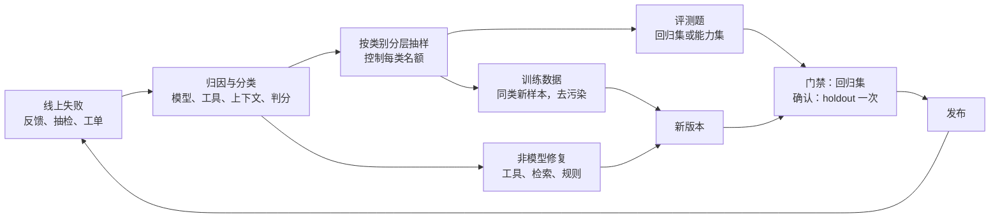

# 评测与训练闭环：bad case 回流与防过拟合

> 层级：垂类 · evaluation · 预计 150 分钟 · 题目：[questions.md](questions.md)
> 前置：[01 评测设计](../01-eval-design/README.md)、[05 线上评测、A/B 与回归门禁](../05-online-regression/README.md)、[training/01 轨迹数据](../../training/01-trajectory-data/README.md)

## 1 这一章解决什么问题

线上发现了 bad case，下一步是什么？只答“加进训练集重新训”，面试官会接着问：这道题还能留在评测集里吗？评测集反复用来挑方案，分数还可信吗？虚高了多少？多久迭代一轮？

这一章讲评测和改进之间的循环：bad case 怎么变成评测数据和训练数据，两边怎么隔离，评测集怎么被“用坏”，以及评测驱动的迭代节奏。改进可以是改 prompt、改工具，也可以是训练模型。前两种同样会过拟合评测集。

之前常见的做法有三个缺陷：

- **一套题既调又报分**。团队在同一套题上反复试方案，最后报的分数里混着“挑中了运气好的那个”的部分。
- **bad case 按出现顺序回流**。最常见的那类失败占满回流名额，小类和高风险类长期没有题。
- **holdout 被悄悄用成开发集**。每轮都看一眼 holdout，它的分数逐轮上涨，线上却不动。

学完你应该能：

- 把一个线上 bad case 拆成评测题和训练数据，说清各自怎么处理；
- 设计评测集与训练集的隔离规则，包括改写题和同源题；
- 推出“从 N 个候选里挑最高分”的乐观偏差有多大，并用模拟验证；
- 说出防止自适应过拟合的工程手段，以及 Thresholdout 的思路；
- 按失败类别分层抽取回流样本；
- 排出一张评测集维护的节奏表：每周、每月各做什么，什么时候重建 holdout。

训练数据的合成、过滤见 [training/01](../../training/01-trajectory-data/README.md)，奖励和 verifier 见 [training/05](../../training/05-reward-verifier/README.md)，统计检验和样本量见 [01 第 6 节](../01-eval-design/README.md#6-统计显著性与样本量)。

**符号表**

| 符号 | 含义 |
|---|---|
| p | 候选方案的真实通过率（在无限多同分布题上的通过率） |
| n | 一套题的题数 |
| N | 在同一套题上比较、从中挑最高分的候选个数 |
| p̂_i | 第 i 个候选在这套题上的通过率，p̂_i = 通过题数 / n |
| se | 单个候选得分的标准误，se = √(p(1 − p) / n) |
| Z_i | 标准化后的噪声，p̂_i ≈ p + se · Z_i，Z_i 近似服从标准正态 |
| M_N | N 个独立标准正态里的最大值，M_N = max_i Z_i |
| ρ | 两个候选在同一套题上得分的相关系数 |
| φ、Φ | 标准正态的密度函数和分布函数 |

## 2 闭环全景



一轮闭环分五步：

1. **线上失败**：来自用户反馈、人工抽检、工单、自动监控（拒答、转人工、撤销操作）。
2. **归因**：判定是判分错、工具或检索错、上下文缺失、模型行为，还是需求本身不清。归因决定去路。
3. **进回归集或训练集**：同一个 bad case 有三条去路。原题进评测集；模型行为问题另造同类新样本进训练集；非模型问题直接修工具或检索。进评测和进训练的必须分开。
4. **修复**：改 prompt、改工具、训练新检查点。
5. **验证**：先在回归集上过门禁，发布前用 holdout 确认一次，上线后盯同类请求。

三套题的分工贯穿整章：

| 题集 | 用途 | 谁能看、看几次 | 结果能不能用来调方案 |
|---|---|---|---|
| 开发集 | 读失败轨迹、试方案、选检查点 | 随便看 | 能，它本来就是用来调的 |
| 回归集 | 门禁，挡住已修好的行为再次退化 | 每次改动或合并都跑 | 只用来判“过不过”，不用来逐题调 |
| holdout | 发布或关键决策前的最终确认 | 每个决策只看一次，记录查看次数 | 不能。按它的结果改了系统，它就降级成开发集 |

为什么一定要三套：开发集的分数注定虚高（下文第 5 节量化），所以要有一套没参与挑选的题给出无偏估计。回归集每天都跑，同样会被慢慢拟合，所以它也不能当最终分数。

## 3 bad case 回流

### 3.1 先归因，再决定去哪

不是所有失败都该变成训练数据。先按 [03 失败归因](../03-trajectory-eval/README.md) 分类：

| 失败原因 | 例子（客服 Agent，虚构） | 去路 |
|---|---|---|
| 判分错了 | Agent 给了正确的替代方案，评委判错 | 修评分器，不进训练 |
| 工具或检索问题 | 订单接口超时，Agent 编了个状态 | 修工具和超时处理；补一道“工具失败时要如实说明”的回归题 |
| 上下文问题 | 政策文档没被检索到 | 修检索；补检索评测题 |
| 模型行为问题 | 没等用户确认就执行退款 | 进评测集，也可以构造训练数据 |
| 需求本身不清 | 政策没写这种情况怎么办 | 先找业务方补规则，再出题 |

判分错误为什么不能进训练：训练信号来自评分器。评分器把对的判成错，再拿这条判定去训练，就是在教模型迎合错误的判分。

Anthropic 的评测工程文章建议：用户报告的失败转成测试用例，按用户影响排优先级；一道题跑很多次都是 0 分，先怀疑题坏了。

### 3.2 变成评测题

1. 脱敏，去掉用户身份和业务敏感字段。
2. 写清成功标准：终态、必须告知的信息、禁止项（见 [01](../01-eval-design/README.md)）。
3. 写一份能通过评分器的参考解，证明题可解、评分器配对了。
4. 确认旧版本稳定失败，题能抓住这个问题。
5. 决定放哪：一个修好后应该一直对的行为，放回归集；还做不好、代表一类能力的，放能力集。
6. 再找几道同类题，避免评测集只认这一道。

新题默认进开发集或回归集，不进当前的 holdout。holdout 要反映线上分布，而 bad case 是按“出过事”挑出来的，分布偏向失败。holdout 按第 7 节的节奏从线上随机采样重建。

### 3.3 变成训练数据

| 数据形式 | 怎么从 bad case 来 | 适合 |
|---|---|---|
| 修正轨迹（SFT） | 人工或强模型写出正确做法的完整轨迹 | 模型不会某个固定流程 |
| 偏好对 | 原失败轨迹做负例，修正轨迹做正例 | 模型会做但常选错 |
| RL 环境任务 | 把场景做成带判分的任务，让模型自己采样 | 有可验证终态的任务 |
| 奖励规则 | 把失败类型写成奖励里的惩罚项 | 需要防住一类违规 |

**关键约束**：用来训练的应当是同类场景的新样本，而不是评测题本身。一个常见做法是：bad case 原题进评测集；按它的失败类型另行合成或采集一批相似但不同的样本进训练集，再对这批样本做去污染，确认和评测题没有改写重叠（检测手段见第 4 节）。

**代价**：bad case 都偏向“最近出过事的问题”。只加不减，训练和评测都会偏向旧问题。要按类别控制回流数量（第 6 节），定期淘汰过时的题（第 7 节）。

## 4 评测集与训练集隔离

**问题**：评测题或它的改写版进了训练集，评测分数就会虚高，且你不知道高了多少。

| 规则 | 做法 | 防什么 |
|---|---|---|
| 存储隔离 | 评测集单独存放，训练数据流水线没有读取权限 | 评测题被误放进训练数据 |
| 按源头切分 | 同一会话、同一文档、同一用户派生的样本只能在一边 | 同源题让模型间接见过答案 |
| 按时间切分 | 评测集用某个时间点之后的请求，训练用之前的 | 线上分布变化导致的“提前看到” |
| 去污染检查 | n-gram 挡字面重复，embedding 检索加 LLM 判定挡改写题 | 改写和翻译后的评测题 |
| 合成数据也查 | 教师模型生成的训练数据同样做去污染 | 教师见过评测题，生成数据带着题的影子 |
| 来源记录 | 每条训练样本记录来源、生成提示版本、教师、时间 | 出问题时能整批回溯删除 |

去污染的具体检测手段（n-gram 重叠、Yang 等的 LLM 改写判定、新题对照、按时间切分、金丝雀字符串）见 [04 第 7.1 节](../04-benchmarks/README.md#71-污染从哪来怎么查)，这里不重复。本章只强调两点：去污染要对**每一批**回流训练数据做，而不是只在建库时做一次；合成样本和原 bad case 太像时，丢掉或改得更远，不要“差不多就留着”。

**按源头切分要在派生之前做**。先把源头（会话 ID、文档 ID、用户 ID）分到评测侧或训练侧，再从各自的源头派生题目和样本。先派生、再随机切分样本，同一源头的样本就会两边都有。

**代价**：按源头切分会让两边都变小；严格去污染会误删一些只是主题相近的训练样本。常见做法是对评测集的高风险层用更严的阈值。

## 5 评测集过拟合

### 5.1 为什么会发生

每次看分数再选方案，都是在用评测集做一次挑选。挑的次数多了，留下的方案里总有一部分只是碰巧在这批题上表现好。题越少、看的次数越多，运气的成分越大。不训练模型、只改 prompt 也会这样。

Dwork 等（2015-06）把这个问题叫自适应数据分析：分析者根据之前的结果决定下一步，用同一个留出集检验很多这样选出来的假设，很容易拟合留出集本身。他们给出了可证明避免这种过拟合的留出集复用算法（思路见第 5.5 节）。工程上要记住的结论是：留出集被看一次，就漏一点信息给调优。

下面先把“挑一次”的偏差算出来，再看“反复挑”会怎样。

### 5.2 挑一次：N 选 1 的乐观偏差

**设定**。有 N 个候选（N 个 prompt 版本，或 N 个训练检查点），真实通过率都等于 p，也就是它们其实一样好。每个候选在同一套 n 道题上各跑一次，得到 p̂_1, …, p̂_N。我们选分数最高的那个，并把它的分数当作“新版本的成绩”报出去。

**第 1 步：单个候选的分数**。每道题的结果是 0 或 1，通过的概率是 p，所以通过题数服从二项分布 Binomial(n, p)：

```text
E[p̂_i] = p
Var(p̂_i) = p(1 − p) / n,    se = √(p(1 − p) / n)
```

n 不太小时，二项分布近似正态，可以写成 p̂_i ≈ p + se · Z_i，Z_i ~ N(0, 1)。先假设各候选的噪声相互独立（每个候选在每道题上的成败各自掷硬币）。

**第 2 步：挑最大值**。被选中者的分数是

```text
p̂_sel = max_i p̂_i ≈ p + se · max_i Z_i = p + se · M_N
```

所以乐观偏差（被选中者分数的期望减去真实水平）是

```text
偏差 = E[p̂_sel] − p ≈ se · E[M_N]
```

**第 3 步：E[M_N] 怎么算**。M_N ≤ x 等价于 N 个 Z_i 都 ≤ x，所以 P(M_N ≤ x) = Φ(x)^N。求导得到密度 N φ(x) Φ(x)^(N−1)，于是

```text
E[M_N] = ∫ x · N φ(x) Φ(x)^(N−1) dx
```

这个积分没有闭式，有两个常用近似：

- 分位数近似：E[M_N] ≈ Φ⁻¹((N − 0.375) / (N + 0.25))。直觉是 N 个点里最大的那个，大约落在第 N/(N+1) 分位附近，0.375 和 0.25 是修正项。
- 渐近式：E[M_N] ≈ √(2 ln N)。N 很大时才准，N = 20 时明显偏大。

几个数：E[M_2] ≈ 0.56，E[M_5] ≈ 1.16，E[M_20] ≈ 1.87，E[M_100] ≈ 2.51。**偏差随 N 只按对数级增长，随题数按 1/√n 下降**。

**第 4 步：带入数字**。p = 0.70，n = 200，N = 20：se = √(0.7 × 0.3 / 200) ≈ 0.0324，偏差 ≈ 0.0324 × 1.87 ≈ 0.060。也就是说，20 个其实一样的候选里挑最高分，报出来的成绩平均是 76%，真实是 70%，凭空多出 6 个百分点。

**第 5 步：换新题会怎样**。把选中的候选拿到一套新的、同分布的 n 道题上重测。新题上的噪声和“它为什么被选中”无关，所以 E[新题分] = p，平均回落 6 个百分点。这就是“开发集上涨、holdout 不涨”最朴素的来源：什么都没变好，只是挑中了运气。

**第 6 步：候选相关时**。真实情况下，几个 prompt 版本在同一道题上往往一起对、一起错，得分相关系数 ρ > 0。把每个候选的噪声拆成公共部分和独有部分：Z_i = √ρ · C + √(1 − ρ) · U_i，C 和 U_i 独立标准正态。最大值只在独有部分上挑：

```text
max_i Z_i = √ρ · C + √(1 − ρ) · max_i U_i
E[偏差] ≈ se · √(1 − ρ) · E[M_N]
```

候选越像，偏差越小；ρ = 0.81 时偏差约为独立时的 0.44 倍。但只要 ρ < 1，偏差就不为 0。这个推导是本章自己做的，下面用模拟验证。

```python
import math
import numpy as np
from statistics import NormalDist

rng = np.random.default_rng(0)
p, n, N, R = 0.70, 200, 20, 20000   # 真实通过率、题数、候选数、重复实验次数
se = math.sqrt(p * (1 - p) / n)

# 1) E[M_N] 的数值积分：∫ x · N φ(x) Φ(x)^(N-1) dx
x = np.linspace(-8, 8, 160001)
phi = np.exp(-x**2 / 2) / math.sqrt(2 * math.pi)
grid = x[::100]
Phi = np.interp(x, grid, [NormalDist().cdf(v) for v in grid])
e_max = float(np.sum(x * N * phi * Phi**(N - 1)) * (x[1] - x[0]))
quantile = NormalDist().inv_cdf((N - 0.375) / (N + 0.25))  # 分位数近似
asym = math.sqrt(2 * math.log(N))                           # 渐近式

# 2) 模拟：N 个真实水平都是 p 的候选，在同一套 n 道题上各跑一次，挑最高分
scores = rng.binomial(n, p, size=(R, N)) / n               # 形状 (R, N)
best = scores.max(axis=1)                                  # 形状 (R,)
inflation = best.mean() - p

# 3) 选中者换一套同分布的新题重测：新题噪声和“为什么被选中”无关
fresh = rng.binomial(n, p, size=R) / n

print(f"se={se:.4f}  E[M_N]: 积分 {e_max:.3f} 分位数近似 {quantile:.3f} 渐近 {asym:.3f}")
print(f"选中者旧题分 {best.mean():.4f}，虚高 {inflation*100:.2f} 点；解析 {se*e_max*100:.2f} 点")
print(f"新题分 {fresh.mean():.4f}")
assert abs(e_max - quantile) < 0.01                 # 分位数近似在 N=20 时很准
assert asym - e_max > 0.5                           # 渐近式在 N 小时明显偏大
assert abs(inflation - se * e_max) < 0.003          # 模拟和解析近似一致
assert 0.055 < inflation < 0.065                    # 约 6 个百分点
assert abs(fresh.mean() - p) < 0.002                # 换新题后回落到真实水平
```

模拟里的虚高约 5.95 点，解析近似给 6.05 点。差的 0.1 点来自二项分布的离散性和偏斜：通过率 0.7 时右尾比正态略短。

### 5.3 反复挑：在同一套题上爬山

第 5.2 节只挑了一次。实际迭代是一连串小改动：改一句 prompt，分数涨了就保留，没涨就撤回。每一步都是一次“二选一”，几百步下来，分数会一路涨上去，哪怕每个改动都毫无作用。

下面的模拟里，每个改动都不改变真实通过率 p，只是让 10% 的题重新掷一次结果（模型行为的随机扰动）。对比两种做法：

- **看 holdout 调**：用 holdout 判断改动是否保留，最后也报 holdout 分；
- **看开发集调**：用开发集判断，holdout 只在最后看一次。

```python
import numpy as np

rng = np.random.default_rng(2)
p, n, K, frac, R = 0.70, 200, 300, 0.1, 200   # 真实通过率、题数、改动次数、每次扰动比例、重复次数

def climb(select_on):
    """K 个改动都不改变真实通过率；select_on 决定用哪套题判断“变好了”。"""
    sets = {k: rng.random(n) < p for k in ("dev", "holdout")}   # 每套形状 (n,)，True 表示通过
    for _ in range(K):
        trial = {}
        for k, v in sets.items():
            t = v.copy()
            idx = rng.random(n) < frac
            t[idx] = rng.random(idx.sum()) < p                  # 这部分题重新掷一次
            trial[k] = t
        if trial[select_on].mean() > sets[select_on].mean():    # 涨了就保留
            sets = trial
    fresh = (rng.random(n) < p).mean()                         # 发布后的新请求
    return sets["dev"].mean(), sets["holdout"].mean(), fresh

a = np.array([climb("holdout") for _ in range(R)])
b = np.array([climb("dev") for _ in range(R)])
print("看 holdout 调：holdout %.3f  新题 %.3f" % (a[:, 1].mean(), a[:, 2].mean()))
print("看开发集调：  开发集 %.3f  holdout %.3f  新题 %.3f" % tuple(b.mean(0)))
assert a[:, 1].mean() - p > 0.15         # 被反复查看的 holdout 虚高 15 个点以上
assert abs(a[:, 2].mean() - p) < 0.01    # 新请求上没有任何提升
assert b[:, 0].mean() - p > 0.15         # 开发集同样虚高，这是预期内的
assert abs(b[:, 1].mean() - p) < 0.01    # 只看一次的 holdout 仍是无偏估计
```

运行结果：被反复查看的 holdout 从 0.70 爬到约 0.92，新请求上仍是 0.70。只看一次的 holdout 给出 0.70，和新请求一致。两种做法的差别不在题，在于**这套题有没有参与挑选**。

这个模拟比现实极端：改动完全无效，且每次扰动都是独立的新运气。现实里改动有真有假，爬山得到的分数是真实提升加上挑选偏差，两者在同一套题上分不开。所以要有一套没参与挑选的题。

### 5.4 形态和信号

| 形态 | 例子 | 信号 |
|---|---|---|
| 挑选偏差 | 20 个 prompt 版本里报最高分 | 换一套同分布的新题，分数回落 |
| 针对题面打补丁 | prompt 里加一条只对某道题有用的规则 | 修复说不出对哪一类问题有效 |
| 迎合评分器 | 学会评委爱看的格式和措辞 | 评委分涨，确定性校验和人工抽检不动 |
| 记住题目 | 训练数据混进评测题或改写版 | 旧题涨、新题不涨 |
| 题集老化 | 题目反映的是半年前的请求 | 评测分稳定，线上抽检慢慢下滑 |

**最直接的检测**：同一组版本同时跑旧题集和一批新题。改写重叠检测和 GSM1k、Recht 的新题对照见 [04 第 7.1 节](../04-benchmarks/README.md#71-污染从哪来怎么查)；本章只讲自己团队的评测集怎么判断过拟合。

**新题掉分要先排除难度差异**。判断方法是看历次版本：如果旧题上的提升在新题上也按相近幅度出现，只是整体低一截，多半是难度差；如果旧题涨、新题不涨，才是过拟合。

### 5.5 怎么防：限制查看、事先约定、可复用 holdout

从第 5.2 节的式子看，偏差 ≈ se · √(1 − ρ) · E[M_N]。能动的只有三个量：题数 n（决定 se）、挑选次数 N、以及这套题有没有参与挑选。工程手段都是在动这三个量。

1. **三套题分工**。开发集随便看，用来调；回归集卡门禁；holdout 集只在关键决策前跑，结果不用于逐条调方案。holdout 不参与挑选，它上面的 N 就是 1，偏差为 0。
2. **限制查看次数**。holdout 设访问权限，每次查看记一笔：谁、为了哪个决策、比较了几个候选。查看次数就是第 5.3 节里的爬山步数，记下来才能知道这套题“用掉了多少”。
3. **事先定主指标和候选数**。看结果之前写下：用哪个指标决策、比较哪几个候选、通过的门槛是多少。事后再挑指标，等于把 N 乘上指标个数（多指标的假阳性见 [01 第 6.7 节](../01-eval-design/README.md#67-边跑边看和多指标假阳性怎么变多)）。候选数也要事先定：报告里写“从 20 个里挑的”，读者才能按第 5.2 节扣掉约 6 个点的期望虚高。
4. **holdout 看过就降级**。根据 holdout 的结果改了系统，它就变成开发集，从新采样的请求里另建 holdout。
5. **定期补新题、淘汰旧题**。从线上按当前分布采样补题（第 7 节）。
6. **改动要有理由**。每个修复要说出对哪一类问题有效，并用同类新题验证。
7. **监控差距**。把评测集分数和线上抽检分数画在一起，差距拉大就报警。

Anthropic 的工具编写文章也提到，他们在优化工具时留了独立的测试集，防止拟合“训练用”的评测。

**Thresholdout 的思路**。Dwork 等在同一篇论文里给出了一个可复用 holdout 的算法，叫 Thresholdout。分析者手里有训练集（相当于本章的开发集）和一个 holdout。每次分析者问“这个函数 φ 的期望是多少”（例如某个候选的通过率），算法这样回答：

1. 分别算 φ 在训练集上的均值和在 holdout 上的均值。
2. 两者之差的绝对值低于一个加了噪声的阈值 T + η，就返回**训练集**上的均值。此时分析者只得到“训练集上的结论在 holdout 上也成立”这一比特信息。
3. 差值超过阈值，说明在训练集上过拟合了，才返回 holdout 均值加一个 Laplace 噪声 ξ，同时把“过拟合预算” B 减一。
4. 预算用完，就不再回答。

噪声 η、ξ 和阈值的扰动来自差分隐私的“稀疏向量”技术，作用是让每次回答尽量少地泄露 holdout 的具体内容。论文给出的保证是：只要过拟合的次数不超过 holdout 大小 n 的平方量级，能回答的查询数可以达到 n 的指数量级。

论文报告了一个合成数据实验：标签和特征完全无关，任何分类器的真实准确率都只有 50%；n = 10,000、d = 10,000，按标准方式复用 holdout 挑选 k = 500 个变量时，训练集和 holdout 上报告的准确率都超过 63%。改用 Thresholdout（实验里 T = 0.04，噪声换成了高斯噪声），报告的准确率回到真实水平附近。

工程上很少直接部署 Thresholdout，原因是要把每次查询都经过一个服务，且阈值和预算的取值依赖证明里的常数，论文作者也说实验参数低于证明所需的值。但它的思路可以直接借：**holdout 只回答“和开发集一致吗”，不一致时才给出带噪声的数，并且限次**。一个简化做法是 holdout 默认只报“过/不过门槛”，不报具体分数。

**代价**：holdout 不被反复看，就意味着很多时候拿不到它的信号；补新题要持续花标注成本。holdout 够用就行，关键是少看。

## 6 bad case 回流的分层采样

### 6.1 为什么不能按出现频率抽

一周归因下来，失败池里各类别的条数往往差几十倍。例如工具超时一出问题就是几百条，而“没等确认就执行”这种高风险问题只有几十条。按出现频率等比例抽 100 条回流：

- 大类占掉六成以上名额，评测集和训练集都偏向它；
- 小类只分到一两条，第 3.2 节第 6 步“补几道同类题”无从谈起；
- 大类往往是一个工具 bug 造成的，修好工具就整类消失，回流进来的题很快过时。

**推导**：一个类别分到 m 条样本，这一类的通过率估计的标准误是 √(p(1 − p) / m)。p = 0.7、m = 2 时标准误约 0.32，这一类修没修好根本看不出来。分层的目标是让每一类都有足够的 m，而不是让总体分布和失败池一样。

### 6.2 做法

1. **先归因，再分层**。类别用第 3.1 节的归因结果，不用表面关键词。
2. **单类设上限**。任何一类不超过总名额的某个比例，例如 30%。
3. **高风险类加权**。会造成不可逆后果的类别（误执行、泄露）多分名额。
4. **名额用不完时重新分配**。某类池子里只有 20 条，就全拿，剩下的名额分给其他没满的类。这叫注水法：像往高低不平的容器里倒水，先填满矮的格子。
5. **类内随机抽**。同一类里不放回随机抽，不挑最新的或最显眼的，避免类内再偏一次。
6. **记录抽样权重**。每条样本记下它所在类别的抽样比例。要估计“线上整体的失败率”时，按权重还原，不能直接用回流集的比例。

```python
import random

# 本周归因后的失败池：类别 -> 该类失败条数（虚构客服 Agent）
counts = {"工具超时后编造状态": 600, "检索没命中政策": 150, "未确认就执行": 80,
          "多轮后遗忘约束": 50, "格式不合规": 20}
budget = 100                    # 本周回流名额
cap = 30                        # 单类上限
weight = {"未确认就执行": 2}     # 高风险类别多分名额

def proportional(counts, budget):
    tot = sum(counts.values())
    return {k: round(budget * v / tot) for k, v in counts.items()}

def stratified(counts, budget, cap, weight):
    """注水法：每轮把剩余名额按权重分给还没满的类；池子用完或到上限的类不再分。"""
    limit = {k: min(v, cap) for k, v in counts.items()}
    alloc = {k: 0 for k in counts}
    left = budget
    while left > 0:
        open_ = [k for k in counts if alloc[k] < limit[k]]
        if not open_:
            break                                  # 所有类都满了，名额用不完
        wsum = sum(weight.get(k, 1) for k in open_)
        gave = 0
        for k in open_:
            share = max(1, left * weight.get(k, 1) // wsum)
            add = min(share, limit[k] - alloc[k], left - gave)
            alloc[k] += add
            gave += add
        left -= gave
    return alloc

prop = proportional(counts, budget)
strat = stratified(counts, budget, cap, weight)
print("按比例：", prop)
print("分层：  ", strat)

rng = random.Random(3)
picked = {k: rng.sample(range(counts[k]), m) for k, m in strat.items()}   # 类内不放回随机抽
ratio = {k: strat[k] / counts[k] for k in counts}                          # 抽样比例，用于还原

assert prop["工具超时后编造状态"] / budget > 0.6      # 按比例抽：一类占六成以上
assert prop["格式不合规"] <= 2                      # 小类几乎抽不到
assert sum(strat.values()) == budget
assert max(strat.values()) <= cap                  # 分层后单类不超过上限
assert min(strat.values()) >= 10                   # 每类都有十条以上
assert strat["未确认就执行"] >= strat["检索没命中政策"]   # 高风险加权生效
assert all(len(set(v)) == len(v) == strat[k] for k, v in picked.items())
# 按 1/抽样比例 加权，能还原失败池里每类的条数
assert all(abs(strat[k] / ratio[k] - counts[k]) < 1e-9 for k in counts)
```

运行结果：按比例抽是 67、17、9、6、2；分层后是 18、18、30、17、17。高风险的“未确认就执行”到了上限 30，最小的“格式不合规”池子里 20 条拿了 17 条。

**代价**：分层后的回流集不再代表线上分布。它适合放进开发集和能力集，用来看“每一类修没修好”；不能用它的总分代表线上质量，那是 holdout 的事。

## 7 评测驱动的迭代节奏与评测集维护

Anthropic 的评测工程文章把评测驱动开发描述为：在 Agent 做到之前，先用评测定义要做到的能力，再迭代到通过。新模型发布时，跑一遍能力集，就知道哪些押注兑现了。

### 7.1 节奏表

| 频率 | 做什么 | 用哪套题 |
|---|---|---|
| 每次改动 | 快门禁，挡明显退化 | 小回归集 |
| 每天或每次合并 | 全量回归，分层配对比较 | 回归集 |
| 每轮迭代内 | 读失败轨迹、调方案、选检查点 | 开发集、能力集 |
| 每轮迭代结束 | 决定发不发、训练检查点选哪个 | holdout，只看这一次 |
| 每周 | 抽样读线上轨迹，把新失败归因，按类分层回流 | 线上样本 |
| 每月或每季度 | 补新题、淘汰过时题、重建 holdout；饱和的能力题转进回归集 | 全部题集 |

### 7.2 每周：读线上轨迹

- 从线上随机抽一批轨迹，加上用户反馈和工单里的失败，一起读。只读失败的，会漏掉“评分器判对、其实错了”的情况。
- 每条失败按第 3.1 节归因，记进失败池。
- 按第 6 节分层抽出本周的回流名额，进开发集或回归集，以及训练数据的候选池。
- 顺手记一个数：本周线上抽检通过率。它和评测集分数画在同一张图上，是第 5.5 节“监控差距”的输入。

### 7.3 每月：补题、淘汰、重建 holdout

**补题**。从最近一个月的线上请求里按当前分布随机采样，标注后补进开发集和回归集。这一步补的是“分布”，不是“失败”，和每周的 bad case 回流互补。

**淘汰旧题**。下面几类题移出或降级：

- 对应的功能、政策、工具已经下线或改了接口，题的成功标准不再成立；
- 连续很多个版本都 100% 通过的能力题，转进回归集，只用来抓退化；
- 回归集里同类题太多、一类占比过高的，按第 6 节的上限做减法；
- 审核发现题面歧义或参考解错误的，修好或删掉。

**重建 holdout**。满足下面任意一条就重建：

- 本月有决策依据 holdout 的结果改了系统（它已经降级成开发集）；
- holdout 的查看记录超过事先定的次数；
- 线上分布明显变了（新功能上线、用户群变化），老 holdout 不再代表线上。

重建时从最近的线上请求随机采样，按源头和时间与训练数据隔离（第 4 节），老 holdout 并入开发集。新旧 holdout 交接时，让当前版本在两套上各跑一次，记下两者的分差。之后的版本只和新 holdout 比，避免把难度差当成进步或退步。

### 7.4 训练场景的额外注意

- **选检查点也是在挑**。用同一份评测集在几十个检查点里挑最好的，就是第 5.2 节的 N 选 1。挑选用开发集，最终确认用 holdout。
- **训练奖励和最终评测不要完全相同**。完全相同时，奖励被钻空子也看不出来（见 [training/05](../../training/05-reward-verifier/README.md)）。
- **一轮只改少数变量**。数据、奖励、超参一起改，评测分数变了也说不清原因。

**节奏太快和太慢的代价**：太快，每次改动的效果都在噪声范围内，团队开始追噪声；太慢，bad case 积压，线上同类问题反复出现。按 [01](../01-eval-design/README.md) 的样本量估算，题数决定了能分辨多小的改进，节奏要和能分辨的幅度匹配。

## 8 数值例子：题数、候选数和偏差

**问题**：团队打算在开发集上比较 20 个 prompt 版本，真实通过率在 0.70 左右。想让“挑最高分”带来的期望虚高不超过 2 个百分点，开发集需要多少题？

**推导**：由第 5.2 节，偏差 ≈ √(p(1 − p) / n) · E[M_N] ≤ δ，解出

```text
n ≥ p(1 − p) · E[M_N]² / δ²
```

带入 p = 0.7、N = 20（E[M_20] ≈ 1.87）、δ = 0.02：n ≥ 0.21 × 3.49 / 0.0004 ≈ 1833 道题。

几个对照：

| 候选数 N | E[M_N]（精确值） | 分位数近似 | 偏差 ≤ 2 点所需题数（独立候选，按近似值算） |
|---|---|---|---|
| 5 | 1.16 | 1.18 | 约 731 |
| 20 | 1.87 | 1.87 | 约 1833 |
| 100 | 2.51 | 2.50 | 约 3278 |

读法：

- 候选从 5 个加到 20 个，题数要乘 2.5，不是乘 4。E[M_N] 按对数增长，挑选次数的“价格”比直觉便宜，但不是零。
- 200 道题的开发集，比较 20 个版本，期望虚高约 6 点。这就是为什么开发集上的最好分数不能直接写进发布报告。
- 候选之间相关时，偏差乘 √(1 − ρ)。同一个基线上的小改动通常 ρ 较高，偏差小一些。

下面的代码验证相关时的修正式，并算出上表。

```python
import math
import numpy as np
from statistics import NormalDist

rng = np.random.default_rng(1)
p, n, N, R = 0.70, 200, 20, 20000
se = math.sqrt(p * (1 - p) / n)
e_max = NormalDist().inv_cdf((N - 0.375) / (N + 0.25))   # 分位数近似的 E[M_N]

def pick_best(c):
    """每道题上，候选以概率 c 照抄一个公共结果，否则自己掷。得分相关系数 ρ ≈ c²。"""
    base = rng.random((R, 1, n)) < p           # 公共结果，形状 (R, 1, n)
    own = rng.random((R, N, n)) < p            # 各自结果，形状 (R, N, n)
    copy = rng.random((R, N, n)) < c
    s = np.where(copy, base, own).mean(axis=2) # 每个候选的通过率，形状 (R, N)
    return s.max(axis=1).mean() - p, np.corrcoef(s[:, 0], s[:, 1])[0, 1]

for c in (0.0, 0.6, 0.9):
    infl, rho = pick_best(c)
    pred = se * math.sqrt(1 - rho) * e_max
    print(f"rho={rho:.2f}  模拟虚高 {infl*100:.2f} 点  公式 {pred*100:.2f} 点")
    assert abs(rho - c * c) < 0.03
    assert abs(infl - pred) < 0.003                       # 相关时的修正式成立

def n_needed(p, N, delta):
    e = NormalDist().inv_cdf((N - 0.375) / (N + 0.25))
    return math.ceil(p * (1 - p) * e * e / delta**2)

table = {N_: n_needed(0.7, N_, 0.02) for N_ in (5, 20, 100)}
print(table)
assert table == {5: 731, 20: 1833, 100: 3278}
assert table[20] / table[5] < 3                           # 候选数乘 4，题数只乘 2.5
```

## 9 工程细节与常见坑

**坑 1：开发集上的最好分数直接写进发布报告**

- 现象：报告写“新版本 76%”，上线后抽检约 70%，团队以为是线上分布变了。
- 原因：76% 是 20 个版本里的最大值，期望虚高约 6 点（第 5.2 节）。
- 排查：查报告里的分数来自哪套题、比较了几个候选；用 holdout 或新采样的题重测选中的版本。
- 处理：发布报告只用 holdout 分数；开发集分数只用来排序候选。

**坑 2：holdout 逐轮上涨，线上不动**

- 现象：holdout 每轮都涨 1 到 2 点，几轮下来涨了 8 点，线上抽检和采纳率曲线是平的。
- 原因：holdout 被用来判断改动去留，已经变成开发集（第 5.3 节）。
- 排查：看 holdout 的查看记录，数一数它参与了几次决策；用新采样的一批题跑最近几个版本，看提升是否同步出现。
- 处理：老 holdout 并入开发集，按第 7.3 节重建；之后限制查看次数。

**坑 3：回流集被一类失败占满**

- 现象：回归集里六成是“工具超时”类题，工具修好后这些题全部通过，总分大涨；别的类别几乎没题，退化看不出来。
- 原因：按出现频率回流，没有分层（第 6.1 节）。
- 排查：按归因类别统计回归集和训练集的组成；看每类的题数是否够分辨这一类的变化。
- 处理：单类设上限，名额用不完时注水重分；工具修好后，这一类只留少量题防回退，其余淘汰。

**坑 4：回流训练数据和评测题同源**

- 现象：某类题在回归集上涨很多，同类新题不涨。
- 原因：训练样本是从和评测题同一会话、同一文档派生的，或合成样本只是评测题的改写。
- 排查：按来源记录查训练样本和评测题的源头 ID 是否重叠；对这批训练数据重新跑去污染（[04 第 7.1 节](../04-benchmarks/README.md#71-污染从哪来怎么查)）。
- 处理：整批删掉同源样本；以后先按源头切分，再派生（第 4 节）。

**坑 5：判分错误进了训练**

- 现象：训练后评委分涨，人工抽检发现某类正确的替代方案反而变少了。
- 原因：评委误判过的 bad case 被当成负例进了偏好对，模型学会避开评委不认的做法。
- 排查：抽查训练数据里的负例，人工复判；看负例集中在哪个评分维度。
- 处理：先修评分器、复判已回流的样本，再重训。归因时“判分错”一类不进训练（第 3.1 节）。

**坑 6：新 holdout 上掉分，误判为退化**

- 现象：重建 holdout 后，当前版本分数低了 5 点，团队以为最近的改动有问题。
- 原因：新 holdout 来自最近的请求，难度或分布和旧的不同。
- 排查：看交接时同一版本在新旧两套上的分差（第 7.3 节）；看历次版本在新 holdout 上的相对顺序是否和旧的一致。
- 处理：之后只和新 holdout 上的基线比，不和旧 holdout 的历史分数比。

**坑 7：事后挑指标**

- 现象：主指标没涨，报告改用一个涨了的次要指标说明“有提升”。
- 原因：多个指标里挑一个显著的，相当于把 N 乘上了指标数。
- 排查：对照事先登记的主指标和门槛。
- 处理：事先定主指标和候选数；次要指标只做非劣护栏（[01 第 5.2 节](../01-eval-design/README.md#52-多个指标怎么权衡)）。

## 10 对比与取舍

| 做法 | 防什么 | 代价 | 什么时候选 |
|---|---|---|---|
| 单套题既调又报分 | 不防 | 无额外成本 | 只适合最早期探索，不用于任何对外数字 |
| 开发集 + holdout 看一次 | 挑选偏差 | 要多标一套题；holdout 信号少 | 默认做法 |
| 开发集 + 回归集 + holdout | 挑选偏差加退化 | 三套题的维护成本 | 有持续迭代和发布门禁的团队 |
| holdout 只报“过/不过” | 减少每次查看泄露的信息 | 拿不到具体分数，难以排查 | holdout 必须频繁看时 |
| Thresholdout | 可证明地控制自适应过拟合 | 要有查询服务；参数依赖证明常数 | 研究或有平台支持时；工程上借思路 |
| 每次决策都新采样一批题 | 彻底没有复用 | 标注成本最高 | 题能自动生成或判分便宜时 |

| 回流采样方式 | 优点 | 缺点 | 适合 |
|---|---|---|---|
| 按出现频率 | 回流集代表失败分布 | 大类占满，小类和高风险类没题 | 估计失败分布本身 |
| 分层加上限 | 每类都有足够题，能看每类修没修好 | 不代表线上分布，要按权重还原 | 开发集、能力集、训练数据 |
| 只取高风险类 | 资源集中在最严重的问题 | 其他类长期无人看 | 事故后的短期专项 |

## 11 自测清单

- [ ] 说出 bad case 的三条去路，以及判分错误为什么不该进训练
- [ ] 写出把 bad case 变成评测题的六步，说清为什么新题不进当前 holdout
- [ ] 解释为什么训练用同类新样本而不是评测题本身
- [ ] 列出评测集与训练集隔离的规则，说清为什么按源头切分要在派生之前
- [ ] 推出 N 个同水平候选挑最高分的期望虚高 se · E[M_N]，算出 p = 0.7、n = 200、N = 20 时约 6 个点
- [ ] 解释候选相关时偏差为什么乘 √(1 − ρ)
- [ ] 解释被反复查看的 holdout 为什么会一路上涨，而只看一次的 holdout 无偏
- [ ] 说出 Thresholdout 什么时候返回训练集均值、什么时候返回加噪的 holdout 均值
- [ ] 说出评测集过拟合的几种形态和对应信号，以及怎么区分“过拟合”和“新题更难”
- [ ] 按类别分层抽取回流样本：上限、加权、注水、类内随机、记录权重
- [ ] 排一张评测集维护的节奏表，说出重建 holdout 的三个触发条件

## 资料

- Anthropic（Grace、Hadfield、Olivares、De Jonghe），[Demystifying evals for AI agents](https://www.anthropic.com/engineering/demystifying-evals-for-ai-agents)，2026-01
- Anthropic（Ken Aizawa 等），[Writing effective tools for agents — with agents](https://www.anthropic.com/engineering/writing-tools-for-agents)，2025-09
- Dwork、Feldman、Hardt、Pitassi、Reingold、Roth，[Generalization in Adaptive Data Analysis and Holdout Reuse](https://arxiv.org/abs/1506.02629)，arXiv 1506.02629，2015-06（v2 2015-09）。Thresholdout 见第 4 节和图 1，合成数据实验见第 5 节
- Yang、Chiang、Zheng、Gonzalez、Stoica，[Rethinking Benchmark and Contamination for Language Models with Rephrased Samples](https://arxiv.org/abs/2311.04850)，arXiv 2311.04850，2023-11
- Zhang 等，[A Careful Examination of Large Language Model Performance on Grade School Arithmetic](https://arxiv.org/abs/2405.00332)，arXiv 2405.00332，2024-05
- Recht、Roelofs、Schmidt、Shankar，[Do ImageNet Classifiers Generalize to ImageNet?](https://arxiv.org/abs/1902.10811)，arXiv 1902.10811，2019-02
