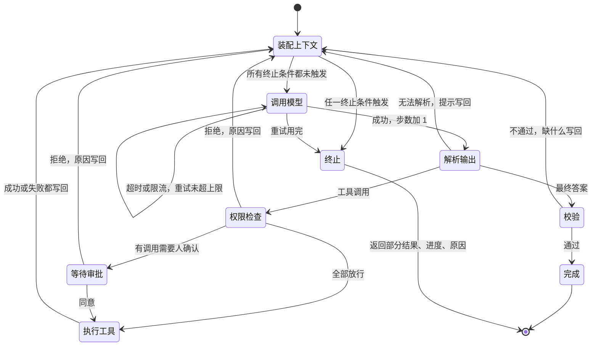
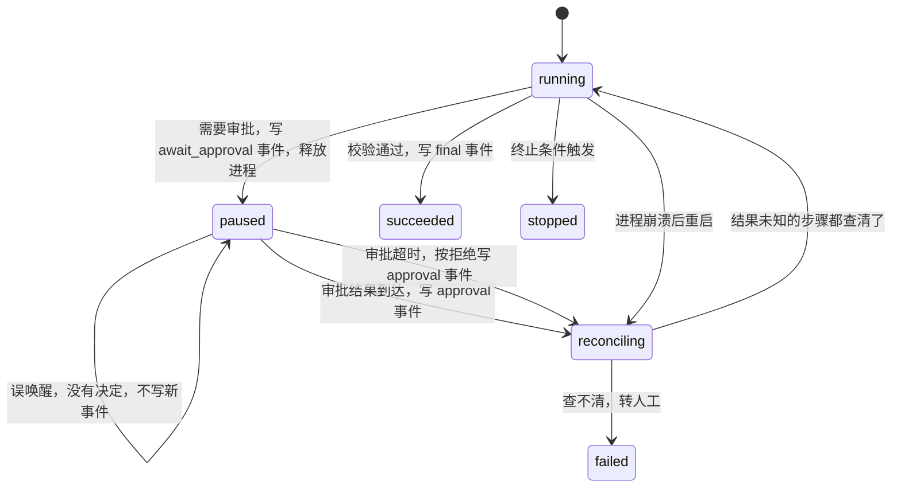

# Agent Loop 与 Harness 的边界

> 层级：垂类 · harness · 预计 180 分钟 · 题目：[questions.md](questions.md)
> 前置：[core/02 Agent 架构与设计模式](../../../core/02-agent-architecture/README.md)（Agent 的组成、“Harness 管住 Loop”）
> 相关：[02 上下文压缩](../02-context-compaction/README.md)（Event Log、Checkpoint、崩溃恢复）、[03 沙箱与权限](../03-sandbox-permissions/README.md)（审批策略）、[04 工具编排](../04-tool-orchestration/README.md)（并发、幂等、工具层的死循环）

## 1 这一章解决什么问题

[core/02 Agent 架构](../../../core/02-agent-architecture/README.md) 讲了 Agent 由模型、循环、工具、状态组成，Harness 负责管住循环。面试官接下来会问：循环怎么写？跑到第几步该停？设了 1 美元的预算，为什么花了 1.3 美元？用户审批要等一晚上，进程怎么办？恢复之后会不会把已经部署过的东西再部署一遍？这些问题都不在模型里，在 Harness 里。

最常见的错误答法是只说“设个 `max_turns`”。这只管住了一个维度。它管不住一次读进 40 万 token 的工具结果，管不住并行子 Agent 的花费，也管不住模型在两个工具之间来回切换。

这一章先写出一个能跑的最小 Loop，再把它画成状态机，逐条补上生产环境要的东西：预算、终止、权限、日志、暂停与恢复。每个结论都配一段能运行的模拟。

学完你应该能：

- 写出最小 Loop，说出它缺哪几块，以及每块归 Loop 还是归 Harness；
- 给出 Step 状态机的状态、转移、守卫和终止条件，并说明为什么加了步数上限它就一定会停；
- 推出“调用后记账”的预算在 k 路并发下最多超多少，以及两种不超的做法各自的代价；
- 写出工具死循环、过早宣布完成、无限重规划的检测规则；
- 设计审批暂停的持久化和恢复，保证已完成的步骤不重复执行；
- 对比 OpenAI Agents SDK、Claude Agent SDK、LangGraph 的循环、上限、审批和恢复，只讲文档写明的部分。

**本章符号**（后文沿用）：

| 符号 | 含义 |
|---|---|
| S | 一个 Task 里调用模型的次数（步数） |
| P | 第一次调用时的上下文长度（system prompt、工具定义、用户消息），单位 token |
| g | 每一步追加进上下文的 token 数（模型输出加工具结果），先按常数算 |
| B | 预算上限（token 或美元） |
| c_max | 单次调用的最坏花费：输入全按未命中缓存算，输出按 `max_tokens` 算 |
| k | 共用同一个预算、能同时在途的调用数（并行子 Agent 或一批付费工具调用） |

## 2 最小 Loop 与它缺的东西

最小 Loop 只有三步：调模型、执行工具、把结果写回。

```python no-run
def run(task, tools, model):
    messages = [system_prompt(), user(task)]
    while True:
        reply = model(messages, tools)
        messages.append(reply)
        if not reply.tool_calls:          # 没有工具调用 = 最终答案
            return reply.text
        for call in reply.tool_calls:
            result = tools[call.name](**call.args)
            messages.append(tool_result(call.id, result))
```

这几行能跑通演示，但上线会出问题：

| 缺的东西 | 会出什么事 | 归谁管 |
|---|---|---|
| 步数、token、金额、时间上限 | 模型一直调工具，成本和延迟没有上限 | Harness：预算与终止 |
| 工具异常处理 | 一次超时让整个任务崩掉；或者错误被吞掉，模型以为成功了 | Loop：错误写回 |
| 权限检查 | 模型写什么就执行什么，包括删文件、发消息 | Harness：权限，见 [03](../03-sandbox-permissions/README.md) |
| 上下文增长控制 | 工具结果越堆越长，撞上窗口上限 | Harness：压缩，见 [02](../02-context-compaction/README.md) |
| 持久化 | 进程一崩，所有进度丢失，也查不到模型当时看到了什么 | Harness：Event Log 与 Checkpoint |
| 取消与暂停 | 用户想停停不下来；等人审批时进程一直占着 | Harness：人在回路 |
| 结果校验 | 模型说“完成了”，其实没完成 | Harness：完成判定 |

**边界怎么划**：Loop 只管“下一步做什么”，即解析模型输出、分发工具、写回结果。Harness 管“能看到什么、能做什么、做到哪停、出了事怎么接着做”。Loop 的逻辑对谁都一样，可以交给成熟 SDK；Harness 的规则和业务相关，大部分要自己定。

最小 Loop 还有一个不显眼的漏洞：`for call in reply.tool_calls` 中途抛异常，后面的调用就没有结果。Anthropic 的文档要求，每个 `tool_use` 块都要在下一条 user 消息里有一个对应的 `tool_result` 块，工具失败了也要有；结果必须紧跟在调用之后。缺了结果，下一次请求会报错，错误信息类似 “tool_use ids were found without tool_result blocks immediately after”。所以“每个调用都有结果”是 Loop 必须维持的不变量，第 3.3 节的状态机把它写成了规则。

## 3 Task、Turn、Step 与状态机

### 3.1 三个粒度

讨论预算、日志和恢复之前，先说清在哪个粒度上。

| 粒度 | 定义 | 编程助手里的例子 | 典型控制 |
|---|---|---|---|
| Task | 为一个用户目标做的一组工作，有完成标准 | “修好登录模块的失败测试” | 总预算、总时长、完成判定、Checkpoint |
| Turn | 用户发一条消息，到系统给出回复 | 用户追问“顺便把注释补上” | 单轮时延、单轮 token 上限 |
| Step | Loop 里的一次“调模型 → 执行动作 → 写回” | 一次跑测试，或一次读文件 | 单步超时、重试次数、权限检查 |

外面通常还有一层 Session（会话），管鉴权、超时和保留期。一个长 Task 可以跨多个 Turn，甚至跨多个 Session。

**术语要先对齐**。不同 SDK 里 “turn” 的含义不同：

| SDK | 叫法 | 含义 | 对应本章 |
|---|---|---|---|
| OpenAI Agents SDK | `max_turns` 里的 turn | 一次 LLM 调用（文档原文 “agent-loop turns (LLM calls)”）。一次 `Runner.run` 是聊天里的一个逻辑 turn | Step；`Runner.run` 对应 Turn |
| Claude Agent SDK | turn | 模型输出一次，SDK 执行其中的工具调用，结果送回模型。最后那次只有文字的回复也算一个 turn | Step |
| LangGraph | super-step | 图执行的一个离散步；并行的节点共用一个 super-step，串行的节点各占一个 | 取决于你怎么画图，一个 Step 可能占两三个 super-step |

面试时先说清你说的 turn 是哪一种。第 10 节有一个因为数错 turn 而拿不到最终答案的坑。

**为什么要分层**：每层出问题的处理方式不同。

- Step 失败：重试或换工具，不打扰用户。
- Turn 超时：先给部分结果，告诉用户还在做。
- Task 超预算：停下来，请用户决定是否追加，或者交付已有结论。

预算至少要在 Task 和 Step 两层同时设。只按 Turn 设，用户多追问几轮，Task 总花费就没有上限；只按 Step 设，又拦不住总量。

### 3.2 Step 状态机

把 Step 内部画成状态机，是为了让每条失败路径都有确定的去处。



三条原则：错误要写回上下文，模型才能换路；每个重试都有上限；终止不能返回空。“等待审批”是一个可能持续几小时的状态，必须能存盘，见第 8 节。

### 3.3 状态、转移和守卫

图只说了“能从哪到哪”。实现时还要写清每条转移的守卫（什么条件下走）和副作用（走的时候写什么）。

| 从 | 到 | 守卫 | 写什么 |
|---|---|---|---|
| 装配上下文 | 调用模型 | 取消、步数、token、金额、墙钟、连续被拒、校验失败次数、循环检测都未触发 | 日志：本步开始 |
| 装配上下文 | 终止 | 上面任一条件触发 | 结束原因、已完成部分 |
| 调用模型 | 解析输出 | 响应返回 | 步数 +1，token 和金额累加 |
| 调用模型 | 调用模型 | 超时或限流，且重试次数 ≤ 上限 | 重试计数 +1 |
| 调用模型 | 终止 | 重试用完 | 结束原因 `model_error` |
| 解析输出 | 权限检查 / 校验 / 装配上下文 | 有工具调用 / 只有文字 / 都不是 | 无法解析时写回提示 |
| 权限检查 | 执行工具 / 等待审批 / 装配上下文 | 全部放行 / 有 ask / 有 deny | 被拒时每个调用都写回“拒绝 + 原因”，被拒计数 +1 |
| 等待审批 | 执行工具 / 装配上下文 | 同意 / 拒绝或超时 | 审批结果进日志 |
| 执行工具 | 装配上下文 | 所有调用都有了结果 | 每个调用一条结果，异常也写成结果 |
| 校验 | 完成 / 装配上下文 | 完成标准满足 / 不满足 | 不满足时写回缺什么，校验失败计数 +1 |

两个不变量贯穿全表：

1. **每个工具调用都有结果**。放行、拒绝、超时、异常、取消，都要写一条结果回去。第 2 节说过，缺了结果下一次请求会报错。
2. **终止条件只在“装配上下文”检查**。这样一个 Step 要么完整走完，要么根本不开始，日志里不会有走到一半的 Step。代价是单次模型调用或工具调用卡住时，墙钟检查要等它返回，所以每次调用还要有自己的超时（第 10 节第 6 条）。

### 3.4 为什么加了步数上限就一定会停

这是推导，不是某个 SDK 的结论。

看上表：回到“装配上下文”的每一条路径，都经过一次成功的“调用模型”，步数 +1。唯一不加步数的环是“调用模型 → 调用模型”，它受重试上限 r 约束，而且每次成功调用会把重试计数清零。所以二元组

```text
V = (max_steps − steps,  r − retries)
```

按字典序每次转移都不增，且每绕一圈严格减小。V 有下界，状态机不可能无限运行。

再数一次最长的一圈：装配 → 调用（1）→ 重试 r 次（r）→ 解析（1）→ 权限（1）→ 审批（1）→ 执行（1）→ 回到装配（1），共 r + 6 次转移。所以

```text
总转移数 ≤ max_steps · (r + 6) + 1
```

最后的 +1 是步数用完后“装配 → 终止”那一次。第 3.6 节的代码 assert 了这个上界。

这个推导也说明了哪些改动会破坏终止性：让“校验不通过”或“无法解析”绕过步数计数直接重新调用模型；在“执行工具”里自动重试而不设上限；把“等待审批”做成没有超时的阻塞。

### 3.5 Task 和 Turn 的状态

Step 状态机是 Loop 的内部。Task 在外层还有自己的状态，调用方和界面看到的是这一层：

| Task 状态 | 含义 | 进入条件 | 离开条件 |
|---|---|---|---|
| running | Loop 在跑 | 创建，或从 paused 恢复 | 进入下面任一状态 |
| paused | 等人审批或补充输入，进程已释放 | Step 进入“等待审批” | 审批结果到达；审批超时按拒绝处理 |
| succeeded | 校验通过 | Step 到“完成” | 用户追问时新开 Turn，Task 回到 running |
| stopped | 终止条件触发，带原因 | Step 到“终止” | 调用方追加预算或改条件后恢复 |
| failed | 无法继续，例如外部状态查不清 | 恢复时对账失败 | 转人工 |

stopped 和 failed 要分开。stopped 是 Harness 按规则主动停下，带着进度，追加预算就能接着跑；failed 是系统自己不知道该怎么办。把超预算当成 failed 上报，调用方就会去重试整个 Task，而不是从断点继续。

Turn 的状态最简单：收到消息，处理中，已回复。它的作用是给用户的消息和 Task 之间建立对应：一个 Turn 可能推动一个 Task，也可能新开一个 Task（第 8.6 节）。

### 3.6 实现：带状态机的最小 Loop

下面的代码把第 3.3 节的转移表写成一个 Loop，用假的“模型”函数驱动。假模型可以按脚本返回回复，也可以永远不收尾。代码做三件事：

1. 每次状态转移都记下来，结束时 assert 每一条都在允许的转移表里，并且第 3.4 节的转移数上界成立；
2. assert “每个工具调用都有结果”这个不变量；
3. 用假模型逐个触发 11 种结束方式：正常完成、步数、token、金额、墙钟、循环检测、策略拒绝、审批拒绝、校验不通过、模型重试用完、用户取消。最后一例确认超时重试、工具异常、无法解析的输出都不会终止任务。

```python
import hashlib
import json

# Step 内部的状态和允许的转移（对应第 3.3 节的转移表）
ASSEMBLE, CALL, PARSE, PERMIT, AWAIT, EXEC, VALIDATE = (
    "assemble", "call_model", "parse", "permission", "await_approval", "exec_tools", "validate")
DONE, STOPPED = "done", "stopped"
ALLOWED = {
    (ASSEMBLE, CALL), (ASSEMBLE, STOPPED),
    (CALL, PARSE), (CALL, CALL), (CALL, STOPPED),
    (PARSE, PERMIT), (PARSE, VALIDATE), (PARSE, ASSEMBLE),
    (PERMIT, EXEC), (PERMIT, AWAIT), (PERMIT, ASSEMBLE),
    (AWAIT, EXEC), (AWAIT, ASSEMBLE),
    (EXEC, ASSEMBLE),
    (VALIDATE, DONE), (VALIDATE, ASSEMBLE),
}
LIMITS = dict(max_steps=20, max_tokens=10**6, max_cost=100.0, max_seconds=3600,
              max_model_retries=2, max_denials=3, max_invalid_finals=2, max_same_result=3)


def h(obj):
    return hashlib.sha256(json.dumps(obj, sort_keys=True, ensure_ascii=False).encode()).hexdigest()[:12]


def run(model, tools, *, policy=lambda c: "allow", approver=lambda c: True,
        validator=lambda text, msgs: True, clock=None, cancelled=lambda: False, **over):
    lim = {**LIMITS, **over}
    clock = clock or (lambda: 0.0)
    t0 = clock()
    msgs, trans = [], []
    c = dict(steps=0, tokens=0, cost=0.0, retries=0, denials=0, invalid=0)
    seen = {}                                    # (调用, 结果) 的哈希 → 出现次数
    state, reply, reason = ASSEMBLE, None, None

    def go(nxt):
        nonlocal state
        trans.append((state, nxt))
        state = nxt

    while state not in (DONE, STOPPED):
        if state == ASSEMBLE:                    # 所有终止条件都在调模型前检查，信息源都在服务端
            reason = ("cancelled" if cancelled() else
                      "max_steps" if c["steps"] >= lim["max_steps"] else
                      "max_tokens" if c["tokens"] >= lim["max_tokens"] else
                      "max_cost" if c["cost"] >= lim["max_cost"] else
                      "wall_time" if clock() - t0 >= lim["max_seconds"] else
                      "too_many_denials" if c["denials"] >= lim["max_denials"] else
                      "invalid_final" if c["invalid"] >= lim["max_invalid_finals"] else
                      "loop_detected" if seen and max(seen.values()) >= lim["max_same_result"] else None)
            go(STOPPED if reason else CALL)
        elif state == CALL:
            try:
                reply = model(msgs)
                c["retries"] = 0
                c["steps"] += 1
                c["tokens"] += reply.get("tokens", 0)
                c["cost"] += reply.get("cost", 0.0)
                go(PARSE)
            except TimeoutError:
                c["retries"] += 1
                if c["retries"] > lim["max_model_retries"]:
                    reason = "model_error"
                    go(STOPPED)
                else:
                    go(CALL)                     # 有上限的重试
        elif state == PARSE:
            msgs.append({"role": "assistant", **reply})
            if "tool_calls" in reply:
                go(PERMIT)
            elif "text" in reply:
                go(VALIDATE)
            else:
                msgs.append({"role": "system", "content": "输出无法解析，请重新给出"})
                go(ASSEMBLE)
        elif state == PERMIT:
            verdicts = [policy(call) for call in reply["tool_calls"]]
            if "deny" in verdicts:
                c["denials"] += 1
                for call in reply["tool_calls"]:   # 简化：一个被拒，整批不执行；每个调用都写回结果
                    msgs.append({"role": "tool", "content": "拒绝：该操作不允许，原因已记录"})
                go(ASSEMBLE)
            else:
                go(AWAIT if "ask" in verdicts else EXEC)
        elif state == AWAIT:
            if all(approver(call) for call in reply["tool_calls"]):
                go(EXEC)
            else:
                c["denials"] += 1
                for call in reply["tool_calls"]:
                    msgs.append({"role": "tool", "content": "审批人拒绝了这次调用"})
                go(ASSEMBLE)
        elif state == EXEC:
            for call in reply["tool_calls"]:     # 每个调用都要有结果，失败也写回
                try:
                    out = tools[call["name"]](**call["args"])
                except Exception as e:
                    out = f"error: {type(e).__name__}: {e}"
                key = h([call["name"], call["args"], out])
                seen[key] = seen.get(key, 0) + 1
                msgs.append({"role": "tool", "content": out})
            go(ASSEMBLE)
        elif state == VALIDATE:
            if validator(reply["text"], msgs):
                go(DONE)
            else:
                c["invalid"] += 1
                msgs.append({"role": "system", "content": "完成标准未满足，继续"})
                go(ASSEMBLE)

    assert all(t in ALLOWED for t in trans), set(trans) - ALLOWED
    n_calls = sum(len(m.get("tool_calls", [])) for m in msgs if m["role"] == "assistant")
    assert n_calls == sum(m["role"] == "tool" for m in msgs)   # 不变量：每个调用都有结果
    progress = [m["content"] for m in msgs if m["role"] == "tool"]
    return dict(reason=reason or "success", **c, progress=progress, transitions=len(trans),
                answer=reply.get("text") if state == DONE else None)


# ---------- 用假模型逐个触发终止条件 ----------
import itertools


def script(*replies):                    # 按顺序返回给定的回复；异常对象表示这次调用超时
    it = iter(replies)

    def model(msgs):
        r = next(it)
        if isinstance(r, Exception):
            raise r
        return r
    return model


def forever(make):                       # 永不收尾的模型：第 i 次调用返回 make(i)
    n = itertools.count()
    return lambda msgs: make(next(n))


tools = {"read": lambda path: f"content of {path}", "fail": lambda: 1 / 0}
call = lambda name, **a: {"tool_calls": [{"name": name, "args": a}], "tokens": 1000, "cost": 0.01}
final = lambda t: {"text": t, "tokens": 500, "cost": 0.01}
fresh = lambda i: call("read", path=f"f{i}.py")          # 每次读不同文件，不会被当成循环

r = run(script(call("read", path="a.py"), final("ok")), tools)
assert r["reason"] == "success" and r["steps"] == 2 and r["answer"] == "ok"

r = run(forever(fresh), tools)
assert r["reason"] == "max_steps" and r["steps"] == 20 and len(r["progress"]) == 20  # 进度不为空
assert r["transitions"] <= LIMITS["max_steps"] * (LIMITS["max_model_retries"] + 6) + 1   # 第 3.4 节的上界

r = run(forever(lambda i: {**fresh(i), "tokens": 400_000}), tools)
assert r["reason"] == "max_tokens" and r["steps"] == 3 and r["tokens"] == 1_200_000  # 超了 20 万

r = run(forever(lambda i: {**fresh(i), "cost": 30.0}), tools)
assert r["reason"] == "max_cost" and r["cost"] == 120.0                              # 调用后记账，超 20 美元

ticks = itertools.count(0, 700)                          # 假时钟：每读一次前进 700 秒
r = run(forever(fresh), tools, clock=lambda: next(ticks))
assert r["reason"] == "wall_time" and r["steps"] == 5

r = run(forever(lambda i: call("read", path="same.py")), tools)
assert r["reason"] == "loop_detected" and r["steps"] == 3

r = run(forever(fresh), tools, policy=lambda c: "deny")
assert r["reason"] == "too_many_denials" and r["steps"] == 3

r = run(forever(fresh), tools, policy=lambda c: "ask", approver=lambda c: False)
assert r["reason"] == "too_many_denials" and r["progress"][0] == "审批人拒绝了这次调用"

r = run(forever(lambda i: final("全部完成！")), tools, validator=lambda text, msgs: False)
assert r["reason"] == "invalid_final" and r["answer"] is None                        # 模型说完成，校验不认

r = run(script(TimeoutError(), TimeoutError(), TimeoutError()), tools)
assert r["reason"] == "model_error" and r["steps"] == 0                              # 重试 2 次后放弃

r = run(forever(fresh), tools, cancelled=lambda: True)
assert r["reason"] == "cancelled" and r["steps"] == 0

# 一次超时重试、一次工具异常、一次无法解析的输出，都不终止任务，错误写回后继续
r = run(script(TimeoutError(), call("fail"), {"tokens": 5}, final("修好了")), tools)
assert r["reason"] == "success" and r["progress"][0].startswith("error: ZeroDivisionError")
```

几个结果值得看一眼，它们后面会用到：

- token 上限 100 万，每步 40 万 token，第 3 步结束时累计 120 万才停。上限在调用前检查、调用后记账，所以会超。第 6 节推出超多少。
- 金额上限 100 美元，结束时花了 120 美元，原因相同。
- 循环检测数的是“同一调用加同一结果”出现的次数，不是单看参数。第 7.1 节解释为什么要带上结果。

## 4 Harness 的职责清单

| 职责 | 做什么 | 放在状态机的哪个位置 |
|---|---|---|
| 预算 | 计步数、token、金额、墙钟时间，按 Task 和 Step 两层 | “装配上下文”里检查，“调用模型”返回后累加 |
| 终止 | 多个独立条件，任一触发就停 | “装配上下文”的守卫 |
| 权限 | 按工具加参数判定放行、拒绝或交给人 | “权限检查” |
| 上下文 | 装配、裁剪、压缩 | “装配上下文” |
| 日志 | 记下每一步的输入、输出、工具调用和结果 | 每次状态转移时追加 |
| 恢复 | 从 Checkpoint 加后续日志重建状态 | 启动时，以及从 paused 回到 running 时 |
| 校验 | 检查完成标准、格式、引用 | “校验” |

日志按 Step 记，并带上 Task ID 和 Turn ID。只记到 Turn 粒度，出问题时只知道“哪一轮错了”，不知道是哪一步的工具结果导致的。Trace 的字段设计和回放见 [06 Trace 与回放](../06-tracing-replay/README.md)。

## 5 终止条件

**问题**：模型说“做完了”，可能真做完了，也可能只是它以为做完了。反过来，它也可能一直不说做完。

**做法**：设一组彼此独立的终止条件，每个条件由不同的信息源判断。

| 条件 | 信息源 | 防什么 | 第 3.6 节的结束原因 |
|---|---|---|---|
| 模型给出最终答案且校验通过 | 模型 + 校验器 | 正常结束 | `success` |
| 步数上限 | 服务端计数 | 无限循环 | `max_steps` |
| token 或金额预算 | 服务端计量 | 成本失控 | `max_tokens`、`max_cost` |
| 墙钟时间 | 服务端计时 | 用户等不起 | `wall_time` |
| 循环检测 | 规则：相同调用加相同结果重复、来回打转、连续多步没有新信息 | 来回打转 | `loop_detected` |
| 连续被拒 | 权限层计数 | 模型反复尝试被禁止的动作 | `too_many_denials` |
| 校验连续不通过 | 校验器计数 | 模型反复宣布完成 | `invalid_final` |
| 模型调用重试用完 | 网关 | 下游故障 | `model_error` |
| 用户取消 | 用户 | 用户不要了 | `cancelled` |

“独立”的意思是：不能让模型自己报告用了几步。所有条件都依赖模型时，它们会一起失效。

**上限怎么定**：先在评测集上看正常完成的任务用了多少步、多少 token，把上限放在分布尾部之外。换模型、换工具后分布会变，要重测。几个框架的默认值差别很大，不能不看就用：

| 框架 | 上限 | 默认值 | 超限时 |
|---|---|---|---|
| OpenAI Agents SDK | `max_turns` | 源码里 `DEFAULT_MAX_TURNS = 10`（`src/agents/run_config.py`，main 分支）；传 `None` 关闭 | 抛 `MaxTurnsExceeded` |
| Claude Agent SDK | `max_turns`、`max_budget_usd` | 都是不限 | 结果消息的 `subtype` 为 `error_max_turns` 或 `error_max_budget_usd` |
| LangGraph | `recursion_limit`，按 super-step 计 | 1.1.4 起是 10,007；1.0.6 到 1.1.3 是 10,000 | 抛 `GraphRecursionError` |

10 对于一个编程任务太小，10,007 对于一个只有三个节点的图又太大。默认值反映的是框架的定位，不是你的任务需要多少步。

**终止时返回什么**：已完成的部分、当前进度、停下的原因。调用方据此决定追加预算重跑、转人工，还是交付部分结果。Claude Agent SDK 的结果消息有五种 `subtype`：`success`、`error_max_turns`、`error_max_budget_usd`、`error_during_execution`、`error_max_structured_output_retries`。只有 `success` 带 `result` 字段；所有种类都带 `total_cost_usd`、`usage`、`num_turns`、`session_id`，超限后可以按 `session_id` 恢复会话继续。OpenAI Agents SDK 用异常表达超限，但所有 `Runner` 入口都接受 `error_handlers`，支持的键是 `"max_turns"`、`"model_refusal"`、`"invalid_final_output"`，处理函数可以返回一个受控的兜底输出，而不是让运行以错误结束。

**完成判定不能只靠模型**。Anthropic 的长任务文章观察到，模型会在只做了单元测试或 `curl` 检查后就把功能标成完成，实际端到端跑不通；有的会话看到已有进展就宣布整个项目完成。他们的做法是一份 JSON 功能清单（例子里有 200 多项），每项初始为 `"passes": false`，Agent 只能改这个字段，提示词写明删改测试是不可接受的。另一篇 Harness 设计文章补充：让 Agent 给自己的产出打分，它倾向于自信地夸奖，即使人看来质量平平；把干活的 Agent 和打分的 Agent 分开，并把单独的评估者调得更挑剔，比让生成者自我批评容易得多。所以完成标准要写成可检查的清单，由系统或独立的评分器检查。检测规则见第 7.1 节。

**提前收工**：有的模型接近上下文上限时会提前收尾（context anxiety），应对办法见 [02 上下文压缩](../02-context-compaction/README.md)。

## 6 预算：怎么计、什么时候查、会超多少

### 6.1 token 是按步累积的

Loop 每一步都把整个上下文重新发给模型。第 i 步（从 0 数）发出的上下文是 P + i·g，S 步累计的输入 token 是一个等差数列求和：

```text
T_in(S) = Σ_{i=0}^{S-1} (P + i·g) = S·P + g·S·(S−1)/2
```

二次项 g·S²/2 很快占主导。由此推出三件事：

1. **步数和 token 不是一回事**。步数翻倍，累计输入接近 4 倍。只设步数上限，管不住 token。
2. **反过来能解出 token 预算允许的最大步数**。解 T_in(S) ≤ B 即可。
3. **压缩的收益也在这里**。把 g 压小，或者每隔几步把上下文缩回接近 P，二次项就变成分段的小二次项。压缩策略见 [02](../02-context-compaction/README.md)。前缀缓存降的是单价，不降 token 数，见 [inference/05](../../inference/05-agent-serving/README.md)。

预算检查还需要一个量：单次调用的最坏花费 c_max。输入 token 在调用前就能算出来；输出最多是 `max_tokens`；缓存可能不命中，所以输入按未命中价算。这样算出的 c_max 偏保守，但它是一个确定的上界。

代入一组数（单价是虚构的，只为演示算法）：

```python
P, g, S = 8_000, 2_000, 30            # 初始上下文、每步新增（模型输出 + 工具结果）、步数


def total_input(P, g, S):
    """第 i 步（从 0 起）发给模型的上下文是 P + i·g，累计输入是等差数列求和。"""
    return S * P + g * S * (S - 1) // 2


assert total_input(P, g, S) == sum(P + i * g for i in range(S)) == 1_110_000
assert P + (S - 1) * g == 66_000      # 最后一步的上下文
# 步数翻倍，累计输入接近 4 倍：二次项 g·S²/2 占主导
ratio = total_input(P, g, 2 * S) / total_input(P, g, S)
assert 3.5 < ratio < 4 and round(ratio, 2) == 3.62

# 反过来：给定 token 预算 T_max，最多能跑几步（解 S·P + g·S(S-1)/2 ≤ T_max）
T_max = 1_000_000
S_ok = max(s for s in range(1, 200) if total_input(P, g, s) <= T_max)
assert S_ok == 28                     # 设 30 步上限时，token 预算先触发

# 单次调用最坏花费 c_max（单价是虚构的，只为演示算法）
price_in, price_out = 3 / 1e6, 15 / 1e6
c_max = 20_000 * price_in + 4_000 * price_out   # 输入 20K token 全部未命中缓存，输出按 max_tokens=4K 算
assert abs(c_max - 0.12) < 1e-12

# 数值例子：token 预算 100 万，调用后检查 vs 调用前预估
assert total_input(P, g, 28) == 980_000           # 前 28 步累计
ctx_29 = P + 28 * g                               # 第 29 步要发的上下文
assert ctx_29 == 64_000
# 调用后检查：980K < 1M，第 29 步照常发出，结束时累计 1,044,000，超出 4.4%
assert total_input(P, g, 29) == 1_044_000
# 调用前预估：980K + 64K > 1M，第 29 步不发
assert total_input(P, g, 28) + ctx_29 > T_max
```

结果：P = 8K、g = 2K 时，30 步累计输入 111 万 token，最后一步的上下文是 6.6 万；步数翻到 60，累计输入变成 3.62 倍。token 预算 100 万时最多跑 28 步，所以同时设 30 步上限，先触发的是 token。

### 6.2 调用前检查，还是调用后记账

花费要等响应返回才知道。于是有两种做法：

| 做法 | 规则 | 超不超 | 代价 |
|---|---|---|---|
| 调用后记账 | 调用前看“已花 < B”，返回后累加 | 会超，最多超在途调用的花费 | 实现简单，用的是真实计量 |
| 调用前预估 | 调用前看“已花 + 本次最坏花费 ≤ B” | 不超 | 要算 c_max；最后总有一截预算花不出去 |

用上面的数字走一遍：28 步后累计 98 万 token，第 29 步要发 6.4 万。

- 调用后记账：98 万 < 100 万，第 29 步照常发出。结束时累计 104.4 万，超出 4.4%。
- 调用前预估：98 万 + 6.4 万 > 100 万，第 29 步不发。结束时 98 万，有 2 万 token 没用上。

**Claude Agent SDK 用的是第一种**。它的文档写明：花费在每次模型响应到达后才和 `max_budget_usd` 比较，因为每次响应的花费来自 API 随响应返回的 token 用量；触达上限的那次响应仍会完成，并计入 `total_cost_usd`。所以实际花费可能超出上限，最多超出那一次响应的花费，再加上那一刻仍在运行的子 Agent 在停下之前的花费。文档的建议是设上限时留出余量。

同一份文档还写了几条相关行为：预算覆盖子 Agent，它们的花费计入总数；花费达到上限后再派生子 Agent 会失败，报 `Budget limit reached`，仍在后台运行的子 Agent 会被停掉；这些执行行为要求 Claude Code v2.1.217 或更高。流式输入模式下，`max_turns` 按每条消息重新计数，但预算在同一个会话的多条消息之间累加。

### 6.3 并发下最多超多少

单线程时，调用后记账最多超一个 c_max。有了并发就不一样了。设 k 个调用可以同时在途，共用一个预算计数器。

**推导上界**。设 t* 是最后一次发出调用的时刻。调用后记账的规则保证 t* 时已花 spent(t*) < B。t* 之后不再发新调用，所以最终花费只来自 t* 时已经在途的调用，最多 k 个，每个最多 c_max：

```text
spent_final ≤ spent(t*) + k·c_max < B + k·c_max
超支 < k·c_max
```

这个界是紧的。构造：k 个调用同时发出、同时返回，每个都花满 c_max，并且让 B 刚好比某一轮结束时的已花多一点点。那一轮结束时已花仍小于 B，下一轮 k 个调用全部放行，超支就是 k·c_max − ε。

c_max = 0.12 美元、预算 1 美元时，4 个并行子 Agent 最坏超 0.48 美元，即预算的 48%。单线程时只超 12%。

**两种不超的做法**：

1. **预留**。发调用前按 c_max 预留，条件是“已花 + 已预留 + c_max ≤ B”；返回后按实际花费结算，退回差额。已花加预留始终不超过 B。代价：结束时最多剩下不到一个 c_max 没用上，和 k 无关，因为最后一个调用失败时预留已经全部结算。
2. **降阈值**。仍然调用后记账，但把内部阈值设成 B − k·c_max。代价：要让出 k·c_max 的预算，并发越高让得越多。

预留要求有一个所有 worker 共享的服务端计数器，原子地做“检查加预留”。各子 Agent 各算各的，就退化成每个子 Agent 单独超一份。

下面的离散事件模拟验证这三条：调用后记账的超支严格小于 k·c_max；预留模式过程中“已花 + 预留”从不超过 B，且最终花费大于 B − c_max；降阈值后最终花费小于 B。

```python
import heapq
import random


def simulate(budget, k, c_max, mode, seed, n_tasks=200):
    """k 个并发 worker（子 Agent 或并行分支）共用一个预算计数器，离散事件模拟。

    mode="post"：调用前只看“已花 < 上限”，花费在响应返回后才记账（Claude Agent SDK 文档描述的做法）。
    mode="reserve"：调用前按最坏花费 c_max 预留，返回后按实际花费结算、退回差额。
    返回 (最终花费, 过程中“已花 + 预留”的最大值)。
    """
    rng = random.Random(seed)
    spent, reserved, peak = 0.0, 0.0, 0.0
    events = []                                   # (完成时间, worker, 实际花费)
    now, started = 0.0, 0

    def try_start(w):
        nonlocal reserved, started, peak
        if started >= n_tasks:
            return
        if mode == "post" and spent >= budget:
            return
        if mode == "reserve" and spent + reserved + c_max > budget:
            return
        cost = rng.uniform(0.2, 1.0) * c_max      # 实际花费在返回前不知道
        if mode == "reserve":
            reserved += c_max
        started += 1
        peak = max(peak, spent + reserved)
        heapq.heappush(events, (now + rng.uniform(1, 10), w, cost))

    for w in range(k):
        try_start(w)
    while events:
        now, w, cost = heapq.heappop(events)
        spent += cost                             # 响应返回，这时才知道花了多少
        if mode == "reserve":
            reserved -= c_max
        peak = max(peak, spent + reserved)
        try_start(w)
    return spent, peak


B, C = 1.00, 0.12                                 # 预算 1 美元；单次调用最坏 0.12 美元（第 6.1 节算出）
for k in (1, 2, 4, 8):
    over = [simulate(B, k, C, "post", s)[0] - B for s in range(300)]
    # 推导的上界：最多 k 个调用在“已花 < B”时同时发出，每个最多花 c_max
    assert max(over) < k * C, (k, max(over))
    res = [simulate(B, k, C, "reserve", s) for s in range(300)]
    assert all(peak <= B + 1e-9 for _, peak in res)            # 预留模式从不超
    assert all(spent > B - C for spent, _ in res)              # 代价：最后剩下不到一个 c_max 没花，和 k 无关
    print(f"k={k}  post 模式最大超支 {max(over):.3f}（上界 {k*C:.3f}）"
          f"  reserve 模式最少花到 {min(s for s, _ in res):.3f}")

# 上界是紧的：构造一个最坏情况。k 个调用同时发出、同时返回、每次都花满 c_max。
# 两轮之后已花 2·k·C = B - ε，仍小于 B，于是第三轮 k 个调用全部放行。
k, eps = 4, 1e-6
B_tight, spent, rounds = 2 * k * C + eps, 0.0, 0
while spent < B_tight:
    spent += k * C
    rounds += 1
assert rounds == 3 and abs((spent - B_tight) - (k * C - eps)) < 1e-9

# 只有调用后检查、又想硬保证不超 B：把内部阈值降到 B - k·c_max
for seed in range(300):
    spent, _ = simulate(B - 4 * C, 4, C, "post", seed)
    assert spent < B
assert round(4 * C / B, 2) == 0.48                  # 代价：4 路并发时要让出 48% 的预算
```

模拟里随机花费的超支（k = 4 时 0.436 美元）低于上界 0.48 美元，因为随机情况下 k 个调用很难同时在最坏时刻发出、又都花满。设余量要按上界，不能按观察到的平均值。

**并发从哪来**。Claude Agent SDK 文档写明，同一个 turn 里的多个工具调用，只读工具（`Read`、`Glob`、`Grep` 和标了只读的 MCP 工具）可以并发，修改状态的工具（`Edit`、`Write`、`Bash`）串行；自定义工具默认串行，设了 `readOnlyHint` 才并行。工具本身不花模型 token，但如果一个工具会调用付费 API，或者派生子 Agent，它就是预算里的一路并发。并发执行器的设计见 [04 工具编排](../04-tool-orchestration/README.md)。

### 6.4 预算用完时还有调用在途

调用后记账的方案里，停止时一定有调用在途。三种处理方式：

| 方式 | 做法 | 适合 |
|---|---|---|
| 等它结束 | 不再发新调用，等在途调用返回，把结果写进日志和进度 | 只读调用，或者马上就能结束的调用 |
| 取消 | 发取消信号，把“已取消”写回上下文作为这个调用的结果 | 长时间的只读调用 |
| 标为未知 | 有副作用、取消后不确定是否生效的调用，在日志里记成“结果未知” | 写操作；恢复时先查外部状态，见第 8.3 节 |

不管哪种，都要保持第 3.3 节的不变量：每个调用都有一条结果。

## 7 三种失败模式与检测

工具死循环、过早宣布完成、无限重规划，是长任务里最常见的三种失败。三者都有一个共同点：模型自己意识不到。所以检测要放在 Harness 里，用 Harness 自己记下的事件，而不是模型的自述。

| 失败模式 | 现象 | 原因 | 检测信号 |
|---|---|---|---|
| 工具死循环 | 步数涨得快，token 涨得慢；日志里一两个工具名反复出现 | 工具结果没给出模型需要的信息；错误信息不够具体；模型忘了已经试过 | 同一调用加同一结果重复；调用序列有周期；连续多步结果没有新内容 |
| 过早宣布完成 | 很快就结束，`success` 比例高，但人工抽查或端到端测试不过 | 模型只能看到自己上下文里的证据；自评偏宽松 | 最后一次修改之后没有通过的测试；完成清单里还有未通过项 |
| 无限重规划 | 每隔几步输出一份新计划，工具调用很少；token 主要花在输出上 | 计划和执行脱节；遇到一个错误就推翻整个计划 | 计划内容变了，但两次计划之间没有新的工具结果 |

### 7.1 检测规则怎么写

**完全重复要带上结果**。轮询任务状态时，参数完全相同，结果在变（排队、运行中、完成），这是正常的。只看“工具名 + 参数”会把轮询误判为死循环。所以完全重复的键是“工具名 + 规范化参数 + 结果”。

**参数要规范化**。去掉字典键的顺序、首尾空白、Unicode 全角半角差异、路径里多余的 `./`。否则模型改一个空格就能绕过检测。[04 工具编排](../04-tool-orchestration/README.md) 讲了工具层的规则和触发后的处理，这里不重复。

**来回打转换着参数也能抓**。A、B 两个调用交替出现，每次参数都和上次一样，但完全重复的计数要到很晚才触发。检查调用序列末尾是否有周期 2 或 3 的重复模式，连续 3 轮就算打转。

**“无新信息”看结果，不看调用**。翻页搜索每次参数都不同，但每页都是空的。用结果的哈希判断这一步有没有带来上下文里没有过的内容，连续多步都没有就触发。

**过早宣布完成用确定性规则**。编程任务里最简单的一条：最后一次修改文件之后，必须有一次通过的测试。这条规则只看 Harness 记的工具事件，不看模型说了什么。更一般的做法是第 5 节的完成清单：模型给出最终答案时，校验器检查清单里每一项的状态。

**无限重规划要先把计划变成事件**。让模型用一个专门的工具或固定格式写计划，Harness 才能比较两次计划是否不同。计划变了、但期间没有任何新的工具结果，记一次空转；连续 3 次就触发。计划之间有新信息，改计划是正常的，计数清零。

### 7.2 实现：检测器

```python
import hashlib
import json
import unicodedata


def canon(v):
    """规范化参数：字典键排序、字符串去首尾空白并做 NFKC、路径去掉多余的 ./ 和末尾 /。"""
    if isinstance(v, dict):
        return {k: canon(v[k]) for k in sorted(v)}
    if isinstance(v, list):
        return [canon(x) for x in v]
    if isinstance(v, str):
        s = unicodedata.normalize("NFKC", v).strip()
        while s.startswith("./"):
            s = s[2:]
        return s.rstrip("/") if "/" in s else s
    return v


def key(name, args):
    raw = json.dumps([name, canon(args)], sort_keys=True, ensure_ascii=False)
    return hashlib.sha256(raw.encode()).hexdigest()[:12]


class Monitor:
    """三类失败模式的检测器。每一步喂一条事件，返回触发的规则名或 None。"""

    def __init__(self, max_repeat=3, max_cycle_rounds=3, max_idle=4, max_replans=3):
        self.max_repeat, self.max_cycle_rounds = max_repeat, max_cycle_rounds
        self.max_idle, self.max_replans = max_idle, max_replans
        self.count, self.keys, self.seen_results = {}, [], set()
        self.idle, self.replans_without_progress, self.plan = 0, 0, None

    def on_tool(self, name, args, result):
        k = key(name, args)
        kr = key(name, [args, str(result)])               # 完全重复 = 同一调用拿到同一结果
        self.count[kr] = self.count.get(kr, 0) + 1
        self.keys.append(k)                               # 打转检测只看调用本身
        new_info = hashlib.sha256(str(result).encode()).hexdigest() not in self.seen_results
        self.seen_results.add(hashlib.sha256(str(result).encode()).hexdigest())
        self.idle = 0 if new_info else self.idle + 1
        if new_info:
            self.replans_without_progress = 0
        if self.count[kr] >= self.max_repeat:
            return "exact_repeat"
        for p in (2, 3):                                    # 周期为 2、3 的来回打转：A B A B A B
            w = p * self.max_cycle_rounds
            tail = self.keys[-w:]
            if len(tail) == w and len(set(tail)) == p and all(
                    tail[i] == tail[i % p] for i in range(w)):
                return f"cycle_period_{p}"
        if self.idle >= self.max_idle:
            return "no_new_info"
        return None

    def on_plan(self, steps):
        """模型给出新计划。计划变了但期间没有任何新信息，记一次空转重规划。"""
        h = key("plan", steps)
        if self.plan is not None and h != self.plan:
            self.replans_without_progress += 1
        self.plan = h
        return "replan_loop" if self.replans_without_progress >= self.max_replans else None


# 1. 规范化：改空格、键顺序、加 ./ 都算同一个调用
assert key("read", {"path": "./src/a.py", "lines": [1, 50]}) == key("read", {"lines": [1, 50], "path": " src/a.py "})
assert key("read", {"path": "src/a.py"}) != key("read", {"path": "src/b.py"})

# 2. 完全重复：第 3 次触发
m = Monitor()
hits = [m.on_tool("read", {"path": p}, "same") for p in ["a.py", " a.py", "./a.py"]]
assert hits == [None, None, "exact_repeat"]

# 对照：轮询任务状态，参数完全相同，但结果在变，不算重复
m = Monitor()
hits = [m.on_tool("job_status", {"id": "j1"}, s) for s in ["queued", "running", "running 60%", "done"]]
assert hits == [None] * 4

# 3. 来回打转：每次调用参数不同就躲过了“完全重复”，但 A B A B A B 的模式被抓住
m = Monitor(max_repeat=10, max_idle=99)
seq = [("open", {"f": "x"}), ("close", {"f": "x"})] * 3
hits = [m.on_tool(n, a, f"r{i}") for i, (n, a) in enumerate(seq)]
assert hits[:5] == [None] * 5 and hits[5] == "cycle_period_2"

# 4. 无新信息：参数都不同（翻页），结果都一样（每页都是空的）
m = Monitor()
hits = [m.on_tool("search", {"q": "foo", "page": i}, "[]") for i in range(5)]
assert hits.index("no_new_info") == 4          # 第 1 次是新信息，之后连续 4 次没有

# 5. 无限重规划：计划改了 3 次，期间没有拿到任何新信息
m = Monitor()
m.on_tool("ls", {}, "a.py b.py")
plans = [["读 a", "改 a"], ["读 b", "改 b"], ["读 a", "改 a"], ["先跑测试", "读 a"]]
hits = [m.on_plan(p) for p in plans]
assert hits == [None, None, None, "replan_loop"]

# 对照：计划之间有新的工具结果，就不算空转
m = Monitor()
for i, p in enumerate(plans):
    m.on_tool("read", {"path": f"f{i}"}, f"content {i}")
    assert m.on_plan(p) is None


def premature_done(events):
    """过早宣布完成的一条确定性规则：最后一次修改之后，必须有一次通过的测试。

    events 是 Harness 自己记的工具事件 (工具名, 结果)，不是模型的自述。
    """
    last_edit = max((i for i, (t, _) in enumerate(events) if t in ("edit", "write")), default=-1)
    passed_after = any(t == "run_tests" and r == "pass" for t, r in events[last_edit + 1:])
    return last_edit >= 0 and not passed_after


# 6. 过早宣布完成：测试通过之后又改了代码，没有再跑
assert premature_done([("edit", "ok"), ("run_tests", "pass"), ("edit", "ok")])
assert premature_done([("edit", "ok"), ("run_tests", "fail")])
assert not premature_done([("edit", "ok"), ("run_tests", "fail"), ("edit", "ok"), ("run_tests", "pass")])
```

### 7.3 触发之后怎么办

检测到不等于马上终止。按代价从低到高：

1. **写回提示**。“你已经用相同参数调用过这个工具，结果相同”，把上次的结果附上。很多死循环是模型忘了已经试过。
2. **限制工具**。本 Task 内暂时禁用这个工具，或者强制模型先总结已有信息。OpenAI Agents SDK 有一个相关的框架内置机制：`reset_tool_choice` 默认为 `True`，工具调用后把 `tool_choice` 重置为 `"auto"`。文档的解释是，工具结果送回模型后，如果 `tool_choice` 仍强制使用工具，模型会再生成一次工具调用，无限循环下去。
3. **终止**。返回部分结果和原因 `loop_detected`，交给调用方决定。

阈值要用评测集校准。设得太紧，正常的重试和轮询被打断；设得太松，死循环要烧掉很多步才停。可以先只记录不拦截，看触发的样本里有多少是真的死循环，再决定阈值。

## 8 人在回路：审批、中断与恢复

### 8.1 四种介入方式

| 方式 | 人做什么 | 适合 | 代价 |
|---|---|---|---|
| 执行前确认 | 对单个高风险动作点同意或拒绝 | 不可逆、对外、越过沙箱边界的动作 | 每次都要等人；问多了人会不看就点 |
| 计划确认 | 先批一份计划，符合计划的动作不再逐个问 | 长任务、成本高的任务 | 计划对了，执行时仍可能偏 |
| 中断 | 用户中途叫停，或补充一条约束 | 用户发现方向错了 | 要处理执行到一半的工具调用 |
| 接管 | Agent 卡住或终止后，人从断点接手 | 长尾难题 | 交接信息要足够完整 |

哪些动作要确认、审批弹窗太多怎么办，见 [03 沙箱与权限](../03-sandbox-permissions/README.md)。这一节只讲 Loop 这一侧：暂停、存盘、恢复。

### 8.2 暂停与恢复的状态机



关键在“reconciling”（对账）这个状态。不管是从审批恢复，还是从崩溃恢复，都先经过它：从日志重建状态，把“发出了请求、没记下结果”的步骤逐个去外部系统查一遍，查清了才继续跑。

**暂停必须持久化**。等审批可能要几小时，Loop 不能一直占着进程和连接。暂停时把状态写进日志，人回复后从日志重建状态继续。三个框架的做法：

- **LangGraph**：`interrupt()` 要求配置 checkpointer（生产用持久化的那种）和 config 里的 thread ID；`interrupt()` 的载荷要能 JSON 序列化。恢复时用同一个 thread ID 调用图，传 `Command(resume=...)`，这个值就是 `interrupt()` 的返回值。
- **OpenAI Agents SDK**：工具设 `needs_approval`（布尔值，或按调用判断的函数）。需要审批且没有已存的决定时，运行暂停，`result.interruptions` 里是待审批的 `ToolApprovalItem`。用 `result.to_state()` 转成 `RunState`，调 `state.approve(...)` 或 `state.reject(...)`，再用 `Runner.run(agent, state)` 恢复。`RunState` 可以用 `to_json()` / `to_string()` 存进数据库或队列，之后用 `RunState.from_json(...)` / `from_string(...)` 重建；序列化内容包括审批决定、待执行的工具调用和工具参数。
- **Claude Agent SDK**：权限模式为 `"default"` 时，需要审批且没被允许规则覆盖的调用会交给 `canUseTool` 回调；没有回调就拒绝。会话按 `session_id` 恢复，可以配 `session_store` 把轨迹同步到自己的存储，让另一台主机恢复。

### 8.3 恢复时会不会重做已经做过的事

这是这一节的核心问题。答案取决于状态按什么粒度存。

**LangGraph 按节点粒度**。文档写明，恢复时运行时从头重新执行整个节点，不是从调用 `interrupt` 的那一行继续，`interrupt` 之前的代码会再执行一次。所以它要求：`interrupt` 之前的副作用最好幂等；不要在 `interrupt` 之前做非幂等的操作；副作用放在 `interrupt` 之后，或者拆到单独的节点。同一个节点里有多个 `interrupt` 时，恢复值严格按调用顺序的下标匹配，所以不能有条件地跳过某个 `interrupt`，也不要在一个节点里写 `while True` 加 `interrupt()`。另外，不要用裸的 `try/except` 包住 `interrupt`：它靠抛异常暂停，被捕获了就传不回图。

**OpenAI Agents SDK 按 `RunState` 快照**。文档说恢复的运行“从停下的地方继续”。它同时警告：审批允许一个工具调用执行，但不保证只执行一次。从一个更早的、已经批准的快照恢复，可能再执行一次工具；文档举的例子是一笔付款已经完成，但存下的快照里没有付款结果。建议给每个逻辑动作分配稳定的幂等键；结果仍不确定时，记成未知，不要自动重放。服务端还要协调存储，防止并发或重复的提交把同一个快照恢复两次。

**推广到自己实现**。任何“暂停 → 恢复”的实现都要回答三个问题：

1. 暂停前做过的事，恢复时会不会再做一遍？
2. 一个副作用发出去了、结果还没记下进程就崩了，恢复时怎么办？
3. 同一个审批被提交两次，或者被两个进程同时恢复，会怎样？

一个能同时回答三个问题的设计：

- **事件日志是唯一的状态来源**。只追加，每条写盘后才算发生过。内存里不留任何恢复要用的东西。
- **每个副作用拆成两个事件**：发出前写 `intent`（带幂等键），拿到结果后写 `result`。有 `intent` 没 `result` 的步骤就是“结果未知”。
- **幂等键用 Task ID 加步骤名**生成，下游按键去重。恢复时先用键查外部状态，查到了就补记结果，查不到才重发，查不清就转人工。这和 [02 的崩溃恢复](../02-context-compaction/README.md) 是同一套做法。
- **审批也是事件**。只接受“当前确实在等的那一步”的审批，已经审批过的再提交就拒绝。

### 8.4 实现：审批暂停后从磁盘恢复

下面的代码用一个 JSONL 文件做事件日志。一个四步的任务（读配置、写文件、部署、通知），部署需要审批。每次 `run` 都新建一个 `Store` 对象，只从磁盘读状态，模拟进程重启。代码 assert 六件事：

- A：跑到部署前暂停，前两步各执行一次；没有审批时误唤醒，不重复记事件；
- B：审批通过后从磁盘恢复，四步各执行一次，没有重做前两步；同一个审批提交两次，第二次被拒；
- C：已完成的 Task 再被调度一次，什么都不发；
- D：进程崩在“写文件”的副作用生效之后、结果写盘之前，恢复时先查外部状态补记结果，没有再发一次；
- E：审批拒绝时部署不执行，“rejected”作为结果写回，假模型据此收尾；
- F：对照组，按 LangGraph 的语义“整个节点从头重跑”，暂停点之前没有幂等键的写操作被执行了两次。

```python
import json
import os
import tempfile


class External:
    """外部世界：进程崩了它也还在。带幂等键的接口，同一个键只生效一次。"""

    def __init__(self):
        self.sent = {}        # 动作名 → Harness 实际发出的请求次数（含重复）
        self.effects = {}     # 幂等键 → 结果

    def execute(self, key, action):
        self.sent[action] = self.sent.get(action, 0) + 1
        return self.effects.setdefault(key, f"{action}:ok")

    def status(self, key):    # 查询接口：这个键执行过没有
        return self.effects.get(key)


class Store:
    """只追加的事件日志，每个 Task 一个 JSONL 文件。状态全部从日志重建。"""

    def __init__(self, root):
        self.root = root

    def path(self, task):
        return os.path.join(self.root, f"{task}.jsonl")

    def append(self, task, **event):
        with open(self.path(task), "a", encoding="utf-8") as f:
            f.write(json.dumps(event, ensure_ascii=False) + "\n")
            f.flush()
            os.fsync(f.fileno())  # 写盘之后才算发生过

    def events(self, task):
        if not os.path.exists(self.path(task)):
            return []
        with open(self.path(task), encoding="utf-8") as f:
            return [json.loads(line) for line in f]


def replay(events):
    s = dict(results={}, intents=set(), awaiting=None, decisions={}, done=False)
    for e in events:
        t = e["type"]
        if t == "intent":
            s["intents"].add(e["step"])
        elif t == "result":
            s["results"][e["step"]] = e["out"]
        elif t == "await_approval":
            s["awaiting"] = e["step"]
        elif t == "approval":
            s["decisions"][e["step"]] = e["decision"]
            s["awaiting"] = None
        elif t == "final":
            s["done"] = True
    s["unknown"] = s["intents"] - set(s["results"])    # 发出了请求、没记下结果
    return s


PLAN = ["read_config", "write_file", "deploy", "notify"]
NEEDS_APPROVAL = {"deploy"}


def fake_model(state):
    """假模型：按计划给出下一个没做的动作；部署被拒就直接收尾。"""
    if state["results"].get("deploy") == "rejected":
        return None
    for step in PLAN:
        if step not in state["results"]:
            return step
    return None


class Crash(Exception):
    pass


def run(task, store, ext, crash_after=None):
    s = replay(store.events(task))
    if s["done"]:
        return "done"
    for step in sorted(s["unknown"]):                   # 先对账，再继续
        st = ext.status(f"{task}:{step}")
        if st is not None:
            store.append(task, type="result", step=step, out=st)
    while True:
        s = replay(store.events(task))
        step = fake_model(s)
        if step is None:
            store.append(task, type="final")
            return "done"
        if step in NEEDS_APPROVAL and step not in s["decisions"]:
            if s["awaiting"] != step:
                store.append(task, type="await_approval", step=step)
            return "paused"                             # 释放进程，什么都不留在内存里
        if s["decisions"].get(step) == "reject":
            store.append(task, type="result", step=step, out="rejected")  # 拒绝也写回
            continue
        key = f"{task}:{step}"                          # 幂等键 = Task ID + 步骤
        store.append(task, type="intent", step=step, key=key)
        out = ext.execute(key, step)
        if step == crash_after:
            raise Crash(step)                           # 副作用已生效，结果还没写盘
        store.append(task, type="result", step=step, out=out)


def decide(task, store, step, decision):
    """审批人提交决定。只接受当前确实在等的那一步，重复提交被拒。"""
    s = replay(store.events(task))
    if s["awaiting"] != step:
        raise ValueError("没有在等这一步的审批，或已经审批过")
    store.append(task, type="approval", step=step, decision=decision)


with tempfile.TemporaryDirectory() as root:
    ext = External()

    # A. 跑到部署前暂停：读配置、写文件各做一次，部署没做
    assert run("t1", Store(root), ext) == "paused"
    assert ext.sent == {"read_config": 1, "write_file": 1}
    # 没人审批时再唤醒一次（比如定时器误触发），仍然停在原地，不重复记事件
    n = len(Store(root).events("t1"))
    assert run("t1", Store(root), ext) == "paused" and len(Store(root).events("t1")) == n

    # B. “进程重启”：换一个全新的 Store 对象，只从磁盘读状态；审批通过后恢复
    decide("t1", Store(root), "deploy", "approve")
    try:
        decide("t1", Store(root), "deploy", "approve")  # 同一个审批提交两次
        raise AssertionError("重复审批应该被拒")
    except ValueError:
        pass
    assert run("t1", Store(root), ext) == "done"
    assert ext.sent == {"read_config": 1, "write_file": 1, "deploy": 1, "notify": 1}

    # C. 已完成的 Task 再被调度一次：什么都不发
    assert run("t1", Store(root), ext) == "done"
    assert sum(ext.sent.values()) == 4

    # D. 崩在副作用之后、记结果之前：恢复时先查外部状态，不重发
    ext2 = External()
    try:
        run("t2", Store(root), ext2, crash_after="write_file")
    except Crash:
        pass
    assert replay(Store(root).events("t2"))["unknown"] == {"write_file"}
    assert run("t2", Store(root), ext2) == "paused"
    assert ext2.sent["write_file"] == 1                 # 对账补记了结果，没有再发一次

    # E. 审批拒绝：部署不执行，“rejected” 写回，模型据此收尾
    decide("t2", Store(root), "deploy", "reject")
    assert run("t2", Store(root), ext2) == "done"
    assert "deploy" not in ext2.sent and "notify" not in ext2.sent

# F. 对照：恢复时“整个节点从头重跑”，而副作用放在暂停点之前
sent = {"write_file": 0}


def node(resume_value=None):
    sent["write_file"] += 1                             # 暂停点之前的副作用，且没有幂等键
    if resume_value is None:
        return "interrupt"
    return "deployed" if resume_value == "approve" else "skipped"


assert node() == "interrupt"
assert node(resume_value="approve") == "deployed"
assert sent["write_file"] == 2                          # 写了两次
```

这段代码省掉了生产里必须有的几样：日志的并发写保护（同一个 Task 只能有一个 Loop 在跑，用租约或乐观锁保证）、审批人的鉴权、审批超时。OpenAI 的文档特别提醒，`RunState` 的加载函数不验证快照本身和提交它的人，这层要自己做。

### 8.5 暂停很久之后要检查什么

审批通过不等于可以直接执行。暂停了一晚上，外部世界可能变了：

- 外部状态：要部署的分支有没有新提交，工单是不是已经被别人关了，文件有没有被改过。
- 依赖：工具和下游服务是否可用，凭据是否过期。
- 版本：prompt、模型、工具定义是否已经升级；升级了，旧快照里的待执行调用可能已经不合法。

OpenAI Agents SDK 有一个对应的开关：`pre_approval_tool_input_guardrails=True` 时，工具输入 Guardrail 在发出审批中断之前先跑一次；通过的调用在批准之后还会再跑一次，用来复查和时间有关的条件。默认值是 `False`，即只在批准之后、执行之前跑。

### 8.6 用户中途发新消息

先判断它是补充约束还是新目标。补充约束并入当前 Task，更新工作状态；新目标则新开 Task，或先问用户是否取消当前 Task。

正在执行的工具调用，要么等它结束，要么取消并把“已取消”写回上下文，不能留下一个没有结果的调用。Claude Agent SDK 的流式输入模式下，一个 turn 因 `max_turns` 结束时还在排队的消息，不会塞进这个 turn 的最后一次模型调用，而是开一个新 turn 处理，并且 `max_turns` 计数从头开始。

**拒绝要写回原因**。模型不知道自己被拒，会换个参数再调同一个工具。Claude Agent SDK 的做法是把拒绝消息作为工具结果交给模型；OpenAI Agents SDK 可以给 `state.reject(...)` 传 `rejection_message`。审批界面展示的内容要由执行器从真实参数生成，不能用模型写的说明，见 [03](../03-sandbox-permissions/README.md)。

## 9 数值例子：给一个任务配预算

把第 6 节的数字串起来，给一个虚构的编程任务配一套预算。条件：

- 主 Agent 第一次调用的上下文 P = 8K token，每步追加 g = 2K token；
- token 预算 100 万，步数上限 30；
- 主 Agent 会同时派出 4 个子 Agent，金额预算 1 美元，单次调用最坏花费 c_max = 0.12 美元（输入 20K 全按未命中，输出按 `max_tokens` = 4K，单价虚构）。

**第一步：哪个上限先触发**。T_in(28) = 98 万，T_in(29) = 104.4 万。100 万 token 的预算在第 28 到 29 步之间触发，早于 30 步的上限。想让步数上限成为主要约束，要么把 token 预算放宽到 T_in(30) = 111 万以上，要么压缩上下文把 g 降下来。

**第二步：调用后记账会超多少 token**。第 29 步发出前已花 98 万，小于上限，照常发出，结束时 104.4 万，超 4.4%。调用前预估则停在 98 万。

**第三步：金额会超多少**。主 Agent 加 4 个子 Agent，最多 k = 5 路同时在途（主 Agent 等子 Agent 时不调模型，保守起见按 5 算）。调用后记账的最坏超支是 5 × 0.12 = 0.60 美元，实际可能花到接近 1.60 美元。

**第四步：怎么改**。三个选择：

| 选择 | 结果 | 代价 |
|---|---|---|
| 维持调用后记账，告诉调用方“最多 1.60 美元” | 上限是软的，但有确定的界 | 对外承诺要按 1.60 算 |
| 内部阈值降到 1 − 0.60 = 0.40 美元 | 硬保证不超 1 美元 | 平均只能用到不到一半的预算 |
| 共享计数器预留 c_max | 硬保证不超 1 美元，最后剩下不到 0.12 美元 | 要一个原子的服务端计数器，子 Agent 每次调用都要先申请 |

多数平台选第三种，因为它的代价和并发数无关。第 6.3 节的模拟验证了这三行的结论。

## 10 工程细节与常见坑

每条写现象、原因、排查和处理。

**1. turn 数错，拿不到最终答案**

- 现象：任务看起来做完了，结果却是 `error_max_turns`，没有最终文字；或者用 OpenAI Agents SDK 时一个正常的编程任务总在第 10 次模型调用后抛 `MaxTurnsExceeded`。
- 原因：Claude Agent SDK 文档写明，`max_turns` 要按“每个带工具调用的 turn，再加一个最后只有文字的 turn”来数；少了最后那一个，运行以 `error_max_turns` 结束，没有最终回复。OpenAI Agents SDK 的 `DEFAULT_MAX_TURNS` 是 10，不传就用它。
- 排查：看结果里的 `num_turns`（Claude Agent SDK 的所有结果种类都带）和失败任务的步数分布。
- 处理：按评测集的步数分布设上限，给收尾留一步；超限后按 `session_id` 恢复，或用 `error_handlers` 给兜底输出。

**2. 只设了步数上限，token 爆了**

- 现象：步数离上限很远，账单却很高；某几个任务的单步输入特别长。
- 原因：一个工具一次返回几十万 token（读了大文件、日志、整页 HTML），而累计输入按 T_in(S) 的二次项增长。
- 排查：按步统计输入 token，找出跳变的那一步对应的工具。
- 处理：token 预算和步数上限同时设；工具结果在写回前截断或摘要，见 [04](../04-tool-orchestration/README.md) 和 [02](../02-context-compaction/README.md)。

**3. 子 Agent 让预算形同虚设**

- 现象：设了 1 美元上限，账单 1.4 美元；或者子 Agent 越多，超得越多。
- 原因：调用后记账在 k 路并发下最多超 k·c_max（第 6.3 节）；更糟的是每个子 Agent 各有一个计数器，互相看不见。
- 排查：把子 Agent 的花费按父 Task 聚合。Claude Agent SDK 的 `usage` 字段只覆盖主循环，整棵树的 token 和花费要看 `model_usage`（TypeScript 里是 `modelUsage`）。
- 处理：一个 Task 一个服务端计数器，子 Agent 调用前预留；或者按 k·c_max 留余量。

**4. 终止被当成失败，整个任务重跑**

- 现象：超预算的任务被调度系统自动重试，从头再花一遍；重试几次后花费是预算的好几倍。
- 原因：调用方只看“成功还是失败”，没区分 stopped 和 failed（第 3.5 节）。
- 排查：看结束原因的分布，超限类原因有没有触发整任务重试。
- 处理：结束原因进结果结构；超限类结束返回进度和恢复用的 ID，调用方决定追加预算继续，而不是重来。

**5. 工具调用没有对应的结果**

- 现象：下一次模型请求返回 400，错误信息类似 “tool_use ids were found without tool_result blocks immediately after”。常出现在加了权限拒绝、取消或超时逻辑之后。
- 原因：一批调用里有一个被拒或抛异常，代码直接 `continue` 或跳出，后面的调用没写结果；或者在调用和结果之间插了一条别的消息。
- 排查：在发请求前检查最后一条 assistant 消息里的每个调用 ID 是否都有结果。
- 处理：把“每个调用都有结果”写成断言（第 3.6 节代码最后的 assert）；拒绝、取消、超时都生成一条结果，异常时带 `is_error`。

**6. 墙钟上限不生效**

- 现象：设了 10 分钟上限，一个任务跑了 40 分钟才停。
- 原因：终止条件只在“装配上下文”检查（第 3.3 节），一次工具调用卡了 30 分钟，检查一直没机会执行。
- 排查：看最后一步的单步耗时。
- 处理：每个模型调用和工具调用都有自己的超时；超时作为结果写回。这时能保证的最长运行时间是墙钟上限加上一个 Step 的最长耗时（模型调用超时乘以重试次数，再加上这一步工具调用的超时），不是墙钟上限本身。

**7. 恢复后副作用执行了两次**

- 现象：审批通过后，邮件发了两封；崩溃恢复后，同一个合并请求创建了两个。
- 原因：LangGraph 恢复时整个节点重跑，`interrupt` 之前的写操作再执行一次（第 8.4 节的对照组 F）；或者崩在副作用之后、结果写盘之前，恢复时直接重发。
- 排查：在日志里找有 `intent` 没 `result` 的步骤；看下游有没有按幂等键去重。
- 处理：副作用放在暂停点之后或单独的节点；每个副作用带 Task ID 加步骤名的幂等键；恢复时先查后发。

**8. `interrupt` 被吞掉，审批没弹出来**

- 现象：LangGraph 图里该暂停的地方没有暂停，直接往下跑了，或者报了一个看不懂的异常被日志吞了。
- 原因：`interrupt` 靠抛异常暂停。被裸的 `try/except` 包住，异常被捕获，暂停传不回图。
- 排查：搜 `interrupt` 外层的 `except Exception` 或 `except:`。
- 处理：只捕获具体的异常类型。

**9. 同一个快照被恢复两次**

- 现象：审批人双击了“同意”，或者两个 worker 同时拿到了恢复任务，工具执行了两次。
- 原因：恢复入口没有去重。OpenAI Agents SDK 的文档提醒服务端要协调存储，防止并发或重复的提交恢复同一个快照两次。
- 排查：日志里同一个审批有两条，或者同一个 Task 有两个 Loop 交错写事件。
- 处理：审批只接受“当前在等的那一步”（第 8.4 节的 `decide`）；同一个 Task 同时只允许一个 Loop，用租约或乐观锁。

**10. 循环检测误杀正常任务**

- 现象：加了循环检测后，等待部署、轮询任务状态的任务被提前终止。
- 原因：完全重复只看“工具名 + 参数”，没带结果。
- 排查：看 `loop_detected` 样本里被判重复的调用，结果是否在变化。
- 处理：完全重复的键带上结果；轮询类工具单独设次数上限和间隔；新阈值先只记录不拦截。

**11. SDK 在错误结果之后抛异常，或者丢了尾部事件**

- 现象：Claude Agent SDK 里一个超限任务直接让脚本崩了；或者拿不到某些结束后的事件。
- 原因：文档写明，单次 `query()` 在交出错误结果消息之后会抛一个带失败信息的异常（例如 `Reached maximum number of turns`），这是有意设计；结果消息之后还可能有少量系统事件，例如 `prompt_suggestion`。
- 排查：看异常前是否已经收到 `ResultMessage`。
- 处理：迭代外面包 `try`；把流迭代到结束，不要一见到结果消息就 `break`。

**12. 用模型的自述做完成判定**

- 现象：`success` 的比例很高，但人工抽查或端到端测试的通过率低很多。
- 原因：完成判定只看模型有没有给出不带工具调用的回复；模型自评偏宽松（第 5 节）。
- 排查：抽样对比 `success` 任务和独立校验的结果。
- 处理：校验器检查完成清单和第 7.1 节的确定性规则；校验不通过回到“装配上下文”，并设校验失败次数上限。

## 11 对比与取舍

### 11.1 三个框架的循环结构

以下只写官方文档或源码里写明的部分，2026-11 查阅。版本变化快，用之前以当时的文档为准。

| | OpenAI Agents SDK | Claude Agent SDK | LangGraph |
|---|---|---|---|
| 循环由谁写 | SDK 的 `Runner`：调模型；最终输出就返回，Handoff 就换 Agent 重跑，工具调用就执行、追加结果、重跑 | SDK 内置 Claude Code 的循环 | 你用节点和边画出来 |
| 何时算结束 | 输出了期望类型的文本，且没有工具调用；`tool_use_behavior` 还可以设成第一个工具的结果就是最终输出（`stop_on_first_tool`）或调到指定工具就停（`StopAtTools`） | 模型给出不含工具调用的回复 | 所有节点都不再活跃、没有消息在途 |
| 步数上限 | `max_turns`，按 LLM 调用计，默认 10；超限抛 `MaxTurnsExceeded` | `max_turns`，按 turn 计（含最后的纯文字 turn），默认不限 | `recursion_limit`，按 super-step 计，1.1.4 起默认 10,007；超限抛 `GraphRecursionError` |
| 金额上限 | 文档未提供内置项 | `max_budget_usd`，调用后记账，覆盖子 Agent | 自己在状态里计 |
| 并行工具 | 本章查阅的页面未写明执行方式 | 只读工具并发，改状态的工具串行；自定义工具默认串行 | 并行分支在同一个 super-step |
| 超限时 | 异常；`error_handlers` 可给兜底输出 | 结果消息的 `subtype` 区分，带 `session_id` | 异常 |
| 多 Agent | Handoff：切换当前 Agent，继续同一个循环 | Subagent：子 Agent 只把最终回复交回主 Agent | 子图 |
| 审批 | 工具设 `needs_approval`，暂停后从 `result.interruptions` 取待审项 | 权限模式、allow/deny 规则、hooks、`canUseTool` 回调 | `interrupt()` 加 checkpointer |
| 持久化与恢复 | `RunState` 序列化为 JSON 或字符串，`Runner.run(agent, state)` 恢复 | 按 `session_id` 恢复或分叉会话，可配 `session_store` | checkpointer 按 thread 存快照，`Command(resume=...)` 恢复 |
| 恢复粒度 | 从停下的地方继续，但不保证工具只执行一次 | 恢复完整的会话上下文 | 整个节点从头重跑 |

**怎么读这张表**：三者都替你写好了“调模型 → 执行 → 写回”，差别在默认值和抽象层次。OpenAI Agents SDK 原语少，编排用普通代码写。Claude Agent SDK 直接给一个现成 Agent 的 Harness，包括工具、压缩、权限和花费上限。LangGraph 不规定 Agent 长什么样，只管流程和状态持久化，步数上限的默认值很大，因为它的“步”是图的执行步，不是模型调用。

**它们都不替你做的**：业务的完成标准、工具参数的业务校验、按风险分级的审批策略、跨子 Agent 的硬预算、有副作用工具的幂等键、评测门禁。这些是 Harness 里和业务绑定的部分。

**选哪个**：看哪个的默认值离任务最近。任务像“读写文件、跑命令”就用现成 Harness；要精细控制流程和断点就用图；多个专职 Agent 转交就看 Handoff。不管选哪个，把工具、校验、预算计数器、评测写成和 SDK 无关的模块，换 SDK 时只换胶水。

### 11.2 预算的三种执行方式

| | 调用后记账 | 降阈值 | 预留 |
|---|---|---|---|
| 规则 | 已花 < B 就发 | 已花 < B − k·c_max 就发 | 已花 + 预留 + c_max ≤ B 才发 |
| 最坏超支 | < k·c_max | 不超 | 不超 |
| 用不上的预算 | 0 | 最多 k·c_max | 不到一个 c_max |
| 需要什么 | 只要计量 | 知道 k 和 c_max | 原子的共享计数器、c_max 的估算 |
| 适合 | 内部工具、对外不承诺硬上限 | 并发低、实现要简单 | 对外承诺硬上限的多租户平台 |

### 11.3 恢复粒度

| 粒度 | 例子 | 恢复时重做什么 | 要求 |
|---|---|---|---|
| 节点或步骤快照 | LangGraph checkpointer | 整个节点 | 暂停点之前的副作用幂等，或拆出去 |
| 运行状态快照 | OpenAI `RunState` | 从快照点继续；旧快照可能重做已执行的工具 | 幂等键；防止同一快照恢复两次 |
| 事件日志 + 两段式副作用 | 第 8.4 节 | 只重做“结果未知且查不到”的步骤 | 下游支持按键查询或去重 |

粒度越细，重做得越少，但每一步都要写盘，下游也要配合。多数系统的选择是：只读步骤按节点粒度，接受重做；有副作用的步骤用两段式记录加幂等键。

**Harness 组件要随模型重测**。Anthropic 的 Harness 设计文章提出：每个 Harness 组件都编码了一个“模型自己做不到什么”的假设；这些假设可能本来就不对，模型变强后也会很快过时。作者建议一次只去掉一个组件做对比，因为一次去掉很多，就说不清是哪个在起作用。他的结论是，有用的 Harness 组合不会随模型变强而缩小，而是会移动。本章的循环检测阈值、校验失败上限、审批范围都属于这类假设，换模型后要在评测集上重测。

## 12 自测清单

- [ ] 写出最小 Loop 的伪代码，列出它缺的至少五样东西和归属
- [ ] 说出 Task、Turn、Step 的定义，以及三个 SDK 里 turn 或 step 的含义和对应关系
- [ ] 画出 Step 状态机，写出每条转移的守卫，说明“每个调用都有结果”和“终止只在装配时检查”两个不变量
- [ ] 证明加了步数上限和重试上限后状态机一定停，并写出转移数的上界
- [ ] 写出累计输入 token 的公式，解释为什么步数翻倍 token 接近 4 倍
- [ ] 推出调用后记账在 k 路并发下的超支上界，说出预留和降阈值的代价
- [ ] 写出工具死循环、过早宣布完成、无限重规划各自的检测规则，解释完全重复为什么要带上结果
- [ ] 设计审批暂停的事件日志，说明恢复时怎么保证已完成的步骤不重复执行、结果未知的步骤怎么处理
- [ ] 说出 LangGraph 和 OpenAI Agents SDK 在恢复时各自会不会重做副作用，依据是什么
- [ ] 对比三个框架的循环、上限默认值、审批和持久化

## 资料

- Anthropic（Justin Young），[Effective harnesses for long-running agents](https://www.anthropic.com/engineering/effective-harnesses-for-long-running-agents)，2025-11-26（过早宣布完成、JSON 功能清单）
- Anthropic（Prithvi Rajasekaran），[Harness design for long-running application development](https://www.anthropic.com/engineering/harness-design-long-running-apps)，2026-03-24（自评偏宽松、生成与评估分离、组件即假设）
- Anthropic，[How the agent loop works](https://code.claude.com/docs/en/agent-sdk/agent-loop)，Claude Agent SDK 文档，2026-11 查阅（turn 的定义、`max_turns` 计数、`max_budget_usd` 与 Budget headroom、结果 `subtype`、并行工具、`usage` 与 `model_usage`）
- Anthropic，[Handle tool calls](https://platform.claude.com/docs/en/agents-and-tools/tool-use/handle-tool-calls)，Claude API 文档，2026-11 查阅（每个 `tool_use` 都要有 `tool_result`、`is_error` 与重试上限）
- OpenAI，[Running agents](https://openai.github.io/openai-agents-python/running_agents/)，OpenAI Agents SDK 文档，2026-11 查阅（循环、`max_turns`、`error_handlers`、`pre_approval_tool_input_guardrails`）
- OpenAI，[Agents](https://openai.github.io/openai-agents-python/agents/)，OpenAI Agents SDK 文档，2026-11 查阅（`tool_use_behavior`、`reset_tool_choice`）
- OpenAI，[Human-in-the-loop](https://openai.github.io/openai-agents-python/human_in_the_loop/)，OpenAI Agents SDK 文档，2026-11 查阅（`needs_approval`、`RunState` 序列化与恢复、不保证只执行一次）
- OpenAI，[`src/agents/run_config.py`](https://github.com/openai/openai-agents-python/blob/main/src/agents/run_config.py)，openai-agents-python 源码，main 分支，2026-11 查阅（`DEFAULT_MAX_TURNS = 10`）
- LangChain，[Interrupts](https://docs.langchain.com/oss/python/langgraph/interrupts)，LangGraph 文档，2026-11 查阅（checkpointer 与 thread ID、节点重跑、按下标匹配恢复值、不要用裸 `try/except`）
- LangChain，[Graph API](https://docs.langchain.com/oss/python/langgraph/graph-api)，LangGraph 文档，2026-11 查阅（super-step、`recursion_limit` 默认值、`GraphRecursionError`）
- Liuliming，[2025–2026 国内大厂 Agent 面经：从 RAG 到 Harness Engineering](https://keepkeen.github.io/blog/china-agent-interview-guide-2025-2026/)，2026-08
