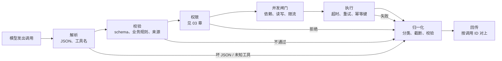

# 工具注册、路由、并发与错误恢复

> 层级：垂类 · harness · 预计 150 分钟 · 题目：[questions.md](questions.md)
> 前置：[core/04 工具调用、MCP 与 Skills](../../../core/04-tool-use-mcp/README.md)（Function Calling 协议、strict、MCP 原语、工具描述写法）、[01 Agent Loop 与 Harness 的边界](../01-loop-and-harness/README.md)（预算与终止）

## 1 这一章解决什么问题

[core/04](../../../core/04-tool-use-mcp/README.md) 讲了模型怎么表达“我要调这个工具”，以及协议层的规则：`tool_result` 怎么回、strict 模式管什么、MCP 的两类错误、描述和返回值怎么写。本章不重复这些，只讲模型发出调用以后 Harness 里的工具执行层：

- 工具从哪来，注册表存什么，几个 MCP 服务撞名了怎么办；
- 几百个工具里每轮给模型看哪些，检索漏了怎么办；
- 一轮五个调用、互相有依赖，怎么排、怎么限流；
- 超时了谁重试、重试几次、怎么保证不扣两次钱；
- 返回几 MB 的日志，怎么截、怎么分页；
- 模型反复调同一个工具，或者编了一个 ID，怎么在执行前拦下。

最朴素的执行层是一个 循环：对每个调用，按名字找到函数，传入参数，把返回值追加到结果列表。它在演示里能跑，在生产里会坏在每一个环节：参数是坏 JSON 时整个 Loop 抛异常；第三方工具说自己只读，结果是写操作，被并行跑了；下游超时，SDK 自动重试三次，Harness 又重试三次，模型再重发一次；扣款成功但响应丢了，重试又扣一次。面试问“你的工具层怎么设计”，考的就是这些失败路径。

学完你应该能：

- 列出一次调用经过的六关，说出每一关失败时写回什么、谁来处理；
- 设计注册表的字段、命名空间和版本，讲清工具快照和 prompt 缓存的关系；
- 推导检索式选工具时端到端成功率的上界，用模拟找最优 top-k；
- 在依赖图上做并行执行，算出总耗时的下界，处理有副作用工具的串行化；
- 写出带抖动的退避、重试预算和幂等键，推导重试放大的倍数；
- 设计截断和分页，让错误信息可操作；
- 写出重复调用检测器和参数来源检查。

**本章符号**（后文沿用）：

| 符号 | 含义 |
|---|---|
| k | 检索式选工具时，每轮交给模型的候选工具数（top-k） |
| R(k) | 召回率：正确工具出现在 top-k 里的概率 |
| S(k) | 正确工具在候选里时，模型从 k 个候选中选对的概率 |
| W | 一批调用的总工作量：各调用耗时之和 |
| C | 依赖图的关键路径长度：最长依赖链上的耗时之和 |
| P | 全局并发上限 |
| r | 某一层的尝试次数（首次加重试） |
| n | 调用栈里各自做重试的层数 |
| b、c | 退避的基础时长和上限（base、cap） |
| ρ | 重试预算：重试请求占全部请求的比例上限 |

## 2 一次工具调用经过哪些关



所有失败路径都汇到归一化，因为每个调用都必须有一个结果写回。少回一个，Anthropic API 的下一次请求会直接报 400，规则见 [core/04 第 3.4 节](../../../core/04-tool-use-mcp/README.md#34-tool_result-的回传规则)。

### 2.1 每一关失败怎么处理

| 关 | 检查什么 | 典型失败 | 写回的 `error_type` | 谁来处理 |
|---|---|---|---|---|
| 解析 | 参数能否解析成 JSON；工具名是否在本 Task 的快照里 | 流式拼接出半截 JSON；模型拼错工具名 | `malformed_arguments`、`unknown_tool` | 模型重发；`unknown_tool` 频繁出现说明快照和描述不一致，要进告警 |
| 校验 | 类型、必填、多余字段；业务规则（日期先后、范围）；ID 的来源 | 字符串冒充整数；编造的订单号 | `invalid_argument` | 模型改参数；信息写清合法取值 |
| 权限 | 工具加参数在当前模式下是否允许 | 越过白名单；审批被拒 | `permission_denied` | 模型换路；连续被拒计入终止条件，见 [03 第 4.2 节](../03-sandbox-permissions/README.md#42-六步判定顺序) |
| 并发闸门 | 依赖是否完成；同资源写是否互斥；工具和租户的并发额度 | 上游调用失败；排队超过 deadline | `dependency_failed`、`deadline_exceeded` | Harness 跳过并写回原因 |
| 执行 | 超时、下游错误、熔断 | 超时；限流；凭据失效 | `timeout`、`rate_limited`、`unavailable` | 临时错误执行器重试；致命错误降级 |
| 归一化 | 输出 schema；长度；空结果 | 下游改了格式；结果 5 MB | `bad_output`，或正常结果加 `truncated` | Harness 截断并给提示；格式错按错误处理 |

两点说明。

**解析这一关只在参数是字符串时才有**。OpenAI 的 `arguments` 是 JSON 字符串，流式输出时更要自己拼；Anthropic 返回的 `input` 已经是对象。开源引擎在 `auto` 模式下参数可能不合法，见 [inference/05](../../inference/05-agent-serving/README.md)。不管哪种，都在 Harness 里统一成“解析失败也是一个结果”。

**关的顺序有讲究**。校验放在权限前面：参数不合法的调用不必去问人。权限放在并发闸门前面：被拒的调用不占并发额度。执行放在最后：前面任何一关不过，都不产生副作用。

### 2.2 实现：六关流水线

下面的代码把六关写成六个函数，每一关失败都抛出带类别的 `Fail`，在 `run_call` 里统一变成一个 `is_error` 结果。验证的结论：六个各有毛病的调用，拿回六个结果，类别各不相同，错误信息说清了合法取值。

```python
# 一次工具调用的六关：解析 → 校验 → 权限 → 执行 → 归一化 → 回传。
# 每一关失败都变成一个结构化的 tool_result，不抛到 Loop 外面。
import json


class Fail(Exception):
    def __init__(self, error_type, message, retryable=False):
        super().__init__(message)
        self.error_type, self.message, self.retryable = error_type, message, retryable


REGISTRY = {
    "search_tickets": {"schema": {"query": str, "limit": int}, "required": {"query"},
                       "side_effect": "read", "fn": lambda a: [f"T-{i}" for i in range(a.get("limit", 3))]},
    "close_ticket": {"schema": {"ticket_id": str}, "required": {"ticket_id"},
                     "side_effect": "irreversible", "fn": lambda a: {"closed": a["ticket_id"]}},
    "flaky": {"schema": {}, "required": set(), "side_effect": "read",
              "fn": lambda a: (_ for _ in ()).throw(TimeoutError("upstream 30s"))},
}
DENY = {"close_ticket"}            # 权限层的决定，细节见 harness/03


def parse(raw):                    # 关 1：解析。流式拼出来的参数可能是坏 JSON
    try:
        args = json.loads(raw["arguments"])
    except json.JSONDecodeError as e:
        raise Fail("malformed_arguments", f"参数不是合法 JSON：{e.msg}，位置 {e.pos}")
    if raw["name"] not in REGISTRY:
        raise Fail("unknown_tool", f"没有工具 {raw['name']}，可用：{sorted(REGISTRY)}")
    return raw["name"], args


def validate(name, args):          # 关 2：校验。类型、必填、多余字段
    spec = REGISTRY[name]
    missing = spec["required"] - set(args)
    if missing:
        raise Fail("invalid_argument", f"缺少必填参数 {sorted(missing)}")
    for k, v in args.items():
        if k not in spec["schema"]:
            raise Fail("invalid_argument", f"未知参数 {k}，合法参数：{sorted(spec['schema'])}")
        t = spec["schema"][k]
        if not isinstance(v, t) or (t is int and isinstance(v, bool)):
            raise Fail("invalid_argument", f"{k} 应为 {t.__name__}，收到 {type(v).__name__}")


def authorize(name):               # 关 3：权限
    if name in DENY:
        raise Fail("permission_denied", f"{name} 需要人工审批，本次未执行")


def execute(name, args):           # 关 4：执行。异常按类别翻译
    try:
        return REGISTRY[name]["fn"](args)
    except TimeoutError as e:
        raise Fail("timeout", f"超时：{e}", retryable=REGISTRY[name]["side_effect"] == "read")


def normalize(call_id, out=None, err=None, limit=200):   # 关 5：归一化
    if err:
        return {"tool_use_id": call_id, "is_error": True, "content": json.dumps(
            {"error_type": err.error_type, "message": err.message, "retryable": err.retryable},
            ensure_ascii=False)}
    text = json.dumps(out, ensure_ascii=False)
    if len(text) > limit:
        text = text[:limit] + f"…[截断，共 {len(text)} 字符]"
    return {"tool_use_id": call_id, "content": text}


def run_call(raw):
    try:
        name, args = parse(raw)
        validate(name, args)
        authorize(name)
        return normalize(raw["id"], out=execute(name, args)), None
    except Fail as e:
        return normalize(raw["id"], err=e), e.error_type


def run_turn(calls):                # 关 6：回传。每个调用一个结果，按调用 ID 对上
    results, kinds = zip(*(run_call(c) for c in calls))
    assert [r["tool_use_id"] for r in results] == [c["id"] for c in calls]
    return list(results), list(kinds)


calls = [
    {"id": "c1", "name": "search_tickets", "arguments": '{"query": "login", "limit": 2}'},
    {"id": "c2", "name": "search_tickets", "arguments": '{"query": "login", "limit": "2"}'},
    {"id": "c3", "name": "search_tickets", "arguments": '{"query": "login"'},
    {"id": "c4", "name": "search_ticket", "arguments": "{}"},
    {"id": "c5", "name": "close_ticket", "arguments": '{"ticket_id": "T-1"}'},
    {"id": "c6", "name": "flaky", "arguments": "{}"},
]
results, kinds = run_turn(calls)

# 1) 六个调用六个结果，一个都不少；只有 c1 成功
assert len(results) == 6
assert kinds == [None, "invalid_argument", "malformed_arguments", "unknown_tool",
                 "permission_denied", "timeout"]
# 2) 失败的结果都带 is_error，消息说清错在哪、合法取值是什么
assert all(r.get("is_error") for r in results[1:]) and "is_error" not in results[0]
assert "应为 int" in results[1]["content"] and "search_tickets" in results[3]["content"]
# 3) 只读工具超时标为可重试；被拒绝的写操作不可重试
assert json.loads(results[5]["content"])["retryable"] is True
assert json.loads(results[4]["content"])["retryable"] is False
# 4) 布尔值不能冒充整数（Python 里 True 是 int 的子类）
assert run_call({"id": "x", "name": "search_tickets", "arguments": '{"query": "a", "limit": true}'})[1] == "invalid_argument"
```

注意第 4 条：Python 里 `True` 是 `int` 的子类，`isinstance(True, int)` 为真。手写校验器常在这里漏掉，JSON Schema 的 `integer` 不接受布尔值。

## 3 工具注册与动态发现

### 3.1 注册表存什么

**问题**：模型只看名称、描述和参数 schema。执行器要知道的东西多得多：这个工具有没有副作用、能不能并行、超时多少、失败能不能重试、结果最多多长。

**做法**：一条工具记录分两部分，一部分给模型看，一部分只给执行器用。

| 字段 | 给谁用 | 作用 |
|---|---|---|
| 名称、描述、输入 schema | 模型 | 选工具、填参数。写法见 [core/04 第 5 节](../../../core/04-tool-use-mcp/README.md#5-工具描述和返回值怎么写) |
| 输出 schema | 执行器 | 校验返回值。MCP 规范要求声明了 `outputSchema` 的服务端返回符合它的 `structuredContent`，客户端应当（SHOULD）校验 |
| 副作用类别：只读 / 可逆写 / 不可逆写 | 执行器、权限层 | 决定能否并行、能否自动重试、要不要审批 |
| 是否幂等、幂等键怎么生成 | 执行器 | 决定超时后能否重试 |
| 超时、并发上限、限流 | 执行器 | 保护下游 |
| 是否可轮询、轮询上限 | 循环检测 | 区分合法的重复调用和死循环，见第 8 节 |
| 来源（内置 / 哪个 MCP 服务）和版本 | 执行器、日志 | 回放时知道当时用的是哪一版 |
| 结果长度上限、截断策略 | 归一化层 | 控制上下文增长 |

**MCP 的行为注解不能当真**。MCP 的 `ToolAnnotations` 有 `readOnlyHint`（默认 false）、`destructiveHint`（默认 true）、`idempotentHint`（默认 false）、`openWorldHint`（默认 true）。2026-07-28 版 Tools 规范写明：除非来自可信服务端，客户端必须（MUST）把注解当作不可信。所以第三方工具的副作用类别要由你在注册表里自己标，默认按最危险的情况处理。注解可以记下来，作为人工标注时的参考。

### 3.2 命名空间：多个服务撞名

MCP 规范说工具名只在单个服务端内唯一。聚合多个服务端时，两个服务都暴露 `search` 很常见。规范建议加服务端标识做前缀，并且不要依赖 `serverInfo` 里的名字去区分，因为它不保证唯一。前缀应该用你自己配置里给这个服务起的别名。

还有一个细节：两边的字符集不同。MCP 规范建议工具名 1 到 128 个字符，允许字母、数字、下划线、连字符和点号，例子里有 `admin.tools.list`。Claude API 要求 `^[a-zA-Z0-9_-]{1,128}$`，不允许点号。所以把 MCP 工具转交给模型时要转义，并在注册表里保存“暴露名 → (服务, 原名)”的映射，执行时再换回来。加了前缀以后名字可能超过 128，要截断并加短哈希保证唯一。

前缀还是后缀、用不用资源名分组，对选择准确率有影响，而且因模型而异，见 [core/04 第 5.2 节](../../../core/04-tool-use-mcp/README.md#52-定义的写法)。

### 3.3 版本与快照

**动态发现**：MCP 客户端用 `tools/list` 拉取工具列表，支持分页和缓存（响应里有 `ttlMs`）。服务端声明了 `listChanged` 能力后，对用 `subscriptions/listen`（`toolsListChanged: true`）订阅过的客户端，应当在工具变化时发 `notifications/tools/list_changed`，客户端收到后重新拉取。规范还要求服务端应当按确定的顺序返回工具，理由是方便客户端缓存，也能提高 prompt 缓存命中率。

**热更新和缓存冲突**：Anthropic 的 prompt 缓存按 `tools → system → messages` 的顺序建前缀，修改工具定义会让整个缓存失效。块哈希怎么失效见 [inference/05 第 3 节](../../inference/05-agent-serving/README.md#3-前缀缓存按块哈希)。所以常见做法是：

1. Task 开始时冻结一份快照：按暴露名排序，序列化后取哈希，作为本 Task 的“工具版本”写进 Trace。
2. 执行中途收到 `list_changed`，只更新注册表，不动当前 Task 的快照；下一个 Task 生效。
3. 必须中途生效时只追加、不改已有定义。中途加一次工具，代价是那一次请求只命中旧工具那一段，见 [02 第 5 节](../02-context-compaction/README.md#5-稳定前缀与-kv-cache-命中)。

**版本号由谁定**：MCP 工具定义里没有版本字段。常见做法是注册表自己给每个工具算一个内容哈希（描述加 schema），哈希变了就算新版本。下面代码里用显式版本号，并拒绝“版本号没变但定义变了”的注册，目的是让变更必须被看见。

### 3.4 实现：带命名空间和快照的注册表

验证的结论：两个服务的 `search` 加前缀后不撞名；点号被转义；第三方声明的只读注解不改变默认的副作用类别；快照哈希和服务端返回顺序无关；改了定义必须升版本，升版本后快照哈希变化。

```python
# 注册表：命名空间 + 版本 + 执行器字段；聚合多个 MCP 服务时处理撞名和字符集差异。
import hashlib
import json
import re
from dataclasses import dataclass, field

ANTHROPIC_NAME = re.compile(r"^[a-zA-Z0-9_-]{1,128}$")   # Claude API 的工具名规则（不含点号）
MCP_NAME = re.compile(r"^[A-Za-z0-9_.-]{1,128}$")        # MCP 规范建议的字符集（允许点号）


@dataclass(frozen=True)
class ToolSpec:
    server: str                       # 来源：内置用 "builtin"，MCP 服务用你配置里的别名
    name: str                         # 服务端给的原名
    version: str
    description: str
    input_schema: dict
    side_effect: str = "irreversible" # 第三方工具默认按最危险处理，不信它的注解
    idempotent: bool = False
    timeout_s: float = 30.0
    max_concurrency: int = 4
    result_limit: int = 8000
    read_only_hint: bool | None = None  # 服务端声明的注解，只记录，不用于决策

    def model_view(self, exposed_name):
        return {"name": exposed_name, "description": self.description, "input_schema": self.input_schema}


@dataclass
class Registry:
    tools: dict = field(default_factory=dict)  # 暴露名 -> ToolSpec

    @staticmethod
    def exposed_name(server, name):
        """服务别名做前缀；把 MCP 允许、Claude API 不允许的点号换成下划线。"""
        assert MCP_NAME.match(name), name
        out = f"{server}__{name}".replace(".", "_")
        if len(out) > 128:            # 过长时截断并加短哈希，保证唯一
            out = out[:115] + "_" + hashlib.sha256(out.encode()).hexdigest()[:12]
        assert ANTHROPIC_NAME.match(out), out
        return out

    def register(self, spec):
        key = self.exposed_name(spec.server, spec.name)
        old = self.tools.get(key)
        if old and old.version == spec.version and old != spec:
            raise ValueError(f"{key} 版本号没变但定义变了，拒绝注册")
        self.tools[key] = spec
        return key

    def snapshot(self):
        """Task 开始时冻结：按暴露名排序，序列化后取哈希，作为本 Task 的工具版本。"""
        view = [self.tools[k].model_view(k) for k in sorted(self.tools)]
        blob = json.dumps(view, sort_keys=True, ensure_ascii=False)
        return view, hashlib.sha256(blob.encode()).hexdigest()[:16]


reg = Registry()
s = {"type": "object", "properties": {"q": {"type": "string"}}, "required": ["q"]}
a = reg.register(ToolSpec("github", "search", "1", "搜 issue", s, read_only_hint=True))
b = reg.register(ToolSpec("jira", "search", "1", "搜工单", s))
c = reg.register(ToolSpec("docs", "admin.tools.list", "2", "列出文档工具", {"type": "object"}))

# 1) 两个服务都叫 search，加前缀后不撞名；MCP 合法的点号被换掉，符合 Claude API 的正则
assert a == "github__search" and b == "jira__search" and c == "docs__admin_tools_list"
assert not ANTHROPIC_NAME.match("admin.tools.list") and MCP_NAME.match("admin.tools.list")

# 2) 第三方声明了 readOnlyHint=True，注册表里的副作用类别仍是默认的最危险值
assert reg.tools[a].read_only_hint is True and reg.tools[a].side_effect == "irreversible"

# 3) 快照与插入顺序无关：服务端返回顺序变了，前缀不变，缓存不失效
reg2 = Registry()
for spec in [reg.tools[c], reg.tools[b], reg.tools[a]]:
    reg2.register(spec)
assert reg.snapshot()[1] == reg2.snapshot()[1]

# 4) 改描述必须升版本；升了版本，快照哈希跟着变（Task 中途不切换，下一个 Task 生效）
try:
    reg.register(ToolSpec("jira", "search", "1", "搜工单（新描述）", s))
    raise AssertionError("应当拒绝")
except ValueError:
    pass
h_before = reg.snapshot()[1]
reg.register(ToolSpec("jira", "search", "2", "搜工单（新描述）", s))
assert reg.snapshot()[1] != h_before

# 5) 超长名字截断后仍合法且唯一
n1 = Registry.exposed_name("srv", "x" * 120 + "a")
n2 = Registry.exposed_name("srv", "x" * 120 + "b")
assert len(n1) <= 128 and n1 != n2
```

**代价**：快照意味着新工具要等下一个 Task；不冻结则每次变动都重算整段前缀。工具很多的场景通常两者都不要，改用第 4 节的延迟加载，让新增的定义只出现在上下文末尾。

## 4 工具多了怎么选

### 4.1 几种办法

**问题**：工具定义很占上下文。Anthropic 的 [Advanced tool use](https://www.anthropic.com/engineering/advanced-tool-use) 举了一个五个 MCP 服务的例子：58 个工具，定义约 55K token。工具一多，名字相近的工具也更容易选错。

| 办法 | 做法 | 好处 | 代价 |
|---|---|---|---|
| 全量加载 | 所有工具定义每轮都发 | 简单，前缀稳定，缓存友好 | 工具多时占满上下文，选择变难。OpenAI 的软性建议是一轮开始时可用函数少于 20 个 |
| 分组路由 | 先按意图分类，只发对应组的工具 | 便宜，可控 | 分类错了就缺工具；跨组任务难处理 |
| 检索式选择 | 用请求去检索工具描述的索引，只发 top-k | 工具规模可以很大 | 检索漏召回时模型根本看不到正确工具 |
| 模型侧工具搜索 | 给模型一个“搜索工具”的工具，其余定义延迟加载 | 模型自己决定何时找什么 | 每次搜索多一步，延迟增加 |
| 写代码编排 | 模型写一段代码调用多个工具，中间结果不进上下文 | 省掉多轮推理和大块中间数据 | 需要沙箱；模型看不到中间结果 |

**检索式选择的数据**：[RAG-MCP](https://arxiv.org/abs/2505.03275)（2025-05）在调用模型前，先对 MCP 工具描述做语义检索，只把 top-k 交给模型。论文表 1 报告：平均 prompt token 从 2133.84 降到 1084，工具选择准确率从 13.62% 提到 43.13%（基线是把全部工具描述放进上下文）。论文的压力测试还把可选 MCP 的数量从 1 加到 11100，观察到选择准确率随数量增加而下降。

**模型侧工具搜索**：Anthropic 的 Tool Search Tool 让标了 `defer_loading: true` 的工具不进初始上下文，模型搜到后再展开定义。文章报告 token 用量减少 85%，工具选择准确率也有提升。文章建议工具定义超过 10K token 或工具超过 10 个时使用，最常用的三到五个工具保持常驻。OpenAI 的 `tool_search` 思路相同，文档说它主要延迟的是参数 schema，加载的工具放在上下文末尾以保住缓存，并建议每个 namespace 少于 10 个函数。

**写代码编排**：Anthropic 的 Programmatic Tool Calling 让模型在沙箱里写 Python 调工具，只把最终输出交回模型。文章报告复杂研究任务上平均 token 从 43,588 降到 27,297，约 37%。

### 4.2 推导：召回率是成功率的上界

把“检索 top-k，再由模型选”拆成两步。设正确工具只有一个。

- 第一步，检索。正确工具进入候选的概率是召回率 R(k)。k 越大，R(k) 越大，k 等于工具总数时 R = 1。
- 第二步，选择。正确工具在候选里时，模型选对的概率是 S(k)。候选越多、越相似，S(k) 越小。

正确工具不在候选里时，模型只能选错（或者用常驻的搜索工具自己找回来，设找回概率为 f）。于是端到端成功率：

```text
E(k) = R(k)·S(k) + (1 − R(k))·f·S(k)
```

没有兜底时 f = 0，E(k) = R(k)·S(k) ≤ R(k)。这条不等式说明两件事：

1. **召回率是上界**。召回 70%，换再强的模型，端到端也不超过 70%。
2. **失败要拆开看**。1 − E(k) = (1 − R(k)) + R(k)·(1 − S(k))，前一项是“没检索到”，后一项是“检索到了没选对”。只看端到端成功率，分不清该改检索还是改描述。

R(k) 随 k 上升、S(k) 随 k 下降，乘积在中间某个 k 取最大。这个最优 k 由你的工具集和模型决定，要实测。

### 4.3 实现：模拟召回和最优 k

下面的模拟用随机向量当工具描述，查询是正确工具的向量加噪声，检索按点积排序，算出 R(k)。S(k) 用一条假设的对数下降曲线（**这是假设，不是论文数据**），只用来演示取舍。验证的结论：E(k) 不超过 R(k)；E(k) 在中间取最大；加搜索工具兜底能追回一部分小 k 时的损失。

```python
# 检索式选工具：端到端成功率 ≈ 召回率 × 候选里选对的概率。
# 模拟里的“选择准确率随候选数下降”是假设的曲线，用来演示取舍，不是论文数据。
import math
import random

import numpy as np

rng = np.random.default_rng(0)
N_TOOLS, N_QUERIES, DIM = 500, 2000, 32

# 每个工具一个描述向量；查询 = 正确工具的向量 + 噪声（用户说法和描述不完全一致）
tools = rng.normal(size=(N_TOOLS, DIM))
tools /= np.linalg.norm(tools, axis=1, keepdims=True)
gold = rng.integers(0, N_TOOLS, size=N_QUERIES)
queries = tools[gold] + rng.normal(scale=0.28, size=(N_QUERIES, DIM))
scores = queries @ tools.T
rank_of_gold = (scores > scores[np.arange(N_QUERIES), gold][:, None]).sum(axis=1)  # 0 = 排第一


def recall_at(k):
    return float((rank_of_gold < k).mean())


def p_select(k, a=0.97, b=0.06):
    """假设：候选越多，模型在候选里选对的概率越低（对数下降）。"""
    return max(0.0, a - b * math.log(k))


def end_to_end(k, fallback=0.0):
    """fallback：漏召回时，模型用常驻的搜索工具自己找回来的概率。"""
    r = recall_at(k)
    return r * p_select(k) + (1 - r) * fallback * p_select(k)


ks = [1, 2, 4, 8, 16, 32, 64, 128, 500]
rec = {k: recall_at(k) for k in ks}
e2e = {k: end_to_end(k) for k in ks}

# 1) 召回率随 k 单调不减，k = 全部工具时为 1
assert all(rec[a] <= rec[b] for a, b in zip(ks, ks[1:])) and rec[500] == 1.0
# 2) 端到端成功率不是单调的：k 太小漏召回，k 太大选不准，中间有最优点
best = max(ks, key=e2e.get)
assert 1 < best < 500
assert e2e[best] > e2e[1] and e2e[best] > e2e[500]
# 3) 端到端成功率的上界就是召回率：召回没上来，换多强的模型也补不回
assert all(e2e[k] <= rec[k] + 1e-12 for k in ks)
# 4) 保留搜索工具兜底，k 小时损失被追回一部分
assert end_to_end(2, fallback=0.6) > end_to_end(2)
# 5) 只看端到端分不清两种失败：同样 e2e，可能是召回低，也可能是选择差
miss = 1 - rec[best]
wrong = rec[best] * (1 - p_select(best))
assert abs((1 - e2e[best]) - (miss + wrong)) < 1e-12
# 6) 这组参数下的具体数字（第 9 节引用）：k=1 召回约 0.59；最优 k 在 8 到 16 之间
assert abs(rec[1] - 0.59) < 0.01 and best in (8, 16)
assert abs(e2e[best] - 0.756) < 0.01 and abs(e2e[500] - 0.597) < 0.001
```

这组参数下：k = 1 时召回约 0.59，端到端约 0.57；最优点在 k = 8 到 16，端到端约 0.756；全量放入（k = 500）召回为 1，但选择准确率掉到 0.597。加了 f = 0.6 的搜索兜底以后，k = 1 的端到端从 0.57 升到约 0.81。这些数字依赖假设的 S(k)，换一组工具和模型就会变，结论的形状不变。

### 4.4 自己实现时的结构

```python no-run
def select_tools(request, registry, k=8):
    pinned = registry.pinned()                 # 常驻工具：高频、通用
    hits = registry.search(request.text, k=k)  # 向量或 BM25 检索描述
    allowed = [t for t in hits if policy.allows(request.tenant, t)]
    return pinned + allowed + [SEARCH_TOOLS]   # 漏召回时模型还能自己搜
```

三个要点：常驻一小组工具兜底；权限过滤放在检索之后，不让模型看到无权使用的工具；保留一个搜索工具作为漏召回的出口。评测时按 4.2 节的拆分，单独报召回率 R(k) 和条件选择准确率 S(k)。

## 5 并发调用

### 5.1 谁决定并不并行

**问题**：模型一轮发出多个调用。串行最安全，但延迟是各调用之和；全部并行最快，但两个写操作可能改同一个文件，有依赖的调用会拿到空参数。

模型决定一轮发几个调用，执行器决定怎么跑。Anthropic 文档写明，API 不规定执行顺序；独立的只读操作通常可以并行，有副作用、共享状态或顺序要求的工具更适合串行，协议细节见 [core/04 第 3.5 节](../../../core/04-tool-use-mcp/README.md#35-多工具并行)。Claude Agent SDK 的做法是：只读工具（如 `Read`、`Glob`、`Grep` 和标了只读的 MCP 工具）并发执行，修改状态的工具（如 `Edit`、`Write`、`Bash`）串行；自定义工具默认串行，设了 `readOnlyHint` 才并行。

### 5.2 依赖从哪来

同一轮的调用之间有三种依赖：

| 依赖 | 例子 | 谁知道 | 怎么处理 |
|---|---|---|---|
| 数据依赖 | 先查用户 ID，再用它查订单 | 模型 | 原生 Function Calling 里，模型通常分两轮发，本轮的调用互相独立。规划器显式输出 DAG 时，用占位符引用上游结果 |
| 资源冲突 | 两个调用写同一个文件 | 执行器 | 从参数解析出资源，同资源的写按模型给出的顺序加隐式依赖边 |
| 下游容量 | 同一个第三方 API 只承受 2 路并发 | 注册表 | 按工具的信号量，不是依赖边 |

显式 DAG 的代表是 [LLMCompiler](https://arxiv.org/abs/2312.04511)（Kim 等，ICML 2024）。它的规划器一次输出一组任务和依赖，任务参数里用 `$1`、`$2` 这样的占位符引用上游结果；Task Fetching Unit 按贪心策略把依赖已满足的任务派发出去，并把占位符替换成实际输出；执行器并发执行这些互相独立的任务。论文报告在 HotpotQA 和 Movie Recommendation 上相对 ReAct 有 1.80 倍和 3.74 倍的加速。原生 Function Calling 的 Harness 很少需要完整的规划器，但资源冲突和下游容量这两类依赖总是要处理。

### 5.3 推导：总耗时的下界

设一批调用的总工作量为 W（各调用耗时之和），关键路径长度为 C（最长依赖链上的耗时之和），全局并发上限为 P。

- 关键路径上的调用只能一个接一个跑，所以总耗时 T ≥ C。
- 任一时刻最多 P 个调用在跑，P 个槽位在 T 时间内最多完成 P·T 的工作，所以 T ≥ W / P。

两条合起来：

```text
T ≥ max(C, W / P)
```

串行执行 T = W。所以并行能带来的加速比不超过 W / C。贪心调度（依赖满足就派发，有空槽就跑）不保证达到下界，但在调用数少的批次里通常很接近。两个推论：

1. **P 调大到 W / C 以上就没用了**，瓶颈在关键路径。
2. **同资源写的隐式依赖会拉长 C**。三个写同一个文件的调用，C 至少是三者之和。按资源加锁比“所有写串行”好，就是因为它只拉长同资源那条链。

### 5.4 实现：依赖图上的并行执行

下面的执行器用 asyncio：先给同资源的写加隐式依赖边，用 Kahn 算法检查有没有环；每个调用等自己的上游完成，再过全局信号量和按工具的信号量。上游失败的调用不执行，标为跳过。

场景：查两个城市的天气（各耗时 2）和一个用户资料（耗时 1），三者独立；再写两份报告到同一个文件（各耗时 1），r1 依赖 w1 和 u，r2 依赖 w2 和 u。W = 7。关键路径是 w1 → r1 → r2，C = 2 + 1 + 1 = 4（r2 因为同文件写互斥要等 r1）。验证的结论：P = 3 时总耗时 4，等于下界 max(4, 7/3)；P = 2 时变成 5；weather 限 1 路并发时两次查询串行；w2 失败只跳过 r2。

```python
# 依赖图上的并行执行：拓扑排序 + 全局并发上限 + 按工具的信号量 + 同资源写操作串行。
# 时间单位 U 秒；每个调用 sleep(cost*U) 模拟下游耗时。
import asyncio
import time

U = 0.05


def add_write_edges(calls):
    """写同一资源的调用，按模型给出的顺序加隐式依赖边：后一个等前一个。"""
    last = {}
    for c in calls:
        if c["write"]:
            r = c["resource"]
            if r in last:
                c["deps"] = sorted(set(c["deps"]) | {last[r]})
            last[r] = c["id"]
    return calls


def topo_levels(calls):
    """Kahn 算法；有环就报错，不执行任何调用。"""
    indeg = {c["id"]: len(c["deps"]) for c in calls}
    child = {c["id"]: [] for c in calls}
    for c in calls:
        for d in c["deps"]:
            child[d].append(c["id"])
    order, ready = [], [i for i, n in indeg.items() if n == 0]
    while ready:
        i = ready.pop(0)
        order.append(i)
        for j in child[i]:
            indeg[j] -= 1
            if indeg[j] == 0:
                ready.append(j)
    if len(order) != len(calls):
        raise ValueError(f"依赖有环：{sorted(set(indeg) - set(order))}")
    return order


async def run_dag(calls, max_parallel=3, per_tool=None):
    calls = add_write_edges([dict(c) for c in calls])
    topo_levels(calls)                                  # 先检查无环
    by_id = {c["id"]: c for c in calls}
    gate = asyncio.Semaphore(max_parallel)
    tool_sem = {t: asyncio.Semaphore(n) for t, n in (per_tool or {}).items()}
    done = {i: asyncio.Event() for i in by_id}
    status, log, t0 = {}, [], time.perf_counter()
    running, peak = 0, 0

    async def one(c):
        nonlocal running, peak
        for d in c["deps"]:
            await done[d].wait()
        if any(status[d] != "ok" for d in c["deps"]):   # 上游失败：不执行，写回原因
            status[c["id"]] = "skipped"
            done[c["id"]].set()
            return
        sem = tool_sem.get(c["tool"])
        async with gate:
            if sem:
                await sem.acquire()
            try:
                running += 1
                peak = max(peak, running)
                start = round((time.perf_counter() - t0) / U)
                await asyncio.sleep(c["cost"] * U)
                status[c["id"]] = "error" if c.get("fail") else "ok"
                log.append((c["id"], start, round((time.perf_counter() - t0) / U)))
                running -= 1
            finally:
                if sem:
                    sem.release()
        done[c["id"]].set()

    await asyncio.gather(*(one(c) for c in calls))
    return status, log, (time.perf_counter() - t0) / U, peak


def call(i, tool, cost, deps=(), write=False, resource=None, fail=False):
    return {"id": i, "tool": tool, "cost": cost, "deps": list(deps),
            "write": write, "resource": resource, "fail": fail}


# 场景：查两个城市的天气和一个用户资料（互相独立），再据此写两份报告到同一个文件
calls = [
    call("w1", "weather", 2), call("w2", "weather", 2), call("u", "user", 1),
    call("r1", "write_file", 1, deps=["w1", "u"], write=True, resource="report.md"),
    call("r2", "write_file", 1, deps=["w2", "u"], write=True, resource="report.md"),
]
status, log, elapsed, peak = asyncio.run(run_dag(calls, max_parallel=3))
start = {i: s for i, s, _ in log}

# 1) 三个读并行，从 0 开始；r1 等 w1，r2 因同文件写互斥等 r1
assert start["w1"] == start["w2"] == start["u"] == 0
assert start["r1"] == 2 and start["r2"] == 3
# 2) 总耗时 = 关键路径 w → r1 → r2 = 2 + 1 + 1 = 4 个单位；串行要 7 个
assert 4 <= elapsed < 4.8, elapsed
assert sum(c["cost"] for c in calls) == 7
assert peak == 3

# 3) 全局并发上限 2：三个读只能先跑两个，关键路径变长
_, log2, elapsed2, peak2 = asyncio.run(run_dag(calls, max_parallel=2))
assert peak2 == 2 and 5 <= elapsed2 < 5.8, elapsed2

# 4) 按工具限流：weather 下游只承受 1 路并发，两次查询串行
_, log3, elapsed3, _ = asyncio.run(run_dag(calls, max_parallel=3, per_tool={"weather": 1}))
s3 = {i: s for i, s, _ in log3}
assert sorted([s3["w1"], s3["w2"]]) == [0, 2]

# 5) 部分失败：w2 失败，只有依赖它的 r2 被跳过，其余照常完成
bad = [dict(c) for c in calls]
bad[1]["fail"] = True
st, _, _, _ = asyncio.run(run_dag(bad))
assert st == {"w1": "ok", "w2": "error", "u": "ok", "r1": "ok", "r2": "skipped"}

# 6) 有环的依赖在执行前就被拒绝
try:
    topo_levels([call("a", "t", 1, deps=["b"]), call("b", "t", 1, deps=["a"])])
    raise AssertionError("应当拒绝")
except ValueError as e:
    assert "有环" in str(e)
```

P = 2 时为什么是 5：三个读只能先跑两个。asyncio 按创建顺序唤醒，w1、w2 先占槽，u 在时刻 2 才开始，r1、r2 都要等 u，最后一个结束在时刻 5。如果先跑 u，总耗时能降到 4。贪心调度不知道谁在关键路径上，这就是下界和实际之间的差距。调用多时可以按“到终点的最长剩余路径”排优先级，这是列表调度的常见做法。

### 5.5 有副作用工具的串行化

| 设计点 | 做法 | 代价 |
|---|---|---|
| 读写分组 | 只读并行，写按模型给出的顺序串行 | 写多的批次仍然慢 |
| 按资源加锁 | 从参数解析出资源（文件路径、记录 ID），同资源的写互斥 | 要为每个工具写资源解析；解析不出就退回整体串行 |
| 不可逆写单独排队 | 发邮件、付款、推送这类调用在所有可逆操作之后，且需要审批 | 延迟增加 |
| 前一个写失败 | 后面依赖它的写不执行，写回 `dependency_failed` | 模型要处理“部分完成” |
| 按工具、按租户限并发 | 每个工具一个信号量；租户一个令牌桶 | 参数要按下游承受能力调 |
| 慢调用 | 到超时就写回超时错误，不让整批等它 | 超时调用可能仍在执行，见第 6 节 |

**写回格式**：Anthropic 要求一轮所有结果放在同一条 user 消息里，`tool_result` 块排在最前面；把每个结果拆成单独的消息，会让模型以后更少并行调用。OpenAI 用 `call_id` 对上调用。不管执行顺序如何，写回时按调用 ID 对齐，第 2.2 节代码里的 `run_turn` 用 assert 检查了这一点。

**什么时候关掉并行**：下游要求严格顺序，或者模型容易在一轮里重复发同一个调用时。Anthropic 在 `tool_choice` 里设 `disable_parallel_tool_use: true`，OpenAI 设 `parallel_tool_calls: false`。

## 6 超时、重试与幂等

### 6.1 超时不等于没执行

工具超时了，最直接的反应是重试，但超时不等于没执行。Marc Brooker 在 AWS Builders' Library 里写道：超时或失败不一定意味着副作用没有发生；有副作用的 API，除非提供幂等，否则重试不安全。

一次超时有三种可能：请求没到下游；下游执行了一半；下游执行完了，但响应丢了。客户端分不清这三种。只读调用三种都无害，可以直接重试。写调用只有在“重复执行等于执行一次”时才能重试，这就是幂等键要解决的问题。

**超时怎么设**：

- 每个远程调用都要有超时。Brooker 的做法是先定可接受的误超时比例，例如 0.1%，再取下游延迟的 p99.9 作为超时。
- 单步超时之外，还要受 Task 剩余时间约束。Google SRE 书主张 deadline 传递：整棵调用树共用一个绝对截止时间。书里的例子是 A 定 30 秒，自己处理了 7 秒，发给 B 的 deadline 就是 23 秒。
- MCP 规范建议（SHOULD）为所有请求设超时；可以在收到进度通知时重置计时，但始终应当有一个最大超时。超时后要发取消：Streamable HTTP 下关闭响应流就是取消，stdio 下发 `notifications/cancelled`。取消可能晚到，已经执行的写操作取消不了，只能记下来交给补偿流程。

### 6.2 错误分类决定重试与否

| 类别 | 例子 | 谁处理 | 怎么处理 |
|---|---|---|---|
| 临时错误 | 超时、限流、下游暂时不可用 | 执行器 | 退避加抖动，有限次重试，模型不必知道 |
| 参数错误 | 日期格式错、ID 不存在 | 模型 | 写回可操作的错误信息，让模型改参数 |
| 权限拒绝 | 越过白名单、审批被拒 | 模型 + Harness | 写回原因；连续被拒计入终止条件 |
| 协议错误 | 工具不存在、请求格式坏了 | Harness | MCP 规范说这类错误模型较难自行修复，可以写回，但更该修注册表或路由 |
| 致命错误 | 下游熔断、凭据失效 | Harness | 停止调用这个工具，降级或终止 |

MCP 两类错误的定义见 [core/04 第 6.4 节](../../../core/04-tool-use-mcp/README.md#64-两类错误)。这里多出的是“临时错误由谁重试”：答案是执行器，而且只有执行器。

### 6.3 推导：重试为什么只放一层

设调用栈有 n 层，每层各自最多尝试 r 次（首次加重试）。最底层失败时，倒数第二层会尝试 r 次，每次都让最底层尝试 r 次，依此类推。最底层收到的请求数是：

```text
r · r · … · r = r^n
```

Brooker 的例子是五层各尝试三次，3^5 = 243 倍。Agent 里的层次通常是：模型重新发调用、执行器重试、工具客户端 SDK 重试、下游服务自己重试。四层各三次就是 81 倍。只在一层重试，放大倍数就是那一层的 r。

所以常见做法是：执行器负责临时错误重试；关掉工具 SDK 的自动重试；模型只处理语义错误（参数错、权限拒绝），不处理超时。模型调用本身的重试放在模型网关，见 [05 第 5 节](../05-gateway-reliability/README.md#5-熔断降级与故障恢复)。

### 6.4 退避、抖动与重试预算

抖动为什么能打散同时发起的重试，[core/10 第 7.2 节](../../../core/10-safety-reliability/README.md#72-指数退避为什么要加抖动) 有惊群模拟；本节讲 Harness 里的取值和重试预算。

**退避**：Brooker 2015 年的文章（AWS Architecture Blog，[Exponential Backoff and Jitter](https://aws.amazon.com/blogs/architecture/exponential-backoff-and-jitter/)）配套的模拟器代码里，第 n 次重试前的等待是：

```text
指数退避        sleep = min(c, b · 2^n)
Full Jitter     sleep = uniform(0, min(c, b · 2^n))
Equal Jitter    v = min(c, b · 2^n);  sleep = v/2 + uniform(0, v/2)
Decorrelated    sleep = min(c, uniform(b, 上次 sleep · 3))
```

b 是基础时长，c 是上限。文章的结论：不加抖动的指数退避最差，工作量更多、耗时也更长；加抖动的方案里 Equal Jitter 最差；Full Jitter 工作量最少，但耗时比 Decorrelated 略长。不加抖动的问题是所有客户端在同一时刻醒来，把冲突集中到几个时间点；抖动把它们摊平。Full Jitter 的期望等待是 min(c, b·2^n) / 2。

**重试预算**：单请求的次数上限挡不住大面积故障。下游全挂时，每个请求都会用满次数，下游流量变成 r 倍。Google SRE 书 Handling Overload 一章给了两条：每个请求最多尝试三次；每个客户端统计重试请求的占比，低于 10% 才允许重试。设首次请求数为 F、重试数为 R，要求 R / (F + R) < ρ，解出 R < F·ρ / (1 − ρ)。ρ = 0.1 时 R < F/9，下游流量不超过 1 + 1/9 ≈ 1.11 倍，而不是 3 倍。SRE 书 Addressing Cascading Failures 一章还给了进程级预算的例子：每分钟最多 60 次重试，超了就不重试，直接失败。

### 6.5 幂等键

**Stripe 的语义**（[Idempotent requests](https://docs.stripe.com/api/idempotent_requests)，2026-11 查阅）：

- 客户端生成幂等键，最长 255 个字符；文档建议用 V4 UUID 或足够随机的字符串，并提醒不要用邮箱这类敏感数据。
- API v1：端点开始执行后，保存第一次请求的状态码和响应体；同一个键的重试返回保存的响应，包括 500。
- 幂等层会比较参数，和原请求不同就报错，防止误用。
- 参数校验失败，或者和另一个正在执行的同键请求冲突时，不保存结果（端点没开始执行），这些请求可以重试。
- API v1 的键至少保留 24 小时后才可能被清理；清理之后再用同一个键，会被当作新请求。
- API v1 的所有 `POST` 都接受幂等键；`GET`、`DELETE` 本身幂等，带键没有作用。
- API v2 的语义不同：重试不会重复已成功的操作，Stripe 会尽量把失败或部分失败的工作做完，返回更新后的响应。

**Agent 里键怎么生成**：Stripe 建议随机键，但那是针对“一次请求的几次重试”。Agent 还要扛进程崩溃：恢复后重做同一步，随机键会重新生成，下游认不出是同一次。所以 Agent 里用 Task ID 加步骤编号生成键，它在恢复前后不变，见 [02 第 4.4 节](../02-context-compaction/README.md#44-恢复流程)。如果同一步里有多个写调用，再加上调用在本步的序号。

**下游不支持幂等怎么办**：超时后不自动重试，先调查询接口确认是否已执行；查不清就交给人。恢复时间晚于下游的保留窗口（Stripe v1 是至少 24 小时）时也一样，不能靠键去重。

### 6.6 实现：退避、预算和幂等去重

下面用假时钟和固定随机种子，结果可复现。验证的结论：前两次超时、第三次成功，共 3 次尝试；一直失败最多 3 次；剩余时间不够等就不重试；没有幂等的写操作超时后不重试；1,000 个请求在下游全挂时，有预算的总流量不到 1.11 倍；响应丢失后带同一个键重试，下游只执行一次；同键换参数报错；随机键会重复扣款。

```python
# 超时、重试与幂等：Full Jitter 退避 + 重试预算 + deadline + 服务端幂等键（按 Stripe v1 的语义）。
# 用假时钟，不真的 sleep；随机数固定种子，结果可复现。
import random


class Clock:
    def __init__(self):
        self.t = 0.0

    def sleep(self, s):
        self.t += s


def full_jitter(n, base=0.1, cap=5.0, rng=random):
    """第 n 次重试前的等待：uniform(0, min(cap, base·2^n))。和 AWS 模拟器的 ExpoBackoffFullJitter 一致。"""
    return rng.uniform(0, min(cap, base * 2 ** n))


class RetryBudget:
    """令牌桶式预算：每个首次请求存 ratio 个令牌，每次重试花 1 个。故障时重试占比被压在 ratio 附近。"""

    def __init__(self, ratio=0.1, initial=10.0):
        self.ratio, self.tokens = ratio, initial
        self.first, self.retries = 0, 0

    def on_first(self):
        self.first += 1
        self.tokens += self.ratio

    def try_spend(self):
        if self.tokens >= 1:
            self.tokens -= 1
            self.retries += 1
            return True
        return False


class Transient(Exception):
    pass


class IdemServer:
    """幂等层：执行开始后保存第一次的结果（包括 500）；同键不同参数报错；同键同参数直接回放。"""

    def __init__(self, effect):
        self.effect, self.saved, self.executions = effect, {}, 0

    def handle(self, key, params):
        if key in self.saved:
            p, resp = self.saved[key]
            if p != params:
                return {"status": 400, "error": "idempotency_key_reused_with_different_params"}
            return resp
        self.executions += 1
        resp = self.effect(params, self.executions)
        self.saved[key] = (params, resp)
        return resp


def call_with_retry(fn, *, clock, budget, deadline, max_attempts=3, retryable=True, rng):
    budget.on_first()
    attempts = 0
    for n in range(max_attempts):
        attempts += 1
        try:
            return fn(), attempts
        except Transient:
            if not retryable:
                return {"error_type": "timeout", "retryable": False}, attempts
            wait = full_jitter(n, rng=rng)
            if clock.t + wait >= deadline:                 # 等完就过 deadline：不再重试
                return {"error_type": "deadline_exceeded"}, attempts
            if n + 1 == max_attempts or not budget.try_spend():
                return {"error_type": "retry_exhausted"}, attempts
            clock.sleep(wait)
    raise AssertionError("unreachable")


rng = random.Random(0)

# 1) 前两次超时、第三次成功：共 3 次尝试，退避等待落在各自的 [0, base·2^n] 内
clock, budget = Clock(), RetryBudget()
outcomes = iter([Transient, Transient, "ok"])


def flaky():
    o = next(outcomes)
    if o is Transient:
        raise Transient()
    return o


res, n = call_with_retry(flaky, clock=clock, budget=budget, deadline=60, rng=rng)
assert res == "ok" and n == 3 and budget.retries == 2
assert 0 <= clock.t <= 0.1 + 0.2

# 2) 一直失败：最多 3 次尝试（Google SRE 的单请求上限），即 2 次重试
clock, budget = Clock(), RetryBudget()
always = lambda: (_ for _ in ()).throw(Transient())
res, n = call_with_retry(always, clock=clock, budget=budget, deadline=60, rng=rng)
assert res["error_type"] == "retry_exhausted" and n == 3 and budget.retries == 2

# 3) deadline 剩得不多：不会为了重试越过 Task 的截止时间
clock, budget = Clock(), RetryBudget()
clock.t = 59.99
res, n = call_with_retry(always, clock=clock, budget=budget, deadline=60.0, rng=random.Random(1))
assert res["error_type"] == "deadline_exceeded" and clock.t < 60.0

# 4) 有副作用、没有幂等键：超时就停，不重试
clock, budget = Clock(), RetryBudget()
res, n = call_with_retry(always, clock=clock, budget=budget, deadline=60, retryable=False, rng=rng)
assert n == 1 and res["retryable"] is False

# 5) 重试预算：下游全挂时，1,000 个请求的重试总数被压到约 初始令牌 + 10%
budget, clock = RetryBudget(ratio=0.1, initial=10), Clock()
for _ in range(1000):
    call_with_retry(always, clock=clock, budget=budget, deadline=1e9, rng=rng)
assert budget.retries <= 10 + 0.1 * 1000
assert budget.retries / (budget.first + budget.retries) < 0.11
# 对照：没有预算时，每个请求尝试 3 次，下游收到 3 倍流量；有预算时不到 1.11 倍
assert (budget.first + budget.retries) / budget.first < 1.11

# 6) 幂等键：第一次执行后响应丢了（客户端看到超时），带同一个键重试，下游只执行一次
server = IdemServer(lambda p, k: {"status": 200, "charge": f"ch_{k}", "amount": p["amount"]})
lost = {"first": True}


def charge(key, params):
    resp = server.handle(key, params)
    if lost.pop("first", False):                     # 执行了，但响应在网络上丢了
        raise Transient()
    return resp


key = "task-42:step-7"                               # Task ID + 步骤号，崩溃恢复后不变
clock, budget = Clock(), RetryBudget()
res, n = call_with_retry(lambda: charge(key, {"amount": 500}), clock=clock, budget=budget,
                         deadline=60, rng=rng)
assert n == 2 and server.executions == 1 and res["charge"] == "ch_1"

# 7) 同键换参数：报错，不执行；第一次结果是 500 也照样回放（Stripe v1 的语义）
assert server.handle(key, {"amount": 900})["status"] == 400 and server.executions == 1
s500 = IdemServer(lambda p, k: {"status": 500})
assert s500.handle("k", {}) == s500.handle("k", {}) == {"status": 500} and s500.executions == 1

# 8) 对照：每次重试生成新的随机键，同一笔扣款执行了两次
server2 = IdemServer(lambda p, k: {"status": 200, "charge": f"ch_{k}"})
server2.handle("uuid-a", {"amount": 500})
server2.handle("uuid-b", {"amount": 500})
assert server2.executions == 2
```

第 5 条里预算是“令牌桶”的写法：每个首次请求存 ρ 个令牌，每次重试花 1 个。它比“统计最近一段时间的重试占比”好实现，效果相同：长期看重试数不超过 初始令牌 + ρ·F。

## 7 结果归一化与校验

### 7.1 统一格式

**问题**：不同工具返回的东西五花八门：HTML、几 MB 的 JSON、堆栈、二进制。直接塞进上下文，模型要么看不懂，要么被淹没。返回值怎么设计（去掉低信号字段、`response_format`、Claude Code 默认 25,000 token 上限）见 [core/04 第 5.3 节](../../../core/04-tool-use-mcp/README.md#53-返回值的写法)。这里讲执行器侧怎么兜底：工具本身写得不好，执行器也要把结果整理好再写回。

```json
{
  "status": "error",
  "error_type": "invalid_argument",
  "message": "start_date 必须早于 end_date，收到 2026-11-30 和 2026-11-01",
  "retryable": false,
  "content": "...",
  "truncated": true,
  "hint": "结果共 1,240 行，只返回前 50 行。可以加 status=open 过滤后重查",
  "meta": {"tool": "tickets_search", "version": "3", "duration_ms": 812}
}
```

| 处理 | 做什么 | 为什么 |
|---|---|---|
| 分类 | 带上 `error_type` 和 `retryable` | 模型和 Harness 都能按类处理，不用猜 |
| 截断 | 超长结果截断并给出提示 | 控制上下文；提示让模型知道怎么缩小范围 |
| 分页 | 大列表返回一页加游标 | 模型按需翻页，不一次拿全 |
| 结构校验 | 按输出 schema 校验，不符合按错误处理 | 防止下游改了格式、模型照单全收 |
| 内容标记 | 外部来源的内容放在工具结果里，不拼进 system 或用户消息 | Anthropic 文档建议把不可信内容留在 `tool_result` 块里，降低间接注入风险；完整设计见 [03 第 7 节](../03-sandbox-permissions/README.md#7-prompt-注入与高危操作识别) |
| 元数据 | 记下工具版本、耗时、是否截断 | 进日志，供 [06 Trace、回放与成本统计](../06-tracing-replay/README.md) 使用；不一定给模型看 |

### 7.2 截断、分页与空结果

**截断保留什么**：测试输出、构建日志、堆栈的关键信息通常在末尾（失败用例、最后的报错）。只保留开头，模型会以为全部通过。常见做法是保留开头一小段（看清是什么命令、什么格式）和末尾一大段，中间写明省略了多少、总共多少、怎么缩小范围。

**分页用游标，不用页码**：游标把偏移量和查询条件编码在一起。模型换了查询条件却拿着旧游标，执行器能识别并返回可操作的错误。页码做不到这一点，而且数据在翻页中途变化时会重复或漏项。MCP 的 `tools/list` 也是游标分页（`cursor` / `nextCursor`）。

**空结果也要附提示**。schema 通过只说明格式对，不说明内容对。搜索返回空列表是合法结果，但如果是因为参数填错导致的空，模型会以为“没有数据”，然后据此给出错误的最终答案。附一句提示，例如“没有匹配项，确认 user_id 是否来自 lookup_user 的结果”。

**错误信息要可操作**：写清哪里错、合法取值是什么、下一步该调什么。对比：

| 不可操作 | 可操作 |
|---|---|
| `Error 400` | `start_date 必须早于 end_date，收到 2026-11-30 和 2026-11-01` |
| `Traceback (most recent call last): ...` | `下游超时（30 s），已重试 2 次；可稍后再试，或缩小 date 范围` |
| `[]` | `没有匹配 'usr_x' 的记录；确认 ID 是否来自之前的结果` |
| `failed` | `限流，60 秒后重试`（Anthropic 文档的例子） |

### 7.3 实现：截断、游标分页、空结果

验证的结论：10,000 行日志截断到 400 字符后末尾的报错还在，只截开头会丢；95 条命中每页 20 条，5 页拿全、无重复无遗漏；换了条件的旧游标被拒绝；空结果带提示。

```python
# 结果归一化：超长结果保留头尾、给出总量和缩小范围的提示；大列表改成游标分页；空结果附提示。
import base64
import json


def truncate(text, limit=400, head_ratio=0.3):
    """保留开头一小段和末尾一大段：测试输出、日志的关键信息通常在末尾（失败用例、报错）。"""
    if len(text) <= limit:
        return text, False
    marker = "\n…[中间省略 {n} 字符，共 {total} 字符；可用 grep 或行号范围缩小]…\n"
    budget = limit - len(marker.format(n=len(text), total=len(text)))
    h = int(budget * head_ratio)
    t = budget - h
    omitted = len(text) - h - t
    return text[:h] + marker.format(n=omitted, total=len(text)) + text[-t:], True


def encode_cursor(offset, query):
    return base64.urlsafe_b64encode(json.dumps({"o": offset, "q": query}).encode()).decode()


def decode_cursor(cursor, query):
    d = json.loads(base64.urlsafe_b64decode(cursor))
    if d["q"] != query:                                   # 游标和查询绑定，换了条件不能接着翻
        raise ValueError("cursor 属于另一个查询，请不带 cursor 重新查询")
    return d["o"]


def search_page(rows, query, cursor=None, page_size=20):
    hits = [r for r in rows if query in r]
    start = decode_cursor(cursor, query) if cursor else 0
    page = hits[start:start + page_size]
    nxt = start + page_size
    out = {"items": page, "total": len(hits)}
    if nxt < len(hits):
        out["next_cursor"] = encode_cursor(nxt, query)
        out["hint"] = f"共 {len(hits)} 条，本页 {len(page)} 条；带 next_cursor 翻页，或加条件缩小范围"
    if not hits:
        out["hint"] = f"没有匹配 {query!r} 的记录；确认关键词是否来自之前的结果，或放宽条件"
    return out


# 1) 一段 10,000 行的测试日志，失败信息在末尾；截断后长度受控，末尾的报错还在
log = "\n".join(f"test_{i} PASSED" for i in range(10_000)) + "\nFAILED test_login: AssertionError: 401 != 200"
short, cut = truncate(log)
assert cut and len(short) <= 400
assert short.endswith("AssertionError: 401 != 200") and "共 " in short
# 对照：只保留开头，失败信息丢了，模型会以为全部通过
assert "FAILED" not in log[:400]

# 2) 短结果原样返回
assert truncate("ok") == ("ok", False)

# 3) 分页：95 条命中，每页 20 条，翻 5 页拿全，没有重复和遗漏
rows = [f"ticket {i} login error" if i % 2 == 0 else f"ticket {i} billing" for i in range(190)]
seen, cur, pages = [], None, 0
while True:
    r = search_page(rows, "login", cur)
    seen += r["items"]
    pages += 1
    cur = r.get("next_cursor")
    if not cur:
        break
assert pages == 5 and len(seen) == len(set(seen)) == r["total"] == 95

# 4) 游标绑定查询：换了关键词还拿旧游标，返回可操作的错误
first = search_page(rows, "login")
try:
    search_page(rows, "billing", first["next_cursor"])
    raise AssertionError("应当拒绝")
except ValueError as e:
    assert "重新查询" in str(e)

# 5) 空结果不是一个光秃秃的 []：附提示，模型才不会把“参数错了”当成“没有数据”
empty = search_page(rows, "usr_unknown")
assert empty["items"] == [] and "确认关键词" in empty["hint"]
```

截断的上限按字符还是 token 算：执行器里通常按字符或字节先粗截（便宜），写回前再按 token 精确核一遍。token 粗估和计数见 [01 第 6 节](../01-loop-and-harness/README.md#6-预算怎么计什么时候查会超多少)。

## 8 工具死循环与参数幻觉

### 8.1 和 01 章的分工

[01 第 7 节](../01-loop-and-harness/README.md#7-三种失败模式与检测)的 `Monitor` 管 Task 级的三种失败模式：完全重复（带结果）、来回打转、无新信息、无限重规划。它在调用执行之后看事件流。本章的检测放在执行之前：一个调用进了第 2 节的“校验”关，就判断要不要执行、执行前要提示什么。两者共用同一套参数规范化。

LLMCompiler 论文的附录 A 给了一个具体现象：在 HotpotQA 上，ReAct 搜索结果信息不够时会反复调用同一个函数，约 10% 的样例需要四次以上的调用，通常以死循环或发散告终。

### 8.2 检测规则

| 检测规则 | 实现 | 触发后 |
|---|---|---|
| 完全重复 | 对“工具名 + 规范化参数”求哈希，在最近 w 次调用的滑动窗口里计数 | 第 2 次执行前提示并附上次结果；第 3 次拒绝执行 |
| 可轮询工具 | 注册表里标出 `job_status` 这类工具，不按重复算，单独限总次数 | 超过次数就拒绝，提示先做别的或交给人 |
| 同错重复 | 同一工具连续 N 次返回同一 `error_type` | 写回更强的提示；再犯就本 Task 内禁用该工具 |
| 单工具过量 | 每个工具在一个 Task 内的调用次数上限 | 停止并请模型总结已有信息 |

**为什么用滑动窗口**：Task 级的累计计数会误伤长任务。一个 200 步的编程任务里，`read_file(path="src/main.py")` 隔几十步读一次是正常的，文件可能已经改过。窗口只看最近 w 次，隔得够远的重复不算。w 太小会漏掉“隔一两步又来一次”的循环，常见取值是 8 到 20，用评测集校准。

**规范化**：去掉字典键的顺序、首尾空白、全角半角差异。否则模型改一个空格就能绕过检测。规范化规则过宽也会误伤：`limit=10` 和 `limit=20` 是不同的调用，不能抹掉。

### 8.3 参数幻觉

模型编造了一个不存在的 ID、日期、文件路径，或者漏填必填参数。

| 手段 | 能防什么 | 不能防什么 |
|---|---|---|
| 严格模式 `strict: true` | Anthropic 用语法约束采样，保证输入符合 schema、工具名有效。细节见 [core/04 第 3.7 节](../../../core/04-tool-use-mcp/README.md#37-strict-模式与约束解码) | 值合法但编造的 ID |
| 枚举和格式约束 | 取值范围有限的参数 | 自由文本 |
| 输入示例 `input_examples` | 格式约定、可选参数何时填。Anthropic 报告它提高了复杂参数的处理准确率，建议每个工具 1 到 5 个示例 | 每个示例都占输入 token |
| 程序注入已知值 | 当前用户 ID、租户、工作目录由代码填，不让模型填 | 只适用于程序已知的值 |
| 来源检查 | 要求 ID 必须出现在之前的工具结果或用户输入里，否则拒绝并提示先查询 | 要维护“本 Task 见过的 ID”集合；ID 格式要能识别 |
| 改描述 | Anthropic 文档说调用无效通常意味着信息不够，开发时先补详细描述 | 要靠评测验证 |

来源检查是对编造 ID 最直接的一条：模型只能用它“看到过”的 ID，编造的 ID 在执行前就被拦下，错误信息还告诉它该先调哪个工具。它要求注册表标出哪些参数是 ID、由哪个工具产生。

### 8.4 实现：重复检测器和来源检查

验证的结论：规范化后的同一调用第 2 次提示、第 3 次拒绝；滑出窗口的旧调用不算重复；可轮询工具只限总次数；编造的 ID 被拦下并指向该先调的工具；格式完全合法的假 ID，只有来源检查能拦。

```python
# 工具层的重复调用检测（滑动窗口 + 参数哈希）和参数来源检查。
# harness/01 第 7.2 节的 Monitor 管 Task 级的三种失败模式；这里管单个工具调用在执行前怎么拦。
import hashlib
import json
import re
import unicodedata
from collections import deque


def canon(v):
    if isinstance(v, dict):
        return {k: canon(v[k]) for k in sorted(v)}
    if isinstance(v, list):
        return [canon(x) for x in v]
    if isinstance(v, str):
        return unicodedata.normalize("NFKC", v).strip()
    return v


def call_hash(name, args):
    raw = json.dumps([name, canon(args)], sort_keys=True, ensure_ascii=False)
    return hashlib.sha256(raw.encode()).hexdigest()[:16]


class RepeatGuard:
    """最近 window 次调用里，同一 (工具, 规范化参数) 出现到 warn 次先提示，到 block 次拒绝。
    可轮询工具（job_status 这类）不按重复算，单独限次数。"""

    def __init__(self, window=8, warn=2, block=3, pollable=None):
        self.window, self.warn, self.block = window, warn, block
        self.recent = deque(maxlen=window)
        self.cache = {}                                  # 哈希 -> 上次结果，提示时附上
        self.pollable = pollable or {}                   # 工具名 -> 本 Task 最多调用次数
        self.poll_count = {}

    def check(self, name, args):
        if name in self.pollable:
            self.poll_count[name] = self.poll_count.get(name, 0) + 1
            if self.poll_count[name] > self.pollable[name]:
                return "block", f"{name} 本 Task 已轮询 {self.pollable[name]} 次，先做别的或交给人"
            return "allow", None
        h = call_hash(name, args)
        n = sum(1 for x in self.recent if x == h) + 1
        self.recent.append(h)
        if n >= self.block:
            return "block", f"相同参数已调用 {n - 1} 次，本次不执行；换参数或换工具"
        if n >= self.warn:
            return "warn", f"相同参数调用过，上次结果：{self.cache.get(h)}"
        return "allow", None

    def record(self, name, args, result):
        self.cache[call_hash(name, args)] = result


class Provenance:
    """来源检查：形如 ID 的参数值，必须在本 Task 之前的工具结果或用户输入里出现过。"""

    ID = re.compile(r"\b(?:usr|ord|tkt)_[A-Za-z0-9]{6,}\b")

    def __init__(self, id_fields, producers):
        self.seen, self.id_fields, self.producers = set(), id_fields, producers

    def observe(self, text):
        self.seen.update(self.ID.findall(text))

    def check(self, name, args):
        for f in self.id_fields.get(name, ()):
            v = args.get(f)
            if v is not None and v not in self.seen:
                return False, f"{f}={v} 没在之前的结果里出现过；先调 {self.producers[f]} 查到真实 ID"
        return True, None


# 1) 规范化：键顺序、首尾空白、全角字符不同，算同一个调用
assert call_hash("search", {"q": " foo ", "n": 5}) == call_hash("search", {"n": 5, "q": "ｆｏｏ"})

# 2) 第 2 次提示并附上次结果，第 3 次拒绝
g = RepeatGuard()
g.record("search", {"q": "foo"}, "[]")
verdicts = [g.check("search", {"q": "foo "})[0] for _ in range(3)]
assert verdicts == ["allow", "warn", "block"]
g2 = RepeatGuard()
g2.check("search", {"q": "foo"}); g2.record("search", {"q": "foo"}, "[]")
assert "上次结果：[]" in g2.check("search", {"q": "foo"})[1]

# 3) 滑动窗口：中间隔了足够多的其他调用，旧的那次滑出窗口，不再算重复
g = RepeatGuard(window=4)
g.check("read", {"p": "a"})
for i in range(4):
    g.check("read", {"p": f"other{i}"})
assert g.check("read", {"p": "a"})[0] == "allow"

# 4) 可轮询工具：参数相同、结果在变，是正常的；只限总次数
g = RepeatGuard(pollable={"job_status": 5})
v = [g.check("job_status", {"id": "j1"})[0] for _ in range(6)]
assert v == ["allow"] * 5 + ["block"]

# 5) 来源检查：编造的 ID 在执行前被拦下，错误信息指向该先调的工具
p = Provenance(id_fields={"refund": ["order_id"]}, producers={"order_id": "find_orders"})
assert p.check("refund", {"order_id": "ord_9f8e7d6c"}) == (
    False, "order_id=ord_9f8e7d6c 没在之前的结果里出现过；先调 find_orders 查到真实 ID")
p.observe('{"orders": [{"id": "ord_9f8e7d6c", "amount": 120}]}')
assert p.check("refund", {"order_id": "ord_9f8e7d6c"}) == (True, None)

# 6) 参数完全合法、strict 模式也挑不出毛病的编造 ID，只有来源检查能拦
schema_ok = bool(re.fullmatch(r"ord_[A-Za-z0-9]{8}", "ord_00000000"))
assert schema_ok and p.check("refund", {"order_id": "ord_00000000"})[0] is False
```

触发后的处理顺序（提示 → 限制工具 → 终止）和阈值怎么校准，见 [01 第 7.3 节](../01-loop-and-harness/README.md#73-触发之后怎么办)。

## 9 数值例子

把本章的几笔账放在一起算一遍。

| 问题 | 条件 | 结果 | 出处 |
|---|---|---|---|
| 重试放大 | 五层各尝试 3 次 | 最底层 3^5 = 243 倍 | Brooker，Builders' Library |
| 重试放大 | 只在执行器一层尝试 3 次 | 3 倍 | 推导，第 6.3 节 |
| 重试预算 | 重试占比 < 10%，下游全挂 | 总流量 < 1 + 1/9 ≈ 1.11 倍 | Google SRE 书，推导见第 6.4 节 |
| deadline 传递 | A 定 30 秒，自己用了 7 秒 | 给 B 的 deadline 是 23 秒 | Google SRE 书 |
| 退避等待 | b = 0.1 s，c = 5 s，Full Jitter | 前 3 次重试期望等待 0.05 + 0.1 + 0.2 = 0.35 s；第 6 次重试起碰到上限 | 推导 |
| DAG 耗时 | W = 7，C = 4，P = 3 | 下界 max(4, 7/3) = 4，加速比上限 7/4 = 1.75 | 推导，第 5.3 节 |
| 检索选工具 | RAG-MCP 表 1 | prompt token 2133.84 → 1084（约减 49%），选择准确率 13.62% → 43.13% | 论文报告 |
| 工具名长度 | 前缀 `jira__`，Claude API 上限 128 | 原名最多 122 个字符 | 推导 |

RAG-MCP 摘要里写的是 prompt token “减少超过 50%”，按表 1 的两个平均值算出来是 49.2%。引用时写表里的原始数字更稳妥。

```python
# 第 9 节数值例子：把几个关键数字算一遍。
import math

# 1) 重试放大：n 层各尝试 r 次，最底层负载是 r^n 倍（Brooker：五层各三次 = 243 倍）
assert 3 ** 5 == 243
# 只在一层重试（其余层 1 次），放大倍数就是那一层的尝试次数
assert 3 * 1 ** 4 == 3

# 2) 重试预算：下游全挂时，单请求上限 3 次 → 3 倍流量；按“重试占比 < 10%”限 → 不到 1.11 倍
#    重试占比 = R / (F + R) < 0.1  ⇒  R < F/9  ⇒  总流量 (F + R)/F < 1 + 1/9
assert abs((1 + 1 / 9) - 1.111) < 1e-3

# 3) deadline 传递（SRE 书的例子）：A 定 30 秒，自己用掉 7 秒，发给 B 的 deadline 是 23 秒
assert 30 - 7 == 23

# 4) Full Jitter 的期望等待是指数退避的一半：E[uniform(0, v)] = v/2；base 0.1 s、cap 5 s 时前 3 次重试
base, cap = 0.1, 5.0
v = [min(cap, base * 2 ** n) for n in range(3)]
assert v == [0.1, 0.2, 0.4] and abs(sum(x / 2 for x in v) - 0.35) < 1e-12
# 到第几次重试碰到上限：base·2^n ≥ cap ⇒ n ≥ log2(50) ≈ 5.6
assert math.ceil(math.log2(cap / base)) == 6

# 5) DAG：5 个调用总工作量 7 个单位；关键路径 4；并发上限 P 时下界 max(关键路径, 工作量 / P)
work, critical = 7, 4
assert max(critical, math.ceil(work / 3)) == 4 and max(critical, math.ceil(work / 1)) == 7
assert round(work / critical, 2) == 1.75                         # 理论加速比上限

# 6) RAG-MCP 表 1：平均 prompt token 1084 对 2133.84，按表里的数算是减少约 49%（摘要写的是“超过 50%”，
#    正文引用表里的原始数字）；准确率 43.13% 对 13.62%，约 3.2 倍
assert round(1 - 1084 / 2133.84, 3) == 0.492 and round(43.13 / 13.62, 1) == 3.2

# 7) 工具名：前缀 "jira__" 占 6 个字符，Claude API 名字上限 128，原名最多还剩 122
assert 128 - len("jira__") == 122
```

## 10 工程细节与常见坑

**1. 三层都在重试，故障时把下游打垮**

- 现象：下游一次小抖动后，它的 QPS 涨到平时的几倍到几十倍，恢复时间远长于抖动本身；Trace 里同一个调用 ID 下有十几次请求。
- 原因：工具 SDK 默认自动重试，执行器又重试，模型看到超时再发一次。放大倍数是各层尝试次数之积，第 6.3 节。
- 排查：按调用 ID 统计下游实际收到的请求数；查工具 SDK 的默认重试配置。
- 处理：只在执行器重试；关掉 SDK 的自动重试；给模型写回的超时错误标 `retryable: false`，说明执行器已经重试过；加重试预算。

**2. 超时后重试导致重复扣款、重复发消息**

- 现象：用户收到两封一样的邮件；同一笔订单被扣两次；日志里第一次调用是超时。
- 原因：超时时下游其实执行完了，只是响应丢了。重试没带幂等键，或者每次重试生成了新的随机键。
- 排查：看下游是否收到两个不同的幂等键；看键是不是用 UUID 在重试循环里生成的。
- 处理：键用 Task ID + 步骤号 + 本步序号生成；下游不支持幂等的写操作，超时后先查询再决定，不自动重试。

**3. 第三方 MCP 工具标了只读，实际在写**

- 现象：并行执行的两个调用互相覆盖；回放时触发了真实的副作用。
- 原因：执行器按 `readOnlyHint` 决定并行和重放，而注解来自不可信的服务端。
- 排查：列出注册表里副作用类别直接取自注解的工具。
- 处理：第三方工具默认按不可逆写处理，人工审核后才改类别；注解只作参考。

**4. 工具列表变了，缓存命中率突然掉到接近零**

- 现象：某次 MCP 服务升级以后，每个请求的缓存读 token 都接近零，首 token 延迟变长。
- 原因：服务端返回顺序不固定，或者 Task 中途收到 `list_changed` 立即换了工具定义。工具定义在缓存前缀的最前面。
- 排查：比较相邻两次请求的工具快照哈希；看服务端返回顺序是否稳定。
- 处理：Task 内冻结快照，按暴露名排序；新工具下一个 Task 生效。

**5. 聚合后的工具名被 API 拒绝**

- 现象：接入一个新的 MCP 服务后，请求直接报 400，提示工具名不合法。
- 原因：MCP 允许点号，Claude API 的正则不允许；或者加前缀后超过 128 个字符。
- 排查：用目标 API 的正则校验所有暴露名。
- 处理：注册时转义并保存映射；超长截断加哈希，第 3.4 节。

**6. 检索式选工具上线后成功率下降，查不出原因**

- 现象：端到端成功率比全量加载时低，但抽样看模型的选择都“合理”。
- 原因：正确工具没被检索进候选，模型在错误的候选里选了最像的那个。端到端指标把两类失败混在一起。
- 排查：离线标注每条请求的正确工具，单独算 R(k) 和 S(k)。
- 处理：召回低就改索引（描述写法、加关键词检索、调 k）；保留搜索工具兜底；常驻高频工具。

**7. 并行调用里一个失败，整批被取消或少回结果**

- 现象：模型报告“工具没有返回”；Anthropic API 报 `tool_use ids were found without tool_result blocks`。
- 原因：用了 `gather` 默认行为，一个异常让整批失败；或者跳过的调用没写结果。
- 排查：检查每轮写回的结果数和调用数是否相等。
- 处理：每个调用在自己的协程里捕获异常，转成结构化错误；跳过的调用写 `dependency_failed`。

**8. 截断只保留开头，模型以为测试全部通过**

- 现象：模型说“测试通过”，CI 实际失败；工具结果末尾是截断标记。
- 原因：失败信息在输出末尾，被截掉了。
- 排查：看截断后的结果是否还包含退出码和最后的报错。
- 处理：保留头尾、写明省略量；退出码放进结构化字段，不依赖文本。

**9. 死循环检测误伤正常任务**

- 现象：长编程任务在中后段被拦下，原因是 `exact_repeat`，但重复读的文件中途被改过。
- 原因：用了 Task 级累计计数，或者窗口太大；轮询工具没有标注。
- 排查：在评测集上同时报两个数：被拦下的循环数和被误拦的正常任务数。
- 处理：改成滑动窗口；写操作之后清掉相关资源的计数；可轮询工具单独限次数。

## 11 对比与取舍

### 11.1 选工具的办法

| 办法 | 上下文开销 | 漏选风险 | 延迟 | 缓存友好 | 什么时候选 |
|---|---|---|---|---|---|
| 全量加载 | 随工具数线性增长 | 无（但选错风险高） | 最低 | 最好 | 工具少于 20 个左右 |
| 分组路由 | 一组 | 分类错就缺 | 加一次分类 | 每组一个前缀 | 意图清楚、组间少交叉 |
| 检索 top-k | k 个 | R(k) < 1 | 加一次检索 | 差，候选每轮在变 | 工具上百、描述质量好 |
| 模型侧工具搜索 | 常驻几个 + 按需 | 模型不搜就漏 | 加一轮模型调用 | 好，新定义追加在末尾 | 工具多，接口支持 `defer_loading` / `tool_search` |

### 11.2 并发策略

| 策略 | 正确性 | 延迟 | 实现难度 | 什么时候选 |
|---|---|---|---|---|
| 全部串行 | 最安全 | W | 最低 | 下游要求顺序；调试阶段 |
| 读并行、写串行 | 安全 | 读的最长者 + 写之和 | 低 | 默认选择，Claude Agent SDK 的做法 |
| 按资源加锁 | 安全，前提是资源解析对 | 接近 max(C, W/P) | 中 | 写多、资源分散，如多文件编辑 |
| 显式 DAG | 依赖由规划器给，规划错会出错 | 接近 max(C, W/P) | 高 | 一次规划多步、步骤间有数据依赖 |

### 11.3 写操作超时后怎么办

| 下游能力 | 做法 | 代价 |
|---|---|---|
| 支持幂等键 | 带同一个键重试 | 要保证键在恢复前后不变 |
| 有查询接口 | 先查是否已执行，再决定 | 多一次调用；查询本身可能不一致 |
| 两者都没有 | 不重试，写回不确定状态，交给人 | 任务停下 |

## 12 自测清单

- [ ] 画出一次调用经过的六关，说出每一关失败时的 `error_type` 和谁来处理
- [ ] 说出解析、校验、权限、执行这几关为什么按这个顺序
- [ ] 列出注册表里只给执行器用的字段，解释为什么不能信第三方的行为注解
- [ ] 说出多个 MCP 服务撞名时怎么处理，以及 MCP 和 Claude API 工具名字符集的差异
- [ ] 说出工具热更新和 prompt 缓存的冲突，以及工具快照的做法
- [ ] 推导检索式选工具时 E(k) ≤ R(k)，说出评测时要单独报哪两个数
- [ ] 推导依赖图并行执行的下界 max(C, W/P)，说出贪心调度为什么达不到它
- [ ] 说出同资源写的隐式依赖怎么加，以及它对关键路径的影响
- [ ] 推导 n 层各尝试 r 次的放大倍数，以及 10% 重试预算下的流量上界
- [ ] 写出 Full Jitter 的公式，说出 Brooker 文章对几种抖动的比较结论
- [ ] 说出 Stripe v1 幂等键的保存内容、参数不同时的行为、保留时长，以及 Agent 里键怎么生成
- [ ] 说出截断为什么要保留末尾，分页为什么用游标
- [ ] 写出带滑动窗口的重复检测器和来源检查，说出轮询工具怎么豁免

## 资料

- Anthropic（Bin Wu 等），[Introducing advanced tool use on the Claude Developer Platform](https://www.anthropic.com/engineering/advanced-tool-use)，2025-11-24
- Anthropic，[Handle tool calls](https://platform.claude.com/docs/en/agents-and-tools/tool-use/handle-tool-calls)、[Parallel tool use](https://platform.claude.com/docs/en/agents-and-tools/tool-use/parallel-tool-use)、[Define tools](https://platform.claude.com/docs/en/agents-and-tools/tool-use/define-tools)、[Strict tool use](https://platform.claude.com/docs/en/agents-and-tools/tool-use/strict-tool-use)，Claude API 文档，查阅于 2026-11
- Anthropic，[Prompt caching](https://platform.claude.com/docs/en/build-with-claude/prompt-caching)，Claude API 文档，查阅于 2026-11
- Anthropic，[How the agent loop works](https://code.claude.com/docs/en/agent-sdk/agent-loop)，Claude Agent SDK 文档，查阅于 2026-11
- OpenAI，[Function calling](https://developers.openai.com/api/docs/guides/function-calling)、[Tool search](https://developers.openai.com/api/docs/guides/tools-tool-search)，官方文档，查阅于 2026-11
- Model Context Protocol，[Tools](https://modelcontextprotocol.io/specification/2026-07-28/server/tools)、[Cancellation](https://modelcontextprotocol.io/specification/2026-07-28/basic/utilities/cancellation)、[schema.ts（ToolAnnotations）](https://github.com/modelcontextprotocol/specification/blob/main/schema/2026-07-28/schema.ts)，规范 2026-07-28 版，查阅于 2026-11
- Gan、Sun，[RAG-MCP: Mitigating Prompt Bloat in LLM Tool Selection via Retrieval-Augmented Generation](https://arxiv.org/abs/2505.03275)，arXiv 2505.03275，2025-05
- Kim 等，[An LLM Compiler for Parallel Function Calling](https://arxiv.org/abs/2312.04511)，arXiv 2312.04511（v3，2024-06），ICML 2024
- Marc Brooker（AWS），[Exponential Backoff and Jitter](https://aws.amazon.com/blogs/architecture/exponential-backoff-and-jitter/)，AWS Architecture Blog，2015-03-04；模拟器代码 [aws-samples/aws-arch-backoff-simulator](https://github.com/aws-samples/aws-arch-backoff-simulator)，查阅于 2026-11
- Marc Brooker（AWS），[Timeouts, retries, and backoff with jitter](https://builder.aws.com/content/3EumjoZascWd1oZiEgL8ORlv3qE/timeouts-retries-and-backoff-with-jitter)，Amazon Builders' Library，2019-12
- Google，[Addressing Cascading Failures](https://sre.google/sre-book/addressing-cascading-failures/)、[Handling Overload](https://sre.google/sre-book/handling-overload/)，Site Reliability Engineering 第 22 章、第 21 章，查阅于 2026-11
- Stripe，[Idempotent requests](https://docs.stripe.com/api/idempotent_requests)，API 文档，查阅于 2026-11
- Liuliming，[2025–2026 国内大厂 Agent 面经：从 RAG 到 Harness Engineering](https://keepkeen.github.io/blog/china-agent-interview-guide-2025-2026/)，2026-08
