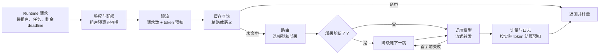

# 模型网关、流式、缓存与熔断降级

> 层级：垂类 · harness · 预计 150 分钟 · 题目：[questions.md](questions.md)
> 前置：[core/10 安全与可靠性](../../../core/10-safety-reliability/README.md)（重试、幂等、熔断、降级的概念）、[04 工具注册、路由、并发与错误恢复](../04-tool-orchestration/README.md)（重试只放一层、超时与取消）

## 1 这一章解决什么问题

Agent 一次任务要调几十次模型。模型服务会限流、过载、偶尔超时，不同模型价格差很多倍，长输出要流式推给用户。如果每个业务各写一套重试、限流和计费，故障时行为五花八门，账也对不上。

常见做法是在 Agent Runtime 和模型服务之间放一层模型网关，把路由、配额、限流、重试、熔断、缓存、计量集中在这一层。[core/10 安全与可靠性](../../../core/10-safety-reliability/README.md) 讲了这些手段是什么，[04](../04-tool-orchestration/README.md) 讲了工具侧的重试、退避、幂等和重试预算。这一章只讲模型调用这一侧：机制怎么实现、参数怎么定、代价在哪。

学完你应该能：

- 画出模型网关的请求路径，说出为什么模型调用只在网关一层重试；
- 写出 RPM、ITPM、OTPM 三维令牌桶的准入和结算，讲清预扣、退还和欠账；
- 区分速率限流、爬坡限制、花费上限三种 429，以及 500、529、200 之后的 `error` 事件；
- 说出按难度路由的做法（RouteLLM 的阈值规则和评价指标），用模拟说明路由器估不准时会退化成随机路由；
- 从误跳闸率和检测延迟两头推出熔断窗口和阈值怎么定，用模拟比较“有熔断”和“只缩短首字超时”；
- 写出按 WHATWG 规则的 SSE 解析器，处理任意切分、断流、半截工具参数，并构造续写请求；
- 用一组数字算清语义缓存的命中率、错误命中率和盈亏点；
- 用 Little 定律和四项 token 计量做一次容量和成本估算。

**本章符号**（后文沿用）：

| 符号 | 含义 |
|---|---|
| r | 令牌桶每秒补充的量（每分钟配额 / 60） |
| C | 令牌桶容量，最多能攒下的量 |
| λ | 到达率，每秒多少个请求 |
| W | 平均停留时间（秒） |
| h | 前缀缓存命中率 |
| p₀、p₁ | 部署正常时、故障时的单次失败率 |
| n、k | 熔断滑动窗口的请求数、跳闸所需的失败数 |
| α | 路由阈值：强模型胜率估计 ≥ α 才发强模型 |
| τ | 语义缓存的相似度阈值 |
| TTFT、TPOT | 首 token 延迟、首 token 之后每个 token 的平均间隔 |

## 2 模型网关的请求路径

### 2.1 每一步做什么



| 步骤 | 做什么 | 关键点 |
|---|---|---|
| 统一协议 | 把各家 API 的请求和流式事件转成内部统一格式 | 字段不对等时（工具调用、思考块、缓存断点）不能静默丢弃 |
| 鉴权与配额 | 按租户、业务查月度或日度预算 | 预算用完是“拒绝”，不是“限流后重试” |
| 限流 | 按请求数、输入 token、输出 token 三个维度 | 见第 3 节 |
| 缓存 | 前缀缓存由模型服务做；网关可做精确缓存和语义缓存 | 见第 7 节 |
| 路由 | 按任务难度、成本、数据敏感度、可用性选模型 | 见第 4 节 |
| 熔断与降级 | 跳过故障部署；首字前切到备用 | 见第 5 节 |
| 流式转发 | 把上游事件转成给客户端的事件，断线可续 | 见第 6 节 |
| 计量与观测 | 按租户、模型、任务记未缓存输入、缓存写、缓存读、输出四项 token，以及首字延迟、是否降级、是否命中缓存 | 计费、容量规划和排障都靠它 |

**网关看不到什么**：网关只看到单次模型调用，看不到整个 Agent 任务还剩多少预算和时间。所以剩余 deadline 和任务 ID 要由 Runtime 在请求里传下来。Google SRE 书主张 deadline 传递：整棵调用树共用一个绝对截止时间。

### 2.2 为什么模型调用只在网关一层重试

多层各自重试，最底层的流量按乘法放大，推导和 Brooker 的“五层各三次 = 243 倍”见 [04 第 6.3 节](../04-tool-orchestration/README.md#63-推导重试为什么只放一层)。落到模型调用上，可能重试的层有：Agent Loop 重新发起一轮、Runtime、网关、官方 SDK、上游服务自己。选网关这一层，理由有三条：

1. **网关知道全局状态**。它看得到每个部署的失败率、熔断状态、租户的令牌桶余额和重试预算。SDK 只看到自己这一个请求，在上游过载时还会按自己的规则重试，把流量放大。
2. **网关能换部署**。同一个模型组有多个部署时，重试发到另一个部署比原地重试成功率高；SDK 和 Runtime 做不到。
3. **网关能看错误详情**。是否可重试要看状态码、`x-should-retry`、`retry-after` 和 `error_code`（见 2.3），这些在网关一处解析，比散落在各业务里一致。

所以要关掉网关调用上游时 SDK 的自动重试（Anthropic SDK 默认会重试，见 2.3），也要让 Runtime 不对网关返回的可重试错误再重试，而是看网关给的 `retry-after`。Agent Loop 的“让模型重新生成”只处理语义错误（格式不对、工具参数错），不处理超时和过载。

例外是**带服务端工具的调用**（例如模型在服务端执行代码、搜索网页）：网关不知道下游副作用是否已经生效，不应自动重试，交给 Runtime 决定。

### 2.3 哪些错误能重试

以 Anthropic 的 Errors 文档为例（查阅于 2026-11）：

| 状态码 / 类型 | 含义 | 网关怎么处理 |
|---|---|---|
| 400 `invalid_request_error` | 请求本身有问题；达到自己设的花费上限也返回 400 | 不重试，返回给调用方 |
| 413 `request_too_large` | 请求字节数超限（Messages API 128 MB） | 不重试；超长上下文先压缩 |
| 429 `rate_limit_error` | 速率限流、爬坡限制或月度花费上限 | 分三种处理，见 3.5 |
| 500 `api_error` | 服务内部错误 | 文档写明：响应头 `x-should-retry` 不是 `false` 时才重试 |
| 504 `timeout_error` | 处理超时；长请求建议走流式或批处理 | 首字前可以换部署重试一次 |
| 529 `overloaded_error` | 全体用户流量高导致的临时过载 | 退避，或切备用部署；计入熔断 |
| 200 之后的 `error` 事件 | 流已经开始，错误只能以事件出现，例如 `overloaded_error` | 见第 6.5 节，按已推给用户的内容决定续写或重来 |

文档还写了 SDK 的默认行为：响应带 `x-should-retry`（`true` 或 `false`）时照它做；否则重试连接错误、超时以及 408、409、429 和 500 以上的状态码。不用 SDK 时，自己的代码要照 `x-should-retry` 和 `retry-after` 来，加退避和次数上限。网关自己负责重试时，这套逻辑搬到网关，SDK 那层关掉。

## 3 配额与限流

### 3.1 为什么要按 token 限

模型服务按 token 收费、按 token 限流。只按请求数限，一个 10 万 token 的请求和一个 100 token 的请求算一样，配额形同虚设。

**上游是怎么限的**：以 Anthropic API 为例（Rate limits 文档，查阅于 2026-11），Messages API 按每个模型类别的每分钟请求数（RPM）、每分钟输入 token（ITPM）、每分钟输出 token（OTPM）三个维度限流，用令牌桶算法，容量连续补充而不是按固定窗口清零。对网关设计有用的细节：

- 60 RPM 可能按每秒 1 个执行，短时突发也会触发限流；
- ITPM 默认只计未命中缓存的输入：`input_tokens`（最后一个缓存断点之后的部分）和 `cache_creation_input_tokens` 计入，`cache_read_input_tokens` 不计入。文档的例子：2,000,000 ITPM、缓存命中 80% 时，一分钟实际能处理 10,000,000 输入 token；
- ITPM 在请求开始时估算，请求过程中按实际输入调整；
- OTPM 按实际生成的 token 实时计算，`max_tokens` 设大不影响 OTPM；
- 超限返回 429，带 `retry-after` 时按它等；
- 用量陡增时还有爬坡限制，即使没到速率上限也可能 429，错误详情里的 `error_code` 是 `ramp_limit_exceeded`；
- 月度花费到上限时也返回 429，但没有 `retry-after`，重试没用。

响应头里有 `anthropic-ratelimit-requests-*`、`anthropic-ratelimit-input-tokens-*`、`anthropic-ratelimit-output-tokens-*` 三组 `limit`、`remaining`、`reset`。网关可以按它们校准自己对上游余量的估计，提前减速，而不是等 429。

### 3.2 令牌桶：从定义到准入规则

一个令牌桶有两个参数：补充速率 r（每秒）和容量 C。设上次更新时刻为 t₀、余额为 b(t₀)，到时刻 t 的余额是：

```text
b(t) = min(C, b(t₀) + r · (t − t₀))
```

一个需要 x 个令牌的请求，能放行的条件是 b(t) ≥ x；不够时要等的时间是：

```text
wait = (x − b(t)) / r
```

C 决定能容忍多大的突发。每分钟配额 Q 时 r = Q/60。C = r · 60 意味着空闲一分钟后可以一次花掉整分钟的配额；C = r · 1 意味着最多攒一秒，60 RPM 就真的变成每秒 1 个。上游文档说的“60 RPM 可能按每秒 1 个执行”，对应的就是小容量的桶。网关给租户配的桶，C 要不大于网关对上游能拿到的突发量，否则租户的突发会直接变成上游的 429。

**三个维度一起准入**。一个请求要同时扣三个桶：请求桶扣 1，输入桶扣“未缓存输入 + 缓存写”，输出桶扣输出估计。三者都够才放行；有一个不够，三个都不扣，等待时间取三者的最大值。分开扣会出现“请求桶扣了、token 桶不够被拒”，请求桶白白少了一个。

**输出 token 事先不知道**。准入时只能估：

```text
预扣 = 未缓存输入估计 + 缓存写估计 + 输出估计
结算 = 实际未缓存输入 + 实际缓存写 + 实际输出
退还 = 预扣 − 结算         （为负时是欠账，余额可以变负）
```

余额变负后，后面的请求要等补充把欠账填上，相当于事后限速。这就是“预扣按历史平均”可以接受的原因：偶尔估少了，下一段时间自动还上。

### 3.3 实现：RPM、ITPM、OTPM 三维令牌桶

下面的实现用假时钟。验证六件事：小容量的桶让 60 RPM 变成每秒 1 个；准入是原子的；缓存读不计入 ITPM 时吞吐是文档例子里的 5 倍；按 `max_tokens` 预扣会占住配额；估少了会产生欠账；超过桶容量的请求要直接拒绝。

```python
# 多维令牌桶：RPM、ITPM、OTPM 三个桶一起准入，按实际用量结算。假时钟，不真的 sleep。
class Bucket:
    def __init__(self, per_minute, burst_s=60.0):
        self.rate = per_minute / 60.0          # 每秒补充多少
        self.cap = self.rate * burst_s         # 容量：最多攒 burst_s 秒的量
        self.tokens, self.t = self.cap, 0.0

    def refill(self, now):
        self.tokens = min(self.cap, self.tokens + (now - self.t) * self.rate)
        self.t = now


class Limiter:
    """一个租户、一个模型的三个桶。三个桶都够才放行，否则一个都不扣。"""

    def __init__(self, rpm, itpm, otpm, burst_s=60.0):
        self.b = {"req": Bucket(rpm, burst_s), "in": Bucket(itpm, burst_s),
                  "out": Bucket(otpm, burst_s)}

    def admit(self, now, uncached_in, cache_write, est_out):
        need = {"req": 1, "in": uncached_in + cache_write, "out": est_out}  # 缓存读不计入
        for k, v in need.items():
            if v > self.b[k].cap:
                return False, f"too_large:{k}", None   # 桶再满也放不下：重试没用
        for b in self.b.values():
            b.refill(now)
        wait = max((v - self.b[k].tokens) / self.b[k].rate for k, v in need.items())
        if wait > 0:
            return False, "rate_limited", wait          # 给出 retry-after，一个桶都不扣
        for k, v in need.items():
            self.b[k].tokens -= v                       # 预扣
        return True, "ok", need

    def settle(self, now, held, actual_in, actual_out):
        """调用结束按实际用量结算：多扣的退还，少扣的记成欠账（余额可以为负）。"""
        for k, actual in (("in", actual_in), ("out", actual_out)):
            b = self.b[k]
            b.refill(now)
            b.tokens = min(b.cap, b.tokens + held[k] - actual)


# 1) 60 RPM 按每秒 1 个执行（burst_s=1）：同一秒来 5 个只放 1 个；攒满一分钟的桶能放 5 个
strict = Limiter(rpm=60, itpm=10**9, otpm=10**9, burst_s=1)
assert sum(strict.admit(0.0, 10, 0, 10)[0] for _ in range(5)) == 1
assert strict.admit(1.0, 10, 0, 10)[0]                  # 1 秒后补回 1 个
loose = Limiter(rpm=60, itpm=10**9, otpm=10**9, burst_s=60)
assert sum(loose.admit(0.0, 10, 0, 10)[0] for _ in range(5)) == 5

# 2) 原子准入：token 桶不够时，请求桶也不扣
lim = Limiter(rpm=100, itpm=60_000, otpm=10**9)
assert lim.admit(0.0, 50_000, 0, 100)[0]
ok, why, wait = lim.admit(0.0, 20_000, 0, 100)
assert not ok and why == "rate_limited" and lim.b["req"].tokens == 99
assert abs(wait - 10_000 / 1_000) < 1e-9                # 差 1 万 token，每秒补 1,000 → 等 10 秒

# 3) 缓存感知的 ITPM（文档的例子）：2M ITPM、命中 80%，一分钟能处理 10M 总输入
def admitted_per_minute(hit):
    lim, total, n = Limiter(rpm=10**6, itpm=2_000_000, otpm=10**9), 100_000, 0
    while lim.admit(0.0, int(total * (1 - hit)), 0, 100)[0]:
        n += 1
    return n, n * total

assert admitted_per_minute(0.8) == (100, 10_000_000)
assert admitted_per_minute(0.0) == (20, 2_000_000)      # 不命中缓存只有五分之一

# 4) 按 max_tokens 预扣占住配额：OTPM 10 万、max_tokens 8192，同一时刻只放得进 12 个
lim = Limiter(rpm=10**6, itpm=10**9, otpm=100_000)
held = []
while True:
    ok, _, h = lim.admit(0.0, 1_000, 0, 8_192)
    if not ok:
        break
    held.append(h)
assert len(held) == 100_000 // 8_192 == 12
for h in held:                                           # 实际每个只输出 500
    lim.settle(0.0, h, 1_000, 500)
assert lim.b["out"].tokens == 100_000 - 12 * 500         # 退还后余额只少了真实用量

# 5) 实际用量超过预扣：余额变负，后面的请求要等欠账补上
lim = Limiter(rpm=10**6, itpm=60_000, otpm=10**9)
ok, _, h = lim.admit(0.0, 10_000, 0, 100)
lim.settle(0.0, h, 70_000, 100)                          # 估少了 6 万
assert lim.b["in"].tokens == -10_000
assert lim.admit(0.0, 1, 0, 1)[1] == "rate_limited"

# 6) 单个请求比桶容量还大：直接拒绝，不能回 429 让客户端无限重试
assert Limiter(rpm=60, itpm=60_000, otpm=10**9).admit(0.0, 80_000, 0, 100)[1] == "too_large:in"
```

第 6 条容易漏：请求的 token 数比桶容量还大时，等多久都放不进去。返回 429 加 `retry-after`，客户端会无限重试。正确做法是返回不可重试的错误（类似 413），提示压缩上下文或换配额更大的模型。

### 3.4 预扣按什么估

| 选择 | 做法 | 代价 |
|---|---|---|
| 预扣按 `max_tokens` | 并发长请求不会一起冲破配额 | 偏保守。上例里 OTPM 10 万、`max_tokens` 8192，同时只能放 12 个，实际每个只用 500 |
| 预扣按历史平均 | 按租户、模型、任务类型统计输出长度的均值或 P90 | 估少了会欠账，下一段时间被限速 |
| 计数放 Redis | 多实例共享，读、算、扣用一段 Lua 脚本原子执行 | 每个请求多一次网络往返；Redis 故障时要预先定好放行还是拒绝 |
| 实例本地计数 | 延迟低 | 全局精度差。N 个实例各配 Q/N，扩缩容时总量跟着变 |

上游 OTPM 不看 `max_tokens`，但网关自己的输出桶如果按 `max_tokens` 预扣，就把上游没有的限制加了回来。常见折中：按历史 P90 预扣，`max_tokens` 只作为单请求上限。

### 3.5 三种 429 和租户隔离

| 429 的来源 | 怎么识别 | 网关怎么做 |
|---|---|---|
| 上游速率限流 | 带 `retry-after`，没有特殊 `error_code` | 按 `retry-after` 退避；同时调低自己对上游的发送速率 |
| 爬坡限制 | `error.details.error_code` 是 `ramp_limit_exceeded` | 至少等 `retry-after`；放慢总流量的增长，不能一到时间就全量重放 |
| 月度花费上限 | 没有 `retry-after`；Messages API 上 `error_code` 是 `enforced_spend_limit_reached` | 停止重试，告警，返回给调用方 |
| 网关自己的租户限流 | 网关产生 | 返回 429 加 `retry-after`，不碰上游 |

文档对爬坡限制的描述是：上限等于组织最近一段时间每分钟用量的峰值加一个步长，每分钟最多比峰值高一个步长，到速率上限为止；用量降下来一段时间后，上限也回落，但不低于一个起始值。所以一个租户把流量突然拉高十倍，即使总量没到 ITPM，也可能把整个组织带进爬坡限制，误伤其他租户。网关要在租户桶之外再对上游的总发送速率做平滑。Message Batches API 不受爬坡限制。

**租户隔离**：每个租户、每个模型各一组桶，一个租户的批量任务只消耗自己的桶。租户桶容量之和可以超过上游配额（超卖），但要在全局桶上兜底；高优先级租户可以预留一部分全局容量。

## 4 多模型路由

### 4.1 按什么路由

| 按什么路由 | 做法 | 风险 |
|---|---|---|
| 任务难度 | 简单请求走小模型，难的走大模型 | 分错了，难题质量下降 |
| 成本 | 预算紧时降到便宜模型 | 质量差异要被评测覆盖 |
| 数据敏感度 | 敏感数据只发到满足合规要求的部署 | 可选模型变少 |
| 可用性 | 主模型故障时切备用 | 备用模型的输出风格和能力不同 |
| 缓存亲和 | 同一会话尽量发到同一部署，保住前缀缓存 | 和负载均衡冲突，见 [inference/05](../../inference/05-agent-serving/README.md) |

Agent 里按难度路由的单位通常是“一类步骤”而不是“一条用户消息”：分类、改写、抽取参数这类步骤走小模型，规划和长文档推理走大模型。同一会话里换模型会让前缀缓存失效（前缀缓存按模型分开），所以路由粒度越细，缓存损失越大。

### 4.2 RouteLLM：用偏好数据学一个阈值路由器

[RouteLLM](https://arxiv.org/abs/2406.18665)（Ong 等，arXiv 2406.18665，2024-06）在一个强模型和一个弱模型之间做二选一。方法分两部分（按 HTML 全文核对）：

1. **胜率预测**。从人类偏好数据（Chatbot Arena 的约 8 万场对战）学一个模型 P_θ(win_s | q)，估计对查询 q 强模型比弱模型答得好的概率。论文试了四种参数化：相似度加权排序、矩阵分解、BERT 分类器、Llama 3 8B 因果语言模型分类器；还用 MMLU 验证集构造的标注数据、GPT-4 当评委标注的数据做数据增强。
2. **阈值决策**。给定成本阈值 α ∈ [0, 1]：

```text
R^α(q) = 弱模型   若 P(win_s | q) < α
         强模型   若 P(win_s | q) ≥ α
```

α 越高，越多查询发给弱模型，越省钱。上线时按预算把 α 标定到“强模型调用占比 = 目标比例”。

**评价指标**。设 r(·) 是在评测集上的质量分。路由器的质量落在弱模型和强模型之间，论文用“找回了多少差距”来衡量：

```text
PGR = (r(路由器) − r(弱)) / (r(强) − r(弱))
```

PGR 单看不够：全发强模型 PGR = 1，但一点不省。所以论文再定义两个指标：

- **CPT(x%)**：PGR 达到 x% 时，最少要把多少比例的调用发给强模型；
- **APGR**：把强模型调用比例从 0% 到 100% 分成 10 段，PGR 的平均值，近似 PGR 对成本曲线的面积。

随机路由器是基线：以概率 c 随机发强模型，期望质量是 c · r(强) + (1 − c) · r(弱)，代入定义 PGR = c，所以随机路由器的 CPT(x%) = x%。学到的路由器 CPT 越低越好。论文摘要报告：在某些情况下成本降到一半以下且质量不降（原文 cost reduction of over 2 times），且换了强模型和弱模型后路由器仍保持效果。正文在 MT Bench 上报告，用 GPT-4 评委数据增强后，矩阵分解路由器的 CPT(80%) 比随机路由器少用约一半的 GPT-4 调用。

### 4.3 实现：阈值路由、CPT 和两种失效

下面用合成数据走一遍：每条查询有一个难度，弱模型在简单题上和强模型差不多，难题上掉得快。路由器拿到的是“强模型多答好的概率”的带噪估计。验证三件事：学到的路由器 CPT 不到随机路由器的一半；路由器的估计和真实差距无关时，退化成随机路由；换了弱模型后，旧阈值对应的强模型比例会变，要重新标定。

```python
# RouteLLM 式的阈值路由：路由器估强模型胜率，胜率 ≥ α 才发强模型。数据是合成的，不代表任何真实模型。
import random

rng = random.Random(0)

# 每条查询有一个“难度” d。强模型答好的概率 ps(d)，弱模型 pw(d)，弱模型在难题上掉得快。
# 路由器给出强模型胜率的带噪估计，胜率 ≥ α 就发强模型（论文式 (2) 的规则）。
def ps(d):
    return 0.95 - 0.25 * d


def pw(d):
    # 简单题和强模型差不多，难度超过 0.7 后弱模型掉得很快
    return ps(d) - 0.01 - (1.8 * (d - 0.7) if d > 0.7 else 0.0)


qs = [rng.random() for _ in range(20_000)]
gap = [ps(d) - pw(d) for d in qs]                         # 强模型比弱模型多答好的概率
est = [g + rng.gauss(0, 0.08) for g in gap]               # 路由器的带噪估计
r_s = sum(ps(d) for d in qs) / len(qs)
r_w = sum(pw(d) for d in qs) / len(qs)


def pgr(quality):                                          # 论文的 performance gap recovered
    return (quality - r_w) / (r_s - r_w)


def route(alpha):
    strong = [e >= alpha for e in est]
    q = sum(ps(d) if s else pw(d) for d, s in zip(qs, strong)) / len(qs)
    return sum(strong) / len(qs), pgr(q)


def cpt(target):
    """达到目标 PGR 最少要把多少比例的调用发给强模型（论文的 CPT）。"""
    best = 1.0
    for a in [i / 200 for i in range(-40, 200)]:
        share, g = route(a)
        if g >= target:
            best = min(best, share)
    return best


# 随机路由器：按比例 x 随机发强模型，期望 PGR 恰好是 x，所以 CPT(50%) = 50%
# 这组合成数据里，学到的路由器达到同样 PGR 所需的强模型调用不到随机路由器的一半
assert cpt(0.5) < 0.5 / 2 and cpt(0.8) < 0.8 / 2
share_all, g_all = route(-1.0)
assert share_all == 1.0 and abs(g_all - 1.0) < 1e-12       # 全发强模型：PGR = 1，但一点不省


# 路由器估得不准（估计和真实差距无关）时，退化成随机路由：CPT(x) ≈ x，一点不省
est_saved = est
est = [rng.random() for _ in qs]
assert abs(cpt(0.5) - 0.5) < 0.03 and abs(cpt(0.8) - 0.8) < 0.03
est = est_saved

# 换了弱模型（弱模型变强，差距整体缩小），旧阈值发强模型的比例就变了：阈值要按新模型对重新标定
share_old, _ = route(0.10)
gap_new = [0.5 * g for g in gap]
est_new = [g + rng.gauss(0, 0.08) for g in gap_new]
share_new = sum(e >= 0.10 for e in est_new) / len(qs)
assert share_new < share_old
```

模拟的结论对应两条工程规则：

- **路由器本身要评测**。路由器估不准时，CPT 退回到 x%，看起来“在路由”，其实和按比例随机分流一样，只是多了一次路由器调用的延迟。上线前要在自己的流量上画出 PGR 对强模型比例的曲线，和随机基线比。
- **换模型要重标阈值**。α 是对“这一对模型”的胜率阈值。换了弱模型或强模型，同一个 α 对应的强模型比例和质量都变了。论文报告路由器在换模型后仍有效，指的是排序能力还在，不是说旧 α 还能直接用。

### 4.4 开源网关的做法

LiteLLM 的 Router 是一个可以参照的实现（文档查阅于 2026-11）。路由策略有按权重随机（默认）、最少在途请求、最低延迟、最低 TPM 用量几种，文档说明按用量路由因性能影响不建议用于生产。它的 fallback 按模型组逐个往下走，上下文超长错误和内容策略错误有单独的 fallback 规则：上下文超长应该换一个上下文更长的模型，而不是换一个同样短的备用。

## 5 熔断、降级与故障恢复

### 5.1 三种实现

熔断器的三态（关闭、打开、半开）和状态转移见 [core/10 第 7.3 节](../../../core/10-safety-reliability/README.md#73-熔断器状态机)，这里只讲网关里的实现和参数。

| 网关里的实现 | 做法 | 出处 |
|---|---|---|
| 按部署冷却 | 某个部署失败过多就冷却一段时间，冷却只作用于这个部署，不是整个模型组 | LiteLLM 文档：`allowed_fails` 未设时，429 立即冷却；当前分钟失败超过 50%，或出现 401、404、408 这类不可重试错误时也会冷却；默认冷却 5 秒 |
| 异常实例摘除 | 连续 5xx、连续网关错误（502、503、504）、成功率显著低于同组的实例被摘除；摘除时长 = `base_ejection_time` × 连续被摘除的次数，到 `max_ejection_time` 封顶；被摘除的实例占比不超过 `max_ejection_percent` | Envoy 的 outlier detection |
| 并发上限 | 对一个上游集群限连接数、排队请求数、在途请求数、在途重试数，超出就快速失败 | Envoy 的 circuit breaking |

Envoy 文档的一句话是网关设计的出发点：几乎总是尽快失败并向下游施加背压更好。`max_ejection_percent` 也值得照搬：模型组里大部分部署同时失败，多半是上游整体过载或网关自己的问题，这时把它们全摘掉只会让剩下的一个被压垮。

**熔断的反面意见**：Marc Brooker 在 AWS Builders' Library 里指出，熔断引入的模态行为难以测试，可能拉长恢复时间；Amazon 的做法是用本地令牌桶限制重试：有令牌时可以重试，令牌用完后按固定速率重试。熔断管“别再打一个已经坏了的部署”，重试令牌桶管“别让重试放大流量”，两者可以同时用。

**重试预算**：每个请求最多尝试三次，每个客户端的重试占比低于 10% 才允许重试（Google SRE 书）；退避用 Full Jitter。推导和实现见 [04 第 6.4 节](../04-tool-orchestration/README.md#64-退避抖动与重试预算)，模型调用照搬。

### 5.2 熔断的阈值怎么定

阈值在两种错误之间取舍：正常时误跳闸，故障时发现得慢。设滑动窗口看最近 n 个请求，失败数 ≥ k 就打开。部署正常时单次失败率是 p₀，请求之间独立，窗口里的失败数服从二项分布，一个窗口误跳闸的概率是：

```text
P(误跳闸) = Σ_{i=k}^{n} C(n, i) · p₀^i · (1 − p₀)^(n−i)
```

故障时失败率升到 p₁，积累到 k 个失败大约要 k / p₁ 个请求，这就是检测延迟。

推导（下面代码验证）：p₀ = 2%、p₁ = 60% 时：

| 窗口 | 一个窗口误跳闸的概率 | 每秒 100 个请求，一天误跳闸次数（粗估） | 检测延迟（请求数） |
|---|---|---|---|
| n = 5，k = 3 | 约 7.8 × 10⁻⁵ | 约 670 次 | 约 5 |
| n = 20，k = 10 | 约 1.6 × 10⁻¹² | 几乎为 0 | 约 17 |

小窗口看起来灵敏，但在高流量下一天要误跳闸几百次，每次都把流量推到备用、半开试探、再切回来。流量大时窗口要按请求数取大，检测延迟按时间算仍然很短（17 个请求在每秒 100 个时不到 0.2 秒）。流量小时则反过来：窗口按时间算会很长，所以要加“窗口内至少 min_req 个请求才判断”的条件，避免一两个失败就跳闸。LiteLLM 用“当前分钟失败超过 50%”，Envoy 用“连续 N 次 5xx”，都是这个取舍的不同参数化。

还有三条经验规则：

- **只把服务端的错误计入熔断**。400、413 是请求自己的问题，计进去会让一个发坏请求的租户把部署熔断掉。429 要看来源：上游速率限流说明这个部署（或这个账号）没余量了，可以计入或单独冷却；花费上限计入没有意义。
- **冷却时间配合 `retry-after`**。上游给了 `retry-after`，冷却时间不短于它。
- **半开只放一个试探**。放一批试探，等于在故障部署上恢复了一部分流量。

### 5.3 两级超时与降级链

只设一个总超时，设短了误切，设长了故障时用户要等满才切。常见做法是分“首字超时”和“总超时”：首字前超时就切备用；首字后只看总超时。总时延 = TTFT + (输出长度 − 1) × TPOT，随输出长度变，首字延迟不随，所以首字超时可以按 TTFT 的 P99 定得很紧。TTFT、TPOT 的定义和引擎侧由谁决定见 [inference/02 第 2.1 节](../../inference/02-batching-pd/README.md#21-ttfttpotitl)。Anthropic 文档建议超过 10 分钟的长请求用流式或批处理接口，因为有的网络会断开空闲连接。

**降级链**：

| 规则 | 理由 |
|---|---|
| 只在首个用户可见内容之前切换 | 用户看到一半再换模型，前后风格和结论可能对不上 |
| 链短，通常一跳 | 每一跳都加一个首字超时的延迟；三跳全失败时用户已经等了 3 倍首字超时。多家共享依赖时还会一起失败 |
| 终点是明确报错或固定流程 | 不返回可能错的半截结果 |
| 备用路径单独评测 | 同一份 prompt 在不同模型上效果不同 |

### 5.4 实现：熔断阈值和主部署挂起

下面先用二项分布算 5.2 的表，再模拟一个最难处理的故障：主部署不报错，只是不出首字（挂起）。比较三种做法：没有熔断、首字超时 10 秒；有熔断、首字超时 10 秒；没有熔断、首字超时缩短到 2 秒。

```python
# 熔断阈值的取舍 + 主部署挂起时熔断和首字超时的效果。假时钟，合成流量。
import math

# ---------- 1) 熔断阈值怎么定：误跳闸率和检测延迟 ----------
# 滑动窗口看最近 n 个请求，失败数 ≥ k 就打开。正常失败率 p0，故障时 p1。
def tail(n, k, p):
    return sum(math.comb(n, i) * p ** i * (1 - p) ** (n - i) for i in range(k, n + 1))


p0, p1 = 0.02, 0.6
# 窗口太小：5 个里坏 3 个就跳。正常时每个窗口误跳的概率
small = tail(5, 3, p0)
big = tail(20, 10, p0)
assert 7e-5 < small < 8e-5 and big < 1e-11
# 每秒 100 个请求时，小窗口一天大约误跳多少次（每个窗口算一次机会，粗估）
assert 600 < small * 100 * 86_400 < 700                   # 约 670 次：几乎每两分钟一次
# 代价：故障时大窗口要多等。期望失败数积累到 k 大约要 k / p1 个请求
assert round(10 / p1) == 17 and round(3 / p1) == 5


# ---------- 2) 主部署故障时：有没有熔断、首字超时怎么设 ----------
class Breaker:
    """按失败率的熔断：窗口内请求数 ≥ min_req 且失败率 ≥ ratio 就打开；
    冷却 cooldown 秒后半开放一个试探，成功关闭，失败重新冷却。"""

    def __init__(self, window=20, min_req=10, ratio=0.5, cooldown=5.0):
        self.window, self.min_req, self.ratio, self.cooldown = window, min_req, ratio, cooldown
        self.hist, self.state, self.opened, self.probing = [], "closed", 0.0, False

    def allow(self, now):
        if self.state == "open" and now - self.opened >= self.cooldown and not self.probing:
            self.state, self.probing = "half_open", True
            return True
        return self.state == "closed"

    def record(self, now, ok):
        if self.state == "half_open":
            self.probing = False
            self.state, self.opened = ("closed", 0.0) if ok else ("open", now)
            self.hist = []
            return
        self.hist = (self.hist + [ok])[-self.window:]
        fails = self.hist.count(False)
        if len(self.hist) >= self.min_req and fails / len(self.hist) >= self.ratio:
            self.state, self.opened = "open", now


def simulate(use_breaker, first_token_timeout, seconds=300, rps=20):
    """主部署在 [100, 200) 秒内挂起（不报错，只是不出首字）。
    首字超时后切备用一次；备用首字 1.2 秒。返回用户看到的首字延迟和打到坏主部署的请求数。"""
    br = Breaker()
    ttft, wasted = [], 0
    for i in range(seconds * rps):
        now = i / rps
        down = 100 <= now < 200
        if use_breaker and not br.allow(now):
            ttft.append(1.2)                                # 熔断打开：直接走备用
            continue
        if not down:
            ttft.append(0.8)
            if use_breaker:
                br.record(now, True)
            continue
        wasted += 1                                         # 打到坏的主部署，等满首字超时
        ttft.append(first_token_timeout + 1.2)
        if use_breaker:
            br.record(now, False)
    outage = ttft[100 * rps:200 * rps]
    return sum(outage) / len(outage), wasted


no_br = simulate(False, first_token_timeout=10.0)
with_br = simulate(True, first_token_timeout=10.0)
short_to = simulate(False, first_token_timeout=2.0)
# 没有熔断：故障期间每个请求都先等 10 秒再切，用户首字延迟 11.2 秒
assert abs(no_br[0] - 11.2) < 1e-9 and no_br[1] == 2_000
# 有熔断：只有跳闸前的 10 个和每 5 秒一次的试探打到坏部署
assert with_br[1] < 40 and with_br[0] < 1.5
# 只缩短首字超时也有用，但每个请求仍要白等 2 秒，坏部署照样吃满流量
assert abs(short_to[0] - 3.2) < 1e-9 and short_to[1] == 2_000
```

结果（假设的参数）：没有熔断时，故障期间每个请求都先等满 10 秒再切，用户首字延迟 11.2 秒，坏部署吃满 2,000 个请求。有熔断时，跳闸前 10 个请求和之后每 5 秒一次的试探打到坏部署，共 29 个，故障期间平均首字延迟约 1.34 秒。只缩短首字超时到 2 秒，平均首字延迟 3.2 秒，坏部署照样吃满流量。挂起类故障里，首字超时决定“每个请求付多少代价”，熔断决定“多少请求付这个代价”。

## 6 流式输出

### 6.1 为什么要流式

推导：TTFT 0.8 秒、TPOT 20 ms、输出 500 token 时，总时延 = 0.8 + 499 × 0.02 = 10.78 秒。不流式，用户要等满 10.78 秒才看到第一个字；流式只等 0.8 秒。输出 2,000 token 时总时延约 40.8 秒，首字延迟不变。流式还让网关在首字前就知道上游是否正常，这是两级超时（5.3）的前提。

### 6.2 SSE 的事件格式

SSE（Server-Sent Events）跑在普通 HTTP 上，响应类型 `text/event-stream`。WHATWG 规范的解析规则（查阅于 2026-11）：

- 行可以用 CRLF、单独的 LF 或单独的 CR 分隔；
- 空行表示分发一个事件；
- 以 `:` 开头的行是注释，忽略。规范建议约每 15 秒发一条注释行，防止旧代理断开空闲连接；
- 其他行按第一个 `:` 拆成字段名和值，值开头如果有一个空格，去掉这一个；
- `event` 设置事件类型；`data` 追加到数据缓冲并补一个换行（多行 `data` 用换行拼起来，分发时去掉最后一个换行）；`id` 设置最后事件编号；`retry` 设置重连间隔（毫秒）；
- 流在一个事件中间结束（没遇到空行），这个不完整的事件不分发。

模型 API 也用 SSE。Anthropic 的 Streaming 文档（查阅于 2026-11）给出的事件流是：

```text
message_start          Message 对象，content 为空
content_block_start    每个内容块一组：start → 若干 delta → stop，index 对应最终 content 数组的下标
content_block_delta    delta 类型：text_delta、input_json_delta（工具参数的分片 JSON 字符串）、
                       thinking_delta、signature_delta（思考块结束前的签名）
content_block_stop
message_delta          顶层变化，如 stop_reason；usage 里的 token 数是累计值
message_stop
```

中间可能夹任意多个 `ping` 事件，也可能出现 `error` 事件，例如过载时的 `{"type": "error", "error": {"type": "overloaded_error", ...}}`，在非流式里它对应 HTTP 529。文档提醒事件类型以后可能增加，客户端要忽略不认识的事件。工具参数是分片的 JSON 字符串，要拼完、等 `content_block_stop` 再解析；边收边解析的方法见 [inference/05 第 6 节](../../inference/05-agent-serving/README.md#6-流式工具调用输出的解析)。

### 6.3 断流怎么恢复

Anthropic 文档的做法：保存断流前已经收到的全部内容，再发一个续写请求。

- Claude 4.5 及以前：把部分回复作为新的 assistant 消息的开头，接着生成；
- Claude 4.6 及以后：改成加一条 user 消息，里面带上部分回复并要求从断处继续，文档的示例提示是 “Your previous response was interrupted and ended with [previous_response]. Continue from where you left off.”；
- 工具调用块和思考块不能部分恢复，只能从最近的文本块续。

推出网关要做的几件事：

1. **判断流是否完整**。没收到 `message_stop` 就是不完整，不管 TCP 连接是怎么结束的。
2. **按块保留**。已经 `content_block_stop` 的块完整保留；没结束的文本块保留已收到的文字；没结束的工具调用块和思考块丢掉，它后面的块也丢掉。
3. **续写还是重来，交给 Runtime**。已经推给用户的文字不能收回，续写能保持一致；但续写的结果和一次生成的不完全一样，有的场景（结构化输出）重来更稳。网关不要静默重发整条请求，否则用户会看到重复的开头。
4. **计费**。断流前生成的输出 token 已经产生。续写只生成剩下的部分；从头重来要把已生成的部分再生成一遍，输入两种都要再付一次。

### 6.4 实现：SSE 解析、事件累加和断流处理

下面按 WHATWG 规则写一个增量 SSE 解析器，再按 Anthropic 的事件类型把流拼回一条消息。验证：网络包任意切分，结果都一样；CRLF 被切在两个包之间也能正确处理；usage 是覆盖不是相加；断在工具参数中间时丢掉半截工具调用；断在文字中间时保留半句并构造续写请求；末尾没空行的半个事件不分发；200 之后的过载以 `error` 事件出现。

```python
# SSE 解析（按 WHATWG 规则）+ Anthropic 事件累加 + 断流处理。只用标准库。
import json
import random


class SSEParser:
    """增量解析：feed 任意切分的文本块，吐出完整事件 (event, data, id)。"""

    def __init__(self):
        self.buf, self.event, self.data, self.last_id = "", "", [], None
        self.pending_cr = False

    def feed(self, chunk):
        out = []
        if self.pending_cr and chunk.startswith("\n"):
            chunk = chunk[1:]                 # 上一块以 CR 结尾，这一块的 LF 属于同一个 CRLF
        self.pending_cr = chunk.endswith("\r")
        self.buf += chunk
        while True:
            idx = [i for i in (self.buf.find("\r\n"), self.buf.find("\n"), self.buf.find("\r")) if i >= 0]
            if not idx:
                return out
            i = min(idx)
            sep = 2 if self.buf.startswith("\r\n", i) else 1
            line, self.buf = self.buf[:i], self.buf[i + sep:]
            ev = self._line(line)
            if ev:
                out.append(ev)

    def _line(self, line):
        if line == "":                        # 空行：分发事件
            if not self.data:
                self.event = ""
                return None
            ev = (self.event or "message", "\n".join(self.data), self.last_id)
            self.event, self.data = "", []
            return ev
        if line.startswith(":"):              # 注释行，保活用，直接忽略
            return None
        field, _, value = line.partition(":")
        if value.startswith(" "):
            value = value[1:]                 # 只去掉一个前导空格
        if field == "event":
            self.event = value
        elif field == "data":
            self.data.append(value)           # 多行 data 用换行拼起来
        elif field == "id" and "\0" not in value:
            self.last_id = value
        return None                           # 文件结束时没遇到空行的事件不分发


class Accumulator:
    """把 Anthropic 的流式事件拼回一条消息。"""

    def __init__(self):
        self.blocks, self.open, self.stop_reason, self.usage = {}, set(), None, {}
        self.done, self.error = False, None

    def on(self, etype, data):
        d = json.loads(data)
        t = d["type"]
        if t == "message_start":
            self.usage = dict(d["message"]["usage"])
        elif t == "content_block_start":
            self.blocks[d["index"]] = dict(d["content_block"], _json="")
            self.open.add(d["index"])
        elif t == "content_block_delta":
            b, delta = self.blocks[d["index"]], d["delta"]
            if delta["type"] == "text_delta":
                b["text"] += delta["text"]
            elif delta["type"] == "input_json_delta":
                b["_json"] += delta["partial_json"]      # 分片 JSON，块结束才解析
        elif t == "content_block_stop":
            b = self.blocks[d["index"]]
            if b["type"] == "tool_use":
                b["input"] = json.loads(b["_json"] or "{}")
            self.open.discard(d["index"])
        elif t == "message_delta":
            self.stop_reason = d["delta"].get("stop_reason")
            self.usage.update(d.get("usage", {}))        # usage 是累计值，覆盖而不是相加
        elif t == "message_stop":
            self.done = True
        elif t == "error":
            self.error = d["error"]["type"]              # HTTP 200 之后的错误只能这样出现
        # ping 和未知事件忽略：文档说事件类型以后可能增加

    def recoverable(self):
        """断流后能保留的部分：已关闭的块原样保留；没关闭的文本块保留已收到的文字；
        没关闭的 tool_use / thinking 块不能部分恢复，丢掉。"""
        keep = []
        for i in sorted(self.blocks):
            b = self.blocks[i]
            if i not in self.open or b["type"] == "text":
                keep.append({k: v for k, v in b.items() if k != "_json"})
            else:
                break                                    # 后面的块依赖它，一起丢
        return keep


def sse(events):
    return "".join(f"event: {json.loads(e)['type']}\ndata: {e}\n\n" for e in events)


EVENTS = [
    '{"type":"message_start","message":{"usage":{"input_tokens":25,"output_tokens":1}}}',
    '{"type":"content_block_start","index":0,"content_block":{"type":"text","text":""}}',
    '{"type":"ping"}',
    '{"type":"content_block_delta","index":0,"delta":{"type":"text_delta","text":"先查一下天气，"}}',
    '{"type":"content_block_delta","index":0,"delta":{"type":"text_delta","text":"再回答。"}}',
    '{"type":"content_block_stop","index":0}',
    '{"type":"content_block_start","index":1,"content_block":{"type":"tool_use","id":"t1","name":"weather","input":{}}}',
    '{"type":"content_block_delta","index":1,"delta":{"type":"input_json_delta","partial_json":"{\\"city\\": \\"Par"}}',
    '{"type":"content_block_delta","index":1,"delta":{"type":"input_json_delta","partial_json":"is\\"}"}}',
    '{"type":"content_block_stop","index":1}',
    '{"type":"message_delta","delta":{"stop_reason":"tool_use"},"usage":{"output_tokens":42}}',
    '{"type":"message_stop"}',
]
RAW = ": keep-alive\n\n" + sse(EVENTS)


def run(raw, cuts):
    p, acc, pos = SSEParser(), Accumulator(), 0
    for c in sorted(cuts) + [len(raw)]:
        for ev, data, _ in p.feed(raw[pos:c]):
            acc.on(ev, data)
        pos = c
    return acc


# 1) 任意切分网络包，拼出的结果都一样
rng = random.Random(0)
ref = run(RAW, [])
for _ in range(200):
    acc = run(RAW, rng.sample(range(1, len(RAW)), 15))
    assert acc.blocks == ref.blocks and acc.usage == ref.usage
assert ref.done and ref.stop_reason == "tool_use"
assert ref.blocks[1]["input"] == {"city": "Paris"}
assert ref.usage["output_tokens"] == 42                 # 累计值：不是 1 + 42

# 2) CRLF、单独 CR、多行 data、去掉一个前导空格
p = SSEParser()
evs = p.feed("data:  two spaces\r\ndata: line2\r\rid: 7\nevent: x\ndata: y\n\n")
assert evs == [("message", " two spaces\nline2", None), ("x", "y", "7")]
p = SSEParser()
assert p.feed("data: a\r") == [] and p.feed("\n\n") == [("message", "a", None)]  # CRLF 被切在两块之间

# 3) 断在工具参数中间：文字块保留，半截 tool_use 丢掉；没有 message_stop 就不算完成
cut = RAW.index("is\\\"}")                              # 第二片 partial_json 之前
acc = run(RAW[:cut], [])
assert not acc.done and acc.recoverable() == [{"type": "text", "text": "先查一下天气，再回答。"}]

# 4) 断在文字中间：已收到的半句保留，构造续写请求（Claude 4.6 及以后：放进 user 消息）
cut = RAW.index("再回答")
acc = run(RAW[:cut], [])
partial = "".join(b["text"] for b in acc.recoverable() if b["type"] == "text")
assert partial == "先查一下天气，"
cont = {"role": "user", "content": f"Your previous response was interrupted and ended with "
                                   f"[{partial}]. Continue from where you left off."}
assert partial in cont["content"]

# 5) 文件末尾没有空行的事件不分发：半个事件不会被当成完整事件
p = SSEParser()
assert p.feed('event: message_stop\ndata: {"type":"message_stop"}\n') == []

# 6) 200 之后的过载：以 error 事件出现，状态码帮不上忙
acc = Accumulator()
acc.on("error", '{"type":"error","error":{"type":"overloaded_error","message":"Overloaded"}}')
assert acc.error == "overloaded_error" and not acc.done
```

两个容易写错的地方：

- **按 `\n` 切行**。规范允许单独的 CR，只按 `\n` 切，CR 会留在字段值里，`event` 字段就对不上了。CRLF 被切在两个包之间时，前一个包末尾的 CR 会先结束一行，后一个包开头的 LF 不能再算成一个空行，否则会提前分发事件。
- **把 `message_delta` 的 usage 加起来**。文档写明它是累计值。加起来会把输出 token 记多，账对不上。

### 6.5 网关到客户端：SSE 还是 WebSocket

| | SSE | WebSocket |
|---|---|---|
| 方向 | 服务端单向推 | 双向 |
| 底层 | 普通 HTTP，`text/event-stream` | HTTP 升级后的独立协议 |
| 断线续传 | 规范自带：事件带 `id`，浏览器重连时发 `Last-Event-ID` 请求头 | 协议不管，应用自己做 |
| 保活 | 规范建议约每 15 秒发一条以 `:` 开头的注释行 | 应用自己发 ping |
| 背压 | 跑在 HTTP 上，靠 TCP 流量控制 | 浏览器 `WebSocket` 只能看 `bufferedAmount`（已 `send()` 未发出的字节数）自己控速 |
| 适合 | 文本流式输出、进度事件 | 语音打断、协同编辑这类高频上行 |

Agent 的文本输出多用 SSE：输出本来就是单向事件流，现有的鉴权、网关、日志都能复用。用户发新消息、取消，用普通 HTTP 请求单独发。

**网关侧的三件事**：

1. **生产和推送解耦**。Runtime 把事件写进一个可回放、有长度上限的流，接入层按客户端速度读。客户端慢只是读得慢，不会阻塞模型调用。缓冲超限时，可覆盖的事件（进度、状态）可以合并，正文不能丢，只能断开让客户端重连续读。
2. **连接和任务分开**。连接断了任务照常跑；重连时带最后的事件编号，从下一条补推。编号已经被裁掉，就返回明确错误，让客户端拉取完整结果。
3. **断开不等于取消**。网络抖动也会断开。取消走单独接口，或者断开超过重连窗口才视为取消；取消要传到底，停掉上游流式调用和正在跑的工具。已经发出的写操作取消不了，只能记下来交给补偿流程。

下面的代码验证第 1、2 条：断线期间生产者照常写，重连从 `Last-Event-ID` 的下一条补推，不重不漏；断得太久、要的那条已被挤出缓冲时返回明确的 gap。

```python
# 连接和任务分开：有上限的事件回放缓冲 + Last-Event-ID 续传。生产者不等消费者。
from collections import deque


class ReplayBuffer:
    def __init__(self, max_events):
        self.q, self.next_id, self.done = deque(maxlen=max_events), 1, False

    def append(self, kind, payload):
        self.q.append((self.next_id, kind, payload))   # 满了自动挤掉最旧的
        self.next_id += 1

    def read_after(self, last_id):
        """客户端带 Last-Event-ID 重连：从下一条补推。要的那条已经被挤掉，返回 gap。"""
        if not self.q:
            return "ok", []
        oldest = self.q[0][0]
        if last_id + 1 < oldest:
            return "gap", []           # 明确报错，让客户端去拉完整结果，不能静默跳过
        return "ok", [e for e in self.q if e[0] > last_id]


def to_sse(e):
    eid, kind, payload = e
    return f"id: {eid}\nevent: {kind}\ndata: {payload}\n\n"


buf = ReplayBuffer(max_events=100)
for i in range(30):
    buf.append("text", f"片段{i}")

# 1) 客户端收到第 12 条后断线，重连带 Last-Event-ID: 12，从 13 补推，不重不漏
status, evs = buf.read_after(12)
assert status == "ok" and [e[0] for e in evs] == list(range(13, 31))
assert to_sse(evs[0]).startswith("id: 13\n")

# 2) 断线期间模型照常生成（生产者不等消费者），重连后拿到断线期间的全部内容
for i in range(30, 60):
    buf.append("text", f"片段{i}")
status, evs = buf.read_after(30)
assert status == "ok" and len(evs) == 30 and evs[-1][2] == "片段59"

# 3) 断得太久，缓冲只留最近 100 条：要的那条被挤掉，返回 gap 而不是从中间接着推
for i in range(60, 200):
    buf.append("text", f"片段{i}")
assert buf.read_after(30) == ("gap", [])
status, evs = buf.read_after(100)             # 共 200 条，留下的是 101..200
assert status == "ok" and evs[0][0] == 101 and len(evs) == 100

# 4) 拼回来的文字和不断线时一样：断线三次，每次从 last_id 续
full = "".join(f"片段{i}" for i in range(200))
big = ReplayBuffer(max_events=1_000)
for i in range(200):
    big.append("text", f"片段{i}")
got, last = [], 0
for drop_after in (37, 81, 150, 10**9):       # 每次读到这么多条就断
    _, evs = big.read_after(last)
    for e in evs:
        got.append(e[2])
        last = e[0]
        if last == drop_after:
            break
assert "".join(got) == full
```

**常见故障**：中间代理开着响应缓冲，事件攒成一批才到客户端，表现为“流式变成一次性返回”。排查先看各层代理是否关了缓冲。

## 7 缓存：前缀缓存、精确缓存与语义缓存

### 7.1 三种缓存

| | 前缀缓存 | 网关精确缓存 | 语义缓存 |
|---|---|---|---|
| 在哪做 | 模型服务内部 | 网关 | 网关 |
| 命中条件 | 请求前缀逐 token 一致 | 整个请求（规范化后）完全一致 | 请求的向量和历史请求足够相似 |
| 省什么 | Prefill 计算和输入费用 | 整次调用 | 整次调用 |
| 会不会答错 | 不会，只是复用计算 | 不会，除非数据过期 | 会，相似不等于相同 |
| 额外开销 | 缓存写比普通输入贵 | 一次哈希查找 | 每次请求一次 Embedding 加向量检索 |
| Agent 里的适用面 | 很大：每轮前缀就是上一轮全部内容 | 小：上下文几乎每次都不同 | 小：只适合无状态、事实稳定的单轮问答 |

**前缀缓存要网关配合**。前缀缓存的规则和价格见 [02 第 5 节](../02-context-compaction/README.md#5-稳定前缀与-kv-cache-命中)：以 Anthropic 文档为例，5 分钟缓存的写入是基础输入价的 1.25 倍，读取是 0.1 倍（查阅于 2026-11，具体模型以当时的定价表为准）。网关要做的：不往前缀里插时间戳、请求 ID；同一会话路由到同一部署和同一模型；统一协议转换时保留缓存断点。引擎侧的原理见 [inference/05](../../inference/05-agent-serving/README.md)。

**语义缓存的结构**：以开源的 GPTCache 为例，模块包括 LLM 适配器、Embedding 生成器、缓存存储、向量库、缓存管理（负责淘汰）和相似度评估器。它的 README 明确提到会有命中时的误报和未命中时的漏报，并给出命中率、延迟、召回三个调优指标。

### 7.2 推导：语义缓存什么时候划算

把一次模型调用的成本记为 1。设精确缓存的正确命中率为 g₀，语义缓存在阈值 τ 下的正确命中率为 g(τ)、错误命中率为 b(τ)，每次查找的开销为 ℓ，一次错误命中给业务造成的损失折合为 c_w 次调用。每请求的期望成本：

```text
成本(τ) = ℓ + (1 − g(τ) − b(τ)) · 1 + b(τ) · c_w
```

第一项是查找，第二项是没命中、照常调用，第三项是答错的代价。错误命中也省掉了一次调用，但多出 c_w 的损失。和只用精确缓存比，语义缓存多省的钱是：

```text
Δ = (g(τ) − g₀) · 1 − b(τ) · (c_w − 1) − (ℓ − ℓ₀)
```

令 Δ = 0，得到盈亏平衡的错误代价：

```text
c_w* = 1 + ((g(τ) − g₀) − (ℓ − ℓ₀)) / b(τ)
```

c_w 超过 c_w*，语义缓存就不如只用精确缓存。这条式子说明两件事：错误命中率 b 在分母，降低一点就能大幅提高可容忍的代价；只看命中率 g + b 是错的，命中率最高的阈值往往错误命中也最多。

### 7.3 实现：一组数字算一遍

假设一个单轮 FAQ 入口的流量：25% 与缓存里某条逐字相同；35% 是换了说法的同一个问题；15% 模板相同、实体不同（“取消订单 A”和“取消订单 B”），答案不能复用；25% 是全新问题。三类不同的相似度分布是假设的正态分布。

```python
# 精确缓存 vs 语义缓存：命中率、错误命中率、每请求期望成本。相似度分布是假设的，只演示算账方法。
import math


def Phi(x):                                   # 标准正态分布函数
    return 0.5 * (1 + math.erf(x / math.sqrt(2)))


def above(mu, sigma, tau):                    # 相似度 ~ N(mu, sigma) 时超过阈值 tau 的概率
    return 1 - Phi((tau - mu) / sigma)


# 一个单轮 FAQ 入口的流量构成（假设）：
#   exact    与缓存里某条逐字相同（规范化后）       答案可复用
#   para     换了说法的同一个问题                   答案可复用，相似度 ~ N(0.93, 0.03)
#   sibling  模板相同、实体不同（“订单 A”和“订单 B”）答案不能复用，相似度 ~ N(0.88, 0.04)
#   novel    全新问题                               相似度 ~ N(0.60, 0.10)
MIX = {"exact": 0.25, "para": 0.35, "sibling": 0.15, "novel": 0.25}
DIST = {"para": (0.93, 0.03), "sibling": (0.88, 0.04), "novel": (0.60, 0.10)}

C_CALL, C_LOOKUP = 1.0, 0.02                  # 一次模型调用记 1；Embedding + 向量检索记 0.02


def semantic(tau):
    """返回 (正确命中率, 错误命中率)。逐字相同的相似度为 1，总能命中。"""
    good = MIX["exact"] + MIX["para"] * above(*DIST["para"], tau)
    bad = MIX["sibling"] * above(*DIST["sibling"], tau) + MIX["novel"] * above(*DIST["novel"], tau)
    return good, bad


def cost(good, bad, c_wrong, lookup):
    """每请求期望成本 = 查找开销 + 未命中的调用 + 错误命中的损失。"""
    return lookup + (1 - good - bad) * C_CALL + bad * c_wrong


no_cache = cost(0, 0, 0, 0)
exact = cost(MIX["exact"], 0, 0, 0.001)       # 精确缓存：一次哈希查找，几乎不花钱，也不会答错
assert no_cache == 1.0 and abs(exact - 0.751) < 1e-12

# 1) 阈值越低，命中越多，错误命中也越多
g90, b90 = semantic(0.90)
g95, b95 = semantic(0.95)
assert g90 > g95 and b90 > b95
assert 0.54 < g90 < 0.55 and 0.046 < b90 < 0.047      # τ=0.90：正确命中约 54%，错误命中约 4.7%
assert 0.33 < g95 < 0.34 and 0.006 < b95 < 0.0062     # τ=0.95：正确命中约 34%，错误命中约 0.6%

# 2) 错一次的代价决定阈值：c_wrong = 1（再问一次就好）时 0.90 更省；c_wrong = 50（工单、投诉）时 0.90 比不缓存还贵
assert cost(g90, b90, 1, C_LOOKUP) < cost(g95, b95, 1, C_LOOKUP) < exact
assert cost(g90, b90, 50, C_LOOKUP) > no_cache
assert cost(g95, b95, 50, C_LOOKUP) < no_cache
assert cost(g95, b95, 50, C_LOOKUP) > exact            # 而且还不如只用精确缓存

# 3) 推导：语义缓存比精确缓存多省的钱 = 多出的正确命中 × C_CALL − 错误命中 × (c_wrong − C_CALL) − 查找开销
#    盈亏平衡的错误命中代价 c* = C_CALL + (Δgood · C_CALL − lookup) / bad
def breakeven(tau):
    g, b = semantic(tau)
    return C_CALL + ((g - MIX["exact"]) * C_CALL - (C_LOOKUP - 0.001)) / b


assert 6.5 < breakeven(0.90) < 7.5      # τ=0.90：错一次的损失超过约 7 次调用，就不如只用精确缓存
assert 12 < breakeven(0.95) < 13        # τ=0.95：约 12 次调用
# 盈亏点不随阈值单调：阈值太高时多出的正确命中也很少，查找开销占了大头
assert breakeven(0.97) < breakeven(0.95)


# 4) 最优阈值随错误代价上移
def best_tau(c_wrong):
    taus = [0.85 + i / 1000 for i in range(150)]
    return min(taus, key=lambda t: cost(*semantic(t), c_wrong, C_LOOKUP))


assert best_tau(1) < best_tau(10) < best_tau(100)

# 5) 只看命中率会选错：命中率最高的阈值，错误命中率也最高
taus = [0.85, 0.90, 0.95, 0.98]
hit = [sum(semantic(t)) for t in taus]
assert hit == sorted(hit, reverse=True)
precision = [semantic(t)[0] / sum(semantic(t)) for t in taus]   # 命中里有多少是对的
assert precision == sorted(precision)
```

这组假设下的结果：

| | 正确命中 | 错误命中 | c_w = 1 时每请求成本 | c_w = 50 时每请求成本 |
|---|---|---|---|---|
| 不缓存 | 0 | 0 | 1.00 | 1.00 |
| 精确缓存 | 25% | 0 | 0.751 | 0.751 |
| 语义，τ = 0.90 | 约 54% | 约 4.7% | 约 0.48 | 约 2.76 |
| 语义，τ = 0.95 | 约 34% | 约 0.6% | 约 0.68 | 约 0.98 |

错一次只是让用户再问一次（c_w ≈ 1）时，τ = 0.90 最省；错一次会产生工单或投诉（c_w = 50）时，τ = 0.90 比不缓存还贵近 3 倍，τ = 0.95 也不如只用精确缓存。“实体不同”这一类的相似度和“换说法”离得很近，阈值怎么调都分不干净，这是语义缓存在 Agent 里风险高的根本原因。上线前要在真实流量样本上标注“该命中 / 不该命中”，估出 b(τ)，按误报率和错误代价定阈值，而不是按命中率。

### 7.4 语义缓存在 Agent 里的风险

| 风险 | 例子 | 常见做法 |
|---|---|---|
| 相似但不同 | “取消订单 A”和“取消订单 B”向量很近 | 只缓存不含实体参数的请求；或把实体抽出来做精确匹配的一部分 |
| 跨租户泄露 | 一个用户的回答被另一个用户命中 | 缓存键带租户和权限范围 |
| 数据过期 | 价格、库存、文档版本变了 | 设 TTL；源数据变更时按标签失效 |
| 带工具调用的回复 | 缓存了一次“调用发邮件工具”的回复 | 不缓存含工具调用或有副作用的轮次 |
| 缓存污染 | 一次错误回答被缓存后反复返回 | 只缓存通过校验或被用户认可的回答；能按条删除 |

## 8 容量与成本规划

### 8.1 容量：Little 定律

Little 定律说系统里同时在处理的请求数 = 到达率 × 平均停留时间（L = λ · W）。Agent 的停留时间很长，所以并发数比聊天高得多。下面用假设的数字走一遍：

| 量 | 假设 | 计算 |
|---|---|---|
| 高峰任务到达率 | 每秒 5 个任务 | |
| 每个任务的模型调用 | 平均 12 次，每次平均 8 秒 | 模型调用到达率 = 5 × 12 = 60 次/秒 |
| 模型侧同时在途调用 | | 60 × 8 = 480 个 |
| 每次调用的输入 | 平均 20K token，前缀缓存命中 80% | 未命中输入 = 60 × 20K × 0.2 = 240K token/秒，约 1,440 万/分钟 |
| 每次调用的输出 | 平均 500 token | 60 × 500 × 60 = 180 万 token/分钟 |

拿这些数去对上游的 RPM、ITPM、OTPM 配额和自建推理集群的容量。缓存读不计入 ITPM，所以要拿 1,440 万对 ITPM，而不是总输入的 7,200 万；把总输入当 ITPM 会高估 5 倍。缓存命中率从 80% 掉到 50%，未命中输入就变成 (1 − 0.5)/(1 − 0.8) = 2.5 倍，所以缓存命中率要作为容量指标监控。

### 8.2 成本的组成

| 项 | 怎么省 | 注意 |
|---|---|---|
| 未缓存输入 | 稳定前缀、压缩上下文、减少工具定义 | 见 [02](../02-context-compaction/README.md) |
| 缓存写入 | 只在会复用的地方打缓存断点 | 写入比普通输入贵；只用一次的缓存反而多花钱 |
| 缓存读取 | 提高命中率 | 0.1 倍，便宜但不是免费 |
| 输出 | 控制输出长度、简单任务降低推理强度 | 按各模型的输出单价单独算 |
| 重试和降级 | 只重试可重试的错误，链短 | 每次重试和降级都是额外调用；流式中途断了，从头重来要把已生成的输出再付一遍 |
| 非实时任务 | 走批处理接口 | Anthropic 的 Message Batches 降价 50%，多数批次 1 小时内完成，24 小时未完成则过期 |

**计量要能对账**：每次调用按租户、任务、模型记下未缓存输入、缓存写、缓存读、输出四个数和单价版本。注意 `input_tokens` 只是最后一个缓存断点之后的部分，总输入 = `cache_read_input_tokens` + `cache_creation_input_tokens` + `input_tokens`。按任务汇总才能回答“一个任务平均花多少钱”，这是定价和预算的依据。成本统计的 Trace 设计见 [06](../06-tracing-replay/README.md)。

## 9 数值例子

把正文里的数字算一遍。单价用“相对基础输入价的倍数”表示：缓存写 1.25 倍（5 分钟），缓存读 0.1 倍（查阅于 2026-11）；输出单价假设为输入的 5 倍，只用来演示，不对应具体模型。

```python
# 第 9 节数值例子：容量、配额、成本、流式延迟。单价用“相对基础输入价的倍数”，不写具体美元。

# 1) Little 定律：在途调用 = 到达率 × 停留时间
tasks_per_s, calls_per_task, call_s = 5, 12, 8
call_rate = tasks_per_s * calls_per_task
inflight = call_rate * call_s
assert call_rate == 60 and inflight == 480

# 2) 每分钟 token：只有未缓存输入和缓存写计入 ITPM
in_tok, hit, out_tok = 20_000, 0.8, 500
itpm_need = call_rate * in_tok * (1 - hit) * 60
otpm_need = call_rate * out_tok * 60
assert round(itpm_need) == 14_400_000 and otpm_need == 1_800_000
# 命中率从 80% 掉到 50%：未缓存输入变成 (1-0.5)/(1-0.8) = 2.5 倍
assert abs((1 - 0.5) / (1 - 0.8) - 2.5) < 1e-12
# 如果完全不算缓存（把总输入当 ITPM），会高估 5 倍
assert round(call_rate * in_tok * 60 / itpm_need) == 5

# 3) 成本按四项算。倍率：缓存写 1.25（5 分钟），缓存读 0.1（查阅于 2026-11）；输出单价假设为输入的 5 倍
W, R, O = 1.25, 0.1, 5.0


def call_cost(uncached, cache_write, cache_read, output):
    return uncached + W * cache_write + R * cache_read + O * output


# 一次调用：20K 输入里 16K 命中，新写入 3.5K，最后断点之后 0.5K；输出 500
c_hit = call_cost(500, 3_500, 16_000, 500)
c_nocache = call_cost(20_000, 0, 0, 500)
assert c_hit == 500 + 4_375 + 1_600 + 2_500 == 8_975
assert c_nocache == 22_500
assert round(c_nocache / c_hit, 2) == 2.51
# 只看 input_tokens（500）统计用量，会把输入低估 40 倍
assert (500 + 3_500 + 16_000) / 500 == 40

# 4) 缓存写只用一次：比不打缓存多花 25%；读一次就回本（1.25 + 0.1 < 2）
assert call_cost(0, 10_000, 0, 0) / call_cost(10_000, 0, 0, 0) == 1.25
assert W + R < 2 * 1.0

# 5) 重试和降级的额外调用：主部署首字前失败率 5%，切备用一次
p_fail = 0.05
assert abs((1 + p_fail) - 1.05) < 1e-12      # 期望调用次数 1.05；失败的调用是否计费以服务方文档为准
#    流式中途断了：已经生成的 300 个输出 token 已计费。续写只生成剩下的，从头重来要把这 300 个再生成一遍
partial_out = 300
assert O * partial_out == 1_500              # 从头重来比续写多花的输出费用（输入两者都要再付）

# 6) 流式延迟：总时延 = TTFT + (输出长度 − 1) × TPOT
ttft, tpot, n = 0.8, 0.02, 500
total = ttft + (n - 1) * tpot
assert abs(total - 10.78) < 1e-9
# 不流式时用户要等满 10.78 秒才看到第一个字；流式只等 0.8 秒
# 首字超时的合理值看 TTFT 的 P99 而不是总时延：总时延随输出长度变，首字不随
assert abs((ttft + (2_000 - 1) * tpot) - 40.78) < 1e-9

# 7) 降级链长度：每跳首字超时 3 秒，三跳全失败时用户已经等了 9 秒
first_token_timeout = 3.0
assert [first_token_timeout * k for k in (1, 2, 3)] == [3.0, 6.0, 9.0]
```

几个值得记住的结论：

- 一次调用 20K 输入里 16K 命中缓存、3.5K 新写入，成本约是不用缓存的 1/2.5；
- 只看 `input_tokens`（这里是 500）统计输入，会低估 40 倍；
- 缓存写只用一次多花 25%，被读一次就回本（1.25 + 0.1 < 2）；
- 首字超时按 TTFT 定，总超时按“TTFT + 输出长度 × TPOT”定，两者差一个数量级；
- 降级链每多一跳，最坏情况多等一个首字超时。

## 10 工程细节与常见坑

| 坑 | 现象 | 原因 | 排查 | 处理 |
|---|---|---|---|---|
| 多层重试叠加 | 上游一过载，网关到上游的请求量翻几倍，恢复变慢 | SDK 默认重试 429 和 5xx，网关、Runtime 又各重试一遍 | 对比网关入口请求数和到上游的请求数；看同一个请求 ID 的尝试次数 | 网关一层重试，关掉 SDK 自动重试，Runtime 只看网关给的 `retry-after` |
| 花费上限当成限流 | 月底所有请求 429，重试队列越积越长 | 花费上限的 429 没有 `retry-after`，重试永远失败 | 看错误详情的 `error_code` 和有没有 `retry-after` | 识别后停止重试、告警，返回明确错误 |
| 爬坡限制误伤 | 没到 ITPM 也 429，常出现在新功能上线、批量任务开跑时 | 组织用量增长过快 | `error_code` 是 `ramp_limit_exceeded` | 对上游总发送速率做平滑；批量任务走 Message Batches |
| 按 `max_tokens` 预扣 | 上游余量很多，网关却在 429；在途请求数远低于预期 | 预扣按最坏情况，实际输出只占一小部分 | 对比预扣总量和实际用量；看输出 token 的分布 | 按历史 P90 预扣，允许欠账 |
| 超大请求回 429 | 某个租户的请求一直重试、一直 429 | 单请求 token 数超过桶容量，等多久都放不进 | 看被拒请求的 token 数和桶容量 | 返回不可重试错误，提示压缩上下文 |
| 熔断误跳闸 | 流量在主备之间来回切，备用质量投诉增多 | 窗口太小，正常失败率下也频繁满足阈值；或把 400 计入熔断 | 按 5.2 的式子算误跳闸率；看跳闸时的错误类型分布 | 加大窗口、加最小请求数、只计服务端错误 |
| 挂起类故障发现得慢 | 部署不报错但首字迟迟不来，用户长时间转圈 | 只有总超时，没有首字超时；熔断只看错误不看超时 | 看 TTFT 分布的尾部和超时计数 | 加首字超时，并把首字超时计入熔断 |
| 流式变成一次性返回 | 客户端隔很久才一下收到全部内容 | 中间代理开着响应缓冲 | 逐层抓包，看哪一层开始攒批 | 关掉代理缓冲；发保活注释行 |
| 断流后重复开头 | 用户看到同一段话出现两次 | 网关断流后静默重发整条请求 | 看同一任务的调用记录里有没有两次相同的请求 | 记下已推给用户的内容，交给 Runtime 续写或明确重来 |
| 输出 token 记多 | 计量的输出比账单多 | 把 `message_delta` 里的累计 usage 加了起来 | 对比计量和响应里最后一个 usage | 覆盖而不是相加 |
| 输入 token 记少 | 计量的输入只有账单的零头 | 只记了 `input_tokens`，漏了缓存读写 | 对比三项之和和账单 | 按四项分别记 |
| 语义缓存答错 | 用户投诉“答非所问”，问题集中在带实体的请求 | 实体不同的请求相似度很高 | 抽样标注命中样本，算错误命中率 | 实体做精确匹配的一部分；按错误代价提高阈值；关掉高风险入口 |
| 路由后缓存命中率下降 | 换上路由后，整体成本没降多少 | 同一会话在模型间来回切，前缀缓存按模型分开 | 按会话看模型切换次数和命中率 | 路由粒度放到步骤类型，同类步骤固定模型 |

## 11 对比与取舍

### 11.1 限流放在哪

| 方案 | 优点 | 缺点 | 适合 |
|---|---|---|---|
| 只靠上游 429 | 不用写代码 | 一个租户能用光全部配额；没有优先级 | 单租户、低流量 |
| 网关本地令牌桶 | 延迟低，Redis 故障不影响 | 多实例时全局不精确 | 实例数少、对精度要求不高 |
| 网关 Redis 令牌桶 | 全局精确，多租户隔离 | 每个请求多一次往返，Redis 是新的故障点 | 多租户、多实例 |
| 本地桶 + 定期向全局申领额度 | 延迟低，精度可调 | 实现复杂，申领周期内有偏差 | 大流量 |

### 11.2 故障处理手段

| 手段 | 解决什么 | 不解决什么 |
|---|---|---|
| 重试（退避加抖动） | 单次临时失败 | 持续故障；会放大流量 |
| 重试预算 / 重试令牌桶 | 限制重试放大的上限 | 不让请求更快成功 |
| 熔断 / 实例摘除 | 不再打坏的部署，挂起类故障里大幅减少白等的请求 | 模态行为难测试；全组故障时没用 |
| 首字超时 | 每个打到坏部署的请求少白等 | 坏部署仍吃满流量 |
| 一跳降级 | 主路径不可用时还有结果 | 质量下降，要单独评测 |

### 11.3 路由与缓存

| 方案 | 省多少 | 风险 | 什么时候选 |
|---|---|---|---|
| 固定一个模型 | 0 | 无路由风险 | 流量小、任务类型单一 |
| 规则路由（按步骤类型） | 取决于小模型能覆盖的步骤比例 | 规则写错了没人发现 | Agent 步骤类型清楚 |
| 学习式路由（RouteLLM 类） | 论文报告某些情况下成本降到一半以下且质量不降 | 路由器要评测，换模型要重标阈值 | 单轮请求多、难度分布宽 |
| 前缀缓存 | Agent 里最大 | 几乎无，要求前缀稳定 | 总是 |
| 精确缓存 | 小，取决于重复率 | 数据过期 | 有重复的无状态请求 |
| 语义缓存 | 取决于错误代价 | 答错、跨租户泄露 | 只给 FAQ 类单轮问答，错误代价低 |

## 12 自测清单

- [ ] 画出模型网关的请求路径，说出为什么模型调用只在网关一层重试，以及带服务端工具的调用为什么不自动重试
- [ ] 写出令牌桶的余额公式和等待时间，说出容量 C 怎么决定突发，以及“60 RPM 按每秒 1 个执行”对应什么
- [ ] 写出三维令牌桶的原子准入、预扣、结算和欠账，说出哪些 token 计入 ITPM
- [ ] 区分速率限流、爬坡限制、花费上限三种 429，以及 500、529、200 之后的 `error` 事件的处理
- [ ] 写出 RouteLLM 的阈值规则，定义 PGR 和 CPT，推出随机路由器的 CPT(x%) = x%
- [ ] 用二项分布推出熔断窗口的误跳闸率和检测延迟，说出高流量和低流量时窗口怎么定
- [ ] 说出挂起类故障里熔断和首字超时各解决什么
- [ ] 说出 SSE 的解析规则（行分隔、空行分发、注释、多行 data、不完整事件），以及 Anthropic 流的事件顺序
- [ ] 说出断流后哪些内容能保留、怎么构造续写请求、为什么不能静默重发
- [ ] 写出语义缓存的期望成本和盈亏平衡错误代价，说明为什么不能按命中率定阈值
- [ ] 用 Little 定律算一次在途调用数，按四项 token 算一次调用的成本

## 资料

- Anthropic，[Rate limits](https://platform.claude.com/docs/en/api/rate-limits)、[Errors](https://platform.claude.com/docs/en/api/errors)、[Streaming messages](https://platform.claude.com/docs/en/build-with-claude/streaming)、[Prompt caching](https://platform.claude.com/docs/en/build-with-claude/prompt-caching)、[Batch processing](https://platform.claude.com/docs/en/build-with-claude/batch-processing)，Claude API 文档，查阅于 2026-11
- OpenAI，[Prompt caching](https://developers.openai.com/api/docs/guides/prompt-caching)，官方文档，查阅于 2026-11
- Envoy，[Circuit breaking](https://www.envoyproxy.io/docs/envoy/latest/intro/arch_overview/upstream/circuit_breaking)、[Outlier detection](https://www.envoyproxy.io/docs/envoy/latest/intro/arch_overview/upstream/outlier)，官方文档，查阅于 2026-11
- LiteLLM，[Router - Load Balancing](https://docs.litellm.ai/docs/routing)，官方文档，查阅于 2026-11
- Martin Fowler，[CircuitBreaker](https://martinfowler.com/bliki/CircuitBreaker.html)，2014-03
- Marc Brooker（AWS），[Exponential Backoff and Jitter](https://aws.amazon.com/blogs/architecture/exponential-backoff-and-jitter/)，AWS Architecture Blog，2015-03
- Marc Brooker（AWS），[Timeouts, retries, and backoff with jitter](https://builder.aws.com/content/3EumjoZascWd1oZiEgL8ORlv3qE/timeouts-retries-and-backoff-with-jitter)，Amazon Builders' Library，2019-12
- Google，[Handling Overload](https://sre.google/sre-book/handling-overload/)（第 21 章）、[Addressing Cascading Failures](https://sre.google/sre-book/addressing-cascading-failures/)（第 22 章），Site Reliability Engineering，查阅于 2026-11
- WHATWG，[Server-sent events](https://html.spec.whatwg.org/multipage/server-sent-events.html)，HTML Living Standard，查阅于 2026-11
- MDN，[WebSocket: bufferedAmount](https://developer.mozilla.org/en-US/docs/Web/API/WebSocket/bufferedAmount)，查阅于 2026-11
- Zilliz，[GPTCache](https://github.com/zilliztech/GPTCache)，GitHub README，查阅于 2026-11
- Ong 等，[RouteLLM: Learning to Route LLMs with Preference Data](https://arxiv.org/abs/2406.18665)，arXiv 2406.18665，2024-06（HTML 全文查阅于 2026-11）
- Liuliming，[2025–2026 国内大厂 Agent 面经：从 RAG 到 Harness Engineering](https://keepkeen.github.io/blog/china-agent-interview-guide-2025-2026/)，2026-08
