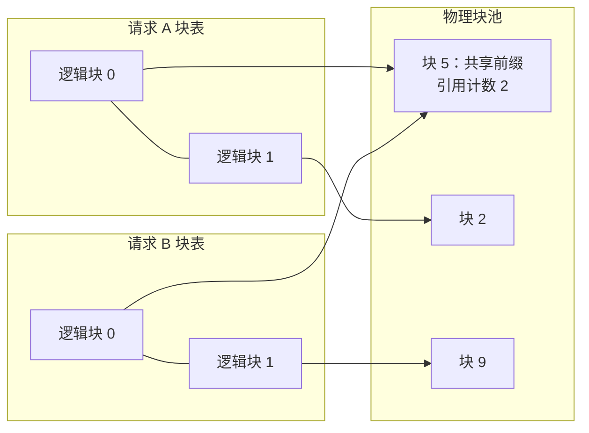

# KV Cache 与显存估算

> 层级：垂类 · inference · 预计 180 分钟 · 题目：[questions.md](questions.md)
> 前置：[core/01 LLM 与 Transformer 基础](../../../core/01-llm-foundations/README.md)（自注意力、Q/K/V、自回归生成）

## 1 这一章解决什么问题

Agent 岗面试问推理，最常见的不是“写一个 kernel”，而是三类问题：KV Cache 为什么能加速；给一个模型和一张卡，能放下多长的上下文、多少并发；GQA、MLA 这类结构为什么能省显存。答不上来，后面的前缀缓存、量化、PD 分离都接不住。

没有 KV Cache 时，生成每个 token 都要把整段序列重新过一遍模型。第 t 步的计算量和 t 成正比，大部分是重复劳动。有了 KV Cache，计算量降下来了，但显存和带宽变成了瓶颈。这一章讲清这笔账怎么算，以及几种省显存的手段各省在哪里。

学完你应该能：

- 从注意力的定义推出 KV 为什么能缓存、Q 为什么不用缓存，写出有缓存和没缓存时每步的 FLOPs 和读写字节；
- 用算术强度说明 Decode 为什么受带宽限制，以及为什么加大 batch 也救不了 KV 的读取；
- 写出一个带 KV Cache 的解码循环，并验证它和整段前向的结果一致；
- 对任意模型 config 估算权重、KV、激活，算出单卡能放几条会话；
- 对比 MHA、MQA、GQA、MLA 的 KV 大小和代价，讲清 MLA 的吸收和解耦 RoPE；
- 讲清 PagedAttention 的块表、引用计数和写时复制，知道它省什么、不省什么；
- 知道生产里常见的显存问题长什么样、怎么排查。

**本章符号**（后文沿用）：

| 符号 | 含义 |
|---|---|
| L | 层数（config 里的 `num_hidden_layers`） |
| d | 隐藏维度（`hidden_size`） |
| n_h | 查询头数（`num_attention_heads`） |
| n_kv | KV 头数（`num_key_value_heads`）；MHA 时 n_kv = n_h |
| d_h | 每个头的维度（`head_dim`） |
| N | 参数量（稠密模型；MoE 另说） |
| T | 当前这一步注意力要覆盖的 token 数（上下文长度） |
| b | batch 里同时解码的序列数 |
| s | 每个元素的字节数，BF16 为 2，FP8 为 1 |

## 2 KV Cache 为什么能加速

### 2.1 从注意力出发：为什么缓存 K、V，不缓存 Q

注意力的定义见 [core/01 第 3 节](../../../core/01-llm-foundations/README.md#3-self-attention-与-kv-头的演进)。这里只看解码器某一层、某一个头在位置 t 的输出：

```text
q_t = W_Q h_t      k_j = W_K h_j      v_j = W_V h_j        （h_j 是第 j 个位置进这一层的隐藏状态）

o_t = Σ_{j≤t} softmax_j( q_t · k_j / √d_h ) · v_j
```

求和只到 j ≤ t，这是因果 mask。由此可以推出三件事。

1. **历史位置的 K、V 不会变。** 第一层的 h_j 只取决于第 j 个 token。o_j 只用到位置 ≤ j 的 K、V，所以第二层的 h_j 也只取决于 token 0..j。逐层归纳，任意一层的 k_j、v_j 只取决于前 j 个 token。后面追加 token 不会改变它们，算一次就能一直用。
2. **历史位置的 Q 不会再用。** 生成第 t+1 个 token 只需要每层的 o_t，而 o_t 只用 q_t。q_j（j < t）只参与计算 o_j。o_j 早已算完，并且已经通过下一层的 k_j、v_j 进了缓存。所以 Q 没有缓存的理由。
3. **这只在因果 mask 下成立。** 双向注意力（如 BERT 式编码器）里，新 token 会改变所有旧位置的表示，K、V 都要重算。

位置编码不破坏这个结论。RoPE 按绝对位置旋转 q 和 k，k_j 只和位置 j 有关，缓存旋转之后的 k_j 即可。实现时要注意：新 token 的位置等于已缓存的长度，传错位置是手写解码最常见的 bug（见第 6 节）。

代价也从这里来：缓存和前缀一一绑定。前缀里任何一个 token 变了，从那里往后的 K、V 全部失效。这是第 [05 章](../05-agent-serving/README.md) 前缀缓存要处理的问题。

### 2.2 每步的计算量：有缓存和没缓存

稠密模型里，每个 token 过一遍所有线性层（Q、K、V、O 投影和 MLP）约要 2N FLOPs：每个参数做一次乘加，记 2 次浮点运算。注意力里的打分 q·kᵀ 和加权 Σ a_j v_j 不在 N 里，要单独算。一个头对 T 个位置做打分是 T·d_h 次乘加，加权求和也是 T·d_h 次乘加。所以每层每个查询 token 的注意力是 4·n_h·d_h·T FLOPs。

在第 T 步（注意力覆盖 T 个 token）：

```text
有缓存：只算 1 个新 token
  F_cache(T)   = 2N + 4·L·n_h·d_h·T

没缓存：T 个 token 全部重算
  F_nocache(T) = 2N·T + 4·L·n_h·d_h·T²

比值 F_nocache / F_cache ≈ T
```

生成 n 个 token，没缓存的线性层部分是 Σ 2N·T ≈ N·n²，有缓存只有 2N·n。

要说清 KV Cache 省的是什么：省的是重算历史 token 的投影和 MLP。注意力本身仍要和全部历史做点积，每步的 4·L·n_h·d_h·T 一项一点没少，还随 T 线性增长。说“KV Cache 降低了注意力的复杂度”是错的。

第 2.5 节的代码逐步数 FLOPs，验证这两个式子一个数都不差。

### 2.3 每步读写多少字节：为什么 Decode 受带宽限制

判断一步受算力还是带宽限制，看**算术强度** I：每从显存读写 1 字节做多少次浮点运算。I 低于硬件的“算力 / 带宽”比值，就受带宽限制。H100 SXM 这个比值约 295 FLOP/B，推导见 [inference/02 第 4 节](../02-batching-pd/README.md#4-prefill-与-decode-的计算特点)。

有缓存时，一步 Decode 同时处理 b 条序列，每条的上下文长度为 T：

```text
计算   F = b · (2N + 4·L·n_h·d_h·T)
读权重 s·N                              每步读一遍，b 条序列共用
读 KV  b · T · 2·L·n_kv·d_h·s           每条序列读自己的全部历史 K、V
写 KV  b · 2·L·n_kv·d_h·s               每条序列写 1 个 token，相对读可以忽略

I = F / (s·N + b·T·2·L·n_kv·d_h·s)
```

看两个极限（BF16，s = 2）：

| 情况 | 近似 | 结论 |
|---|---|---|
| 上下文很短（T 小） | I ≈ 2b·N / (2N) = b | batch 多大，强度就多大。b=1 时 I≈1，算力几乎全闲。加大 batch 有效 |
| batch 很大（b 大） | I → (2N + 4·L·n_h·d_h·T) / (T·2·L·n_kv·d_h·2) | 权重读取被摊薄，剩下 KV 读取。注意力部分的强度固定为 n_h / n_kv，和 batch 无关 |

第二行是 Decode 的根本问题。权重是所有序列共享的，batch 越大摊得越薄；KV 是每条序列私有的，batch 加一条，读取就加一份。所以长上下文时，加大 batch 也救不了 KV 的读取，强度会停在一个很低的值。

Shazeer 在 MQA 论文里给出了同样的结论：增量解码时“访存 / 计算”比为 Θ(n/d + 1/b)，n 是序列长度。1/b 一项靠加大 batch 解决；n/d 一项来自每步重读 K、V，只能靠缩小 K、V 解决。MQA 去掉 K、V 的头维度，把这一项降为原来的 1/h。这就是第 4 节所有结构改动的出发点：**减少每步要读的 KV 字节**。

代入 Qwen3-8B（n_h=32，n_kv=8）：注意力部分强度为 32/8 = 4。上下文 32K、batch 10 时整体强度约 5.5 FLOP/B（第 3.3 节代码算出），离 295 差了 50 多倍。

没缓存时恰好相反。每步重算 T 个 token，F ≈ 2N·T，读权重仍是 s·N，强度约 T，长 prompt 下受算力限制。它不慢在带宽，慢在做了 T 倍的活。

### 2.4 Prefill 和 Decode

上面的式子把推理分成两个阶段：

| 阶段 | 输入 | 做什么 | 一步的强度 | 瓶颈 |
|---|---|---|---|---|
| Prefill | 整段 prompt，T_p 个 token | 并行算出所有位置的 K、V，写入缓存，输出第一个 token | ≈ T_p | 算力（矩阵乘很大） |
| Decode | 每条序列 1 个新 token | 读全部权重和全部 KV，算一个 token | ≈ b（短上下文），长上下文时更低 | 显存带宽（算得少、读得多） |

两个阶段的最优 batch 不同，放在同一个 batch 里会互相干扰。这是连续批处理、分块 Prefill 和 PD 分离要处理的问题，见 [inference/02](../02-batching-pd/README.md)。

### 2.5 实现：带 KV Cache 的解码循环

下面是一个两层、四头、带 RoPE 和因果 mask 的小 Transformer，只用 numpy。它做三件事：

1. 用 KV Cache 贪心解码 20 个 token；
2. 拿整段带因果 mask 的前向做对照，assert 每一步的 logits 完全一致，并且增量写出的缓存和一次性 Prefill 写出的缓存相同；
3. 用计数器数每一步的 FLOPs，assert 它和第 2.2 节的两个式子精确相等。

```python
import numpy as np

rng = np.random.default_rng(0)
VOCAB, d, n_h, d_h, L, d_ff = 50, 32, 4, 8, 2, 64   # 词表、隐藏维、头数、头维、层数、MLP 宽
FLOPS = [0]                                         # 全局 FLOPs 计数器


def mm(a, b):
    """矩阵乘并记 FLOPs：(..., m, k) @ (..., k, n) 记 2·(...·m)·k·n。"""
    FLOPS[0] += 2 * int(np.prod(a.shape[:-1])) * a.shape[-1] * b.shape[-1]
    return a @ b


def w(*shape):
    return rng.normal(0, 0.3, shape)


E, W_out = w(VOCAB, d), w(d, VOCAB)
layers = [dict(q=w(d, n_h * d_h), k=w(d, n_h * d_h), v=w(d, n_h * d_h),
               o=w(n_h * d_h, d), up=w(d, d_ff), down=w(d_ff, d)) for _ in range(L)]


def rms(x):
    return x / np.sqrt((x * x).mean(-1, keepdims=True) + 1e-6)


def rope(x, pos):
    """x: (n_h, t, d_h)，pos: (t,) 绝对位置。缓存里存的是旋转之后的 K。"""
    half = d_h // 2
    ang = pos[:, None] * (10000.0 ** (-np.arange(half) / half))[None, :]   # (t, half)
    x1, x2 = x[..., :half], x[..., half:]
    return np.concatenate([x1 * np.cos(ang) - x2 * np.sin(ang),
                           x1 * np.sin(ang) + x2 * np.cos(ang)], -1)


def attention(x, p, pos, cache):
    t = x.shape[0]
    heads = lambda m: m.reshape(t, n_h, d_h).transpose(1, 0, 2)    # (t, n_h·d_h) → (n_h, t, d_h)
    q = rope(heads(mm(x, p["q"])), pos)
    k = rope(heads(mm(x, p["k"])), pos)
    v = heads(mm(x, p["v"]))
    if cache is not None:                                          # 追加到这一层自己的缓存
        cache["k"] = np.concatenate([cache["k"], k], 1)
        cache["v"] = np.concatenate([cache["v"], v], 1)
        k, v = cache["k"], cache["v"]                              # (n_h, T, d_h)，T = 历史 + 新
    s = mm(q, k.transpose(0, 2, 1)) / np.sqrt(d_h)                 # (n_h, t, T)
    s = np.where(np.arange(k.shape[1])[None, :] > pos[:, None], -np.inf, s)   # 因果 mask
    a = np.exp(s - s.max(-1, keepdims=True))
    a /= a.sum(-1, keepdims=True)
    o = mm(a, v).transpose(1, 0, 2).reshape(t, n_h * d_h)
    return mm(o, p["o"])


def forward(tokens, pos, caches=None, last_only=True):
    x = E[np.asarray(tokens)]                                      # (t, d)
    for l, p in enumerate(layers):
        x = x + attention(rms(x), p, pos, None if caches is None else caches[l])
        x = x + mm(np.maximum(mm(rms(x), p["up"]), 0), p["down"])
    if last_only:                                                  # 生成时只要最后一个位置
        x = x[-1:]
    return mm(rms(x), W_out)                                       # (1 或 t, VOCAB)


def new_caches():
    return [dict(k=np.zeros((n_h, 0, d_h)), v=np.zeros((n_h, 0, d_h))) for _ in range(L)]


prompt, n_new = [3, 14, 15, 9, 26], 20

# 1) 带 KV Cache 的贪心解码：Prefill 一次，之后每步只喂 1 个新 token
caches, toks, step_logits = new_caches(), list(prompt), []
logits = forward(prompt, np.arange(len(prompt)), caches)
for _ in range(n_new):
    step_logits.append(logits[-1])
    toks.append(int(logits[-1].argmax()))
    logits = forward([toks[-1]], np.array([len(toks) - 1]), caches)  # 位置 = 已缓存长度

# 2) 对照：整段带因果 mask 的前向，第 i 行是“看到 token 0..i 之后”的预测
full = forward(toks, np.arange(len(toks)), last_only=False)
for i, lg in enumerate(step_logits):
    assert np.allclose(lg, full[len(prompt) - 1 + i], atol=1e-9)
# 增量写出的缓存，和一次性 Prefill 整段得到的缓存逐元素相同：历史 K、V 不随新 token 改变
ref = new_caches()
forward(toks, np.arange(len(toks)), ref)
for c, r in zip(caches, ref):
    assert c["k"].shape == (n_h, len(toks), d_h)                   # 每层各存一份
    assert np.allclose(c["k"], r["k"]) and np.allclose(c["v"], r["v"])

# 3) 数第 T 步的 FLOPs，和正文式子对上
P = 2 * (4 * d * n_h * d_h + 2 * d * d_ff)     # 每层每 token 的线性层 FLOPs（≈ 2 × 每层参数量）
head = 2 * d * VOCAB                          # 输出层，只算最后一个位置
with_cache = without_cache = 0
for T in range(len(prompt) + 1, len(toks) + 1):  # T = 这一步注意力覆盖的 token 数
    c2 = new_caches()
    forward(toks[:T - 1], np.arange(T - 1), c2)  # 先把前 T-1 个 token 写进缓存（不计）
    FLOPS[0] = 0
    forward([toks[T - 1]], np.array([T - 1]), c2)
    assert FLOPS[0] == L * (P + 4 * n_h * d_h * T) + head
    with_cache += FLOPS[0]
    FLOPS[0] = 0
    forward(toks[:T], np.arange(T))              # 不用缓存：整段重算
    assert FLOPS[0] == L * (T * P + 4 * n_h * d_h * T * T) + head
    without_cache += FLOPS[0]
ratio = without_cache / with_cache
print(f"prompt {len(prompt)}，生成 {n_new}：无缓存 / 有缓存 FLOPs = {ratio:.1f} 倍")
assert ratio > len(prompt) + n_new / 2 - 1       # 约等于“平均上下文长度”
```

几个读代码时要看的地方：

- `forward` 里新 token 的位置是 `len(toks) - 1`，也就是已缓存的长度。RoPE 和因果 mask 都靠它。
- 缓存按层存：`caches[l]` 是第 l 层自己的 K、V，形状 (n_h, T, d_h)。每层的 K、V 都不同，不能共用。
- 带缓存的一步里，打分矩阵的形状是 (n_h, 1, T)，不再是 (n_h, T, T)。这就是计算从 T² 降到 T 的地方。
- 最后一个 assert 说明，这个例子里没缓存比有缓存多做约 15 倍计算，差不多是平均上下文长度。

## 3 显存估算：权重、KV、激活

推理时一张卡上的显存大致分四块：

```text
总显存 ≈ 权重 + KV Cache + 激活（临时张量） + 运行时开销（CUDA context、通信缓冲、CUDA Graph 等）
```

### 3.1 三个公式

**权重**：

```text
权重字节 = 参数量 × 每参数字节数
BF16/FP16 = 2，FP8/INT8 = 1，INT4 ≈ 0.5（另加分组缩放因子，见第 04 章）
```

参数量最好从 config 自己数一遍，能顺便发现 config 读错了。稠密模型每层的参数是 Q、K、V、O 四个投影加 MLP：

```text
每层 ≈ d·n_h·d_h（Q） + 2·d·n_kv·d_h（K、V） + n_h·d_h·d（O） + 3·d·d_ff（SwiGLU 的 gate、up、down）
总参数 ≈ L × 每层 + 词表 × d × (1 或 2，看输入输出嵌入是否共享)
```

MoE 模型的权重要按全部专家算，因为所有专家都要放在显存里；每 token 的计算量按激活的专家算。量化相关的细节见 [04 量化](../04-quantization/README.md)。

**KV Cache**（MHA、MQA、GQA 通用）：

```text
每 token KV 字节 = 2 × L × n_kv × d_h × s
                   ↑K 和 V
总 KV 字节 = 每 token KV 字节 × 序列长度 × 并发请求数
```

MLA 不能套这个公式，它缓存的是潜向量，见第 4.3 节。

**激活**：推理不存反向传播要用的激活，只有前向的临时张量，用完即释放。它的峰值由一步最多处理多少 token 决定：

```text
激活峰值 ≈ 一步的 token 数 × (几个 d 宽的张量 + 两个 d_ff 宽的张量) × s
```

分块 Prefill 把一步的 token 数限在一个上限内（vLLM 里是 `max_num_batched_tokens`），激活峰值也就被限住了，见 [02 批处理与 PD 分离](../02-batching-pd/README.md)。Qwen3-8B 一步 8K token 时约 0.7 GB（下面代码的量级估算）。实际引擎还有 logits、通信缓冲、CUDA Graph 等，所以面试里说“预留几个 GB”即可，不必精算。

对比训练：混合精度 Adam 训练时，每个参数要存 FP16 权重、FP16 梯度和 FP32 的权重副本、动量、方差，ZeRO 论文给出的是每参数 16 字节（2+2+12），还不含激活。推理只要 2 字节，这是“训练要 8 倍显存”说法的来源。

### 3.2 实现：从 config 估算显存

下面的函数输入 config 字典（字段名和 Hugging Face 的 config.json 一致），输出参数量、每 token KV 和三项显存。用 Qwen3-8B 和 DeepSeek-V2 的真实 config 跑一遍，assert 和本章正文、模型卡、论文的数字一致。

```python
import math

# 原样摘自 Hugging Face config.json（2026-11 查阅），只保留估算要用的字段
QWEN3_8B = {"hidden_size": 4096, "intermediate_size": 12288, "num_hidden_layers": 36,
            "num_attention_heads": 32, "num_key_value_heads": 8, "head_dim": 128,
            "vocab_size": 151936, "tie_word_embeddings": False, "torch_dtype": "bfloat16"}
DEEPSEEK_V2 = {"hidden_size": 5120, "intermediate_size": 12288, "num_hidden_layers": 60,
               "num_attention_heads": 128, "num_key_value_heads": 128,
               "q_lora_rank": 1536, "kv_lora_rank": 512, "qk_nope_head_dim": 128,
               "qk_rope_head_dim": 64, "v_head_dim": 128, "moe_intermediate_size": 1536,
               "n_routed_experts": 160, "n_shared_experts": 2, "num_experts_per_tok": 6,
               "first_k_dense_replace": 1, "vocab_size": 102400,
               "tie_word_embeddings": False, "torch_dtype": "bfloat16"}
BYTES = {"float32": 4, "bfloat16": 2, "float16": 2, "fp8": 1, "int8": 1}


def params(c):
    """返回 (总参数, 每 token 激活参数, 非嵌入参数)。忽略各层 norm 之外的小项。"""
    h, L, V = c["hidden_size"], c["num_hidden_layers"], c["vocab_size"]
    if "kv_lora_rank" in c:                                   # MLA（DeepSeek-V2 式）
        nh, qr, kr = c["num_attention_heads"], c["q_lora_rank"], c["kv_lora_rank"]
        dn, dr, dv = c["qk_nope_head_dim"], c["qk_rope_head_dim"], c["v_head_dim"]
        attn = (h * qr + qr + qr * nh * (dn + dr)             # Q 的下投影、norm、上投影
                + h * (kr + dr) + kr                          # KV 下投影（含解耦 RoPE 键）、norm
                + kr * nh * (dn + dv) + nh * dv * h)          # K、V 上投影，输出投影
    else:                                                     # MHA / GQA
        nh, nk, hd = c["num_attention_heads"], c["num_key_value_heads"], c["head_dim"]
        attn = h * nh * hd + 2 * h * nk * hd + nh * hd * h + 2 * hd   # Q、K、V、O、q/k norm
    dense_ffn = 3 * h * c["intermediate_size"]                # SwiGLU：gate、up、down
    if "n_routed_experts" in c:
        e = 3 * h * c["moe_intermediate_size"]
        k = c["first_k_dense_replace"]
        router = h * c["n_routed_experts"]
        ffn_total = k * dense_ffn + (L - k) * ((c["n_routed_experts"] + c["n_shared_experts"]) * e + router)
        ffn_active = k * dense_ffn + (L - k) * ((c["num_experts_per_tok"] + c["n_shared_experts"]) * e + router)
    else:
        ffn_total = ffn_active = L * dense_ffn
    body = L * (attn + 2 * h) + h                             # 每层两个 RMSNorm，加最后一个
    emb = V * h * (1 if c["tie_word_embeddings"] else 2)
    return body + ffn_total + emb, body + ffn_active + emb, body + ffn_total


def kv_bytes_per_token(c, kv_dtype=None):
    b = BYTES[kv_dtype or c["torch_dtype"]]
    L = c["num_hidden_layers"]
    if "kv_lora_rank" in c:                                   # MLA：潜向量 + 解耦 RoPE 键
        return L * (c["kv_lora_rank"] + c["qk_rope_head_dim"]) * b
    return 2 * L * c["num_key_value_heads"] * c["head_dim"] * b   # 2 = K 和 V


def estimate(c, seq_len, batch, chunk_tokens=8192, kv_dtype=None):
    """权重、KV、激活三项，单位字节。激活按一步最多处理 chunk_tokens 个 token 的量级估算。"""
    b = BYTES[c["torch_dtype"]]
    total, _, _ = params(c)
    h = c["hidden_size"]
    ffn = max(c["intermediate_size"], c.get("moe_intermediate_size", 0) * c.get("num_experts_per_tok", 0))
    # 同一时刻活着的临时张量：残差、归一化输出、QKV、注意力输出，加 MLP 的 gate 和 up
    act = chunk_tokens * (4 * h + 2 * ffn) * b
    return {"weights": total * b,
            "kv": kv_bytes_per_token(c, kv_dtype) * seq_len * batch,
            "activation": act}


GB, KiB = 1e9, 1024

# Qwen3-8B：和模型卡的 8.2B（非嵌入 6.95B）对上
tot, act_p, non_emb = params(QWEN3_8B)
assert round(tot / 1e9, 1) == 8.2 and round(non_emb / 1e9, 2) == 6.95
assert tot == act_p                                            # 稠密模型
assert kv_bytes_per_token(QWEN3_8B) == 147_456 == 144 * KiB
m = estimate(QWEN3_8B, seq_len=32_768, batch=1)
assert round(m["weights"] / GB, 1) == 16.4
assert round(m["kv"] / GB, 2) == 4.83
assert round(147_456 * 131_072 / GB, 1) == 19.3
assert round(m["activation"] / GB, 2) == 0.67                  # 8K token 一步，量级不到 1 GB

# 单卡并发：80 GB 卡，可用 90%，激活和运行时预留 4 GB（假设值）
kv_budget = 80 * GB * 0.9 - m["weights"] - 4 * GB
tokens = kv_budget / kv_bytes_per_token(QWEN3_8B)
assert round(kv_budget / GB, 1) == 51.6 and 349_000 < tokens < 351_000
assert math.floor(tokens / 32_768) == 10 and math.floor(tokens / 131_072) == 2

# DeepSeek-V2：和论文的 236B 总参数、21B 激活参数对上
tot, act_p, _ = params(DEEPSEEK_V2)
assert round(tot / 1e9) == 236 and round(act_p / 1e9) == 21
assert round(estimate(DEEPSEEK_V2, 1, 1)["weights"] / GB) == 471   # BF16 权重放不进单张 80 GB 卡
mla = kv_bytes_per_token(DEEPSEEK_V2)
mha = 2 * 128 * 128 * 60 * 2                                    # 论文 Table 1 的 MHA 口径，d_h = 128
assert mla == 69_120 and mha == 3_932_160
assert round(mla / mha * 100, 1) == 1.8
assert (512 + 64) / 128 == 4.5 and 4.5 / 2 == 2.25              # 每层 4.5 d_h 个元素 = 2.25 组 GQA

# 坑：MLA 模型的 config 里 num_key_value_heads = 128。按 GQA 公式套，或者引擎不支持 MLA、
# 把 K（128+64 维）和 V（128 维）展开成多头存，都会高估约 71 倍
naive = 60 * 128 * (128 + 64 + 128) * 2
assert naive == 4_915_200 and round(naive / mla) == 71

# 对照 DeepSeek 67B（deepseek-llm-67b-base 的 config：95 层，64 头，8 个 KV 头，hidden 8192）
DS_67B = {"num_hidden_layers": 95, "num_key_value_heads": 8, "head_dim": 8192 // 64,
          "torch_dtype": "bfloat16"}
base = kv_bytes_per_token(DS_67B)
assert base == 389_120
assert round(1 - mla / base, 3) == 0.822                        # 两者都按 BF16：少 82.2%
assert round(1 - mla * 6 / 16 / base, 3) == 0.933               # MLA 再按平均 6 bit 存：少 93.3%
print("Qwen3-8B 每 token KV", kv_bytes_per_token(QWEN3_8B), "B；DeepSeek-V2", mla, "B")
```

这段代码验证了几件事：

- 从 config 数出来的 Qwen3-8B 参数是 8.19B，非嵌入 6.95B，和模型卡一致。DeepSeek-V2 数出来总参数 236B、每 token 激活 21B，和论文一致。说明公式里没有漏项。
- DeepSeek-V2 的 config 里 `num_key_value_heads` 是 128。照 GQA 公式套会高估约 71 倍，第 6 节会再讲这个坑。
- 论文“KV Cache 减少 93.3%”可以从 config 复现：DeepSeek 67B 每 token 389,120 B。两者都按 BF16 只少 82.2%；MLA 按论文部署时的平均 6 bit 存，正好少 93.3%。这是本章的推算，论文没有写出算式，但数字对得上。

### 3.3 数值例子：一张卡能放几条会话

Hugging Face 上 `Qwen/Qwen3-8B` 的 config.json 和模型卡：

| 字段 | 值 |
|---|---|
| 参数量 | 8.2B（非嵌入 6.95B） |
| `num_hidden_layers` | 36 |
| `num_attention_heads` / `num_key_value_heads` | 32 / 8（GQA） |
| `head_dim` | 128 |
| `hidden_size` / `intermediate_size` | 4096 / 12288 |
| `torch_dtype` | bfloat16 |
| 原生上下文 | 32,768（模型卡称用 YaRN 可到 131,072） |

一步一步走：

```text
① 权重：8.2e9 × 2 B ≈ 16.4 GB

② 每 token KV：2 × 36 × 8 × 128 × 2 B = 147,456 B = 144 KiB
   一条 32K 请求：147,456 × 32,768 ≈ 4.83 GB
   一条 128K 请求：147,456 × 131,072 ≈ 19.3 GB

③ 一张 80 GB 卡，假设引擎可用 90%（72 GB），激活和运行时预留 4 GB（假设值）：
   留给 KV：72 − 16.4 − 4 ≈ 51.6 GB
   可放 token 数：51.6e9 / 147,456 ≈ 35 万
   → 约 10 条满 32K 的会话，或 2 条满 128K 的会话

④ 满载时 Decode 一步要读：16.4 GB 权重 + 10 × 4.83 GB KV ≈ 64.7 GB
   H100 SXM 标称带宽 3.35 TB/s → 一步至少 19.3 ms
   10 条会话合计 ≤ 518 token/s，每条 ≤ 52 token/s
```

第 ④ 步说明两件事。第一，满载时 KV 读取（48.3 GB）是权重读取的 3 倍，长上下文下 Decode 的时间主要花在读 KV 上。第二，batch=1 的短上下文时一步只要读权重，约 4.9 ms；同一个模型，上下文和并发上去之后单步慢了 4 倍。

再换几种注意力结构，其他条件不变。下面代码把每一种的每 token KV、单卡会话数、单步时间下界和算术强度都算出来。“MLA 式”一行是假设：给 Qwen3-8B 的形状套上 DeepSeek-V2 的比例（d_c = 4d_h，d_R = d_h/2），不是真实模型。

```python
GB = 1e9
# Qwen3-8B 的形状（config.json）；硬件取 H100 SXM 标称值，见 inference/02 第 4 节
N, L, n_h, d_h = 8.2e9, 36, 32, 128
BW, PEAK = 3.35e12, 990e12            # 显存带宽 B/s，BF16 稠密算力 FLOP/s
W = 2 * N                             # BF16 权重字节
T = 32_768                            # 每条会话的上下文
budget = 80 * GB * 0.9 - W - 4 * GB   # 留给 KV 的字节（和第 3 节同样的假设）

variants = {                          # 名称: 每 token KV 字节
    "MHA (n_kv=32)":         2 * L * 32 * d_h * 2,
    "GQA (n_kv=8, 实际)":    2 * L * 8 * d_h * 2,
    "GQA + FP8 KV":          2 * L * 8 * d_h * 1,
    "MQA (n_kv=1)":          2 * L * 1 * d_h * 2,
    "MLA 式 (d_c=4d_h, d_R=d_h/2)": L * (4 * d_h + d_h // 2) * 2,
}
rows = {}
for name, s in variants.items():
    b = int(budget // (s * T))                         # 单卡能放几条满 32K 的会话
    step = (W + b * T * s) / BW                        # 满载时 Decode 一步的带宽下界（秒）
    flops = b * (2 * N + 4 * L * n_h * d_h * T)        # 这一步的计算量
    rows[name] = (s, b, step * 1e3, b / step, flops / (W + b * T * s))
    print(f"{name:32s} {s:>8,} B/token  {b:>3} 条  {step * 1e3:5.1f} ms/步  "
          f"≤{b / step:5.0f} token/s  强度 {rows[name][4]:4.1f} FLOP/B")

assert [r[1] for r in rows.values()] == [2, 10, 21, 85, 37]
s, b, ms, tps, I = rows["GQA (n_kv=8, 实际)"]
assert s == 147_456 and round(ms, 1) == 19.3 and 510 < tps < 520 and 5 < I < 6

# 算术强度的两个极限
# (1) 只看注意力：每读 1 个 KV 元素（2 字节）做 2·n_h/n_kv 次乘加 → 强度 = n_h/n_kv，与 batch 无关
for n_kv in (32, 8, 1):
    attn_flops = 4 * L * n_h * d_h * T                 # 一条序列一步的 QKᵀ 和 AV
    kv_read = 2 * L * n_kv * d_h * 2 * T
    assert attn_flops / kv_read == n_h / n_kv
# (2) 硬件的算力/带宽比约 295，Decode 离它差两个数量级
assert 290 < PEAK / BW < 300 and I < PEAK / BW / 50

# 不用缓存时，第 32K 步要把整段重算一遍
no_cache = 2 * N * T + 4 * L * n_h * d_h * T * T
with_cache = 2 * N + 4 * L * n_h * d_h * T
assert 1.1 < no_cache / PEAK < 1.2                     # 按满算力也要 1 秒多出一个 token
assert 30_000 < no_cache / with_cache < 33_000         # 每步计算量差约 T 倍
assert round((W + T * 147_456) / BW * 1e3, 1) == 6.3   # 有缓存、batch=1：约 6.3 ms

# KV 什么时候超过权重
assert int(W / 147_456) == 111_219                     # 单条请求约 11 万 token 时 KV = 权重
assert 10 * T * 147_456 > 2.9 * W                      # 10 条 32K 会话的 KV 是权重的近 3 倍

# DeepSeek-V2 在 8 张 80 GB 卡上做 8 路张量并行（每卡可用 72 GB，预留 4 GB）
P_V2, mla = 235.7e9, 69_120
def kv_tokens_per_card(weight_bytes_per_param):
    per_card = 72 * GB - P_V2 * weight_bytes_per_param / 8 - 4 * GB
    return per_card / mla
bf16, fp8 = kv_tokens_per_card(2), kv_tokens_per_card(1)
assert 125_000 < bf16 < 135_000 and 550_000 < fp8 < 560_000
# MLA 只有一份潜向量，没法按头切到 8 张卡上：纯 TP 时每张卡存全部序列的同一份 KV，
# 整机能放的不同 token 数就等于单卡的数。注意力改成数据并行后，每张卡只存自己那批序列
assert int(8 * fp8 / 32_768) == 136 and int(fp8 / 32_768) == 17
```

运行输出（节选）：

| 结构 | 每 token KV | 32K 会话数 | 满载每步下界 | 整卡 token/s 上界 | 算术强度 |
|---|---|---|---|---|---|
| MHA（n_kv=32） | 576 KiB | 2 | 16.4 ms | 122 | 1.3 |
| GQA（n_kv=8，实际结构） | 144 KiB | 10 | 19.3 ms | 518 | 5.5 |
| GQA + FP8 KV | 72 KiB | 21 | 20.0 ms | 1,048 | 11.2 |
| MQA（n_kv=1） | 18 KiB | 85 | 20.2 ms | 4,204 | 44.8 |
| MLA 式（假设） | 40.5 KiB | 37 | 19.9 ms | 1,859 | 19.8 |

怎么读这张表：

- 每一行的单步时间都差不多，因为显存都被塞满了，每步读的字节数接近整卡容量。KV 越小，同样的字节能服务越多会话，吞吐就越高。所以缩小 KV 同时提高了容量和吞吐。
- 算术强度全部远低于硬件的 295。即使 MQA 塞了 85 条会话，Decode 仍受带宽限制。
- 这些都是下界和上界，不是实测。它们没算注意力 kernel 的效率、调度开销和 Prefill 的插队。

最后一段代码算的是 DeepSeek-V2 的多卡情况。BF16 权重 471 GB，单卡放不下，要 8 卡张量并行。BF16 权重时每卡留给 KV 约 9 GB，约 13 万 token；按论文部署时的 FP8 权重，每卡约 55 万 token。但 MLA 只有一份潜向量，不能按头切分。纯张量并行时每张卡都要存所有序列的同一份 KV，整机能放的不同 token 数等于单卡的数。SGLang 文档把这一点列为 DeepSeek 用纯 TP 的问题，并用注意力部分的数据并行（DP attention）来解决：每个副本只存自己那批请求的 KV。

## 4 MQA / GQA / MLA 对 KV 的影响

**问题**：第 2.3 节说明，Decode 慢在每步重读 K、V。每 token KV 公式里能动的只有 n_kv × d_h 这一项（或者换成别的东西来缓存）。MHA 每个 Q 头都有自己的 K、V 头，KV 最大。

### 4.1 四种结构

| 结构 | 每 token 每层缓存的元素数 | 怎么做 | 代价 |
|---|---|---|---|
| MHA | 2 × n_h × d_h | 每个 Q 头独立 K、V | KV 最大 |
| MQA（Shazeer 2019） | 2 × d_h | 所有 Q 头共享一组 K、V | 论文报告质量有轻微下降 |
| GQA（Ainslie 等 2023） | 2 × n_kv × d_h | Q 头分成 n_kv 组，组内共享 K、V | 介于两者之间；n_kv=1 即 MQA，n_kv=n_h 即 MHA |
| MLA（DeepSeek-V2） | d_c + d_h^R | 缓存一个低秩潜向量 c^KV，用时再上投影成多头 K、V；另缓存一个解耦的 RoPE 键 | 结构更复杂，kernel 和量化都要专门适配 |

表里 d_c 是 KV 压缩维度，d_h^R 是解耦 RoPE 键的维度（第 4.3 节）。

### 4.2 GQA 和 MQA：KV 头怎么复制

GQA 的 Q 头数比 KV 头数多。计算时第 j 个 KV 头服务第 j·r 到 (j+1)·r − 1 个 Q 头，r = n_h / n_kv。缓存里只存 n_kv 份，复制发生在计算时。Hugging Face transformers 的 `repeat_kv` 就是这样写的：把 (batch, n_kv, T, d_h) 扩成 (batch, n_h, T, d_h)。

复制只是参考实现的写法。高效的 kernel 不真的复制，而是把同组的 r 个 Q 头一起和同一份 K、V 算，读一遍 KV 服务 r 个头。这就是第 2.3 节里注意力强度等于 n_h / n_kv 的来源。

下面的代码写出两种实现，assert 它们形状正确、结果等价，并且 MQA 是 n_kv = 1 的特例。最后一段是 GQA 论文从 MHA 检查点改成 GQA 的起点：把同组的 K、V 投影矩阵做均值池化。论文给的完整配方是池化之后再用原预训练约 5% 的计算量继续训练（论文称为上训练，uptraining）。

```python
import numpy as np


def repeat_kv(x, n_rep):
    """(batch, n_kv, T, d_h) → (batch, n_kv·n_rep, T, d_h)。第 j 个 KV 头复制给 Q 头 j·n_rep … (j+1)·n_rep−1。"""
    b, n_kv, T, d_h = x.shape
    if n_rep == 1:
        return x
    return np.broadcast_to(x[:, :, None], (b, n_kv, n_rep, T, d_h)).reshape(b, n_kv * n_rep, T, d_h)


def softmax(s):
    e = np.exp(s - s.max(-1, keepdims=True))
    return e / e.sum(-1, keepdims=True)


def attn_repeat(q, k, v):
    """先把 KV 复制成 n_h 份再做普通多头注意力。q: (b, n_h, 1, d_h)。"""
    n_rep = q.shape[1] // k.shape[1]
    k, v = repeat_kv(k, n_rep), repeat_kv(v, n_rep)
    assert k.shape[1] == q.shape[1]
    return softmax(q @ k.transpose(0, 1, 3, 2) / np.sqrt(q.shape[-1])) @ v


def attn_grouped(q, k, v):
    """不复制：把 Q 头按组重排成 (b, n_kv, n_rep, 1, d_h)，组内共用同一份 K、V。"""
    b, n_h, t, d_h = q.shape
    n_kv = k.shape[1]
    qg = q.reshape(b, n_kv, n_h // n_kv, t, d_h)
    s = np.einsum("bgrtd,bgsd->bgrts", qg, k) / np.sqrt(d_h)
    return np.einsum("bgrts,bgsd->bgrtd", softmax(s), v).reshape(b, n_h, t, d_h)


rng = np.random.default_rng(0)
b, n_h, T, d_h = 2, 8, 12, 16
q = rng.normal(size=(b, n_h, 1, d_h))                 # Decode：每条序列 1 个新 token
for n_kv, name in [(8, "MHA"), (2, "GQA"), (1, "MQA")]:
    k = rng.normal(size=(b, n_kv, T, d_h))
    v = rng.normal(size=(b, n_kv, T, d_h))
    rep = repeat_kv(k, n_h // n_kv)
    assert rep.shape == (b, n_h, T, d_h)
    for h in range(n_h):                               # Q 头 h 用的是第 h // n_rep 个 KV 头
        assert np.array_equal(rep[:, h], k[:, h // (n_h // n_kv)])
    out1, out2 = attn_repeat(q, k, v), attn_grouped(q, k, v)
    assert out1.shape == out2.shape == (b, n_h, 1, d_h)
    assert np.allclose(out1, out2)                     # 两种写法等价
    print(f"{name}: 缓存 {k.size + v.size} 个元素，是 MHA 的 {n_kv / n_h:.3f}")

# MQA 是 n_kv=1 的 GQA；GQA 每个组内等价于一个 MQA
k1 = rng.normal(size=(b, 1, T, d_h))
v1 = rng.normal(size=(b, 1, T, d_h))
assert np.allclose(attn_grouped(q, k1, v1), attn_repeat(q, k1, v1))

# GQA 论文的“上训练”起点：把同组 K 投影矩阵做均值池化
d, n_kv = 64, 2
Wk = rng.normal(size=(d, n_h, d_h))                    # MHA 检查点的 K 投影，按头切开
Wk_gqa = Wk.reshape(d, n_kv, n_h // n_kv, d_h).mean(2)
assert Wk_gqa.shape == (d, n_kv, d_h)
assert np.allclose(Wk_gqa[:, 0], Wk[:, :n_h // n_kv].mean(1))

# 每 token 每层缓存元素数：复制发生在计算时，缓存里只存 n_kv 份
per_tok = {n: 2 * n * d_h for n in (8, 2, 1)}
assert per_tok[8] == 4 * per_tok[2] == 8 * per_tok[1]
```

### 4.3 MLA：缓存潜向量，用吸收避免展开

MLA 的做法（DeepSeek-V2 论文 2.1 节）：

```text
c_t   = W_DKV h_t              c_t 是 d_c 维的潜向量，只缓存它
k_t,i = W_UK,i c_t              第 i 个头的 K，用时再算
v_t,i = W_UV,i c_t              第 i 个头的 V
```

如果每步都把所有历史 c_j 展开成多头 K、V，省下的显存会被重复计算吃掉。论文指出 W^UK 可以吸收进 W^Q，W^UV 可以吸收进 W^O。推导只用到矩阵乘的结合律：

```text
打分：q_i · (W_UK,i c_j) = (W_UK,iᵀ q_i) · c_j       先把 q 投到 d_c 维，再和缓存的 c_j 点积
输出：Σ_j a_j (W_UV,i c_j) = W_UV,i (Σ_j a_j c_j)     先在 d_c 维加权求和，W_UV 再并进输出投影
```

**RoPE 为什么破坏吸收**：如果对 k 加 RoPE，k_j = R(j) W_UK c_j。R(j) 是随键位置 j 变化的旋转矩阵，夹在 q 和 W_UK 之间。矩阵乘不满足交换律，没法把 R(j) 挪走，就不存在一个对所有 j 都适用的吸收矩阵。论文说，这样一来推理时就要为所有前缀 token 重算 K。

**解耦 RoPE**：另用 d_h^R 维的多头查询 q^R 和一个所有头共享的键 k^R 承载 RoPE，拼在不带位置的部分后面：q = [q^C; q^R]，k = [k^C; k^R]。k^R 也要缓存，所以每 token 每层缓存 d_c + d_h^R 个元素。

下面的代码验证吸收前后打分和输出完全相等，并验证带 RoPE 的 K 用位置无关的吸收矩阵算不出来。

```python
import numpy as np

rng = np.random.default_rng(0)
d, n_h, d_h, d_c, T = 64, 4, 16, 24, 10      # 隐藏维、头数、头维、潜向量维 d_c、历史长度
W_DKV = rng.normal(size=(d_c, d))            # 下投影：c_t = W_DKV h_t，缓存的就是 c_t
W_UK = rng.normal(size=(n_h, d_h, d_c))      # 每个头的 K 上投影
W_UV = rng.normal(size=(n_h, d_h, d_c))      # 每个头的 V 上投影
H = rng.normal(size=(T, d))                  # 历史 token 的隐藏状态
q = rng.normal(size=(n_h, d_h))              # 当前 token 每个头的 query
C = H @ W_DKV.T                              # (T, d_c)：每 token 只存 d_c 个数

# 朴素做法：把潜向量展开成多头 K、V 再做注意力
K = np.einsum("hkc,tc->htk", W_UK, C)        # (n_h, T, d_h)
V = np.einsum("hkc,tc->htk", W_UV, C)
s_naive = np.einsum("hk,htk->ht", q, K)
a = np.exp(s_naive - s_naive.max(1, keepdims=True))
a /= a.sum(1, keepdims=True)
o_naive = np.einsum("ht,htk->hk", a, V)

# 吸收：q·(W_UK c) = (W_UKᵀ q)·c，先把 q 投到潜空间，直接和缓存的 c 点积
q_lat = np.einsum("hkc,hk->hc", W_UK, q)     # (n_h, d_c)
s_abs = q_lat @ C.T                          # (n_h, T)，不用展开 K
assert np.allclose(s_naive, s_abs)
# 输出同理：Σ a_j W_UV c_j = W_UV (Σ a_j c_j)，W_UV 可以再并进输出投影 W_O
o_abs = np.einsum("hkc,hc->hk", W_UV, a @ C)
assert np.allclose(o_naive, o_abs)

# RoPE 放在 K 上会破坏吸收：k_j = R(j) W_UK c_j，R(j) 随键的位置 j 变化，
# q·R(j) W_UK c_j 不能写成“同一个矩阵作用在 q 上”再和所有 c_j 点积
def rot(j):
    ang = j * 0.3 * (np.arange(d_h // 2) + 1)
    R = np.zeros((d_h, d_h))
    for i, t in enumerate(ang):
        R[2 * i:2 * i + 2, 2 * i:2 * i + 2] = [[np.cos(t), -np.sin(t)], [np.sin(t), np.cos(t)]]
    return R

K_rope = np.stack([np.einsum("kl,hlc,c->hk", rot(j), W_UK, C[j]) for j in range(T)], 1)
s_rope = np.einsum("hk,htk->ht", q, K_rope)
assert not np.allclose(s_rope, s_abs)        # 用位置无关的吸收矩阵算不出带 RoPE 的分数
# DeepSeek-V2 的解耦：RoPE 只放在额外的 d_R 维共享键 k_R 上，这一小段单独缓存
d_R = 8
W_KR = rng.normal(size=(d_R, d))
k_R = H @ W_KR.T                             # (T, d_R)，所有头共享
assert C.shape[1] + k_R.shape[1] == d_c + d_R    # 每 token 每层缓存 d_c + d_R 个元素
assert d_c + d_R < 2 * n_h * d_h                 # 远少于 MHA 的 2·n_h·d_h
```

### 4.4 用 DeepSeek-V2 的 config 算一遍

`deepseek-ai/DeepSeek-V2-Chat` 的 config：60 层，128 个头，`kv_lora_rank`（即 d_c）= 512，`qk_rope_head_dim`（即 d_h^R）= 64，`qk_nope_head_dim` = 128，`v_head_dim` = 128。

```text
MLA 每 token：60 × (512 + 64) × 2 B = 69,120 B ≈ 67.5 KiB
按论文 Table 1 的 MHA 口径（2 × n_h × d_h × l，d_h = 128）：
            2 × 128 × 128 × 60 × 2 B = 3,932,160 B ≈ 3.75 MiB
比值：576 / 32,768 ≈ 1.8%
```

论文的说法是 d_c = 4d_h、d_h^R = d_h/2，每层缓存 4.5 d_h 个元素，相当于只有 2.25 组的 GQA。论文还报告，DeepSeek-V2 相对 DeepSeek 67B 把 KV Cache 减少了 93.3%，生成吞吐最大提高到 5.76 倍。这里的部署用了 FP8 权重，KV 平均量化到 6 bit（论文 3.2.3 节），第 3.2 节的代码用这个条件复现了 93.3%。

面试回答顺序：先说公式里哪一项被压缩，再说怎么压，最后说代价（质量风险、实现复杂度、量化和 kernel 的适配）。

## 5 PagedAttention

论文细节和实验见论文精读 [PagedAttention / vLLM](../../../papers/11-pagedattention-vllm.md)。这里讲机制本身，并写一个可运行的块表模拟。

### 5.1 解决哪种浪费

早期系统给每个请求按最大长度预分配一段连续 KV 空间。vLLM 论文把浪费分成三类：

- 预留：为将来的 token 预留、暂时没用的空间；
- 内部碎片：按最大长度分配，最终没生成那么长；
- 外部碎片：分配器在不同大小的连续块之间留下的空隙。

论文的测量是，之前的系统里真正存放 token 状态的显存只占 20.4% 到 38.2%。连续存储还有一个问题：并行采样、束搜索的多条序列本可以共享 prompt 的 KV，但各自一段连续空间就没法共享。

### 5.2 块表、引用计数、写时复制

借鉴操作系统的虚拟内存分页：

1. 把显存里的 KV 空间切成固定大小的物理块，每块存 B 个 token 的 K、V。vLLM 默认块大小是 16 个 token。
2. 每个请求有一张块表，记录“第 i 个逻辑块在哪个物理块”。物理块不需要连续。
3. 生成时写满一块再申请下一块，浪费只剩每个请求最后一个没写满的块，平均每条序列约 B/2 个槽位。
4. attention kernel 按块表间接寻址去读 KV。数学上和连续存储完全等价，只是读的方式变了。
5. 多个序列可以让块表指向同一个物理块。每个物理块有引用计数。要往引用计数大于 1 的块里写时，先分配新块、拷贝内容、更新自己的块表、把原块引用计数减 1，再写（写时复制）。引用计数为 1 时直接写。
6. 序列结束时，它的每个块引用计数减 1，归零的块回到空闲池。



### 5.3 实现：块表的最小模拟

下面的 `BlockManager` 实现了按块分配、释放、前缀共享（`fork`）和写时复制。测试流程：

1. 序列 a 写 10 个 token，块大小 4，占 3 块，尾块只用了 2 格；
2. fork 出序列 b，assert 物理块数仍是 3（不共享要 6 块），引用计数都是 2；
3. a、b 各写一个不同的 token。a 先写，尾块被共享，触发写时复制；b 后写，尾块此时只剩 b 引用，直接写。assert 两条序列前两块仍共享、尾块分开、各自读回的内容互不影响；
4. 按块表读回 K 做注意力，assert 和连续存储的结果相同；
5. 释放序列，assert 只回收独占的块，最后全部归还；
6. 10 个随机长度的请求，assert 浪费恰好等于各自尾块的空槽，且每条不到一块。

```python
import numpy as np


class BlockManager:
    """PagedAttention 的块表最小模拟。一个物理块存 B 个 token 的 K（V 同理，这里省略）。"""

    def __init__(self, num_blocks, B, d):
        self.B = B
        self.pool = np.zeros((num_blocks, B, d))   # 物理块池：(块数, B, 每 token 的向量)
        self.ref = np.zeros(num_blocks, int)       # 引用计数
        self.free = list(range(num_blocks))[::-1]  # 空闲块栈
        self.table = {}                            # 序列 → 物理块号列表（块表）
        self.length = {}                           # 序列 → 已写 token 数

    def _alloc(self):
        if not self.free:
            raise MemoryError("没有空闲块：真实引擎这时会抢占某个请求")
        blk = self.free.pop()
        self.ref[blk] = 1
        return blk

    def _release(self, blk):
        self.ref[blk] -= 1
        if self.ref[blk] == 0:
            self.free.append(blk)

    def append(self, seq, kv):
        """写入一个 token。尾块写满才申请新块；尾块被共享时先复制（写时复制）。"""
        tab = self.table.setdefault(seq, [])
        n = self.length.get(seq, 0)
        slot = n % self.B
        if slot == 0:                              # 尾块已满（或还没有块）
            tab.append(self._alloc())
        elif self.ref[tab[-1]] > 1:                # 尾块和别的序列共享，不能原地写
            new = self._alloc()
            self.pool[new] = self.pool[tab[-1]]
            self._release(tab[-1])
            tab[-1] = new
        self.pool[tab[-1], slot] = kv
        self.length[seq] = n + 1

    def fork(self, src, dst):
        """dst 共享 src 的全部块（并行采样、共享前缀）。只加引用计数，不拷数据。"""
        self.table[dst] = list(self.table[src])
        self.length[dst] = self.length[src]
        for blk in self.table[dst]:
            self.ref[blk] += 1

    def free_seq(self, seq):
        for blk in self.table.pop(seq):
            self._release(blk)
        del self.length[seq]

    def gather(self, seq):
        """按块表把一条序列的 K 拼回逻辑顺序。真实 kernel 不拼，而是按块表逐块读。"""
        return self.pool[self.table[seq]].reshape(-1, self.pool.shape[-1])[: self.length[seq]]

    def used(self):
        return len(self.pool) - len(self.free)

    def check(self):
        """不变量：每个块的引用计数 = 块表里引用它的次数；空闲块引用计数为 0。"""
        cnt = np.zeros_like(self.ref)
        for tab in self.table.values():
            for blk in tab:
                cnt[blk] += 1
        assert (cnt == self.ref).all() and all(self.ref[b] == 0 for b in self.free)


rng = np.random.default_rng(0)
B, d = 4, 8
m = BlockManager(num_blocks=16, B=B, d=d)
prompt = rng.normal(size=(10, d))                  # 10 个 token 的 prompt → 3 块，尾块用了 2 格
for x in prompt:
    m.append("a", x)
assert m.table["a"] == [0, 1, 2] and m.used() == 3

# 1) 前缀共享：并行采样出第二条序列，不拷贝任何块
m.fork("a", "b")
assert m.used() == 3                               # 不共享要 6 块，共享后仍是 3 块
assert list(m.ref[:3]) == [2, 2, 2]
m.check()

# 2) 写时复制：两条序列各写一个不同的新 token
ta, tb = rng.normal(size=d), rng.normal(size=d)
m.append("a", ta)                                  # 尾块共享 → a 复制出新块再写
m.append("b", tb)                                  # 此时尾块只剩 b 引用 → 原地写
assert m.table["a"][:2] == m.table["b"][:2]        # 前两个满块仍共享
assert m.table["a"][2] != m.table["b"][2]          # 尾块分开了
assert m.used() == 4 and list(m.ref[:2]) == [2, 2]
m.check()
ka, kb = m.gather("a"), m.gather("b")
assert np.allclose(ka[:10], prompt) and np.allclose(kb[:10], prompt)   # 共享部分没被改坏
assert np.allclose(ka[10], ta) and np.allclose(kb[10], tb)             # 两条序列互不影响

# 3) 按块表做注意力，和连续存储的结果相同（分页只改存放方式，不改数学）
q = rng.normal(size=d)
contig = np.vstack([prompt, ta])
s = contig @ q
want = np.exp(s - s.max()) / np.exp(s - s.max()).sum() @ contig          # 用 K 兼当 V
s2 = ka @ q
got = np.exp(s2 - s2.max()) / np.exp(s2 - s2.max()).sum() @ ka
assert np.allclose(want, got)

# 4) 释放：a 结束后只回收它独占的块，共享块引用计数减 1
m.free_seq("a")
assert m.used() == 3 and list(m.ref[:2]) == [1, 1]
m.free_seq("b")
assert m.used() == 0
m.check()

# 5) 浪费只在尾块：10 个请求各写 1..40 个 token
m = BlockManager(num_blocks=200, B=16, d=1)
lens = rng.integers(1, 41, size=10)
for i, n in enumerate(lens):
    for _ in range(n):
        m.append(i, np.zeros(1))
waste = m.used() * 16 - lens.sum()
assert waste == sum((-n) % 16 for n in lens) and waste < 16 * len(lens)
print("尾块浪费的槽位：", waste, "/", m.used() * 16)
```

真实引擎和这个模拟的区别：kernel 不会像 `gather` 那样把块拼成连续张量，而是在 kernel 里按块表逐块读。vLLM 还把写时复制产生的块拷贝批量合并成一次 kernel 调用（论文第 5 节）。

### 5.4 收益与代价

**收益**：同样的显存能放更多并发请求。论文报告，在相同延迟水平下吞吐是 FasterTransformer、Orca 等系统的 2 到 4 倍，序列越长、解码算法越复杂，优势越明显；束搜索、并行采样这类共享前缀的场景，实测省下的显存在 Alpaca 上为 37.6% 到 55.2%，在 ShareGPT 上为 44.3% 到 66.3%（这两组数是束搜索的；并行采样省得少一些，见论文精读）。

**代价**：

- kernel 要支持按块表读，访存不再完全连续，新的 attention 实现都要适配分页布局。论文测得注意力 kernel 延迟比 FasterTransformer 高 20% 到 26%，但端到端仍大幅领先。
- 块大小是取舍：块小，尾部浪费少，但块表长、kernel 不能充分并行读写；块大，读得更高效，但尾部浪费多、前缀共享粒度粗。论文实验里，ShareGPT 上 16 到 128 表现都好，Alpaca 这类短序列上只有 16 和 32 好，块再大就明显变差；vLLM 默认取 16。

**常见误解**：PagedAttention 不减少每个 token 的 KV 大小。它省的是预留和碎片造成的浪费。要让每个 token 的 KV 变小，得靠 GQA/MLA（结构）或 KV 量化（第 [04 章](../04-quantization/README.md)）。

**显存不够时**：引擎会抢占请求，释放它的块。论文给了换出到 CPU 和重算两种恢复方式。vLLM 现在的文档说，V1 架构默认用重算，因为重算的开销更低。

## 6 工程细节与常见坑

每条写现象和排查方法。估算类的坑可以用第 3.2 节的函数复核。

**1. GB 和 GiB 混用**

- 现象：估算说能放 10 条会话，引擎只给出 9 条多；或者几个人算出的数差 7% 左右。
- 原因：1 GiB = 1.074 GB，差 7.4%；到 TiB 和 TB 差 10%。本章的“144 KiB/token”是 147,456 B，写成 144 KB 就少算了 2.4%。显卡厂商的标称容量、`nvidia-smi` 的 MiB、引擎日志的 GiB 口径都可能不同。
- 排查：全程用字节算，最后再换单位。更好的办法是用 token 数对账：vLLM 启动时会打一行 `KV cache size: N tokens, Maximum concurrency for X tokens per request: Y x`，直接和你算出的“可放 token 数”比，不涉及单位。

**2. KV 公式漏项：忘了按层乘、忘了乘 2、用错 head_dim**

- 现象：估算结果差一个整数倍，例如差 L 倍（36 倍）、2 倍或 n_h/n_kv 倍（4 倍）。
- 原因：KV 是每层各存一份的（第 2.5 节代码里 `caches[l]`）；K 和 V 各一份；GQA 要用 `num_key_value_heads` 而不是 `num_attention_heads`。还有一个隐蔽的：head_dim 不一定等于 hidden_size / n_h。Qwen3-0.6B 的 config 里 hidden_size 是 1024、头数 16、`head_dim` 是 128，用 1024/16 = 64 推会少算一半。
- 排查：config 里有 `head_dim` 就直接用。用第 3.2 节的方法先从 config 数出参数量，和模型卡对上，再算 KV，能发现字段读错。

**3. MLA 模型和张量并行下的 KV 估算**

- 现象：DeepSeek-V2/V3 的 KV 估得比实际大几十倍；或者多卡部署后每卡的 KV 没有按卡数下降。
- 原因：DeepSeek-V2 的 config 里 `num_key_value_heads` 是 128，套 GQA 公式会高估约 71 倍（第 3.2 节代码）。张量并行按头切 KV：vLLM 的 `QKVParallelLinear` 在 TP 数大于等于 KV 头数时，每张卡只放 1 个 KV 头，多出来的卡复制这个头。所以 n_kv = 8 的模型开 TP 16，每卡 KV 不会再减半。MLA 只有一份潜向量，纯 TP 时每张卡都存全量（SGLang 文档）。
- 排查：每卡 KV = 每 token KV × max(1, n_kv / TP) / n_kv × token 数（GQA）；MLA 按不切分算。看引擎日志里的每卡 token 数。MLA 模型考虑注意力部分用数据并行。

**4. `gpu_memory_utilization` 和留给激活、通信的余量**

- 现象：引擎启动正常，跑一段时间后 OOM；同一张卡上跑了两个进程，后启动的那个起不来；RL 训练里推理引擎和训练进程同卡，同步权重时 OOM。
- 原因：vLLM 当前文档说，CUDA 上默认用实测的方式定 KV 大小：在 CUDA Graph 捕获和预热之后测一次空闲显存，留出测到的临时显存和一个安全余量，其余全给 KV。这时 `gpu_memory_utilization` 默认是 1.0；在 TPU、CPU 等平台和回退路径上默认是 0.92，按估算分配。显式设置的值是整个实例的硬上限，设得越低 KV 越少。引擎只在预热后测一次，看不到之后的分配：其他进程、权重更新缓冲、KV connector 缓冲都要靠你自己留。
- 排查：启动日志里的 KV token 数和你的估算对账；`nvidia-smi` 看其他进程占用；同卡有其他用户时显式调低这个值。版本之间默认值和策略变过，以你用的版本的文档为准。

**5. 长上下文时 KV 超过权重**

- 现象：把 `max_model_len` 调大后引擎起不来；或者能起，但日志里的最大并发掉到个位数；长对话越往后，每个 token 越慢。
- 原因：Qwen3-8B 一条请求到约 11.1 万 token 时，KV 就等于全部权重（16.4 GB）。10 条 32K 会话的 KV 是权重的近 3 倍。第 3.3 节算过，满载时 Decode 每步读 KV 的字节是读权重的 3 倍。
- 排查：先算 b × T × 每 token KV，和权重比。按真实的上下文长度分布设 `max_model_len`，不要直接填模型支持的最大值。长上下文场景优先考虑 GQA/MLA 模型、KV 量化，Agent 场景还可以裁剪工具结果。

**6. 块大小选择**

- 现象：短请求为主的负载上吞吐明显变差；前缀缓存命中率比预期低。
- 原因：块大，尾块浪费多（每条平均约 B/2 个槽），并发少；前缀共享和前缀缓存都按整块算，块越大共享粒度越粗。块太小则 kernel 读写不能充分并行，块表也更长。论文实验：ShareGPT 上 16 到 128 表现都好，Alpaca 上只有 16 和 32 好，因为很多序列比块还短。
- 排查：看请求长度分布，算尾块浪费占比。没有特别理由就用默认值。块大小还受 attention 后端支持的取值限制。

**7. 前缀共享时的写时复制**

- 现象：自己实现块管理或修改引擎时，并行采样的几条输出在 prompt 之后互相串内容，或者一条序列的结果随另一条变化。
- 原因：往引用计数大于 1 的块里原地写，改坏了别的序列的 KV。另一个边界是尾块：共享的 prompt 尾块没写满，第一个新 token 就落在共享块里，必须先复制。vLLM 的前缀缓存只缓存写满的块，避开了这个问题，见 [05 章第 3 节](../05-agent-serving/README.md#3-前缀缓存按块哈希)。
- 排查：加第 5.3 节那样的不变量检查（引用计数 = 块表里引用它的次数）；拿“共享”和“不共享”两次运行逐 token 对比输出。

**8. 显存不足时的抢占**

- 现象：P99 延迟突然变差，吞吐抖动，但没有 OOM。
- 原因：KV 块不够时引擎抢占请求，释放它的块，之后重算。重算要把 prompt 和已生成的部分重新 Prefill 一次。
- 排查：vLLM 文档建议用 Prometheus 指标看抢占次数，或打开 `disable_log_stats=False` 看日志。缓解办法按文档：不设或调高 `gpu_memory_utilization`，调低 `max_num_seqs` 或 `max_num_batched_tokens`，或者加大张量并行、流水线并行。

**9. 量化 KV 的精度影响**

- 现象：开 FP8 KV 后短任务正常，长上下文的检索类任务（如大海捞针）或长链推理变差。
- 原因：误差在长序列上累积；不做校准时缩放因子为 1.0；部分层（如滑动窗口层）对 KV 量化更敏感。详见 [04 量化第 7 节](../04-quantization/README.md#7-kv-cache-量化)。
- 排查：用 `--kv-cache-dtype auto` 和 `fp8` 在长上下文评测上做 A/B；用校准数据估计缩放因子。

**10. 手写解码时位置和 mask 出错**

- 现象：前几个 token 正常，之后输出越来越乱；同一条 prompt 单独跑和放进 batch 跑结果不同。
- 原因：新 token 的位置没取“已缓存长度”，RoPE 转错了角度；batch 里左填充时每条序列的真实位置不同，却用了统一的位置；填充位置没被 mask 掉。
- 排查：照第 2.5 节的做法，拿整段带因果 mask 的前向做对照，逐步比较 logits。

## 7 对比与取舍

### 7.1 四种注意力结构

每 token KV 按 BF16 算，“代表模型”一列的结构都核对过对应的 config。

| 结构 | 每 token KV（全部层） | 质量影响（论文报告） | 代表模型 | 什么时候选 |
|---|---|---|---|---|
| MHA | 2·L·n_h·d_h·s；OPT-13B 为 800 KB（论文算例） | 基线 | OPT-13B（40 头，无单独的 KV 头数） | 新模型基本不选；老模型改造时用 GQA 上训练 |
| MQA | 2·L·d_h·s | MQA 论文称质量轻微下降；GQA 论文称 MQA 质量下降、训练也可能不稳 | Falcon-7B（config 里 `multi_query: true`） | 极端看重 Decode 速度和并发，能接受质量风险 |
| GQA | 2·L·n_kv·d_h·s；Qwen3-8B 为 144 KiB | GQA 论文称质量接近 MHA，速度接近 MQA | Qwen3-8B（8 个 KV 头） | 默认选择；生态和 kernel 支持最好 |
| MLA | L·(d_c + d_h^R)·s；DeepSeek-V2 为 67.5 KiB | DeepSeek-V2 论文称强于 MHA（论文自己的对比） | DeepSeek-V2、DeepSeek-V3（`kv_lora_rank` 都是 512） | 长上下文、大并发；要求引擎有 MLA kernel，TP 部署要处理 KV 复制 |

GQA 论文的上训练结论：转换后的 GQA 不继续训练也有不错的效果，MQA 则需要上训练才能可用。这说明 MHA 到 GQA 是一个比较平滑的改动。

### 7.2 几种显存优化手段

| 手段 | 省什么 | 不省什么 | 适用场景 | 代价 | 在哪讲 |
|---|---|---|---|---|---|
| 分页（PagedAttention） | 预留、内部碎片、外部碎片 | 每 token KV 大小 | 所有在线服务，输出长度事先未知 | kernel 要适配分页，注意力 kernel 慢 20% 到 26%（论文） | 本章第 5 节 |
| 结构改动（GQA、MLA） | 每 token KV 的元素数 | 碎片 | 选模型时；改不了已训练的模型（除非上训练） | 质量风险、实现复杂度 | 本章第 4 节 |
| KV 量化（FP8、INT4、2 bit） | 每元素字节数 | 元素数、碎片 | 长上下文、高并发，且有对应 kernel | 精度风险，长上下文要单独回归 | [04 量化](../04-quantization/README.md) |
| 前缀共享与前缀缓存 | 相同前缀的重复存储和重复 Prefill | 不同前缀的 KV | 并行采样、束搜索、固定系统提示和工具定义、多轮 Agent | 只按整块命中，前缀一变就失效；和运行中的请求争块池 | 本章第 5 节、[05 面向 Agent 的推理](../05-agent-serving/README.md) |
| 卸载（换出到 CPU） | GPU 上暂时不用的 KV | 总的 KV 量 | 被抢占的请求；长时间空闲的会话（如 Agent 在等工具结果） | 经 PCIe 拷贝，远慢于显存；vLLM V1 默认用重算而不用换出 | 本章第 5.4 节、[05 第 5 节](../05-agent-serving/README.md#5-会话粘滞与-kv-复用) |

这几种手段可以叠加：GQA 模型 + FP8 KV + 分页 + 前缀缓存，是现在常见的组合。第 3.3 节的表里，GQA 加 FP8 KV 一行就是前两项叠加的效果。

### 7.3 把推理里的问题对到章节

| 想解决的问题 | 手段 | 在哪讲 |
|---|---|---|
| 每 token KV 太大 | GQA、MLA | 本章第 4 节 |
| 每个元素字节太多 | KV 量化（FP8、INT4、2bit） | [04 量化](../04-quantization/README.md) |
| 分配浪费、无法共享 | PagedAttention | 本章第 5 节 |
| 多轮重复 Prefill | 前缀缓存、会话粘滞 | [05 面向 Agent 的推理](../05-agent-serving/README.md) |
| 并发上不去、Prefill 干扰 Decode | 连续批处理、分块 Prefill、PD 分离 | [02 批处理与 PD 分离](../02-batching-pd/README.md) |
| Decode 每步只出一个 token | 投机解码 | [03 投机解码](../03-speculative-decoding/README.md) |

## 8 自测清单

- [ ] 从注意力的定义说明为什么 K、V 可以缓存而 Q 不需要，以及为什么这依赖因果 mask
- [ ] 写出有缓存和没缓存时第 T 步的 FLOPs，说出 KV Cache 省的是哪一部分、没省哪一部分
- [ ] 写出 Decode 一步的读字节和算术强度，说明为什么 batch 变大也救不了 KV 读取
- [ ] 不看代码写出带 KV Cache 的解码循环，说出新 token 的位置怎么取
- [ ] 写出每 token KV 字节公式，用 Qwen3-8B 的 config 算出 144 KiB，并估算单卡能放几条 32K 会话
- [ ] 从 config 数出参数量，和模型卡对上
- [ ] 对比 MHA、MQA、GQA、MLA 的缓存元素数，推导 MLA 的吸收，说出 RoPE 为什么破坏吸收
- [ ] 说出 PagedAttention 省的三类浪费、它不省什么，讲清引用计数和写时复制的流程
- [ ] 说出至少五个生产里的显存坑，以及每个的现象和排查方法

## 资料

- 论文精读：[PagedAttention / vLLM](../../../papers/11-pagedattention-vllm.md)
- Kwon 等，[Efficient Memory Management for Large Language Model Serving with PagedAttention](https://arxiv.org/abs/2309.06180)，arXiv 2309.06180，2023-09
- Shazeer，[Fast Transformer Decoding: One Write-Head is All You Need](https://arxiv.org/abs/1911.02150)，arXiv 1911.02150，2019-11（2.4 节增量解码的访存分析）
- Ainslie 等，[GQA: Training Generalized Multi-Query Transformer Models from Multi-Head Checkpoints](https://arxiv.org/abs/2305.13245)，arXiv 2305.13245，2023-05
- DeepSeek-AI，[DeepSeek-V2: A Strong, Economical, and Efficient Mixture-of-Experts Language Model](https://arxiv.org/abs/2405.04434)，arXiv 2405.04434，2024-05（2.1 节 MLA、Table 1、3.2.3 节推理部署）
- Rajbhandari 等，[ZeRO: Memory Optimizations Toward Training Trillion Parameter Models](https://arxiv.org/abs/1910.02054)，arXiv 1910.02054，2019-10
- Qwen 团队，[Qwen3-8B 模型卡与 config.json](https://huggingface.co/Qwen/Qwen3-8B)，Hugging Face，2025-04 发布，2026-11 查阅
- Qwen 团队，[Qwen3-0.6B config.json](https://huggingface.co/Qwen/Qwen3-0.6B)，Hugging Face，2026-11 查阅
- DeepSeek-AI，[DeepSeek-V2-Chat config.json](https://huggingface.co/deepseek-ai/DeepSeek-V2-Chat)，Hugging Face，2026-11 查阅
- DeepSeek-AI，[deepseek-llm-67b-base config.json](https://huggingface.co/deepseek-ai/deepseek-llm-67b-base)、[DeepSeek-V3 config.json](https://huggingface.co/deepseek-ai/DeepSeek-V3)，Hugging Face，2026-11 查阅
- [Falcon-7B config.json](https://huggingface.co/tiiuae/falcon-7b)、[OPT-13B config.json](https://huggingface.co/facebook/opt-13b)，Hugging Face，2026-11 查阅
- vLLM 文档，[Optimization and Tuning](https://docs.vllm.ai/en/latest/configuration/optimization.html)（KV 大小的确定方式、抢占）和 [Engine Arguments](https://docs.vllm.ai/en/latest/configuration/engine_args.html)，2026-11 查阅
- vLLM 源码，[`vllm/v1/core/kv_cache_utils.py`](https://github.com/vllm-project/vllm/blob/main/vllm/v1/core/kv_cache_utils.py)（启动日志的 KV 容量）和 [`vllm/model_executor/layers/linear.py`](https://github.com/vllm-project/vllm/blob/main/vllm/model_executor/layers/linear.py)（`QKVParallelLinear` 的 KV 头复制），main 分支，2026-11 查阅
- Hugging Face transformers 源码，[`modeling_llama.py` 的 `repeat_kv`](https://github.com/huggingface/transformers/blob/main/src/transformers/models/llama/modeling_llama.py)，main 分支，2026-11 查阅
- SGLang 文档，[DP、DPA 与 SMG 指南](https://docs.sglang.io/advanced_features/dp_dpa_smg_guide.html)（MLA 在张量并行下的 KV 复制），2026-11 查阅
- NVIDIA，[H100 Tensor Core GPU 产品页](https://www.nvidia.com/en-us/data-center/h100/)，2026-11 查阅
