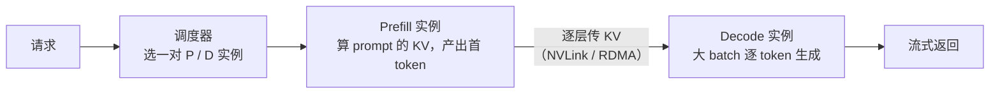

# 连续批处理与 Prefill / Decode 分离

> 层级：垂类 · inference · 预计 150 分钟 · 题目：[questions.md](questions.md)
> 前置：[01 KV Cache 与显存估算](../01-kv-cache-memory/README.md)（Prefill 与 Decode 两阶段、Decode 的带宽账、PagedAttention）

## 1 这一章解决什么问题

[第 01 章](../01-kv-cache-memory/README.md)算过：batch=1 时 Decode 每步都要读一遍全部权重，GPU 算力大部分闲着。要把吞吐做上去，就得把很多请求拼在一起跑。拼法不同，结果差很多。拼得不好，短请求被长请求拖住，长 prompt 让别人的输出卡顿。

最早的做法是静态批：凑够一批请求，一起跑到最后一个结束再返回。它有两个浪费，后面会算出来。2022 年的 Orca 改成按迭代调度，这就是今天所说的连续批处理。连续批处理又带来新问题：同一步里既有吃算力的 Prefill，又有吃带宽的 Decode，两者互相拖慢。Chunked Prefill 和 PD 分离是两条解法。

面试里这一块常见的问法是：“连续批处理比静态批好在哪”“Prefill 和 Decode 为什么要分开”“TTFT 和 TPOT 怎么权衡”“PD 分离要传多少 KV”。Agent 岗不要求你写调度器，但要能说清机制、算清账、说出取舍。

学完你应该能：

- 说清静态批的两个浪费，以及 Orca 的迭代级调度和 selective batching 怎么解决；
- 用算术强度解释 Prefill 受算力限制、Decode 受带宽限制，并推出两者混跑时谁拖慢谁、拖慢多少；
- 推导每步 token 预算怎样同时影响 TTFT 和 TPOT，找到“预算拐点”；
- 估算 PD 分离的 KV 传输量和所需带宽，说出什么时候值得分离；
- 用 TTFT、TPOT、ITL、goodput 描述服务目标，用排队论解释为什么利用率接近 100% 时延迟会爆炸；
- 写一个离散时间的调度模拟器，比较三种调度策略的延迟分布。

**本章符号**（后文沿用；模型和硬件的取值与第 01 章一致）：

| 符号 | 含义 | 本章取值 |
|---|---|---|
| N | 稠密模型参数量 | Qwen3-8B：8.2e9 |
| W | 权重字节，BF16 时 W = 2N | 16.4 GB |
| E_kv | 每 token 的 KV 字节，2·L·n_kv·d_h·s | 147,456 B（144 KiB） |
| L、n_h、n_kv、d_h | 层数、查询头数、KV 头数、头维度 | 36、32、8、128 |
| F、BW | GPU 稠密 BF16 算力、显存带宽 | H100 SXM：990 TFLOPS、3.35 TB/s |
| b | 一步里正在 Decode 的序列数 | |
| T | 一条序列的上下文长度 | |
| P | 一个请求的 prompt 长度 | |
| C | 每步 token 预算（vLLM 的 `max_num_batched_tokens`） | |
| R、D、ρ | 请求到达率、单个请求的服务时间、利用率 ρ = R·D | |

## 2 指标与服务目标

### 2.1 TTFT、TPOT、ITL

| 指标 | 定义 | 主要由谁决定 |
|---|---|---|
| TTFT（time to first token） | 请求到达到第一个 token 返回 | 排队时间 + Prefill 时间（PD 分离时再加 KV 传输） |
| TPOT（time per output token） | 一个请求首 token 之后的平均间隔：(总时延 − TTFT) / (输出长度 − 1) | Decode 单步时间 |
| ITL（inter-token latency） | 相邻两个 token 之间的每一个间隔 | 单步时间，以及有没有 Prefill 插队 |
| 吞吐 | 单位时间输出的 token 数或完成的请求数 | batch 大小、显存能放多少并发 |
| goodput | 满足 SLO 的请求速率，见 2.2 | 上面几项的折中 |

TPOT 和 ITL 不是一回事。vLLM 的压测脚本 `vllm/benchmarks/serve.py` 里，TPOT 按上表的公式每个请求算一个数，ITL 把每个间隔都记下来。一个输出 300 token 的请求，中间有一次 150 ms 的停顿，其余间隔 7 ms，TPOT 只有约 7.5 ms，ITL 的最大值却是 150 ms。用户看到的“卡了一下”只在 ITL 的尾部。Sarathi-Serve 论文把这个间隔叫 TBT（time-between-tokens），SLO 定在 P99 TBT 上。

DistServe 论文举例说，聊天机器人更看重 TTFT；TPOT 只要比人的阅读速度（约每分钟 250 词）快就够了。文档摘要则更看重 TPOT。Agent 每轮输出短、轮数多，TTFT 会被乘上轮数。

### 2.2 goodput

DistServe 的定义：**每张 GPU 的 goodput**，是在 SLO 达标率达到目标（例如 90% 的请求同时满足 TTFT 和 TPOT 目标）的前提下，每张 GPU 能承受的最大请求速率。吞吐只数做完了多少，goodput 只数“达标”的。吞吐很高但一半请求超时，goodput 并不高。

DistServe 开头的例子（论文报告，13B 模型，单张 A100）：Prefill 和 Decode 混跑时，90% 达标率下 goodput 约 1.6 请求/秒。只跑 Prefill 的卡能到 5.6 请求/秒，只跑 Decode 的卡能到 10 请求/秒。用 2 张卡做 Prefill、1 张做 Decode，整体 10 请求/秒，每卡 3.3 请求/秒，是混跑的 2.1 倍。

几个相近的口径要分清：

- Sarathi-Serve 用 **capacity**：满足延迟目标时系统能承受的最大请求速率（QPS），和 goodput 是同一类指标，只是不按 GPU 数归一。
- vLLM 压测脚本的 `--goodput ttft:… tpot:… e2el:…`（单位毫秒）算的是**在给定负载下**每秒完成的达标请求数（`good_completed / 时长`）。它是一个负载点上的值，不是“最大速率”。要得到 DistServe 意义上的 goodput，得扫请求速率，找达标率掉到目标以下的那个点。
- vLLM 脚本里 TPOT 是每个请求的平均值。用它做 SLO，停顿会被平均掉。第 6.5 节的模拟器会算出这个差别有多大。

### 2.3 排队论直觉：为什么利用率接近 100% 时 TTFT 爆炸

DistServe 把单张 Prefill 卡建模成 M/D/1 队列：请求按泊松过程到达，速率 R；每个请求的 Prefill 时间固定为 D；一次只做一个（长 prompt 一个就能吃满算力），先来先服务。利用率 ρ = R·D < 1 时，平均 TTFT 有闭式解：

```text
Avg_TTFT = D + R·D² / (2(1 − R·D))
         = D + D · ρ / (2(1 − ρ))
           ↑执行   ↑排队
```

排队项只取决于 ρ。ρ = 0.5 时排队 0.5D，ρ = 0.9 时 4.5D，ρ = 0.95 时 9.5D。所以“GPU 利用率打满”和“TTFT 达标”天然冲突：为了延迟，必须留余量。

同一篇论文用这个式子比较两张卡怎么并行。流水线并行（inter-op）把执行时间分到两段，容量翻倍；张量并行（intra-op）把执行时间缩短为 D/K，K 在 1 和 2 之间，表示通信造成的不完美加速：

```text
Avg_TTFT_inter = D + R·D² / (4(2 − R·D))
Avg_TTFT_intra = D/K + R·D² / (2K(K − R·D))
```

低负载时第一项（执行时间）占主导，张量并行更好；负载升高后排队项占主导，流水线并行更好。论文的结论是定性的。下面代码按 K = 1.6 算出交叉点约在 R·D ≈ 1.09（这是本章的推算）。

另一个常用工具是 **Little 定律**：系统里的平均请求数 = 到达率 × 平均停留时间。用在 Decode 上：同时在 Decode 的请求数 ≈ 到达率 × 平均输出长度 × TPOT。4 请求/秒、平均输出 288 token、TPOT 7 ms，同时在跑的只有约 8 条。batch 大小不是你想设多大就多大，它由负载决定；`max_num_seqs` 只是上限。

下面的代码用 Lindley 递推模拟 M/D/1 队列，assert 平均 TTFT 和闭式解差不到 5%，并用随机抽样验证 Little 定律。

```python
import numpy as np

rng = np.random.default_rng(0)


def md1_sim(R, D, n=300_000):
    """单卡 Prefill 实例：泊松到达（速率 R），每个请求固定耗时 D，先来先服务、不拼 batch。
    用 Lindley 递推算等待时间：W_{k+1} = max(0, W_k + D − 到达间隔)。返回到达、离开时刻。"""
    gaps = rng.exponential(1 / R, n)
    arrive = np.cumsum(gaps)
    wait = np.zeros(n)
    for k in range(1, n):
        wait[k] = max(0.0, wait[k - 1] + D - gaps[k])
    return arrive, arrive + wait + D


def md1_formula(R, D):
    """DistServe 式 (1)：平均 TTFT = D + R·D² / (2(1 − R·D))。"""
    return D + R * D * D / (2 * (1 - R * D))


D = 0.1                                          # 每个请求的 Prefill 时间 100 ms
for rho in (0.5, 0.8, 0.9):                      # 利用率 ρ = R·D
    a, d = md1_sim(rho / D, D)
    sim = (d - a).mean()
    assert abs(sim / md1_formula(rho / D, D) - 1) < 0.05
    # Little 定律：系统里的平均请求数 = 到达率 × 平均停留时间。随机抽时刻数“已到未走”的请求来验证
    t = rng.uniform(a[1000], a[-1000], 20_000)
    in_sys = np.searchsorted(a, t) - np.searchsorted(d, t)   # FCFS 下离开时刻也是有序的
    assert abs(in_sys.mean() / (rho / D * sim) - 1) < 0.05

# 排队项是 D·ρ/(2(1−ρ))：ρ 从 0.5 到 0.9，排队从 0.5D 涨到 4.5D；0.95 时 9.5D
queue = lambda rho: rho / (2 * (1 - rho))
assert queue(0.5) == 0.5 and round(queue(0.9), 6) == 4.5 and round(queue(0.95), 6) == 9.5


# DistServe 式 (2)(3)：两张卡做 Prefill，流水线并行（inter-op）还是张量并行（intra-op，加速系数 K）
def inter(R, D):
    return D + R * D * D / (4 * (2 - R * D))


def intra(R, D, K):
    return D / K + R * D * D / (2 * K * (K - R * D))


K = 1.6
assert intra(0.5, D, K) < inter(0.5, D)          # 低负载：张量并行把执行时间砍掉，TTFT 更短
assert intra(14, D, K) > inter(14, D)            # 高负载（R·D=1.4）：流水线并行容量更大，排队更短
cross = next(r / 100 for r in range(1, 1600) if intra(r / 100, D, K) > inter(r / 100, D))
print(f"K={K} 时，请求率超过 {cross:.2f}/s（R·D≈{cross*D:.2f}）后流水线并行的平均 TTFT 更低")
assert 1.0 < cross * D < 1.4

# Little 定律用在 Decode 上：同时在 Decode 的请求数 ≈ 到达率 × 输出长度 × TPOT
lam, out_len, tpot = 4.0, 288, 0.007
assert round(lam * out_len * tpot) == 8          # 4 请求/秒、平均输出 288 token、TPOT 7 ms → batch 只有约 8
```

## 3 静态批与连续批处理

### 3.1 静态批的两种浪费

静态批（请求级调度）把一批请求一起送进模型，跑到整批都结束才返回。生成长度差异很大，所以有两种浪费：

- **早结束的请求空占位置。** 一批里输出长度是 10、100、1000，整批要跑 1000 步。3 × 1000 = 3000 个 Decode 位置里，有用的只有 1110 个，占 37%（下面代码算出）。剩下的位置要么算无用的 token，要么空着，GPU 照样要读一遍权重。
- **新请求要等整批跑完。** 新请求到达时，前一批可能才跑到一半。它的 TTFT 里多了一段“等前一批结束”的时间，负载越高越长。

还有一个隐性的浪费：一批里的 prompt 长度不同，要补齐到最长的那条才能拼成规整的 `[B, L, H]` 张量，补齐的位置也要算。

### 3.2 迭代级调度

Orca（OSDI 2022）把调度粒度从“一个请求”改成“一次迭代”。一次迭代是模型跑一遍所有层，给 batch 里每个请求产出一个 token（Prefill 中的请求是处理完它的输入）。调度器每次只让引擎跑一次迭代，结束后：

1. 已经结束的请求立刻返回，释放位置；
2. 等待队列里的新请求立刻加入；
3. 下一次迭代用新的 batch 组合。

Orca 的调度算法（论文 Algorithm 1）很简单。它保证“迭代级先来先服务”：先到的请求跑过的迭代数不少于后到的。它有两个约束：

- `max_bs`：一个 batch 最多几条请求。batch 越大吞吐越高但单步越慢，收益递减，所以要设上限，由运维按延迟目标调。
- `n_slots`：KV 管理器预留的槽位数，一个槽存一个 token 的 K 和 V。请求第一次被调度时，Orca 按它的 `max_tokens` 一次性预留槽位，预留不下就不接。这样保证请求一旦开始就不会因为显存不够卡死。

第二个约束就是 PagedAttention 要解决的问题：按最大长度预留，实际用不完的部分全浪费。vLLM 改成按块按需分配，代价是显存不够时要抢占（见[第 01 章第 5 节](../01-kv-cache-memory/README.md#5-pagedattention)）。

### 3.3 selective batching：为什么不同长度的请求能拼进一步

迭代级调度之后，同一步里的请求状态各不相同。Orca 论文列了三种没法按传统方式拼 batch 的情况：

1. 两个请求都在 Prefill，但输入 token 数不同；
2. 两个请求都在 Decode，但当前位置不同，KV 的长度不同；
3. 一个在 Prefill，一个在 Decode，输入 token 数一个是 P，一个是 1。

传统 batch 要求每个请求的张量形状相同，三种情况都不满足。Orca 的观察是：只有注意力需要知道“哪些 token 属于同一个请求”。

- **Linear、LayerNorm、残差相加、GeLU** 是逐 token 的运算，不关心 token 属于谁。把所有请求的 token 拉平成 `[ΣL, H]` 一起算即可。ΣL 是这一步所有请求的 token 数之和，H 是隐藏维度。
- **注意力**要让每个 token 只看自己请求的历史。Orca 在注意力前插一个 Split，把 `[ΣL, H]` 按请求切开，每个请求和自己的 KV 分别算注意力，再用 Merge 拼回 `[ΣL, H]`。

为什么拆开注意力损失不大？论文的理由：注意力不涉及模型参数。拼 batch 的收益来自“读一次权重，服务多个 token”。注意力读的是每个请求自己的 KV，拼不拼都要各读各的，拼了也省不了读取。省读取的是 Linear，而 Linear 仍然拼在一起。今天的引擎更进一步，用变长注意力 kernel（如 FlashAttention 的 varlen 接口）在一个 kernel 里按请求边界算，不再逐个请求启动 kernel，但原理相同。

论文报告：GPT-3 175B 上，中位归一化延迟同为 190 ms 时，FasterTransformer 的吞吐是 0.185 请求/秒，Orca 是 6.81 请求/秒，36.9 倍。

### 3.4 实现：selective batching 和逐个请求算的结果相同

下面用 numpy 写一个 Transformer 层，分别按“每个请求单独算”和“selective batching”算 Orca 论文图 4 的例子：x1、x2 在 Decode（已缓存 3 个和 1 个 token），x3、x4 在 Prefill（2 个和 3 个 token）。代码 assert 两种算法逐元素相同，并数权重读取次数。

```python
import numpy as np

rng = np.random.default_rng(0)
H, n_h = 64, 4                    # 隐藏维、头数
d_h = H // n_h
Wq, Wk, Wv, Wo = (rng.normal(0, H ** -0.5, (H, H)) for _ in range(4))
W1, W2 = rng.normal(0, H ** -0.5, (H, 4 * H)), rng.normal(0, (4 * H) ** -0.5, (4 * H, H))
READS = [0]                       # 读了多少个权重元素


def linear(x, w):
    READS[0] += w.size            # 一次矩阵乘读一遍权重，不管 x 有多少行
    return x @ w


def attend(q, k, v, start):
    """一个请求的因果注意力。q: (t, H) 是新 token，位置从 start 开始；k, v: (start+t, H)。"""
    t, T = q.shape[0], k.shape[0]
    split = lambda m: m.reshape(m.shape[0], n_h, d_h).transpose(1, 0, 2)     # → (n_h, ·, d_h)
    s = split(q) @ split(k).transpose(0, 2, 1) / np.sqrt(d_h)                 # (n_h, t, T)
    s = np.where(np.arange(T)[None, :] > (start + np.arange(t))[:, None], -np.inf, s)
    a = np.exp(s - s.max(-1, keepdims=True))
    a /= a.sum(-1, keepdims=True)
    return (a @ split(v)).transpose(1, 0, 2).reshape(t, H)


def layer_one(x, cache):
    """参考做法：一个请求单独过一层。cache: dict(k, v)，形状 (已缓存, H)。"""
    k = np.concatenate([cache["k"], linear(x, Wk)])
    v = np.concatenate([cache["v"], linear(x, Wv)])
    h = x + linear(attend(linear(x, Wq), k, v, len(cache["k"])), Wo)
    return h + linear(np.maximum(linear(h, W1), 0), W2)


def layer_selective(xs, caches):
    """selective batching：所有请求的 token 拉平成 [ΣL, H] 过线性层，只在注意力处按请求拆开。"""
    lens = [len(x) for x in xs]
    X = np.concatenate(xs)                                    # [ΣL, H]
    Q, K, V = linear(X, Wq), linear(X, Wk), linear(X, Wv)     # 每个权重只读一次
    cut = np.cumsum(lens)[:-1]
    outs = []
    for q, k, v, c in zip(np.split(Q, cut), np.split(K, cut), np.split(V, cut), caches):   # Split
        outs.append(attend(q, np.concatenate([c["k"], k]), np.concatenate([c["v"], v]), len(c["k"])))
    Hh = X + linear(np.concatenate(outs), Wo)                 # Merge 回 [ΣL, H]
    return np.split(Hh + linear(np.maximum(linear(Hh, W1), 0), W2), cut)


# Orca 论文图 4 的例子：x1、x2 在 Decode（已缓存 3 个和 1 个 token），x3、x4 在 Prefill（2 个和 3 个 token）
cached = [3, 1, 0, 0]
new = [1, 1, 2, 3]
caches = [dict(k=rng.normal(size=(c, H)), v=rng.normal(size=(c, H))) for c in cached]
xs = [rng.normal(size=(n, H)) for n in new]

READS[0] = 0
ref = [layer_one(x, c) for x, c in zip(xs, caches)]
reads_one = READS[0]
READS[0] = 0
out = layer_selective(xs, caches)
reads_sel = READS[0]

assert sum(new) == 7                                          # 拉平后是 [7, H]
assert all(np.allclose(a, b) for a, b in zip(out, ref))       # 结果和逐个请求算完全一致
assert reads_one == 4 * reads_sel                             # 4 个请求共用一次权重读取
# 规整的 [B, L, H] 要按最长的 3 个 token 补齐：12 个位置里只有 7 个有用；
# 而且 x1、x2 的 KV 长度不同（4 和 2），注意力那一步本来就没法拼成一个规整张量
assert len(new) * max(new) == 12

# 静态批的第一种浪费：整批陪最长的请求跑
out_lens = np.array([10, 100, 1000])
useful = out_lens.sum() / (len(out_lens) * out_lens.max())
print(f"静态批里有用的 Decode 位置占 {useful:.0%}")
assert round(useful, 2) == 0.37
```

读代码时看三处：

- `layer_selective` 里 Q、K、V 投影和 MLP 都只调用一次 `linear`，输入是 `[7, H]`；只有 `attend` 按请求循环。
- `attend` 的 `start` 参数是这个请求已缓存的长度。Decode 请求的新 token 位置是 `start`，Prefill 请求 `start = 0`。Chunked Prefill 的后续块也是同一个函数，`start` 等于前面块的总长度。
- 第三个 assert 说明：4 个请求共用一次权重读取。Decode 受带宽限制，这就是连续批处理提吞吐的来源。

### 3.5 代价

- 每次迭代都要重新调度。调度器在 CPU 上跑，一步只有几毫秒，调度本身不能慢，否则 GPU 等 CPU。
- 新请求加入时显存要能接住它的 KV。按最大长度预留（Orca）会浪费，按需分配（PagedAttention）会遇到中途显存不够，要抢占。被抢占的请求要么把 KV 换到 CPU，要么丢掉后重算。vLLM V1 默认重算（vLLM 文档）。长上下文的 Agent 请求重算代价很大。
- Prefill 和 Decode 混在同一步，互相干扰。这是第 5 节的主题。

连续批处理（continuous batching）就是这种迭代级调度的通称。今天的主流引擎都默认这样做。

## 4 Prefill 与 Decode 的计算特点

### 4.1 算术强度：从一步的账推出瓶颈

判断一个阶段受算力还是带宽限制，看算术强度 I：每从显存读 1 字节，做多少次浮点运算。I 高于硬件的“算力 / 带宽”比值，就受算力限制；低于它，就受带宽限制。

硬件比值：

```text
H100 SXM 官方标称：BF16 1,979 TFLOPS（标注 with sparsity，稠密约一半，≈ 990 TFLOPS）
                  显存带宽 3.35 TB/s
硬件比值 F / BW ≈ 990e12 / 3.35e12 ≈ 295 FLOPs/字节
```

一步的账只看线性层（注意力和 KV 的完整式子见[第 01 章第 2.3 节](../01-kv-cache-memory/README.md#23-每步读写多少字节为什么-decode-受带宽限制)）：

```text
稠密模型每个 token 过一遍线性层 ≈ 2N FLOPs（每个参数一次乘加）
BF16 权重 W = 2N 字节，每步读一遍，这一步所有 token 共用

一步处理 n 个 token（Prefill 的 prompt 长度，或 Decode 的 batch 大小 b）：
  计算 ≈ 2N·n
  读权重 ≈ 2N 字节
  I ≈ n FLOPs/字节（不计 KV 读写）
```

| 阶段 | 一步的 n | 算术强度 | 结论 |
|---|---|---|---|
| Prefill，prompt 2,000 token | 2,000 | ≈ 2,000 | 远高于 295，受算力限制 |
| Decode，batch=1 | 1 | ≈ 1 | 受带宽限制，算力几乎全闲 |
| Decode，batch=64 | 64 | ≈ 64 | 仍受带宽限制 |
| Decode，batch≈300 | 300 | ≈ 300 | 只看权重时接近吃满算力 |

用 Qwen3-8B（8.2B 参数）算两个下界：

```text
Prefill 2,000 token：2 × 8.2e9 × 2,000 / 990e12 ≈ 33 ms（按 100% 利用率，实际更慢）
Decode 一步（batch=1）：16.4 GB / 3.35 TB/s ≈ 4.9 ms
```

上表最后一行只在上下文很短时成立。第 01 章推过：每条序列都要读自己的 KV，batch 越大 KV 读取越多。b → ∞ 时权重被摊薄，强度趋向一个上限：

```text
I_max(T) = (2N + 4·L·n_h·d_h·T) / (T · E_kv)
```

Qwen3-8B 上，T = 4,096 时 I_max ≈ 31，T = 32K 时约 7.4。所以长上下文时，Decode 加多大 batch 都到不了 295。

论文里的实测和这个推导一致。Sarathi 在 LLaMA-13B、A6000 上测到：Prefill 在 batch=1 时就吃满算力，Decode 的吞吐随 batch 线性增长。Sarathi-Serve 的脚注说，A100 上理论上约 200 token 就进入算力受限，但张量并行度高时实测要 500 到 600 token（论文报告），因为有固定开销。

### 4.2 混跑一步：谁拖慢谁

把 b 个 Decode token 和一个 c 个 token 的 Prefill 块放进同一步。roofline 近似下，一步的时间是算力下界和带宽下界取大：

```text
t_step = max( 2N·(b + c) / F ,  (W + E_kv·Σctx + E_kv·c) / BW )
               ↑线性层的计算         ↑权重只读一遍 + 各序列的 KV
```

Σctx 是 b 条 Decode 序列的上下文长度之和。这个式子有一个拐点：c 小时右边大，一步受带宽限制，多塞 Prefill token 几乎不加时间；c 大到让左边超过右边后，一步的时间随 c 线性增长。忽略 Prefill 块自己的 KV 和注意力，拐点在：

```text
b + c* ≈ (F / BW) · (W + E_kv·Σctx) / (2N) = 295 × (1 + E_kv·Σctx / W)
```

推导出的两个结论：

1. **拐点以下，Prefill 是在“搭便车”。** Decode 反正要读一遍权重，这时算力闲着，塞进去的 Prefill token 用的是闲置算力。Sarathi 的 decode-maximal batching 就是这个思路，只是论文的说法反过来：Prefill 块吃满算力，Decode 搭 Prefill 的便车。论文报告（LLaMA-13B，A6000）：单独跑 Decode 时每个 token 12.49 ms，和一个 Prefill 块混跑时只要 1.2 ms。
2. **拐点以上，Decode 被拖慢。** 整段 8K 的 Prefill 塞进一步，这一步所有 Decode 请求都要等它算完。DistServe 论文图 2 测到的就是这个现象：往一批 Decode 里加一个 Prefill，两者都变慢，Prefill 越长 Decode 越慢。

下面的代码把这些式子都算一遍。场景：63 条序列在 Decode，上下文各 1,000；来一个 512 token 的块，或者一整段 8K。

```python
# Qwen3-8B 的形状（inference/01 第 3.3 节），硬件取 H100 SXM 标称值
N, L, n_h, n_kv, d_h, s = 8.2e9, 36, 32, 8, 128, 2
PEAK, BW = 990e12, 3.35e12                 # 稠密 BF16 FLOP/s，显存带宽 B/s
W = s * N                                  # 权重字节
E_KV = 2 * L * n_kv * d_h * s              # 每 token KV 字节 = 147,456
RIDGE = PEAK / BW                          # 硬件比值，FLOP/B


def decode_step(b, T):
    """b 条序列各解码 1 个 token，每条上下文 T。返回 (FLOPs, 读字节)，式子同 inference/01 第 2.3 节。"""
    return b * (2 * N + 4 * L * n_h * d_h * T), W + b * T * E_KV


def prefill_step(P, start=0):
    """一个请求的 P 个 prompt token（从位置 start 开始，start>0 就是后面的块）。"""
    flops = 2 * N * P + 4 * L * n_h * d_h * sum(range(start + 1, start + P + 1))   # 因果：第 i 个 token 看 i 个
    return flops, W + (start + P) * E_KV   # 读权重，加上这一块注意力要读的 KV（含前面块的）


def t_lower(flops, nbytes):
    """roofline 下界：算力和带宽谁慢听谁的（假设两者完全重叠）。"""
    return max(flops / PEAK, nbytes / BW)


I = lambda fb: fb[0] / fb[1]

# 1) 硬件比值：稠密算力取标称 with sparsity 值的一半
assert 290 < RIDGE < 300
# 2) 短上下文时 Decode 的强度约等于 batch，batch≈295 才碰到硬件比值
assert 0.99 < I(decode_step(1, 1)) < 1.01 and 63 < I(decode_step(64, 1)) < 65
b_ridge = next(b for b in range(1, 1000) if I(decode_step(b, 1)) >= RIDGE)
assert 290 < b_ridge < 300
# 3) 上下文 4K 时，batch 再大强度也有上限：b→∞ 时权重被摊薄，只剩 KV 读取
T = 4096
limit = (2 * N + 4 * L * n_h * d_h * T) / (T * E_KV)      # ≈ 31：线性层摊到每个 KV 字节 + 注意力的 n_h/n_kv
assert 31 < limit < 32 and all(I(decode_step(b, T)) < limit for b in (64, 256, 1024, 4096))
assert I(decode_step(4096, 32768)) < 8                     # 32K 上下文时只有约 7
# 4) Prefill 一个 512 token 的块，强度已经超过硬件比值；2,000 token 时约 2,000
assert I(prefill_step(512)) > RIDGE and 1900 < I(prefill_step(2000)) < 2100
# 5) 正文的两个下界：Prefill 2,000 token ≈ 33 ms（只算线性层），batch=1 的一步 Decode ≈ 4.9 ms
assert round(2 * N * 2000 / PEAK * 1e3) == 33 and round(W / BW * 1e3, 1) == 4.9

# 6) 混跑：63 条序列在 Decode（上下文各 1,000），再来一个新请求
dec = decode_step(63, 1000)
t_dec = t_lower(*dec)
for P, name in ((512, "512 token 的块"), (8192, "整段 8K Prefill")):
    pre = prefill_step(P)
    t_mix = t_lower(dec[0] + pre[0], dec[1] + pre[1] - W)      # 权重只读一遍
    t_sep = t_dec + t_lower(*pre)
    print(f"{name}: 纯 Decode {t_dec*1e3:.1f} ms，分开跑 {t_sep*1e3:.1f} ms，混在一步 {t_mix*1e3:.1f} ms，"
          f"这一步 Decode 被拖慢 {t_mix / t_dec:.1f} 倍")
    if P == 512:
        assert t_mix < 0.65 * t_sep                 # 搭便车：混跑比分开跑省三成以上
        assert t_mix / t_dec < 1.4                  # Decode 只慢了不到 40%
    else:
        assert t_mix / t_dec > 15                   # 整段 8K 插进来，这一步慢 15 倍以上

# 7) 切块的额外代价：8K 切成 16 块 512，后面的块要重读前面块的 KV
chunks = [prefill_step(512, start=512 * i) for i in range(16)]
extra_kv = sum(c[1] - W for c in chunks) - 8192 * E_KV
assert extra_kv == 512 * sum(range(16)) * E_KV           # 第 i 块重读前 i 块：共 120 块次
assert 9.0e9 < extra_kv < 9.1e9                          # 约 9 GB 额外读取
assert sum(c[0] for c in chunks) == prefill_step(8192)[0]  # 总计算量一个 FLOP 不差
t_chunked = sum(t_lower(*c) for c in chunks)             # 但每块都要再读一遍权重
assert 1.0 < t_chunked / t_lower(*prefill_step(8192)) < 1.05   # 在这组参数下只慢几个百分点
```

运行结果：

| 这一步放什么 | 一步耗时 | 相对纯 Decode |
|---|---|---|
| 纯 Decode（63 条） | 7.7 ms | 1 |
| Decode + 512 token 的块 | 9.6 ms | 1.3 倍；分开跑要 16.2 ms |
| Decode + 整段 8K Prefill | 156.8 ms | 20.4 倍 |

最后三个 assert 是 Chunked Prefill 代价的定量版：8K 切成 16 块，后面的块要重读前面块的 KV，共多读约 9 GB；总计算量一个 FLOP 不差；每块还要多读一遍权重。在这组参数下，切块后的 Prefill 总时间只比整段慢几个百分点，因为每块仍受算力限制。

## 5 干扰从哪来

连续批处理下，一次迭代里可能同时有新请求的 Prefill 和老请求的 Decode。调度器每一步都要决定：先接新请求的 Prefill，还是先保证老请求的 Decode。Sarathi-Serve 论文把当时的调度器分成两类：

| 类型 | 代表（论文的归类） | 做法 | 结果 |
|---|---|---|---|
| Prefill 优先 | Orca、当时的 vLLM | 有新请求就尽快把它的整段 Prefill 放进来 | Decode batch 大、吞吐高；但长 Prefill 那一步所有 Decode 都卡住，论文叫 **generation stall** |
| Decode 优先 | FasterTransformer | 当前这批 Decode 跑完才接新请求 | 没有停顿，TBT 稳；但新请求排队久，TTFT 长，batch 小，吞吐低 |

两类调度在 TTFT 和 TBT 之间二选一。第 4.2 节的式子说明了原因：整段 Prefill 远远超过拐点。Sarathi-Serve 论文报告，朴素的混合批（整段 Prefill 加 Decode）会让 TBT 比纯 Decode 最多高 28.3 倍。

现象上的区别：

- Prefill 优先时，用户看到输出“流着流着停一下”，停的长度约等于别人一整段 Prefill 的时间。平均 TPOT 看不出来，ITL 的 P99 和最大值能看出来。
- Decode 优先时，用户看到“迟迟不出第一个字”，TTFT 的尾部很长。

解决干扰有两条路：在同一实例里把 Prefill 切到拐点附近（第 6 节 Chunked Prefill），或者把两阶段放到不同实例上（第 7 节 PD 分离）。

## 6 Chunked Prefill

### 6.1 做法

**Sarathi（2023）** 有两个部件：

- **chunked prefills**：把一个 prompt 的 Prefill 切成大小相近的块，每一步只做一块。第 k 块的查询要看前面所有块的 K、V 加上本块内的因果部分，注意力 mask 按这个设置，结果和一次做完整段在数学上等价。第 3.4 节代码里的 `attend(q, k, v, start)` 就是这个计算，`start` 是前面块的总长度。
- **decode-maximal batching**：一步里放一个 Prefill 块，剩下的位置全部填 Decode。线性层把块和 Decode token 融合成一次矩阵乘，注意力分开算。Decode 能放多少由显存决定：论文给出 B = ⌊(M_G − M_S) / (L·m_kv)⌋，M_G 是可用显存，M_S 是参数占的显存，L 是最大序列长度，m_kv 是每 token 的 KV。Prefill 中的请求也要占 KV，所以 Decode 最多 B − 1 条。

**Sarathi-Serve（2024）** 在此基础上提出 **stall-free batching**（论文 Algorithm 3）。先按 TBT 的 SLO 定一个每步 token 预算 τ，每步按顺序：

1. 放所有正在 Decode 的请求，每条 1 个 token；
2. 放切了一半的 Prefill，块大小 = 剩余预算；
3. 预算还有剩，才接新请求，同样按剩余预算切块。

和 Orca、当时的 vLLM 相比，区别在于新请求加入时不暂停正在进行的 Decode，每一步的计算量都被预算封顶。

**vLLM V1** 的调度和这个一致（vLLM 文档 Optimization and Tuning）：默认开启 chunked prefill；先放全部待处理的 Decode，再用 `max_num_batched_tokens` 的剩余额度放 Prefill，放不下就切块。文档说，把 `max_num_batched_tokens` 设成和 `max_model_len` 一样大，几乎等于 V0 的默认调度（只是仍然优先 Decode）。

### 6.2 token 预算怎样同时影响 TTFT 和 TPOT

预算 C 是一步里 Decode token 和 Prefill 块的总数。b 条请求在 Decode 时，一步能放的 Prefill 块是 c = C − b。用第 4.2 节的式子：

```text
一条 P token 的 prompt 要 ⌈P / (C − b)⌉ 步做完
TTFT ≈ 排队 + Σ 每一步的 t_step(b, c)
这期间 Decode 每一步的间隔 = t_step(b, c)
```

分两段看：

- **C 在拐点以下**：t_step 几乎不随 c 变，约等于纯 Decode 的一步。Decode 不受影响；但每步只做 c 个 Prefill token，步数是 P / c，TTFT 随 C 近似反比下降。
- **C 在拐点以上**：t_step 随 c 线性增长。TTFT 不再明显变短，因为 Prefill 已经受算力限制，总时间约等于 2N·P / F；Decode 的每一步却线性变长。

所以最好的预算在拐点附近：再小 TTFT 白白变长，再大 TPOT 白白变差。拐点 ≈ 295 × (1 + KV 读取 / 权重读取)，KV 读取越多，拐点越高。下面代码在 63 条 Decode、每条上下文 1,000 的场景下扫预算，拐点约 465 token。

```python
import math

# 同一个场景：63 条请求在 Decode（上下文各 1,000），来了一条 8,192 token 的新请求
N, L, n_h, d_h = 8.2e9, 36, 32, 128
PEAK, BW, W, E_KV = 990e12, 3.35e12, 2 * 8.2e9, 147_456
ATT = 4 * L * n_h * d_h
B, CTX, P = 63, 1000, 8192


def step(budget, start):
    """一步：63 个 Decode token + 一块 c = budget − 63 个 Prefill token（从位置 start 开始）。"""
    c = min(budget - B, P - start)
    flops = 2 * N * (B + c) + ATT * (B * CTX + sum(range(start + 1, start + c + 1)))
    nbytes = W + E_KV * (B * CTX + start + c)
    return max(flops / PEAK, nbytes / BW), c


def run(budget):
    t, start, worst = 0.0, 0, 0.0
    while start < P:
        dt, c = step(budget, start)
        t, start, worst = t + dt, start + c, max(worst, dt)
    return t, worst                      # (新请求的 TTFT, 老请求这段时间里最长的一步)


# 拐点：一步的计算时间追上带宽时间。之前多塞 Prefill token 几乎不加时间，之后线性加
t_mem = (W + E_KV * B * CTX) / BW
knee = t_mem * PEAK / (2 * N)
assert 460 < knee < 470                  # ≈ 硬件比值 295 ×（1 + KV 读取 / 权重读取）
assert abs(knee - PEAK / BW * (1 + E_KV * B * CTX / W)) < 1

rows = {b: run(b) for b in (128, 256, 512, 1024, 2048, 8192 + B)}
for b, (ttft, worst) in rows.items():
    print(f"预算 {b:5d}：新请求 TTFT {ttft*1e3:6.1f} ms，Decode 最长一步 {worst*1e3:6.1f} ms")
ttft = {b: r[0] for b, r in rows.items()}
worst = {b: r[1] for b, r in rows.items()}
assert ttft[128] > 3 * ttft[512]                            # 拐点以下：TTFT 随预算近似反比下降
assert ttft[1024] / ttft[8192 + B] < 1.1                    # 拐点以上：TTFT 几乎不再变短
assert worst[256] < 1.3 * t_mem                             # 拐点以下：Decode 的一步几乎不变慢
assert 1.9 < worst[2048] / worst[1024] < 2.1               # 拐点以上：预算翻倍，一步的时间也翻倍
assert worst[8192 + B] > 10 * worst[512]                    # 整段塞进一步：卡住 Decode 一百多毫秒
assert math.ceil(P / (512 - B)) == 19                       # 预算 512 时这条 prompt 要分 19 步
```

| 预算 C | 新请求 TTFT | 这段时间里 Decode 最长的一步 |
|---|---|---|
| 128 | 997 ms | 8.0 ms |
| 256 | 338 ms | 8.0 ms |
| 512 | 181 ms | 10.6 ms |
| 1,024 | 165 ms | 21.1 ms |
| 2,048 | 163 ms | 42.2 ms |
| 8,255（整段） | 157 ms | 156.8 ms |

这和 vLLM 文档的调参建议方向一致：预算小（文档举例 2048），Prefill 对 Decode 的拖慢少，ITL 更好；预算大，一步能放更多 Prefill，TTFT 更短；追求吞吐时文档建议设到 8192 以上，特别是大卡上的小模型。文档给的 2048 比这里算出的拐点大，原因有两个：真实 kernel 有固定开销，实测的拐点比 roofline 估的高（Sarathi-Serve 报告高张量并行度下要 500 到 600 token）；而且 Decode 的 batch 和上下文一大，拐点也跟着升高。

### 6.3 块大小的其他考量

Sarathi 和 Sarathi-Serve 论文还列了几条：

- **重读 KV。** 切成 n 块时，第一块的 KV 被读 n − 1 次，第二块 n − 2 次，以此类推。计算量不变，读取量增加。论文发现块不太小时注意力仍受算力限制，这部分开销不大。第 4.2 节代码算出，8K 切 16 块多读约 9 GB，总时间只多几个百分点。
- **tile 量化。** GPU 把矩阵乘切成 tile 并行算，矩阵维度不是 tile 的整数倍时，有的线程块做无用功。Sarathi 报告（LLaMA-13B，A6000，tile 128）：序列长度从 128 到 256，一次迭代从 55 ms 到 69.8 ms；再加 1 个 token 到 257，跳到 92.33 ms，多了 32%。所以论文建议让“块大小 + Decode token 数”是 tile 的整数倍。例如块 256、最大 batch B 时，块取 256 − (B − 1)。
- **P:D 比。** Sarathi 定义 P:D 为一个 batch 里 Prefill token 和 Decode token 的比值。块越小，同一条 prompt 能带的 Decode 越多。论文的例子：batch 4（1 条 Prefill、3 条 Decode）、块 128 时，一条 P token 的 prompt 能带 P/128 × 3 ≈ P/42 个 Decode，所以 P:D > 42 时所有 Decode 都能搭便车。
- **流水线并行的气泡。** 每步的计算量不一致时，流水线各级等待，出现气泡。Sarathi-Serve 指出块大会加大步间差异，导致气泡；块太小又有固定开销。预算封顶让每步的计算量接近，这是它在流水线并行上收益大的原因。
- **预算要实测定。** Sarathi-Serve 用 Vidur（推理性能模拟器）按 TBT SLO、并行配置和硬件搜预算。

### 6.4 论文报告的收益

| 论文 | 设置 | 报告结果 |
|---|---|---|
| Sarathi | LLaMA-13B，A6000 | Decode 吞吐最高 10 倍，端到端吞吐最高 1.33 倍 |
| Sarathi-Serve | Mistral-7B，单张 A100，P99 TBT 约束下 | 服务容量是 vLLM 的 2.6 倍 |
| Sarathi-Serve | Yi-34B，两张 A100 | 最高 3.7 倍 |
| Sarathi-Serve | Falcon-180B，流水线并行 | 端到端服务容量最高 5.6 倍 |

Sarathi-Serve 的 SLO 怎么定：P99 TBT 等于“没有 Prefill 干扰时一次 Decode 迭代时间”（prefill 4K、batch 32）的 5 倍（严格）或 25 倍（宽松）。例如 Mistral-7B 的严格 SLO 是 0.1 s，宽松是 0.5 s。

### 6.5 实现：离散时间的调度模拟器

下面的模拟器把前面的式子串起来。每一步的耗时用第 4.2 节的 roofline 式子算，加 0.5 ms 固定开销（假设值）。负载是泊松到达，20% 的请求带 8,192 token 的长 prompt，其余 512；输出 64 到 512 token。KV 容量取第 01 章算的单卡 35 万 token，按最终长度预留，不做抢占。

三种策略：

- `static`：凑最多 16 条，按最长 prompt 补齐后一起 Prefill，整批跑到最长的输出结束。
- `continuous`：迭代级调度，新请求整段 Prefill 混进来（Orca 式）。
- `chunked-512`：迭代级调度，每步预算 512，先 Decode 后 Prefill（vLLM V1 式）。

指标按第 2 节的定义算：TTFT、每个请求的 TPOT（vLLM 口径），再加每个请求“最长的一次停顿”，即 ITL 的最大值。

```python
import numpy as np

# Qwen3-8B（BF16）在一张 H100 SXM 上的 roofline 近似；常数和 inference/01 第 3.3 节一致
N = 8.2e9                       # 参数量
W = 2 * N                       # 权重字节
E_KV = 147_456                  # 每 token KV 字节
PEAK, BW = 990e12, 3.35e12      # 稠密 BF16 FLOP/s，显存带宽 B/s
T0 = 0.5e-3                     # 每步固定开销（调度、kernel 启动），假设值
KV_CAP = 350_000                # 单卡能放的 KV token 数（inference/01 第 3.3 节）


def step_time(n_tok, kv_read):
    """一步耗时 = max(算力下界, 带宽下界) + 固定开销。
    n_tok：这一步过线性层的 token 数；kv_read：注意力要读的 KV token 总数。"""
    return max(2 * N * n_tok / PEAK, (W + E_KV * kv_read) / BW) + T0


def workload(n, rate, seed=0):
    """泊松到达；20% 长 prompt（8,192），其余 512；输出 64~512 token。"""
    rng = np.random.default_rng(seed)
    t = np.cumsum(rng.exponential(1 / rate, n))
    P = np.where(rng.random(n) < 0.2, 8192, 512)
    O = rng.integers(64, 513, n)
    return [dict(id=i, t=float(t[i]), P=int(P[i]), O=int(O[i])) for i in range(n)]


def run_static(reqs, bs=16):
    """请求级调度：凑一批，按最长 prompt 填充后一起 Prefill，跑到整批最长的输出结束。"""
    wait, now, out = list(reqs), 0.0, {}
    while wait:
        now = max(now, wait[0]["t"])
        batch = [r for r in wait if r["t"] <= now][:bs]
        for r in batch:
            wait.remove(r)
        B, pmax, omax = len(batch), max(r["P"] for r in batch), max(r["O"] for r in batch)
        now += step_time(B * pmax, 0)
        st = {r["id"]: [now] for r in batch}
        for k in range(1, omax):
            now += step_time(B, B * (pmax + k))          # 早结束的请求也陪着跑
            for r in batch:
                if len(st[r["id"]]) < r["O"]:
                    st[r["id"]].append(now)
        for r in batch:                                  # 按流式记每个 token 的时刻；不流式时要等整批结束
            out[r["id"]] = st[r["id"]]
    return out


def run_iter(reqs, budget=None, max_seqs=64):
    """迭代级调度。budget=None：新请求整段 Prefill（Orca 式混合批）；
    budget=整数：每步 token 预算，先放 Decode，再续做未完成的 Prefill，最后接新请求（vLLM V1 式）。"""
    wait, run, now, out, kv = list(reqs), [], 0.0, {}, 0
    cap = budget or 10**12
    while wait or run:
        if not run and wait[0]["t"] > now:
            now = wait[0]["t"]                           # 空闲时跳到下一个到达
        n_tok, kv_read, plan = 0, 0, []
        for s in run:                                    # 1) 所有在 Decode 的请求各 1 个 token
            if s["done"] == s["P"]:
                n_tok += 1
                kv_read += s["P"] + len(s["st"])
                plan.append((s, 1))
        for s in run:                                    # 2) 续做切了一半的 Prefill
            if s["done"] < s["P"] and n_tok < cap:
                c = min(s["P"] - s["done"], cap - n_tok)
                n_tok, kv_read = n_tok + c, kv_read + s["done"] + c
                plan.append((s, c))
        while wait and wait[0]["t"] <= now and len(run) < max_seqs and n_tok < cap:
            r = wait[0]                                  # 3) 按到达顺序接新请求
            if kv + r["P"] + r["O"] > KV_CAP:            # 按最终长度预留 KV，模拟里不做抢占
                break
            wait.pop(0)
            kv += r["P"] + r["O"]
            s = dict(r, done=0, st=[])
            run.append(s)
            c = min(r["P"], cap - n_tok)
            n_tok, kv_read = n_tok + c, kv_read + c
            plan.append((s, c))
        now += step_time(n_tok, kv_read)
        for s, c in plan:
            if s["done"] < s["P"]:
                s["done"] += c
                if s["done"] == s["P"]:
                    s["st"].append(now)                  # Prefill 的最后一块产出首 token
            else:
                s["st"].append(now)
        for s in [s for s in run if len(s["st"]) == s["O"]]:
            out[s["id"]] = s["st"]
            kv -= s["P"] + s["O"]
            run.remove(s)
    return out


def metrics(reqs, st):
    ttft = np.array([st[r["id"]][0] - r["t"] for r in reqs])
    tpot = np.array([(st[r["id"]][-1] - st[r["id"]][0]) / (r["O"] - 1) for r in reqs])  # vLLM 口径
    gap = np.array([np.diff(st[r["id"]]).max() for r in reqs])   # 每个请求最长的一次停顿
    return ttft, tpot, gap


POLICIES = {"static": run_static,
            "continuous": run_iter,
            "chunked-512": lambda q: run_iter(q, budget=512)}

# ---- 1) 同一负载（2 请求/秒）下三种策略 ----
reqs = workload(400, rate=2.0)
R = {}
for name, f in POLICIES.items():
    R[name] = metrics(reqs, f(reqs))
    ttft, tpot, gap = R[name]
    print(f"{name:12s} TTFT p50 {np.median(ttft)*1e3:6.0f} p99 {np.percentile(ttft, 99)*1e3:6.0f} ms | "
          f"TPOT p50 {np.median(tpot)*1e3:4.1f} p99 {np.percentile(tpot, 99)*1e3:4.1f} ms | "
          f"最长停顿 p50 {np.median(gap)*1e3:5.1f} p99 {np.percentile(gap, 99)*1e3:5.1f} ms")
(ts, ps, gs), (tc, pc, gc), (tk, pk, gk) = R.values()
assert np.median(ts) > 100 * np.median(tc)                 # 静态批：排整批的队，TTFT 高两个数量级
assert np.percentile(gc, 99) > 10 * np.percentile(gk, 99)  # 整段 Prefill 插队造成的停顿，chunked 消掉了
assert np.percentile(pk, 99) < np.percentile(pc, 99)       # 平均 TPOT 也更稳，但差距远小于停顿的差距
assert np.median(tk) > np.median(tc)                       # 代价：短请求的 TTFT 略长

# ---- 2) token 预算：大了长 prompt 的 TTFT 短、Decode 停顿长；小了反过来 ----
longs = [r for r in reqs if r["P"] == 8192]
rows = []
for b in (256, 512, 2048, 8192):
    st = run_iter(reqs, budget=b)
    _, _, gap = metrics(reqs, st)
    lt = np.median([st[r["id"]][0] - r["t"] for r in longs])
    rows.append((b, lt, np.percentile(gap, 99)))
    print(f"budget {b:5d}: 长 prompt TTFT p50 {lt*1e3:5.0f} ms，最长停顿 p99 {np.percentile(gap, 99)*1e3:6.1f} ms")
assert all(rows[i][1] > rows[i + 1][1] for i in range(3))
assert all(rows[i][2] < rows[i + 1][2] for i in range(3))


# ---- 3) goodput：SLO 达标率 ≥ 90% 的最大请求速率；比较两种 Decode 侧的 SLO 口径 ----
def attainment(f, rate, use_gap):
    q = workload(300, rate, seed=1)
    ttft, tpot, gap = metrics(q, f(q))
    decode_ok = gap <= 0.05 if use_gap else tpot <= 0.02  # 最长停顿 ≤ 50 ms，或平均 TPOT ≤ 20 ms
    return np.mean((ttft <= 1.0) & decode_ok)


RATES = (0.25, 0.5, 1, 2, 4, 8, 12, 16, 20, 24)
gp = {}
for use_gap in (False, True):
    for name, f in POLICIES.items():
        gp[name, use_gap] = max([r for r in RATES if attainment(f, r, use_gap) >= 0.9], default=0)
    print("SLO = TTFT≤1s 且", "最长停顿≤50ms" if use_gap else "平均TPOT≤20ms",
          {n: gp[n, use_gap] for n in POLICIES})
assert gp["static", False] == gp["static", True] == 0      # 静态批光排队就超了 TTFT
assert gp["chunked-512", True] > 10 * gp["continuous", True]   # 按停顿算，差一个数量级以上
assert gp["continuous", False] > 10 * gp["continuous", True]   # 只看平均 TPOT，停顿被平均掉了
```

2 请求/秒下的运行结果：

| 策略 | TTFT p50 | TTFT p99 | TPOT p50 | TPOT p99 | 最长停顿 p50 | 最长停顿 p99 |
|---|---|---|---|---|---|---|
| static | 3,323 ms | 8,631 ms | 8.7 ms | 11.3 ms | 8.7 ms | 11.5 ms |
| continuous | 13 ms | 150 ms | 6.0 ms | 8.3 ms | 9.1 ms | 144.8 ms |
| chunked-512 | 18 ms | 160 ms | 5.9 ms | 6.9 ms | 9.0 ms | 9.0 ms |

怎么读：

- **静态批的问题在 TTFT。** 它的停顿最小，因为一批里没有新 Prefill 插队；但新请求要等前一批跑完，中位 TTFT 是连续批处理的两百多倍。
- **连续批处理的问题在停顿尾部。** 平均 TPOT 看着不错，p99 只有 8.3 ms；但 p99 的最长停顿是 145 ms，正好是一段 8K Prefill 的时间。说明有不少请求在流式输出中途被卡了一次。
- **Chunked Prefill 把停顿压平，代价是 TTFT 略长。** 短请求的中位 TTFT 从 13 ms 到 18 ms，因为它的 Prefill 可能要和别人的块分预算。
- **goodput 的结论取决于 SLO 用哪个口径。** SLO 用“平均 TPOT ≤ 20 ms”时，continuous 能到 12 请求/秒，chunked 16 请求/秒，差得不多。换成“最长停顿 ≤ 50 ms”，continuous 只有 0.25 请求/秒，chunked 仍是 16。用平均 TPOT 做 SLO 会把 generation stall 藏起来，这是 Sarathi-Serve 选 P99 TBT 做 SLO 的原因。

模拟器的局限：没有抢占和换出，没有前缀缓存，单步耗时是 roofline 下界加常数，不含 kernel 效率和 CPU 调度开销；goodput 是在几个离散速率上找的，不是精确值。它只用来验证机制和大小关系，不能代替压测。

## 7 PD 分离

### 7.1 为什么要分离

Chunked Prefill 之后，两个阶段仍然在同一组 GPU 上，有三件事分不开：

- **干扰只是变小，没有消除。** 每一步仍有 Prefill 块，Decode 的单步比纯 Decode 慢；预算要在 TTFT 和 TPOT 之间折中。vLLM 的 Disaggregated Prefilling 文档说，合适的块大小也能控制尾部 ITL，但实际很难找准，分离是更可靠的办法。
- **并行方式绑在一起。** DistServe 分析：Prefill 受算力限制，TTFT 目标严时适合张量并行缩短执行时间；负载高时流水线并行容量更大（第 2.3 节的式子）。Decode 在 TPOT 目标严时需要张量并行缩短单步，之后靠流水线并行或副本线性扩吞吐。混跑时两阶段只能用同一种配置。
- **扩缩绑在一起。** 长 prompt 多、输出短的负载，Prefill 是瓶颈；短 prompt、长输出的负载，Decode 是瓶颈。混跑只能整体加卡。

分离之后，Prefill 实例只做 Prefill，算完把 KV 传给 Decode 实例，Decode 实例只做 Decode。



### 7.2 三个代表系统

| 系统 | 关注点 | 论文报告 |
|---|---|---|
| DistServe（OSDI 2024） | 给定 TTFT、TPOT 目标，分别为两阶段搜索并行方式和卡数，以每卡 goodput 为目标；再按集群带宽决定怎么放置实例 | 相比当时最好的系统，可多服务 7.4 倍请求，或满足严 12.6 倍的 SLO |
| Splitwise（2023） | 两阶段放到不同机器，可用不同型号硬件；token 阶段对功率上限不敏感，可以用更低功耗、更低成本的机器 | 吞吐高 1.4 倍且成本低 20%；同成本和功耗下吞吐高 2.35 倍 |
| Mooncake（2024） | 以 KV 为中心：Prefill 与 Decode 集群分开，用集群闲置的 CPU、DRAM、SSD 组成分布式 KV 池；调度器 Conductor 按前缀命中长度和负载选 P/D 实例；过载时预测负载、提前拒绝 | 真实负载下可多处理 75% 的请求 |

几个容易说错的细节：

- **DistServe 的放置算法分两种。** 跨节点带宽高时，两阶段可以随便放。跨节点带宽低时（论文测试床跨节点只有 25 Gb/s），要求同一模型分段的 Prefill 和 Decode 实例放在同一台机器上，KV 走 NVLink（A100 之间峰值 600 GB/s）。论文报告，这样即使 OPT-175B 的 KV 传输也只占总延迟的 0.1% 以下，95% 以上请求的传输延迟低于 30 ms。
- **Splitwise 的逐层传输。** 朴素做法是 Prefill 全部做完再传 KV，传完才能开始 Decode，第二个 token 的延迟直接加上传输时间。Splitwise 每算完一层就异步传这一层的 KV，和下一层的计算重叠；小 prompt 仍用一次性传输，因为逐层同步有开销。论文报告：逐层传输后露在外面的传输时间约为常数，A100 上约 8 ms，H100 上约 5 ms；第二个 token 的延迟增加 16.5%，一次性传输是 64%。
- **Mooncake 的提前拒绝。** 请求过了 Prefill 才被 Decode 侧拒绝，Prefill 的算力就白花了。Mooncake 在请求到达时就按 Prefill 和 Decode 两边较重的负载决定接不接。

vLLM 文档对 PD 分离的定位值得记住：它的作用是分别调 TTFT 和 ITL、控制尾部 ITL，**不提高吞吐**。

### 7.3 KV 传输量与带宽估算

每个请求多一次 KV 传输，传输量 = E_kv × prompt 长度。用 Qwen3-8B 估：

```text
32K token 的请求：147,456 × 32,768 ≈ 4.83 GB
走 100 Gb/s 网络（12.5 GB/s）：≈ 0.39 s
走 400 Gb/s 网络（50 GB/s）：  ≈ 0.10 s
```

一次性传输时，这段时间直接加在首 token 之后、第二个 token 之前。逐层传输时，只要每层的传输比每层的计算快，露在外面的就只剩最后一层：

```text
可以藏住的条件：E_kv·P / L / 链路带宽  ≤  t_prefill(P) / L
              即  E_kv·P / 链路带宽  ≤  t_prefill(P)
```

右边是 Prefill 时间，至少 2N·P / F。两边都和 P 成正比（忽略注意力），P 约掉，条件变成一个和 prompt 长度无关的带宽门槛：

```text
链路带宽 ≥ E_kv · F / (2N)
```

这也是一张 Prefill 卡满负荷时每秒产出 KV 的速率。Qwen3-8B 在 H100 上约 71 Gb/s。网络低于这个数，KV 产出得比传出去快，长期看 Prefill 卡会被网络拖住。同样形状换成 MHA（n_kv = 32），门槛翻 4 倍。这是本章的推导，用的是满算力下界，实际 Prefill 比下界慢，门槛会低一些。

DistServe 论文的例子可以用同样的方法复核：OPT-66B 的 config 是 64 层、hidden 9216（72 头 × 128）、FP16、MHA，每 token KV 2 × 64 × 9216 × 2 = 2,359,296 B；512 token 是 1.21e9 B = 1.125 GiB，论文写“约 1.13GB”。10 请求/秒要每秒传 11.3 GB，论文写成约 90 Gb/s；严格按十进制换算约 97 Gb/s，量级一致。

下面的代码把这些都算一遍。

```python
def kv_per_token(L, n_kv, d_h, s=2):
    """每 token KV 字节 = 2（K 和 V）× 层数 × KV 头数 × head_dim × 每元素字节。"""
    return 2 * L * n_kv * d_h * s


QWEN = kv_per_token(36, 8, 128)          # Qwen3-8B，GQA
OPT66 = kv_per_token(64, 72, 128)        # OPT-66B，MHA：hidden 9216 = 72 头 × 128
GBPS = 1e9 / 8                           # 1 Gb/s = 1.25e8 B/s
N, PEAK = 8.2e9, 990e12                  # Qwen3-8B 参数量；H100 SXM 稠密 BF16 算力
L = 36

# 1) 一条 32K 请求要传多少、要多久
kv32k = QWEN * 32_768
assert QWEN == 147_456 and round(kv32k / 1e9, 2) == 4.83
t100, t400 = kv32k / (100 * GBPS), kv32k / (400 * GBPS)
assert round(t100, 2) == 0.39 and round(t400, 2) == 0.10

# 2) 复核 DistServe 的例子：OPT-66B 一条 512 token 请求
kv512 = OPT66 * 512
assert 1.12 < kv512 / 2**30 < 1.13             # 1.125 GiB（1.21e9 B）：论文写的 1.13GB 是按 GiB 取整
need = 10 * kv512 * 8 / 1e9                     # 10 请求/秒需要的持续带宽，Gb/s
assert 96 < need < 98                           # 严格按十进制约 97 Gb/s，论文取整写 90 Gbps

# 3) 逐层流水：第 l 层算完就传第 l 层的 KV。只要每层的传输比每层的计算快，
#    露在外面的只剩最后一层的传输
def prefill_lower(T):
    linear = 2 * N * T
    attn = 4 * L * 32 * 128 * T * (T + 1) / 2   # 因果注意力：第 i 个 token 看 i 个
    return (linear + attn) / PEAK


def visible_transfer(T, gbps):
    per_layer_tx = QWEN * T / L / (gbps * GBPS)
    per_layer_compute = prefill_lower(T) / L
    if per_layer_tx <= per_layer_compute:
        return per_layer_tx                     # 只剩最后一层
    return QWEN * T / (gbps * GBPS) - prefill_lower(T) + per_layer_compute   # 传输成了瓶颈


assert 0.85 < prefill_lower(32_768) < 0.87                    # 32K Prefill 按满算力也要约 0.86 s
assert visible_transfer(32_768, 100) < 0.011                  # 0.39 s 的传输几乎全藏住，只露约 11 ms
assert visible_transfer(32_768, 25) > 0.5                     # 25 Gb/s 时藏不住，露出 0.6 s 以上

# 4) 稳态带宽：一张 Prefill 卡满负荷时每秒产出多少 KV。网络跟不上这个速率，队列就会越积越长
tok_per_s = PEAK / (2 * N)                                    # 短 prompt，忽略注意力
kv_rate_gbps = tok_per_s * QWEN * 8 / 1e9
assert 70 < kv_rate_gbps < 72                                 # Qwen3-8B 约 71 Gb/s/卡（满算力上界）
mha_rate = PEAK / (2 * N) * kv_per_token(36, 32, 128) * 8 / 1e9
assert 4 * kv_rate_gbps - 1 < mha_rate < 4 * kv_rate_gbps + 1  # 同样形状换成 MHA，要 4 倍带宽

# 5) 降传输量：FP8 KV 减半；Decode 侧已经有这个会话的前缀 KV 时，只传新增部分
assert kv_per_token(36, 8, 128, s=1) * 32_768 * 2 == kv32k
new_tokens = 2_000                                            # 多轮 Agent：这一轮只新增 2K token 的工具结果
assert QWEN * new_tokens / (100 * GBPS) < 0.025               # 约 24 ms
print(f"32K: {kv32k/1e9:.2f} GB, 100Gb/s {t100:.2f}s, 400Gb/s {t400:.2f}s; "
      f"逐层流水后 100Gb/s 只露 {visible_transfer(32_768, 100)*1e3:.1f} ms; "
      f"单卡 KV 产出 {kv_rate_gbps:.0f} Gb/s")
```

### 7.4 什么时候值得分离

把上面的账归成几个判断：

| 条件 | 倾向分离 | 倾向不分离 |
|---|---|---|
| SLO | TTFT 和尾部 ITL 都严，Chunked Prefill 调不出一个两边都满足的预算 | 只有一个严，或者都宽 |
| prompt 长度 | 长 prompt 多，Prefill 对 Decode 的干扰大 | 短 prompt，Prefill 本来就轻 |
| 规模 | 卡多，能分别给两阶段配并行方式和卡数 | 单卡或少数几张卡，拆开后每边只有一两张，负载波动时一边闲一边忙 |
| 网络 | 节点内 NVLink，或跨节点 RDMA 带宽高于第 7.3 节的门槛 | 跨节点带宽低，又没法同节点放置 |
| 负载结构 | 稳定，两边配比算好后不常变 | 长短 prompt 比例变化大，配比经常失衡 |
| 前缀命中 | 命中低，每轮都要做大量 Prefill | 命中高（如多轮 Agent），每轮只 Prefill 新增的工具结果 |

最后一行是 Agent 场景的重点。前缀缓存命中后，一轮真正要 Prefill 的可能只有 2K token 的工具结果，Prefill 很轻，对 Decode 的干扰也小。这时先做好前缀缓存和会话粘滞（见 [05 面向 Agent 的推理](../05-agent-serving/README.md)），再评估分离。分离后还要处理一个新问题：会话的 KV 在 Decode 实例上，下一轮的 Prefill 在 Prefill 实例上做，前缀 KV 要么传回去，要么放进共享的 KV 池。Mooncake 的分布式 KV 池就是为这个设计的。

### 7.5 代价

- 每个请求多一次 KV 传输；网络带宽也成了要规划的资源。
- 两类实例、两套调度，还要决定两边各配多少卡。DistServe 用模拟器搜配置，负载结构变了要重新搜。
- Prefill 实例上 KV 要暂存到传完为止；Decode 实例要预留接收 KV 的显存。
- 负载低、prompt 短时，多出来的传输和调度可能比混合部署还慢。
- 故障面变大：传输失败、一边实例挂掉，都要有重试和回退到混合模式的路径。Splitwise 保留了一个“混合池”，队列积压时把机器临时转成混合批处理。

### 7.6 数值例子：同一条长请求的三种处理方式

把第 4 到 7 节串起来算一个具体场景。Qwen3-8B，BF16，一张 H100 SXM。63 条请求正在 Decode，每条上下文约 1,000。这时到达一条 8,192 token 的新请求。

**A 连续批处理，整段 Prefill 插进来。** 这一步线性层要算 63 + 8,192 个 token，受算力限制：

```text
线性层 2 × 8.2e9 × 8,255 / 990e12 ≈ 137 ms，加上 8K 的因果注意力 ≈ 157 ms
新请求 TTFT ≈ 157 ms；63 条老请求这一步全部停顿 157 ms（纯 Decode 一步 7.7 ms）
```

**B Chunked Prefill，每步预算 512。** 每步放 63 个 Decode token 和 449 个 Prefill token（代码里简化成每块 512，Decode 另算）：

```text
8,192 / 512 = 16 步；每步 9.6 到 12.0 ms（后面的块注意力看的键更多）
新请求 TTFT ≈ 173 ms，比 A 长约 10%；老请求最长停顿 12 ms
```

**C PD 分离，100 Gb/s，逐层传 KV。** Prefill 卡单独算 8K，Decode 卡上的 63 条不受影响：

```text
Prefill ≈ 156 ms；每层的 KV 是 147,456 × 8,192 / 36 ≈ 33.6 MB，传一层 ≈ 2.7 ms < 每层计算 4.3 ms
露出的传输只剩最后一层 ≈ 2.7 ms → 新请求 TTFT ≈ 158 ms；老请求停顿 = 纯 Decode 一步 7.7 ms
如果一次性传：1.21 GB / 12.5 GB/s ≈ 97 ms，第二个 token 要多等这么久
```

```python
# 数值例子：Qwen3-8B（BF16）、H100 SXM。63 条请求正在 Decode（上下文各约 1,000），
# 这时到达一条 8,192 token 的新请求。比较三种做法下新请求的 TTFT 和老请求的最长停顿。
N, L, n_h, d_h = 8.2e9, 36, 32, 128
PEAK, BW, W, E_KV = 990e12, 3.35e12, 2 * 8.2e9, 147_456
GBPS = 1e9 / 8
ATT = 4 * L * n_h * d_h                     # 每个 (查询, 键) 对的注意力 FLOPs


def t_step(lin_tok, att_pairs, kv_read):
    """roofline 下界：线性层 2N·token + 注意力，对比 权重 + KV 读取。"""
    return max((2 * N * lin_tok + ATT * att_pairs) / PEAK, (W + E_KV * kv_read) / BW)


B, CTX, P, CH = 63, 1000, 8192, 512
dec = (B, B * CTX, B * CTX)                 # 63 个 token，每个看 1,000 个键，读 63,000 个 KV
t_dec = t_step(*dec)


def chunk(start, c):                        # 一个 Prefill 块：c 个 token，从位置 start 开始
    return (c, sum(range(start + 1, start + c + 1)), start + c)


def mix(*parts):
    return t_step(*(sum(x) for x in zip(*parts)))


# A 连续批处理，整段 Prefill 插进来
a_ttft = a_gap = mix(dec, chunk(0, P))
# B Chunked Prefill，每步 512：Decode 每步都跑，新请求分 16 步做完
steps = [mix(dec, chunk(i * CH, CH)) for i in range(P // CH)]
b_ttft, b_gap = sum(steps), max(steps)
# C PD 分离：Prefill 卡单独算，逐层传 KV（100 Gb/s）；Decode 卡上的 63 条不受影响
pre = t_step(*chunk(0, P))
per_layer_tx = E_KV * P / L / (100 * GBPS)
c_ttft = pre + per_layer_tx                 # 每层传输比每层计算快，只露最后一层
c_gap = t_dec

for name, ttft, gap in (("A 整段", a_ttft, a_gap), ("B 分块", b_ttft, b_gap), ("C 分离", c_ttft, c_gap)):
    print(f"{name}: 新请求 TTFT {ttft*1e3:6.1f} ms，老请求最长停顿 {gap*1e3:6.1f} ms")
print(f"纯 Decode 一步 {t_dec*1e3:.1f} ms；PD 分离时 Prefill {pre*1e3:.1f} ms，露出的传输 {per_layer_tx*1e3:.1f} ms")

assert round(t_dec * 1e3, 1) == 7.7
assert 150e-3 < a_ttft < 160e-3 and a_gap > 19 * t_dec          # A：一步卡住 63 条请求约 157 ms
assert b_gap < 1.6 * t_dec and b_ttft > a_ttft                  # B：最后一块看的键最多，最长停顿约 12 ms
assert (b_ttft - a_ttft) / a_ttft < 0.2                         # 但只长不到 20%：Prefill 本来就受算力限制
assert abs(c_ttft - a_ttft) < 5e-3 and c_gap == t_dec           # C：TTFT 和 A 相当，Decode 完全不受影响
assert per_layer_tx < pre / L                                   # 藏得住的条件：每层传输快于每层计算
assert E_KV * P / (100 * GBPS) > 0.09                           # 不做逐层流水，要整整多等约 97 ms
```

| 做法 | 新请求 TTFT | 老请求最长停顿 | 额外代价 |
|---|---|---|---|
| A 整段 | 157 ms | 157 ms | 无 |
| B 分块 512 | 173 ms | 12 ms | 重读 KV、每块重读权重 |
| C 分离 | 158 ms | 7.7 ms | 多一组卡、1.21 GB 网络传输 |

B 用很小的 TTFT 代价换掉了停顿，这也是它成为默认做法的原因。C 两项都最好，但它是用另一张卡换来的。只看一条请求时 C 显得没有代价，要按每卡 goodput 比，才看得出它值不值。

## 8 怎么选

这一节是对比与取舍。标题保留原名，因为其他章节链接到这里。

### 8.1 四种调度方式

| 方式 | 一步里放什么 | TTFT | Decode 停顿 | 吞吐 | 复杂度 | 适合 |
|---|---|---|---|---|---|---|
| 静态批（请求级） | 一批请求，跑到最长的结束 | 差：要等前一批跑完 | 小 | 低：早结束的请求空占位置 | 最低 | 离线批处理、输出长度接近 |
| 连续批处理，整段 Prefill（Orca 式） | 所有 Decode + 新请求的整段 Prefill | 好 | 差：长 Prefill 那一步全部卡住 | 高 | 中 | prompt 都短、对尾部 ITL 不敏感 |
| 连续批处理 + Chunked Prefill（Sarathi-Serve、vLLM V1） | 所有 Decode + 预算内的 Prefill 块 | 好，比整段略差 | 小：每步被预算封顶 | 高 | 中，多一个预算要调 | 大多数在线服务的默认 |
| PD 分离（DistServe、Splitwise、Mooncake） | Prefill 卡只做 Prefill，Decode 卡只做 Decode | 好，可单独调 | 最小 | 每卡 goodput 可能更高，但 vLLM 文档说它不提高吞吐 | 高：两套实例、KV 传输、配比 | 规模大、SLO 双严、长 prompt 多、网络好 |

### 8.2 按场景选

| 场景 | 倾向 | 理由 |
|---|---|---|
| 单机、负载中等、prompt 不长 | 连续批处理 + Chunked Prefill | 简单，没有传输开销 |
| prompt 很长、TTFT 和 TPOT 目标都严 | PD 分离 | 两阶段可分别配置并行方式和扩缩 |
| 跨节点带宽低 | 同节点内分离，或不分离 | KV 传输会吃掉 TTFT；第 7.3 节的带宽门槛 |
| Agent 多轮、前缀命中高 | 先做好前缀缓存和会话粘滞 | Prefill 已经被缓存削掉大半 |
| 离线批量生成，不看延迟 | 大 batch、大预算 | 只看吞吐，TTFT 和停顿都无所谓 |

### 8.3 调参旋钮对指标的影响

以 vLLM 为例（参数名以你用的版本的 Engine Arguments 文档为准）：

| 旋钮 | 调大 | 调小 |
|---|---|---|
| `max_num_batched_tokens`（每步 token 预算） | 长 prompt 的 TTFT 短、吞吐高；单步变长，ITL 尾部变差 | ITL 稳；长 prompt 的 TTFT 变长；太小时固定开销占比上升 |
| `max_num_seqs`（一步最多几条序列） | Decode batch 大，吞吐高；单步变慢，TPOT 变长；KV 占用多，抢占风险上升 | TPOT 短；排队变长，TTFT 变差 |
| `long_prefill_token_threshold` | 0 表示不限制（默认）；设成非零后，超过阈值的长 prompt 每步只放有限的块，给短请求留预算 | — |
| `scheduling_policy` | `fcfs`（默认）按到达顺序；`priority` 按请求给的优先级 | — |

面试回答顺序：先说两阶段的瓶颈不同（算术强度），再说混在一起的干扰现象（停顿或 TTFT 变长），再说两种解法和代价，最后用 goodput 说明怎么评估。

## 9 工程细节与常见坑

**1. 平均 TPOT 达标，用户却说“卡”**

- 现象：压测报告里 TPOT 的 P99 很好看，用户反馈输出中途会停顿零点几秒。
- 原因：TPOT 是每个请求的平均间隔，一次长停顿被几百个短间隔平均掉。停顿来自同一步里插进来的长 Prefill（generation stall）。第 6.5 节的模拟器里，连续批处理的 TPOT p99 只有 8.3 ms，最长停顿 p99 却是 145 ms。
- 排查：看 ITL 的 P99、P99.9 和最大值（vLLM 的 `vllm:inter_token_latency_seconds` 直方图），或者统计每个请求的最长间隔，不要只看 TPOT。把停顿时刻和同一时刻进来的长 prompt 对上。
- 处理：开 Chunked Prefill 并调小 `max_num_batched_tokens`；长 prompt 多时设 `long_prefill_token_threshold`；SLO 定在 P99 ITL 上。

**2. 调小 token 预算后长 prompt 的 TTFT 暴涨**

- 现象：为了压 ITL 把预算从 8192 调到 256，短请求没事，长 prompt 的 TTFT 从零点几秒涨到一秒多。
- 原因：预算低于第 6.2 节的拐点后，每步只做很少的 Prefill token，步数 = P / (C − b)，TTFT 近似和预算成反比。Decode 的 batch 大时，剩给 Prefill 的 C − b 更少。第 6.2 节的表里，预算 128 时 TTFT 是 512 时的 5 倍多，Decode 的单步却几乎没变快。
- 排查：按 prompt 长度分桶看 TTFT；看每步实际放了多少 Prefill token。
- 处理：预算定在拐点附近，用压测扫几个值；拐点随 Decode batch 和上下文变化，不同负载时段可能要不同的值。

**3. 预算取了一个“不整”的数，Prefill 突然变慢**

- 现象：预算从 512 改成 520，吞吐反而下降。
- 原因：tile 量化。矩阵维度刚超过 tile 的整数倍时，多出来的一点要多启动一整排线程块。Sarathi 测到序列长度从 256 到 257，迭代时间多 32%。
- 排查：扫一组相邻的预算值，看单步时间是否有台阶。
- 处理：让“块大小 + Decode token 数”落在 tile 的整数倍上；没有特别理由就用 2 的幂。

**4. 利用率一高，TTFT 尾部爆炸**

- 现象：负载从 70% 加到 90%，TTFT 的 P99 涨了好几倍，单个请求的执行时间却没变。
- 原因：排队。第 2.3 节的 M/D/1 式子里，排队项是 D·ρ / (2(1 − ρ))，ρ 从 0.7 到 0.9，排队从 1.17D 涨到 4.5D。真实到达比泊松更突发时更糟。
- 排查：把 TTFT 拆成排队时间和 Prefill 执行时间。vLLM 的 Prometheus 指标 `vllm:request_queue_time_seconds` 是请求在队列里的时间，`vllm:time_to_first_token_seconds` 是 TTFT。
- 处理：容量按目标利用率规划，留余量；扩副本把 R 摊薄；过载时提前拒绝（Mooncake 的做法），不要接了再超时。

**5. 连续批处理下被抢占，延迟抖动**

- 现象：没有 OOM，但 P99 延迟和吞吐周期性抖动。
- 原因：KV 按需分配，并发涨上来后块不够，引擎抢占正在跑的请求，之后重算。vLLM V1 默认重算而不换出。见[第 01 章第 6 节](../01-kv-cache-memory/README.md#6-工程细节与常见坑)第 8 条。
- 排查：看 `vllm:num_preemptions` 计数，以及每个请求的 `vllm:request_num_preemptions` 分布。
- 处理：调低 `max_num_seqs` 或 `max_num_batched_tokens`，或加卡。

**6. PD 分离后第二个 token 特别慢**

- 现象：TTFT 正常，第一个 token 和第二个 token 之间隔了几十到几百毫秒，长 prompt 更明显。
- 原因：KV 一次性传输，传完 Decode 才能开始。Splitwise 测到一次性传输让第二个 token 延迟多 64%，逐层传输后只多 16.5%。也可能是跨节点带宽低于第 7.3 节的门槛，逐层传输藏不住。
- 排查：单独记录 KV 传输开始、结束时刻；算 E_kv × P / 链路带宽，和每层计算时间比。
- 处理：用支持逐层传输的 connector；P/D 放同节点走 NVLink；KV 用 FP8 传，减半；带宽不够时不分离。

**7. PD 分离后整体吞吐没涨，甚至下降**

- 现象：同样的卡数，分离后每秒完成的请求数反而少了。
- 原因：两边配比不对，一边是瓶颈、另一边闲着；或者负载结构变了，配比失衡。vLLM 文档也明说分离不提高吞吐。它的收益在 SLO 约束下的 goodput。
- 排查：分别看 Prefill 实例和 Decode 实例的利用率和队列长度。
- 处理：按目标负载重新算配比（DistServe 的思路）；保留一部分可以切换角色的实例（Splitwise 的混合池）。

**8. 自己写的批推理脚本有效吞吐很低**

- 现象：自己写的批推理脚本，GPU 利用率很高，但每秒产出的有效 token 很少。
- 原因：按最长 prompt 补齐、按最长输出陪跑的位置也在算。第 3.1 节的例子里，有用的 Decode 位置只有 37%。
- 排查：统计有效 token 数 / 计算的总位置数。
- 处理：离线任务也用支持连续批处理的引擎；按长度分桶后再成批。

**9. 模拟或估算把 GB 和 Gb、GiB 混用**

- 现象：算出的传输时间差 8 倍，或者和论文数字差 7%。
- 原因：网络带宽用 bit（100 Gb/s = 12.5 GB/s）；KV 大小常用 GiB。DistServe 的 1.13GB 其实是 1.125 GiB。
- 排查：全程用字节和 B/s 算，最后再换单位。

## 10 自测清单

- [ ] 说出静态批的两种浪费，以及迭代级调度怎么解决
- [ ] 说清 selective batching 拆哪些算子、不拆哪些，为什么只拆注意力损失不大
- [ ] 用算术强度说明 Prefill 和 Decode 的瓶颈，算出 H100 上 Decode 大约要多大 batch 才接近吃满算力，说出长上下文时为什么到不了
- [ ] 写出混跑一步的 roofline 式子，推出预算拐点，并说明拐点两侧 TTFT 和 TPOT 怎么变
- [ ] 区分 TTFT、TPOT、ITL，说出用平均 TPOT 做 SLO 的问题；给出 goodput 的定义
- [ ] 写出 M/D/1 的平均 TTFT，说明利用率从 0.5 到 0.9 时排队时间怎么变
- [ ] 说出 Chunked Prefill 的四个代价（重读 KV、每块重读权重、块小时效率下降、tile 量化）
- [ ] 估算一条 32K 请求在 PD 分离时要传多少 KV、要多久，以及逐层传输能藏住的带宽门槛
- [ ] 列出至少四个判断“值不值得做 PD 分离”的条件
- [ ] 不看代码写出一个迭代级调度器的主循环：先 Decode、再续做 Prefill、最后接新请求

## 资料

- Yu 等，[Orca: A Distributed Serving System for Transformer-Based Generative Models](https://www.usenix.org/conference/osdi22/presentation/yu)，OSDI 2022，2022-07（第 3 节迭代级调度与 selective batching、Algorithm 1、第 6 节 36.9 倍）
- Agrawal 等，[SARATHI: Efficient LLM Inference by Piggybacking Decodes with Chunked Prefills](https://arxiv.org/abs/2308.16369)，arXiv 2308.16369，2023-08（第 4.2 到 4.4 节：块的 mask、decode-maximal batching、表 2、P:D 比、tile 量化）
- Agrawal 等，[Taming Throughput-Latency Tradeoff in LLM Inference with Sarathi-Serve](https://arxiv.org/abs/2403.02310)，arXiv 2403.02310，2024-03（第 3.2 节 generation stall、Algorithm 3、第 4.3 节 token 预算、表 3 SLO）
- Zhong 等，[DistServe: Disaggregating Prefill and Decoding for Goodput-optimized Large Language Model Serving](https://arxiv.org/abs/2401.09670)，arXiv 2401.09670，2024-01（OSDI 2024；第 1 节 goodput、第 3.1 节 M/D/1 式 (1) 到 (3)、第 3.3 节 KV 传输、第 6.3 节延迟分解）
- Patel 等，[Splitwise: Efficient generative LLM inference using phase splitting](https://arxiv.org/abs/2311.18677)，arXiv 2311.18677，2023-11（第 IV-C 节逐层 KV 传输、第 VI-A 节传输开销）
- Qin 等，[Mooncake: A KVCache-centric Disaggregated Architecture for LLM Serving](https://arxiv.org/abs/2407.00079)，arXiv 2407.00079，2024-06（第 5.2 节逐层 Prefill、第 7 节提前拒绝）
- vLLM 文档，[Optimization and Tuning（Chunked Prefill 一节）](https://docs.vllm.ai/en/latest/configuration/optimization.html)、[Disaggregated Prefilling](https://docs.vllm.ai/en/latest/features/disagg_prefill.html)、[Engine Arguments](https://docs.vllm.ai/en/latest/configuration/engine_args.html)，2026-11 查阅
- vLLM 源码，[`vllm/benchmarks/serve.py`](https://github.com/vllm-project/vllm/blob/main/vllm/benchmarks/serve.py)（TPOT、ITL、`--goodput` 的计算）和 [`vllm/v1/metrics/loggers.py`](https://github.com/vllm-project/vllm/blob/main/vllm/v1/metrics/loggers.py)（Prometheus 指标名），main 分支，2026-11 查阅
- [OPT-66B config.json](https://huggingface.co/facebook/opt-66b)，Hugging Face，2026-11 查阅
- NVIDIA，[H100 Tensor Core GPU 产品页](https://www.nvidia.com/en-us/data-center/h100/)，2026-11 查阅
