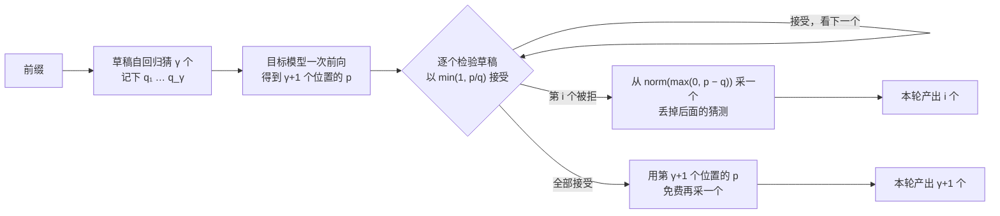

# 投机解码

> 层级：垂类 · inference · 预计 150 分钟 · 题目：[questions.md](questions.md)
> 前置：[01 KV Cache 与显存估算](../01-kv-cache-memory/README.md)（Decode 受带宽限制）、[连续批处理与 Prefill / Decode 分离](../02-batching-pd/README.md)（算术强度、batch 与算力）
> 论文精读：[投机解码](../../../papers/12-speculative-decoding.md)（Leviathan 等，逐节核对过）

## 1 这一章解决什么问题

Decode 每步只出一个 token，却要把全部权重读一遍。[第 02 章第 4 节](../02-batching-pd/README.md#4-prefill-与-decode-的计算特点)算过，batch 小时算术强度约等于 batch，离 H100 的硬件比值 295 差两个数量级，算力几乎全闲。

之前降低 Decode 延迟的办法是蒸馏、量化、换小模型。它们都会改变输出。投机解码换了一个思路：先用便宜的办法猜几个 token，再让大模型一次前向并行验证。验证规则经过设计，输出分布和只用大模型采样完全一样。

面试里常见的问法：

- 投机解码为什么不改变输出分布？请证明。
- 接受率、期望接受长度、加速比怎么算？γ 取多少最好？
- 为什么大 batch 时收益变小，甚至变负？拐点在哪？
- Medusa、EAGLE、MTP 和独立草稿模型有什么区别？哪些严格无损？

学完你应该能：

- 写出接受规则，证明单个位置的输出分布等于目标分布，再推广到整段序列；
- 从截断几何分布推出期望接受长度 (1 − α^(γ+1)) / (1 − α)，写出加速比，推出最优 γ 的边际条件；
- 写一个小词表上的投机采样，用大量采样验证输出分布和目标模型一致；
- 对比草稿模型、n-gram、Medusa、EAGLE、MTP 的机制，说出哪些做法放松了分布保证；
- 用算术强度算出“验证不再免费”的 batch 拐点，解释长上下文时为什么情况又变了。

**本章符号**（后文沿用）：

| 符号 | 含义 |
|---|---|
| p | 目标模型（要加速的大模型）在当前前缀下的下一个 token 分布 |
| q | 草稿模型的下一个 token 分布 |
| γ | 每轮草稿猜的 token 数（vLLM 里的 `num_speculative_tokens`） |
| β | 给定前缀时，一个草稿 token 被接受的概率，β = Σ_x min(p(x), q(x)) |
| α | β 的期望，叫接受率 |
| c | 成本系数：草稿跑一次的时间 / 目标模型跑一次的时间 |
| ĉ | 草稿每 token 的运算量 / 目标模型每 token 的运算量 |
| T_p | 目标模型一次前向的时间 |
| B | batch 里同时解码的序列数 |
| T | 上下文长度 |

## 2 基本流程

两篇工作几乎同时独立提出了这个方法：Leviathan 等（2022-11，叫 speculative decoding）和 Chen 等（2023-02，叫 speculative sampling）。下面按 Leviathan 等的算法 1 写，记号见第 1 节。

每一轮：

1. 草稿模型自回归地猜 γ 个 token：x₁ … x_γ，同时记下每个位置的 q 分布 q₁ … q_γ；
2. 目标模型对 prefix + x₁ … x_γ 做一次前向，并行得到 γ+1 个位置的分布 p₁ … p_{γ+1}；
3. 从 x₁ 开始逐个判断接受或拒绝，第一次拒绝后，后面的猜测全部作废；
4. 被拒绝的位置从修正分布里重新采一个 token；如果 γ 个全部接受，用 p_{γ+1} 再免费采一个（常叫 bonus token）。



所以一轮至少产出 1 个 token，最多 γ+1 个。最坏情况下，目标模型串行调用的次数也不会比普通解码多。

为什么这样能快：Decode 受带宽限制，验证 γ+1 个位置和算 1 个位置要读的权重一样多，KV 也只读一遍，耗时接近。Chen 等论文把这一点拆成三部分说明：小 batch 时线性层受带宽限制，多几个 token 时间差不多；注意力的主要开销是读 KV，KV 大小不随 K 变化；张量并行的 all-reduce 只传少量激活，受延迟限制。前提是“batch 小、K 小”，第 6 节算这个前提什么时候不成立。

## 3 接受规则与分布不变

### 3.1 规则

单个位置的规则（Leviathan 等论文 2.3 节）：

```text
草稿采样 x ~ q
若 q(x) ≤ p(x)：接受
若 q(x) > p(x)：以概率 1 − p(x)/q(x) 拒绝
   合起来：接受概率 = min(1, p(x)/q(x))
拒绝后从修正分布重新采样：p'(x) = norm(max(0, p(x) − q(x)))
```

norm 表示除以总和，使它成为一个分布。实现时用一个均匀随机数 r ~ U(0, 1)，r < p(x)/q(x) 就接受。

这里的 p、q 指“调整后”的分布。论文 2.2 节指出，argmax、top-k、nucleus、温度都能写成“先调整分布，再标准采样”。所以温度、top-p 要对 p 和 q 各自先做一遍，再套这个规则。

### 3.2 证明：单个位置的输出分布等于 p

论文附录 A.1 的证明。先算接受概率：

```text
β = Σ_x q(x) · min(1, p(x)/q(x)) = Σ_x min(q(x), p(x))
```

再看修正分布的归一化常数。因为 max(0, p − q) = p − min(p, q)：

```text
Σ_x max(0, p(x) − q(x)) = Σ_x p(x) − Σ_x min(p(x), q(x)) = 1 − β
所以 p'(x) = (p(x) − min(p(x), q(x))) / (1 − β)
```

输出 x 有两条路径：草稿恰好是 x 并被接受；或者草稿被拒，再从 p' 采到 x。

```text
P(接受且输出 x) = q(x) · min(1, p(x)/q(x)) = min(p(x), q(x))
P(拒绝且输出 x) = P(拒绝) · p'(x) = (1 − β) · (p(x) − min(p(x), q(x))) / (1 − β)
               = p(x) − min(p(x), q(x))

P(输出 x) = min(p(x), q(x)) + p(x) − min(p(x), q(x)) = p(x)
```

注意第二行的 P(拒绝) 是对所有草稿 token 加总的拒绝概率 1 − β，和拒掉的是哪个草稿无关。这是证明能成立的关键：修正分布不依赖被拒的草稿 token 是哪个。

直观理解：草稿高估的 token（q > p），多出来的那部分概率被拒掉；草稿低估的 token（q < p），缺的那部分由修正分布补上。修正分布只在 p > q 的 token 上有质量，正好填这些缺口。

β = 1 − D_LK(p, q)（论文定理 3.5），D_LK(p, q) = Σ_x |p(x) − (p(x)+q(x))/2| = ½ Σ_x |p(x) − q(x)|。所以 D_LK 就是总变差距离（TV），接受概率 = 1 − TV(p, q)。草稿和目标的 TV 越小，接受越多。

### 3.3 推广到整段序列

上面只证了一个位置。一轮里有多个位置，还要说明整段序列的分布等于目标模型自回归采样的分布。用归纳法：

1. 第 1 个位置：草稿 x₁ ~ q₁，按 3.2 节，输出的 token 分布是 p₁。
2. 假设前 i−1 个位置都接受了，输出的前缀就是 x₁ … x_{i−1}。目标模型在第 i 个位置算的 p_i 正是以这个前缀为条件的分布；草稿 x_i 也是以同一前缀采的。所以第 i 个位置又是一次 3.2 节的单步投机采样，输出分布等于 p_i。
3. 第 i 个位置被拒时，输出的是从 p'_i 采的 token，它和 x_i 不同（p'_i 在 x_i 上可能有质量，但这一步作为整体，输出分布仍是 p_i）。后面的 x_{i+1} … 是以 x_i 为前提采的，目标模型在那些位置算的 p 也以 x_i 为条件。前提已经换了，这些分布都不再对应真实前缀，只能丢掉。
4. 全部接受时，p_{γ+1} 就是以 x₁ … x_γ 为条件的目标分布，从它采一个是普通采样，自然正确。
5. 下一轮从新的前缀开始，又回到第 1 步。

每个位置的条件分布都等于目标模型的条件分布，按链式法则，整段序列的联合分布也相等。第 3.5 节的代码对长度 3 的序列做 20 万次采样，检验 216 种序列的频率。

### 3.4 温度 0 与几种错误写法

温度为 0 时，p 和 q 都是 one-hot。草稿 token 等于目标的 argmax 时 β = 1，接受；不等时 β = 0，修正分布 max(0, p − q) 就是目标的 one-hot，换成目标的 argmax 并停止。规则退化成“比对 argmax”。

常见的三种错误写法，第 3.5 节的代码都算出了偏差：

| 写法 | 结果 |
|---|---|
| 拒绝后直接从 p 重采 | 接受路径已经给了 min(p, q)，重采又给了 (1−β)·p，q 高估的 token 被多算，输出偏向 q |
| 接受概率写成 min(1, q/p) | 方向反了，草稿高估的 token 反而更容易被接受 |
| 拒绝后不丢后面的猜测 | 后面的 token 以错误的前缀为条件，整段分布不对 |

论文附录 A.2 还比较了普通拒绝采样：取 M = max_x p(x)/q(x)，以 p(x)/(M·q(x)) 接受。它一次通过的概率是 1/M，不超过 β，可能低得多。投机采样之所以接受得多，是因为拒绝后不重来，而是从修正分布补一个。

### 3.5 实现：精确验证与采样验证

第一段代码用分数做精确计算。在 5 个 token 的词表上，把单步投机采样的输出概率逐项算出来，assert 它和 p 完全相等；同时算出两种错误写法的偏差、β 与 TV 的关系、普通拒绝采样的通过率。

```python
from fractions import Fraction as F

# 一个 5 个 token 的小词表。p 是目标分布，q 是草稿分布，故意让 q 在 a、c 上高估，在 b、d、e 上低估
p = {"a": F(1, 10), "b": F(3, 10), "c": F(1, 20), "d": F(2, 5), "e": F(3, 20)}
q = {"a": F(3, 10), "b": F(1, 5), "c": F(1, 4), "d": F(1, 5), "e": F(1, 20)}
assert sum(p.values()) == 1 and sum(q.values()) == 1
V = list(p)

beta = sum(min(p[x], q[x]) for x in V)                  # 接受概率 β = Σ min(p, q)
resid = {x: max(F(0), p[x] - q[x]) for x in V}          # max(0, p − q)
Z = sum(resid.values())
assert Z == 1 - beta                                    # 归一化常数正好是 1 − β（引理 3.3）
p_adj = {x: resid[x] / Z for x in V}                    # 修正分布 p'


def output_dist(accept, after_reject):
    """单步投机采样输出 x 的精确概率：Σ_draft q(draft)·[接受则输出 draft，否则从 after_reject 采]。"""
    out = {x: F(0) for x in V}
    for d in V:
        a = accept(d)
        out[d] += q[d] * a
        for x in V:
            out[x] += q[d] * (1 - a) * after_reject[x]
    return out


# 1) 正确规则：接受概率 min(1, p/q)，拒绝后从 p' 采。输出分布逐项精确等于 p
right = output_dist(lambda d: min(F(1), p[d] / q[d]), p_adj)
assert right == p
# 接受部分贡献 min(p, q)，拒绝部分贡献 p − min(p, q)：附录 A.1 的两项
for x in V:
    assert q[x] * min(F(1), p[x] / q[x]) == min(p[x], q[x])
    assert (1 - beta) * p_adj[x] == p[x] - min(p[x], q[x])

# 2) 错误一：拒绝后直接从 p 重采。接受路径已经给过 min(p, q)，重采又给一遍，偏向 q 高估的 token
wrong1 = output_dist(lambda d: min(F(1), p[d] / q[d]), p)
assert wrong1 != p and wrong1["a"] > p["a"] and wrong1["d"] < p["d"]

# 3) 错误二：把接受概率写反成 min(1, q/p)
wrong2 = output_dist(lambda d: min(F(1), q[d] / p[d]), p_adj)
assert wrong2 != p

# 4) 附录 A.2：普通拒绝采样（r < p/(M·q)，M = max p/q）一次通过的概率是 1/M，不超过 β
M = max(p[x] / q[x] for x in V)
assert 1 / M <= beta
print(f"β = {beta} = {float(beta):.2f}；普通拒绝采样一次通过的概率 1/M = {1 / M} = {float(1 / M):.2f}")

# 5) β = 1 − D_LK(p, q)，D_LK = Σ |p − (p+q)/2| = 总变差距离 TV(p, q)
D_LK = sum(abs(p[x] - (p[x] + q[x]) / 2) for x in V)
assert beta == 1 - D_LK and D_LK == sum(abs(p[x] - q[x]) for x in V) / 2

# 6) 温度 0：p、q 都是 one-hot。草稿等于目标 argmax 时 β = 1，否则 β = 0 且 p' 就是目标的 one-hot
onehot = lambda k: {x: F(int(x == k)) for x in V}
pt, qt = onehot("d"), onehot("a")
assert sum(min(pt[x], qt[x]) for x in V) == 0
assert {x: max(F(0), pt[x] - qt[x]) for x in V} == pt
```

第二段代码是完整的一轮算法 1。目标和草稿都是 6 个 token 词表上的二元模型（下一个 token 只看上一个），草稿和目标只部分相似。它做三件事：

1. 用 γ = 3 的投机采样生成 20 万条长度 3 的序列，和目标模型的精确序列概率比较。卡方统计量和 TV 距离都落在同样本量的噪声范围内；把修正分布换成 p，偏差一眼可见。
2. 让每个位置的 β 相同（i.i.d. 假设精确成立），对比模拟出的每轮产出 token 数和第 4.1 节的闭式。
3. 展示一个估计 α 的坑：用“接受数 / 草稿提出数”估计，会明显低估 α。

```python
import itertools
import random

import numpy as np

V = 6                                     # 词表大小
rng = np.random.default_rng(0)
# 目标模型 p 和草稿模型 q 都是“看上一个 token 决定下一个”的二元模型：P[a] 是上一个 token 为 a 时的分布
P = rng.dirichlet(np.ones(V) * 0.7, size=V)
Q = 0.5 * P + 0.5 * rng.dirichlet(np.ones(V) * 0.7, size=V)   # 草稿只和目标部分相似
R = random.Random(1)


def draw(dist):
    """按分布 dist（长度 V）采一个 token。"""
    r, acc = R.random(), 0.0
    for x, w in enumerate(dist):
        acc += w
        if r < acc:
            return x
    return V - 1


def spec_round(prefix, gamma, correct=True):
    """一轮投机采样（Leviathan 算法 1）。返回本轮新产出的 token 列表，长度 1..gamma+1。"""
    xs, qs = [], []
    last = prefix[-1]
    for _ in range(gamma):                           # 草稿自回归猜 gamma 个，记下每步的 q
        qd = Q[last]
        x = draw(qd)
        xs.append(x); qs.append(qd); last = x
    ctx = [prefix[-1]] + xs                          # 目标模型“一次前向”拿到 gamma+1 个位置的 p
    ps = [P[c] for c in ctx]
    for i, x in enumerate(xs):
        if R.random() < min(1.0, ps[i][x] / qs[i][x]):
            continue                                 # 接受，继续看下一个
        if correct:
            resid = np.maximum(ps[i] - qs[i], 0)     # 拒绝：从 norm(max(0, p − q)) 重采
            t = draw(resid / resid.sum())
        else:
            t = draw(ps[i])                          # 错误写法：直接从 p 重采
        return xs[:i] + [t]                          # 后面的猜测全部作废
    return xs + [draw(ps[gamma])]                    # 全部接受：第 gamma+1 个位置免费再采一个


def sample_seq(n, gamma, correct=True, start=0):
    seq = [start]
    while len(seq) < n + 1:
        seq += spec_round(seq, gamma, correct)
    return tuple(seq[1:n + 1])                       # 只看前 n 个新 token


# 1) 目标模型直接采样时，长度 3 的序列的精确概率（共 6³ = 216 种）
n, gamma, S = 3, 3, 200_000
exact = {s: P[0, s[0]] * P[s[0], s[1]] * P[s[1], s[2]] for s in itertools.product(range(V), repeat=n)}
assert abs(sum(exact.values()) - 1) < 1e-12


def compare(correct):
    cnt = {}
    for _ in range(S):
        s = sample_seq(n, gamma, correct)
        cnt[s] = cnt.get(s, 0) + 1
    chi2 = sum((cnt.get(s, 0) - S * e) ** 2 / (S * e) for s, e in exact.items())
    tv = 0.5 * sum(abs(cnt.get(s, 0) / S - e) for s, e in exact.items())
    return chi2, tv


chi2, tv = compare(correct=True)
chi2_bad, tv_bad = compare(correct=False)
df = len(exact) - 1                                  # 自由度 215；0.1% 显著性的临界值约 215 + 3.09·√(2·215) ≈ 279
print(f"正确规则：χ² = {chi2:.0f}（自由度 {df}），TV = {tv:.4f}")
print(f"拒绝后从 p 重采：χ² = {chi2_bad:.0f}，TV = {tv_bad:.4f}")
# 有限样本下 TV 不会是 0：从 exact 本身采 S 个样本，TV 的期望约为 0.5·Σ √(2·e·(1−e)/(π·S))
tv_floor = 0.5 * sum(np.sqrt(2 * e * (1 - e) / (np.pi * S)) for e in exact.values())
print(f"同样本量下 TV 的噪声水平约 {tv_floor:.4f}")
assert chi2 < 279 and tv < 1.2 * tv_floor            # 和目标分布在统计上分不开
assert chi2_bad > 10 * df and tv_bad > 0.03          # 错误写法一眼可见地偏了

# 2) 期望产出 token 数：β 每个位置都相同时（i.i.d. 假设成立），模拟值对上闭式 (1 − α^(γ+1)) / (1 − α)
p1 = np.array([0.40, 0.25, 0.15, 0.10, 0.06, 0.04])
q1 = np.array([0.25, 0.30, 0.10, 0.20, 0.10, 0.05])
P[:], Q[:] = p1, q1                                  # 每一行都一样：β 和上下文无关
alpha = np.minimum(p1, q1).sum()                     # α = Σ min(p, q) = 0.80
for g in (1, 2, 4, 8):
    lens = [len(spec_round([0], g)) for _ in range(100_000)]
    closed = (1 - alpha ** (g + 1)) / (1 - alpha)
    sim = sum(lens) / len(lens)
    print(f"γ={g}: 模拟 {sim:.3f}，闭式 {closed:.3f}")
    assert abs(sim - closed) / closed < 0.01
    assert min(lens) >= 1 and max(lens) <= g + 1     # 每轮最少 1 个，最多 γ+1 个

# 3) 估计 α 的坑：“接受数 / 草稿提出的数”比 α 低，因为第一次拒绝之后的草稿根本没被检验
g, acc, proposed, judged = 4, 0, 0, 0
for _ in range(100_000):
    k = len(spec_round([0], g)) - 1                  # 本轮接受的草稿数
    acc += k; proposed += g; judged += k + (k < g)   # 被检验过的 = 接受的 + 那一次拒绝
naive, mle = acc / proposed, acc / judged
print(f"α = {alpha:.3f}；接受数/提出数 = {naive:.3f}；接受数/检验数 = {mle:.3f}")
assert naive < alpha - 0.1 and abs(mle - alpha) < 0.01
```

运行结果：

| 检验 | 数值 |
|---|---|
| 正确规则，216 种序列 | χ² ≈ 215（自由度 215），TV ≈ 0.0106，噪声水平约 0.0105 |
| 拒绝后从 p 重采 | χ² ≈ 24,880，TV ≈ 0.148 |
| α = 0.8 时每轮产出（模拟 / 闭式） | γ=1：1.80 / 1.80；γ=4：3.37 / 3.36；γ=8：4.34 / 4.33 |
| α 的两种估计 | 接受数 / 提出数 ≈ 0.59；接受数 / 检验数 ≈ 0.80 |

TV 不是 0，因为 20 万个样本的经验分布本身就有波动。代码先算出“从目标分布直接采 20 万个样本”的 TV 期望，再要求投机采样的 TV 不超过它的 1.2 倍。

最后一行是排查线上指标时常踩的坑：第一次拒绝之后的草稿根本没被检验，算进分母就会低估。引擎报的 “acceptance rate” 是哪种口径，要先看清楚。

## 4 接受长度与加速比

### 4.1 期望接受长度的推导

Leviathan 等论文 3.1 节假设每个位置的 β 独立同分布，均值为 α。一轮里第 k 个草稿被检验的前提是前 k−1 个都被接受：

```text
P(前 k 个都被接受) = α^k                    k = 0, 1, …, γ

一轮产出的 token 数 N = (接受的草稿数) + 1，其中“+1”是拒绝时的修正 token，或全部接受时的 bonus token。
P(N ≥ k+1) = P(前 k 个都被接受) = α^k        k = 0..γ

E(N) = Σ_{k=0..γ} P(N ≥ k+1) = 1 + α + α² + … + α^γ = (1 − α^(γ+1)) / (1 − α)      （论文式 1）
```

这是一个截断在 γ+1 的几何分布。几个性质：

- γ → ∞ 时 E(N) → 1/(1 − α)。α = 0.8 时最多 5 个，猜再多也越不过去。
- 每多猜一个，E(N) 只多 α^(γ+1)，收益指数递减。
- “平均接受长度”有两种口径：E(N) 包含修正或 bonus token，E(N) − 1 只算被接受的草稿。EAGLE 论文把 τ 定义为“目标模型每次前向平均接受的 token 数”。比较不同论文、不同引擎的数字时，先查清是哪种口径。

### 4.2 加速比

论文 3.3 节。一轮要跑 γ 次草稿、1 次目标模型（并行验证 γ+1 个位置），记目标一次前向的时间为 T_p：

```text
一轮耗时 = γ · c · T_p + T_p = (1 + γc) · T_p
一轮产出 = E(N)
每个 token 的平均耗时 = (1 + γc) · T_p / E(N)
普通解码每个 token 耗时 = T_p

加速比 S(γ) = E(N) / (1 + γc) = (1 − α^(γ+1)) / ((1 − α)(1 + γc))      （定理 3.8）
```

这个式子有两个前提。一是“验证 γ+1 个位置的时间等于算 1 个位置”，第 6 节会算它什么时候不成立。二是生成足够长，因为目标模型至少要跑一次，加速比不会超过生成的 token 数。

推论 3.9：取 γ = 1，S = (1 + α)/(1 + c)。所以只要 α > c，就一定存在能加速的 γ。反过来，α ≤ c 时任何 γ 都不加速。

论文 3.4 节还给了运算量的账。一轮的运算量是草稿 γ·ĉ 加目标 γ+1（以目标模型每 token 运算量为单位），除以 E(N)：

```text
总运算量的期望增长倍数 = (1 − α)(γĉ + γ + 1) / (1 − α^(γ+1))      （定理 3.11）
```

α = 0.8、γ = 4、ĉ = 0.05 时约 1.55 倍。也就是多花约 55% 的运算，换来 2.8 倍的墙钟加速。目标模型每轮算 γ+1 = 5 个位置，平均只有 3.36 个变成输出，约 33% 的验证计算被丢掉。访存反过来减少了：目标的权重和 KV 每轮只读一次，读取次数按 E(N) 倍缩小。所以投机解码适合访存受限、算力有余的场景。

### 4.3 最优 γ 的边际条件

γ 是整数，论文 3.5 节说可以数值求解（图 3）。这里推一个边际条件（推导，第 4.4 节代码验证）。从 γ 加到 γ+1：

```text
产出多 α^(γ+1)，耗时多 c·T_p

S(γ+1) > S(γ)
⇔ (E(γ) + α^(γ+1)) / (1 + (γ+1)c) > E(γ) / (1 + γc)
⇔ (E(γ) + α^(γ+1)) · (1 + γc) > E(γ) · (1 + γc + c)
⇔ α^(γ+1) · (1 + γc) > c · E(γ)
⇔ α^(γ+1) / E(γ) > c / (1 + γc)
```

左边是“多猜一个的边际产出占当前产出的比例”，右边是“多猜一个的边际耗时占当前耗时的比例”。

条件一旦不成立，之后就一直不成立，所以 S(γ) 是单峰的。证明：记 D(γ) = α^(γ+1)(1 + γc) − c·E(γ)，假设 D(γ) ≤ 0，即 α^(γ+1)(1 + γc) ≤ c·E(γ)。那么

```text
D(γ+1) = α · α^(γ+1)(1 + γc) + c·α^(γ+2) − c·E(γ) − c·α^(γ+1)
       ≤ α·c·E(γ) + c·α^(γ+1)(α − 1) − c·E(γ)
       = −c·(1 − α)·(E(γ) + α^(γ+1)) < 0
```

所以从 γ = 1 往上找，第一个让条件不成立的 γ 就是最优 γ。

由此读出最优 γ 的规律：

- α 越高，左边下降越慢，最优 γ 越大。
- c 越大，右边越大，最优 γ 越小。c → 0 时右边 → 0，γ 越大越好，但收益被 1/(1 − α) 封顶。
- 峰附近很平。α = 0.8、c = 0.05 时最优 γ = 8，S = 3.09；γ 取 5 到 12 都在峰值的 95% 以内。实践里 γ 取小一点更安全，因为 α 会波动，第 6 节还会看到 batch 大时最优 γ 变小。

### 4.4 实现：公式、论文表格与最优 γ

下面的代码实现三个公式，复核论文表 1（c = ĉ = 0 时的速度和运算量倍数）和附录表 4 的理论列，再验证边际条件、单峰性和最优 γ 随 α、c 的变化。

```python
def E_tokens(a, g):
    """一轮期望产出 token 数（式 1）：截断几何分布，1 + α + α² + … + α^γ。"""
    return (1 - a ** (g + 1)) / (1 - a)


def speedup(a, g, c):
    """定理 3.8：期望墙钟加速。假设验证 γ+1 个位置和算 1 个位置一样快。"""
    return E_tokens(a, g) / (1 + g * c)


def ops_factor(a, g, c_hat):
    """定理 3.11：总算术运算量的期望增长倍数。"""
    return (1 - a) * (g * c_hat + g + 1) / (1 - a ** (g + 1))


def best_gamma(a, c, g_max=200):
    return max(range(1, g_max + 1), key=lambda g: speedup(a, g, c))


# 1) 式 1 就是 Σ_{k=0..γ} α^k；正文表格的几行
assert all(abs(E_tokens(a, g) - sum(a ** k for k in range(g + 1))) < 1e-12 for a in (0.3, 0.8) for g in (1, 5))
assert round(E_tokens(0.8, 4), 2) == 3.36 and round(speedup(0.8, 4, 0.05), 2) == 2.80
assert round(speedup(0.8, 8, 0.05), 2) == 3.09 and round(speedup(0.8, 4, 0.30), 2) == 1.53

# 2) 复核论文表 1（c = ĉ = 0）：运算量倍数和速度倍数
table1 = [(0.6, 2, 1.53, 1.96), (0.7, 3, 1.58, 2.53), (0.8, 2, 1.23, 2.44),
          (0.8, 5, 1.63, 3.69), (0.9, 2, 1.11, 2.71), (0.9, 10, 1.60, 6.86)]
for a, g, ops, spd in table1:
    assert round(ops_factor(a, g, 0), 2) == ops and round(speedup(a, g, 0), 2) == spd

# 3) 复核论文附录表 4 的理论列（T5-XXL，α、c 是表里给的两位小数，所以只要求差 < 0.1）
table4 = [(0.75, 0.02, 7, 3.2), (0.80, 0.04, 7, 3.3), (0.82, 0.11, 7, 2.5), (0.62, 0.02, 7, 2.3),
          (0.68, 0.04, 5, 2.4), (0.71, 0.11, 3, 2.0), (0.65, 0.02, 5, 2.4), (0.73, 0.04, 5, 2.6),
          (0.74, 0.11, 3, 2.0), (0.53, 0.02, 5, 1.9), (0.55, 0.04, 3, 1.8), (0.56, 0.11, 3, 1.6)]
assert all(abs(speedup(a, g, c) - exp) < 0.1 for a, c, g, exp in table4)

# 4) 最优 γ 的边际条件（推导）：γ → γ+1 多得 α^(γ+1) 个 token，多花 c 个目标前向的时间。
#    S(γ+1) > S(γ)  ⇔  α^(γ+1)·(1 + γc) > c·E(γ)  ⇔  α^(γ+1) / E(γ) > c / (1 + γc)
for a in (0.5, 0.7, 0.8, 0.9):
    for c in (0.01, 0.05, 0.1, 0.3):
        for g in range(1, 40):
            better = speedup(a, g + 1, c) > speedup(a, g, c)
            assert better == (a ** (g + 1) * (1 + g * c) > c * E_tokens(a, g))
# S(γ) 是单峰的：条件一旦不成立就一直不成立（正文 4.3 节的证明），第一个让条件不成立的 γ 就是最优
curve = [speedup(0.8, g, 0.05) for g in range(1, 30)]
peak = curve.index(max(curve))
assert all(x < y for x, y in zip(curve[:peak], curve[1:peak + 1]))
assert all(x > y for x, y in zip(curve[peak:], curve[peak + 1:]))
print("α=0.8, c=0.05 时的 S(γ)：", ", ".join(f"γ={g}:{s:.2f}" for g, s in enumerate(curve[:12], 1)))
assert best_gamma(0.8, 0.05) == 8 and round(speedup(0.8, 8, 0.05), 2) == 3.09
# 最优点附近很平：γ 取 5 到 12 都在峰值的 95% 以内，比 γ=4 只差约 10%
assert all(speedup(0.8, g, 0.05) > 0.95 * speedup(0.8, 8, 0.05) for g in range(5, 13))

# 5) 最优 γ 随 α 升高而变大，随 c 升高而变小（论文图 3 的形状）
grid = {c: [best_gamma(a, c) for a in (0.5, 0.6, 0.7, 0.8, 0.9)] for c in (0.01, 0.02, 0.05, 0.1)}
assert grid[0.05] == [3, 4, 6, 8, 13] and grid[0.01][-1] == 24     # c=0.01、α=0.9 时 24，正是图 3 纵轴的顶
assert all(x <= y for row in grid.values() for x, y in zip(row, row[1:]))
assert all(grid[0.01][i] >= grid[0.02][i] >= grid[0.05][i] >= grid[0.1][i] for i in range(5))

# 6) 推论 3.9：只要 α > c，γ=1 就有加速 (1+α)/(1+c)；α ≤ c 时任何 γ 都不加速
assert abs(speedup(0.3, 1, 0.2) - 1.3 / 1.2) < 1e-12
assert all(speedup(0.2, g, 0.25) < 1 for g in range(1, 50))
# c → 0 时加速上界 1/(1−α)：α=0.8 最多 5 倍，再长的 γ 也越不过去
assert all(speedup(0.8, g, 0) < 5 for g in range(1, 60)) and speedup(0.8, 60, 0) > 4.999

# 7) 运算量：α=0.8、γ=4、ĉ=0.05 时总 FLOPs 约多 55%，换来 2.8 倍墙钟加速
assert 1.5 < ops_factor(0.8, 4, 0.05) < 1.6
# 被丢掉的验证位置占比：目标模型每轮算 γ+1 个位置，只有 E 个变成输出（含修正的那一个）
assert round(1 - E_tokens(0.8, 4) / 5, 2) == 0.33

# 8) 用 DeepSeek-V3 报告的数反推（推导）：γ=1、α=0.85~0.9 时期望产出 1.85~1.9；
#    报告的 1.8 倍 TPS 对应的“等效 c”约 0.03~0.06，即 MTP 模块加上系统开销约占一次主模型前向的 3%~6%
implied_c = [E_tokens(a, 1) / 1.8 - 1 for a in (0.85, 0.90)]
assert [round(E_tokens(a, 1), 2) for a in (0.85, 0.90)] == [1.85, 1.9]
assert 0.02 < implied_c[0] < 0.03 and 0.05 < implied_c[1] < 0.06
```

c = 0.05 时最优 γ 的网格（代码算出）：

| α | 0.5 | 0.6 | 0.7 | 0.8 | 0.9 |
|---|---|---|---|---|---|
| 最优 γ（c = 0.05） | 3 | 4 | 6 | 8 | 13 |
| 最优 γ（c = 0.01） | 5 | 7 | 9 | 14 | 24 |

论文图 3 画的就是这张表的曲线，纵轴到 24。

### 4.5 数值例子

c = 0.05 除注明外：

| α | γ | c | 期望产出 token | 加速比 |
|---|---|---|---|---|
| 0.5 | 4 | 0.05 | 1.94 | 1.61 |
| 0.6 | 4 | 0.05 | 2.31 | 1.92 |
| 0.8 | 4 | 0.05 | 3.36 | 2.80 |
| 0.8 | 8 | 0.05 | 4.33 | 3.09 |
| 0.9 | 4 | 0.05 | 4.10 | 3.41 |
| 0.8 | 4 | 0.30 | 3.36 | 1.53 |

手算 α = 0.8、γ = 4、c = 0.05：0.8⁵ = 0.328，(1 − 0.328)/0.2 = 3.36；1 + 4 × 0.05 = 1.2；3.36/1.2 = 2.8。

从表里能读出三件事：

- α 是最重要的变量。α 由草稿和目标的接近程度、任务、温度决定。
- γ 加大收益递减。α 不高时，后面的猜测大多被丢掉，还白花草稿的时间。
- c 变大会吃掉收益。草稿太大、或草稿和目标跑在一起互相抢资源，c 都会上升。

论文自己的实测（都是论文报告）：Leviathan 等在 T5-XXL（11B）上相比标准 T5X 实现快 2 到 3 倍，输出相同；最好的组合是 T5-small 当草稿，英译德温度 0 时 3.4 倍、温度 1 时 2.6 倍。附录表 4 列出了每个组合的 α、c、γ 和理论值，上面代码复核过理论列；实测和理论的差异，论文归因于实现优化的差别和 β 并非真的独立同分布。Chen 等在 Chinchilla 70B 上分布式设置下解码快 2 到 2.5 倍。

## 5 草稿从哪来

第 3 节的证明对任意 q 都成立。所以草稿的选择只影响速度（α 和 c），不影响正确性，前提是验证时用标准拒绝采样，并且记录的 q 就是草稿实际采样用的分布。各方法的差别在于草稿怎么产生、一次给几个候选、验证规则有没有放松。

### 5.1 独立草稿模型

用同一个 tokenizer 的小模型当草稿，比如 Qwen3-8B 配 Qwen3-0.6B（两者词表都是 151,936）。Leviathan 等论文 3.6 节的经验是：草稿比目标小约两个数量级时，α 和 c 平衡最好。草稿更大 α 更高，但 c 也变大，不一定更快。论文附录表 4（对应正文表 2）里，英译德温度 0 时 T5-large 当草稿的 α 最高（0.82），实测加速却最低（1.7 倍）。

代价：多部署一个模型，占显存；草稿本身也要维护 KV Cache；分布差得远时 α 低。还要注意，“小”不等于 c 小。第 6.5 节代码第 6 条算出 Qwen3-0.6B 里有 1.56 亿参数是词表矩阵，占它的四分之一以上，batch 为 1 时 c ≈ 0.08，比论文 T5 实验的 c < 0.05 大。

### 5.2 n-gram 与 prompt 查找

从 prompt 和已生成的文本里找和当前结尾匹配的片段，把它后面的 token 当猜测。查表的开销几乎为 0，c ≈ 0，加速上界是 1/(1 − α)。论文 3.6 节已经提出这类“可忽略成本的草稿”：英译德上用 bigram 当草稿，α 约 0.2，γ = 3 时也有 1.25 倍加速（论文报告）。

只在输出复述输入时有效：改代码、引用工具结果、按模板改写。开放写作里匹配不到，就不猜或猜错。草稿是确定性的（q 是 one-hot），接受概率就是 p(x)，规则照样适用。

### 5.3 Medusa：多个解码头 + 树形验证 + typical acceptance

Medusa（Cai 等 2024）去掉独立草稿，在目标模型最后一层的隐状态 h_t 上加 K 个解码头。第 k 个头预测第 t+k+1 个位置的 token（原来的 LM 头预测 t+1）。每个头是一层带残差的前馈网络。论文的经验是最多 5 个头就够了。

所有头基于同一个 h_t 一次给出预测，所以草稿阶段几乎不花时间。代价是第 k 个头要“跳着猜”：它看不到第 t+1 … t+k 个位置实际选了哪个 token，越往后越不准。

**树形验证**。每个头取 top-s_k 个候选，各头的候选组合成一棵树（比如头 1 取 2 个、头 2 取 3 个，就有 6 条路径）。所有候选 token 拼成一个序列，用一个特殊的注意力 mask 让每个 token 只看到自己这条路径上的祖先，一次前向验证全部路径，取接受得最长的那条。论文 2.3.3 节还按每个位置的经验准确率挑出稀疏树，减少候选数。树形验证不增加前向次数，但每次前向处理的 token 变多了，这一点在第 6 节很关键。

**两种训练方式**：

- Medusa-1：冻结主干，只训练头。主干不变。
- Medusa-2：主干和头一起训练，先只训练头再联合训练（warmup），避免头的大梯度破坏主干。主干输出变了，就谈不上保持原模型的分布。论文报告的 MT-Bench 质量分：基线 6.17，Medusa-1 6.23，Medusa-2 6.18，直接微调 5.925。

**typical acceptance**（论文 2.3.1 节）。论文认为“通常不必严格匹配原模型的分布”，而且标准拒绝采样在温度升高时效率下降：即使草稿和目标分布完全一样，独立采样出来的两个 token 也可能不同，于是被拒。所以它换了一个规则，候选 x 满足下式就接受：

```text
p_original(x | 前缀) > min( ε, δ · exp(−H(p_original(· | 前缀))) )

H 是熵；ε 是硬阈值，δ 是随熵变化的阈值。论文实验里按 Hewitt 等的做法取 δ = √ε，ε 从 0.01 扫到 0.25
```

两个观察支撑这个规则：概率较高的 token 是合理的；分布熵高时，很多续写都可以接受。另外，每步的第一个 token 用贪心解码并无条件接受，保证至少产出一个；最后取所有候选里接受得最长的前缀。

这个规则不保持分布。它检查的是“候选是否够典型”，不是让输出概率等于 p。第 5.6 节的代码给出一个具体例子：草稿头的 top-1 只要够典型就每次都被接受，这个位置的输出就固定成它，和目标分布的 TV 距离达到 0.55。论文图 5 也显示了这个取舍：ε 越大质量越高、加速越小。

所以“Medusa 无损”只在 Medusa-1 加标准拒绝采样时成立。论文报告 Medusa-1 加速超过 2.2 倍，Medusa-2 为 2.3 到 2.8 倍（arXiv 摘要页写 2.3 到 3.6 倍，3.6 是单个类别的最高值）。

### 5.4 EAGLE 与 EAGLE-3：在特征层上自回归

EAGLE（Li 等 2024-01）的两个观察：

1. 在特征层上自回归比在 token 层上容易。这里的“特征”是目标模型倒数第二层（LM 头之前）的隐状态。
2. 特征预测有不确定性。同一个特征后面采到“am”还是“always”，下一步的特征完全不同。只喂特征，草稿不知道实际采到了哪个 token。

所以 EAGLE 的草稿同时输入特征序列和往前错一位的 token 序列（包含采样结果）。结构是：token 嵌入和特征拼接成 2 × hidden 维，一个全连接层降回 hidden 维，再过一个解码器层预测下一步特征，最后用目标模型自己的 LM 头得到 token 分布。损失是特征回归（Smooth L1）加 token 分类（交叉熵）。论文报告草稿的可训练参数在 7B、13B、33B、70B 目标上分别为 0.24B、0.37B、0.56B、0.99B。

和 Medusa 的区别：Medusa 的头并行地跳着猜，EAGLE 是一层小网络自回归地一步步猜，每步都知道前面猜了什么。EAGLE 同样用树形草稿，验证时用多候选版本的拒绝采样（和 SpecInfer 一致），保持输出分布。论文报告 LLaMA2-Chat 70B 上延迟加速 2.7 到 3.5 倍，吞吐翻倍；加入错一位的 token 序列后，加速从 1.9 倍提到 2.8 倍（消融，论文图 4）。

EAGLE-3（2025-03）放弃特征预测，直接预测 token；融合目标模型低、中、高三层的特征；用“training-time test”训练，即训练时就模拟推理时草稿用自己的预测继续往下猜的情形。论文报告最高 6.5 倍，比 EAGLE-2 快约 1.4 倍。

### 5.5 MTP：预训练时就带的草稿

DeepSeek-V3 技术报告的 MTP（multi-token prediction）用 D 个顺序模块预测额外的 D 个 token。第 k 个模块包含：和主模型共享的嵌入层与输出头、一个 Transformer 块 TRM_k、一个投影矩阵 M_k ∈ R^(d×2d)。对第 i 个位置，它把上一深度的表示 h_i^(k−1) 和第 i+k 个 token 的嵌入各做 RMSNorm、拼接，用 M_k 投影，再过 TRM_k，最后用共享输出头预测第 i+k+1 个 token。k = 1 时 h^(k−1) 就是主模型的表示。

报告说它保持完整的因果链，原则和 EAGLE 类似；但 EAGLE 的主要目的是投机解码，MTP 的主要目的是改进训练。DeepSeek-V3 的 D = 1，即每个位置除了下一个 token 再多预测一个。推理时这些模块可以直接丢掉，主模型独立工作；也可以拿来做投机解码。报告给出第二个 token 的接受率在不同生成主题上为 85% 到 90%，解码速度达到 1.8 倍 TPS。模型卡注明：Hugging Face 上的 685B 包括 671B 主模型和 14B 的 MTP 模块。

用第 4 节的公式验算：γ = 1、α 取 0.85 到 0.9 时，期望产出 1.85 到 1.9 个 token。报告的 1.8 倍反推出等效 c 约 0.03 到 0.06（推导，第 4.4 节代码第 8 条），也就是 MTP 模块和系统开销约占主模型一次前向的 3% 到 6%。量级合理。

### 5.6 实现：放松验证规则后分布怎么变

下面的代码做两件事。第一，实现 Medusa 的 typical acceptance 判据，展示它在一个位置上把输出变成确定性的。第二，实现 Leviathan 附录 A.5 的宽容度参数 l：比较前把 q 乘以 l，接受概率变成 min(1, p/(l·q))。论文说这样 α = Σ min(p/l, q)，接受率更高，但只保证“没有 token 的采样概率超过 p(x)/l”，不再保持分布。代码在随机分布上检查这个上界。

```python
import numpy as np

# Medusa 的 typical acceptance（论文 2.3.1 节）：候选 x 满足 p(x) > min(ε, δ·exp(−H(p))) 就接受
def typical_ok(p, x, eps, delta):
    H = -(p * np.log(p)).sum()
    return p[x] > min(eps, delta * np.exp(-H))


p = np.array([0.45, 0.30, 0.15, 0.10])          # 目标模型在这个位置的分布（温度已经作用过）
eps, delta = 0.09, 0.3                          # ε 是硬阈值；论文按 Hewitt 等的做法取 δ = √ε
assert abs(delta - np.sqrt(eps)) < 1e-12

# 候选来自 Medusa 头的 top 预测。假设头的 top-1 是 token 0：只要它够“典型”就被接受
assert typical_ok(p, 0, eps, delta)
out = np.zeros(4); out[0] = 1.0                 # 这个位置每次都输出 token 0
tv = 0.5 * np.abs(out - p).sum()
print(f"typical acceptance：输出 token 0 的概率 1.0，目标是 {p[0]}；TV = {tv:.2f}")
assert tv > 0.5                                 # 和目标分布差得很远：输出更像贪心，不是从 p 采样

# 头的 top-1 换成 token 3（p=0.10），阈值 min(0.09, 0.3·e^{−H}) 仍然让它通过：低概率候选照样被接受
assert typical_ok(p, 3, eps, delta)
# 熵越高阈值越低，能接受的候选越多；ε 调大，阈值变高，接受得更少（论文图 5：ε 越大质量越高、加速越少）
flat, sharp = np.full(4, 0.25), np.array([0.97, 0.01, 0.01, 0.01])
thr = lambda q, e: min(e, np.sqrt(e) * np.exp((q * np.log(q)).sum()))
assert thr(flat, eps) < thr(sharp, eps)
assert thr(p, 0.01) < thr(p, 0.25)

# 对照：同一个位置用标准拒绝采样，草稿 q 不管是什么，输出都精确等于 p（第 3.2 节）
q = np.array([0.7, 0.1, 0.1, 0.1])
acc = np.minimum(p, q)
resid = np.maximum(p - q, 0)
std_out = acc + (1 - acc.sum()) * resid / resid.sum()
assert np.allclose(std_out, p)

# Leviathan 附录 A.5 的宽容度 l：比较前把 q 乘以 l，接受概率 min(1, p/(l·q))，拒绝后从 norm(max(0, p − l·q)) 采
def lenient_out(p, q, l):
    acc = np.minimum(q, p / l)                  # q·min(1, p/(l q))
    resid = np.maximum(p - l * q, 0)
    rest = resid / resid.sum() if resid.sum() > 0 else np.zeros_like(p)
    return acc.sum(), acc + (1 - acc.sum()) * rest


rng = np.random.default_rng(0)
prev_alpha = 0.0
for l in (1.0, 0.8, 0.6, 0.5):
    alpha, out = lenient_out(p, q, l)
    assert abs(alpha - np.minimum(p / l, q).sum()) < 1e-12      # 论文给的 α = Σ min(p/l, q)
    assert np.all(out <= p / l + 1e-12)                          # 保证：没有 token 的概率超过 p/l
    assert alpha >= prev_alpha                                   # l 越小，接受率越高
    prev_alpha = alpha
    print(f"l={l}: α={alpha:.2f}，TV(输出, p)={0.5 * np.abs(out - p).sum():.3f}")
    if l == 1.0:
        assert np.allclose(out, p)                               # l=1 就是标准规则
    else:
        assert not np.allclose(out, p)                           # l<1 不再保持分布
# 随机分布上检查 p/l 的上界
for _ in range(2000):
    k = int(rng.integers(2, 8))
    pp, qq, l = rng.dirichlet(np.ones(k)), rng.dirichlet(np.ones(k)), float(rng.uniform(0.05, 1))
    assert np.all(lenient_out(pp, qq, l)[1] <= pp / l + 1e-9)
# l 小到 α=1 时，草稿说什么就输出什么：输出分布退化成 q，TV(输出, p) = TV(q, p)
assert np.allclose(lenient_out(p, q, 0.5)[1], q)
```

宽容度的结果说明一件事：放松规则换来的接受率，是直接用分布偏差买的。l 小到 α = 1 时，草稿说什么就输出什么，输出分布退化成 q。论文附录 A.5 报告 T5-XXL 配 T5-small、c = 0.015 时，l 取 1、0.5、0.3、0.1 的加速分别是 2.5、3.1、3.6、5 倍；论文正文的实验全部用 l = 1 的严格版本。vLLM 文档也区分了两类：标准拒绝采样有无损保证，FLy 验证“有意放松验证，不保持分布”。

### 5.7 机制对比

| 方法 | 草稿怎么来 | 一次给几个候选 | 验证规则 | 是否保持分布 | 主要代价 |
|---|---|---|---|---|---|
| 独立草稿模型 | 同 tokenizer 的小模型自回归 | 一条链（也可做树） | 标准拒绝采样 | 是 | 多一个模型的显存和 KV；c 不一定小 |
| n-gram / prompt 查找 | 从上下文里复制匹配片段 | 一条或几条 | 标准拒绝采样 | 是 | 几乎没有；只在复述输入时有效 |
| Medusa-1 | 冻结主干上的多个头，基于同一个 h_t 跳着猜 | 树 | 拒绝采样或 typical acceptance | 配拒绝采样时是；typical acceptance 不是 | 训练头；后面的头准确率低 |
| Medusa-2 | 同上，主干一起微调 | 树 | 同上 | 否（主干变了） | 要改模型权重 |
| EAGLE | 一层小网络在特征层自回归，输入错一位的 token | 树 | 多候选拒绝采样 | 是 | 训练草稿层，要拿到目标的中间特征 |
| EAGLE-3 | 直接预测 token，融合多层特征 | 树 | 同上 | 是 | 同上 |
| MTP（DeepSeek-V3） | 预训练自带的顺序模块 | D = 1 时只猜 1 个 | 标准拒绝采样 | 是 | 模型发布时就要带；γ 受 D 限制 |

## 6 和大批量服务的冲突

### 6.1 验证的额外计算从哪来

投机解码借的是 Decode 闲置的算力。用[第 02 章第 4.1 节](../02-batching-pd/README.md#41-算术强度从一步的账推出瓶颈)的 roofline 近似，一步的时间是算力下界和带宽下界取大。设 F_tok(T) = 2N + 4·L·n_h·d_h·T 是一个 token 的 FLOPs（线性层加注意力），W 是权重字节，E_kv 是每 token 的 KV 字节：

```text
普通 Decode：B 条序列各 1 个 token
  t_dec = max( B · F_tok / PEAK ,  (W + B·T·E_kv) / BW )

验证：B 条序列各 γ+1 个 token，每条序列的 KV 只读一次，γ+1 个查询共用
  t_ver = max( B·(γ+1) · F_tok / PEAK ,  (W + B·T·E_kv) / BW )
```

两者的带宽项一样，只有算力项乘了 γ+1。所以：

- 带宽项大于 t_ver 的算力项时，t_ver = t_dec，验证“免费”。
- 算力项超过带宽项后，t_ver 随 B 线性增长，最多是 t_dec 的 γ+1 倍。被拒的那部分验证就是真正浪费的算力。

### 6.2 拐点：多大的 batch 验证不再免费

令两项相等，解出拐点（推导）：

```text
B·(γ+1)·F_tok / PEAK = (W + B·T·E_kv) / BW

B* = (W / BW) / ( (γ+1)·F_tok / PEAK − T·E_kv / BW )
```

短上下文时 T·E_kv 一项很小，B*·(γ+1) ≈ 295，也就是 B* ≈ 295/(γ+1)。γ = 4 时约 59。

代入 Qwen3-8B、H100 SXM、上下文 256：B* = 68.5（第 6.5 节代码算出）。比 59 略高，因为 KV 读取也占了一点带宽时间。B = 128 时验证一步是普通 Decode 的 1.66 倍，B = 256 时 2.67 倍。

这里有一个反直觉的地方。分母可能为负：当 (γ+1)·F_tok / PEAK < T·E_kv / BW 时，不管 B 多大，验证都免费。把它改写成强度：

```text
(γ+1) · I_max(T) < PEAK / BW ≈ 295
I_max(T) = F_tok(T) / (T · E_kv)    （b → ∞ 时 Decode 强度的上限，第 02 章第 4.1 节）
```

长上下文时每条序列都要读自己的 KV，KV 读取随 B 一起涨，强度被钉在 I_max(T)。Qwen3-8B 上 I_max(4096) ≈ 29、I_max(32K) ≈ 7。γ = 4 时，上下文超过约 1,860 个 token，验证对任何 batch 都免费（推导）。这和 MagicDec（Sadhukhan 等 2024）的结论方向一致：它指出存在一个临界序列长度，超过之后投机解码在大 batch 下也能提高吞吐；论文报告 Llama3.1-8B 在 batch 32 到 256、中长序列上最高 2.51 倍。

### 6.3 长上下文时，瓶颈转到草稿

验证免费了，草稿却变贵了。完整 KV 的草稿模型也要读自己的 KV。Qwen3-0.6B 每 token 的 KV 是 114,688 字节（28 层、8 个 KV 头、head_dim 128），是 Qwen3-8B 147,456 字节的 78%。上下文 32K、B = 64 时，草稿一步的时间约是目标的 0.75 倍，c ≈ 0.75，开投机反而慢到 0.84 倍（假设 α = 0.8，代码算出）。

这就是 MagicDec 用稀疏 KV 草稿的原因：草稿只保留一部分 KV（例如 StreamingLLM 式的窗口），把草稿的 KV 读取封顶。代码里把草稿的 KV 限制在 512 个 token，c 降到约 0.015，收益回到约 3.2 倍。这里假设 α 不变，实际上草稿 KV 被裁剪后 α 会下降，MagicDec 用的是能保持较高接受率的压缩方式。

所以“batch 大了投机解码就没用”只在短上下文时对。完整的判断要同时看 B、T、γ 和草稿的 KV。

### 6.4 其他代价

- **树形验证放大计算**。Medusa、EAGLE 一次验证一棵树，每条序列送进目标模型的 token 数是树的节点数，比 γ+1 多。EAGLE 论文指出：树形草稿不增加前向次数，但增加每次前向处理的 token 数，所以加速的提升小于接受长度的提升。batch 大时节点数直接乘进算力项。
- **MoE 的验证不免费**。EAGLE 论文解释它在 Mixtral 8x7B 上只有 1.5 倍：MoE 每个 token 只读两个专家的权重，验证多个 token 时可能要读更多专家。Mixtral 的 config 是 8 个专家、每 token 选 2 个。假设路由均匀独立，5 个 token 期望读到约 6.1 个不同专家，专家权重的读取约变成 3 倍（推导，代码第 7 条）。
- **KV 和调度**。被拒 token 的 KV 已经写进缓存，要回退；batch 里每条序列接受的长度不同，下一轮的位置参差不齐，调度和 kernel 都要处理。
- **显存**。草稿模型的权重和 KV 挤掉一部分 batch。

### 6.5 实现：batch、上下文和草稿 KV 的 roofline 估算

下面的代码从 Qwen3-8B 和 Qwen3-0.6B 的 config 数出参数，用 H100 SXM 的标称值做 roofline 估算。所有序列同步前进，一轮 = γ 次草稿 + 1 次验证。这是上界估算，不含 kernel 效率、调度、采样开销，α 固定为 0.8。

```python
PEAK, BW = 990e12, 3.35e12                 # H100 SXM：稠密 BF16 FLOP/s，显存带宽 B/s（inference/02 第 4 节）
RIDGE = PEAK / BW                          # 硬件比值 ≈ 295 FLOP/B


def model(L, d, n_h, n_kv, d_h, d_ff, vocab, tied):
    """从 config 数参数，返回每步要用的常数。N 是参与矩阵乘的参数（嵌入查表不算，输出投影算）。"""
    attn = d * n_h * d_h * 2 + d * n_kv * d_h * 2           # Q、O 投影 + K、V 投影
    mlp = 3 * d * d_ff                                      # SwiGLU：gate、up、down
    N = L * (attn + mlp) + d * vocab
    total = N + (0 if tied else d * vocab)                  # 不共享词表时，嵌入矩阵另占一份显存
    return dict(N=N, total=total, W=2 * N, L=L, n_h=n_h, d_h=d_h, E_kv=2 * L * n_kv * d_h * 2)


# Hugging Face config.json（2026-11 查阅）。两者同一个 tokenizer，可以做目标和草稿
TGT = model(L=36, d=4096, n_h=32, n_kv=8, d_h=128, d_ff=12288, vocab=151936, tied=False)  # Qwen3-8B
DRF = model(L=28, d=1024, n_h=16, n_kv=8, d_h=128, d_ff=3072, vocab=151936, tied=True)    # Qwen3-0.6B
assert 8.1e9 < TGT["total"] < 8.3e9 and 0.55e9 < DRF["total"] < 0.65e9   # 对上模型卡的 8.2B、0.6B
# 只读“每步要做矩阵乘”的部分（嵌入查表只读用到的几行，忽略）


def step(m, B, n, T):
    """B 条序列，每条这一步处理 n 个 token（Decode n=1，验证 n=γ+1），上下文 T。roofline：算力和带宽取慢的。"""
    flops = B * n * (2 * m["N"] + 4 * m["L"] * m["n_h"] * m["d_h"] * T)
    nbytes = m["W"] + B * T * m["E_kv"]                     # 权重读一次；每条序列的 KV 读一次，n 个查询共用
    return max(flops / PEAK, nbytes / BW)


def E_tokens(a, g):
    return (1 - a ** (g + 1)) / (1 - a)


def spec_gain(B, T, g, a, draft="model", kv_budget=None):
    """开投机后每条序列的吞吐 / 不开时的吞吐。一轮 = γ 次草稿 + 1 次验证，所有序列同步前进。"""
    t_base = step(TGT, B, 1, T)
    t_draft = 0.0
    if draft == "model":
        t_draft = g * step(DRF, B, 1, T if kv_budget is None else min(T, kv_budget))
    t_round = t_draft + step(TGT, B, g + 1, T)              # n-gram 草稿：查表，时间记 0
    return E_tokens(a, g) * t_base / t_round


a, g = 0.8, 4                                              # 假设：α=0.8 对所有 batch 不变

# 1) 验证何时“免费”：短上下文时 B·(γ+1) 越过硬件比值，验证一步就开始比普通 Decode 慢
T = 256
ratio = lambda B: step(TGT, B, g + 1, T) / step(TGT, B, 1, T)
assert ratio(1) < 1.001 and ratio(32) < 1.001
B_free = max(B for B in range(1, 400) if ratio(B) <= 1)
# 闭式（推导）：B·(γ+1)·F_tok / PEAK ≤ (W + B·T·E_kv) / BW，F_tok = 2N + 4·L·n_h·d_h·T
F_tok = 2 * TGT["N"] + 4 * TGT["L"] * TGT["n_h"] * TGT["d_h"] * T
B_star = (TGT["W"] / BW) / ((g + 1) * F_tok / PEAK - T * TGT["E_kv"] / BW)
print(f"T={T}、γ={g}：验证一步不比 Decode 慢的最大 batch = {B_free}（闭式 {B_star:.1f}），B·(γ+1) = {B_free * (g + 1)}")
assert B_free == int(B_star)
assert 55 <= B_free <= 70 and B_free * (g + 1) > RIDGE      # 比 295/(γ+1)≈59 略高：KV 读取也占带宽时间
assert 2.5 < ratio(256) < 3 and ratio(1024) > 4.5          # 越过拐点后，验证成本逐渐接近 γ+1 倍

# 2) 短上下文时收益随 batch 下降，到某个 batch 变成负收益
gains = {B: spec_gain(B, T, g, a) for B in (1, 8, 32, 64, 128, 256)}
print("T=256 小模型草稿：", ", ".join(f"B={B}:{x:.2f}" for B, x in gains.items()))
assert gains[1] > 2.5 and all(gains[x] >= gains[y] for x, y in zip(list(gains), list(gains)[1:]))
assert gains[256] < 1
# n-gram 草稿 c≈0：没有草稿开销，变负来得更晚（B=256 时仍约 1.26），但 B 再大同样被验证的算力拖累
assert spec_gain(1, T, g, a, "ngram") > gains[1]
assert 1.2 < spec_gain(256, T, g, a, "ngram") < 1.3 and spec_gain(1024, T, g, a, "ngram") < 1

# 3) 每个 batch 下的最优 γ（推导）：batch 越大，越该少猜
best = {B: max(range(1, 16), key=lambda k: spec_gain(B, T, k, a)) for B in (1, 16, 64, 128)}
print("最优 γ：", best)
assert best[1] >= best[16] >= best[64] >= best[128] and best[1] > best[128]

# 4) 长上下文：目标模型受 KV 读取限制，B·(γ+1) 个查询共用一次 KV 读取，验证重新变“免费”
T = 32768
assert step(TGT, 64, g + 1, T) / step(TGT, 64, 1, T) < 1.001
# 但完整 KV 的草稿也要读自己的 KV：每 token 114,688 B，是目标 147,456 B 的 78%，c 被推高
assert DRF["E_kv"] / TGT["E_kv"] == 28 / 36
c_full = step(DRF, 64, 1, T) / step(TGT, 64, 1, T)
c_sparse = step(DRF, 64, 1, 512) / step(TGT, 64, 1, T)     # 草稿只保留 512 个 token 的 KV（MagicDec 的思路）
full, sparse = spec_gain(64, T, g, a), spec_gain(64, T, g, a, kv_budget=512)
print(f"T=32K、B=64：完整 KV 草稿 c={c_full:.2f}、收益 {full:.2f}；稀疏 KV 草稿 c={c_sparse:.3f}、收益 {sparse:.2f}")
assert c_full > 0.7 and full < 0.9                          # c 大于 0.7，反而更慢
assert c_sparse < 0.03 and sparse > 2.5                     # 假设 α 不变时，收益回到 2.5 倍以上
assert abs(spec_gain(64, T, g, a, "ngram") - E_tokens(a, g)) < 1e-9   # n-gram 草稿：验证免费，收益 = 期望产出

# 5) 长上下文的拐点（推导）：b→∞ 时目标模型 Decode 的强度上限 I_max(T) = F_tok(T) / (T·E_kv)。
#    (γ+1)·I_max(T) < 295 时，batch 再大验证也免费。γ=4 时这个上下文长度约 1,860
I_max = lambda T: (2 * TGT["N"] + 4 * TGT["L"] * TGT["n_h"] * TGT["d_h"] * T) / (T * TGT["E_kv"])
T_crit = next(T for T in range(1, 100_000) if (g + 1) * I_max(T) < RIDGE)
print(f"γ={g} 时，上下文超过 {T_crit} 后验证对任何 batch 都免费")
assert 1800 < T_crit < 1900

# 6) 小草稿的 c 不一定小：Qwen3-0.6B 里 1.56 亿参数是词表矩阵，B=1 时 c ≈ 0.08，比论文 T5 实验的 c < 0.05 大
c_b1 = step(DRF, 1, 1, 256) / step(TGT, 1, 1, 256)
assert 1024 * 151936 / DRF["N"] > 0.25 and 0.07 < c_b1 < 0.09

# 7) MoE 的验证不免费（推导，假设路由均匀独立）：8 选 2 的专家，1 个 token 读 2 个专家；
#    γ+1 = 5 个 token 一起验证，期望读到的不同专家数 = 8·(1 − (6/8)^5) ≈ 6.1，专家权重的读取约变成 3 倍
experts = lambda n, E=8, k=2: E * (1 - ((E - k) / E) ** n)
assert abs(experts(1) - 2) < 1e-12 and 6.0 < experts(5) < 6.2

# 8) 短上下文时开始变负的 batch：小模型草稿约 186，n-gram 草稿约 387
T = 256
B_neg = next(B for B in range(1, 1000) if spec_gain(B, T, g, a) < 1)
B_neg_ngram = next(B for B in range(1, 4000) if spec_gain(B, T, g, a, "ngram") < 1)
assert 180 < B_neg < 190 and 380 < B_neg_ngram < 390
```

运行结果（α = 0.8，γ = 4，小模型草稿）：

| 场景 | B=1 | B=8 | B=32 | B=64 | B=128 | B=256 |
|---|---|---|---|---|---|---|
| 上下文 256，开投机的吞吐倍数 | 2.54 | 2.45 | 2.21 | 1.98 | 1.27 | 0.83 |

| 上下文 256 时的最优 γ | B=1 | B=16 | B=64 | B=128 |
|---|---|---|---|---|
| 最优 γ | 6 | 6 | 4 | 2 |

| 上下文 32K、B=64 | 草稿的 c | 吞吐倍数 |
|---|---|---|
| 完整 KV 草稿 | 0.75 | 0.84 |
| 草稿 KV 限制在 512 | 0.015 | 3.17 |
| n-gram 草稿（c = 0） | 0 | 3.36 |

从这几张表读出的结论（推导）：

1. 短上下文时收益随 batch 单调下降，B 约 186 时变负（代码第 8 条）。越过拐点后，最优 γ 也变小，因为每多猜一个都要真实地付算力。
2. n-gram 草稿没有草稿开销，变负来得更晚（B 约 387），但 B 足够大时同样被验证的算力拖累。
3. 长上下文时，验证免费，瓶颈换成草稿的 KV 读取。

### 6.6 线上怎么处理

| 做法 | 说明 |
|---|---|
| 按负载开关 | vLLM 文档说投机解码的目标是降低“中低 QPS、受带宽限制”负载的 token 间延迟；动态投机解码适合 RL 或 QPS 波动的负载 |
| 选便宜的草稿 | 文档说 n-gram 和 suffix decoding 收益适中，但高峰时不增加负载 |
| 选对齐更好的草稿 | EAGLE-3 论文报告（SGLang 团队测，H100，LLaMA-Instruct 3.1 8B，MT-Bench）：batch=64 时吞吐仍有 1.38 倍；同表里 EAGLE 在 batch 24 时已降到 0.93 倍 |
| 按请求动态调 γ | 接受率低的请求少猜或不猜；Leviathan 等估计有理想的 γ 预测时加速最多还能高约 60%（假设算力无限） |
| 长上下文用稀疏 KV 草稿 | 草稿 KV 封顶，c 不随上下文增长 |

面试的核心说法：投机解码主要换的是延迟，不是吞吐。低负载时用闲置算力换延迟；高负载、短上下文时算力不再闲置，收益缩小甚至变负；长上下文时 KV 读取让验证重新免费，能不能赚取决于草稿的成本。

## 7 Agent 场景怎么看

| 场景 | 判断 |
|---|---|
| 编码 Agent 改文件、复述工具结果 | 输出大量复述输入，n-gram / prompt 查找接受率高，便宜好用 |
| 输出短 JSON 工具调用 | 输出本来就短，固定开销占比高，收益有限 |
| 长链推理（思考链很长） | Decode 步数多，延迟收益大，但开放写作的接受率通常低于代码 |
| 高并发批量评测、离线 rollout | 追求吞吐，batch 大，常常不如关掉；长尾阶段 batch 变小时可以打开 |
| 低并发交互式 Agent | 最适合，用户直接感受到 TPOT 下降 |
| 长上下文 Agent（几万 token 的历史） | 第 6.3 节：验证在大 batch 下也免费，但完整 KV 的草稿模型很贵，优先 n-gram、MTP 或稀疏 KV 草稿 |

上线前要按真实流量压测：同时看接受长度、TPOT、吞吐三个数。只看单请求延迟会高估收益。Agent 的上下文前缀长、复用多，前缀缓存的内容见 [05 章](../05-agent-serving/README.md)。

## 8 工程细节与常见坑

**1. 接受率的口径不一致**

- 现象：引擎报的接受率只有 0.5 多，按第 4 节公式估出的加速比实测低很多；或者两个引擎、两篇论文的“接受长度”对不上。
- 原因：“接受数 / 草稿提出数”把第一次拒绝之后没被检验的草稿也算进了分母，会低估 α。第 3.5 节代码里真实 α = 0.8，这种口径只有 0.59。接受长度也有“含 bonus token”和“不含”两种。
- 排查：看指标定义。按位置统计：第 k 个位置的接受率 = 第 k 个被接受的次数 / 第 k 个被检验的次数。EAGLE 论文表里的 n-α 就是这种条件接受率。
- 处理：拿“每轮平均产出 token 数”直接对公式里的 E(N)，最不容易错。

**2. 记录的 q 和实际采样用的分布不一致**

- 现象：开投机后输出风格变了，比如重复变多或多样性变低，但贪心模式下完全一致。
- 原因：证明要求公式里的 q 就是草稿实际采样用的分布。草稿用了 top-k 或不同的温度采样，记录的却是未调整的 softmax；或者目标 p 没按请求的温度、top-p 调整。温度 0 时 p、q 都是 one-hot，这类错误不会暴露。
- 排查：在小词表上像第 3.5 节那样做采样检验，比较开和不开投机时的 token 频率；vLLM 也有一项测试检查拒绝采样器的输出收敛到目标分布。
- 处理：p 和 q 都先用同一套采样参数调整，再进拒绝采样；记录采样时实际用的 q。

**3. 输出和不开投机时不逐 token 一致**

- 现象：同一个请求开投机和不开投机，贪心模式下输出在某个位置之后分叉。
- 原因：分布等价是数学保证。Chen 等论文指出，随机数的使用方式和计算图不同，数值也会不同；贪心时一个 token 因数值差异变了，后面就完全分叉。vLLM 文档说采样“在硬件数值精度内理论无损”，并说明 batch 大小变化可能改变 logprobs，它也不保证 logprobs 稳定。
- 排查：区分“分布不同”和“数值噪声”。用多个种子比较统计量，而不是逐 token 对比单次输出。vLLM 的端到端测试检查的是贪心模式下开关投机输出相同。
- 处理：需要逐 token 可复现时，固定 batch 组成，或者在评测里关掉投机解码。

**4. 拒绝后 KV 没有回退**

- 现象：自己实现时，前几轮正常，之后输出越来越乱；或者接受率逐轮下降。
- 原因：验证时目标模型为 γ+1 个位置都写了 KV，第 i 个被拒后，缓存长度要截断到实际接受的位置。草稿模型的 KV 也要同样回退。全部接受时，草稿还没处理过 x_γ 和 bonus token，下一轮要先补上这两个。位置编码用的位置要等于截断后的缓存长度（见 [01 章第 6 节](../01-kv-cache-memory/README.md#6-工程细节与常见坑)第 10 条）。
- 排查：拿不开投机的解码做对照，贪心模式下逐步比较 logits。
- 处理：每轮结束时断言“目标缓存长度 = 草稿缓存长度 = 已输出长度”（草稿可以少最后一两个，需显式补齐）。

**5. 大 batch 下吞吐下降**

- 现象：低峰时 TPOT 降了一半，高峰时整体吞吐反而比不开投机低，P99 延迟变差。
- 原因：第 6.2 节，短上下文时 B·(γ+1) 越过硬件比值后，验证要真实地付算力，被拒的 token 是纯浪费。树形验证的节点数让拐点更早到来。
- 排查：按 batch 分桶统计开关前后的每步耗时和吞吐；用第 6.5 节的估算找拐点。
- 处理：按负载动态开关或调 γ；高峰期换成 n-gram；减小树的宽度。

**6. 小草稿模型的 c 比预期大**

- 现象：草稿参数只有目标的 1/14，实测 c 却在 0.1 以上，加速远低于公式。
- 原因：草稿每步也有固定开销（kernel 启动、采样、调度），小模型更难吃满硬件；词表矩阵在小模型里占比大，Qwen3-0.6B 里超过四分之一；长上下文时草稿还要读自己的 KV（第 6.3 节）；草稿和目标在同一张卡上串行跑，草稿的时间完全露在外面。
- 排查：用 profiler 测草稿一步和目标一步的时间，直接算 c。Leviathan 等论文附录 A.3 也是这样从 profiler trace 估 c。
- 处理：减少草稿层数，用 EAGLE 这类单层草稿，或 n-gram；长上下文用稀疏 KV 草稿。

**7. tokenizer 不一致**

- 现象：草稿模型换成另一个系列的小模型后，接受率接近 0，或者直接报错。
- 原因：规则是逐 token 比较 p 和 q，两边的词表必须相同。同系列的模型也要核对词表大小和特殊 token。
- 排查：比较两个模型 config 里的 `vocab_size` 和 tokenizer 文件。
- 处理：用同系列的草稿；跨词表需要专门的对齐方法，不能直接套标准规则。

**8. 结构化输出和约束解码**

- 现象：开了 JSON schema 约束后，接受率明显下降。
- 原因：目标模型的 p 被语法约束 mask 过，草稿的 q 如果没有同样的约束，会猜出语法不允许的 token，这些 token 的 p 为 0，必然被拒。
- 排查：统计被拒 token 里违反语法的比例。
- 处理：草稿也套同样的约束，或者用 n-gram 从 schema 模板里猜。

**9. 把放松验证的方法当成无损**

- 现象：开了 Medusa 的 typical acceptance 或宽容度参数后，创作类任务的多样性下降，评测分数有变化。
- 原因：第 5.3、5.6 节。typical acceptance 只检查候选够不够典型，第一个 token 还是贪心；宽容度 l < 1 只保证概率不超过 p/l。
- 排查：看引擎的验证模式配置，区分标准拒绝采样和放松的验证。
- 处理：需要和原模型同分布时（例如 RL rollout 要和训练策略一致），只用标准拒绝采样。

## 9 对比与取舍

### 9.1 选哪种草稿

| 条件 | 优先选 | 理由 |
|---|---|---|
| 输出大量复述输入（改代码、引用工具结果） | n-gram / prompt 查找 | c ≈ 0，α 高，不加负载 |
| 模型自带 MTP 模块 | MTP | 不用另外训练，α 高；γ 受深度限制 |
| 可以训练、追求低延迟 | EAGLE-3 | 草稿小、对齐好，大 batch 下保留部分收益 |
| 不能改模型、有同系列小模型 | 独立草稿模型 | 不用训练；注意 c 和显存 |
| 需要严格保持分布 | 任何方法配标准拒绝采样 | 不用 typical acceptance、宽容度、Medusa-2 |
| 高 QPS、短上下文 | 关掉，或只开 n-gram | 验证不再免费 |
| 长上下文、大 batch | n-gram、MTP 或稀疏 KV 草稿 | 验证免费，草稿 KV 是瓶颈 |

### 9.2 和其他降延迟手段的关系

| 手段 | 改变输出吗 | 省的是什么 | 和投机解码的关系 |
|---|---|---|---|
| 投机解码（标准规则） | 不改分布 | 目标模型的串行前向次数 | 本章 |
| 量化 | 改（有精度损失） | 每步读的字节数 | 可以叠加；量化后 Decode 更快，c 和拐点都会变，见 [04 量化](../04-quantization/README.md) |
| 换小模型 / 蒸馏 | 改 | 每步的读和算 | 小模型可以当草稿，用标准规则就不改输出 |
| 连续批处理 | 不改 | 提高吞吐，不直接降 TPOT | 冲突，见第 6 节和 [02 章](../02-batching-pd/README.md) |
| 前缀缓存 | 不改 | Prefill 的重复计算 | 互补，见 [05 章](../05-agent-serving/README.md) |

## 10 自测清单

- [ ] 写出接受概率和修正分布，推导单个位置的输出分布等于 p，说出修正分布的归一化常数为什么是 1 − β
- [ ] 用归纳法说明整段序列的分布不变，以及为什么拒绝后要丢掉后面的全部猜测
- [ ] 说出拒绝后直接从 p 重采为什么错，偏向哪边
- [ ] 从 P(前 k 个都接受) = α^k 推出期望产出 (1 − α^(γ+1))/(1 − α)，写出加速比，算出 α=0.8、γ=4、c=0.05 时约 2.8 倍
- [ ] 推出最优 γ 的边际条件 α^(γ+1)/E(γ) > c/(1 + γc)，说出最优 γ 随 α、c 怎么变
- [ ] 解释为什么“接受数 / 提出数”会低估 α
- [ ] 对比草稿模型、n-gram、Medusa、EAGLE、MTP 的机制，说出 Medusa 在什么情况下不保持分布
- [ ] 用 DeepSeek-V3 报告的接受率验算 1.8 倍 TPS 的量级
- [ ] 推出验证不再免费的 batch 拐点 B*，代入 Qwen3-8B、H100、上下文 256 得到约 68
- [ ] 解释长上下文时为什么验证对任何 batch 都免费，以及这时瓶颈为什么转到草稿

## 资料

- 论文精读：[投机解码](../../../papers/12-speculative-decoding.md)
- Leviathan、Kalman、Matias，[Fast Inference from Transformers via Speculative Decoding](https://arxiv.org/abs/2211.17192)，arXiv 2211.17192，2022-11（ICML 2023）。本章核对了 2.3 节、3.1 到 3.6 节、表 1、附录 A.1、A.2、A.3（表 4）、A.5
- Chen 等，[Accelerating Large Language Model Decoding with Speculative Sampling](https://arxiv.org/abs/2302.01318)，arXiv 2302.01318，2023-02。核对了 Conditional Scoring 一节和关于数值误差的说明
- Cai 等，[Medusa: Simple LLM Inference Acceleration Framework with Multiple Decoding Heads](https://arxiv.org/abs/2401.10774)，arXiv 2401.10774，2024-01。核对了 2.1、2.2、2.3.1、2.3.3 节和图 5 附近的质量对比
- Li 等，[EAGLE: Speculative Sampling Requires Rethinking Feature Uncertainty](https://arxiv.org/abs/2401.15077)，arXiv 2401.15077，2024-01。核对了第 1、3、4 节和表 2、表 3
- Li 等，[EAGLE-3: Scaling up Inference Acceleration of Large Language Models via Training-Time Test](https://arxiv.org/abs/2503.01840)，arXiv 2503.01840，2025-03。核对了摘要和表 3（不同 batch 下的吞吐）
- Sadhukhan 等，[MagicDec: Breaking the Latency-Throughput Tradeoff for Long Context Generation with Speculative Decoding](https://arxiv.org/abs/2408.11049)，arXiv 2408.11049，2024-08。核对了摘要和临界序列长度的论述
- DeepSeek-AI，[DeepSeek-V3 Technical Report](https://arxiv.org/abs/2412.19437)，arXiv 2412.19437，2024-12。核对了 2.2 节 MTP 模块和 5.4.3 节
- DeepSeek-AI，[DeepSeek-V3 模型卡](https://huggingface.co/deepseek-ai/DeepSeek-V3)，Hugging Face，2026-11 查阅
- Qwen 团队，[Qwen3-8B config.json](https://huggingface.co/Qwen/Qwen3-8B/blob/main/config.json)、[Qwen3-0.6B config.json](https://huggingface.co/Qwen/Qwen3-0.6B/blob/main/config.json)，Hugging Face，2026-11 查阅
- Mistral AI，[Mixtral-8x7B-v0.1 config.json](https://huggingface.co/mistralai/Mixtral-8x7B-v0.1/blob/main/config.json)，Hugging Face，2026-11 查阅
- vLLM 项目，[Speculative Decoding 文档](https://docs.vllm.ai/en/latest/features/speculative_decoding/)，2026-11 查阅
