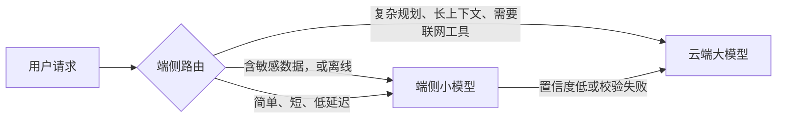

# 端侧部署：模型选型、运行时与端云协同

> 层级：垂类 · inference · 预计 150 分钟 · 题目：[questions.md](questions.md)
> 前置：[01 KV Cache 与显存估算](../01-kv-cache-memory/README.md)（权重和 KV 公式、Decode 的带宽账）、[04 量化](../04-quantization/README.md)（INT4、分组量化、QAT、KV 量化）

## 1 这一章解决什么问题

端侧 Agent（手机助手、桌面助手、车机、本地编码助手）把模型跑在用户设备上。好处是没有网络往返、数据不出设备、不按 token 付费。难处是设备内存小、带宽低、电池有限、会发热，还要和系统里其他应用共用资源。

服务端的优化思路在端侧大多用不上。服务端靠拼 batch 摊薄读权重的开销，端侧只有一个用户，batch 几乎总是 1。服务端显存按 80 GB 算，端侧一个应用能用的内存按百 MB 到 1 GB 算。服务端不关心一次请求耗多少焦耳，端侧要关心电池和发热。

面试里这一块常问：“手机上放多大的模型”“每秒能出几个 token”“用什么运行时、跑在 NPU 还是 GPU”“小模型怎么来”“哪些请求留在本地、哪些送云端”。考的是能不能把约束换算成数字，并给出取舍。

学完你应该能：

- 从一个公开小模型的 config 数出参数量，估算权重、KV、运行时开销，说出它占设备内存的比例；
- 从“每生成一个 token 要把权重读一遍”推出 tokens/s ≈ 带宽 / 每 token 读的字节，并用公开带宽规格算出上限；
- 用每 token 能耗估算续航，说清持续负载下为什么会降频；
- 对比 llama.cpp / GGUF、MLC LLM、ExecuTorch 的机制和取舍，说出 NPU 算子回退的风险；
- 说出蒸馏、剪枝加蒸馏怎么得到小模型，以及 Minitron 为什么只需要很少的重训数据；
- 写出端云路由的代价模型，算出“端侧成功率多高才值得先在本地试”的盈亏点。

**本章符号**（沿用 [01 章](../01-kv-cache-memory/README.md#1-这一章解决什么问题)，新增几个端侧用的）：

| 符号 | 含义 |
|---|---|
| N | 参数量 |
| L、n_kv、d_h | 层数、KV 头数、每个头的维度 |
| w | 每个权重的等效位宽（bit），含分组 scale 等开销 |
| s_kv | KV 每个元素的字节数，BF16 为 2，8 bit 为 1 |
| T | 当前上下文长度（token 数） |
| B | 设备的有效内存带宽（字节/秒） |
| e | 每生成一个 token 的能耗（焦耳） |
| E | 电池能量（焦耳） |

## 2 端侧的四个约束

| 约束 | 限制了什么 | 典型应对 |
|---|---|---|
| 内存 | 权重 + KV 能不能放下，会不会被系统杀掉 | 小模型、INT4 量化、短上下文、KV 量化 |
| 延迟 | 首 token 时间和每 token 速度 | Prefill 吃算力，Decode 吃带宽；量化减少要读的字节 |
| 功耗 | 一次对话耗多少电 | 小模型、少生成、关掉不必要的长思考 |
| 发热 | 持续负载下芯片会降频 | 控制持续生成时长，长任务交给云端 |

四个约束不是独立的。量化同时降内存、降读取字节、降能耗；上下文变长同时加内存、加每步读取、加能耗。所以端侧调优的主线只有一条：**减少每个 token 要搬的字节**。

### 2.1 内存：和系统共用，预算按 10% 算

MobileLLM 论文（Meta，2024）给了一组常被引用的数：iPhone 15 的 DRAM 是 6 GB，Google Pixel 8 Pro 是 12 GB；DRAM 和操作系统、其他应用共用，论文认为一个移动应用不应超过 DRAM 的 10%。按这个口径，6 GB 设备约 0.6 GB，12 GB 设备约 1.2 GB。这是论文的设计假设，不是平台的硬性规定，但面试时可以拿来说明“内存预算远比显卡紧”。

服务端超出显存会 OOM 报错。端侧超出预算的表现更隐蔽：应用切到后台后被系统回收，下次打开要重新加载模型；或者前台时其他应用被挤出内存，用户体验变差。所以端侧的内存预算不只是“能不能跑起来”，还包括“常驻时会不会被杀”。

### 2.2 延迟：Decode 在端侧是带宽瓶颈

[01 章第 2.3 节](../01-kv-cache-memory/README.md#23-每步读写多少字节为什么-decode-受带宽限制)推过算术强度。这里换成端侧最关心的形式：每秒能出几个 token。

batch = 1 时，Decode 一步生成 1 个 token，要做两件事：

```text
计算：F ≈ 2N FLOPs（每个参数一次乘加）
读取：S = N·w/8 + T·(2·L·n_kv·d_h·s_kv)      权重读一遍 + 全部历史 KV 读一遍

一步的时间 t ≥ max(F / 算力, S / B)
```

算术强度 I = F / S。只看权重时 I ≈ 2N / (N·w/8) = 16/w。INT4（w ≈ 4.5）时 I ≈ 3.6 FLOP/B。按本章代码里的假设值（有效算力 2 TFLOPS、有效带宽 50 GB/s），设备的“算力 / 带宽”比值为 40 FLOP/B，比 3.6 大一个数量级，所以读取的时间远大于计算的时间。由此得到：

```text
tokens/s ≈ B / S = B / (N·w/8 + T·KV每token字节)
```

这个式子是上限：真实实现还有反量化、kernel 启动、调度开销，有效带宽也低于标称带宽。推出三条结论：

1. **速度和权重字节成反比。** 同一台设备，模型小一半或位宽减一半，Decode 上限翻倍。
2. **上下文越长越慢。** KV 读取随 T 线性增长。端侧小模型的 KV 不小（第 3 节），几千 token 后 KV 读取就和权重读取同量级。
3. **换更强的算力单元不一定更快。** NPU、GPU、CPU 共用同一块 DRAM，Decode 主要看带宽。NPU 的好处更多是省电（第 4 节）。

Prefill 相反：T_p 个 token 一起算，F ≈ 2N·T_p，强度约为 T_p，受算力限制。首 token 时间 ≈ 2N·T_p / 有效算力。长 prompt（比如把整屏文字或一篇文档塞进上下文）在端侧首 token 会很慢，这是端侧 Agent 要控制上下文长度的第二个原因。

公开的带宽规格（只用厂商原文写过的数）：

| 设备 / 部件 | 公开规格 | 出处 |
|---|---|---|
| Apple M4 | 统一内存带宽 120 GB/s | Apple Newsroom，2024-10 |
| Apple M4 Pro | 统一内存带宽 273 GB/s | Apple Newsroom，2024-10 |
| LPDDR5X | 每个引脚最高 10.7 Gbps | Samsung Semiconductor LPDDR5X 产品页 |

手机 SoC 的总带宽 = 每引脚速率 × 总线位宽 / 8。厂商一般不在产品页直接写总带宽。下面的代码按“64 bit 总线”这个假设推一个上限（推导，不是规格），再用 50 GB/s 作为端侧有效带宽的假设值。

```python
# 端侧 Decode 速度上限：tokens/s ≈ 带宽 / 每 token 要读的字节
GB = 1e9

def decode_tps(bandwidth, n_params, bits_per_weight, kv_bytes_per_token=0, context=0):
    """batch=1 的 Decode 上限：每步把权重读一遍，再把 context 个 token 的 KV 读一遍。"""
    bytes_per_step = n_params * bits_per_weight / 8 + kv_bytes_per_token * context
    return bandwidth / bytes_per_step

def arithmetic_intensity(bits_per_weight):
    """只看权重：2N FLOPs / (N·w/8) 字节"""
    return 2 / (bits_per_weight / 8)

# 1) 强度：INT4 约 3.6 FLOP/B，BF16 为 1。远低于任何加速器的“算力/带宽”比值
assert abs(arithmetic_intensity(4.5) - 3.556) < 1e-3 and arithmetic_intensity(16) == 1

# 2) 带宽规格。手机：LPDDR5X 每引脚 10.7 Gbps（Samsung 产品页），64 bit 总线是假设
phone_peak = 10.7e9 * 64 / 8                      # 85.6 GB/s，推导出的理论峰值
m4, m4_pro = 120 * GB, 273 * GB                   # Apple Newsroom 2024-10
phone_eff = 50 * GB                               # 有效带宽假设值，沿用本章口径
assert abs(phone_peak / GB - 85.6) < 1e-9

# 3) Qwen3-1.7B，Q4_K 约 4.5 bit/权重；每 token KV 112 KiB（第 3 节推导）
N, w, kv_tok = 1.7e9, 4.5, 114_688
no_ctx = decode_tps(phone_eff, N, w)
ctx4k = decode_tps(phone_eff, N, w, kv_tok, 4096)
assert 52 < no_ctx < 53                          # 约 52 token/s（权重 0.96 GB / 50 GB/s ≈ 19 ms）
assert 34 < ctx4k < 36                           # 4K 上下文时 KV 读取把上限压到约 35 token/s

# 4) 结论 1：位宽减半，速度翻倍
assert abs(decode_tps(phone_eff, N, 2.25) / no_ctx - 2) < 1e-12

# 5) 7B 模型同样按 Q4_K 估：约 12.7 token/s 上限
tps_7b = decode_tps(phone_eff, 7e9, w)
assert 12 < tps_7b < 13

# 6) 同一个模型放到 M4 / M4 Pro 上：上限按带宽线性放大
for bw, lo, hi in ((m4, 125, 126), (m4_pro, 285, 286)):
    assert lo < decode_tps(bw, N, w) < hi

# 7) Prefill：受算力限制。有效算力 2 TFLOPS 是假设值
eff_flops = 2e12
ttft_1k = 2 * N * 1000 / eff_flops               # 1000 token 的 prompt
assert abs(ttft_1k - 1.7) < 1e-9                 # 约 1.7 秒首 token
print(f"无上下文 {no_ctx:.1f} tok/s，4K 上下文 {ctx4k:.1f} tok/s，7B {tps_7b:.1f} tok/s，"
      f"1K prompt 首 token {ttft_1k:.1f} s")
```

和论文数字对照：MobileLLM 论文报告，当时 iPhone 上的 MLC Chat 跑 LLaMA 7B 约 3～6 token/s，125M 模型能到 50 token/s。7B 的实测值低于上面 12.7 token/s 的上限，方向一致：上限只算了读权重，实际还有其他开销，手机的有效带宽也可能低于 50 GB/s。

### 2.3 功耗与发热：每 token 能耗和续航

MobileLLM 论文用“每十亿参数每 token 约 0.1 J”估算能耗：7B 模型约 0.7 J/token，350M 的 8-bit 模型约 0.035 J/token。论文估计，满电 iPhone 约 50 kJ，7B 模型以 10 token/s 对话撑不到 2 小时；350M 模型可以支撑一整天的对话。这些是论文的粗估，用来说明量级。

为什么能耗和参数量成正比：Decode 的能量大头是从 DRAM 搬数据，每个 token 都要把全部权重搬一遍。搬的字节和参数量（乘位宽）成正比，所以能耗也大致成正比。由此推出：量化不只省内存和时间，也省电。

把能耗换成功率：e（J/token）× 速度（token/s）= 持续功率（W）。7B 以 10 token/s 生成，持续功率约 7 W（推导）。这个功率能不能长期维持，取决于设备散热；维持不住时芯片降频，速度下降。所以评估端侧方案要看持续负载下的速度，而不是第一分钟的速度。

下面的代码验证续航估算，并用一个一阶热模型（示意，参数都是假设值）演示降频的机制：温度随功率上升，超过阈值后频率下调，速度随之下降。

```python
# 每 token 能耗、续航和降频的示意
J_PER_B_PARAM = 0.1          # MobileLLM 论文：每十亿参数每 token 约 0.1 J
BATTERY = 50_000             # 论文：满电 iPhone 约 50 kJ

def joule_per_token(n_params):
    return J_PER_B_PARAM * n_params / 1e9

def battery_hours(n_params, tps, e=None):
    e = joule_per_token(n_params) if e is None else e
    tokens = BATTERY / e
    return tokens, tokens / tps / 3600

# 1) 7B：0.7 J/token，约 7.1 万 token；10 token/s 时约 1.98 小时，“撑不到 2 小时”
e7 = joule_per_token(7e9)
tok7, h7 = battery_hours(7e9, 10)
assert abs(e7 - 0.7) < 1e-12
assert 71_000 < tok7 < 72_000 and 1.9 < h7 < 2.0

# 2) 350M 8-bit：论文给的是 0.035 J/token（按 0.1 J 每十亿参数正好是 0.035）
tok350, h350 = battery_hours(350e6, 10, e=0.035)
assert abs(joule_per_token(350e6) - 0.035) < 1e-12
assert h350 > 24                                   # 约 40 小时，够“一整天”

# 3) 论文同一段还写了“每 64 token 耗 0.2% 电量”。按 0.7 J 和 50 kJ 推算只有约 0.09%：
pct_64 = 64 * e7 / BATTERY * 100
assert 0.08 < pct_64 < 0.10                       # 两个数不自洽，本章只用 J/token 和 50 kJ

# 4) 功率 = 能耗 × 速度
assert abs(e7 * 10 - 7.0) < 1e-12                  # 7B @ 10 tok/s 约 7 W 持续功率

# 5) 一阶热模型（示意，全部参数是假设）：dT/dt = (P·R - (T - T_amb)) / tau
def simulate(power_at_full, seconds, t_amb=30.0, r=6.0, tau=120.0, t_limit=42.0, tps_full=20.0):
    temp, freq, out = t_amb, 1.0, []
    for _ in range(seconds):
        p = power_at_full * freq                    # 功率随频率下降（简化为线性）
        temp += (p * r - (temp - t_amb)) / tau
        if temp > t_limit:
            freq = max(0.5, freq - 0.01)            # 超温就降频，最低到一半
        elif temp < t_limit - 1:
            freq = min(1.0, freq + 0.01)
        out.append(tps_full * freq)
    return out

speed = simulate(power_at_full=4.0, seconds=900)
first_min = sum(speed[:60]) / 60
last_min = sum(speed[-60:]) / 60
assert first_min == 20.0                          # 第一分钟满速
assert last_min < 0.8 * first_min                 # 15 分钟后稳定在更低的速度
print(f"7B 续航 {h7:.2f} h，350M 续航 {h350:.0f} h；降频示意：第一分钟 {first_min:.1f} tok/s，"
      f"第 15 分钟 {last_min:.1f} tok/s")
```

热模型只演示机制：持续功率乘热阻决定稳态温度，稳态温度超过阈值就必然降频。真实设备的阈值、热阻、降频策略都不同，只能真机测。

## 3 现场估算：Qwen3-1.7B 放进手机

Hugging Face 上 `Qwen/Qwen3-1.7B` 的模型卡和 config.json（2026-11 查阅）：

| 字段 | 值 |
|---|---|
| 参数量 | 1.7B（非嵌入 1.4B） |
| `num_hidden_layers` | 28 |
| `num_attention_heads` / `num_key_value_heads` | 16 / 8（GQA） |
| `head_dim` | 128 |
| `hidden_size` | 2048 |
| `intermediate_size` | 6144 |
| `vocab_size` | 151,936 |
| `tie_word_embeddings` | true |
| 上下文 | 32,768 |

### 3.1 三部分：权重、KV、运行时开销

```text
权重      M_w  = N · w / 8                              w 是等效位宽，含 scale 开销
KV        M_kv = T · 2 · L · n_kv · d_h · s_kv          K 和 V，每层各一份
运行时    M_rt = 计算缓冲（中间激活、logits）+ 运行时本身 + 分词器等
合计      M    = M_w + M_kv + M_rt
```

**等效位宽 w 从哪来**：GGUF 的 Q4_K 把 256 个权重组成一个超块（super-block），里面分 8 个块，每块 32 个权重。每个权重存 4 bit；每块有一个 6 bit 的 scale 和一个 6 bit 的 min；每个超块再存两个 FP16 的超块 scale。ggml 源码里 `block_q4_K` 的定义正是这样：2 个 `ggml_half`、12 字节 `scales`、128 字节 `qs`。合起来 144 字节存 256 个权重，即 4.5 bit/权重。量化原理和分组开销见 [04 章第 2.3 节](../04-quantization/README.md#23-量化粒度)。

**运行时开销**：llama.cpp 这类运行时要为中间激活和输出 logits 分配计算缓冲，大小和上下文长度、batch 大小、词表大小有关，因实现而异。本章用 0.15 GB 作为假设值，实际以运行时日志为准。

### 3.2 实现：从 config 数参数，再算内存

```python
import json

# 原样摘自 Hugging Face config.json（2026-11 查阅），只保留估算要用的字段
CFG = {
    "Qwen3-1.7B": json.loads('{"hidden_size": 2048, "intermediate_size": 6144, "num_attention_heads": 16,'
                             '"num_hidden_layers": 28, "num_key_value_heads": 8, "head_dim": 128,'
                             '"vocab_size": 151936, "tie_word_embeddings": true}'),
    "Qwen3-0.6B": json.loads('{"hidden_size": 1024, "intermediate_size": 3072, "num_attention_heads": 16,'
                             '"num_hidden_layers": 28, "num_key_value_heads": 8, "head_dim": 128,'
                             '"vocab_size": 151936, "tie_word_embeddings": true}'),
}

def count_params(c):
    d, f, L = c["hidden_size"], c["intermediate_size"], c["num_hidden_layers"]
    n_h, n_kv, d_h, V = c["num_attention_heads"], c["num_key_value_heads"], c["head_dim"], c["vocab_size"]
    attn = d * n_h * d_h + 2 * d * n_kv * d_h + n_h * d_h * d   # Q、K、V、O 投影（Qwen3 无 QKV 偏置）
    mlp = 3 * d * f                                             # gate、up、down
    norms = 2 * d + 2 * d_h                                     # 两个 RMSNorm + q_norm、k_norm
    embed = V * d * (1 if c["tie_word_embeddings"] else 2)
    body = L * (attn + mlp + norms) + d                         # 最后再加一个 RMSNorm
    return body + embed, body, embed

def kv_bytes_per_token(c, s_kv=2):
    return 2 * c["num_hidden_layers"] * c["num_key_value_heads"] * c["head_dim"] * s_kv

GB = 1e9
# 1) 参数量和模型卡对上：1.7B（非嵌入 1.4B）、0.6B
n17, body17, emb17 = count_params(CFG["Qwen3-1.7B"])
n06, _, _ = count_params(CFG["Qwen3-0.6B"])
assert abs(n17 / 1e9 - 1.72) < 0.01 and abs(body17 / 1e9 - 1.41) < 0.01
assert abs(n06 / 1e9 - 0.60) < 0.01
assert abs(emb17 / n17 - 0.18) < 0.01                  # 嵌入约占 18%；tie 省掉同样大的输出层

# 2) Q4_K 的等效位宽：144 字节 / 256 个权重
q4k_bytes = 2 * 2 + 12 + 256 // 2                      # d、dmin（FP16）+ scales + 4-bit quants
assert q4k_bytes * 8 / 256 == 4.5

# 3) infer-device-002 的口径：N 取 1.7e9，4.5 bit，4K 上下文，BF16 KV
w = 1.7e9 * 4.5 / 8
kv_tok = kv_bytes_per_token(CFG["Qwen3-1.7B"])
kv_4k = kv_tok * 4096
assert kv_tok == 114_688 and kv_tok / 1024 == 112        # 112 KiB/token
assert abs(w / GB - 0.956) < 0.001 and abs(kv_4k / GB - 0.470) < 0.001
total = w + kv_4k
assert abs(total / GB - 1.43) < 0.01
budget_12g = 12 * GB * 0.10
assert total > budget_12g                                # 超过 12 GB 设备 10% 的预算（1.2 GB）

# 4) 加上运行时开销（0.15 GB 是假设值），差距更大
M_rt = 0.15 * GB
assert total + M_rt > 1.5 * GB

# 5) 三种降法
kv8 = kv_bytes_per_token(CFG["Qwen3-1.7B"], s_kv=1) * 4096
assert abs((w + kv8) / GB - 1.19) < 0.01 and w + kv8 < budget_12g      # KV 用 8 bit：刚好进预算
ctx_fit = int((budget_12g - w) // kv_tok)
assert 2100 < ctx_fit < 2200                             # 不量化 KV，只能给约 2.1K token 上下文
w06 = 0.6e9 * 4.5 / 8
assert abs(w06 / GB - 0.34) < 0.01
assert kv_bytes_per_token(CFG["Qwen3-0.6B"]) == kv_tok   # 0.6B 的每 token KV 和 1.7B 一样
assert kv_4k > w06                                       # 4K 时 0.6B 的 KV 比 Q4 权重还大
assert abs((w06 + kv_4k) / GB - 0.81) < 0.01

# 6) KV 什么时候追上权重：1.7B 在约 8.3K token
cross = w / kv_tok
assert 8000 < cross < 8500
print(f"1.7B：参数 {n17/1e9:.2f}B，Q4 权重 {w/GB:.2f} GB，4K KV {kv_4k/GB:.2f} GB，合计 {total/GB:.2f} GB；"
      f"10% 预算下最长 {ctx_fit} token；KV 在 {cross:.0f} token 时等于权重")
```

### 3.3 数值例子：读一遍结果

- 参数：从 config 数出 1.72B，非嵌入 1.41B，和模型卡的“1.7B，非嵌入 1.4B”一致。嵌入矩阵 151,936 × 2048 ≈ 0.31B，约占 18%。`tie_word_embeddings: true` 让输入嵌入和输出层共用一份，省掉同样大的一块。MobileLLM 论文报告，嵌入共享在它的 125M/350M 模型上减少约 10% 参数，精度只掉一点。
- 权重：1.7e9 × 4.5 / 8 ≈ 0.96 GB。实际文件里嵌入层、输出层常用更高精度，会略大。
- 每 token KV：2 × 28 × 8 × 128 × 2 B = 114,688 B = 112 KiB。4K 上下文约 0.47 GB；8K 约 0.94 GB；KV 用 8 bit 则减半。
- 合计（Q4 权重 + 4K 的 16 bit KV）：0.96 + 0.47 ≈ 1.43 GB。12 GB 设备的 10% 是 1.2 GB，这个配置已经超了，再加运行时开销超得更多。

降下来的办法：

| 办法 | 合计 | 代价 |
|---|---|---|
| KV 量化到 8 bit | ≈ 1.19 GB | 长上下文精度要评测，见 [04 章第 7 节](../04-quantization/README.md#7-kv-cache-量化) |
| 上下文锁在约 2.1K token | ≈ 1.2 GB | 多轮对话和工具结果要裁剪 |
| 换 Qwen3-0.6B | ≈ 0.81 GB（4K） | 能力下降，要在目标任务上评测 |

两个容易忽略的点：

- **小模型的 KV 不一定小。** Qwen3-0.6B 和 1.7B 层数、KV 头数、head_dim 都一样，所以每 token KV 相同。0.6B 在 4K 上下文时，KV 已经比 Q4 权重还大。1.7B 在约 8.3K token 时 KV 等于 Q4 权重。
- **小模型里嵌入层占比高。** 1.7B 里嵌入占 18%，0.6B 里约占 26%（0.156B / 0.6B）。MobileLLM 论文把嵌入共享列为小模型的关键设计之一。

Decode 速度账见第 2.2 节代码：有效带宽 50 GB/s（假设值）时，只读权重上限约 52 token/s；4K 上下文时约 35 token/s。

## 4 运行时与硬件取舍

### 4.1 三个运行时的机制

只写官方文档里核对过的机制：

| 运行时 | 官方定位 | 怎么把模型变成能跑的东西 | 支持的后端或平台（文档所列） |
|---|---|---|---|
| llama.cpp | 在多种硬件上以最少配置做 LLM 推理，基于 ggml 库 | 把权重转成 GGUF 单文件，运行时读文件里的元数据和张量，用手写 kernel 执行 | 构建文档有 CPU、BLAS、Metal、CUDA、HIP、Vulkan、SYCL、OpenCL（Adreno GPU）、CANN（昇腾 NPU）、Hexagon 等；macOS 上默认开启 Metal |
| MLC LLM | 机器学习编译器加高性能部署引擎 | 两样产物：转换成 MLC 格式的权重，和编译出的模型库（推理逻辑）。编译针对目标平台优化，基于 TVM | iOS Swift SDK、Android SDK、WebLLM（浏览器）、REST API、Python API |
| ExecuTorch | PyTorch 的端侧推理方案，从手机到微控制器 | 从 PyTorch 导出，按后端划分可加速的子图，生成针对该硬件的 `.pte` 文件；多个平台通常各生成一个 `.pte` | XNNPACK（CPU，通用和回退）、Core ML、MLX、Vulkan、Qualcomm、MediaTek、Arm Ethos-U、Samsung Exynos 等 |

**GGUF 的设计目标**（ggml 仓库的 GGUF 规范）：单文件部署，不需要外部文件；可扩展，加新字段不破坏旧模型；兼容 `mmap`，加载快；所有加载需要的信息都在文件里。和上一代格式 GGJT 的主要区别是超参数改成了键值结构的元数据。

`mmap` 对端侧有实际意义：模型文件映射进地址空间后，操作系统按页加载、在内存紧张时可以丢弃干净页，之后再从文件读回。代价是首次访问某些页时要从存储读，冷启动后的前几个 token 可能慢。

**量化格式各管各的**。GGUF 有自己的量化类型（Hugging Face GGUF 文档列出）：Q4_K 为 4.5 bit/权重，Q5_K 为 5.5，Q6_K 为 6.5625，Q3_K 为 3.4375，Q2_K 为 2.625，IQ4_XS 为 4.25；Q4_0、Q8_0 等被标为旧格式。MLC LLM 的量化模式写成 `q4f16_1` 这样的名字，文档列出的选项有 `q0f16`、`q0f32`、`q3f16_1`、`q4f16_1`、`q4f32_1`，默认算法是分组量化。ExecuTorch 的量化在导出阶段按后端配置。三家格式互不通用，换运行时意味着重新转换和重新评测。量化原理见 [04 量化](../04-quantization/README.md)。

**取舍**：

| 关心什么 | llama.cpp | MLC LLM | ExecuTorch |
|---|---|---|---|
| 上手成本 | 低：下载 GGUF 即可跑，社区现成文件多 | 中：要转权重、编译模型库 | 中到高：要从 PyTorch 导出，配置后端和量化 |
| 新模型结构 | 要等 llama.cpp 实现该结构 | 要在 MLC 里定义结构 | PyTorch 写得出就能导出，但每个后端的算子覆盖不同 |
| NPU | 有部分后端（CANN、Hexagon 等），覆盖面随版本变化 | 以 GPU 为主 | 后端划分就是为接 NPU 设计的 |
| 浏览器 | 不是重点 | WebLLM | 有实验性的 WebGPU 后端 |

### 4.2 NPU、GPU、CPU 怎么选

| 硬件 | 长处 | 短处 |
|---|---|---|
| NPU | 能效高，适合长期常驻的小模型 | 算子覆盖有限，新结构常常没有现成 kernel；工具链和格式与厂商绑定 |
| GPU | 通用性好，Prefill 快 | 功耗和发热比 NPU 高，和图形渲染抢资源 |
| CPU | 什么都能跑，兼容性最好 | Prefill 慢；Decode 受内存带宽限制时差距反而没那么大 |

ExecuTorch 后端文档说得很直接：后端不支持的算子用可移植的 CPU 回退（例如 XNNPACK）执行，只能部分加速；可以按优先级指定多个划分器，让 GPU 不支持的算子回退到 CPU；不同后端的模型和算子支持不同，要看各后端的文档。

回退为什么伤：图被切成“NPU 段 — CPU 段 — NPU 段”，每个切口都要把激活在两种内存布局或两块缓冲之间同步，并且要等一边算完另一边才能开始。切口越多，同步开销越多。下面的最小模拟把一层分成若干算子，比较三种放置方式（时间都是假设的相对值，只演示机制）：

```python
# NPU 子图被不支持的算子切开后的代价（示意：时间单位为相对值，全部是假设）
ops = ["qkv", "rope", "attn", "o_proj", "norm", "gate_up", "act", "down"]
cpu_cost = {"qkv": 8, "rope": 1, "attn": 6, "o_proj": 3, "norm": 1, "gate_up": 10, "act": 1, "down": 5}
npu_speedup = 4.0            # NPU 上同一算子快 4 倍（假设）
sync_cost = 3.0              # 每次 NPU↔CPU 切换的同步和搬运代价（假设）

def layer_time(placement):
    """placement[i] 是第 i 个算子放在哪：'npu' 或 'cpu'。每次换设备加一次同步开销。"""
    t, prev = 0.0, None
    for op, dev in zip(ops, placement):
        t += cpu_cost[op] / (npu_speedup if dev == "npu" else 1.0)
        if prev is not None and dev != prev:
            t += sync_cost
        prev = dev
    return t

all_cpu = layer_time(["cpu"] * len(ops))
all_npu = layer_time(["npu"] * len(ops))
# 新的位置编码算子 rope 在 NPU 上没有 kernel，回退 CPU：图被切成三段，两次切换
rope_fallback = layer_time(["cpu" if op == "rope" else "npu" for op in ops])
# 再多一个激活函数不支持：四次切换
two_fallbacks = layer_time(["cpu" if op in ("rope", "act") else "npu" for op in ops])

assert all_npu == sum(cpu_cost.values()) / npu_speedup             # 全在 NPU：8.75
assert rope_fallback == all_npu - 1 / 4 + 1 + 2 * sync_cost         # 一个小算子回退，多出 6.75
assert rope_fallback > 1.7 * all_npu                                # 收益被吃掉一大半
assert two_fallbacks > rope_fallback
# 同步代价再大一点（例如每次要跨内存拷贝大激活），部分回退会比全 CPU 还慢
sync_cost = 10.0                                                    # layer_time 读的是这个全局变量
assert layer_time(["cpu" if op in ("rope", "act") else "npu" for op in ops]) > all_cpu
print(f"全 CPU {all_cpu}，全 NPU {all_npu}，rope 回退 {rope_fallback}，两处回退 {two_fallbacks}")
```

实践上的结论：

- 先确认模型的每个算子在目标 NPU 上都有支持，否则一次回退就可能抵消 NPU 的收益。导出工具一般能打印哪些节点被委托给后端、哪些留在 CPU，上线前看这份清单；
- Decode 主要受内存带宽限制，换到 NPU 不一定更快，但通常更省电；
- 上线前在真机上测首 token 时间、每 token 速度、持续 10 分钟后的速度（看降频）和耗电。

## 5 小模型从哪来：蒸馏与剪枝

| 方法 | 做法 | 代价 |
|---|---|---|
| 从头训小模型 | 在大量数据上直接训练 | 要完整的预训练算力和数据 |
| 知识蒸馏 | 用大模型的输出分布做软目标训练小模型 | 需要教师模型的推理算力；小模型容量有上限 |
| 剪枝 + 蒸馏 | 从大模型裁掉层、宽度、注意力头或 MLP 维度，再用蒸馏恢复 | 剪枝结构要选对；要验证裁掉的能力 |
| 结构设计 | 针对小参数量专门设计结构 | 要做架构搜索实验 |

### 5.1 蒸馏：软目标和温度

Hinton 等（2015）提出用大模型的类别概率做“软目标”。教师 logits 为 v，学生 logits 为 z，温度为 T：

```text
p_i = softmax(v / T)_i            教师的软目标
q_i = softmax(z / T)_i            学生在同样温度下的输出
L_soft = − Σ_i p_i · log q_i      软目标交叉熵

∂L_soft / ∂z_i = (q_i − p_i) / T
```

T 越大，分布越平，错误类别之间的相对概率被放大出来。软目标里“错误答案之间的相对概率”带有教师学到的相似性信息，这是硬标签没有的。训练完后学生用 T = 1 推理。

论文还指出一个实现细节：T 很大时，把 q_i、p_i 在 T → ∞ 处展开（假设 logits 均值为 0），梯度近似为 (z_i − v_i) / (K·T²)，K 是类别数。软目标梯度的量级按 1/T² 缩小，所以同时用硬标签和软目标时，要把软目标那一项乘 T²，否则换温度就等于换了两项的相对权重。

Minitron 论文在 LLM 上做了温度实验（τ = 0.1、0.5、1.0、3.0），报告 τ = 1.0 最好。论文的解释是 LLM 的 logits 分布本身熵就高，不像分类模型那样尖，不需要高温去软化。所以“蒸馏要高温”是分类模型的经验，用到 LLM 上要重新验证。

```python
import numpy as np

def softmax(x):
    e = np.exp(x - x.max())
    return e / e.sum()

def soft_ce_grad(z, v, T):
    """软目标交叉熵对学生 logits 的梯度：(q − p) / T"""
    return (softmax(z / T) - softmax(v / T)) / T

rng = np.random.default_rng(0)
K = 10                                              # 类别数
v = rng.normal(size=K); v -= v.mean()               # 教师 logits，均值为 0
z = rng.normal(size=K); z -= z.mean()               # 学生 logits，均值为 0

# 1) 数值梯度和解析梯度一致
def loss(z, T):
    return -(softmax(v / T) * np.log(softmax(z / T))).sum()
eps, T = 1e-6, 2.0
num = np.array([(loss(z + eps * np.eye(K)[i], T) - loss(z - eps * np.eye(K)[i], T)) / (2 * eps) for i in range(K)])
assert np.allclose(num, soft_ce_grad(z, v, T), atol=1e-7)

# 2) 高温时梯度 ≈ (z − v) / (K·T²)，量级按 1/T² 缩小
for T in (20.0, 50.0, 100.0):
    g = soft_ce_grad(z, v, T)
    assert np.allclose(g, (z - v) / (K * T**2), rtol=0.1)
g20, g100 = (np.abs(soft_ce_grad(z, v, T)).sum() for T in (20.0, 100.0))
assert abs(g20 / g100 - 25) < 1                    # 温度 ×5，梯度 ÷25

# 3) 所以乘上 T² 后，不同温度下软目标那一项的量级稳定
scaled = [np.abs(soft_ce_grad(z, v, T)).sum() * T**2 for T in (20.0, 50.0, 100.0)]
assert max(scaled) / min(scaled) < 1.05

# 4) 温度把错误类别之间的差别显出来：次大类和最大类的概率比 = exp((v2 − v1)/T)，T 越大越接近 1
p1, p5 = softmax(v), softmax(v / 5)
top, second = np.argsort(v)[-1], np.argsort(v)[-2]
r1, r5 = p1[second] / p1[top], p5[second] / p5[top]
assert np.isclose(r5, np.exp((v[second] - v[top]) / 5)) and r5 > r1
entropy = lambda p: -(p * np.log(p)).sum()
assert entropy(p5) > entropy(p1)                    # 分布更平
print(f"次大/最大概率比：T=1 时 {r1:.3f}，T=5 时 {r5:.3f}；T² 缩放后量级比 {max(scaled)/min(scaled):.3f}")
```

### 5.2 剪枝 + 蒸馏：Minitron

NVIDIA 的 Minitron 论文（2024）研究：与其每个尺寸都从头训，不如先训一个大模型，再剪枝并用很少的数据重训。论文把 Nemotron-4 15B 剪成 8B 和 4B。

**做法**：

1. **估计重要性**。只用前向，在 1024 条校准样本上算激活，给每个注意力头、MLP 神经元、嵌入通道打分；深度（整层）用困惑度或 Block Importance 打分。不需要反向传播。
2. **剪枝**。按分数裁掉宽度（头、神经元、嵌入通道）或深度（层）。
3. **蒸馏重训**。教师是原模型，学生是剪后的模型，只用蒸馏损失（logits 上的前向 KL 散度）重训。

论文给出的部分最佳实践：

- 训一个模型族时，先训最大的，再逐级剪枝加蒸馏得到小的；
- 在论文研究的尺度（≤ 15B）上，剪宽度优于剪深度，但这个结论要在重训一些步之后才显现；
- 重训只用蒸馏损失（KLD），不用常规的下一个 token 损失；
- 深度剪得多时，蒸馏要加中间层状态和嵌入；深度没怎么剪时只蒸馏 logits；
- 从最接近目标尺寸的模型剪起。

**为什么只要很少的数据**：剪后的模型继承了大模型学到的大部分权重，重训只是让剩下的结构重新配合好，而不是从随机初始化学起。论文报告：重训只用了不到 3% 的原始训练数据（94B token，原模型是 8T）；每个额外的模型，训练 token 比从头训少最多 40 倍；训练整个 15B、8B、4B 模型族的算力节省 1.8 倍。

1.8 倍这个数可以手算核对。论文给出每个训练步的 FLOPs：15B、8B、4B 分别为 4.4e17、2.5e17、1.2e17。从头训三个模型的总量正比于 4.4 + 2.5 + 1.2 = 8.1；用剪枝方法，后两个模型各少 40 倍，正比于 4.4 + 2.5/40 + 1.2/40 ≈ 4.49。比值 8.1 / 4.49 ≈ 1.8。节省只有 1.8 倍而不是 40 倍，是因为最大的那个模型仍要完整训一遍。

下面用一层 MLP 演示“按激活重要性剪神经元”比随机剪更好，并核对上面的算术：

```python
import numpy as np

# 1) Minitron 模型族的算力节省：论文给出的每步 FLOPs
full = 4.4e17 + 2.5e17 + 1.2e17
pruned = 4.4e17 + 2.5e17 / 40 + 1.2e17 / 40
assert abs(full / pruned - 1.8) < 0.01
assert 94e9 / 8e12 < 0.03                          # 94B / 8T ≈ 1.2%，“不到 3%”

# 2) 按激活重要性剪 MLP 神经元（简化版：一层 ReLU MLP，重要性 = 校准集上激活的 L2 范数）
rng = np.random.default_rng(0)
d, f, n_calib = 64, 256, 1024                       # 1024 条校准样本，与论文一致
W1 = rng.normal(size=(d, f)) / np.sqrt(d)
scale = np.exp(rng.normal(size=f))                  # 让神经元的重要性差别大一些
W1 *= scale
W2 = rng.normal(size=(f, d)) / np.sqrt(f)
X = rng.normal(size=(n_calib, d))                   # 校准集，形状 (1024, 64)

def mlp(X, keep):
    H = np.maximum(X @ W1[:, keep], 0)              # (n, k)
    return H @ W2[keep, :]                          # (n, d)

ref = mlp(X, np.arange(f))
H = np.maximum(X @ W1, 0)                           # (1024, 256)
importance = np.sqrt((H ** 2).sum(axis=0))          # 每个神经元一个分数，只用前向
k = f // 2                                          # 剪掉一半神经元

keep_imp = np.argsort(importance)[-k:]
err_imp = np.linalg.norm(mlp(X, keep_imp) - ref) / np.linalg.norm(ref)
err_rand = np.mean([np.linalg.norm(mlp(X, rng.choice(f, k, replace=False)) - ref) / np.linalg.norm(ref)
                    for _ in range(20)])
assert err_imp < 0.5 * err_rand                     # 按重要性剪，输出误差远小于随机剪

# 3) 测试集上同样成立（不是只拟合了校准集）
X_test = rng.normal(size=(512, d))
ref_t = mlp(X_test, np.arange(f))
err_imp_t = np.linalg.norm(mlp(X_test, keep_imp) - ref_t) / np.linalg.norm(ref_t)
assert err_imp_t < 0.5 * err_rand
print(f"模型族算力节省 {full/pruned:.2f}×；剪一半神经元：按重要性误差 {err_imp:.3f}，随机 {err_rand:.3f}")
```

剪完的误差靠蒸馏重训恢复，这一步代码里没做。真实模型里还要处理注意力头、嵌入通道，以及剪完之后形状的对齐（例如 GQA 的 KV 头分组）。

### 5.3 小模型的结构选择

MobileLLM 论文认为在 1B 以下，结构比通常认为的更重要。它的几个发现：

- 深而窄比浅而宽好；
- 输入输出嵌入共享，在 125M/350M 上减少约 10% 参数，精度只掉一点；
- 用 GQA；
- 相邻块共享权重（MobileLLM-LS），不增加模型大小，提升精度。

权重共享和本章的带宽账直接相关。论文的解释是：内存搬运是延迟瓶颈时，相邻两个块共享权重，第二次计算时权重已经在缓存里，只需多算一遍、不用多搬一遍。论文在 iPhone 13 上用 ExecuTorch（MPS 后端）测 125M FP16 模型：层数翻倍但共享权重，执行时间只多 2.6%；层数翻倍不共享，执行时间多 86%，加载和初始化时间多 143%。

### 5.4 对 Agent 的提醒

小模型最先掉的往往是指令遵循、工具调用格式和多步规划，而不是知识问答。蒸馏数据要覆盖 Agent 真实用到的工具调用轨迹；评测要测工具调用的格式正确率和参数正确率（评测方法见[第 04 章第 8 节](../04-quantization/README.md#8-量化对-agent-能力的影响)）。端侧模型还常配合约束解码保证输出格式合法，见 [05 章第 7 节](../05-agent-serving/README.md#7-结构化输出与约束解码)。

## 6 端云分工与路由

端侧模型能力有限，几乎所有端侧 Agent 都是端云协同。路由层决定每个请求留在本地还是送到云端。



| 路由依据 | 留本地 | 送云端 |
|---|---|---|
| 难度 | 意图识别、简单改写、单步工具调用 | 多步规划、长文档、复杂代码 |
| 隐私 | 涉及本地文件、通讯录、屏幕内容 | 已脱敏或用户同意上传的内容 |
| 网络 | 离线、弱网 | 网络好，且云端延迟可接受 |
| 成本 | 高频小请求 | 低频高价值请求 |

隐私和网络是**硬约束**：命中就不再比较代价，直接留本地。难度和成本是**软约束**：按下面的代价模型选。

### 6.1 三种做法

- **规则**：按任务类型、输入长度、需要的工具分流，简单可解释。
- **学习式路由**：RouteLLM 论文（2024）用人类偏好数据训练轻量路由器，决定请求给强模型还是弱模型。论文用“强模型调用比例”衡量成本，用 PGR（performance gap recovered，路由后的质量在弱模型和强模型之间恢复了多少比例）衡量质量。论文报告：成本降到一半以下且质量不降。
- **级联**：先让端侧模型答，再用置信度、格式校验或规则检查决定要不要升级到云端。代价是升级的请求多花了一次端侧时间。

### 6.2 代价模型：级联什么时候划算

设一类请求里，端侧模型能答对的比例为 p（端侧成功率）。记：

| 符号 | 含义 |
|---|---|
| c_l、c_c | 一次端侧、一次云端调用的成本（云端按 token 计费；端侧计电量，常可视为 0） |
| t_l、t_c | 一次端侧、一次云端调用的延迟（云端含网络往返） |
| r | 校验器能抓住端侧错误的比例（召回） |

**级联**（先本地，失败再上云）：

```text
期望成本   C_cas = c_l + (1 − p)·r·c_c
期望延迟   T_cas = t_l + (1 − p)·r·t_c
漏掉的错误 E_cas = (1 − p)·(1 − r)          校验器没抓到，错误答案直接给了用户
```

**全部送云端**：C = c_c，T = t_c，错误率取云端自身的错误率。

先看 r = 1（端侧失败都能被发现）。级联的延迟比直接上云低，条件是：

```text
t_l + (1 − p)·t_c < t_c   ⟺   p > t_l / t_c
```

成本同理：p > c_l / c_c。端侧成本近似为 0 时，成本上级联几乎总是赚；延迟上要求端侧成功率超过“端侧延迟 / 云端延迟”。端侧越慢、云端越快，门槛越高。

r < 1 时，有 (1 − p)(1 − r) 比例的错误漏给用户。这是级联真正的风险：成本和延迟省了，质量掉了。所以级联的前提是端侧输出**可校验**：格式能用 JSON Schema 检查，工具参数能用规则检查，答案能用执行结果检查。开放式生成很难校验，更适合用路由器提前分流。

**路由器**（先判断难度，难题直接上云，不在本地试）：路由器准确时，难题省掉一次端侧尝试；路由器看错时，难题留在本地答错，或简单题被送上云端浪费钱。

下面的代码把三种策略放进同一个模型，验证盈亏点：

```python
# 端云路由的代价模型：全云端、级联、路由器
def all_cloud(c_c, t_c):
    return {"cost": c_c, "latency": t_c, "miss": 0.0}

def cascade(p, c_l, c_c, t_l, t_c, r=1.0):
    """先在本地试；失败且被校验器发现（比例 r）就上云。miss 是漏给用户的端侧错误比例。"""
    esc = (1 - p) * r
    return {"cost": c_l + esc * c_c, "latency": t_l + esc * t_c, "miss": (1 - p) * (1 - r)}

def router(p, c_l, c_c, t_l, t_c, acc):
    """路由器以准确率 acc 判断“本地能不能答对”；判为能就本地答（不再校验），否则直接上云。"""
    local_ok = p * acc                    # 本地能答对、也被留在本地
    local_bad = (1 - p) * (1 - acc)       # 本地答不对、却被留在本地 → 错误漏给用户
    to_cloud = 1 - local_ok - local_bad
    return {"cost": (local_ok + local_bad) * c_l + to_cloud * c_c,
            "latency": (local_ok + local_bad) * t_l + to_cloud * t_c,
            "miss": local_bad}

# 假设值：云端每次 0.01 元、1.2 s（含网络）；端侧不计钱、0.6 s
c_l, c_c, t_l, t_c = 0.0, 0.01, 0.6, 1.2

# 1) 延迟盈亏点：p* = t_l / t_c = 0.5
p_star = t_l / t_c
assert abs(p_star - 0.5) < 1e-12
assert abs(cascade(p_star, c_l, c_c, t_l, t_c)["latency"] - t_c) < 1e-12   # 恰好打平
assert cascade(0.7, c_l, c_c, t_l, t_c)["latency"] < t_c                   # p 高于 p*：级联更快
assert cascade(0.3, c_l, c_c, t_l, t_c)["latency"] > t_c                   # p 低于 p*：级联更慢

# 2) 成本：端侧不计钱时，只要 p > 0 级联就省钱；省的比例正好是 p
cas = cascade(0.7, c_l, c_c, t_l, t_c)
assert abs(cas["cost"] / c_c - 0.3) < 1e-12

# 3) 端侧变慢（例如长 prompt 的 Prefill）会抬高门槛：t_l = 1.0 s 时 p* ≈ 0.83
assert abs(1.0 / t_c - 0.833) < 1e-3
assert cascade(0.7, c_l, c_c, 1.0, t_c)["latency"] > t_c                   # 同样 70% 成功率，已经不划算

# 4) 校验器召回 r < 1：钱和时间更省，但错误漏给用户
cas_r = cascade(0.7, c_l, c_c, t_l, t_c, r=0.8)
assert cas_r["cost"] < cas["cost"] and abs(cas_r["miss"] - 0.06) < 1e-12    # 6% 的请求拿到错误答案

# 5) 路由器：成功率低的请求类型（p = 0.3）上，级联延迟已超过全云端；准确的路由器仍能比全云端快
cas_low = cascade(0.3, c_l, c_c, t_l, t_c)
rt_low = router(0.3, c_l, c_c, t_l, t_c, acc=0.9)
assert cas_low["latency"] > t_c and rt_low["latency"] < t_c
assert abs(rt_low["miss"] - 0.07) < 1e-12           # 代价：7% 的难题被误留在本地

# 6) 路由器准确率的盈亏：低于某个值，路由器的漏错比级联（r=0.8）还多
def miss_gap(acc, p=0.7):
    return router(p, c_l, c_c, t_l, t_c, acc)["miss"] - cascade(p, c_l, c_c, t_l, t_c, r=0.8)["miss"]
acc_star = 1 - 0.06 / 0.3                           # (1−p)(1−acc) = 0.06 → acc = 0.8
assert abs(miss_gap(acc_star)) < 1e-12 and miss_gap(0.7) > 0 and miss_gap(0.9) < 0
print(f"延迟盈亏点 p*={p_star}；p=0.7 时级联成本降到全云端的 {cas['cost']/c_c:.0%}，"
      f"延迟 {cas['latency']:.2f}s；路由器在 p=0.3 时延迟 {rt_low['latency']:.2f}s")
```

读这段代码得到的结论（推导）：

- 级联的延迟盈亏点是 p* = t_l / t_c。端侧和云端延迟要在真机、真实网络下测，不能用桌面数字。
- 端侧不计钱时，级联省下的云端成本比例就是 p。
- 级联靠校验器兜底质量；校验器召回不够时，省下的钱是用质量换的。
- 某类请求端侧成功率低于 p* 时，级联在延迟上不划算，应由路由器或规则直接送云端。
- 路由器和级联可以组合：路由器先把明显的难题送云端，剩下的走级联。

### 6.3 代价和一致性

- 路由错了有两种损失：难题留在本地答错；简单题送云端浪费钱、多了延迟。
- 端云两个模型行为不一致，同一个 Agent 的输出风格和工具调用格式可能不同，要统一提示和工具协议。
- 升级到云端意味着数据出设备，要和隐私规则一起设计（第 7 节）。
- 云端要设超时。弱网时超时回退到本地，给用户降级提示。

## 7 本地数据与隐私

端侧的一大卖点是数据不出设备。但端云协同之后，“不出设备”要靠设计来保证：

| 环节 | 风险 | 做法 |
|---|---|---|
| 路由 | 敏感请求被送到云端 | 先在本地做敏感信息检测，命中就强制本地或先脱敏 |
| 上传内容 | 带上了不需要的上下文 | 只传完成任务需要的最小片段；对人名、号码等做替换 |
| 本地存储 | 对话历史、KV、向量索引落盘 | 用系统提供的加密存储；设置保留期限，支持用户删除 |
| 日志与遥测 | 调试日志带出原文 | 日志只记元数据；上报前征得同意 |
| 模型文件 | 本地权重可能被提取 | 把模型当作可被读取的资产来评估，不在权重或提示里放密钥 |

和第 6 节的关系：隐私检测要放在路由器**之前**，作为硬约束。第 6.2 节的代价模型只在“允许上云”的请求里比较。如果把隐私当成路由器的一个特征，路由器出错时敏感数据就出了设备，这类错误不能按“概率小”接受。

面试回答顺序：先说本地处理的边界（哪些数据、哪些任务），再说路由怎么守住这个边界，最后说本地存储和日志怎么处理。

## 8 工程细节与常见坑

**1. 只算权重，不算 KV 和运行时开销**

- 现象：估算 1 GB 能放下，真机上内存涨到 1.5 GB 以上；应用切后台后很快被系统回收。
- 原因：KV 随上下文线性增长，Qwen3-1.7B 每 token 112 KiB，4K 就是 0.47 GB；运行时还要为激活和 logits 分配计算缓冲。
- 排查：按第 3.2 节的式子把三部分分开算；看运行时启动日志里各缓冲的大小，和估算对账。
- 处理：锁上下文上限，KV 量化，裁剪工具结果和历史对话。

**2. 用标称带宽算速度，真机慢一倍以上**

- 现象：按 tokens/s ≈ 带宽 / 权重字节算出 50 token/s，真机只有 20 多。
- 原因：标称带宽是峰值，有效带宽更低；还有反量化、kernel 启动、调度开销；上下文变长后 KV 读取也占带宽。
- 排查：测不同上下文长度下的 Decode 速度。速度随上下文下降说明 KV 读取占比在涨；短上下文下也远低于上限，说明 kernel 或调度效率不够。
- 处理：把估算当上限，选型用真机数字；换带宽利用率更高的量化格式或运行时。

**3. 只测第一分钟的速度**

- 现象：演示时流畅，用户连续用十分钟后明显变慢，机身发烫。
- 原因：持续功率超过设备的散热能力，芯片降频（第 2.3 节的热模型）。
- 排查：连续生成 10～15 分钟，每分钟记一次 tokens/s 和设备温度。
- 处理：控制单次生成长度，关掉不必要的长思考；长任务交给云端；在 NPU 上跑以降功率。

**4. NPU 算子回退**

- 现象：同一个模型放到 NPU 后端，速度和全 CPU 差不多甚至更慢；换了一个新结构的模型后 NPU 收益消失。
- 原因：不支持的算子回退 CPU，图被切开，每个切口都要同步（第 4.2 节代码）。
- 排查：看导出时的委托报告，数一下有几段子图留在 CPU、切口有几个。
- 处理：把不支持的算子改写成支持的等价形式，或选算子覆盖更好的后端；实在不行整图放 GPU。

**5. 量化格式和运行时不匹配**

- 现象：同一个模型的 Q4 版本在两个运行时上效果不同；换运行时后格式要重新转换，评测结果变了。
- 原因：GGUF 的 K-quant、MLC 的 `q4f16_1`、ExecuTorch 导出时的量化配置是不同的方案，分组大小、scale 精度、哪些层保留高精度都不同。
- 排查：记录每个产物的量化方案和保留高精度的层；在同一评测集上比较。
- 处理：换运行时要重新跑 Agent 评测，至少覆盖工具调用的格式正确率和参数正确率。

**6. 嵌入和输出层没量化，体积比估算大**

- 现象：按 4.5 bit × 参数量估算 0.96 GB，实际文件 1.1 GB 以上。
- 原因：很多量化方案把嵌入层和输出层留在更高精度。小模型里嵌入占比高（Qwen3-1.7B 约 18%，0.6B 约 26%），影响比大模型明显。
- 排查：读文件里每个张量的类型（GGUF 元数据里有），按类型分别求和。
- 处理：估算时把嵌入单独按实际精度算。

**7. 冷启动慢**

- 现象：应用第一次打开或被回收后重开，要等几秒才出第一个 token。
- 原因：模型文件要从存储加载；用 `mmap` 时页面在第一次访问时才读入；有些运行时第一次运行还要编译或初始化 kernel。MobileLLM 论文在 iPhone 13 上报告 125M FP16 模型的初始化约 1.36 s，执行一次约 15.6 ms。
- 排查：分开测加载、初始化、首 token、后续 token 的时间。
- 处理：预加载或常驻（要和内存预算一起算）；缓存编译产物；先用更小的模型响应。

**8. 端侧失败无法校验，级联漏错**

- 现象：上了级联后云端调用比例和成本都降了，但用户投诉答错的比例上升。
- 原因：校验器召回不够，端侧答错没有被发现（第 6.2 节的 (1 − p)(1 − r)）。
- 排查：抽样回放留在本地的请求，用云端模型或人工复核，估计漏错率。
- 处理：只对可校验的任务（结构化输出、工具调用）用级联；开放式任务用路由器分流或直接上云。

**9. 隐私检测放在路由器之后**

- 现象：审计时发现部分含个人信息的请求被送到了云端。
- 原因：隐私被当作路由器的一个软特征，路由器判错时数据就出了设备。
- 排查：对所有上云请求做离线敏感信息扫描，统计命中数。
- 处理：敏感检测作为路由前的硬规则；上云内容最小化和脱敏（第 7 节）。

## 9 对比与取舍

### 9.1 让模型在端侧跑起来的手段

| 手段 | 省内存 | 提 Decode 速度 | 省电 | 代价 |
|---|---|---|---|---|
| 换小模型 | 多 | 多 | 多 | 能力下降，要评测 |
| 权重量化到 4 bit | 多 | 多（读的字节少） | 多 | 精度损失；格式和运行时绑定 |
| KV 量化 | 中（长上下文时多） | 长上下文时有 | 中 | 长上下文精度要评测 |
| 锁短上下文 | 中 | 长上下文时有 | 中 | 多轮和工具结果要裁剪 |
| 嵌入共享 | 中（小模型里明显） | 少 | 少 | 要在训练时就采用 |
| 相邻块权重共享 | 不增加 | 层数翻倍时延迟只多一点 | 少 | 要在训练时就采用 |
| 换 NPU | 无 | Decode 不一定 | 多 | 算子覆盖、工具链绑定 |

### 9.2 小模型的来源

| 方法 | 训练数据 | 适用 |
|---|---|---|
| 从头训 | 完整预训练数据 | 有足够算力，要专门的结构 |
| 蒸馏 | 教师推理加训练数据 | 已有强教师，要迁移特定能力（如工具调用） |
| 剪枝 + 蒸馏 | 论文报告不到 3% 的原始数据 | 已有同系列大模型，要一族不同尺寸 |

### 9.3 端云协同的三种做法

| 做法 | 适合 | 风险 |
|---|---|---|
| 规则 | 任务类型清楚，隐私和网络这类硬约束 | 规则覆盖不到的新请求 |
| 学习式路由 | 请求多样，难度难以用规则描述 | 路由器判错；要有偏好或评测数据训练 |
| 级联 | 端侧输出可校验，端侧成功率高于 t_l / t_c | 校验器漏错；失败请求多付一次端侧延迟 |

### 9.4 相关章节

| 问题 | 去哪看 |
|---|---|
| KV 公式、Decode 的算术强度 | [01 KV Cache 与显存估算](../01-kv-cache-memory/README.md) |
| 量化原理、GPTQ/AWQ、KV 量化 | [04 量化](../04-quantization/README.md) |
| 结构化输出、约束解码 | [05 Agent 服务](../05-agent-serving/README.md#7-结构化输出与约束解码) |
| 端侧助手的系统设计 | [design/06 端侧助手](../../../design/06-on-device-assistant/README.md) |

## 10 自测清单

- [ ] 从 batch = 1 时“每步读一遍权重”推出 tokens/s ≈ 带宽 / 每 token 字节，说出它为什么是上限
- [ ] 用 Qwen3-1.7B 的 config 数出参数量，算出每 token KV 112 KiB，以及 Q4 权重加 4K KV 约 1.4 GB
- [ ] 说出 Q4_K 的 4.5 bit/权重是怎么来的（256 个权重一个超块，144 字节）
- [ ] 说出 MobileLLM 论文的 10% DRAM 口径和每十亿参数每 token 约 0.1 J 的能耗估算，算出 7B 的续航
- [ ] 解释持续负载下为什么降频，以及为什么要测 10 分钟后的速度
- [ ] 对比 llama.cpp / GGUF、MLC LLM、ExecuTorch 的机制，说出 NPU 算子回退为什么伤
- [ ] 写出蒸馏的软目标梯度，说出 T² 缩放的原因；说出 Minitron 剪枝加蒸馏的流程和数据量
- [ ] 写出级联的期望成本和延迟，推出盈亏点 p* = t_l / t_c，说出校验器召回不够时的风险
- [ ] 设计一个按隐私、网络、难度分流的端云路由，说出隐私为什么是路由前的硬约束

## 资料

- Liu 等，[MobileLLM: Optimizing Sub-billion Parameter Language Models for On-Device Use Cases](https://arxiv.org/abs/2402.14905)，arXiv 2402.14905，2024-02（ICML 2024；第 1 节的内存和能耗估算，3.6 节的 iPhone 13 延迟表）
- Hinton、Vinyals、Dean，[Distilling the Knowledge in a Neural Network](https://arxiv.org/abs/1503.02531)，arXiv 1503.02531，2015-03（第 2 节软目标和 T² 缩放）
- Muralidharan 等，[Compact Language Models via Pruning and Knowledge Distillation](https://arxiv.org/abs/2407.14679)，arXiv 2407.14679，2024-07（重要性估计、最佳实践、模型族算力节省）
- Ong 等，[RouteLLM: Learning to Route LLMs with Preference Data](https://arxiv.org/abs/2406.18665)，arXiv 2406.18665，2024-06（PGR、CPT 指标）
- Qwen 团队，[Qwen3-1.7B 模型卡与 config.json](https://huggingface.co/Qwen/Qwen3-1.7B)，Hugging Face，2026-11 查阅
- Qwen 团队，[Qwen3-0.6B 模型卡与 config.json](https://huggingface.co/Qwen/Qwen3-0.6B)，Hugging Face，2026-11 查阅
- ggml-org，[llama.cpp](https://github.com/ggml-org/llama.cpp) 及其 [构建文档](https://github.com/ggml-org/llama.cpp/blob/master/docs/build.md)，2026-11 查阅
- ggml-org，[GGUF 规范](https://github.com/ggml-org/ggml/blob/master/docs/gguf.md) 和 [`ggml-common.h` 的 `block_q4_K` 定义](https://github.com/ggml-org/ggml/blob/master/src/ggml-common.h)，master 分支，2026-11 查阅
- Hugging Face，[GGUF 文档](https://huggingface.co/docs/hub/gguf)（量化类型和位宽），2026-11 查阅
- MLC 团队，[MLC LLM 文档](https://llm.mlc.ai/docs/)，含 Compile Model Libraries 和 Configure Quantization 两页，2026-11 查阅
- PyTorch，[ExecuTorch 文档](https://docs.pytorch.org/executorch/stable/index.html) 及 [后端概览](https://docs.pytorch.org/executorch/stable/backends-overview.html)，2026-11 查阅
- Apple，[Apple introduces M4 Pro and M4 Max](https://www.apple.com/newsroom/2024/10/apple-introduces-m4-pro-and-m4-max/)，Apple Newsroom，2024-10（M4 120 GB/s，M4 Pro 273 GB/s）
- Samsung Semiconductor，[LPDDR5X 产品页](https://semiconductor.samsung.com/dram/lpddr/lpddr5x/)（每引脚最高 10.7 Gbps），2026-11 查阅
