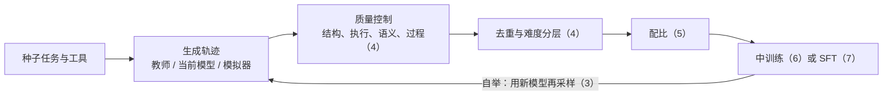

# 轨迹数据：合成、蒸馏、配比与中训练

> 层级：垂类 · training · 预计 180 分钟 · 题目：[questions.md](questions.md)
> 前置：[core/11 后训练入门](../../../core/11-post-training-basics/README.md)（SFT 数据格式、chat template、loss mask、packing）
> 相关：[03 GRPO 及其变体](../03-grpo-family/README.md)（长度偏差）、[04 Agentic RL](../04-agentic-rl/README.md)（RL 阶段工具返回的 mask）、[05 奖励与 Verifier](../05-reward-verifier/README.md)（过滤用的验证器从哪来）

## 1 这一章解决什么问题

Agent 后训练的岗位，面试官很少只问算法。更常见的问题是：“你的轨迹数据从哪来，怎么筛，怎么配，哪些 token 算 loss？”数据决定了 SFT 的上限，也决定了后面 RL 有多少可学的空间。

之前的做法有三类缺陷。人工写多步轨迹太贵，量上不去。直接拿强模型跑出来的轨迹做 SFT，会把教师的错误和坏习惯一起学走，学生上线后还会走到教师从没走过的状态。只看最终答案过滤，数据里会堆满“答案碰对、过程冗余”的轨迹。

这一章讲轨迹数据从生产到进入训练的整个过程。学完你应该能：

- 说清 Agent 轨迹和普通 SFT 数据的结构差别，算出一条轨迹里有多少 token 真正计 loss；
- 从策略梯度推出拒绝采样微调（RFT）在优化什么，说清 STaR、ReST、ReST-EM 为什么能提升、在哪里饱和；
- 推导 off-policy 蒸馏的分布偏移，说清 GKD 的 on-policy 蒸馏改了什么；
- 设计一套合成轨迹的质量控制流程，写出 MinHash 去重并算出它的阈值；
- 解释数据配比怎么定、中训练和后训练各管什么；
- 写出 Agent SFT 的 loss mask 规则，说清失败的工具调用怎么处理。

**符号表**

| 符号 | 含义 |
|---|---|
| x | 输入：系统提示、工具定义、用户请求 |
| y = (y_1, …, y_T) | 一条轨迹的 token 序列，T 是总长度 |
| m_t ∈ {0, 1} | 第 t 个 token 是否计 loss |
| π_θ | 被训练的模型（策略、学生），参数 θ |
| p_T, p_S | 蒸馏里的教师分布和学生分布 |
| r(x, y) | 验证器给的奖励，本章大多是 0/1 |
| p(x) | 当前模型在题 x 上单次采样答对的概率（通过率） |
| N | 每题采样的次数 |
| η | 配比：Agent 数据在训练目标里的权重 |

下图是本章覆盖的流水线，括号里是对应的节号。



## 2 轨迹数据和普通 SFT 数据的区别

### 2.1 结构

普通 SFT 样本是“一问一答”。Agent 轨迹是一串交替的片段：模型思考、发出工具调用、环境返回结果、模型再决定下一步，最后给出答案。

| | 普通 SFT 样本 | Agent 轨迹 |
|---|---|---|
| 结构 | 单轮或少量多轮对话 | 多轮，模型输出和环境返回交替 |
| 谁写的 token | 用户和助手 | 用户、助手、工具或环境 |
| 长度 | 通常几百到几千 token | 工具返回很长，常见上万 token |
| 正确性 | 看最终回答 | 既看结果，也看过程：调用是否合法、有没有多余步骤、有没有编造工具结果 |
| 来源 | 人写、模型生成 | 多数要在真实或模拟环境里跑出来 |
| 与环境耦合 | 无 | 工具接口一改，旧轨迹可能就失效 |

**由此带来的问题**：

- **格式必须和推理时完全一致**。工具定义放哪、调用用什么标记、参数怎么序列化，训练和线上推理只要有一处不同，模型就可能输出解析不了的调用。chat template 的基础见 [core/11 第 3.2 节](../../../core/11-post-training-basics/README.md#32-chat-template训练和推理必须逐字一致)。
- **要有失败和纠错样本**。只有一路顺利的轨迹，模型没见过工具报错、检索为空，上线后遇到就容易反复调用同一个工具。
- **数据会过期**。工具版本、返回格式变化后，要能按来源批量找到受影响的轨迹。所以每条轨迹要记录生成它的环境版本和教师模型。

Agent-FLAN（arXiv 2403.12881）专门分析过现有 Agent 语料：格式遵循和推理能力混在一起，和预训练数据的分布差很远；模型学这几类能力的速度也不同。它的做法是把语料拆开重新组织，并加入专门构造的负样本来减少幻觉。负样本有两类：没给工具但用户请求需要工具；给了工具但用户只是普通聊天。目的是让模型学会“什么时候该当 Agent”，不只是“怎么当”。

### 2.2 token 构成与 mask

SFT 的目标是只在要学的 token 上做最大似然（推导和错位一位的实现见 [core/11 第 3.3 节](../../../core/11-post-training-basics/README.md#33-loss-mask-的实现错位一位和-ignore_index)）：

```text
L(θ) = − Σ_t m_t · log π_θ(y_t | x, y_<t)  /  Σ_t m_t
```

Agent 轨迹里，m_t = 1 的只有 assistant 写的 token。用一组常见量级算一下（8.1 节的代码复现）：系统提示加工具定义 1500 token，用户请求 100 token，8 轮工具调用每轮 150 token，每次工具返回 2000 token，最终回答 300 token。

```text
T     = 1500 + 100 + 8 × (150 + 2000) + 300 = 19100
Σ m_t = 8 × 150 + 300 = 1500                     （所有 assistant 段都计 loss 时）
工具返回占比 = 16000 / 19100 ≈ 83.8%
```

推导出的结论有三条：

1. **计算花在不计 loss 的 token 上**。mask 掉的 token 仍参与前向和反向（梯度通过注意力流过它们的表示），所以显存和计算按 T 算，监督信号按 Σ m_t 算。这条轨迹只有不到 8% 的位置产生 loss。
2. **工具返回仍然影响学习**。后面 assistant token 的条件概率 π_θ(y_t | x, y_<t) 里含有工具返回。模型学的是“看到这个返回之后该做什么”，所以它学得会用工具结果，只是不学着“写”工具结果。
3. **配比和聚合要按 token 想**。一条轨迹的监督 token 数可能是普通样本的几倍。按样本数配比和按 token 数配比，结果差得很远（5.2 节）。

RL 阶段为什么工具返回必须 mask，从轨迹概率分解可以直接推出来，见 [04 第 3 节](../04-agentic-rl/README.md#3-工具返回的-loss-mask)。SFT 阶段的例外和失败调用的处理见第 7 节。

## 3 拒绝采样与蒸馏：让模型自己产数据

人工写多步轨迹很贵。主流做法有两条路：让当前模型自己跑、用验证器筛（拒绝采样与自举）；让更强的教师跑、学生模仿（蒸馏）。

| 方法 | 做法 | 出处 |
|---|---|---|
| 拒绝采样微调（RFT） | 每题采多个回答，只留答对的，拿来做 SFT | DeepSeekMath、DeepSeek-R1 等都用过 |
| STaR | 迭代：生成推理链，留下答对的去微调；答错的题把正确答案告诉模型，让它反推一条推理链（rationalization），也加进训练集 | Zelikman 等，arXiv 2203.14465 |
| ReST | Grow：当前策略采样建数据集；Improve：在这份数据上做离线 RL，阈值逐步提高；数据可以反复用 | Gulcehre 等，arXiv 2308.08998 |
| ReST-EM | 生成并按正确性过滤，再微调，重复几轮；每轮都从基座模型重新微调，而不是接着上一轮训 | Singh 等，arXiv 2312.06585 |
| 蒸馏 | 用更强的教师模型跑轨迹，学生做 SFT | DeepSeek-R1 用约 80 万条样本蒸馏小模型 |
| 在线蒸馏 | 学生自己采样，教师在学生的轨迹上逐 token 给分布 | GKD，arXiv 2306.13649 |

### 3.1 拒绝采样微调在优化什么

设奖励 r(x, y) ∈ {0, 1}，当前模型 π_old 每题采 N 个回答，只保留 r = 1 的，在保留下来的样本上做 SFT。对一道题，SFT 的目标是：

```text
J_RFT(θ) = Σ_{i=1..N} r(x, y_i) · log π_θ(y_i | x),     y_i ~ π_old(· | x)
```

对 θ 求梯度，再对采样取期望：

```text
E[∇J_RFT] = N · E_{y~π_old} [ r(x, y) · ∇_θ log π_θ(y | x) ]
```

在 θ = θ_old 这一点（每轮 SFT 的第一步），π_θ = π_old，对数导数技巧把它变成：

```text
N · Σ_y π_θ(y|x) · r(x, y) · ∇log π_θ(y|x) = N · ∇_θ Σ_y π_θ(y|x) r(x, y) = N · ∇_θ p(x)
```

p(x) 是这道题的通过率。所以**RFT 第一步就是 0/1 奖励、不带基线的策略梯度**（推导，8.2 节用数值梯度验证）。STaR 论文第 3.1 节也把自己写成这个式子的近似：指示函数 1(ŷ = y) 把答错样本的梯度丢掉，就是过滤这一步。

这个推导说明了四件事：

1. **为什么能提升**。每轮都在沿 ∇p(x) 走，通过率上升；下一轮用更强的模型采样，答对的样本更多、更难的题也开始有样本。这就是“自举”。
2. **和 RL 差在哪**。第一步之后，数据仍来自 π_old，但没有重要性比率修正，所以是离线的。它也没有负样本：答错的回答梯度为 0，不会被压低。DeepSeekMath 第 5.2 节的对比里，从当前策略在线采样的 Online RFT 在训练后期明显好于离线 RFT；GRPO 能惩罚错误回答，又好于 Online RFT。
3. **题与题之间的权重**。按样本求和时，一道题贡献的梯度正比于 ∇p(x)，简单题保留的样本多，权重大。如果每题先在保留样本上求平均，梯度变成 ∇p(x) / p(x) = ∇log p(x)，相当于最大化对数通过率，难题的权重被放大。ReST-EM 每题最多保留 10 条正确解（MATH 和 APPS 都是 10），论文的理由是避免简单题占满数据、保证多样性。这个上限介于两种权重之间。
4. **在哪里饱和**。p(x) = 0 的题梯度恒为 0。一道 p(x) 很小的题，N 次全错的概率是 (1 − p)^N。模型有“固定错误模式”的题，永远采不到正样本，迭代多少轮都学不会。8.2 节的玩具实验里，准确率在第 4 轮后停在约 0.70，上限是可达题的比例 0.75。

### 3.2 STaR：用答案提示补上 0/N 的题

STaR（Zelikman 等，arXiv 2203.14465，算法 1）每轮做两件事：

1. 让模型对每题生成推理链和答案，保留答对的，组成 D_n。
2. 对答错的题，把正确答案作为提示加进输入，让模型反推一条推理链（rationalization）。反推出来能得到正确答案的，去掉提示后加入 D_n^rat。

然后在 D_n ∪ D_n^rat 上微调。论文写明：每次收集到新数据集后，**从原始预训练模型重新微调**，而不是接着训一个模型，目的是避免过拟合。

rationalization 直接针对 3.1 节的饱和点：0/N 的题本来没有梯度，加了提示后就有了样本。代价是这些样本来自另一个分布 π(y | x, 答案)，不是模型自己在 x 上会写出的东西。推理链可能是“凑答案”的，过程不可靠。8.2 节的玩具实验假设有提示时反推成功率是 0.5，准确率从约 0.70 升到约 0.99；真实场景里这个成功率取决于模型，过程质量也要另外检查。

### 3.3 ReST 与 ReST-EM：EM 视角下为什么会单调变好

ReST（Gulcehre 等，arXiv 2308.08998）把过程拆成两个离线阶段：

- **Grow**：从当前策略采样，扩充数据集 D_g。原始数据集 D 保留在混合里，论文说这是为了防止策略发散。
- **Improve**：用奖励阈值 τ 过滤 D_g，在过滤后的数据上做离线 RL。一次 Grow 之后做多次 Improve，阈值递增 τ_1 < τ_2 < …，数据质量越来越高、量越来越少。论文试过多种离线 RL loss，最好的是最简单的 BC（行为克隆，即 NLL）。

ReST-EM（Singh 等，arXiv 2312.06585）把这件事放进 EM 框架。定义一个二值的“最优”变量 O，p(O = 1 | x, y) ∝ f(r(x, y))。目标是最大化 log p(O = 1 | x)。对任意分布 q(y | x)，用 Jensen 不等式得到下界（ELBO）：

```text
log p(O=1|x) = log E_q [ p(O=1|x,y) · p_θ(y|x) / q(y|x) ]
             ≥ E_q [ log p(O=1|x,y) ] − KL( q(y|x) ‖ p_θ(y|x) )  =: L(p_θ, q)
```

EM 交替两步：

```text
E 步：q_{t+1}(y|x) ∝ p(O=1|x,y) · p_θt(y|x)          （按“得到高奖励的可能性”给模型样本加权）
M 步：θ_{t+1} = argmin_θ KL( q_{t+1} ‖ p_θ ) = argmax_θ E_{q_{t+1}} [ log p_θ(y|x) ]
```

两步都不让 L 变小，所以 L(p_θt+1, q_t+1) ≥ L(p_θt, q_t+1) ≥ L(p_θt, q_t)。奖励是 0/1 时，q_{t+1} 就是“当前模型在答对条件下的分布”。从 p_θt 采样再按 r 过滤，得到的正是 q_{t+1} 的样本；M 步就是在这些样本上做 SFT。**所以拒绝采样加 SFT 是在爬一个下界，每一轮在 ELBO 意义上不会变差**。这是它“能提升”的形式化解释。

论文也指出：奖励是 0/1 时，ReST 里递增的阈值 τ 取 (0, 1) 中任何值都一样，多次 Improve 退化成同一步。

ReST-EM 的几个实现细节（论文第 4 节）：每轮 E 步每题采 32 个解（MATH）或 64 个解（APPS），top-K 采样 K = 40、温度 0.7；每题最多保留 10 条正确解；只在模型生成的解上算 next-token loss。

**每轮从基座重训**。M 步每次都从基座预训练模型开始微调，论文说是为了减少偏离基座、缓解任务特定的过拟合。论文报告：和接着上一轮训相比，任务内分数相近，迁移到其他任务（HumanEval）好得多。

**多轮会退步**。ELBO 单调不等于测试集单调。论文图 4：训练集表现随迭代轮数线性上升，测试集不是。MATH 上第一轮之后提升很小；APPS 上大部分收益来自第一轮，第二轮在 APPS 和 HumanEval 上都退步。论文推测是在少量训练题上过拟合，APPS 只有 MATH 约三分之一大，受影响更大。

### 3.4 DeepSeek-R1 的数据流水线

DeepSeek-R1（arXiv 2501.12948，v2 附录 B.3.3、B.4.3、F.1）把拒绝采样和蒸馏都用上了，是一份可以对照的完整流程。精读见 [papers/03](../../../papers/03-deepseek-r1.md)。

**推理数据，约 60 万条**：

- 从第一阶段 RL 训练的 checkpoint 做拒绝采样。
- 之前的 RL 阶段只用规则奖励能判的题；这一阶段加入更多题，其中一部分用生成式奖励：把标准答案和模型预测一起交给 DeepSeek-V3 判断。
- 过滤掉语言混杂、段落过长、带代码块的思维链，原因是模型输出有时混乱难读。
- 每题采多个回答，只留正确的。

**非推理数据，约 20 万条**：写作、事实问答、自我认知、翻译等，沿用 DeepSeek-V3 的流程，复用其 SFT 数据的一部分；加入程序修复、前端开发这类软件工程数据。部分任务先让 DeepSeek-V3 生成思维链再回答，“hello”这类简单问题不加思维链。

**蒸馏**：用这 80 万条在 Qwen 和 Llama 的基座上微调 2 到 3 个 epoch，cosine 学习率衰减到初始值的十分之一，最大上下文 32768，batch size 64。蒸馏模型只做 SFT，没有 RL 阶段。

**蒸馏强于对小模型直接做 RL**。论文在 Qwen2.5-32B-Base 上用数学、代码、STEM 数据做了超过 1 万步的大规模 RL，得到的模型和 QwQ-32B-Preview 相当；从 DeepSeek-R1 蒸馏的 32B 模型在所有评测上都明显更好。论文的结论是：把更强的模型蒸馏到小模型效果很好；小模型靠大规模 RL 需要巨大算力，还可能达不到蒸馏的效果；要突破能力边界，可能仍需要更强的基座和更大规模的 RL。

这和 3.1 节的推导一致：RL 和拒绝采样只能放大模型“偶尔能做对”的行为，p(x) = 0 的能力学不出来；教师的轨迹直接提供了学生采不到的正样本。

### 3.5 off-policy 蒸馏的分布偏移

普通蒸馏（off-policy）在教师生成的序列（或固定数据集）上训学生。写成 token 级的目标：

```text
L_off(θ) = E_{x} E_{y ~ p_T(·|x)} [ Σ_n D( p_T(· | y_<n, x) ‖ p_S^θ(· | y_<n, x) ) ]
```

D 是某种散度，用前向 KL 时就是在教师样本上做最大似然加软标签。关键在于前缀 y_<n 的分布：训练时来自教师，推理时来自学生自己。

**推导：误差怎么随长度累积**。把“前缀”看成状态 s，长度 T 的生成就是 T 步决策。设学生在教师会访问的状态上每步出错的概率是 ε。分两步看：

1. 学生在前 t 步里至少出错一次的概率不超过 tε（并集上界）。
2. 出错之后，学生进入教师从没访问过的状态。训练数据里没有这些状态，学生在那里没有任何监督，最坏情况下之后每一步都错。

所以第 t 步处在“没见过的状态”的概率不超过 tε，总的出错步数上界是：

```text
Σ_{t=1..T} t·ε ≈ T²ε / 2
```

Ross 等（arXiv 1011.0686，定理 2.1，引用 Ross and Bagnell 2010）给出的正是 J(π) ≤ J(π*) + T²ε，并指出存在达到二次增长的例子。如果训练数据就来自学生自己会访问的状态，学生在这些状态上也被监督过，出错后能被拉回来，DAgger 类方法的界变成和 T 线性相关。

8.3 节的玩具实验复现了这个现象：off-policy 学生在教师分布上的误差和 on-policy 学生一样小，但在自己的分布上误差大一个数量级；累计出错步数在 T 从 10 增到 40 时涨了约 10 倍，on-policy 只涨约 4 倍。

**Agent 轨迹里，“没见过的状态”很具体**：参数填错后的报错、检索为空、上一步调用了错误的工具。教师很少走到这些状态，它的轨迹里也就没有“从这里怎么恢复”的示范。这和第 2 节“要有失败和纠错样本”是同一个问题的两种说法。

### 3.6 GKD：on-policy 蒸馏

GKD（Agarwal 等，arXiv 2306.13649）把模仿学习里的 on-policy 思路搬到蒸馏。on-policy KD 的 loss（论文式 4）：

```text
L_OD(θ) = E_{x} E_{y ~ p_S(·|x)} [ D_KL( p_T ‖ p_S^θ )(y | x) ]
```

学生自己采样，教师在学生的每个前缀上给出 token 级分布，学生去拟合。梯度不穿过学生的采样过程，论文说这样训练稳定、计算也省。GKD 把两种数据混起来，并允许换散度：

```text
L_GKD(θ) = (1 − λ) · E_{(x,y)~(X,Y)} [ D(p_T ‖ p_S^θ)(y|x) ]  +  λ · E_{x} E_{y~p_S(·|x)} [ D(p_T ‖ p_S^θ)(y|x) ]
```

- λ ∈ [0, 1] 是学生数据的比例。λ = 0、D 取前向 KL 就是普通的监督 KD；λ = 1 是 on-policy KD。
- D 可以是前向 KL、反向 KL 或广义 JSD(β)。JSD(β) 有界，β 接近 0 和 1 时梯度分别接近前向和反向 KL。容量不够时，前向 KL 倾向于覆盖教师的所有模式（mean-seeking），反向 KL 倾向于抓住主要模式（mode-seeking），论文图 A.16 有示意。

论文报告：on-policy 和混合变体在各种学生规模上都稳定好于监督变体；用温度采样评测时 mode-seeking 的散度更好，贪心解码时散度选择影响不大。在 XSum 上，只用 5% 的输入、不用任何标准摘要的 on-policy GKD，好于用全部数据和标准摘要的监督 KD。

**代价与前提**：

- 要能拿到教师每个位置的完整分布（或至少 top-k logits），通常要求教师是白盒、和学生共用分词器。只有 API 的教师只能做 off-policy 的序列蒸馏。
- 每步训练都要学生采样加教师前向。学生采样比教师生成便宜，但流程比 SFT 复杂，更接近 RL 的工程形态（见 [07 RL 训练框架](../07-training-systems/README.md)）。
- 用在 Agent 轨迹上时，学生的轨迹要在环境里跑，工具返回来自环境；教师只在 assistant token 上给分布，工具返回位置同样 mask 掉。

### 3.7 代价

- 自产数据只能覆盖模型已经“偶尔能做对”的题。0/N 的题筛不出样本，需要更强的教师或 STaR 式的提示答案。
- 验证器有漏洞时，“答案碰对、过程错”的轨迹会被当成正样本学走。
- 蒸馏的上限是教师，教师的坏习惯（多余调用、固定话术）也会被继承。
- 多轮自我迭代会让输出越来越单一，要监控多样性。ReST-EM 的每题上限、ReST 保留原始数据，都是在对抗这个问题。

## 4 合成轨迹的质量控制

### 4.1 生成骨架：Kimi K2 的工具调用数据

Kimi K2 报告（arXiv 2507.20534）公开了一套大规模工具调用数据合成流程，可以作为参考骨架：

1. **工具**：从 GitHub 收集 3000 多个真实 MCP 工具，再按领域层级合成 2 万多个工具。
2. **Agent 与任务**：用不同的系统提示和工具子集组合出几千个 Agent，每个配从易到难的任务。每个任务带 rubric：成功标准、预期的工具使用方式、检查点。
3. **轨迹**：LLM 扮演不同风格的用户和 Agent 多轮对话；工具由模拟器执行，模拟器维护状态，并加入受控的随机性，产生成功、部分失败和边界情况。
4. **过滤**：LLM 评委按 rubric 打分，只留达到成功标准的轨迹。报告把这一步称为大规模拒绝采样。
5. **真实执行**：编码和软件工程类任务用真实沙箱，用测试通过率这类信号代替模拟。

### 4.2 执行验证：APIGen 的三层校验

工具调用数据和一般对话数据有一个关键区别：调用可以直接执行，正确性能被检查。APIGen（Liu 等，arXiv 2406.18518，第 3.2 节）据此设计了三层校验，数据要依次通过：

| 层 | 检查什么 | 丢掉什么 |
|---|---|---|
| 1 格式检查 | 输出是严格的 JSON，有 query 和 answer 字段（通常还有 thought 字段）；调用能解析；函数名和参数都在给定的 API 里 | 格式错误、不完整的数据；调用了不存在的函数或参数（幻觉） |
| 2 执行检查 | 把调用真正执行：Python 函数在子进程里跑，REST API 真的请求并看状态码 | 执行失败的调用；同时记录细粒度错误：参数类型错、无效参数、运行时错误、超时、语法错误、缺参数 |
| 3 语义检查 | 把执行结果、可用函数和 query 交给另一个 LLM 判断：调用是否符合意图、参数是否合适、函数选得对不对、调用次数是否匹配用户意图、结果有没有报错、结果是否和 query 相关 | 能执行但结果没意义的数据，例如 query 本身不可行或参数不对 |

通过三层的数据会被放回种子集，用来生成更多样的新数据。论文用这套流程收集了 21 个类别的 3673 个可执行 API，发布了 6 万条数据。论文报告：前两层（格式和执行）过滤掉了大部分低质量数据。消融实验把被第 2、3 层过滤掉的数据加回训练集，最终效果变差，对小模型影响更大。

ToolACE（Liu 等，arXiv 2409.00920，ICLR 2025）的做法可以对照着看：

- **规则层不执行**。规则检查覆盖 API 定义清晰度、调用可执行性、对话正确性、样本一致性。例如检查可执行性时，先确认 API 名在工具列表里，再确认必填参数都给了，最后用正则检查参数格式符合 API 文档。论文强调这样不需要真正执行，效率高、部署开销小。
- **模型层拆成子问题**。论文发现把整条样本直接交给 LLM 判对错效果不好，于是拆成三个方面，各由一个 LLM 专家 Agent 判断：参数值有没有编造（用户和系统提示里都没提到）、回答能否完成任务并遵守约束、模拟的工具返回是否符合 API 定义。
- **复杂度按被训模型定**。用被训模型在样本上的平均 token loss 衡量复杂度：模型已经能正确生成的样本 loss 是下界，微调后 loss 仍很高的样本是上界。生成器根据这个范围调整用户提问的难度：太简单就要求用更多 API，太难就简化。

两者的取舍：APIGen 真执行，能抓到参数取值超范围这类规则查不出的问题，但要能访问真实 API；ToolACE 用模拟工具和规则，成本低、覆盖 2 万多个合成 API，但查不出“格式对、真实执行会失败”的调用。

### 4.3 一套完整的流程

自己搭流程时，按“便宜的先做，贵的后做”排序。每一层只处理上一层留下的数据，所以越贵的检查跑的量越少。

| 环节 | 检查什么 | 防什么 |
|---|---|---|
| 结构校验 | 工具名存在、参数能解析、标签成对 | 格式错误的调用 |
| 执行校验 | 在沙箱或模拟器里重放调用，看返回和状态码 | 能解析但执行不了的调用 |
| 结果校验 | 有标准答案的用程序判；没有的用评委加人工抽检 | 学到错误答案 |
| 过程校验 | 重复调用同一工具同一参数、引用了工具没返回的内容、步数远超同类任务 | 答案碰对、过程很差的轨迹 |
| 去重 | 先 MinHash 做近重复，再按 embedding 聚类做语义去重 | 少数模板占满数据 |
| 难度分层 | 用当前模型每题采 N 次，按通过率分档 | 简单题淹没难题 |
| 去污染 | n-gram 加 embedding 检索加 LLM 判定 | 评测题的改写版混进训练集 |

**过程校验里“引用了工具没返回的内容”怎么查**：把最终回答里的实体、数字、ID 抽出来，在本条轨迹的工具返回和用户输入里找。找不到的就是编造。这比让评委判断“有没有幻觉”便宜也稳定。

### 4.4 去重：MinHash 与 LSH

合成数据最常见的问题是“同模板换实体”：模板相同，只换了城市名或商品名。这类样本 Jaccard 相似度很高，精确去重查不出来。

**定义**。把样本切成 n-gram 集合（shingle），两个集合的 Jaccard 相似度是 J(A, B) = |A ∩ B| / |A ∪ B|。

**MinHash 为什么能估计 Jaccard**。取一个随机哈希函数 h，看两个集合各自的最小哈希值。A ∪ B 里每个元素成为最小值的机会相等；两个最小值相同，当且仅当 A ∪ B 中哈希最小的那个元素同时属于 A 和 B。所以：

```text
P( min h(A) = min h(B) ) = |A ∩ B| / |A ∪ B| = J(A, B)
```

用 K 个独立哈希函数得到长度 K 的签名，签名相同位置的比例是 J 的无偏估计，标准差约为 sqrt(J(1 − J) / K)。

**LSH 分桶把两两比较变成近线性**。签名切成 b 段，每段 r 个值（b · r = K）。任意一段完全相同，两个样本就成为候选对。一段完全相同的概率是 J^r，b 段里至少有一段相同的概率是：

```text
P(候选 | J = s) = 1 − (1 − s^r)^b
```

它是一条 S 形曲线，阈值大约在 (1/b)^(1/r)。Lee 等（arXiv 2107.06499，第 4.1.2 节）去重预训练数据时用 5-gram、长度 9000 的签名，论文写作 b = 20、r = 450，它的公式是 1 − (1 − s^b)^r，b 是每段的哈希数、r 是段数；换成本文记号是每段 r = 20 个、共 b = 450 段，候选对再用编辑相似度大于 0.8 确认。按公式算，J = 0.8 的文档对成为候选的概率约 0.995，J = 0.5 约 0.0004（推导，8.4 节验证）。

**对轨迹数据的调整**：

- 工具返回经常大段相同（同一个 API 的固定字段），会把不同任务的轨迹拉得很像。去重时只对用户请求和 assistant 段做 shingle，或对工具返回单独去重。
- 近重复不等于没用。同一题几条思路不同的正确轨迹应该保留（ReST-EM 每题保留最多 10 条正确解）；要去的是“同一思路、只换实体”的那类。
- 语义去重（embedding 聚类）能抓到换了说法的重复，但阈值更难定，要人工看边界样本。

### 4.5 多样性

去重只删东西，不增加覆盖。多样性要在生成阶段就设计进去：

- **工具和任务的组合**。APIGen 从 API 和种子数据的不同组合、不同 prompt 模板采样，温度 0.7；Kimi K2 用不同系统提示和工具子集组合出几千个 Agent。
- **查询风格**。APIGen 把查询分成简单、多个、并行、并行多个四类调用形态。
- **难度**。ToolACE 按被训模型的 loss 调难度；简单的做法是按当前模型的通过率分档定配额（第 5 节）。
- **监控**。每轮自举后看工具调用分布、轨迹长度分布、首个动作的分布。分布越来越窄，说明在自我强化少数模式。

### 4.6 代价与取舍

- 模拟工具便宜、可控，但和真实工具的行为有差距。模型可能学会依赖模拟器的“好脾气”。
- 评委过滤会带入评委的偏好，例如冗长偏差。评委打分要先和人工标注对齐。
- 过程规则会误伤。复杂任务本来就需要更多步，步数阈值要按任务类型分别定。
- 每条样本保留来源（种子、提示版本、教师、环境版本），出问题时才能整批回溯和删除。

## 5 数据配比与轨迹 scaling

### 5.1 问题：为什么要混，混多少

只训 Agent 轨迹，模型的通用对话、指令遵循会退化；通用数据太多，Agent 能力又学不进去。

AgentTuning（Zeng 等，arXiv 2310.12823，第 2.2 节）把这件事写成一个显式的目标。D_agent 是 Agent 轨迹数据集 AgentInstruct，D_general 是通用指令数据，η 是配比：

```text
J(θ) = η · E_{(x,y)~D_agent} [ log π_θ(y|x) ]  +  (1 − η) · E_{(x,y)~D_general} [ log π_θ(y|x) ]
```

论文观察到：只在 Agent 数据上训，在没见过的 Agent 任务上反而比混合训练差。它的解释是 Agent 任务需要规划、推理这些综合能力，通用数据在保住这些能力。论文在 7B 模型上把 η 从 0 到 1 按 0.1 扫了一遍，最终选 η = 0.2，因为它在 held-out 任务上最好。这个 0.2 是那份数据、那个模型上扫出来的，换了数据不能照搬。

**推导：为什么最优配比在中间**。设模型容量有限，两个任务想要的参数不同。用二次损失近似各任务：L_k(θ) = ½ (θ − c_k)ᵀ H_k (θ − c_k)，c_k 是任务 k 的最优参数，H_k 是曲率。混合目标的最优解有闭式：

```text
θ*(η) = ( η H_A + (1−η) H_B )⁻¹ · ( η H_A c_A + (1−η) H_B c_B )
```

η 从 0 到 1，θ* 从 c_B 移到 c_A。L_A 单调下降，L_B 单调上升，每个 η 都在两者的 Pareto 前沿上，没有“两边都更好”的配比。held-out 的 Agent 任务如果既需要 Agent 格式又需要通用能力，它的最优参数在 c_A 和 c_B 之间，最好的 η 就落在内部。8.5 节的代码画出了这条权衡曲线：held-out 任务的最优 η 是 0.9，η = 1 时损失比最优高约 60%。

这个模型很粗糙，但它说清了两件事：配比是在 Pareto 前沿上选点，不存在通用最优；选点的标准是你真正关心的 held-out 指标，不是训练任务的损失。

### 5.2 配比按什么单位算

η 可以按样本数算，也可以按 token 数算。Agent 轨迹的监督 token 往往是普通指令样本的几倍（2.2 节那条轨迹有 1500 个监督 token），按 token 平均 loss 时，同样“20% 的样本”在梯度里的份额可能超过一半。

举例（推导）：通用样本平均 300 个监督 token，Agent 轨迹平均 1500 个，样本数 1 : 4 混合。按 token 算，Agent 的份额是 1500 / (1500 + 4 × 300) ≈ 56%。报告配比时写清楚单位，复现别人的配比时先换算。和 loss 怎么聚合也有关，见第 7.4 节。

### 5.3 怎么定配比

- **按格子定配额**。先按“任务类型 × 难度档”分格，每格内按质量筛选，再按格定配额。加量时只补缺的格子，不放大已经过多的类型。难度档用当前模型每题采 N 次的通过率分：全对的题信息量小，全错的题 SFT 也难学，中间档给最多配额。
- **用消融定比例**。固定其他条件，只改一类数据的比例，看分项指标：Agent 任务成功率、通用能力、格式错误率。
- **小模型扫，大模型验证**。每改一次配比就要重训和全面评测，成本高。预训练阶段有系统化的方法：DoReMi（arXiv 2305.10429）用 280M 的代理模型配合 Group DRO 学出领域权重，再用来训 8B 模型；RegMix（arXiv 2407.01492）训练 512 个 1M 参数的小模型，用回归模型预测其他配比的效果，再选最优配比训大模型。后训练数据量小，常见做法简单得多：在小模型上扫几个点，在目标模型上验证少数候选。小模型上的最优比例不一定能直接迁移到大模型，大模型学得更快，也更容易过拟合少量数据。

### 5.4 轨迹 scaling

加量有用的前提是“新增的轨迹带来新信息”。同一模板换个实体批量生成，条数涨了，有效信息没涨，去重时这类样本也会被 MinHash 抓到（4.4 节）。更有效的方向通常是：增加工具和任务的种类、增加难题和失败恢复的比例、同一题保留几条思路不同的正确轨迹。

判断加量是否有效：画“数据量 vs held-out 指标”的曲线，同时画“数据量 vs 去重后的有效条数”。后者不涨，前者也不会涨。

## 6 中训练与后训练的分工

**中训练（mid-training）**：主体预训练之后、指令微调之前的一个较短阶段，换成更有针对性的数据，同时把学习率退火。

OLMo 2（arXiv 2501.00656）写得比较完整：

- 中训练用约 5% 到 10% 的训练 FLOPs，学习率线性降到 0。
- 数据是 Dolmino Mix 1124：高质量网页、学术文本、问答，加上以合成数据为主的数学数据。
- 7B 用 50B token 的混合；13B、32B 用 100B 和 300B。
- 用不同的数据混合或数据顺序跑几次退火，再把权重平均（model souping）。13B 和 32B 是 3 次 100B 加 1 次 300B，一共 4 个模型取平均。
- 数学数据源先用小规模的短退火实验（论文叫 microannealing）逐个评估，再决定是否加入。
  做法（论文第 4.4.2 节）：选出要评估的数学数据源，从通用数据里取同样多的 token，按 50/50 混合，像正式退火一样把学习率线性降到 0。论文一共跑了 19 次，合计 130B token，不到 3 次完整的 50B 退火；结果在训练不到 10B token 时就能看出来。

| | 中训练 | 后训练（SFT / RL） |
|---|---|---|
| 目标 | 补知识、补能力底子（数学、代码、长上下文、工具调用的基本形态） | 教行为：格式、何时调工具、如何纠错、偏好 |
| 数据量 | 几十到几百 B token | 几万到几百万条样本 |
| 数据形态 | 文档、合成教材、大量轨迹，通常整段计 loss | 对话和轨迹，只对助手部分计 loss |
| 学习率 | 从预训练的学习率继续，退火到 0 | 单独设，通常远小于预训练峰值 |
| 风险 | 配比不当会伤基础能力 | 量小、易过拟合，教不进新知识 |

**为什么退火阶段适合放目标数据**。学习率大的时候，参数在损失面上来回振荡，最后留下的是“大量数据的平均方向”；学习率降到 0 的过程中，参数沿当前数据的梯度收敛到一个局部的低点。所以退火期见到的数据对最终权重影响大，少量 token 就能看出一个数据源有没有用。这是经验性的解释，OLMo 2 的 microannealing 正是利用了这一点：用短退火逐个评估数据源，比每次都完整重训便宜得多。

**为什么 souping 有用**。OLMo 2 给的理由是“找到更好的局部极小值”，并引用了模型合并的工作（Matena and Raffel 2022、Wortsman 等 2022）。下面是常见的解释，不是论文的结论：几次退火从同一个预训练 checkpoint 出发，只是数据顺序不同，它们落在同一个低损失区域的不同位置，权重平均后通常仍在这个区域里，还能抵消各自对数据顺序的偶然依赖。从不同起点训出来的模型直接平均，没有这个保证。

**怎么分工**：模型缺的是“知识或能力底子”，放中训练；缺的是“行为方式”，放后训练。一个实用判断：在 SFT 后对每道题采多次，如果大量题是 0/N，说明能力底子不够。按 3.1 节的推导，0/N 的题在拒绝采样和 RL 里都没有梯度，加 SFT 轮次也难补，应考虑在中训练加相关数据，或者用更强的教师蒸馏。一些模型的技术报告提到在中训练加入 Agent 轨迹，但通常不公开配比，引用时只说“有这种做法”，不要编比例。

## 7 Agent SFT 的 loss mask

### 7.1 规则

| 片段 | 是否计 loss | 原因 |
|---|---|---|
| system、user | 不计 | 模型不需要学写系统提示或扮演用户 |
| assistant 的思考、工具调用、最终回答 | 计 | 这是要学的行为 |
| 工具返回 | 一般不计 | 不是模型的行为；计入会让模型学着编造工具结果，长返回还会稀释梯度 |
| 失败的调用 | 看失败原因 | 见 7.3 节 |

**实现**：把不计 loss 的位置的标签设成忽略值（很多框架用 −100）。mask 掉的 token 仍参与前向，仍占显存和计算。错位一位、谁来做错位这类细节见 [core/11 第 3.3 节](../../../core/11-post-training-basics/README.md#33-loss-mask-的实现错位一位和-ignore_index)。

### 7.2 mask 在 token 上做，不在字符上做

轨迹通常以“段列表”存储（角色、内容、状态），训练前再拼成 token 序列。mask 要在分词之后按段生成：先对每段单独分词，拼接 token id，同时拼接每段的 mask。如果先拼成一整段文本再分词，再按字符位置找段边界，段边界附近的 token 可能跨两段，mask 会错一两个位置。最常错的是 assistant 段结尾的结束符：它必须计 loss，否则模型学不会在工具调用之后停下来，会接着写出一段假的工具返回。RL 阶段同样的问题见 [04 第 2.3、2.4 节](../04-agentic-rl/README.md#23-mask-的构造在-token-上做按段拼)。

### 7.3 失败的工具调用怎么处理

“失败”有不同的来源，处理方式不一样。

| 失败类型 | 例子 | 这个调用计 loss 吗 | 后续 |
|---|---|---|---|
| 模型自己的错 | 参数类型错、缺必填参数、调用了不存在的工具、调用了不该调的工具 | 不计 | 错误信息作为工具返回留在上下文里（不计），之后的纠错调用计 loss |
| 环境的错 | 超时、限流、服务 5xx，调用本身是对的 | 计 | 重试或换路径的动作计 loss |
| 结果为空或不符预期 | 检索无结果、查询条件过严 | 通常计 | 调用本身合理；之后放宽条件、换工具的动作计 loss |

**为什么模型自己的错要 mask**。SFT 是最大似然，计 loss 的 token 都会被推高概率。如果错误调用也计 loss，模型在同样的状态下就会学着先犯这个错、再纠正。8.1 节用一个两状态的玩具策略算了一下：错误调用计 loss 时，第一步犯错的概率被推到 0.97；mask 掉之后，第一步不受影响（仍是初始的 1/3），看到报错之后的纠错照样学会了（概率超过 0.9）。

**为什么要保留而不是删掉**。直接删掉失败的那一轮，轨迹就成了一路顺利的样本，模型没见过报错之后的状态。这就是 3.5 节说的“没见过的状态”。保留错误调用和报错作为上下文、只训纠错，等于给这些状态补了监督。

**还有两种做法**：

- **截断重写**。把失败分支整段删掉，让轨迹从失败前的状态直接走正确路径。数据更干净，但丢了恢复示范。适合失败本身没有信息量的情况（例如模拟器的偶发错误）。
- **当作偏好数据**。同一个前缀下，错误调用作为 rejected、正确调用作为 chosen，做 DPO（见 [02 DPO 及其变体](../02-preference-optimization/README.md)）。SFT 只能“不学”错误调用，偏好学习能主动压低它的概率。

环境错误的那一类要注意：如果数据里环境错误很多，模型会学到“这个工具常失败，要多重试”。合成数据里环境错误的比例要接近线上，Kimi K2 用的是“受控的随机性”。

### 7.4 长度带来的聚合问题

轨迹长短差别很大。按样本平均 loss，长轨迹里的每个 token 权重变小；按 token 平均，长轨迹整体权重变大。这和 GRPO 的长度偏差是同一类问题，见 [03 GRPO 及其变体](../03-grpo-family/README.md)。packing 之后两种平均的差别、梯度累积时分母怎么取，见 [core/11 第 3.4 节](../../../core/11-post-training-basics/README.md#34-packing吞吐交叉污染和平均方式)。

和配比的关系（5.2 节）：按 token 平均时，配比要按监督 token 数算；按样本平均时，按样本数算。两者混用，实际配比会和设计的配比差很多。

### 7.5 例外

- 训练一个“工具模拟器”模型时，工具返回就是要学的目标，要计 loss。
- 想让模型记住领域知识时，把文档单独做成中训练数据，而不是在轨迹里放开工具返回的 mask。
- 中训练里的大批量轨迹有时整段计 loss，用来教“工具调用的基本形态”。这时要接受模型会学到工具返回的格式；后训练阶段再用 mask 规则把行为纠正过来。

RL 阶段的 mask 规则，以及不 mask 时梯度落在哪里，见 [04 第 3 节](../04-agentic-rl/README.md#3-工具返回的-loss-mask)。

## 8 实现：只用 numpy 验证上面的结论

每段代码都能单独运行，结尾的 assert 对应正文的某个结论。

### 8.1 轨迹的 token 构成与失败调用的 mask

验证 2.2 节的 token 占比和 7.3 节“错误调用要 mask”。这条轨迹比 2.2 节多了一个条件：第 3 轮是参数错误的调用，被 mask 掉，所以监督 token 是 1350，不是 1500。第 6 轮是环境错误，调用本身是对的，照样计 loss。

```python
import numpy as np

# 一条 Agent 轨迹，按段给出 (角色, token 数, 状态)。数字是虚构的常见量级
traj = [("system", 1500, None),          # 系统提示加工具定义
        ("user", 100, None)]
for k in range(8):                       # 8 轮工具调用
    traj.append(("assistant", 150, "bad_args" if k == 2 else ("env_error" if k == 5 else "ok")))
    traj.append(("tool", 2000, None))
traj.append(("assistant", 300, "ok"))    # 最终回答

def train_on(role, status):
    if role != "assistant":
        return 0                         # system、user、工具返回：不计
    if status == "bad_args":
        return 0                         # 模型自己的错误调用：留作上下文，不计
    return 1                             # 正确动作；env_error 是调用对、环境出错，照样计

mask = np.concatenate([np.full(n, train_on(r, s)) for r, n, s in traj])   # (T,)
T, sup = mask.size, int(mask.sum())
tool_tok = sum(n for r, n, _ in traj if r == "tool")
print("T=%d supervised=%d (%.1f%%) tool-result share=%.1f%%" % (T, sup, 100 * sup / T, 100 * tool_tok / T))
assert T == 19100 and sup == 1350
assert sup / T < 0.08 and tool_tok / T > 0.8   # 前向的大部分计算花在不计 loss 的 token 上

# 为什么错误调用要 mask：一个表格“策略”。状态 s0 = 第一次调用；s1 = 看到报错之后
# 动作 0 = 错误调用，1 = 正确调用，2 = 其他
def softmax(z): e = np.exp(z - z.max()); return e / e.sum()
def sft(pairs, steps=50, lr=0.5):
    Z = {"s0": np.zeros(3), "s1": np.zeros(3)}
    for _ in range(steps):
        for s, a in pairs:               # 对 log p(a|s) 做梯度上升：onehot(a) − p
            Z[s] += lr * (np.eye(3)[a] - softmax(Z[s]))
    return {s: softmax(z) for s, z in Z.items()}

full = sft([("s0", 0), ("s1", 1)])       # 错误调用也计 loss
masked = sft([("s1", 1)])                # 错误调用 mask 掉
print("loss on wrong call: p(wrong|s0)=%.2f   masked: p(wrong|s0)=%.2f" % (full["s0"][0], masked["s0"][0]))
assert full["s0"][0] > 0.9               # 模型学会了先犯错
assert np.isclose(masked["s0"][0], 1 / 3) # mask 后第一步不受影响
assert masked["s1"][1] > 0.9             # 报错之后的纠错照样学会
```

### 8.2 拒绝采样自举：上升、饱和与 rationalization

验证 3.1 节的三个结论：RFT 第一步的期望梯度等于 0/1 奖励的策略梯度；准确率随轮数上升；有固定错误模式的题永远学不会，准确率停在可达题的比例以下。再验证 3.2 节：STaR 的答案提示能突破这个上限。每轮都从基座 z0 重新微调，和 ReST-EM、STaR 一致。

```python
import numpy as np

# 玩具任务：K 类题，每类有 M 种候选解法，只有解法 0 是对的
# 每类题的策略是 softmax(z[k])，z 的形状 (K, M)。基座模型是 z0
K, M, N = 20, 5, 8          # N = 每轮每题的采样数
rng = np.random.default_rng(0)
z0 = rng.normal(0, 0.5, size=(K, M))
z0[:15, 0] += np.linspace(-1.5, 0.5, 15)  # 15 类“可达”题：基座答对的概率约 0.05 到 0.35
z0[15:, 0] = -20.0                        # 5 类“固定错误模式”：几乎永远采不到正确解法

def softmax(z):
    e = np.exp(z - z.max(-1, keepdims=True))
    return e / e.sum(-1, keepdims=True)

def acc(z):                              # 期望准确率：各类题答对概率的平均
    return softmax(z)[:, 0].mean()

# 3.1 节的推导：在过滤后的样本上做 SFT（按样本求和），第一步的期望梯度
# 等于 0/1 奖励的策略梯度。对一类题精确检查：Σ_y p(y) r(y) (onehot(y) − p) = ∇_z p(答对)
p = softmax(z0[3]); r = np.eye(M)[0]
rft_grad = sum(p[y] * r[y] * (np.eye(M)[y] - p) for y in range(M))
eps = 1e-6; num = np.array([(softmax(z0[3] + eps*np.eye(M)[j])[0] - p[0]) / eps for j in range(M)])
assert np.allclose(rft_grad, num, atol=1e-5)

def sft(z_start, data, steps=200, lr=0.5):
    """在过滤后的样本上对 log p 做梯度上升。data[k] = 第 k 类题保留下来的正确样本数"""
    z = z_start.copy()
    for _ in range(steps):
        p = softmax(z)
        z += lr * data[:, None] * (np.eye(M)[0] - p) / N
    return z

def round_data(z, rationalize=False):
    p = softmax(z)
    kept = np.array([rng.binomial(N, p[k, 0]) for k in range(K)], dtype=float)
    if rationalize:                      # STaR：0/N 的题给出答案提示，让模型反推推理链
        hint_p = 0.5                     # 假设：有提示时反推出正确解法的概率是 0.5
        for k in np.where(kept == 0)[0]:
            kept[k] = rng.binomial(N, hint_p)
    return kept

def run(rounds, restart=True, rationalize=False):
    z, hist = z0.copy(), [acc(z0)]
    for _ in range(rounds):
        data = round_data(z, rationalize)
        z = sft(z0 if restart else z, data)   # ReST-EM、STaR：每轮从基座重新微调
        hist.append(acc(z))
    return z, np.array(hist)

z_rs, h_rs = run(6)
print("拒绝采样自举，每轮准确率：", np.round(h_rs, 3))
# 1) 前几轮准确率上升：更强的模型采出更多正样本
assert h_rs[1] > h_rs[0] and h_rs[3] > h_rs[1]
# 2) 饱和：5 类“固定错误”题每轮都是 0/N，从没得到梯度
assert softmax(z_rs)[15:, 0].max() < 1e-6
assert h_rs[-1] < 15 / 20                # 上限 = 可达题的比例 0.75
# 3) 后面几轮的收益远小于第一轮
assert (h_rs[-1] - h_rs[3]) < (h_rs[1] - h_rs[0])

z_st, h_st = run(6, rationalize=True)
print("加 rationalization：        ", np.round(h_st, 3))
assert h_st[-1] > 15 / 20                # 有提示就能突破上限
```

运行输出（种子固定）：自举的准确率依次是 0.09、0.41、0.51、0.56、0.69、0.70、0.70；加 rationalization 后第一轮就到 0.97。玩具模型里 rationalization 的样本和正常样本走的是同一个“正确解法”，所以没有体现“凑答案的推理链不可靠”这个代价。真实场景里这部分样本要另外检查过程。

### 8.3 off-policy 与 on-policy 蒸馏

验证 3.5、3.6 节。学生每步有 ε = 0.05 的容量误差，会偶尔走进教师从不访问的坏状态。off-policy 学生只在教师的状态分布上训练，坏状态的参数一次都没被更新；on-policy 学生按自己的状态分布加权，坏状态也被教师纠正。

```python
import numpy as np

# 状态 = 上一个 token。V=6：好状态 {0,1,2}，坏状态 {3,4,5}
# 教师从不进入坏状态；如果在坏状态里，它会回到好状态
V, GOOD, BAD = 6, [0, 1, 2], [3, 4, 5]
PT = np.zeros((V, V))                                   # 教师 p_T(下一个 | 状态)，形状 (V, V)
PT[0, [1, 2]] = [0.7, 0.3]; PT[1, [0, 2]] = [0.5, 0.5]; PT[2, [0, 1]] = [0.6, 0.4]
for s in BAD:
    PT[s, GOOD] = 1 / 3

EPS = 0.05                                              # 学生容量有限：每步有 ε 的概率均匀乱走
def student(Z):                                         # p_S = (1−ε)·softmax(Z) + ε/V, shape (V, V)
    q = np.exp(Z - Z.max(1, keepdims=True)); q /= q.sum(1, keepdims=True)
    return (1 - EPS) * q + EPS / V, q

def visitation(P, T):                                   # 从状态 0 出发，第 0..T−1 步状态的精确分布
    d, out = np.eye(V)[0], []
    for _ in range(T):
        out.append(d); d = d @ P
    return np.array(out)                                # (T, V)

def kl_rows(P, Q):                                      # 每个状态 s 上的 KL(P[s] ‖ Q[s])，形状 (V,)
    with np.errstate(divide="ignore", invalid="ignore"):
        t = np.where(P > 0, P * np.log(P / Q), 0.0)
    return t.sum(1)

def grad(Z, w):                                         # ∇_Z Σ_s w_s KL(p_T(·|s) ‖ p_S(·|s))
    PS, q = student(Z)
    r = np.where(PT > 0, PT / PS, 0.0)                  # p_T / p_S
    return -w[:, None] * (1 - EPS) * (r * q - q * (r * q).sum(1, keepdims=True))

Z0 = np.zeros((V, V)); Z0[np.ix_(BAD, BAD)] = 4.0      # 没训过的坏状态：学生倾向于留在坏区域（固定错误模式）
T = 20
d_teacher = visitation(PT, T).mean(0)                   # 教师的状态分布
assert d_teacher[BAD].sum() == 0                        # off-policy 数据里完全没有坏状态

def train(on_policy, steps=3000, lr=2.0):
    Z = Z0.copy()
    for _ in range(steps):
        # on-policy：权重来自学生当前的状态分布，梯度不穿过采样（GKD 式 4）
        w = visitation(student(Z)[0], T).mean(0) if on_policy else d_teacher
        Z -= lr * grad(Z, w)
    return Z

Z_off, Z_on = train(False), train(True)
for name, Z in [("off", Z_off), ("on", Z_on)]:
    PS = student(Z)[0]
    d_S = visitation(PS, T).mean(0)
    print(name, "teacher-dist KL=%.4f  own-dist KL=%.4f  bad-state mass=%.3f"
          % (d_teacher @ kl_rows(PT, PS), d_S @ kl_rows(PT, PS), d_S[BAD].sum()))

PS_off, PS_on = student(Z_off)[0], student(Z_on)[0]
own = lambda PS: visitation(PS, T).mean(0) @ kl_rows(PT, PS)
# 1) 在教师分布上两者差不多（off-policy 直接优化的就是它）
assert abs(d_teacher @ kl_rows(PT, PS_off) - d_teacher @ kl_rows(PT, PS_on)) < 0.01
# 2) 在学生自己的分布上，on-policy 误差低得多：off-policy 从没训过坏状态
assert own(PS_on) < 0.5 * own(PS_off)
assert np.allclose(Z_off[BAD], Z0[BAD])                 # off-policy 在坏状态上的梯度恰好为 0

# 3) 误差累积：累计处在坏状态的步数。off-policy 随 T 超线性增长，on-policy 接近线性
cost = lambda PS, T: visitation(PS, T)[:, BAD].sum()
c_off = [cost(PS_off, t) for t in (10, 20, 40)]
c_on = [cost(PS_on, t) for t in (10, 20, 40)]
print("cumulative bad steps off:", np.round(c_off, 2), " on:", np.round(c_on, 2))
assert c_off[2] / c_off[0] > 5.0                        # T 涨 4 倍，代价涨超过 5 倍
assert c_on[2] / c_on[0] < 4.5                          # 接近线性
```

运行输出：两个学生在教师分布上的 KL 都是 0.035；在自己的分布上，off-policy 是 0.558，on-policy 是 0.035。off-policy 学生有 17% 的时间处在坏状态，on-policy 只有 2.5%。累计坏状态步数在 T = 10、20、40 时，off-policy 是 0.96、3.34、9.84，on-policy 是 0.23、0.50、1.02。

### 8.4 MinHash 与 LSH 去重

验证 4.4 节：MinHash 签名估计 Jaccard；LSH 分段能抓到“同模板换实体”的近重复，不相关样本不成为候选；分段的候选概率曲线。

```python
import numpy as np

def shingles(text, n=3):                       # 词级 n-gram。Lee 等 2021 用 5-gram；这里样本短，用 3
    w = text.lower().split()
    return {" ".join(w[i:i + n]) for i in range(len(w) - n + 1)}

def jaccard(a, b):
    return len(a & b) / len(a | b)

P = (1 << 61) - 1                              # 梅森素数，用于通用哈希 h(x) = (a·x + b) mod P
K = 128                                        # 签名长度 = 哈希函数个数
rng = np.random.default_rng(0)
A = rng.integers(1, P, size=K, dtype=np.uint64).tolist()
B = rng.integers(0, P, size=K, dtype=np.uint64).tolist()

def base_hash(s):                              # 把 shingle 确定性地映射成整数（Python 的 hash() 每个进程加盐不同）
    h = 1469598103934665603
    for ch in s.encode():
        h = ((h ^ ch) * 1099511628211) % (1 << 64)
    return h

def minhash(sh):                               # 签名：每个哈希函数在集合上的最小值，形状 (K,)
    xs = [base_hash(s) for s in sh]
    return np.array([min((a * x + b) % P for x in xs) for a, b in zip(A, B)], dtype=object)

def est_jaccard(s1, s2):                       # P(最小哈希相等) = Jaccard，所以相等位置的比例是无偏估计
    return float(np.mean(s1 == s2))

def lsh_candidates(sigs, bands=32, rows=4):    # 签名切成 b 段，任意一段完全相同就成为候选对
    assert bands * rows == K
    buckets, pairs = {}, set()
    for i, s in enumerate(sigs):
        for bd in range(bands):
            key = (bd, tuple(s[bd * rows:(bd + 1) * rows]))
            for j in buckets.get(key, []):
                pairs.add((j, i))
            buckets.setdefault(key, []).append(i)
    return pairs

docs = [
    "user asks for the weather in paris tomorrow the agent calls get_weather with city paris and date tomorrow then reports rain in the afternoon and suggests an umbrella",
    "user asks for the weather in lyon tomorrow the agent calls get_weather with city lyon and date tomorrow then reports rain in the afternoon and suggests an umbrella",   # 同模板，只换了实体
    "user wants to book a table for two at an italian restaurant the agent searches restaurants filters by rating and calls book_table with party size two",
    "the agent reads the failing test file runs pytest sees an import error installs the missing package and reruns the tests until they pass",
]
sh = [shingles(d) for d in docs]
sigs = [minhash(s) for s in sh]

J01 = jaccard(sh[0], sh[1])
print("true Jaccard(0,1)=%.3f  estimate=%.3f" % (J01, est_jaccard(sigs[0], sigs[1])))
assert J01 > 0.6                                            # 换一个实体只改变含它的 shingle
assert abs(est_jaccard(sigs[0], sigs[1]) - J01) < 0.12      # 估计的标准差 ≈ sqrt(J(1−J)/K) ≈ 0.04
cands = lsh_candidates(sigs)
print("candidate pairs:", cands)
assert (0, 1) in cands                                      # 近重复被抓到
assert all(jaccard(sh[i], sh[j]) > 0.5 for i, j in cands)   # 不相关的样本不成为候选

# 分段下成为候选的概率：1 − (1 − s^r)^b，S 形曲线
def p_cand(s, b, r):
    return 1 - (1 - s ** r) ** b
# 这里 b=32、r=4：阈值约 (1/b)^(1/r) ≈ 0.42
assert p_cand(0.7, 32, 4) > 0.99 and p_cand(0.2, 32, 4) < 0.05
# Lee 等 2021 的参数：签名长 9000，每段 20 个哈希，450 段
assert p_cand(0.8, 450, 20) > 0.99 and p_cand(0.5, 450, 20) < 1e-3
```

### 8.5 配比的权衡曲线

验证 5.1 节：两个任务的损失随 η 此消彼长，每个点都在 Pareto 前沿上；同时需要两种能力的 held-out 任务，最优 η 在内部。

```python
import numpy as np

# 容量有限：模型只有 d=2 个共享参数 θ，两个任务想要不同的 θ
# 每个任务的损失是二次的：L_k(θ) = ½ (θ − c_k)ᵀ H_k (θ − c_k)
c_A, H_A = np.array([1.0, 0.0]), np.diag([4.0, 0.5])     # A = Agent 轨迹任务
c_B, H_B = np.array([0.0, 1.0]), np.diag([0.5, 4.0])     # B = 通用指令任务
c_C, H_C = 0.7 * c_A + 0.3 * c_B, np.eye(2)              # C = held-out Agent 任务：主要需要 A，也需要一些 B（假设）
L = lambda th, c, H: 0.5 * (th - c) @ H @ (th - c)

def theta_star(eta):                                     # argmin η L_A + (1−η) L_B 的闭式解
    H = eta * H_A + (1 - eta) * H_B
    return np.linalg.solve(H, eta * H_A @ c_A + (1 - eta) * H_B @ c_B)

etas = np.linspace(0, 1, 11)
LA = np.array([L(theta_star(e), c_A, H_A) for e in etas])
LB = np.array([L(theta_star(e), c_B, H_B) for e in etas])
LC = np.array([L(theta_star(e), c_C, H_C) for e in etas])
for e, a, b, c in zip(etas, LA, LB, LC):
    print("eta=%.1f  L_A=%.3f  L_B=%.3f  L_C=%.3f" % (e, a, b, c))

# 1) 权衡：Agent 数据越多，L_A 单调下降，L_B 单调上升
assert np.all(np.diff(LA) <= 1e-12) and np.all(np.diff(LB) >= -1e-12)
# 2) 只用 Agent 数据（η=1）对 held-out Agent 任务不是最好，最优在内部
best = etas[np.argmin(LC)]
assert 0 < best < 1 and LC[-1] > 1.5 * LC.min()
# 3) 收益递减：η 从 0.5 到 1，L_A 降的比 L_B 涨的少
i5 = 5
assert (LA[i5] - LA[-1]) < (LB[-1] - LB[i5])
# 4) 每个点都在 Pareto 前沿上：没有别的 η 在两个任务上同时更好
for i in range(len(etas)):
    assert not np.any((LA < LA[i] - 1e-12) & (LB < LB[i] - 1e-12))
```

运行输出的几个点：η = 0 时 L_A = 2.25、L_B = 0；η = 0.5 时两者都是 0.222；η = 1 时 L_A = 0、L_B = 2.25。held-out 任务 C 的损失在 η = 0.9 时最小（0.056），η = 1 时是 0.090。C 的位置是假设的，换一个假设最优 η 就会变，这正是配比要靠消融定的原因。

## 9 数值例子：一轮拒绝采样能产出什么

条件：1000 道题，按当前模型的通过率 p 分四档；每题采 N = 8 次；只留答对的。下表是期望值，可以手算：保留条数 = 题数 × N × p，0/8 的题数 = 题数 × (1 − p)^8。

| 档 | 题数 | p | 期望保留条数 | 0/8 的题数 | 不设上限时占比 | 每题最多留 2 条时占比 |
|---|---|---|---|---|---|---|
| 简单 | 200 | 0.9 | 1440 | 0 | 49.7% | 32.5% |
| 中等 | 300 | 0.5 | 1200 | 1.2 | 41.4% | 47.8% |
| 难 | 300 | 0.1 | 240 | 129 | 8.3% | 18.4% |
| 很难 | 200 | 0.01 | 16 | 185 | 0.6% | 1.3% |
| 合计 | 1000 | | 2896 | 约 315 | | 共约 1231 条 |

读这张表：

1. **简单题占了一半数据**。200 道简单题贡献了约 50% 的样本，它们是模型已经会的。这就是 3.1 节说的“按样本求和时梯度权重正比于 p”。
2. **上限把权重挪向中等和难题**。每题最多留 2 条后，简单题的占比从 49.7% 降到 32.5%，难题从 8.3% 升到 18.4%。“每题最多留 2 条”的期望用 E[min(k, 2)]（k 服从二项分布 B(8, p)）算。ReST-EM 用的上限是 10（每题采 32 或 64 次）。
3. **约 315 道题没有任何样本**。难题档有 129 道、很难档有 185 道是 0/8。这些题在这一轮拒绝采样里没有梯度。要让 0/8 的概率降到 10% 以下，p = 0.1 的题要采 log 0.1 / log 0.9 ≈ 22 次，p = 0.01 的要采约 229 次。采样预算按难度分配比平均分配省得多；剩下的题要靠教师或 rationalization。
4. **下一轮会更好，但很难档变化不大**。如果一轮 SFT 把难题档的 p 从 0.1 提到 0.2，它的 0/8 比例从 43% 降到 17%；很难档如果停在 0.01，下一轮还是 92% 采不到。这就是 8.2 节看到的饱和。

## 10 工程细节与常见坑

**1. 模型开始编造工具返回**
- 现象：线上输出在工具调用之后接着写出一段“返回结果”，没有停下来等真实返回；离线评测里格式正确率很高，真实执行时错误多。
- 原因：工具返回段计了 loss；或者 assistant 段末尾的结束符被 mask 掉，模型没学会在调用后停止。
- 排查：抽几条训练样本，把 mask 为 1 的 token 解码出来逐段看；检查推理时 stop token 和训练模板里的结束符是不是同一个。
- 处理：工具返回 mask 为 0，结束符 mask 为 1；mask 按段在分词后生成（7.2 节）。

**2. 自举几轮后指标不升反降**
- 现象：训练题上的通过率每轮上升，held-out 指标第一轮之后持平或下降；输出越来越像，首个动作的分布越来越集中。
- 原因：在少量训练题上过拟合（ReST-EM 在 APPS 上看到的就是这个）；简单题样本占比太大；接着上一轮训，偏离基座越来越远。
- 排查：画训练集和 held-out 的通过率随轮数的曲线；统计每轮数据里各难度档的占比和每题条数。
- 处理：每轮从基座重训；每题设上限；扩充题目池而不是增加轮数；保留一部分原始数据。

**3. 轨迹过滤后平均步数上升**
- 现象：SFT 后任务成功率没变或略升，但平均工具调用次数、token 数变多。
- 原因：只按结果过滤，冗余步骤、重复调用的轨迹也被当成正样本。
- 排查：统计训练集里“同一工具同一参数被调用多次”的轨迹比例，和步数分布的长尾。
- 处理：加过程校验；同一题多条正确轨迹时优先保留步数少的；或把冗余轨迹当 DPO 的 rejected。

**4. 蒸馏后学生在错误状态里打转**
- 现象：学生前几步像教师，一旦某步调用出错，就重复同一个错误调用，直到步数上限。
- 原因：off-policy 蒸馏的分布偏移，学生没见过“出错之后”的状态（3.5 节）。
- 排查：把学生的失败轨迹按“第一次出错的位置”分组，看出错后有没有任何恢复动作。
- 处理：数据里加失败加纠错的轨迹；让学生跑轨迹、教师在出错的前缀上续写正确动作（DAgger 式），或用 on-policy 蒸馏。

**5. 加了一倍轨迹，指标没涨**
- 现象：数据量翻倍，Agent 指标持平；通用能力可能还略降。
- 原因：新增数据是同模板变体；或集中在模型已经会的题；或按 token 算的配比被拉高，挤掉了通用数据。
- 排查：MinHash 去重后看有效条数涨了多少；按难度档看新增数据的分布；按监督 token 数重算实际配比（5.2 节）。
- 处理：只补缺的格子；换工具和任务种类；固定按 token 的配比。

**6. 格式错误率在上线后升高**
- 现象：离线评测格式错误率低，线上调用解析失败变多。
- 原因：训练模板和推理模板不一致（工具定义位置、参数序列化、空格换行）；或者训练时用的工具 schema 版本和线上不同。
- 排查：用推理服务实际收到的 prompt 和训练样本逐字比对；按轨迹记录的环境版本统计。
- 处理：训练和推理共用同一个模板渲染函数；工具版本变化后按来源批量重生成或删除受影响的轨迹。

**7. 评测分数异常高**
- 现象：某个评测集上提升远大于其他评测集，或者小模型突然接近大模型。
- 原因：评测题的改写版混进了合成数据；教师在生成时见过评测题。
- 排查：用 n-gram 重合和 embedding 近邻检索训练集里和评测题最像的样本，人工看前几十条。
- 处理：去污染放在流水线最后、按评测集逐个做；生成时种子题避开评测集的来源。

## 11 对比与取舍

### 11.1 数据从哪来

| 方法 | 数据来自谁 | 能学到采不到的行为吗 | 有负样本吗 | 成本 | 什么时候选 |
|---|---|---|---|---|---|
| 人工标注 | 人 | 能 | 可以有 | 最高 | 种子数据、评测集、关键场景 |
| 拒绝采样（RFT） | 当前模型 | 不能，p = 0 的题没梯度 | 没有 | 低：采样加验证 | 有可靠验证器、模型已经偶尔能做对 |
| STaR | 当前模型加答案提示 | 部分能 | 没有 | 低 | 有标准答案、0/N 的题多 |
| ReST-EM | 当前模型，多轮 | 不能 | 没有 | 中：多轮采样和重训 | 题目池足够大，一两轮就够 |
| off-policy 蒸馏 | 教师 | 能，上限是教师 | 没有 | 中：教师生成 | 有更强的教师、学生小 |
| on-policy 蒸馏（GKD） | 学生采样，教师打分布 | 能 | 隐式：教师压低学生的错 token | 高：需要白盒教师、在线采样 | 学生会走到教师没走过的状态、能拿到教师 logits |
| RL（GRPO 等） | 当前模型 | 不能 | 有 | 高 | 想超过教师，或没有教师 |

### 11.2 质量控制怎么选

| 手段 | 能查出 | 查不出 | 成本 |
|---|---|---|---|
| 规则检查（ToolACE 规则层、APIGen 第 1 层） | 格式、工具名、必填参数、参数格式 | 参数值不合理、执行失败 | 很低 |
| 真实执行（APIGen 第 2 层、沙箱） | 执行失败、超时、类型错误 | 能执行但结果没意义 | 中：要可访问的环境 |
| LLM 评委（APIGen 第 3 层、ToolACE 模型层） | 意图不符、编造参数、结果无关 | 评委自己的偏差 | 中到高 |
| 人工抽检 | 上面都能 | 量上不去 | 高 |

### 11.3 面试时怎么串起来讲

先讲数据结构：轨迹是交替的段，只有 assistant 段计 loss，工具返回占了大部分 token。再讲数据来源：拒绝采样是 0/1 奖励的策略梯度，所以能自举，也所以会在 0/N 的题上饱和；蒸馏补上学生采不到的样本，off-policy 蒸馏的问题是分布偏移，on-policy 蒸馏用学生自己的状态解决。然后讲质量控制：便宜的检查先做，执行验证是工具数据的优势，去重抓同模板。最后讲配比和阶段：配比是 Pareto 前沿上选点，按 token 算；缺能力底子放中训练，缺行为放后训练。

## 12 自测清单

- [ ] 列出 Agent 轨迹和普通 SFT 数据的四个区别，并各说一个工程后果
- [ ] 给定各段 token 数，算出一条轨迹的监督 token 占比
- [ ] 推出 RFT 第一步的期望梯度等于 N · ∇p(x)，并说出它为什么会在 0/N 的题上饱和
- [ ] 写出 ReST-EM 的 ELBO 和 E 步、M 步，说清拒绝采样加 SFT 为什么对应 EM；说出每轮从基座重训的理由和多轮退步的现象
- [ ] 说出 DeepSeek-R1 的 80 万条数据由什么组成、过滤了什么，以及为什么蒸馏强于对小模型直接做 RL
- [ ] 推导 off-policy 蒸馏的误差为什么随 T² 增长，写出 GKD 的目标并说清 λ 和散度各控制什么
- [ ] 说出 APIGen 三层校验各查什么，和 ToolACE 的双层校验差在哪
- [ ] 推出 MinHash 估计 Jaccard 的原理和 LSH 的候选概率公式
- [ ] 说出配比怎么定、按样本和按 token 算有什么差别，为什么“同模板加量”不算 scaling
- [ ] 说出中训练和后训练各补什么，并用 OLMo 2 的做法举例
- [ ] 写出 Agent SFT 的 loss mask 规则，按失败类型说出失败调用怎么处理

## 资料

- 论文精读：[DeepSeek-R1](../../../papers/03-deepseek-r1.md)
- Zelikman 等，[STaR: Bootstrapping Reasoning With Reasoning](https://arxiv.org/abs/2203.14465)，arXiv 2203.14465，2022-03。第 3.1 节和算法 1：过滤、rationalization、每轮从原始模型重训。
- Gulcehre 等，[Reinforced Self-Training (ReST) for Language Modeling](https://arxiv.org/abs/2308.08998)，arXiv 2308.08998，2023-08。第 2 节：Grow 与 Improve、递增阈值、保留原始数据、BC loss 最好。
- Singh 等，[Beyond Human Data: Scaling Self-Training for Problem-Solving with Language Models](https://arxiv.org/abs/2312.06585)，arXiv 2312.06585，2023-12（TMLR 2024-04）。第 3 节 EM 推导，第 4 节实现细节，第 5.1 节多轮退步。
- Agarwal 等，[On-Policy Distillation of Language Models: Learning from Self-Generated Mistakes](https://arxiv.org/abs/2306.13649)，arXiv 2306.13649，2023-06（ICLR 2024）。式 4 与 GKD 目标、散度选择、消融。
- Ross 等，[A Reduction of Imitation Learning and Structured Prediction to No-Regret Online Learning](https://arxiv.org/abs/1011.0686)，arXiv 1011.0686，2010-11。定理 2.1：监督模仿的 T²ε 上界；DAgger。
- Liu 等，[APIGen: Automated Pipeline for Generating Verifiable and Diverse Function-Calling Datasets](https://arxiv.org/abs/2406.18518)，arXiv 2406.18518，2024-06。第 3.2 节三层校验，第 3.3 节多样性。
- Liu 等，[ToolACE: Winning the Points of LLM Function Calling](https://arxiv.org/abs/2409.00920)，arXiv 2409.00920，2024-09（ICLR 2025）。第 2.2、2.3 节：复杂度评估与双层校验。
- Lee 等，[Deduplicating Training Data Makes Language Models Better](https://arxiv.org/abs/2107.06499)，arXiv 2107.06499，2021-07。第 4.1.2 节 MinHash 参数。
- Zeng 等，[AgentTuning: Enabling Generalized Agent Abilities for LLMs](https://arxiv.org/abs/2310.12823)，arXiv 2310.12823，2023-10。第 2.2 节混合目标与 η 扫描。
- Chen 等，[Agent-FLAN: Designing Data and Methods of Effective Agent Tuning for Large Language Models](https://arxiv.org/abs/2403.12881)，arXiv 2403.12881，2024-03。第 4.3 节负样本。
- Xie 等，[DoReMi: Optimizing Data Mixtures Speeds Up Language Model Pretraining](https://arxiv.org/abs/2305.10429)，arXiv 2305.10429，2023-05。
- Liu 等，[RegMix: Data Mixture as Regression for Language Model Pre-training](https://arxiv.org/abs/2407.01492)，arXiv 2407.01492，2024-07（ICLR 2025）。
- Shao 等，[DeepSeekMath: Pushing the Limits of Mathematical Reasoning in Open Language Models](https://arxiv.org/abs/2402.03300)，arXiv 2402.03300，2024-02。第 5.2 节统一框架。
- DeepSeek-AI，[DeepSeek-R1: Incentivizing Reasoning Capability in LLMs via Reinforcement Learning](https://arxiv.org/abs/2501.12948)，arXiv 2501.12948，2025-01（v2 2026-01）。附录 B.3.3、B.4.3、F.1。
- Team OLMo 等，[2 OLMo 2 Furious](https://arxiv.org/abs/2501.00656)，arXiv 2501.00656，2024-12。第 2.3、4.4.2 节：中训练、souping、microanneal。
- Kimi Team，[Kimi K2: Open Agentic Intelligence](https://arxiv.org/abs/2507.20534)，arXiv 2507.20534，2025-07。
