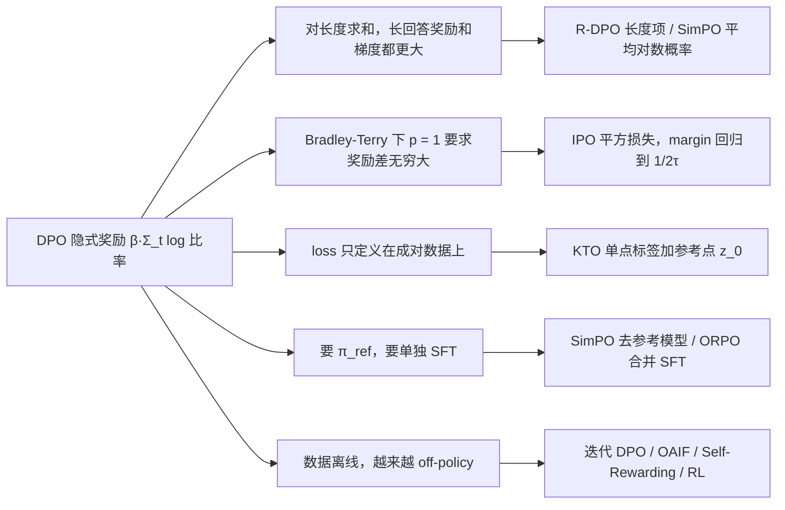

# DPO 及其变体

> 层级：垂类 · training · 预计 180 分钟 · 题目：[questions.md](questions.md)
> 前置：[core/11 后训练入门](../../../core/11-post-training-basics/README.md)（DPO 推导、隐式奖励、chosen 概率下降与 DPO-Positive）
> 相关：[03 GRPO 及其变体](../03-grpo-family/README.md)（在线 RL 里的长度偏差）、[05 奖励与 Verifier](../05-reward-verifier/README.md)（评委和奖励从哪来）

## 1 这一章解决什么问题

DPO 的推导在 [core/11 第 6 节](../../../core/11-post-training-basics/README.md#6-dpo从-rlhf-目标推出分类-loss) 已经讲完：从 KL 约束下的奖励最大化出发，反解出奖励，代入 Bradley-Terry 模型，配分函数 Z(x) 相减抵消，得到一个分类 loss。这一章不重推。

DPO 跑通以后，面试和实践里会碰到下面几类问题：

- 回答越训越长，质量却不一定跟着涨。原因在隐式奖励的形式里。
- 偏好数据里“几乎总是赢”的回答，会把输的那条压到概率 0。KL 系数 β 调多大都拦不住。
- 只有点赞点踩，没有成对比较，DPO 用不了。
- 参考模型要多占一份显存，还要先单独做一轮 SFT。
- 偏好对来自旧模型，策略变了以后数据越来越过时。

IPO、KTO、SimPO、ORPO、R-DPO 和在线、迭代 DPO 各针对其中一类。这一章按“DPO 的一个具体问题 → 机制 → 一个修法”的顺序讲，每个结论都用一小段 numpy 代码验证。

学完你应该能：

- 从“log π 是 token 对数概率之和”推出 DPO 的长度偏差，写出 R-DPO 式 9 的来历；
- 用 p = 1 的例子说明 DPO 在确定偏好下 KL 约束失效，推出 IPO 的最优 margin 有限；
- 写出 KTO 的价值函数和 z_0 的估计方法，说出为什么不需要成对数据；
- 写出 SimPO 和 ORPO 的 loss，说出长度归一化去掉了什么、没去掉什么；
- 区分离线与在线、on-policy 与 off-policy，讲出 Xu 等关于 DPO 最优解集合的反例；
- 在一个离散的小回答空间上实现 DPO、IPO、SimPO 的 loss 并做梯度下降。

**符号表**

| 符号 | 含义 |
|---|---|
| x | prompt |
| y_w、y_l | 同一 prompt 下被偏好（chosen）和被拒（rejected）的回答 |
| \|y\| | 回答的 token 数，不含 prompt |
| π_θ、π_ref | 训练中的策略、冻结的参考策略（通常是 SFT 模型） |
| log π(y\|x) | 整条回答的对数概率，等于 Σ_t log π(y_t \| x, y_<t) |
| β | DPO 和 KTO 的温度，也是 KL 约束的系数；SimPO 里只是奖励的缩放 |
| τ | IPO 论文里的 KL 系数，作用和 β 相同 |
| σ | sigmoid 函数，σ(z) = 1/(1+e^(−z)) |
| h | 两个对数比之差：log(π_θ(y_w)/π_ref(y_w)) − log(π_θ(y_l)/π_ref(y_l)) |
| p̂ | 数据里 y_w 赢 y_l 的经验比例 |

下图把 DPO 的问题和对应的修法连起来，后面各节按这个顺序展开。



## 2 先回顾：DPO 的几个固有问题

DPO 的隐式奖励是策略和参考模型的对数比，乘以 β（出处 [Rafailov 等，arXiv 2305.18290](https://arxiv.org/abs/2305.18290)）：

```text
r̂_θ(x, y) = β · log( π_θ(y|x) / π_ref(y|x) )
          = β · Σ_{t=1..|y|} log( π_θ(y_t|x,y_<t) / π_ref(y_t|x,y_<t) )
L_DPO     = − log σ( r̂_θ(x, y_w) − r̂_θ(x, y_l) ) = − log σ( β·h )
∇_θ L_DPO = − β · σ(−β·h) · ( ∇_θ log π_θ(y_w|x) − ∇_θ log π_θ(y_l|x) )
```

第二行是关键：语言模型对整条回答的对数概率是逐 token 对数概率之和，所以隐式奖励也是 |y| 项之和。它的梯度 ∇log π_θ(y|x) = Σ_t ∇log π_θ(y_t|…) 同样是 |y| 项之和。训练开始时 π_θ = π_ref，h = 0，权重 σ(0) = 0.5 对所有样本相同，loss 等于 log 2 ≈ 0.693。

从这几行可以读出后面要修的问题：

| DPO 的问题 | 来源 | 对应变体 |
|---|---|---|
| 回答越训越长 | 奖励和梯度都按 token 求和；数据本身偏爱长回答 | R-DPO、SimPO（第 3 节、4.3 节） |
| 偏好接近确定时过拟合 | Bradley-Terry 要求奖励差趋于无穷，KL 约束失效 | IPO（4.1 节） |
| 必须有成对数据 | loss 只定义在 (y_w, y_l) 上 | KTO（4.2 节） |
| 需要参考模型和单独的 SFT 阶段 | 隐式奖励里有 π_ref | SimPO、ORPO（4.3、4.4 节） |
| 数据离线、分布过时 | 偏好对来自旧模型 | 迭代 DPO、在线 DPO（第 5 节） |
| 概率可以放到数据没覆盖的回答上 | loss 只约束数据里出现的回答 | 在线 RL（第 6 节） |

chosen 的概率和 rejected 一起下降的问题在 [core/11](../../../core/11-post-training-basics/README.md) 讲过（DPO-Positive），这里不再展开。

## 3 长度偏差：成因与对策

出处：[Park、Rafailov、Ermon、Finn，Disentangling Length from Quality in Direct Preference Optimization，arXiv 2403.19159](https://arxiv.org/abs/2403.19159)，2024-03。

### 3.1 现象

DPO 训练后平均回答长度上涨，质量不一定跟着涨。论文在 HH 数据集、β = 0.1 的设置下观察到：第一个 epoch 的前 10% 里，标准 DPO 的回答长度就涨到 SFT 模型的将近两倍；此后胜率不再提高，只有 KL 和长度继续上涨。

奇怪的是，偏好数据本身的长度偏好很弱。论文表 1 给出了两份数据的统计：

| 数据集 | chosen 平均长度 | rejected 平均长度 |
|---|---|---|
| Anthropic RLHF HH | 79.6 | 75.7 |
| Reddit TL;DR | 37.9 | 35.2 |

chosen 只比 rejected 长 5% 到 8%，训练出来的策略却长了一倍。下面解释这一点偏好是怎么被放大的。

### 3.2 成因一：奖励和梯度都按 token 求和

第 2 节的式子里，log π(y|x) = Σ_t log π(y_t|…)。这带来两个直接后果。

**隐式奖励随长度线性放大**。设一条回答是某段内容重复 n 次，每个 token 的对数比都是 δ。它的隐式奖励是 β·n·|段|·δ，和 n 成正比。每个 token 的“质量”没变，奖励却翻了 n 倍。所以只要长回答每个 token 的对数比稍微为正，它的奖励就能轻松超过短回答。

**梯度量也随长度线性放大**。对一条回答第 t 个 token 的 log 概率求导，DPO loss 的系数是 −β·σ(−β·h)。同一对里每个 token 的系数相同，所以一条回答收到的总梯度量正比于它的 token 数。SimPO 论文附录 F 的梯度分析也指出这一点：DPO 里更长的序列得到更大的梯度更新，主导训练过程。第 7.1 节的代码用数值导数核对了这个系数。

### 3.3 成因二：隐式奖励在分布外外推

求和形式本身不会让模型变长。需要一个“推力”，这个推力来自分布外外推。Park 等的关键观察：

- 在离线偏好数据上（训练分布内），DPO 的隐式奖励和长度只有很弱的相关，强 α 正则下甚至负相关。
- 在训练后策略自己采样的回答上（分布外），隐式奖励都表现出明显的长度偏差。对“奖励 ~ 长度”做线性回归，长度能解释 30%–46% 的奖励方差（R²）。
- 论文把这称为 out-of-distribution bootstrapping：数据里一点点长度偏好，被隐式奖励外推到训练没见过的长度上，策略跟着它走。

下面用一个只会“决定何时停”的玩具策略把这个机制推一遍（推导，第 7.3 节代码验证）。每个位置以概率 q 输出 EOS，否则输出一个内容 token。长度为 L 的回答概率是 (1−q)^L·q，平均长度 (1−q)/q。参考策略 q_ref = 0.1，平均长度 9。

偏好数据里只有两种长度：12 和 8，内容完全一样。60% 的对是长的赢，40% 是短的赢。对一对长度分别是 L_w、L_l 的回答：

```text
h(q) = log(π(y_w)/π_ref(y_w)) − log(π(y_l)/π_ref(y_l))
     = (L_w − L_l) · log( (1−q) / (1−q_ref) )          log q 项两边相同，抵消
```

DPO 的总体 loss 是 −0.6·log σ(β·h) − 0.4·log σ(−β·h)，对 β·h 求导令其为 0，最优满足 σ(β·h) = 0.6，即 β·h = logit(0.6) ≈ 0.405。代入 L_w − L_l = 4：

```text
log( (1−q*) / 0.9 ) = 0.405 / (4β)
β = 1   →  1 − q* = 0.9 · e^0.101 ≈ 0.996  →  平均长度约 250
β = 0.1 →  需要 log((1−q)/0.9) = 1.01，但 (1−q) ≤ 1 时左边最多 log(1/0.9) ≈ 0.105
         →  永远拟合不到，q 被一直推向 0，长度无上界
```

这个例子说明了三件事：

1. 数据里只出现长度 8 和 12，策略采样的平均长度却到了 250。隐式奖励在这两个长度上只差 0.405，很小，但它是长度的线性函数，外推到 250 时完全没有约束。
2. 让长度变长的“参数”是 EOS 的概率，它对数据里所有回答都起作用。DPO 只在乎两条回答的对数比之差，它找到的最省力方式就是改一个对所有长度都生效的旋钮。
3. β 越小，KL 约束越弱，同样一点偏好要用更大的对数比去拟合，长度涨得越凶。Park 等也观察到 β 越小，生成越长。

真实模型里没有这么干净的“长度旋钮”，但 EOS 的概率、换行、列表格式这类全局特征起的是同一个作用。

### 3.4 对策一：R-DPO，在 margin 里加长度项

R-DPO 的推导和 DPO 完全平行，只是在 RLHF 目标里多减一项 α|y|（论文式 6）：

```text
(6) max_π  E_{x, y~π}[ r(x,y) − α|y| ] − β · KL( π(y|x) ‖ π_ref(y|x) )
(7) 最优解  π*(y|x) = (1/Z(x)) · π_ref(y|x) · exp( (r(x,y) − α|y|) / β )
(8) 反解    r(x,y) = β · log( π*(y|x)/π_ref(y|x) ) + β · log Z(x) + α|y|
(9) 代入 Bradley-Terry，β·log Z(x) 相减抵消：
    L_R-DPO = − log σ( β·log(π_θ(y_w|x)/π_ref(y_w|x)) − β·log(π_θ(y_l|x)/π_ref(y_l|x)) + (α|y_w| − α|y_l|) )
```

α 是超参，|y| 是回答的 token 数。和 DPO 比只多了 sigmoid 里的 α(|y_w| − |y_l|)。

直观理解：这一项把“长度能解释的那部分偏好”交给 α|y| 去解释，隐式奖励不用再学它。论文把它解释为一个逐样本的学习率。梯度权重是 σ(−margin)。y_w 比 y_l 长时，margin 被预先加大，权重变小；y_w 更短时，权重变大，与长度差成正比。

在上面的玩具例子里，取 α = logit(0.6)/4 ≈ 0.101，长度项正好解释了全部偏好。初始梯度精确为 0，长度停在 9。α 取一半只能部分抵消，最优平均长度约 18，仍然比 DPO 的 250 短得多。第 7.3 节的代码验证了这三个数。

论文实验里 HH 用 α = 0.01，TL;DR 用 α = 0.05。注意 α 的量纲是“每个 token 的奖励”，和 β、长度分布都有关，换数据要重调。

### 3.5 对策二和三：SimPO 和数据、评测侧

**SimPO** 把奖励改成平均对数概率，直接去掉求和，见 4.3 节。

**数据和评测侧**（常见做法）：

- 构造偏好对时控制 chosen 和 rejected 的长度差，加入“短而好胜过长而差”的样本。
- 训练时画平均长度曲线。长度涨、胜率不涨，就是信号。
- 在策略自己的采样上画“隐式奖励 vs 长度”的散点图，算 R²。这是 Park 等用来发现问题的方法，比只看训练集更早暴露外推。
- 评测时用长度控制后的胜率。Length-Controlled AlpacaEval（[Dubois 等，arXiv 2404.04475](https://arxiv.org/abs/2404.04475)）用一个 GLM 拟合评委偏好，再把“长度差”这一项置零，估计“两边一样长时的偏好”。评委侧的冗长偏差见 [05 章](../05-reward-verifier/README.md)。

**代价**：长度控制过头，模型会把该展开的分析也省掉。目标是“长度不影响偏好”，不是“越短越好”。

## 4 四个变体：动机、推导与代价

### 4.1 IPO：把 margin 拉回有限值

出处：[Azar 等，A General Theoretical Paradigm to Understand Learning from Human Preferences，arXiv 2310.12036](https://arxiv.org/abs/2310.12036)，2023-10，第 4.2 节、第 5 节、算法 1。

**统一框架 ΨPO**。论文把 RLHF 和 DPO 写成同一个目标的特例（式 6）：

```text
max_π  E_{x, y~π, y'~μ} [ Ψ( p*(y ≻ y' | x) ) ] − τ · KL( π ‖ π_ref )
```

μ 是产生对比回答 y' 的行为策略，Ψ 是一个把偏好概率映射成实数的非减函数。取 Ψ(q) = log(q/(1−q))，在 Bradley-Terry 假设下就回到 RLHF 和 DPO 的最优策略。这个 Ψ 在 q → 1 时趋于无穷。论文指出它高度非线性：把已经接近 1 的偏好概率再提高一点，和把 50% 附近的偏好概率提高很多，得到的激励一样大。

**p = 1 的论证**。两个回答 y、y'，y 总是被偏好：p*(y ≻ y') = 1。Bradley-Terry 要求 σ(r(y) − r(y')) = 1，只能 r(y) − r(y') → +∞。DPO 的最优策略是 π*(y) ∝ π_ref(y)·exp(r(y)/τ)，所以

```text
π*(y') / π*(y) = ( π_ref(y') / π_ref(y) ) · exp( −(r(y) − r(y')) / τ ) → 0
```

不管 τ 取多大，π*(y') 都是 0。KL 项的作用是把 π 拉向 π_ref，这里它被一个无穷大的奖励差压过去了。偏好越接近确定，KL 约束就越弱。

把同一个结论换成“经验偏好 p̂”看更清楚（推导）。只看一对回答，设数据里 y_w 赢的比例是 p̂。DPO 的总体 loss 对 h 求导：

```text
L(h) = −p̂·log σ(β h) − (1−p̂)·log σ(−β h)
dL/dh = β·( σ(β h) − p̂ ) = 0   →   h* = logit(p̂) / β
p̂ = 0.6 → h* = 4.05；p̂ = 0.8 → 13.9；p̂ = 0.99 → 46；p̂ = 1 → ∞     （β = 0.1）
```

有限数据下这个问题更严重。论文的例子：真实偏好是 0.8，只有几个样本时很可能估成 p̂ = 1，经验最优策略就会让 π(y') = 0。大语言模型的回答空间极大，绝大多数回答对只出现一次，p̂ 几乎都是 0 或 1。

**为什么经典 RLHF 不那么怕**。论文的解释是：p̂ 取 {0, 1} 时，奖励模型的最优值也是无穷，但实际训练会对奖励模型做正则和早停，奖励模型是“欠拟合”的。这种欠拟合让最终策略留在 π_ref 附近。DPO 跳过奖励模型，也丢掉了这层保护。早停仍可以作为额外的正则。

**IPO：取 Ψ 为恒等函数**。Ψ(q) = q 有界，KL 项在确定偏好下也能起作用。论文推出一个可以直接在偏好对上采样估计的 loss。每对 (y_w, y_l) 贡献两项：(y_w, y_l, 标签 1) 和 (y_l, y_w, 标签 0)，利用这个对称性降低方差，整理后得到式 17 和算法 1：

```text
h_π(y_w, y_l, x) = log( π(y_w|x)·π_ref(y_l|x) / ( π(y_l|x)·π_ref(y_w|x) ) )      就是 DPO 里的 h
L_IPO = E_{(x, y_w, y_l)~D} [ ( h_π(y_w, y_l, x) − 1/(2τ) )² ]
```

DPO 把 h 往 +∞ 推，IPO 把 h 回归到 1/(2τ)。用同样的“经验偏好 p̂”分析 IPO（推导）：

```text
L(h) = p̂·( h − 1/(2τ) )² + (1−p̂)·( −h − 1/(2τ) )²
dL/dh = 2p̂(h − 1/(2τ)) + 2(1−p̂)(h + 1/(2τ)) = 0   →   h* = (2p̂ − 1) / (2τ)
p̂ = 1 → h* = 1/(2τ)，有限
```

论文 5.3.1 节给出了同一结论：两个回答、π_ref 均匀、p* = 1 时，IPO 的最优策略是 π*(y1) = σ(0.5/τ)。τ → ∞ 时回到均匀的 π_ref，τ → 0 时才变成确定性策略。τ 真正控制了离 π_ref 多远。

**梯度上看两者的区别**。DPO 对 h 的梯度是 −β·σ(−β h)，h 再大它也只是变小，永远不为 0，所以只要训练继续，h 就继续涨。IPO 的梯度是 2(h − 1/(2τ))，h 超过目标后变号往回拉。

**论文的小实验**（5.4 节）：三个回答 {y_a, y_b, y_c}，π = softmax(θ)，Adam 学习率 0.01，18000 步。D1 = {(y_a, y_b), (y_b, y_c), (y_a, y_c)} 是全序。DPO 对所有 τ 都收敛到只输出 y_a 的确定性策略；IPO 在 τ 大时留在 π_ref 附近。另一个数据集只观察到 (y_a, y_b) 和 (y_b, y_a)，(y_a, y_c) 完全没出现：y_c 一次也没赢过，DPO 无论 τ 多大都把它的概率压到 0；IPO 不会，y_c 的概率随 τ 平滑变化，正则越强越接近 π_ref。论文指出后一种情况在真实数据里更常见：回答空间大、数据少时，很多回答只出现一两次，从来没赢过。第 7.2 节的代码复现了 D1 的情况，并对 IPO 给出闭式解。

**代价**：所有偏好对回归到同一个目标 margin，不区分“很确定的偏好”和“勉强的偏好”；τ 要调；平方损失对标签噪声没有 sigmoid 那样的饱和保护。

### 4.2 KTO：不要成对数据

出处：[Ethayarajh 等，KTO: Model Alignment as Prospect Theoretic Optimization，arXiv 2402.01306](https://arxiv.org/abs/2402.01306)，2024-02，第 3、4 节和附录。

**问题**：成对比较数据贵。很多场景只有“这条好 / 这条差”的单点标签，比如点赞点踩、人工审核通过与否。

**前景理论的价值函数**。Kahneman 和 Tversky 的前景理论用一个价值函数描述人对“相对某个参考点 z_0 的得失”的主观感受（论文式 4）：

```text
v(z; λ, α, z_0) =  (z − z_0)^α          z ≥ z_0     收益
                 = −λ·(z_0 − z)^α       z < z_0     损失
```

论文引用的中位数参数是 α = 0.88、λ = 2.25。α < 1 让收益段凹、损失段凸，表示边际敏感度递减；λ > 1 表示损失厌恶，同样大小的损失比收益更痛。它有三个要素：参考点、收益段凹、损失比收益陡。

**从价值函数到 loss**。KTO 做了三处替换（4.1 节）：

1. z 换成隐式奖励 r_θ(x, y) = log(π_θ(y|x)/π_ref(y|x))，单位是 nat。
2. 幂函数在优化时数值不稳，换成同样“收益凹、损失凸”的 logistic 函数 σ，并加一个 β 控制饱和速度。β 越大，价值越快饱和。
3. λ 拆成 λ_D、λ_U，分别作用于好样本和坏样本。

于是得到默认的 KTO loss（论文式 8）：

```text
r_θ(x, y) = log( π_θ(y|x) / π_ref(y|x) )
z_0       = KL( π_θ(y'|x) ‖ π_ref(y'|x) )                参考点，不回传梯度
v(x, y)   = λ_D · σ( β·(r_θ(x,y) − z_0) )    若 y 是好回答
          = λ_U · σ( β·(z_0 − r_θ(x,y)) )    若 y 是坏回答
L_KTO     = E_{x,y~D} [ λ_y − v(x, y) ]
```

λ_y 只是为了让 loss 非负，去掉不影响梯度。

**为什么不需要成对数据**。DPO 的参考点是“同一 prompt 下的另一条回答”，所以必须成对。KTO 假设人是拿 y 和“这个 prompt 下所有可能的回答”比，参考点就变成策略相对 π_ref 的期望对数比，也就是 KL(π_θ ‖ π_ref)。每条样本只要和这个共享参考点比，自己带一个好坏标签就够了。

**z_0 怎么估**（论文 4.1 节）。从 π_θ 采样太慢。论文在同一个 microbatch 里把输出错位，构造不匹配的对 (x_1, y_2), (x_2, y_3), …, (x_m, y_1)，用它们的对数比估计一个共享参考点：

```text
ẑ_0 = max( 0, (1/m) · Σ_{i=1..m} log( π_θ(y_j|x_i) / π_ref(y_j|x_i) ) ),   j = (i mod m) + 1
```

几个细节：

- 用错位的 y_j 而不是配对的 y_i：配对的回答往往是刻意挑出来的好或坏样本，奖励幅度偏大，不具代表性。
- 这个估计有偏。截到 ≥ 0 又加了一点向上的偏差，但降低了方差。
- 多一次前向。microbatch 至少为 2，否则错位配对就是自己。论文实验用有效 batch 32，建议 8 到 128。
- 如果 KTO 之前已经在同一批好样本上做过 SFT，并用这个 SFT 模型当 π_ref，KL 估计会很快接近 0，这时可以直接设 ẑ_0 = 0 省掉这次前向。

**梯度为什么会饱和**（论文命题 4.1）。记 z = r_θ − z_0，一条样本的梯度是

```text
∇_θ ℓ_KTO = d(y) · λ_y · β · σ(βz)(1 − σ(βz)) · ∇_θ log π_θ(y|x)        d(y) = −1 好样本，+1 坏样本
```

σ(βz)(1−σ(βz)) 在 z = 0 处最大，z → ±∞ 时趋于 0。离参考点很远的样本，不管是太容易还是太难，都几乎不贡献梯度。论文认为这在噪声标签下有好处，被错标成“好”的坏回答隐式奖励很负，会被自动忽略；代价是难而必要的样本也会被忽略。

**直觉**（论文 4.1 节）：如果模型粗暴地提高好样本的奖励，比如整体提高所有回答的概率，KL 参考点也跟着涨，r_θ − z_0 不变，loss 不降。模型只有学会“好样本具体好在哪”，才能在不抬高 KL 的情况下提高奖励。

**超参**（论文 4.2 节）：

- 默认 β = 0.1，λ_D = λ_U = 1。
- 好坏样本不平衡时，建议 λ_D·n_D / (λ_U·n_U) ∈ [1, 3/2]（式 9）。例如好:坏 = 1:10，取 λ_U = 1、λ_D ∈ [10, 15]。
- 学习率通常是 DPO 最优学习率的 2 到 10 倍，因为 KTO 的奖励幅度更小。论文的默认值是 5e-6。
- 学习率太大时，好样本和坏样本的隐式奖励会一起下降；正常情况只有坏样本的下降。

**代价**：丢掉了“同一 prompt 下两条回答谁更好”的直接对比，信号更弱；z_0 的估计有偏；仍然要 π_ref。数据本来就是成对偏好时，论文自己也说选 KTO 还是 DPO 没有定论。

### 4.3 SimPO：长度平均奖励，去掉参考模型

出处：[Meng、Xia、Chen，SimPO: Simple Preference Optimization with a Reference-Free Reward，arXiv 2405.14734](https://arxiv.org/abs/2405.14734)，2024-05，第 2 节、第 4 节、附录 F。

**问题一：训练奖励和生成指标不一致**。生成时（例如 beam search、多选题打分）常用的是平均对数似然 (1/|y|)·log π_θ(y|x)，里面没有 π_ref。DPO 优化的是对数比之和。满足 r̂(y_w) > r̂(y_l) 不代表 y_w 的平均对数似然更高。论文统计，用 DPO 训练后，训练集里只有约 50% 的三元组满足后者。

**问题二：求和的奖励带长度偏差**。论文指出，长序列的总对数概率天然更低。y_w 比 y_l 长时，要让求和的奖励 y_w 更高，模型就得人为抬高长序列的概率，这增加了退化的风险。

**做法**。用平均对数概率当隐式奖励（式 4），在 Bradley-Terry 里加一个目标间隔 γ（式 5），合起来得到式 6：

```text
r_SimPO(x, y) = (β/|y|) · log π_θ(y|x) = (β/|y|) · Σ_i log π_θ(y_i | x, y_<i)
p(y_w ≻ y_l | x) = σ( r(x, y_w) − r(x, y_l) − γ )
L_SimPO = − log σ( (β/|y_w|)·log π_θ(y_w|x) − (β/|y_l|)·log π_θ(y_l|x) − γ )
```

**长度归一化去掉了什么**。把第 3.2 节的例子再做一遍：同一段内容重复 n 次，平均对数概率不变，SimPO 奖励和 n 无关，DPO 奖励却乘了 n。梯度也一样（附录 F 式 7）：

```text
∇_θ L_SimPO = − β · s_θ · ( (1/|y_w|)·∇_θ log π_θ(y_w|x) − (1/|y_l|)·∇_θ log π_θ(y_l|x) )
s_θ = σ( (β/|y_l|)·log π_θ(y_l|x) − (β/|y_w|)·log π_θ(y_w|x) + γ )
```

每条回答的梯度除以了自己的长度，回答整体变长 n 倍，梯度不变。第 7.4 节的代码验证了：一对回答放大 10 倍，DPO 的梯度范数放大 10 倍，SimPO 不变。

**长度归一化没去掉什么**（推导）。它去掉的是“求和”带来的线性放大，不是所有和长度有关的自由度。把 EOS 也算进回答：每个位置以概率 q 停止，长度为 L、内容相同的回答，平均对数概率是

```text
avg(L) = [ L·log(1−q) + log q ] / (L+1) = log(1−q) − logit(q) / (L+1)
```

第二项随 1/(L+1) 衰减，所以长回答的平均对数概率仍然略高（q < 0.5 时）。q = 0.1、β = 2 时，长 12 和长 8 的两条回答奖励差约 0.15，比 DPO 里的线性项小得多，但不为 0。另外，SimPO 没有 π_ref 的约束，如果数据本身偏长，模型仍然可以通过降低 EOS 概率来拉开 margin。这一节的结论是：SimPO 消除了隐式奖励对长度的线性依赖，长度控制仍然要靠数据和监控兜底。论文消融里去掉长度归一化（w/o LN）伤害最大，奖励和长度出现很强的正相关，模型生成更长但质量更低的回答。

**目标间隔 γ**。γ > 0 要求 chosen 的奖励至少比 rejected 高 γ。论文观察到：γ 增大时，held-out 集上的奖励准确率上升，生成质量却先升后降。γ 太大时，奖励差的分布变平，chosen 的对数似然也下降。IPO 也有一个目标 margin 1/(2τ)，区别是 IPO 用平方损失把 h 钉在这个值上，SimPO 只要求超过它。

**超参**：论文建议 β 取 2.0–2.5，γ 取 0.5–1.5。β 比 DPO 的 0.1 大一个数量级，因为它乘的是每个 token 的平均对数概率，数值小。

**没有参考模型**：省掉参考模型的前向。论文报告在 8×H100 上，相比原始 DPO 实现，运行时间约少 20%，每卡峰值显存约少 10%。

**代价**：没有对参考模型的显式约束。论文的解释是小学习率、覆盖多领域的偏好数据、LLM 自身的抗遗忘能力，三者合起来让 KL 保持在较低水平；但论文也承认，没有显式正则时原则上可能出现 reward hacking，loss 很低而模型退化。实践上要监控和 SFT 模型的 KL。

### 4.4 ORPO：把 SFT 和偏好合成一个 loss

出处：[Hong、Lee、Thorne，ORPO: Monolithic Preference Optimization without Reference Model，arXiv 2403.07691](https://arxiv.org/abs/2403.07691)，2024-03，第 3、4 节和附录 A。

**问题**。标准流程是先 SFT 再 DPO，两个阶段，DPO 还要参考模型。论文观察到，只做 SFT 时 chosen 和 rejected 的对数概率一起上升：交叉熵把模型带到了目标领域（例如对话），但对不想要的风格没有任何惩罚，rejected 有时比 chosen 还可能。论文认为 SFT 对偏好对齐的收敛仍然必要，只需在 SFT 时对不想要的风格加一个小惩罚。

**做法**（论文式 3、4、6、7）：

```text
log P_θ(y|x) = (1/m) · Σ_t log P_θ(y_t | x, y_<t)          长度平均，m 是回答的 token 数
odds_θ(y|x)  = P_θ(y|x) / (1 − P_θ(y|x))
L_OR   = − log σ( log( odds_θ(y_w|x) / odds_θ(y_l|x) ) )
L_ORPO = E [ L_SFT + λ · L_OR ]                             L_SFT 是 y_w 上的 NLL
```

odds = k 表示模型生成 y 的可能性是不生成它的 k 倍。P 用的是长度平均的似然，和 SimPO 一样不受长度线性放大的影响。

**梯度**（论文式 8–10）：

```text
∇_θ L_OR = δ(d) · h(d)
δ(d) = ( 1 + odds_θ(y_w|x) / odds_θ(y_l|x) )^(−1)
h(d) = ∇_θ log P_θ(y_w|x) / (1 − P_θ(y_w|x)) − ∇_θ log P_θ(y_l|x) / (1 − P_θ(y_l|x))
```

推导的关键一步（附录 A）：log odds = log P − log(1 − P)，对 log P 求导得 1 + P/(1−P) = 1/(1−P)。所以 ∇log odds(y) = ∇log P(y)/(1 − P(y))。第 7.5 节的代码用数值导数核对了这一步。

两项的含义：

- δ(d) = σ(−log OR)。chosen 的 odds 远大于 rejected 时趋于 0，模型更可能生成 rejected 时接近 1。它和 DPO 的 σ(−β h) 是同一种“排错了才加大权重”的机制。
- h(d) 里的 1/(1 − P) 在 P 小时接近 1，P 大时放大梯度。

**为什么用几率比，不用概率比**（论文 7.1 节）。概率比 log(P_w/P_l) 乘上 β 以后，对 rejected 的区分更极端。ORPO 把偏好项和 SFT 放在一起训，太极端的惩罚会把 SFT 也带偏；几率比更温和。

**超参与代价**：论文里 λ 按模型取 0.1 到 0.25。没有参考模型，每个 batch 只需对 chosen 和 rejected 各做一次前向，DPO 要四次（策略和参考各两次），前向次数减半。代价是 SFT 和偏好耦合在一起，λ 决定两者的平衡；没有参考模型的锚点。

## 5 在线与离线

**两组概念别混**（按 [Guo 等，arXiv 2402.04792](https://arxiv.org/abs/2402.04792) 的区分）：

- 离线与在线：反馈是训练前收集好、不再更新，还是每个训练迭代重新收集。
- off-policy 与 on-policy：回答是别的模型采的，还是当前训练的模型采的。固定数据集随着模型更新，必然越来越 off-policy。

**为什么离线数据会过时**。DPO 只在数据里出现过的回答上调概率。第 3.3 节的例子说明，策略变了以后，它自己会生成的回答（长度 250）根本不在数据里（长度 8 和 12），隐式奖励在那里没有任何约束。on-policy 采样的作用是把“策略现在会生成什么”拉回到训练数据里，让奖励在这些回答上被重新校准。

| 做法 | 每轮怎么做 | 代价 |
|---|---|---|
| 离线 DPO | 一份固定偏好数据训到底 | 最简单；分布过时 |
| 迭代 DPO | 用当前模型采样、打分、组成新偏好对，再训一轮 DPO；循环几轮 | 每轮要打分；轮内数据仍固定 |
| 在线 DPO（OAIF） | 每个训练步从当前模型采两条回答，LLM 评委选出更好的一条，立刻做 DPO 更新 | 评委调用量大；评委偏差直接进梯度 |
| 在线 RL（PPO、GRPO） | 每步采样，用奖励模型或规则打分 | 工程最重；见 [03 GRPO](../03-grpo-family/README.md) |

**OAIF 的一个副作用：长度可以由评委控制**。论文通过在评委 prompt 里要求“偏好更短的回答”，把对齐后策略的平均回答长度从约 120 token 降到约 40 token。这同时说明了另一面：评委有什么偏好，在线训练就会把它直接写进策略。

**三个有原文支撑的迭代例子**：

- Self-Rewarding（[Yuan 等，arXiv 2401.10020](https://arxiv.org/abs/2401.10020)）：当前模型对每个新 prompt 采 N = 4 条回答，再用自己当评委，按 5 分加法量表打分，每条评 3 次取平均。最高分当 chosen，最低分当 rejected，同分丢弃。DPO 用 β = 0.1。M1 是 SFT 模型，M2、M3 各在上一轮模型自己生成的偏好对上做一轮 DPO。论文报告 M1、M2、M3 在同一评测集上的平均生成长度是 1092、1552、2552，并在局限里承认长度增长可能影响了相对表现，自我评委下是否会 reward hacking 留作未来工作。
- Iterative RPO（[Pang 等，arXiv 2404.19733](https://arxiv.org/abs/2404.19733)）：推理题上，当前模型生成多条思维链，答案对的当 chosen、错的当 rejected。loss 是 DPO 加一项 chosen 上的 NLL，L = L_DPO + α·L_NLL，论文称 NLL 项是关键。这和 core/11 讲的 chosen 概率下降问题是同一个方向的补救。
- Xu 等的迭代 DPO（见第 6 节）：用学到的奖励模型给新采样打标签，好于静态 DPO，但在代码竞赛类任务上仍落后 PPO。

**代价**：迭代越多越接近在线，但评委（或奖励模型）的偏差会被反复放大，和 RL 里的 reward hacking 是同一类问题，见 [05 奖励与 Verifier](../05-reward-verifier/README.md)。Self-Rewarding 里长度一路上涨就是一个例子：评委偏爱长回答，下一轮的 chosen 就更长。

## 6 什么时候从 DPO 换到 RL

出处：[Xu 等，Is DPO Superior to PPO for LLM Alignment? A Comprehensive Study，arXiv 2404.10719](https://arxiv.org/abs/2404.10719)，ICML 2024，定理 4.1、表 1、第 5 节。

**定理 4.1：PPO 可达的策略集合是 DPO 最优解集合的真子集**。记 Π_PPO 为“用某个最小化奖励模型 loss 的奖励 r，再做 KL 约束 RL 得到的策略”，Π_DPO 为“最小化 DPO loss 的策略”。

证明的第一半（Π_PPO ⊆ Π_DPO）沿用 DPO 的推导：任何 PPO 解都能写成 π ∝ π_ref·exp(r/β)，代回 DPO loss 等于奖励模型的最小 loss，所以它也是 DPO 的最优解。

第二半（真子集）靠一个反例（论文表 1）：

| | y1 | y2 | y3 |
|---|---|---|---|
| π_ref | 0.5 | 0.5 | 0 |
| 偏好数据 | 只有一对 y1 ≻ y2 | | |
| π_DPO | 0.1 | 0.0 | 0.9 |
| π_PPO | 1 | 0 | 0 |

记 π_DPO 给 y1、y2 的概率为 a、b。因为 π_ref(y1) = π_ref(y2)，DPO loss 是

```text
L_DPO = −log σ( β·log(a/0.5) − β·log(b/0.5) ) = log( 1 + (b/a)^β )
```

只要 b = 0，loss 就取到下确界 0，和 y3 上放多少概率无关。所以把 0.9 的概率放到 π_ref 为 0、数据里从未出现的 y3 上，也是 DPO 的最优解。PPO 的解必须写成 π_ref·exp(r/β)，π_ref(y3) = 0 就迫使 π_PPO(y3) = 0。从 KL 的角度看，π > 0 而 π_ref = 0 的地方 KL 是无穷，带 KL 的 RL 目标直接排除了这种解。第 7.6 节的代码核对了这两点。

**这个结论的实际含义**。DPO 的 loss 只约束数据里出现的回答。数据没覆盖的回答上，概率怎么分配都不影响 loss。真实模型不会精确地把概率放到 π_ref 为 0 的地方，但同一个机制会让概率流向数据覆盖不到的区域。这和第 3.3 节长度外推是同一类问题。PPO 用 prompt-only 数据在线采样，KL 项在这些新回答上继续起正则作用。

**其他结论**：

- DPO 对参考模型和偏好数据的分布错配敏感。先在偏好数据的好回答上做一次 SFT、再拿它当参考模型，能改善结果。
- 迭代 DPO 好于静态 DPO，但即使标注接近完美，在代码竞赛类困难任务上仍明显落后于 PPO。
- PPO 的三个关键因素：优势归一化、大 batch（对代码任务收益最大）、参考模型的 EMA 更新。

**判断清单**（常见做法）：

| 情况 | 倾向 |
|---|---|
| 有高质量离线偏好对，任务是风格、安全、语气 | DPO 或其变体 |
| 只有点赞点踩 | KTO |
| 奖励可以程序验证（测试通过、答案比对） | 在线 RL，GRPO 一类省掉 critic |
| 多轮、要和环境交互 | RL，偏好对很难覆盖轨迹空间，见 [04 Agentic RL](../04-agentic-rl/README.md) |
| 离线 DPO 已到平台，又没有 RL 基础设施 | 先上迭代 DPO |
| 策略采样明显偏离偏好数据分布（长度、格式、话题） | 迭代 DPO 或在线方法，先把数据拉回 on-policy |

## 7 实现：只用 numpy 验证上面的结论

下面每段代码都能单独运行，结尾用 assert 检查结论。真实训练里 log 概率由模型算出，梯度会继续反传到参数。这里的策略是几个参数的 softmax，梯度可以手写，便于直接看到 loss 的形状。

### 7.1 一个 batch 上的 DPO、R-DPO、IPO、SimPO loss

张量形状：B 是偏好对数，T 是补齐后的回答长度。logp 类张量是 (B, T)，每个回答 token 一个 log 概率；mask 是 (B, T)，回答 token 为 1，padding 为 0。检查三件事：初始时 DPO loss 等于 log 2；padding 不影响 loss；DPO 对每个 token log 概率的梯度系数是 −β·σ(−βh)/B，同一回答所有 token 相同。

```python
import numpy as np

sig = lambda x: 1.0 / (1.0 + np.exp(-x))
logsig = lambda x: -np.logaddexp(0.0, -x)          # log σ(x)，数值稳定

# 一个 batch：B 对偏好数据，回答补齐到 T 个 token
# logp_*：(B, T)，每个回答 token 的 log 概率；mask_*：(B, T)，回答 token 为 1，padding 为 0
B, T = 3, 6
rng = np.random.default_rng(0)
mask_w = np.array([[1, 1, 1, 1, 1, 1], [1, 1, 1, 0, 0, 0], [1, 1, 1, 1, 0, 0]], float)
mask_l = np.array([[1, 1, 0, 0, 0, 0], [1, 1, 1, 1, 1, 0], [1, 1, 1, 1, 0, 0]], float)
ref_w = np.where(mask_w > 0, -rng.uniform(0.5, 3.0, (B, T)), -np.inf)   # padding 位置故意放 −inf
ref_l = np.where(mask_l > 0, -rng.uniform(0.5, 3.0, (B, T)), -np.inf)
pol_w = ref_w + rng.normal(0, 0.2, (B, T))
pol_l = ref_l + rng.normal(0, 0.2, (B, T))

def seq(logp, mask):
    """先用 mask 把无效位置置 0 再求和，避免 −inf × 0 = NaN。返回 (B,)"""
    return np.where(mask > 0, logp, 0.0).sum(-1)

def losses(pw, pl, rw, rl, beta=0.1, tau=0.1, alpha=0.01, beta_s=2.0, gamma=1.0):
    Lw, Ll = mask_w.sum(-1), mask_l.sum(-1)                        # (B,)
    h = (seq(pw, mask_w) - seq(rw, mask_w)) - (seq(pl, mask_l) - seq(rl, mask_l))
    out = {
        "dpo": -logsig(beta * h),
        "rdpo": -logsig(beta * h + alpha * (Lw - Ll)),             # Park 等式 9
        "ipo": (h - 1 / (2 * tau)) ** 2,                           # Azar 等式 17，按论文的求和形式
        "simpo": -logsig(beta_s * (seq(pw, mask_w) / Lw - seq(pl, mask_l) / Ll) - gamma),
    }
    return {k: v.mean() for k, v in out.items()}, h

out, h = losses(pol_w, pol_l, ref_w, ref_l)
assert all(np.isfinite(v) for v in out.values())

# 1) π_θ = π_ref 时：h = 0，DPO loss = log 2，IPO loss = (1/(2τ))²
init, h0 = losses(ref_w, ref_l, ref_w, ref_l)
assert np.allclose(h0, 0) and np.isclose(init["dpo"], np.log(2)) and np.isclose(init["ipo"], 25.0)

# 2) padding 位置的值随便改，loss 不变
junk = lambda a, m: np.where(m > 0, a, rng.normal(0, 100, a.shape))
out2, _ = losses(junk(pol_w, mask_w), junk(pol_l, mask_l), ref_w, ref_l)
assert all(np.isclose(out[k], out2[k]) for k in out)

# 3) DPO 对每个 token log 概率的梯度：chosen 上是 −β·σ(−βh)/B，rejected 上取反，padding 上为 0
beta = 0.1
coef = -beta * sig(-beta * h) / B                                  # (B,)
analytic = coef[:, None] * mask_w
eps, num = 1e-6, np.zeros((B, T))
for i in range(B):
    for t in range(T):
        if mask_w[i, t] == 0:
            continue
        up, dn = pol_w.copy(), pol_w.copy()
        up[i, t] += eps; dn[i, t] -= eps
        num[i, t] = (losses(up, pol_l, ref_w, ref_l)[0]["dpo"]
                     - losses(dn, pol_l, ref_w, ref_l)[0]["dpo"]) / (2 * eps)
assert np.allclose(num, analytic, atol=1e-8)
# 同一对里每个 token 系数相同，所以一条回答的总梯度量正比于它的 token 数：这是长度偏差的入口
assert np.allclose(np.abs(analytic).sum(-1), np.abs(coef) * mask_w.sum(-1))
print({k: round(float(v), 4) for k, v in out.items()})
```

最后一个 assert 就是第 3.2 节的“梯度量正比于长度”。这里的 IPO 按论文式 17 的求和形式写。TRL 的 `loss_type="ipo"` 实现会先把两边的对数比各自除以回答 token 数再算平方，代码注释说这是和 IPO 作者确认过的做法，论文里的实验结果也对应这个归一化形式（第 9 节第 6 条）。

### 7.2 偏好确定时：DPO 把被拒回答压到 0，IPO 停在有限值

第一部分是 4.1 节的总体最优 h*。第二部分复现 IPO 论文 5.4 节的 D1：三个回答，π_ref 均匀，偏好 a ≻ b ≻ c 且确定。用梯度下降训练 DPO 和 IPO，对 IPO 再推一个闭式解来核对（推导写在注释里）。

```python
import numpy as np

sig = lambda x: 1.0 / (1.0 + np.exp(-x))

# ---- (1) 两个回答 y1、y2，经验偏好 p̂ = P(y1 ≻ y2)。h = 两个对数比之差（式 17 里的 h_π）
# DPO 的总体最优：σ(β·h) = p̂，所以 h = logit(p̂)/β
# IPO 的总体最优：p̂·(h − 1/(2τ))² + (1 − p̂)·(−h − 1/(2τ))² 最小，h = (2p̂ − 1)/(2τ)
def h_dpo(p, beta):
    return np.inf if p == 1 else np.log(p / (1 - p)) / beta

def h_ipo(p, tau):
    return (2 * p - 1) / (2 * tau)

for p in [0.6, 0.8, 0.99, 0.9999]:
    print(f"p̂={p}: DPO h={h_dpo(p, 0.1):8.2f}   IPO h={h_ipo(p, 0.1):5.2f}")
assert h_dpo(1.0, 10.0) == np.inf            # p̂ = 1：β 再大，h 也是无穷，π(y2) → 0
assert h_ipo(1.0, 0.1) == 1 / (2 * 0.1)      # IPO：p̂ = 1 时 h 停在 1/(2τ)
# IPO 论文 5.3.1 节：均匀 π_ref、p* = 1 时，最优 π(y1) = σ(0.5/τ)
for tau in [0.1, 1.0, 10.0]:
    assert np.isclose(sig(h_ipo(1.0, tau)), sig(0.5 / tau))

# ---- (2) 梯度下降：三个回答 a、b、c，π = softmax(θ)，π_ref 均匀
# IPO 论文 5.4 节的 D1：a ≻ b，b ≻ c，a ≻ c，偏好全序且确定
pairs = [(0, 1), (1, 2), (0, 2)]
theta_ref = np.zeros(3)

def logratio(theta):                     # log π(y) − log π_ref(y)，形状 (3,)
    lp = theta - np.log(np.exp(theta).sum())
    lr = theta_ref - np.log(np.exp(theta_ref).sum())
    return lp - lr

def grad(theta, kind, coef):
    """kind='dpo' 时 coef=β；kind='ipo' 时 coef=τ。返回 loss 对 θ 的梯度，形状 (3,)"""
    r = logratio(theta)
    g = np.zeros(3)
    for w, l in pairs:
        h = r[w] - r[l]
        e = np.zeros(3); e[w], e[l] = 1.0, -1.0       # softmax 下 ∂h/∂θ = e_w − e_l
        if kind == "dpo":
            g += -coef * sig(-coef * h) * e            # ∂/∂h [−log σ(β h)] = −β σ(−β h)
        else:
            g += 2 * (h - 1 / (2 * coef)) * e          # ∂/∂h (h − 1/(2τ))²
    return g / len(pairs)

def train(kind, coef, steps, lr=0.5):
    theta = theta_ref.copy()
    for _ in range(steps):
        theta -= lr * grad(theta, kind, coef)
    return np.exp(theta) / np.exp(theta).sum()

for beta in [0.1, 1.0, 5.0]:
    p_short, p_long = train("dpo", beta, 2_000), train("dpo", beta, 50_000)
    print(f"DPO β={beta}: π(c) {p_short[2]:.2e} → {p_long[2]:.2e}")
    assert p_long[2] < p_short[2] < 0.05        # 被拒回答 c 的概率一直往 0 走，和 β 无关
    assert p_long[0] > 0.9                      # 总是赢的 a 吃掉几乎全部概率

# IPO：可以求出闭式。令 u = θa − θb，v = θb − θc，loss ∝ (u−t)² + (v−t)² + (u+v−t)²，t = 1/(2τ)
# 令梯度为 0 得 u = v = 2t/3 = 1/(3τ)
for tau in [0.1, 1.0, 5.0]:
    p_short, p_long = train("ipo", tau, 2_000, lr=0.2), train("ipo", tau, 50_000, lr=0.2)
    target = np.exp(np.array([2, 1, 0]) / (3 * tau)); target /= target.sum()
    print(f"IPO τ={tau}: π = {p_long.round(4)}")
    assert np.allclose(p_short, p_long, atol=1e-6)   # 已收敛，再训也不动
    assert np.allclose(p_long, target, atol=1e-6)    # 和闭式一致
    assert p_long[2] > 0.001                         # c 的概率停在有限值
# τ 越大越接近 π_ref（均匀），τ 越小越接近确定性策略
assert abs(train("ipo", 5.0, 5000, lr=0.2)[2] - 1 / 3) < 0.05
```

运行结果：β = 0.1 时 DPO 训练 5 万步后 π(c) 约 3e-39，β = 5 时也一路下降，只是慢。IPO τ = 1 时停在 π = (0.448, 0.321, 0.230)，再训也不动。τ = 0.1 时 π(c) ≈ 0.0012，τ = 5 时接近均匀。β 在 DPO 里只改变“多快趋向 0”，τ 在 IPO 里改变“停在哪”。

### 7.3 长度偏差：数据只偏好一点点长度，DPO 把长度推到数据之外

第 3.3 节的“停止概率”玩具策略。内容完全相同，60% 的对是长 12 胜长 8。代码同时验证 β = 1 的闭式解、β = 0.1 时长度无界增长，以及 R-DPO 的 α 取多少能完全抵消。

```python
import numpy as np

sig = lambda x: 1.0 / (1.0 + np.exp(-x))
logit = lambda p: np.log(p / (1 - p))

# 一个只会“决定何时停”的玩具策略：每个位置以概率 q 输出 EOS，否则输出一个内容 token。
# 回答长度为 L（不含 EOS）的概率是 (1−q)^L · q，平均长度 E[L] = (1−q)/q。
# 参数是 s = logit(q)。参考策略 q_ref = 0.1，平均长度 9。
q_ref = 0.1
mean_len = lambda q: (1 - q) / q

def h(q, L_w, L_l):
    """两个对数比之差：log π(y_w)/π_ref(y_w) − log π(y_l)/π_ref(y_l)。log q 项在两边相同，抵消"""
    return (L_w - L_l) * np.log((1 - q) / (1 - q_ref))

# 偏好数据：60% 的对是“12 个 token 的回答胜 8 个 token 的回答”，40% 反过来。内容完全相同，只有长度不同
rho, L_long, L_short = 0.6, 12, 8

def grad_s(s, beta, alpha):
    """R-DPO 总体 loss 对 s 的导数；alpha = 0 就是 DPO"""
    q = sig(s)
    dh_ds = (L_long - L_short) * (-q)              # d/ds log(1−q) = −q
    g = 0.0
    for w, l, wt in [(L_long, L_short, rho), (L_short, L_long, 1 - rho)]:
        m = beta * h(q, w, l) + alpha * (w - l)     # R-DPO 式 9 的 sigmoid 参数
        sign = 1.0 if w == L_long else -1.0
        g += wt * (-sig(-m)) * beta * sign * dh_ds  # ∂/∂m [−log σ(m)] = −σ(−m)
    return g

def train(beta, alpha=0.0, steps=200_000, lr=1.0):
    s = logit(q_ref)
    for _ in range(steps):
        s -= lr * grad_s(s, beta, alpha)
    return sig(s)

# 1) β = 1：总体最优满足 σ(β·h) = 0.6，可以解出 q，平均长度从 9 涨到约 250
q_star = 1 - (1 - q_ref) * np.exp(logit(rho) / (1.0 * (L_long - L_short)))
q_dpo = train(beta=1.0)
print(f"β=1 DPO：平均长度 {mean_len(q_ref):.0f} → {mean_len(q_dpo):.0f}（闭式 {mean_len(q_star):.0f}）")
assert np.isclose(q_dpo, q_star, rtol=1e-3)
assert mean_len(q_dpo) > 25 * mean_len(q_ref)
# 在数据里的两种长度上，隐式奖励差只有 logit(0.6) ≈ 0.405，很小；策略自己采样的长度却远离数据（8 到 12）
assert np.isclose(1.0 * h(q_dpo, L_long, L_short), logit(rho), atol=1e-3)

# 2) β = 0.1：β·h 的上限是 β·4·log(1/(1−q_ref)) ≈ 0.042 < 0.405，永远拟合不到，q 一路被推向 0
assert 0.1 * (L_long - L_short) * np.log(1 / (1 - q_ref)) < logit(rho)
lens = [mean_len(train(beta=0.1, steps=n)) for n in (1_000, 10_000, 100_000)]
print("β=0.1 DPO：训练 1e3/1e4/1e5 步后的平均长度", np.round(lens))
assert lens[0] < lens[1] < lens[2] and lens[2] > 100 * mean_len(q_ref)

# 3) R-DPO：α·ΔL 项正好能解释这份数据里的长度偏好时（α = logit(0.6)/4），初始梯度为 0，长度不动
alpha_star = logit(rho) / (L_long - L_short)
assert abs(grad_s(logit(q_ref), 1.0, alpha_star)) < 1e-12
assert np.isclose(mean_len(train(beta=1.0, alpha=alpha_star, steps=10_000)), 9.0)
# α 小一些只能部分抵消：最优仍偏长，但比 DPO 短
q_half = train(beta=1.0, alpha=alpha_star / 2)
assert mean_len(q_ref) < mean_len(q_half) < mean_len(q_dpo)
print(f"R-DPO α={alpha_star:.3f}：长度 9；α 减半：长度 {mean_len(q_half):.0f}")
```

三个数：β = 1 时平均长度从 9 涨到 250，和闭式一致；β = 0.1 时 1e3、1e4、1e5 步后约 45、367、3588，没有上限；R-DPO 取 α = logit(0.6)/4 ≈ 0.101 时长度停在 9，α 减半时最优长度约 18。

### 7.4 SimPO 的长度归一化：去掉了什么，没去掉什么

unigram 玩具策略，回答用 token 计数向量表示。比较“同一段内容重复 n 次”时 DPO 和 SimPO 的奖励与梯度，再验证第 4.3 节关于 EOS 的推导。

```python
import numpy as np

sig = lambda x: 1.0 / (1.0 + np.exp(-x))

# 一个 unigram 玩具策略：每个位置独立地从 V = 4 个 token 里抽，logits θ 形状 (V,)
# 一条回答用 token 计数向量 c 表示，形状 (V,)，长度 |y| = c.sum()
rng = np.random.default_rng(0)
theta_ref = rng.normal(size=4)
theta = theta_ref + rng.normal(scale=0.3, size=4)       # 训练中的某个策略

def logp(th):                                          # 每个 token 的 log 概率，形状 (V,)
    return th - np.log(np.exp(th).sum())

def seq_logp(th, c):                                   # log π(y) = Σ_t log π(y_t)
    return c @ logp(th)

def grad_seq_logp(th, c):                              # ∇_θ log π(y) = c − |y|·softmax(θ)
    return c - c.sum() * np.exp(logp(th))

def r_dpo(th, c, beta=0.1):                            # DPO 隐式奖励：对数比之和
    return beta * (seq_logp(th, c) - seq_logp(theta_ref, c))

def r_simpo(th, c, beta=2.0):                          # SimPO 奖励：平均对数概率
    return beta * seq_logp(th, c) / c.sum()

# 1) 同一段内容重复 n 次：每个 token 的质量没变，只有长度变了
unit = np.array([2.0, 1.0, 0.0, 1.0])
for n in range(1, 6):
    assert np.isclose(r_dpo(theta, n * unit), n * r_dpo(theta, unit))   # DPO：奖励随长度线性放大
    assert np.isclose(r_simpo(theta, n * unit), r_simpo(theta, unit))   # SimPO：和长度无关

# 2) 一对回答整体放大 n 倍，看一步梯度的大小
cw, cl = np.array([3.0, 1.0, 0.0, 0.0]), np.array([0.0, 1.0, 3.0, 0.0])

def grad_dpo(th, cw, cl, beta=0.1):
    m = r_dpo(th, cw, beta) - r_dpo(th, cl, beta)
    return -sig(-m) * beta * (grad_seq_logp(th, cw) - grad_seq_logp(th, cl))

def grad_simpo(th, cw, cl, beta=2.0, gamma=1.0):
    m = r_simpo(th, cw, beta) - r_simpo(th, cl, beta) - gamma
    return -sig(-m) * beta * (grad_seq_logp(th, cw) / cw.sum() - grad_seq_logp(th, cl) / cl.sum())

g1_dpo, g1_simpo = grad_dpo(theta_ref, cw, cl), grad_simpo(theta_ref, cw, cl)
for n in [2, 5, 10]:
    # π_θ = π_ref 时 DPO 的 margin 为 0，权重 σ(0) = 0.5 和长度无关，梯度正比于长度
    assert np.allclose(grad_dpo(theta_ref, n * cw, n * cl), n * g1_dpo)
    # SimPO 的 margin 和梯度都和整体长度无关
    assert np.allclose(grad_simpo(theta_ref, n * cw, n * cl), g1_simpo)
print("长度放大 10 倍：DPO 梯度范数放大",
      round(np.linalg.norm(grad_dpo(theta_ref, 10 * cw, 10 * cl)) / np.linalg.norm(g1_dpo), 2), "倍")

# 3) 去掉长度归一化（SimPO w/o LN）：奖励又变回求和，长回答的 margin 被放大
r_sum = lambda th, c, beta=2.0: beta * seq_logp(th, c)
assert np.isclose(r_sum(theta, 5 * unit) - r_sum(theta, unit), 4 * r_sum(theta, unit))

# 4) 推导：长度归一化去掉的是“求和”的线性放大，不是所有长度相关的自由度。
#    把 EOS 也算进回答：每个位置以概率 q 输出 EOS。内容完全相同、长度为 L 的回答，平均对数概率是
#    avg(L) = [L·log(1−q) + log q] / (L+1) = log(1−q) − logit(q)/(L+1)
q, beta = 0.1, 2.0
avg = lambda L: (L * np.log(1 - q) + np.log(q)) / (L + 1)
assert np.isclose(avg(12) - avg(8), -np.log(q / (1 - q)) * (1 / 9 - 1 / 13))
gap = beta * (avg(12) - avg(8))
print(f"内容相同、长 12 和长 8 的回答：SimPO 奖励差 {gap:.3f}（随 1/L 衰减）")
assert 0 < gap < 0.2
assert beta * (avg(120) - avg(80)) < gap / 5      # 长度都放大 10 倍，这一项缩小约 10 倍
```

### 7.5 KTO 的参考点与饱和，ORPO 的几率比

KTO 部分实现式 8 和错位配对的 ẑ_0，验证截断、梯度在参考点最大、1:10 不平衡时 λ_D 的取值区间。ORPO 部分实现式 6、7，并用数值导数核对附录 A 里 ∇log odds = ∇log P/(1 − P) 这一步。

```python
import numpy as np

sig = lambda x: 1.0 / (1.0 + np.exp(-x))

# ---- KTO（论文式 8）：只要单点标签，不要成对数据
# 一个 microbatch：m 条 (x_i, y_i)，label=1 好，0 坏。logr[i, j] = log π_θ(y_j|x_i) − log π_ref(y_j|x_i)，形状 (m, m)
m = 4
rng = np.random.default_rng(1)
logr = rng.normal(scale=0.5, size=(m, m))
labels = np.array([1, 0, 1, 0])

def kto_z0(logr):
    """错位配对 (x_i, y_{i+1})，对数比取平均再截到 ≥ 0。不回传梯度"""
    j = (np.arange(m) + 1) % m
    return max(0.0, logr[np.arange(m), j].mean())

def kto_loss(logr, labels, beta=0.1, lam_d=1.0, lam_u=1.0):
    r = np.diag(logr)                                # 配对的 (x_i, y_i)
    z0 = kto_z0(logr)
    v = np.where(labels == 1, lam_d * sig(beta * (r - z0)), lam_u * sig(beta * (z0 - r)))
    lam = np.where(labels == 1, lam_d, lam_u)
    return (lam - v).mean(), z0

loss, z0 = kto_loss(logr, labels)
assert z0 >= 0 and loss > 0
assert m >= 2                       # microbatch 为 1 时错位配对就是自己，估不出参考点

# 截断：错位对的对数比平均为负时 z0 取 0
assert kto_z0(-np.abs(logr)) == 0.0

# 梯度饱和（论文命题 4.1）：每条样本对 r 的导数是 λ·β·σ(βz)(1−σ(βz))，z = r − z0
dv = lambda z, beta=0.1: beta * sig(beta * z) * (1 - sig(beta * z))
assert dv(0.0) == max(dv(z) for z in np.linspace(-50, 50, 1001))   # 在参考点处最大
assert dv(100.0) < 0.01 * dv(0.0) and dv(-100.0) < 0.01 * dv(0.0)  # 离参考点很远的样本几乎被忽略

# 不平衡：好:坏 = 1:10，论文式 9 要求 λ_D·n_D/(λ_U·n_U) ∈ [1, 3/2]，λ_U = 1 时 λ_D ∈ [10, 15]
n_d, n_u, lam_u = 100, 1000, 1.0
lo, hi = 1.0 * lam_u * n_u / n_d, 1.5 * lam_u * n_u / n_d
assert (lo, hi) == (10.0, 15.0)
```

```python
import numpy as np

sig = lambda x: 1.0 / (1.0 + np.exp(-x))

# ---- ORPO（论文式 3-7）：P 是长度平均的似然 exp(平均 log 概率)
def orpo_or_loss(avg_lp_w, avg_lp_l):
    P_w, P_l = np.exp(avg_lp_w), np.exp(avg_lp_l)
    log_odds = lambda P: np.log(P) - np.log1p(-P)        # log(P/(1−P))
    return -np.log(sig(log_odds(P_w) - log_odds(P_l)))

def orpo_loss(avg_lp_w, avg_lp_l, lam=0.1):
    return -avg_lp_w + lam * orpo_or_loss(avg_lp_w, avg_lp_l)    # L_SFT 是 y_w 上的平均 NLL

# chosen 更可能时 L_OR 小，反过来大
assert orpo_or_loss(-0.5, -2.0) < np.log(2) < orpo_or_loss(-2.0, -0.5)
# 推导：log odds = log P − log(1 − P)，对平均 log 概率 a = log P 求导得 1/(1 − P)。
# 所以 ∇ log odds(y) = ∇ log P(y) / (1 − P(y))，用数值导数核对
log_odds_of_a = lambda a: a - np.log1p(-np.exp(a))
for a in [-3.0, -1.5, -0.2]:
    eps = 1e-6
    num = (log_odds_of_a(a + eps) - log_odds_of_a(a - eps)) / (2 * eps)
    assert np.isclose(num, 1 / (1 - np.exp(a)), rtol=1e-5)
# 论文式 9 的权重 δ = (1 + odds_w/odds_l)^(−1) = σ(−log OR)：chosen 的 odds 远大于 rejected 时趋于 0
delta = lambda aw, al: sig(-(log_odds_of_a(aw) - log_odds_of_a(al)))
assert delta(-0.1, -3.0) < 0.01 < 0.99 < delta(-3.0, -0.1)
# 不需要 π_ref：loss 只用到策略自己的两个前向
assert np.isfinite(orpo_loss(-0.7, -1.5))
```

### 7.6 Xu 等的反例：DPO loss 一样低，策略却完全不同

```python
import numpy as np

# ---- Xu 等表 1：DPO 最优解集合里有 PPO 到不了的策略
# 三个回答 y1, y2, y3，π_ref = (0.5, 0.5, 0)，数据只有一对 y1 ≻ y2
beta = 0.1
pi_ref = np.array([0.5, 0.5, 0.0])

def dpo_loss_pair(pi):
    """L = −log σ(β log(π1/π_ref1) − β log(π2/π_ref2)) = log(1 + (π2/π1)^β)，π_ref1 = π_ref2"""
    return np.log1p((pi[1] / pi[0]) ** beta)

pi_dpo = np.array([0.1, 1e-300, 0.9])     # 论文表 1 的 π_DPO（b = 0 时 loss 取到下确界 0）
pi_ppo = np.array([1.0, 1e-300, 0.0])
assert dpo_loss_pair(pi_dpo) < 1e-2 and dpo_loss_pair(pi_ppo) < 1e-2
# 两个策略的 DPO loss 一样好，但 π_DPO 把 0.9 放在 π_ref 为 0、数据没出现过的 y3 上
# KL(π ‖ π_ref) 在 π_ref = 0、π > 0 的地方是无穷：带 KL 的 RL 目标排除这种解
with np.errstate(divide="ignore", invalid="ignore"):
    kl = lambda p: np.sum(np.where(p > 0, p * np.log(p / pi_ref), 0.0))
    assert np.isinf(kl(pi_dpo)) and np.isfinite(kl(pi_ppo))
```

## 8 数值例子：同一对数据，六种 loss 各是多少

一对回答：chosen 20 个 token，rejected 10 个。四个序列对数概率如下，单位 nat：

| | log π_θ | log π_ref | 对数比 | 平均 log π_θ |
|---|---|---|---|---|
| chosen y_w | −30 | −32 | +2 | −1.5 |
| rejected y_l | −18 | −17 | −1 | −1.8 |

h = 2 − (−1) = 3。逐个手算：

| 方法 | 超参 | 进 sigmoid 或平方的量 | loss | 说明 |
|---|---|---|---|---|
| DPO | β = 0.1 | β·h = 0.3 | −log σ(0.3) = 0.554 | 梯度权重 σ(−0.3) = 0.426 |
| R-DPO | β = 0.1，α = 0.01 | 0.3 + 0.01·(20 − 10) = 0.4 | 0.513 | chosen 更长，margin 被预先加大，权重变小 |
| IPO | τ = 0.1 | h − 1/(2τ) = 3 − 5 = −2 | 4.0 | 目标 margin 是 5，还差 2 |
| SimPO | β = 2，γ = 1 | 2·(−1.5 + 1.8) − 1 = −0.4 | 0.913 | 平均对数概率 chosen 更高，但没超过 γ |
| KTO（chosen 当好样本） | β = 0.1，假设 ẑ_0 = 0.5 | 0.1·(2 − 0.5) = 0.15 | 1 − σ(0.15) = 0.463 | rejected 当坏样本：0.1·(0.5 + 1) = 0.15，loss 相同 |
| ORPO | λ = 0.1 | log OR = 0.372 | 1.5 + 0.1·0.524 = 1.552 | P_w = e^−1.5 = 0.223，P_l = e^−1.8 = 0.165 |

这组数字里有一个值得手算的地方：按求和的对数概率，chosen 更不可能（−30 < −18）；按平均对数概率，chosen 更可能（−1.5 > −1.8）。DPO 不在乎这个，它只看相对 π_ref 的变化。SimPO 和 ORPO 看的正是平均对数概率。下面的代码核对表里每个数。

```python
import numpy as np

sig = lambda x: 1.0 / (1.0 + np.exp(-x))

# 一对回答的序列对数概率（对回答 token 求和，不含 prompt 和 padding）
Lw, Ll = 20, 10                       # chosen 20 个 token，rejected 10 个
lp_w, lp_w_ref = -30.0, -32.0         # log π_θ(y_w|x)、log π_ref(y_w|x)
lp_l, lp_l_ref = -18.0, -17.0         # log π_θ(y_l|x)、log π_ref(y_l|x)
rw, rl = lp_w - lp_w_ref, lp_l - lp_l_ref          # 对数比：+2、−1
h = rw - rl                                        # 两个对数比之差：3

# DPO，β = 0.1
beta = 0.1
dpo = -np.log(sig(beta * h))
w_dpo = sig(-beta * h)                             # 梯度权重
assert np.isclose(dpo, 0.5544, atol=1e-4) and np.isclose(w_dpo, 0.4256, atol=1e-4)

# R-DPO，α = 0.01：margin 多出 α(|y_w| − |y_l|) = 0.1
rdpo = -np.log(sig(beta * h + 0.01 * (Lw - Ll)))
assert np.isclose(rdpo, 0.5130, atol=1e-4) and rdpo < dpo

# IPO，τ = 0.1：目标 margin 1/(2τ) = 5，h = 3 还差 2
ipo = (h - 1 / (2 * 0.1)) ** 2
assert np.isclose(ipo, 4.0)

# SimPO，β = 2、γ = 1：平均对数概率 −1.5 和 −1.8
simpo_m = 2.0 * (lp_w / Lw - lp_l / Ll) - 1.0
simpo = -np.log(sig(simpo_m))
assert np.isclose(simpo_m, -0.4) and np.isclose(simpo, 0.9130, atol=1e-4)
# 同一对数据，按求和的对数概率 chosen 更不可能（−30 < −18），按平均则 chosen 更可能（−1.5 > −1.8）
assert lp_w < lp_l and lp_w / Lw > lp_l / Ll

# KTO，β = 0.1、z_0 = 0.5（假设 microbatch 估出来是 0.5），把两条当作单点样本
z0 = 0.5
kto_w = 1 - sig(beta * (rw - z0))
kto_l = 1 - sig(beta * (z0 - rl))
assert np.isclose(kto_w, 0.4626, atol=1e-4) and np.isclose(kto_l, kto_w)

# ORPO，λ = 0.1：P = exp(平均对数概率)
P_w, P_l = np.exp(lp_w / Lw), np.exp(lp_l / Ll)
log_or = np.log(P_w / (1 - P_w)) - np.log(P_l / (1 - P_l))
l_or = -np.log(sig(log_or))
orpo = -lp_w / Lw + 0.1 * l_or
assert np.isclose(log_or, 0.3718, atol=1e-4) and np.isclose(orpo, 1.5524, atol=1e-4)

for name, v in [("DPO", dpo), ("R-DPO", rdpo), ("IPO", ipo), ("SimPO", simpo),
                ("KTO 好样本", kto_w), ("ORPO", orpo)]:
    print(f"{name:8s} loss = {v:.4f}")
```

## 9 工程细节与常见坑

每条按“现象 → 原因 → 排查 → 处理”写。DPO 类训练建议至少监控：loss、`rewards/chosen`、`rewards/rejected`、`rewards/margins`、`rewards/accuracies`（TRL DPOTrainer 默认记录这几项）、chosen 和 rejected 的平均 log 概率、策略采样的平均长度、和 π_ref 的 KL。

**1. 回答长度持续上涨，胜率却不涨**

- 现象：训练早期胜率上升，之后平台；平均生成长度和 KL 继续稳定上涨。Park 等在 HH 上看到前 10% 个 epoch 长度就接近翻倍。
- 原因：第 3 节。求和形式的隐式奖励在策略自己的采样上外推长度。
- 排查：在策略采样上画“隐式奖励 vs 长度”，算 R²；对比训练集上的同一张图。训练集上相关弱、采样上相关强，就是分布外外推。再看偏好数据的 chosen、rejected 长度差。
- 处理：R-DPO 加长度项、换 SimPO、平衡数据的长度差、增大 β、早停；评测用长度控制胜率。

**2. rejected 的概率被压到接近 0，输出开始退化**

- 现象：`rewards/margins` 一直涨，`rewards/accuracies` 接近 1，训练 loss 接近 0；生成出现重复、格式异常，或者对未见 prompt 的回答风格突变。
- 原因：4.1 节。偏好对大多只出现一次，经验偏好是 0 或 1，DPO 的最优 h 是无穷大，loss 不停地推。
- 排查：看 margin 是否在训练后期仍单调增长；看 rejected 的平均 log 概率是否持续下降到远低于初始值。
- 处理：早停；换 IPO 把 margin 钉在 1/(2τ)；或者用 label smoothing 的稳健 DPO 变体（TRL 里 `loss_type="robust"`）承认标签有噪声。

**3. chosen 的 log 概率也在下降**

- 现象：`rewards/chosen` 变负，chosen 的平均 log 概率低于训练前，margin 却在涨。
- 原因：DPO 只约束 h 的差，压低 rejected 比抬高 chosen 更容易，两者可以一起下降。TRL 文档也写道，实践中 DPO 主要靠压低 rejected 的似然来拉开 margin。
- 排查：分开画 chosen 和 rejected 的 log 概率曲线，不要只看 margin。
- 处理：加 chosen 上的 NLL（Iterative RPO 的做法）、DPO-Positive（见 [core/11](../../../core/11-post-training-basics/README.md)）、或 ORPO 这种自带 SFT 项的方法。

**4. SimPO 照搬 DPO 的 β，几乎不学**

- 现象：SimPO 的 loss 从初始值几乎不动，margin 很小。
- 原因：SimPO 的奖励是每 token 平均 log 概率，数值通常只有零点几到几，β = 0.1 时 margin 远小于 γ，loss 停在 −log σ(−γ) 附近。
- 排查：打印 β·(平均 log π_w − 平均 log π_l) 和 γ 的量级。
- 处理：按论文从 β = 2.0–2.5、γ = 0.5–1.5 起调。反过来，γ 太大时 held-out 奖励准确率上升而生成质量下降，chosen 的似然下降，也要停。

**5. KTO 的 z_0 一直是 0，或者好坏样本的奖励一起掉**

- 现象一：ẑ_0 在整个训练里都是 0。现象二：好样本和坏样本的隐式奖励都在下降。
- 原因一：microbatch 太小（为 1 时错位配对就是自己），或者 π_ref 就是在同一批好样本上 SFT 出来的，KL 本来就接近 0，再截到 ≥ 0。原因二：学习率太大，论文 4.2 节说的正是这个现象。
- 排查：打印每个 microbatch 的 m 和截断前的平均对数比；分开画好、坏样本的奖励。
- 处理：microbatch ≥ 2；KL 本来接近 0 的场景可以直接设 ẑ_0 = 0 省一次前向；学习率按论文从 5e-6 起，奖励一起掉就降。不平衡数据记得按 λ_D·n_D/(λ_U·n_U) ∈ [1, 3/2] 调 λ。

**6. 同一个“IPO”，不同实现的 τ 不能互换**

- 现象：按论文的 τ 设置，换一个框架后训练行为完全不同。
- 原因：论文式 17 里 h 是序列级对数比之差，按 token 求和，h 随长度增长，平方损失也随长度增长。TRL 的 `loss_type="ipo"` 先把两边对数比各自除以 token 数，再算 (Δ − 1/(2β))²，并把 DPOConfig 的 `beta` 当 τ 用。同样的 τ，两种写法的目标 margin 含义差了一个“平均长度”的倍数。
- 排查：读 loss 代码，看对数比是求和还是平均。
- 处理：迁移实验时连同归一化方式一起记录；用平均形式时 τ 要重调。

**7. padding 或 prompt 的 token 被算进了序列 log 概率**

- 现象：h 随 batch 里的最大长度变化；π_θ = π_ref 时 DPO loss 不等于 log 2；loss 偶尔出现 NaN。
- 原因：序列 log 概率没乘回答 mask，把 prompt 或 padding 也加了进去；padding 位置的 log 概率是 −inf，先乘 mask 得到 −inf × 0 = NaN。
- 排查：第一步训练前 π_θ = π_ref，loss 必须恰好是 log 2；随便改 padding 位置的值，loss 必须不变（7.1 节检查了这两点）。
- 处理：先用 `where(mask, logp, 0)` 再求和；chosen 和 rejected 共享的 prompt 部分不进 loss。

**8. 参考模型和偏好数据不匹配**

- 现象：训练一开始 rejected 和 chosen 的对数比就很大，或者训练很快饱和，效果不如预期。
- 原因：偏好数据不是 π_ref 采样的（例如来自别的更强的模型）。DPO 的最优解推导假设数据和 π_ref 匹配；Xu 等也指出 DPO 对这种分布错配敏感。
- 排查：在偏好数据上算 π_ref 的平均 log 概率，和 π_ref 自己采样的回答比。差得很远就是错配。
- 处理：先在偏好数据的 chosen 上做一次 SFT，再用它当 π_ref（core/11 和 Xu 等都推荐）；或者改用迭代 DPO，让数据来自当前模型。TRL 的 `precompute_ref_log_probs=True` 可以把参考模型的 log 概率提前算好，训练时不用常驻参考模型。

**9. 迭代 DPO 每轮都在变长、变迎合评委**

- 现象：每轮在自家评委上的分数都涨，独立评测上不涨甚至下降；生成长度一轮比一轮长。
- 原因：第 5 节。评委的偏差被一轮轮写进 chosen。Self-Rewarding 三轮的平均长度是 1092、1552、2552。
- 排查：留一份独立评委或人工评测集，每轮都测；按长度分桶看评委分数。
- 处理：评委 prompt 里加长度要求（OAIF 用这种方法把长度从约 120 压到约 40）；偏好对按长度差过滤；增益变小或两种评测开始背离就停。

**10. 把 loss 和 `rewards/accuracies` 当成效果指标**

- 现象：loss 一直下降、准确率接近 1，生成质量没有变好。
- 原因：DPO 的 loss 只说明训练集上的偏好对被分开了。它可以靠压低 rejected、靠长度、靠分布外的概率重分配做到（第 3、6 节），这些都不代表生成更好。
- 处理：效果看独立评测和长度控制后的胜率；loss 和 margin 只用来发现过拟合和退化。

## 10 对比与取舍

### 10.1 六种方法放在一起

| | DPO | R-DPO | IPO | KTO | SimPO | ORPO |
|---|---|---|---|---|---|---|
| 数据 | 成对 | 成对 | 成对 | 单点好坏 | 成对 | 成对 |
| 参考模型 | 要 | 要 | 要 | 要 | 不要 | 不要 |
| 单独 SFT 阶段 | 要 | 要 | 要 | 可选 | 要 | 不要，合在 loss 里 |
| 奖励形式 | β·对数比之和 | DPO + α\|y\| | 对数比之差 h | 对数比减参考点 z_0 | β·平均 log 概率 | 平均似然的 log odds |
| loss 形状 | −log σ | −log σ | 平方，目标 1/(2τ) | 1 − σ，两侧饱和 | −log σ，带间隔 γ | NLL + λ·(−log σ) |
| 确定偏好下的最优 margin | 无穷 | 无穷 | 1/(2τ) | 有饱和，但无有限最优 | 无穷（γ 只是下限） | 无穷 |
| 对长度的线性依赖 | 有 | 用 α 抵消 | 有（论文形式） | 有 | 去掉 | 去掉 |
| 典型超参 | β = 0.1 | α 0.01–0.05 | τ 需调 | β = 0.1，λ 按比例 | β 2.0–2.5，γ 0.5–1.5 | λ 0.1–0.25 |
| 修的问题 | 基线 | 长度偏差 | 确定偏好下过拟合 | 没有成对数据 | 长度偏差、和生成不一致、省参考模型 | 两阶段流程、省参考模型 |

“确定偏好下的最优 margin”一行是推导：对一对 p̂ = 1 的数据，DPO、R-DPO、SimPO、ORPO 的偏好项都是 −log σ(·)，最优在无穷远；IPO 是平方损失，最优有限。KTO 的梯度随奖励远离参考点而饱和，但 loss 本身仍随奖励单调下降。

### 10.2 什么情况选哪个

- **默认**：先用 DPO 跑通，确认具体问题再换对应变体，一次只换一个。SimPO 论文在实验里也观察到，很多 DPO 变体在经验上并不比标准 DPO 好。这些方法的相对好坏依赖基座、数据和超参，面试讲动机和机制，不要排名。
- **长度上涨是主要问题**：先看数据的长度差，再试 R-DPO 或 SimPO。SimPO 同时省掉参考模型，但要自己监控 KL。
- **偏好对噪声大、很多回答只出现一次**：IPO，或者 DPO 加早停、label smoothing。
- **只有单点反馈，或好坏样本严重不平衡**：KTO。
- **显存紧、想省一个阶段**：ORPO 或 SimPO。ORPO 适合还没做 SFT 的基座；已有好的 SFT 模型时，SimPO 更直接。
- **策略采样已经明显偏离数据**：换方法不如换数据，上迭代 DPO 或在线方法（第 5 节）。
- **奖励可验证、或多轮交互**：在线 RL（第 6 节、[03 章](../03-grpo-family/README.md)）。

### 10.3 面试时怎么串起来讲

按“DPO 的一个问题 → 修法”讲：

1. DPO 的隐式奖励是 β·Σ_t 对数比。求和让奖励和梯度都随长度线性放大；加上分布外外推，一点数据偏好就能让长度翻倍。R-DPO 在 margin 里加 α(|y_w| − |y_l|)，SimPO 改成平均 log 概率。
2. Bradley-Terry 下 p = 1 要求奖励差无穷，DPO 把输家压到 0，β 拦不住。IPO 把 Ψ 换成恒等函数，平方损失把 h 回归到 1/(2τ)。
3. 没有成对数据时，KTO 用前景理论的价值函数，让每条样本和共享参考点 z_0 = KL 比较。
4. 参考模型和 SFT 阶段：SimPO 不要参考模型；ORPO 在 SFT loss 上加几率比项，一个阶段完成。
5. 离线数据会过时：迭代 DPO、OAIF、Self-Rewarding 把数据拉回 on-policy，代价是评委偏差被放大。Xu 等证明 PPO 可达策略是 DPO 最优解的真子集，DPO 可能把概率放到数据没覆盖的地方。

## 11 自测清单

- [ ] 从 log π(y|x) = Σ_t log π(y_t|…) 出发，说明 DPO 的奖励和梯度为什么随长度线性放大
- [ ] 解释 out-of-distribution bootstrapping，用“停止概率”玩具例子算出 β = 1 时长度从 9 涨到约 250
- [ ] 从 RLHF 目标减 α|y| 推出 R-DPO 式 9，说出它怎样改变梯度权重
- [ ] 用 p = 1 的例子说明 DPO 在确定偏好下 KL 约束失效，写出 DPO 和 IPO 的最优 h*（logit(p̂)/β 与 (2p̂−1)/(2τ)）
- [ ] 写出 IPO 式 17，说出它和 SimPO 的目标间隔 γ 有什么不同
- [ ] 写出 KTO 的价值函数，说出 z_0 怎么估计、为什么截到 ≥ 0、microbatch 为什么至少为 2、不平衡时 λ 怎么调
- [ ] 写出 SimPO 的 loss，说出长度归一化去掉了什么、没去掉什么，β 为什么和 DPO 不在一个量级
- [ ] 写出 ORPO 的 odds 和 loss，推导 ∇log odds = ∇log P/(1 − P)，说出它为什么不要参考模型
- [ ] 区分离线 / 在线和 off-policy / on-policy，说出迭代 DPO、OAIF、Self-Rewarding 的区别和共同风险
- [ ] 讲出 Xu 等表 1 的反例，算出 DPO loss = log(1 + (b/a)^β)，并给出“何时换 RL”的判断
- [ ] 不看代码，手算第 8 节的表
- [ ] 说出至少 6 个训练中的现象，以及各自怎么排查

## 资料

- 论文精读：[DPO](../../../papers/07-dpo.md)
- Rafailov 等，[Direct Preference Optimization: Your Language Model is Secretly a Reward Model](https://arxiv.org/abs/2305.18290)，arXiv 2305.18290，2023-05
- Azar 等，[A General Theoretical Paradigm to Understand Learning from Human Preferences](https://arxiv.org/abs/2310.12036)，arXiv 2310.12036，2023-10。ΨPO 见式 6，p = 1 的论证见 4.2 节，IPO loss 见式 17 和算法 1，玩具实验见 5.3、5.4 节
- Ethayarajh 等，[KTO: Model Alignment as Prospect Theoretic Optimization](https://arxiv.org/abs/2402.01306)，arXiv 2402.01306，2024-02。价值函数见式 4，KTO loss 见式 8，z_0 估计和超参见 4.1、4.2 节，梯度饱和见命题 4.1
- Meng、Xia、Chen，[SimPO: Simple Preference Optimization with a Reference-Free Reward](https://arxiv.org/abs/2405.14734)，arXiv 2405.14734，2024-05。式 3 到式 6，消融见 4.2、4.3 节，效率与 KL 见 4.4 节，梯度见附录 F
- Hong、Lee、Thorne，[ORPO: Monolithic Preference Optimization without Reference Model](https://arxiv.org/abs/2403.07691)，arXiv 2403.07691，2024-03。式 3 到式 10，梯度推导见附录 A
- Park、Rafailov、Ermon、Finn，[Disentangling Length from Quality in Direct Preference Optimization](https://arxiv.org/abs/2403.19159)，arXiv 2403.19159，2024-03。R-DPO 见式 6 到式 9，长度统计见表 1，分布外长度偏差见图 6
- Dubois 等，[Length-Controlled AlpacaEval: A Simple Way to Debias Automatic Evaluators](https://arxiv.org/abs/2404.04475)，arXiv 2404.04475，2024-04
- Guo 等，[Direct Language Model Alignment from Online AI Feedback](https://arxiv.org/abs/2402.04792)，arXiv 2402.04792，2024-02
- Yuan 等，[Self-Rewarding Language Models](https://arxiv.org/abs/2401.10020)，arXiv 2401.10020，2024-01
- Pang 等，[Iterative Reasoning Preference Optimization](https://arxiv.org/abs/2404.19733)，arXiv 2404.19733，2024-04
- Xu 等，[Is DPO Superior to PPO for LLM Alignment? A Comprehensive Study](https://arxiv.org/abs/2404.10719)，arXiv 2404.10719，2024-04。定理 4.1 和表 1，PPO 关键因素见第 5 节
- Hugging Face，[TRL DPO Trainer 文档](https://huggingface.co/docs/trl/main/en/dpo_trainer)与 [dpo_trainer.py 源码](https://github.com/huggingface/trl/blob/main/trl/trainer/dpo_trainer.py)，2026-11 查阅。loss_type 列表、记录的指标、IPO 的长度归一化实现
