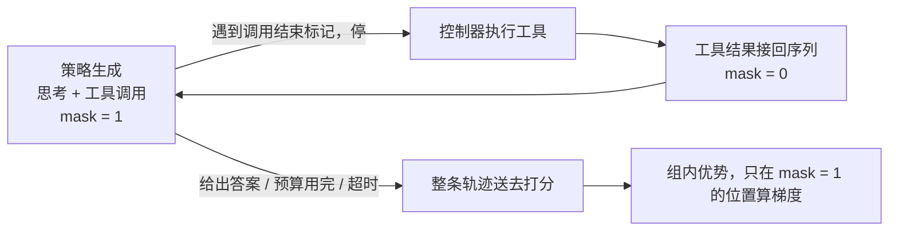

# Agentic RL：多轮 rollout 与工具返回 mask

> 层级：垂类 · training · 预计 210 分钟 · 题目：[questions.md](questions.md)
> 前置：[03 GRPO 及其变体](../03-grpo-family/README.md)（组内优势、token 级 loss 聚合、k3 KL）、[core/12 强化学习入门](../../../core/12-rl-basics/README.md)
> 相关：[05 奖励与 Verifier](../05-reward-verifier/README.md)、[06 训练环境](../06-environments/README.md)、[07 RL 训练框架](../07-training-systems/README.md)、[design/07 Agentic RL 平台](../../../design/07-agentic-rl-platform/README.md)

## 1 这一章解决什么问题

数学和代码题的 RL 是单轮的：一个 prompt，一次生成，一个奖励。Agent 的 RL 是多轮的：模型生成、调用工具、拿到工具结果、再生成，循环多次后才拿到奖励。算法公式变化不大，变化大的是四件事：rollout 怎么跑，哪些 token 算梯度，奖励怎么分到每一步，系统怎么不被慢轨迹拖住。

GRPO 本身的推导见 [03 章](../03-grpo-family/README.md)，那里的 train-grpo-005 已经概括了“多轮要改哪些地方”。这一章往下讲每一处具体怎么改、为什么、代价是什么，并用 numpy 验证关键结论。

学完你应该能：

- 写出一条多轮轨迹的数据结构，在 token 序列上构造 mask，说出分词边界和移位会怎样让 mask 错位；
- 从轨迹概率的分解推出为什么工具结果要 mask，说出不 mask 时梯度推向哪里、为什么 KL 也要 mask；
- 证明“只有结果奖励时，不影响成败的动作期望梯度为 0”，说出轮级奖励、效率项各改变了什么；
- 讲清 Search-R1 的完整设置和消融，说出它的默认算法和奖励；
- 估算同步 rollout 的长尾损失，推导异步样本的重要性比率修正，讲清 Kimi k1.5 部分 rollout 和 AReaL 解耦 PPO；
- 说出 RAGEN 描述的 Echo Trap 的监控信号和 StarPO-S 的三项改动。

**符号表**

| 符号 | 含义 |
|---|---|
| x | prompt：系统指令加题目 |
| τ | 一条轨迹：x 之后的全部 token y_1 … y_T，策略写的和工具写的交替出现 |
| y_t、y_<t | 第 t 个 token；它前面的所有 token |
| m_t | mask：y_t 由策略采样得到记 1；来自工具、环境、用户模拟器、系统插入的提示或 padding 记 0 |
| a_k、e_k | 第 k 轮策略写的段（思考加动作）；第 k 次工具结果 |
| π_θ、π_old、π_ref | 当前策略；采样这批数据时的策略；参考策略（通常是 RL 开始时的 SFT 模型） |
| π_behav、π_prox | 异步训练里实际采样的策略；作为 clip 中心的近端策略（AReaL 的记法） |
| R(τ)、A_i | 轨迹奖励；第 i 条轨迹的优势 |
| ρ_t | token 级重要性比率 π_θ(y_t \| …) / π_old(y_t \| …) |
| G | 每题采样的轨迹数（组大小） |
| η | AReaL 允许的最大滞后步数 |

## 2 多轮 rollout 与环境交互

### 2.1 生成循环

推理引擎生成到“工具调用结束标记”就停下。rollout 控制器解析调用、执行工具，把工具结果包进特定标签接到序列后面，再让模型接着生成。直到模型给出答案、用完动作预算或超时。



Search-R1 的算法 1 是这个循环的一个具体版本：

- 停止条件：生成到 `</search>`、`</answer>` 或 `<eos>` 就停。
- 解析：段里有 `<search>…</search>`，就取出查询、检索，把结果包成 `<information>…</information>` 接到序列后面。
- 段里有 `<answer>…</answer>`，返回整条轨迹。
- 两者都没有（非法动作）：系统追加一句 “My action is not correct. Let me rethink.”，让模型重来。
- 每走一次，动作计数加 1，到预算 B 为止。

那句 rethink 提示是系统插入的，不是策略采样的。按 Search-R1 对 I(y_t) 的定义（只有策略生成的 token 记 1），它应该记 0。这一点论文没有单独写，是从定义推出来的。

不在调用处停止会出问题。模型会接着自己编出一段“工具结果”，再基于编出来的内容答题。训练时这段编造的文本还是策略 token，会被当成正常动作强化。

### 2.2 轨迹的数据结构：段列表，不是一段文本

一条轨迹在控制器里应该按段存，每段记下是谁写的：

```text
段：      x (prompt) | a_1 (策略) | e_1 (工具) | a_2 (策略) | e_2 (工具) | a_3 (策略，含答案) | padding
mask：    0 … 0      | 1 … 1      | 0 … 0      | 1 … 1      | 0 … 0      | 1 … 1             | 0 … 0
old_logp：—          | 每个 token | —          | 每个 token | —          | 每个 token        | —
version： —          | v          | —          | v          | —          | v 或 v+1          | —
```

拼成训练样本时，展开成几条等长数组，形状都是 (T,)：

- `ids`：token id。策略段直接用推理引擎返回的 id，工具段单独分词。
- `mask`：上表第二行。
- `old_logp`：策略段每个 token 采样时的 log 概率。很多实现用训练引擎重算，见 [03 章第 8 节第 6 条](../03-grpo-family/README.md#8-工程细节与常见坑)。
- `version`：生成这个 token 的策略版本。同步训练里全部相同；部分 rollout 和异步训练里同一条轨迹可能跨版本（第 5 节）。

存成一段文本、训练前再整体分词是最常见的错误来源，原因见 2.4 节。

### 2.3 mask 的构造：在 token 上做，按段拼

1. **策略段用采到的 token id**。不要把推理引擎返回的文本再分词一遍。
2. **工具段单独分词再拼接**。标签 `<information>`、`</information>` 归工具段，mask 为 0。
3. **对齐移位**。语言模型在位置 t 的 logits 预测的是 y_{t+1}。如果 loss 按“输入位置”存，mask 要取 `mask[1:]`，对齐到被预测的 token。错一位的后果是：策略段最后一个位置“预测工具结果第一个 token”这一项被算进 loss。
4. **停止串**。vLLM 的 `SamplingParams` 文档写明，`stop` 停止串默认不出现在返回文本里（`include_stop_str_in_output` 默认 False）；`stop_token_ids` 对应的 token 默认会出现在输出里，特殊 token 除外。如果控制器拿返回文本拼轨迹，再自己补一个 `</search>`，这个标签就是重新分词得到的，不一定是模型当时采到的那个 token。做法是以 token id 为准，让训练样本里的停止标记就是采样得到的那个。

### 2.4 分词边界错位

BPE 类分词器会把常见的字符组合合成一个 token。工具标签和相邻的换行、空格、标点，很可能在词表里有一个合并后的 token。例如 `</search>` 加换行合成一个 token，这个 token 一半是策略写的，一半是控制器拼的。

整段文本重新分词时会出三个问题：

- **mask 没法标**。跨段的 token 标 1 或标 0 都不对。
- **训练端算的是没采过的 token**。模型当时采的是 `</search>`，重新分词后变成 `</search>\n`。训练端算这个合并 token 的概率，推理端记录的 old_logp 却属于 `</search>`，比率的分子分母不是同一个事件。
- **长度对不上**。重新分词的 token 数和采样时不同，old_logp 数组整体错位，后面所有 token 的比率都错。

8.1 节的代码用一个玩具分词器复现了这三点。这一节是工程经验，不是论文结论。

### 2.5 和单轮比多出的问题

| 问题 | 原因 | 常见做法 |
|---|---|---|
| 必须在调用处停止生成 | 不停的话，模型会自己编出“工具结果”继续写 | 把调用结束标记设为停止词 |
| 非法动作 | 模型既没调用工具也没给答案 | 追加提示让它重来，并计入动作预算 |
| 轨迹长度差异大 | 有的 2 轮结束，有的 10 轮没完 | 动作上限、长度上限、异步 rollout（第 5 节） |
| 环境不稳定 | 在线工具超时、结果每次不同 | 离线检索库、工具结果缓存、沙箱；环境要求见 [06 训练环境](../06-environments/README.md) |
| 重复计算 | 每接一次工具结果，前缀要重新编码 | 保留已有 KV Cache，只算新接入的工具结果部分（ReTool 的做法） |

**截断要区分原因**：动作或长度上限造成的截断，可以参考 DAPO 的超长处理（见 [03 章](../03-grpo-family/README.md#4-dapo四个工程改进)）；工具超时造成的截断是环境问题，应该丢弃或重跑，不应该给模型负奖励。

## 3 工具返回的 loss mask

### 3.1 从轨迹概率推出 mask

一条轨迹由策略段和工具段交替组成。它的概率可以分解成两类因子的乘积：

```text
P_θ(τ | x) = Π_k  π_θ(a_k | x, a_<k, e_<k)  ·  P_env(e_k | x, a_≤k, e_<k)
           = Π_{t: m_t = 1} π_θ(y_t | x, y_<t)  ·  Π_{t: m_t = 0} P_env(y_t | x, y_<t)
```

第一类是策略在它自己写的 token 上的概率。第二类是环境给出工具结果的概率：检索器、解释器、用户模拟器决定了 e_k，和 θ 无关。

取对数再对 θ 求导，第二类整项消失：

```text
∇_θ log P_θ(τ | x) = Σ_{t: m_t = 1} ∇_θ log π_θ(y_t | x, y_<t)  +  0
```

代回带基线的策略梯度（[03 章 2.1 节](../03-grpo-family/README.md#21-起点带基线的策略梯度)）：

```text
∇_θ J = E_τ [ (R(τ) − b) · Σ_t m_t · ∇_θ log π_θ(y_t | x, y_<t) ]
```

mask 不是一个工程技巧，它就是策略梯度本身的形状。工具结果仍然在上下文 y_<t 里，影响后面策略 token 的条件概率，梯度会通过注意力流过这些位置的表示。但工具 token 自己的 log π_θ(y_t) 不该出现在目标里。

Search-R1 3.1 节把它写成指示函数 I(y_t)：策略生成的 token 记 1，检索 token 记 0。PPO 和 GRPO 两个目标都只在 I(y_t) = 1 的位置求和，分母是 Σ_t I(y_t)。用 GRPO 时，KL 项同样只在这些位置上算。

```text
L = Σ_i Σ_t  m_{i,t} · ℓ_{i,t}  /  Σ_i Σ_t m_{i,t}      （一组内所有轨迹一起求和，DAPO 式 token 级聚合）
```

如果先按每条轨迹求 masked mean 再平均，会带上 [03 章第 3 节](../03-grpo-family/README.md#3-dr-grpo去掉两处归一化)讲的长度偏差。Search-R1 原文的 GRPO 写法正是按每条轨迹求平均：1/G · Σ_i 1/(Σ_t I(y_{i,t})) · Σ_t …。上面给的是 DAPO 式的整组聚合，属于推荐写法，不是原文写法。第 9 节用一组数字比较了两种分母。

### 3.2 不 mask 时梯度落在哪里

不 mask，就是在目标里多加了一项：

```text
多出的项 = E_τ [ (R(τ) − b) · Σ_{t: m_t = 0} ∇_θ log π_θ(y_t | x, y_<t) ]
```

这一项为什么不会“平均掉”？关键在得分函数恒等式。对策略自己采的 token，E_{y~π_θ}[∇log π_θ(y)] = Σ_y ∇π_θ(y) = ∇1 = 0。所以基线 b 不改变期望，噪声在期望里抵消。工具 token 不是从 π_θ 采的，它服从环境分布 q。在 softmax 输出层上，∇_z log π(y) = onehot(y) − π，取 q 的期望得到：

```text
E_{y~q} [ onehot(y) − π_θ ] = q − π_θ ≠ 0
```

所以多出的这一项是一个有方向的力。它把策略在工具位置上的分布往 q 推，力度和符号由轨迹的优势决定。分三种情况看（推导，8.2 节的代码验证）：

| 轨迹 | 多出的项在做什么 | 现象 |
|---|---|---|
| 优势为正（答对） | 对检索文本做语言建模，推高“自己写出工具结果”的概率，包括 `<information>` 标签 | 模型开始自己写 `<information>`，伪造检索结果再答题 |
| 优势为负（答错） | 压低检索文本的概率，即使文档里的事实是对的 | 模型对文档里的实体和措辞“反感”，抄写答案时出错 |
| 任何轨迹 | 分母多出工具 token，策略 token 的权重被稀释 | 学得慢；工具结果越长，稀释越多 |

稀释可以直接算。token 级聚合下，策略 token 的权重从 1/Σm 变成 1/T。一条轨迹策略 token 400 个、工具 token 1500 个时，每个策略 token 的权重缩小到 400/1900，约 0.21 倍。检索类任务里工具结果往往比策略写的长，这个比例很常见。

### 3.3 KL 项也要 mask

GRPO 的 KL 项用 k3 估计（[03 章 2.4 节](../03-grpo-family/README.md#24-k3-kl-估计量为什么无偏且非负)）。k3 无偏的前提是 token 从 π_θ 采样：E_{y~π_θ}[π_ref/π_θ] = Σ π_ref = 1。在工具 token 上，y 服从 q，这个等式不成立，k3 的平均值估计的不再是 KL(π_θ ‖ π_ref)。

漏掉 KL 的 mask 有三个后果：

- **监控数字失真**。KL 曲线随工具结果的长度变化，而不是随策略偏离参考模型的程度变化。8.2 节的例子里，同一个位置的真实 KL 是 0.030，在工具 token 上取平均得到 0.053。
- **多一个无意义的约束**。梯度要求策略在“抄写工具结果”这件事上贴近参考模型。策略从不在这些位置采样，这个约束没有对象。
- **相对权重漂移**。策略项 mask 了而 KL 没 mask，两者的分母不同，KL 的相对权重随工具结果长度变化。

Search-R1 的 GRPO 版本明确写了 KL 也做同样的屏蔽。熵正则同理，只在策略 token 上算。

### 3.4 有原文支撑的证据

- Search-R1 附录 D 表 6 的消融（PPO，7 个问答集平均 EM）：7B Base 屏蔽检索 token 时为 0.431，不屏蔽为 0.343；3B Base 为 0.303 对 0.262。论文说屏蔽后优化更稳、效果更好。
- R1-Searcher 把检索文档包在特殊 token 之间，训练时 mask 掉，理由是不让外部 token 影响 loss。
- ReTool 把代码解释器的输出从 loss 中排除，理由是防止外部 token 干扰 loss 计算、保证训练稳定。
- RAGEN 附录 D 在 Sokoban 上评估了按轮处理的 response masking 和 bi-level GAE（沿用 Wang 等 2025 的做法），论文报告两者都提升了多轮 RL 的表现。

### 3.5 要用同一个 mask 的地方

一个 batch 里所有和“策略在这个 token 上的概率”有关的量，都用同一个 mask：

- 策略项：新策略 log 概率、旧策略 log 概率、比率、clip。
- KL 项和熵正则。
- 聚合的分母：只数 mask 为 1 的 token。
- 监控：clip 比例、比率分位数、熵、KL。工具 token 混进来，这些曲线都会被工具结果的长度左右。
- critic（用 PPO 时）：价值损失只在策略 token 位置上算。GAE 沿 token 向前传递时，工具位置怎么处理要和价值损失的 mask 一致，否则价值目标和价值损失错位。

## 4 多轮信用分配

### 4.1 结果奖励下，“不影响成败”的动作得到什么

结果奖励只给整条轨迹。GRPO 把同一个优势分给轨迹里所有策略 token。一条答对的轨迹里，多余的那次检索也拿到正优势。这会不会把多余检索推高？

看期望。设动作 d 不影响奖励的分布，即 R 和 d 独立。策略梯度里 d 对应的部分是：

```text
E[ (R − b) · ∇log π(d) ] = E[R − b] · E[∇log π(d)] = E[R − b] · 0 = 0
```

第一步用了独立性，第二步用了得分函数恒等式。结论：只用结果奖励时，不影响成败的动作期望梯度为 0。它在答对和答错的轨迹里同样常见，正负优势抵消。这是推导，8.5 节在一个两决策的玩具 Agent 上精确枚举验证了它。

期望为 0 不等于每一步为 0。单组估计里这一项的方差和有用动作同一量级，信噪比接近 0。所以粗信用分配的代价是学得慢、噪声大，不是学不到。

### 4.2 几种更细的做法

| 做法 | 怎么做 | 改变了什么 | 代价 |
|---|---|---|---|
| 轨迹级共享优势 | 整条轨迹一个优势（GRPO 默认） | 无 | 简单；无用动作的梯度只在期望里为 0，方差大 |
| 有 critic 的 PPO | 价值模型逐 token 估值，GAE 把末端奖励往前分 | 每个位置有自己的基线 V(s_t) | 要训 critic；稀疏奖励下 critic 不一定准。Search-R1 和 RAGEN 都用 λ = 1、γ = 1，此时 A_t = R − V(s_t) |
| 效率项 | 在结果奖励里减去 c × 调用次数 | 多余调用的期望梯度变负 | c 过大时，必要的调用也被压下去（8.5 节：成功率增益小于 c 时梯度反向） |
| 轮级奖励 | 每次工具调用后给一个中间信号，例如检索是否命中相关文档 | 被奖励动作的梯度更强 | 奖励“调用了”而不看“有没有用”，多余调用被推高；定义难、易被钻空子，见 [05 奖励与 Verifier](../05-reward-verifier/README.md) |
| 过程奖励模型 | 把每轮当一步，用 PRM 打分 | 每轮单独评价 | 标注贵；Agent 场景每步对错更难定义 |
| 轮级优势估计 | 把一轮当一个决策单元估值，例如 RAGEN 附录 D 评估的 bi-level GAE | 信用在轮之间分配，轮内共享 | 实现复杂，和 token 级 PPO 的耦合要单独验证 |

GAE 取 λ = 1、γ = 1 时，A_t = Σ_{l≥0} δ_{t+l} 逐项抵消，只剩 R − V(s_t)。critic 学得好，同一条轨迹里不同位置的优势就不同。例如在已经检索到答案之后，V(s_t) 已经很高，后面那次多余检索的优势接近 0。

### 4.3 多轮更不稳的原因

- **上下文分布随策略变**。工具结果依赖之前的动作，策略一变，后续上下文的分布跟着变。旧数据和新策略的差距在多轮里叠加。
- **比率噪声累积**。轨迹越长，token 级重要性比率的噪声累积越多。这也是 GSPO 改用序列级比率的动机之一（见 [03 章第 5 节](../03-grpo-family/README.md#5-gspo把重要性比率放到序列级)）。
- **奖励更稀疏**。很多轮才有一个结果，组内全对或全错的比例更高，零优势组更多。

### 4.4 RAGEN 的 Echo Trap 与 StarPO-S

出处：Wang 等，RAGEN，arXiv 2504.20073（本章核对的是 v2）。实验在 Bandit、Sokoban、FrozenLake、WebShop 四个环境上做，前三个用 Qwen-2.5 Instruct 0.5B，WebShop 用 3B。每批 P = 8 个 prompt、每个 prompt N = 16 条 rollout，最多 5 轮、10 个动作；GAE 取 γ = 1.0、λ = 1.0，熵奖励系数 0.001，格式错误罚 −0.1。

**现象**。直接把单轮的 PPO 和 GRPO 搬过来，早期有提升，之后常常崩溃。论文把这种崩溃叫 Echo Trap：模型收敛到固定的措辞和推理模板，过拟合到局部得奖的推理模式。PPO 的 critic 能推迟崩溃，但阻止不了推理退化。

**监控信号**（论文 4.1 节）：

| 指标 | 含义 | 在崩溃里的角色 |
|---|---|---|
| 平均奖励 | 任务表现 | 平台或下降，直接反映崩溃 |
| 梯度范数 | 更新稳定性 | 出现尖峰；论文说尖峰往往标志着不可逆的崩溃 |
| 组内奖励标准差 | 同一 prompt 下结果是否还多样 | 先于奖励下降出现波动，是早期预警 |
| 输出熵 | 预测的确定程度 | 有效学习时应平稳下降；突然上升或乱跳常和推理崩溃同时出现 |

**StarPO-S 的三项改动**：

1. **按不确定性过滤轨迹**。按同一 prompt 多次 rollout 的奖励标准差排序，每步只保留前 p% 的 prompt。默认 25%。论文报告：PPO 在 FrozenLake 上保留 75% 时，稳定训练的步数从 100 延长到 140；保留 50% 时没有崩溃。GRPO 获益较小。论文也说 25% 这个激进的值不一定适合所有场景。
2. **引入 critic**。用 PPO 的价值基线代替无 critic 的组内基线。
3. **梯度稳定**：沿用 DAPO 的两项。去掉 KL 项，只留策略损失和熵奖励；Clip-Higher，ε_low = 0.2、ε_high = 0.28。

过滤和 DAPO 的 Dynamic Sampling 是一个思路：组内奖励标准差为 0 的组没有梯度，方差小的组信息少。区别是 StarPO-S 按比例保留方差最大的那部分，不只去掉方差为 0 的组。

**rollout 新鲜度**。RAGEN 的 Online-k 实验让一批 rollout 被复用 k 次更新。论文报告 Online-1（每次更新都用新 rollout）收敛更快、泛化更好。这和第 5 节的滞后问题是同一件事：数据越旧，越偏离当前策略。

## 5 异步 rollout 与长尾

### 5.1 同步训练的长尾损失

同步训练里，一个 batch 要等最慢的轨迹结束才能更新。设一批 n 条轨迹并行生成，各自的耗时 L_1 … L_n 独立同分布。这一步的耗时是 max_i L_i，生成槽位的平均占用率是 E[L] / E[max L]。

L 服从均值为 μ 的指数分布时，可以直接算（推导）。n 个独立指数变量的最大值，等于依次等第一个、第二个……结束的间隔之和。第 k 个间隔是剩下 n − k + 1 个变量里最小的那个，均值 μ/(n − k + 1)。所以：

```text
E[max_i L_i] = μ · (1 + 1/2 + … + 1/n) = μ · H_n
占用率 = μ / (μ · H_n) = 1 / H_n
```

n = 64 时 H_n ≈ 4.74，占用率约 21%。真实的轨迹长度往往比指数分布更重尾，8.4 节的模拟里换成 σ = 1 的对数正态分布，占用率降到约 14%。多轮场景还要等工具返回，耗时分布更散。

### 5.2 三类方案

| 方案 | 做法 | 代价 |
|---|---|---|
| 同步 | 采样完一整批再训练 | 简单、严格 on-policy；长尾拖慢整体 |
| 部分 rollout | 每轮给固定 token 预算，没写完的轨迹存进回放缓冲，下一轮接着写；之前的片段直接复用 | 同一条轨迹的不同片段来自不同版本的策略 |
| 完全异步 | 采样和训练完全解耦，采样端持续生成，训练端凑满一批就更新 | 样本来自旧策略，要控制滞后步数，并修正目标函数 |

**Kimi k1.5 的部分 rollout**（arXiv 2501.12599，本章核对的是 v4，2.6.2 节）。系统整体是“迭代式同步”的：每次迭代先 rollout 再训练。部分 rollout 设一个固定的输出 token 预算。轨迹超出预算时，未完成部分存入回放缓冲，下一次迭代继续生成，这样一条长轨迹不会独占资源。论文的图 3(b) 说明，只有当前迭代的片段需要在线计算，之前迭代的片段从缓冲里复用。训练时某些片段可以不计 loss，但论文没有说清是哪些。它还做了重复检测：发现生成内容在重复就提前终止。

**AReaL**（arXiv 2505.24298，本章核对的是 v5）完全解耦生成和训练。rollout worker 持续生成，trainer 凑满一批就做 PPO 更新，回放缓冲里的数据只用一次。它的可中断生成：新权重到达时，rollout worker 中断正在进行的生成，丢弃用旧权重算的 KV Cache，用新权重重算后继续解码。所以一条轨迹可能由多个版本的策略写成。论文报告，可中断生成在 4 个节点上让 1.5B 和 7B 模型的生成吞吐分别提高 12% 和 17%；整体上相同 GPU 数下最多 2.77 倍训练加速，最终效果持平或更好。

### 5.3 滞后的修正：重要性比率

异步样本由行为策略 π_behav 采样，训练要估计的却是当前策略 π_θ 的梯度。直接当 on-policy 数据用，期望是 Σ_τ π_behav(τ) R(τ) ∇log π_θ(τ)，和真梯度 Σ_τ π_θ(τ) R(τ) ∇log π_θ(τ) 不同，有偏。

乘整条轨迹的重要性比率可以精确修正：

```text
E_{τ~π_behav} [ ρ(τ) · R(τ) · ∇log π_θ(τ) ] = Σ_τ π_behav(τ) · (π_θ(τ)/π_behav(τ)) · R · ∇log π_θ = ∇ E_{π_θ}[R]
ρ(τ) = Π_{t: m_t = 1} π_θ(y_t | …) / π_behav(y_t | …)
```

工具 token 的环境概率在分子分母里相同，消掉了，所以 ρ(τ) 也只在策略 token 上连乘。这又是一处 mask。

整条轨迹的比率方差随长度和滞后指数增长，实际很少直接用。PPO 用 token 级比率 ρ_t 代替，每个 token 只乘自己的比率，不修正前文分布的变化。这是有偏的近似，靠 clip 把新旧策略限制得足够近，让偏差可以接受。8.3 节在一个两轮的玩具问题上验证了四点：未修正的估计有偏，那个例子里方向几乎反了；整条轨迹比率精确无偏；token 级比率有偏；比率的方差随滞后单调增大。

**片段来自不同版本怎么办**。AReaL 第 5.2 节证明：由策略 π_v、π_{v+1} … 分段写成的轨迹，等价于从某一个行为策略 π_behav 完整采样。每个 token 的行为概率就是当时生成它的那个版本给出的概率。所以只要逐 token 记下采样时的 log 概率，比率照常算，不需要知道版本边界。

### 5.4 AReaL 的两处算法改动

**有界滞后**。设当前策略版本为 i，已提交的生成请求数为 N_r，训练 batch 大小为 B。每次提交新请求前要求：

```text
⌊(N_r − 1) / B⌋ ≤ i + η
```

η = 0 时退化成同步 RL。组批时优先用较早的轨迹。默认值：代码任务 η = 4，数学任务 η = 8。论文说 η 太小时，遇到极长的轨迹生成吞吐会下降，建议取较大的 η，再靠下面的目标函数处理过时数据。

注意这个限制作用在“提交请求”上。慢的轨迹完成得晚，进入训练的时间可能比预期晚，个别样本的实际滞后会超过 η。8.4 节的模拟显示了这一点。所以组批时还要记录每条样本的策略版本。

**解耦 PPO 目标**（论文式 5，来自 Hilton 等的做法）：

```text
J(θ) = E_{a_t ~ π_behav} [ Σ_t  (π_prox / π_behav) · min( u_t · Â_t , clip(u_t, 1−ε, 1+ε) · Â_t ) ]
u_t = π_θ(a_t | s_t) / π_prox(a_t | s_t)
```

它把两件事拆开。π_prox / π_behav 是重要性比率，修正采样分布。u_t 是信任域的中心，clip 只限制 π_θ 相对 π_prox 走多远。原版 PPO 把两者合成一个 π_θ / π_old。在异步训练里，π_old 就是 π_behav，可能是好几步之前的策略。以它为 clip 中心，最新策略会被拉回旧的、质量较差的策略附近。比率本身已经离 1 很远，大量 token 被 clip，梯度为 0。

AReaL 的 π_prox 直接取每步更新前的参数，训练端在全局 batch 到达时重算一次 token 概率得到它。clip 未触发时，解耦目标和直接用 π_θ / π_behav 数值相同（8.3 节验证）。

论文的消融（1.5B 数学任务）：不用解耦目标时，很小的滞后就让最终表现明显下降；用了解耦目标，适度滞后（η ≤ 8）对最终表现影响很小；滞后不设上限时，即使用了解耦目标也比同步差。

### 5.5 怎么判断滞后是否过大

- 看 clip 比例和 KL。滞后越多，重要性比率偏离 1 越远，被 clip 的 token 比例上升。
- 看 log 比率的分位数，按滞后步数分桶统计。滞后大的桶尾部更重。
- 看 ρ 的有效样本量 (Σρ)² / Σρ²。它远小于样本数时，少数样本主导了梯度。

框架层面的实现和权重同步见 [07 RL 训练框架](../07-training-systems/README.md)。

## 6 Search Agent 的 RL：以 Search-R1 为例

出处：Jin 等，Search-R1，arXiv 2503.09516，2025-03（本章核对的是 v5，2025-08）。精读见 [papers/08](../../../papers/08-search-r1.md)。

**问题**：只靠提示词让模型调用搜索引擎，模型常常不会写查询、该搜不搜。SFT 学检索轨迹又需要大量标注。

### 6.1 设置

| 设计 | Search-R1 的选择 |
|---|---|
| 输出结构 | 模型写 `<think>`、`<search>`、`<answer>`；系统把检索结果包进 `<information>` 接回去 |
| 模板 | 只规定结构，不规定内容：先在 `<think>` 里推理，缺知识就搜，不需要就直接答。论文说有意不加“要反思”“要搜索”这类内容偏好 |
| 动作预算 | B = 4 |
| 检索 | E5 检索器，2018 年维基百科语料，默认每次返回 top-3 段落 |
| 训练数据 | NQ 和 HotpotQA 训练集合并 |
| 长度 | 序列最长 4096，单次回答最长 500，检索内容最长 500 token |
| 奖励 | 只用最终答案的精确匹配（EM），没有格式奖励，没有神经奖励模型 |
| 算法 | 默认 PPO，GAE 取 λ = 1、γ = 1；GRPO 作为对比，每题采 5 条 |
| mask | 检索 token 不计策略梯度；用 GRPO 时 KL 也屏蔽 |

**训练超参数**（附录 B.2）：

| 项 | PPO | GRPO |
|---|---|---|
| 学习率 | 策略 1e-6，价值模型 1e-5 | 策略 1e-6 |
| warm-up 比例 | 策略 0.285，价值模型 0.015 | 0.285 |
| 训练步数 | 500 | 500 |
| batch | 总 512，mini-batch 256，micro-batch 64 | 同 PPO |
| KL 系数 β、clip ε | 0.001、0.2 | 0.001、0.2 |
| 采样 | vLLM，temperature 1.0，top-p 1.0 | 同 PPO，每题 5 条 |
| 硬件 | 单节点 8 张 H100，FSDP 加 CPU offload，梯度检查点 | 同 PPO |

每 100 步存一次检查点。训练发散时，按训练奖励曲线取最近一个稳定的检查点评测，否则用最后一个。这条规则本身说明了多轮 RL 会崩，论文把它当成常规情况处理。

### 6.2 论文报告的关键结论

- **屏蔽检索 token 是关键设计**。消融数字见 3.4 节。
- **PPO 和 GRPO**：GRPO 收敛更快，因为 PPO 的 critic 需要预热；但 GRPO 长时间训练后出现奖励崩溃，PPO 更稳。最终训练奖励相近，论文默认用 PPO。
- **每次返回几段**：7B Base 上 top-1、top-3、top-5 的平均 EM 为 0.375、0.431、0.400。top-5 前 200 步训练奖励涨得最快，之后逐渐下降、变得不稳；top-1 和 top-3 一直稳步提升。1 段召回不够，5 段噪声多。
- **GRPO 组大小**：比较了 1、3、5。组大小为 1 时 GRPO 退化成 REINFORCE。组越大收敛越快、训练奖励越高，但更容易崩；组越小训练越稳、在没见过的数据集上泛化越好。
- **训练动态**：前 100 步回答长度急剧下降、奖励略升，模型在去掉多余的填充词；100 步之后长度和奖励一起明显上升，模型学会频繁调用搜索，检索内容让序列变长。
- **不加格式奖励的理由**：训练后的模型已经能很好地遵守结构。

### 6.3 同类工作与局限

**R1-Searcher**（arXiv 2503.05592）用两阶段奖励。第一阶段只奖励“调用了检索”和“格式正确”，各 0.5 分，不看答案；第二阶段去掉检索奖励，答案奖励用 F1，格式错误罚 −2。论文还比较了 EM 和 F1 作为答案奖励，F1 最好。和 Search-R1 相比，它多了一个“先学会调用”的引导阶段，代价是多了阶段切换和奖励设计。第一阶段的检索奖励正是 4.2 节说的“奖励调用了而不看有没有用”，所以第二阶段要把它去掉。

**局限**：EM 只适合短答案的事实问答；检索环境是静态的维基百科，真实搜索引擎有时效、噪声和费用；4 个动作做不了长链路研究任务；没有过程奖励，多余的检索拿到同样的信号（4.1 节）。

**常见误读**：“Search-R1 是 GRPO 方法”。它的默认算法是 PPO。

## 7 Coding Agent 的 RL

**奖励从哪来**：

| 来源 | 例子 | 问题 |
|---|---|---|
| 测试通过 | 运行单元测试，通过为 1 | 需要可执行环境和高质量测试；测试不全时错误补丁也能过 |
| 补丁相似度 | SWE-RL（arXiv 2502.18449）：格式错误给 −1；否则用 `difflib.SequenceMatcher` 算生成补丁和真实补丁的相似度，范围 0 到 1 | 只看文本相似，功能等价但写法不同的修复得分低 |
| 解释器结果 | ReTool（arXiv 2504.11536）：模型交替写推理和代码，代码在沙箱里执行；最终答案对为 +1，错为 −1，不奖励“代码能跑” | 只适合有标准答案的题 |

**几个原文细节**：

- SWE-RL 用 GRPO。它对比过离散奖励（完全一致才给 1），因为真实补丁很少完全一致，平均奖励一直接近 0，效果不如连续的相似度奖励。
- SWE-RL 的数据来自 GitHub 上合并的 PR，排除了 SWE-bench 的仓库以防污染。
- ReTool 在调用结束时暂停生成，保留已有 KV Cache，只为解释器输出计算新的 KV。沙箱是异步的任务池，慢的执行不拖住整体。解释器输出和检索结果一样从 loss 中排除。

**Coding 场景特有的坑**：

- **模型改测试**。可写的测试文件会被模型修改成“永远通过”。测试文件要只读，或在隔离副本里跑。
- **环境成本**。每条轨迹要起一个容器、装依赖、跑测试，rollout 成本远高于搜索。长尾也更重：一次测试可能跑几秒，也可能跑几分钟，第 5 节的问题更突出。
- **奖励稀疏**。复杂任务一开始几乎全错，组内优势全为 0。要先做 SFT 或蒸馏冷启动，并按通过率筛选难度。
- **工具结果很长**。编译错误、测试日志动辄几千 token。它们 mask 为 0，不产生梯度，但占上下文。要截断或摘要，否则序列长度上限先被日志用完。

## 8 实现：只用 numpy 验证上面的结论

下面每段代码都能单独运行，结尾用 assert 检查结论。形状约定：T 是一条轨迹的 token 数，V 是词表大小；`ids`、`mask` 是 (T,)；每个位置的策略分布 p 是 (T, V)。和 [03 章第 6 节](../03-grpo-family/README.md#6-实现只用-numpy-验证上面的结论)一样，用“对 logits 的解析梯度”代替自动求导：softmax 下 ∂log p(y)/∂z = onehot(y) − p。

### 8.1 构造多轮轨迹的 token 序列和 mask

按段分词再拼接，检查三点：mask 为 1 的 token 解码后只含策略写的文本；整段重新分词会出现跨段的合并 token；loss mask 要随“位置 t 预测 y_{t+1}”移一位。玩具分词器是贪心最长匹配，词表里故意放了一个 `</search>` 加换行的合并 token。

```python
import numpy as np

# 一条 Search-R1 风格的轨迹，按段存放：谁写的、写了什么、由哪个策略版本生成
segments = [
    ("prompt", "<question>Who wrote X?</question>\n"),
    ("policy", "<think>need search</think><search>X author</search>"),
    ("tool",   "\n<information>X was written by Y.</information>\n"),
    ("policy", "<think>found</think><answer>Y</answer>"),
]

# 玩具分词器：贪心最长匹配。词表里有一个跨段的合并 token "</search>\n"，
# 模拟 BPE 把标签和后面的换行合成一个 token 的情况
SPECIAL = ["</search>\n", "<search>", "</search>", "<information>", "</information>",
           "<think>", "</think>", "<answer>", "</answer>", "<question>", "</question>"]
chars = sorted(set("".join(t for _, t in segments)))
vocab = SPECIAL + chars
tok2id = {s: i for i, s in enumerate(vocab)}
MAXLEN = max(map(len, vocab))

def encode(s):
    ids, i = [], 0
    while i < len(s):
        for L in range(min(MAXLEN, len(s) - i), 0, -1):
            if s[i:i + L] in tok2id:
                ids.append(tok2id[s[i:i + L]])
                i += L
                break
    return ids

def decode(ids):
    return "".join(vocab[i] for i in ids)

# 正确做法：每段单独分词（策略段在真实系统里就是推理引擎采到的 token id），按段拼接
ids, mask, seg_of = [], [], []
for k, (role, text) in enumerate(segments):
    seg_ids = encode(text)
    ids += seg_ids
    mask += [1 if role == "policy" else 0] * len(seg_ids)
    seg_of += [k] * len(seg_ids)
ids, mask = np.array(ids), np.array(mask)        # 形状都是 (T,)

# 1) mask 为 1 的 token 解码出来，只含策略写的文本，不含任何工具结果
pol_text = decode(ids[mask == 1])
assert pol_text == segments[1][1] + segments[3][1]
assert "written by" not in pol_text and "<information>" not in pol_text

# 2) 错误做法：把整段文本重新分词。"</search>\n" 被合成一个 token，跨了策略段和工具段
full_text = "".join(t for _, t in segments)
ids_re = encode(full_text)
assert decode(ids_re) == full_text               # 文本完全一样
assert ids_re != ids.tolist()                    # token 序列却不一样
straddle = tok2id["</search>\n"]
assert straddle in ids_re and straddle not in ids
assert len(ids_re) == len(ids) - 1               # 长度也变了：old_logp 数组从这里往后整体错位
# 按字符位置给 mask：这个 token 一半属于策略、一半属于工具，怎么标都错
char_role = np.concatenate([[r == "policy"] * len(t) for r, t in segments])
start = 0
for t in ids_re:
    piece_roles = set(char_role[start:start + len(vocab[t])])
    if t == straddle:
        assert piece_roles == {True, False}
    start += len(vocab[t])
# 更糟的是：重新分词后，训练端算的是模型从没采过的 token "</search>\n" 的概率，
# 而推理端记录的旧策略 log 概率属于 "</search>"，两边的比率对不上同一个 token

# 3) 移位：位置 t 的 logits 预测 token t+1。loss mask 要按“被预测的 token”取
inputs, targets = ids[:-1], ids[1:]              # (T-1,)
loss_mask = mask[1:]                             # 对齐到 targets
first_tool = int(np.argmax(np.array(seg_of) == 2))
# 工具段第一个 token 由策略段最后一个位置预测，它的 loss mask 必须是 0
assert loss_mask[first_tool - 1] == 0 and mask[first_tool - 1] == 1
# 常见 bug：用没移位的 mask[:-1]，会把“策略段最后一个位置预测工具首 token”算进 loss
wrong = mask[:-1]
assert wrong[first_tool - 1] == 1
leaked = [decode([targets[t]]) for t in np.where((wrong == 1) & (loss_mask == 0))[0]]
print("错位后混进 loss 的目标 token：", leaked)
assert any(seg_of[t + 1] == 2 for t in np.where((wrong == 1) & (loss_mask == 0))[0])
print("T =", len(ids), "策略 token", mask.sum(), "工具/提示 token", (mask == 0).sum())
```

运行结果：轨迹 71 个 token，策略 token 33 个。用没移位的 mask，混进 loss 的那个目标 token 是工具段开头的换行，它属于控制器拼进来的内容。

### 8.2 mask 与不 mask：梯度落在哪些 token 上

一条轨迹策略 400 个 token、工具 1500 个 token。工具 token 来自文档分布：5% 是 `<information>` 标签，其余是策略很少写的文档词。比较两种写法下每个位置对 logits 的梯度，再把所有位置的梯度加到一个共享的输出层偏置上，看它被推向哪里。

```python
import numpy as np

rng = np.random.default_rng(0)
V = 60                                   # 词表大小
INFO = 0                                 # 一个只在工具结果里出现的标签 token，例如 <information>
DOC = np.arange(40, 60)                  # 文档里常见、策略自己很少写的词
T_pol, T_tool = 400, 1500                # 一条轨迹：策略 400 token，3 次检索共 1500 token

# 每个位置的策略分布 p_t，形状 (T, V)。策略很少写 INFO 和文档词，对应 logit 压低
T = T_pol + T_tool
logits = rng.normal(0, 1, size=(T, V))
logits[:, INFO] -= 5.0
logits[:, DOC] -= 3.0
p = np.exp(logits) / np.exp(logits).sum(axis=1, keepdims=True)

role = np.array([1] * 100 + [0] * 500 + [1] * 100 + [0] * 500 + [1] * 100 + [0] * 500 + [1] * 100)
assert role.sum() == T_pol and (role == 0).sum() == T_tool
y = np.empty(T, dtype=int)
for t in range(T):
    if role[t] == 1:                     # 策略 token：从策略分布采样
        y[t] = rng.choice(V, p=p[t])
    else:                                # 工具 token：来自文档，和策略分布无关
        y[t] = INFO if rng.random() < 0.05 else rng.choice(DOC)

def logit_grad(A, use_mask):
    """目标 J = Σ_t w_t · A · log p_t(y_t) 对每个位置 logits 的梯度，形状 (T, V)。
    token 级聚合：w_t = m_t / Σ m。softmax 下 ∂log p(y)/∂z = onehot(y) − p。"""
    m = role.astype(float) if use_mask else np.ones(T)
    w = m / m.sum()
    return (w * A)[:, None] * (np.eye(V)[y] - p)

# 0) 得分函数恒等式只对策略自己的样本成立：E_{y~p}[onehot(y) − p] = 0，
#    换成文档分布 q 取期望，结果是 q − p，不为 0，所以工具 token 的梯度不会“平均掉”
q = np.zeros(V); q[INFO] = 0.05; q[DOC] = 0.95 / len(DOC)
assert np.allclose(p[0] @ (np.eye(V) - p[0]), 0)
assert np.allclose(q @ (np.eye(V) - p[0]), q - p[0]) and np.abs(q - p[0]).sum() > 1

g_mask, g_nomask = logit_grad(1.0, True), logit_grad(1.0, False)

# 1) mask 后工具位置的梯度恰为 0
assert np.all(g_mask[role == 0] == 0)

# 2) 不 mask：按 token 数，79% 的权重落在工具 token 上；每个策略 token 的权重被稀释 4.75 倍
w_share = T_tool / T
assert np.isclose(w_share, 1500 / 1900)
dilution = np.abs(g_mask[role == 1]).sum() / np.abs(g_nomask[role == 1]).sum()
assert np.isclose(dilution, T / T_pol) and np.isclose(dilution, 4.75)

# 3) 按梯度范数算，工具 token 的占比比按个数算还高：
#    它们在策略下概率很低，‖onehot(y) − p‖ 接近 √2；策略 token 自己采的，概率较高
norm = np.linalg.norm(g_nomask, axis=1)
norm_share = norm[role == 0].sum() / norm.sum()
assert norm_share > w_share
print("工具 token 占比：按个数 %.3f，按梯度范数 %.3f" % (w_share, norm_share))

# 4) 误导：把输出层偏置 b（所有位置共享）当成被更新的参数，它的梯度是各位置梯度之和
gb_mask, gb_nomask = g_mask.sum(axis=0), g_nomask.sum(axis=0)
# 答对的轨迹（A > 0）不 mask 时，INFO 的偏置被推高：模型学着自己写 <information>，伪造检索结果
assert gb_nomask[INFO] > 0
# mask 后它从未被策略采到，偏置只会被轻微压低
assert gb_mask[INFO] < 0
# 答错的轨迹（A < 0）不 mask 时，文档词的偏置被压低：检索到的事实可能是对的，却一起挨罚
gb_wrong = logit_grad(-1.0, False).sum(axis=0)
assert gb_wrong[DOC].sum() < 0 and np.isclose(logit_grad(-1.0, True).sum(axis=0)[DOC].sum(),
                                              -gb_mask[DOC].sum())

# 5) KL 也要 mask。k3 = r − 1 − log r，r = π_ref/π_θ。在 π_θ 自己的样本上它无偏估计 KL(π_θ‖π_ref)
p_t = p[0]
p_ref = np.exp(logits[0] + rng.normal(0, 0.3, V)); p_ref /= p_ref.sum()
r = p_ref / p_t
k3 = r - 1 - np.log(r)
kl = np.sum(p_t * np.log(p_t / p_ref))
assert np.isclose((p_t * k3).sum(), kl)
# 在工具 token 上取平均，等于用文档分布 q 取期望，估的不是 KL，而且可以差很多
kl_on_tool = (q * k3).sum()
assert abs(kl_on_tool - kl) > 0.5 * kl
print("KL 真值 %.4f，在工具 token 上的 k3 均值 %.4f" % (kl, kl_on_tool))
```

结果：不 mask 时，工具 token 按个数占 79% 的权重，按梯度范数占 80%；每个策略 token 的权重被稀释 4.75 倍。答对的轨迹会推高 `<information>` 的偏置，答错的轨迹会压低文档词的偏置。同一个位置的真实 KL 为 0.030，在工具 token 上算的 k3 均值为 0.053。

### 8.3 异步样本的重要性比率修正

两轮、每轮三选一的玩具策略，两轮都选 2 得 1 分，先 0 后 1 得 0.5 分。穷举 9 条轨迹，精确比较“直接用旧样本”“整条轨迹比率”“逐轮比率”三种估计的期望；再用蒙特卡洛验证修正后的估计在 4 个标准误以内，以及比率方差随滞后增大。最后一段对照 AReaL 的解耦目标。

```python
import itertools
import numpy as np

# 玩具问题：一条轨迹 = 2 轮，每轮从 3 个动作里选一个。策略在两轮共用 logits z（形状 (3,)）
# 奖励只看最后结果：两轮都选动作 2 得 1 分；先 0 后 1 得 0.5 分（另一条也能部分成功的路线）
RT = np.zeros((3, 3)); RT[2, 2] = 1.0; RT[0, 1] = 0.5
z_new = np.array([0.2, -0.1, 0.4])          # 训练端当前策略 π_θ
z_old = np.array([0.6, 0.1, -0.3])          # 采样端还在用的旧策略 π_behav（滞后几步）
soft = lambda z: np.exp(z) / np.exp(z).sum()
pi, mu = soft(z_new), soft(z_old)
R = lambda traj: RT[traj]

def score(traj):
    """∇_z log π_θ(traj) = Σ_轮 (onehot(a) − π)，形状 (3,)"""
    return sum(np.eye(3)[a] - pi for a in traj)

trajs = list(itertools.product(range(3), repeat=2))
P_new = {t: pi[t[0]] * pi[t[1]] for t in trajs}
P_old = {t: mu[t[0]] * mu[t[1]] for t in trajs}
true_grad = sum(P_new[t] * R(t) * score(t) for t in trajs)        # ∇_z E_{π_θ}[R]

# 1) 直接拿旧策略的样本当 on-policy 用：期望是 Σ μ(τ) R ∇log π，有偏
naive = sum(P_old[t] * R(t) * score(t) for t in trajs)
assert not np.allclose(naive, true_grad)
cos = naive @ true_grad / np.linalg.norm(naive) / np.linalg.norm(true_grad)
assert cos < 0.99                                   # 不只是尺度不同，方向也偏了

# 2) 乘整条轨迹的重要性比率 ρ(τ) = Π_轮 π/μ：精确无偏
is_grad = sum(P_old[t] * (P_new[t] / P_old[t]) * R(t) * score(t) for t in trajs)
assert np.allclose(is_grad, true_grad)

# 3) token（这里是轮）级比率：每轮只乘自己的 π/μ，PPO 的做法。忽略了前文分布的变化，有偏
def tok_ratio_grad():
    g = np.zeros(3)
    for t in trajs:
        for a in t:
            g += P_old[t] * (pi[a] / mu[a]) * R(t) * (np.eye(3)[a] - pi)
    return g
assert not np.allclose(tok_ratio_grad(), true_grad)
# 偏差来自第二轮：它的前文（第一轮动作）是按旧策略分布出现的，但没有被修正

# 4) 蒙特卡洛：从旧策略采样，用 ρ(τ) 修正。样本均值收敛到真梯度；旧策略离得越远，方差越大
rng = np.random.default_rng(0)
def mc(z_b, n):
    m = soft(z_b)
    a = rng.choice(3, size=(n, 2), p=m)
    rho = (pi[a[:, 0]] * pi[a[:, 1]]) / (m[a[:, 0]] * m[a[:, 1]])
    r = RT[a[:, 0], a[:, 1]]
    sc = (np.eye(3)[a[:, 0]] - pi) + (np.eye(3)[a[:, 1]] - pi)
    return (rho * r)[:, None] * sc, rho
est, rho = mc(z_old, 400_000)
se = est.std(axis=0) / np.sqrt(len(est))
assert np.all(np.abs(est.mean(axis=0) - true_grad) < 4 * se)      # 4 个标准误以内
assert abs(rho.mean() - 1) < 0.01                                    # E_μ[ρ] = 1

# 5) 滞后越大，ρ 的方差越大：旧策略 = 新旧之间按 k 插值，k 越大越旧
var = []
for k in [0.0, 0.5, 1.0, 2.0]:
    _, r_k = mc(z_new + k * (z_old - z_new), 200_000)
    var.append(r_k.var())
assert var[0] < 1e-12 and all(a < b for a, b in zip(var, var[1:]))
print("真梯度", true_grad.round(4), "未修正", naive.round(4), "IS 修正", is_grad.round(4), "夹角余弦 %.3f" % cos)
print("ρ 方差随滞后变化：", np.round(var, 3))

# 6) AReaL 式解耦 PPO：clip 中心放在 π_prox（更新前的最新参数），系数 π_prox/π_behav 单独乘在外面。
#    clip 未触发时，它和直接用 π_θ/π_behav 完全一样
pi_prox = soft(z_new + 0.1 * (z_old - z_new))
a, A, eps = 2, 1.0, 0.2
coupled = (pi[a] / mu[a]) * A
u = pi[a] / pi_prox[a]
decoupled = (pi_prox[a] / mu[a]) * min(u * A, np.clip(u, 1 - eps, 1 + eps) * A)
assert abs(u - 1) < eps and np.isclose(coupled, decoupled)
# 用 π_behav 当 clip 中心：比率本身已经离 1 很远，被 clip 后梯度为 0，新数据学不动
r_behav = pi[a] / mu[a]
assert r_behav > 1 + eps
print("π_θ/π_behav = %.3f，被 clip；π_θ/π_prox = %.3f，在信任域内" % (r_behav, u))
```

结果：真梯度约 (−0.101, −0.064, 0.165)，直接用旧样本得到 (−0.003, 0.017, −0.014)，两者夹角的余弦是 −0.67，方向基本反了。原因是旧策略更常走“先 0 后 1”那条得 0.5 分的路线，未修正的估计在强化旧策略偏好的路线；整条轨迹比率精确恢复真梯度。比率的方差在滞后插值系数 k = 0、0.5、1、2 时约为 0、0.14、0.64、5.1。以 π_behav 为 clip 中心时比率是 2.04，被 clip；以 π_prox 为中心时是 1.06，在信任域内。

### 8.4 长尾对一步时间的影响

三个模拟：同步训练的槽位占用率和 1/H_n 对比；部分 rollout 的吞吐和跨版本比例；AReaL 式限流下不同 η 的每步耗时和实际滞后。时间单位是任意的，轨迹耗时服从均值 1000 的指数分布。

```python
import heapq
import numpy as np

rng = np.random.default_rng(0)
n, mean_len = 64, 1000.0                         # 一批 64 条轨迹，平均 1000 个时间单位

# 1) 同步：一批的耗时 = 最慢那条。指数分布长度时 E[max] = mean · H_n（调和数）
H = sum(1 / k for k in range(1, n + 1))
L = rng.exponential(mean_len, size=(20000, n))
step_sync = L.max(axis=1).mean()
assert abs(step_sync / (mean_len * H) - 1) < 0.01
util_sync = L.mean() / step_sync                 # 生成槽位的平均占用率 = 1/H_n
assert abs(util_sync - 1 / H) < 0.005
print("n=%d：H_n=%.2f，同步时槽位占用率 %.1f%%" % (n, H, 100 * util_sync))

# 长尾更重时（对数正态，中位数相同量级）更差
Ln = rng.lognormal(np.log(mean_len) - 0.5, 1.0, size=(20000, n))
util_ln = Ln.mean() / Ln.max(axis=1).mean()
assert util_ln < util_sync
print("对数正态 σ=1 时占用率 %.1f%%" % (100 * util_ln))

# 2) 部分 rollout（Kimi k1.5 式）：每轮迭代固定预算 B_tok 个时间单位；
#    没写完的轨迹留到下一轮接着写；写完的槽位立刻换一条新轨迹
def partial(budget, iters=3000):
    remain = rng.exponential(mean_len, size=n)
    born = np.zeros(n, dtype=int)                # 这条轨迹从第几轮开始写
    done, spans = 0, []
    for it in range(iters):
        clock = np.zeros(n)                      # 本轮每个槽位已用的时间
        while True:
            fin = remain <= budget - clock
            if not fin.any():
                break
            for s in np.where(fin)[0]:
                clock[s] += remain[s]
                done += 1
                spans.append(it - born[s] + 1)   # 跨了几轮 = 混了几个策略版本
                remain[s] = rng.exponential(mean_len)
                born[s] = it
        remain -= budget - clock
    return done / (iters * budget), np.array(spans)

thr_sync = n / step_sync                         # 每单位时间完成的轨迹数
for budget in [500, 2000]:
    thr, spans = partial(budget)
    gain = thr / thr_sync
    # 槽位不再空等，吞吐接近 n / mean_len，提升约 H_n 倍
    assert abs(gain / H - 1) < 0.05
    multi = (spans > 1).mean()
    print("预算 %d：吞吐是同步的 %.2f 倍，%.0f%% 的轨迹跨了多个策略版本" % (budget, gain, 100 * multi))
    if budget == 500:
        multi_small = multi
# 代价：预算越小，跨版本的轨迹越多
assert multi_small > multi

# 3) AReaL 式限流：提交第 j 条（从 0 计）请求前要求 ⌊j/B⌋ ≤ i + η，i 是当前策略版本
def areal(eta, B=16, slots=32, U=300.0, steps=300):
    t, i, j, buf, trained = 0.0, 0, 0, [], []
    events, free, train_busy = [], slots, False
    def submit():
        nonlocal j, free
        while free > 0 and j // B <= i + eta:
            heapq.heappush(events, (t + rng.exponential(mean_len), "gen", j, i))
            j += 1; free -= 1
    submit()
    while i < steps:
        t, kind, idx, ver = heapq.heappop(events)
        if kind == "gen":
            free += 1
            buf.append((idx, ver))
        else:                                    # 一步训练结束，版本 +1
            i += 1; train_busy = False
        if not train_busy and len(buf) >= B and i < steps:
            buf.sort()                           # 优先用最早提交的轨迹
            batch, buf = buf[:B], buf[B:]
            trained += [i - v for _, v in batch] # 滞后 = 训练时版本 − 提交时版本
            heapq.heappush(events, (t + U, "train", -1, -1))
            train_busy = True
        submit()
    return steps / t, np.array(trained)

thr0, st0 = areal(0)
assert st0.max() == 0                            # η = 0 退化成同步：没有任何滞后
res = {eta: areal(eta) for eta in [1, 2, 4, 8]}
thr = [thr0] + [res[e][0] for e in [1, 2, 4, 8]]
assert all(a < b * 1.02 for a, b in zip(thr, thr[1:]))     # η 越大吞吐越高（允许 2% 随机波动）
for e in [1, 2, 4, 8]:
    st = res[e][1]
    print("η=%d：每步耗时 %.0f，滞后均值 %.2f，>η 的比例 %.3f"
          % (e, 1 / res[e][0], st.mean(), (st > e).mean()))
print("η=0：每步耗时 %.0f" % (1 / thr0))
assert abs(1 / res[8][0] - 16 / (32 / mean_len)) < 30   # 生成吞吐上限：32 槽 / 1000 → 每步 500
assert 1 / res[8][0] < 0.7 / thr0                # η=8 时每步耗时不到同步的 70%
# 限流只管“提交速度”：慢轨迹完成得晚，排进的批次比预计的晚，个别样本的滞后会超过 η。
# 所以除了限流，还要在组批时记录并检查每条样本的策略版本
assert (res[4][1] > 4).mean() > 0
assert (res[8][1] > 8).mean() < (res[2][1] > 2).mean()
```

结果（随机种子固定）：

| 设置 | 每步耗时或吞吐 | 滞后 |
|---|---|---|
| 同步，n = 64 | 占用率 21.0%（1/H_64 = 1/4.74） | 0 |
| 同步，对数正态 σ = 1 | 占用率 14.2% | 0 |
| 部分 rollout，预算 500 | 吞吐是同步的 4.76 倍 | 79% 的轨迹跨多个版本 |
| 部分 rollout，预算 2000 | 吞吐是同步的 4.75 倍 | 43% 的轨迹跨多个版本 |
| AReaL 式，η = 0 | 每步 3677 | 0 |
| AReaL 式，η = 1 / 2 / 4 / 8 | 每步 831 / 533 / 506 / 506 | 均值 0.99 / 1.98 / 2.58 / 2.57 |

读法：部分 rollout 的吞吐提升约等于 H_n，和预算大小关系不大，预算决定的是有多少轨迹混了多个策略版本。AReaL 式限流下，η 到 4 以后每步耗时停在 506，这时瓶颈变成了生成吞吐（32 个槽位、每条平均 1000，每步要 16 条，约 500）。η 再大只增加允许的滞后，不再加速。η = 4 时仍有 13.7% 的样本实际滞后超过 4，原因见 5.4 节。

这些是玩具模拟，数字只说明趋势。论文报告的系统指标见 5.2 节。

### 8.5 信用分配：多余动作的期望梯度

一个两决策的玩具 Search Agent。d1 是“必要的检索”，做了答对概率 0.8，不做 0.2；d2 是“多余的检索”，不影响答对概率。精确枚举，比较只有结果奖励、加效率惩罚、加轮级奖励时两个决策的期望梯度。

```python
import itertools
import numpy as np

# 一个两决策的 Search Agent：每条轨迹做两个二元决策，策略对每个决策各有一个 logit
#   d1 = 是否做“必要的检索”：做了答对概率 0.8，不做 0.2
#   d2 = 是否再做一次“多余的检索”：对答对概率没有影响
# 奖励：答对 1，答错 0；可选效率惩罚 c × 调用次数
sig = lambda x: 1 / (1 + np.exp(-x))
theta = np.array([0.0, 0.0])                 # 两个 logit，初始各 50%
p = sig(theta)
P_OK = {0: 0.2, 1: 0.8}

def outcomes(c):
    """枚举 (d1, d2, 是否答对)，返回 [(概率, 奖励, ∇log π)]。∇log Bernoulli = d − p"""
    out = []
    for d1, d2, ok in itertools.product([0, 1], repeat=3):
        prob = (p[0] if d1 else 1 - p[0]) * (p[1] if d2 else 1 - p[1])
        prob *= P_OK[d1] if ok else 1 - P_OK[d1]
        r = ok - c * (d1 + d2)
        out.append((prob, r, np.array([d1, d2]) - p))
    return out

def exact_grad(c, G):
    """GRPO 式组内均值基线（留一形式，乘 (G−1)/G 即组内均值版本）下的精确期望梯度。
    留一均值和自己独立，所以期望 = (G−1)/G · Σ prob · (r − E[r]) · ∇log π"""
    o = outcomes(c)
    Er = sum(q * r for q, r, _ in o)
    return (G - 1) / G * sum(q * (r - Er) * s for q, r, s in o)

g = exact_grad(c=0.0, G=5)
# 1) 只有结果奖励：多余检索的期望梯度恰为 0，它在答对和答错的轨迹里一样常见，正负抵消
assert g[0] > 0 and abs(g[1]) < 1e-12
# 2) 加一个很小的效率惩罚：多余检索的期望梯度变负，必要检索仍为正
g_c = exact_grad(c=0.05, G=5)
assert g_c[1] < 0 and g_c[0] > 0
# 3) 惩罚太大：必要检索也被压下去（0.8−0.2 的成功率增益 < 惩罚时）
assert exact_grad(c=0.7, G=5)[0] < 0

# 4) 期望为 0 不等于每个样本为 0：多余检索那一维的单样本梯度方差不小，学得慢、噪声大
rng = np.random.default_rng(0)
def sample_grads(n, G=5, c=0.0):
    d = (rng.random((n, G, 2)) < p).astype(float)
    ok = (rng.random((n, G)) < np.where(d[..., 0] == 1, 0.8, 0.2)).astype(float)
    r = ok - c * d.sum(-1)
    adv = r - r.mean(axis=1, keepdims=True)              # 组内均值基线，(n, G)
    return (adv[..., None] * (d - p)).mean(axis=1)       # 每组一个梯度估计，(n, 2)
gs = sample_grads(200_000)
assert abs(gs[:, 1].mean()) < 4 * gs[:, 1].std() / np.sqrt(len(gs))
snr = np.abs(gs.mean(0)) / gs.std(0)
print("期望梯度", g.round(4), "单组估计的信噪比", snr.round(3))
assert gs[:, 1].std() > 0.5 * gs[:, 0].std()             # 噪声和有用维度同一量级

# 5) 轮级奖励：给“必要检索命中”一个中间奖励 0.2，只加在做了 d1 的轨迹上
#    它对 d1 的梯度方向和结果奖励一致，所以信号更强；对 d2 仍是 0
def exact_grad_turn(bonus, G=5):
    o = []
    for q, r, s in outcomes(0.0):
        d1 = s[0] + p[0]                                  # 从 ∇log π 还原 d1
        o.append((q, r + bonus * d1, s))
    Er = sum(q * r for q, r, _ in o)
    return (G - 1) / G * sum(q * (r - Er) * s for q, r, s in o)
gt = exact_grad_turn(0.2)
assert gt[0] > g[0] and abs(gt[1]) < 1e-12
print("结果奖励 d1 梯度 %.4f，加轮级奖励后 %.4f" % (g[0], gt[0]))

# 6) 轮级奖励给了一个不影响结果的动作：奖励“调用了检索”而不看是否有用，多余检索被推高
def exact_grad_bonus_d2(bonus, G=5):
    o = [(q, r + bonus * (s[1] + p[1]), s) for q, r, s in outcomes(0.0)]
    Er = sum(q * r for q, r, _ in o)
    return (G - 1) / G * sum(q * (r - Er) * s for q, r, s in o)
assert exact_grad_bonus_d2(0.2)[1] > 0
```

结果：只有结果奖励时，d2 的期望梯度恰为 0，单组估计的信噪比约 0.001，而 d1 约 1.36。加 c = 0.05 的效率惩罚后 d2 梯度变负；c = 0.7 超过了 d1 带来的成功率增益 0.6，d1 的梯度也变负。给 d1 加 0.2 的轮级奖励，它的期望梯度从 0.12 升到 0.16；把同样的奖励给 d2（奖励“调用了”），多余检索被推高。

## 9 数值例子：一组 G = 5 的轨迹

设一题采 G = 5 条轨迹（Search-R1 的 GRPO 组大小），奖励是 EM。各轨迹的长度是假设的：

| 轨迹 | 奖励 | 策略 token | 工具 token |
|---|---|---|---|
| 1 | 1 | 300 | 1000 |
| 2 | 0 | 250 | 500 |
| 3 | 1 | 400 | 1500 |
| 4 | 0 | 200 | 0（没检索） |
| 5 | 0 | 350 | 1000 |

**第一步：优势**。mean(r) = 0.4，总体标准差 std(r) = √(0.4 × 0.6) ≈ 0.4899。答对的优势 0.6 / 0.4899 ≈ 1.2247，答错的 −0.4 / 0.4899 ≈ −0.8165。

**第二步：每个策略 token 的梯度系数**（目标对它 log π 的导数，β = 0、ρ = 1，单位 10⁻³）。策略 token 合计 1500，全部 token 合计 5500。

| 轨迹 | mask + 整组聚合：A/1500 | mask + 每条平均：A/(5·n_pol) | 不 mask + 整组聚合：A/5500 |
|---|---|---|---|
| 1 对 | 0.8165 | 0.8165 | 0.2227 |
| 2 错 | −0.5443 | −0.6532 | −0.1485 |
| 3 对 | 0.8165 | 0.6124 | 0.2227 |
| 4 错 | −0.5443 | −0.8165 | −0.1485 |
| 5 错 | −0.5443 | −0.4666 | −0.1485 |

**第三步：读表**。

- 不 mask：每个策略 token 的系数缩小到 1500/5500 ≈ 0.27 倍；整组 73% 的梯度权重落在工具 token 上。轨迹 1 和 3 答对，它们的 2500 个工具 token 拿到正系数，等于在对检索文本做语言建模。
- 每条平均（Search-R1 原文的 GRPO 写法）：答错且最短的轨迹 4，每个 token 的惩罚是答对且最长的轨迹 3 每个 token 奖励的 1.33 倍。整组聚合下这个比值只由优势决定，是 0.67。长度改变了比值，这是 [03 章 3.1 节](../03-grpo-family/README.md#31-长度偏差1o_i-让-token-的权重依赖回答长度)的长度偏差。
- 整组聚合下每条轨迹的总权重正比于它的策略 token 数，每条平均下都是 |A|/G。前者让长轨迹的整体影响更大，后者让长轨迹里每个 token 的影响更小。两种取舍的完整对比见 03 章第 9 节。

```python
import numpy as np

# 一组 G = 5 条轨迹（Search-R1 的 GRPO 组大小），长度是假设的
r     = np.array([1., 0., 1., 0., 0.])          # EM 奖励
n_pol = np.array([300, 250, 400, 200, 350])     # 策略 token 数
n_too = np.array([1000, 500, 1500, 0, 1000])    # 工具结果 token 数（第 4 条没检索）

A = (r - r.mean()) / r.std()                    # mean 0.4，std √0.24 ≈ 0.4899
assert np.allclose(A, [1.2247, -0.8165, 1.2247, -0.8165, -0.8165], atol=1e-4)

# 每个策略 token 的梯度系数（目标对它 log π 的导数），三种写法
c_mask_tok = A / n_pol.sum()                    # mask + 整组 token 聚合（本章推荐）
c_mask_seq = A / (len(r) * n_pol)               # mask + 每条轨迹各自平均（Search-R1 原文的 GRPO 写法）
c_nomask   = A / (n_pol + n_too).sum()          # 不 mask + 整组 token 聚合
assert np.isclose(n_pol.sum(), 1500) and np.isclose((n_pol + n_too).sum(), 5500)

# 1) 不 mask 时每个策略 token 的系数缩小到 1500/5500 ≈ 0.273 倍
assert np.allclose(c_nomask / c_mask_tok, 1500 / 5500)
# 2) 整组 73% 的梯度权重落在工具 token 上，其中正优势的 2500 个工具 token 在做“检索文本的语言建模”
tool_share = n_too.sum() / (n_pol + n_too).sum()
assert np.isclose(tool_share, 4000 / 5500)
pos_tool = n_too[A > 0].sum()
assert pos_tool == 2500
# 3) 每条轨迹各自平均：答错且最短的第 4 条，每个 token 的惩罚是答对且最长的第 3 条每个 token 奖励的 1.33 倍；
#    整组聚合下这个比值只由优势决定，是 0.667
ratio_seq = abs(c_mask_seq[3]) / c_mask_seq[2]
ratio_tok = abs(c_mask_tok[3]) / c_mask_tok[2]
assert np.isclose(ratio_seq, (0.8165 / 200) / (1.2247 / 400), atol=1e-3)
assert np.isclose(ratio_tok, 2 / 3)
# 4) 每条轨迹的总权重（系数 × 策略 token 数）：整组聚合下正比于长度；每条平均下都是 |A|/G
tot_tok = c_mask_tok * n_pol
tot_seq = c_mask_seq * n_pol
assert np.allclose(np.abs(tot_seq), np.abs(A) / 5)
assert np.isclose(tot_tok[2] / tot_tok[0], 400 / 300)
print("A =", A.round(4))
print("系数 ×1e3：整组聚合", (c_mask_tok * 1e3).round(4), "每条平均", (c_mask_seq * 1e3).round(4),
      "不 mask", (c_nomask * 1e3).round(4))
print("工具 token 权重占比 %.3f，比值 每条平均 %.3f / 整组 %.3f" % (tool_share, ratio_seq, ratio_tok))
```

## 10 工程细节与常见坑

每条按“现象 → 原因 → 排查 → 处理”写。多轮训练建议至少监控：训练奖励、验证集指标、平均轮数和调用次数、每轮策略 token 与工具 token 数、截断率（按原因分开）、工具超时率和错误率、熵、组内奖励标准差、零优势组比例、clip 比例、KL、梯度范数；异步训练再加样本滞后的分布。

**1. 模型开始自己写工具结果**

- 现象：轨迹里出现策略写的 `<information>` 段或伪造的执行结果，后面直接给答案；调用次数下降，奖励先升后降。
- 原因：两种可能。一是工具 token 没有 mask，答对轨迹里的工具结果被当成策略动作强化（3.2 节）。二是停止串没生效，模型没在调用处停下。
- 排查：抽样把 mask 为 1 的 token 解码，看里面有没有工具结果的内容；统计“策略段里出现工具标签”的频率；检查推理引擎的停止串配置和返回 token。
- 处理：修 mask；停止标记以 token id 为准；把“策略段里出现工具标签”当成格式错误处理。

**2. mask 错位**

- 现象：工具标签附近的格式开始乱，例如标签和换行粘连、标签后多一个字符；或者第一步更新前比率就不等于 1。
- 原因：整段文本重新分词，出现跨段的合并 token；或者 loss mask 没随 logits 移位（2.4 节、8.1 节）。
- 排查：对比“按段拼接的 id 序列”和“整段重新分词的 id 序列”是否一致；检查 old_logp 数组长度和策略 token 数是否相等；单步检查 π_θ = π_old 时比率是否全为 1。
- 处理：轨迹按段存，策略段用采样得到的 id；在被预测 token 的坐标系里定义 mask，并写一个单元测试：mask 为 1 的 token 解码后不含任何工具文本。

**3. KL 曲线随工具结果长度变化**

- 现象：换了检索 top-k 或工具日志截断长度，KL 曲线整体平移；π_θ 和 π_ref 相同时 KL 不为 0。
- 原因：KL 项漏了 mask，在工具 token 上算的 k3 不是 KL 的无偏估计（3.3 节）。
- 排查：令 π_θ = π_ref，KL 必须恰为 0；把工具 token 的 log 概率随便改，loss 必须不变。
- 处理：KL、熵、策略项用同一个 mask 和同一个分母。

**4. 工具故障被当成策略失败**

- 现象：某段时间奖励突然下降、方差变大，策略侧指标（熵、clip 比例）却没变化。
- 原因：检索服务超时、沙箱崩溃、离线库缺文档。轨迹被截断或拿到空结果，被判错并给了负优势。
- 排查：把奖励曲线和工具超时率、错误率画在一起；按截断原因分桶统计。
- 处理：环境故障的轨迹丢弃或重跑，不进入组内优势计算。丢弃后组可能不满 G，要么补采，要么整组丢弃，否则组内均值基线有偏。

**5. 调用次数一直涨，效果不涨**

- 现象：平均调用次数和序列长度持续上升，验证集指标停滞。
- 原因：结果奖励下多余调用的期望梯度为 0（4.1 节），它们只是不被惩罚，会随噪声漂移；如果有“调用了就给分”的轮级奖励，它们会被推高。
- 排查：拆开看“调用次数”和“成功率”；离线做反事实抽检，去掉某次调用重跑，看答案是否改变。
- 处理：加小的效率项，从很小的 c 开始，保证它小于必要调用带来的成功率增益（8.5 节）；去掉只奖励“调用了”的中间奖励。

**6. Echo Trap：回答变成固定模板，然后崩溃**

- 现象：同一 prompt 的多条 rollout 越来越像，组内奖励标准差下降，熵异常；随后梯度范数出现尖峰，奖励断崖式下降，回退检查点也很难救回来。
- 原因：模型在自己生成的轨迹上训练，强化了局部得奖的推理模板（4.4 节）。
- 排查：盯组内奖励标准差和熵，它们比奖励更早出现异常；梯度范数的尖峰是最后的信号。
- 处理：StarPO-S 的三项，过滤低方差 prompt、用 critic、去 KL 加 Clip-Higher；保证 rollout 新鲜（Online-1）；在标准差开始下降时就存检查点。

**7. 异步训练效果比同步差**

- 现象：换成异步后吞吐上去了，同样步数下验证指标更低；clip 比例比同步时高很多。
- 原因：样本滞后。用 π_behav 做 clip 中心时，比率本身就离 1 很远，大量 token 被 clip，有效梯度变少；不设滞后上限时，旧样本的比率方差很大（5.3、5.4 节）。
- 排查：按样本滞后步数分桶，统计 clip 比例和 log 比率分位数；看实际滞后的最大值，不只看配置的 η。
- 处理：限制滞后（AReaL 的 η）；用解耦目标，clip 中心放在最近的策略上；逐 token 记录采样时的 log 概率和版本。

**8. 部分 rollout 拼接后比率异常**

- 现象：跨迭代续写的轨迹，比率分布明显比一次写完的宽。
- 原因：之前迭代的片段由旧版本策略生成，却被当成当前 π_old 的样本；或者旧片段的 old_logp 用当前参数重算了，掩盖了版本差。
- 排查：给每个 token 打版本号，分版本统计比率。
- 处理：事先定好旧片段怎么处理：要么不计 loss（Kimi k1.5 提到某些片段可以不计 loss），要么按采样时的 log 概率算重要性比率修正。二选一，并让 mask 和比率用同一种约定。

**9. 同组轨迹跨了策略版本**

- 现象：组内优势看起来合理，但同组里版本新的轨迹系统性地得分更高。
- 原因：异步时同一题的 G 条轨迹分别由不同版本生成，组内比较混进了版本差异。
- 排查：统计组内版本跨度和奖励的相关性。
- 处理：同一组尽量由同一版本一起提交；至少记录每条轨迹的版本，便于分析。

**10. 工具结果把上下文吃满**

- 现象：截断率随训练上升，被截断的轨迹大多卡在工具结果中间。
- 原因：调用次数增长，或者单次结果（测试日志、网页正文）很长。Search-R1 把检索内容限制在 500 token。
- 排查：统计每条轨迹工具 token 的占比和单次结果长度分布。
- 处理：单次结果设长度上限，长日志截断或摘要；把“上下文用完”当成动作预算的一部分。

## 11 对比与取舍

### 11.1 信用分配方法

| | 轨迹级共享优势（GRPO） | PPO + GAE | 效率项 | 轮级奖励 | PRM |
|---|---|---|---|---|---|
| 要训额外模型 | 否 | critic | 否 | 视信号来源 | PRM |
| 无用动作的期望梯度 | 0 | 接近 0，critic 准时方差更小 | 负 | 0；奖励了它就为正 | 取决于 PRM |
| 被钻空子的风险 | 低 | 低 | 低，c 过大时压制必要动作 | 高 | 中到高 |
| 适合 | 短轨迹、可验证奖励、起步 | 轨迹长、需要稳定（Search-R1、RAGEN 的选择） | 调用有成本 | 中间结果可以客观判定 | 有步骤级标注 |

### 11.2 rollout 调度

| | 同步 | 部分 rollout | 完全异步（AReaL） |
|---|---|---|---|
| 策略分布 | 严格 on-policy | 跨迭代的片段来自旧版本 | 整批来自多个旧版本 |
| 吞吐 | 被最慢的轨迹决定，占用率约 1/H_n（指数分布假设） | 接近满占用 | 接近满占用，生成和训练也重叠 |
| 目标函数要改吗 | 不用 | 旧片段不计 loss 或用比率修正 | 限制滞后 + 解耦 PPO |
| 实现复杂度 | 低 | 中：回放缓冲、片段拼接 | 高：可中断生成、权重同步、限流 |
| 适合 | 轨迹长度差别小，或先验证正确性 | 长 CoT、偶尔有极长轨迹 | 规模大、多轮、工具耗时差别大 |

**怎么选**：先用同步把 mask、奖励和监控做对，这一阶段的问题最多。确认训练曲线正常后，测量轨迹耗时分布。如果 max/mean 很大，再上部分 rollout 或异步，并在切换前后对比同样步数下的验证指标。

### 11.3 面试时怎么串起来讲

1. 轨迹概率分解成策略因子和环境因子，后者和 θ 无关，所以梯度只在策略 token 上。mask 就是这个结论。
2. 不 mask 时，工具 token 的得分函数期望是 q − π，不为 0。答对的轨迹在学写工具结果，答错的轨迹在压低文档，策略 token 被稀释。KL 和熵也要同一个 mask。
3. 实现上，轨迹按段存，策略段用采到的 token id，loss mask 随移位对齐。
4. 结果奖励下，不影响成败的动作期望梯度为 0，所以粗信用分配是慢，不是错。更细的信号各有被钻空子的风险。
5. 长尾让同步训练的占用率只有约 1/H_n。部分 rollout 和异步提高吞吐，代价是滞后，用重要性比率修正，用 η 限制，用解耦 PPO 把 clip 中心放到最近的策略上。
6. 多轮更容易崩，监控组内奖励标准差、熵和梯度范数，RAGEN 的 StarPO-S 是一套现成的稳定化做法。

## 12 自测清单

- [ ] 写出一条多轮轨迹的段结构，说出 ids、mask、old_logp、version 四个数组各是什么
- [ ] 从 P_θ(τ) 的分解推出策略梯度只含 mask 为 1 的 token
- [ ] 说出整段重新分词会出的三个问题，以及 loss mask 为什么要移一位
- [ ] 证明工具 token 的得分函数期望是 q − π，说出答对和答错时多出的梯度各在做什么
- [ ] 说出 KL 为什么也要 mask，以及漏掉后监控曲线会怎么变
- [ ] 证明结果奖励下不影响成败的动作期望梯度为 0，说出效率项和轮级奖励的风险
- [ ] 说出 Search-R1 的默认算法、奖励、动作预算、top-k、组大小和主要超参数，以及 PPO 和 GRPO 的对比结论
- [ ] 推导同步 rollout 的占用率 1/H_n（指数分布假设），算出 n = 64 时约 21%
- [ ] 写出整条轨迹的重要性比率，说出 PPO 的 token 级比率为什么有偏
- [ ] 写出 AReaL 的滞后约束和解耦 PPO 目标，解释为什么 clip 中心不能放在 π_behav
- [ ] 说出 Echo Trap 的四个监控信号和 StarPO-S 的三项改动
- [ ] 说出 Coding Agent RL 的三类奖励来源和“模型改测试”的防法

## 资料

- 论文精读：[Search-R1](../../../papers/08-search-r1.md)、[GSPO](../../../papers/06-gspo.md)、[DAPO](../../../papers/04-dapo.md)
- Jin 等，[Search-R1: Training LLMs to Reason and Leverage Search Engines with Reinforcement Learning](https://arxiv.org/abs/2503.09516)，arXiv 2503.09516，2025-03（核对 v5）。目标函数和 mask 见 3.1 节，rollout 见算法 1，超参数见附录 B.2，mask 消融见 5.4 节和附录 D 表 6，PPO 与 GRPO 见 5.1 节和附录 F，top-k 见附录 G 表 7，组大小见附录 H 表 8
- Song 等，[R1-Searcher: Incentivizing the Search Capability in LLMs via Reinforcement Learning](https://arxiv.org/abs/2503.05592)，arXiv 2503.05592，2025-03
- Feng 等，[ReTool: Reinforcement Learning for Strategic Tool Use in LLMs](https://arxiv.org/abs/2504.11536)，arXiv 2504.11536，2025-04
- Wei 等，[SWE-RL: Advancing LLM Reasoning via Reinforcement Learning on Open Software Evolution](https://arxiv.org/abs/2502.18449)，arXiv 2502.18449，2025-02
- Wang 等，[RAGEN: Understanding Self-Evolution in LLM Agents via Multi-Turn Reinforcement Learning](https://arxiv.org/abs/2504.20073)，arXiv 2504.20073，2025-04（核对 v2）。实验设置见 3.2 节，Echo Trap 见 4.1 节，StarPO-S 见 4.2 节和附录 D，rollout 新鲜度见 4.3 节
- Kimi Team，[Kimi k1.5: Scaling Reinforcement Learning with LLMs](https://arxiv.org/abs/2501.12599)，arXiv 2501.12599，2025-01（核对 v4）。部分 rollout 见 2.6.2 节
- Fu 等，[AReaL: A Large-Scale Asynchronous Reinforcement Learning System for Language Reasoning](https://arxiv.org/abs/2505.24298)，arXiv 2505.24298，2025-05（核对 v5）。可中断生成见 4.1 节，滞后约束式 3 和解耦 PPO 式 4、式 5 见第 5 节，算法消融见 7.4 节，可中断生成的吞吐见 7.5 节
- Hilton、Cobbe、Schulman，[Batch size-invariance for policy optimization](https://arxiv.org/abs/2110.00641)，arXiv 2110.00641。解耦 PPO 目标的来源
- vLLM，[SamplingParams](https://github.com/vllm-project/vllm/blob/main/vllm/sampling_params.py)，2026-11 查看。`stop`、`stop_token_ids`、`include_stop_str_in_output` 的默认行为
