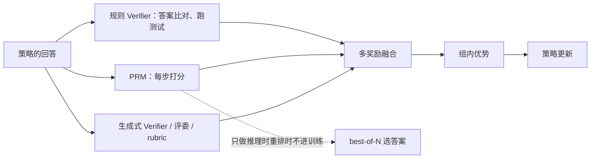

# 奖励与 Verifier：结果奖励、过程奖励与 reward hacking

> 层级：垂类 · training · 预计 150 分钟 · 题目：[questions.md](questions.md)
> 前置：[03 GRPO 及其变体](../03-grpo-family/README.md)（组内优势、零优势组）、[core/09 评测](../../../core/09-evaluation/README.md)
> 相关：[04 Agentic RL](../04-agentic-rl/README.md)（多轮环境里的奖励）、[evaluation/02 LLM-as-Judge](../../evaluation/02-llm-as-judge/README.md)（评委的偏差和校准）

## 1 这一章解决什么问题

RL 的优化压力只作用在奖励上。奖励和“真正想要的行为”之间的任何差距，都会被几百步梯度更新放大。所以面试里“你的奖励怎么设计的”比“你用的什么算法”问得更深。

之前的做法是 RLHF：用人类偏好训一个奖励模型，再用 PPO 优化它。奖励模型是另一个神经网络，有自己的盲区。策略训久了会找到“奖励模型打高分但其实不好”的回答。推理模型这一波转向了程序可验证的奖励（RLVR），但它只覆盖少数任务；开放任务、长推理的中间步骤、多目标的 Agent 任务，仍然要靠过程奖励、生成式 Verifier、rubric 和评委。每一种都有被钻空子的方式。

学完你应该能：

- 写出 RLVR 的目标，推导二值奖励下 GRPO 组内优势的取值，说清 Verifier 的随机误判和系统性误判对梯度有什么不同；
- 讲清 PRM 的三种标签来源，推导 Math-Shepherd 的 HE 标签为什么 N 越大假阳性越多，说出 PRM 用于 best-of-N 重排和用于 RL 的区别；
- 说出生成式 Verifier 和 rubric 奖励怎么把分数算出来；
- 设计多奖励融合，解释名义权重和实际影响的差别，以及先求和再组内标准化会丢什么信息；
- 用 Gao 等的过优化规律解释“代理奖励涨、真实表现跌”，列出常见的钻空子模式和分层防御。

**符号表**

| 符号 | 含义 |
|---|---|
| x, y | 提示（问题）和模型的回答 |
| v(x, y) | Verifier（验证器）给出的奖励 |
| G | GRPO 每个问题采样的回答数 |
| k, p̂ | 一组里答对的个数，组内通过率 p̂ = k/G |
| p | 策略在这道题上的真实通过率 |
| s_i | 解题过程的第 i 步 |
| N | Math-Shepherd 从某一步出发续写的次数 |
| q | 从某一步出发续写一次能得到正确答案的概率 |
| r_k, w_k | 第 k 个奖励分项和它的权重 |
| d | Gao 等定义的优化强度，d = √KL(π ‖ π_init) |

下图是一条 RL 训练里奖励的来源和它们被用在哪。



## 2 RLVR：可验证奖励

**问题**：RLHF 的奖励模型有盲区，策略会去找它。Gao、Schulman、Hilton（arXiv 2210.10760，下称 Gao 等 2022）用一个固定的“金标准”奖励模型代替人，系统测量了这种过度优化：对代理奖励优化过多，金标准分数反而会变差，而且变化规律随优化方法（RL 或 best-of-n）不同。具体规律见第 6.1 节。

**做法**：RLVR（Reinforcement Learning with Verifiable Rewards）用程序算奖励。这个名字来自 Tülu 3（arXiv 2411.15124）：只有生成结果被验证为正确时才给一个固定奖励，用在 GSM8K、MATH 和 IFEval 式的约束遵循上。

### 2.1 目标函数

Tülu 3 第 6 节把 RLVR 写成带 KL 约束的奖励最大化：

```text
max_θ  E_{y ~ π_θ(·|x)} [ v(x, y) − β · KL(π_θ(y|x) ‖ π_ref(y|x)) ]

v(x, y) = α   若 y 被验证为正确
          0   否则
```

- v 是验证函数：从回答 y 里取出答案，和标准答案比对，或跑测试、查约束。
- π_ref 是参考策略，通常是 RL 前的 SFT 或偏好训练后的模型；β 控制偏离它的代价。
- α 是答对的奖励值。Tülu 3 用 PPO 优化这个目标，α = 10，论文说这是小规模试跑后定的，没有再调。

其他工作的取值不同。DAPO（arXiv 2503.14476）用 is_equivalent(ŷ, y) 判断等价，答对 +1、答错 −1。DeepSeek-R1（arXiv 2501.12948）的 R1-Zero 把准确性奖励和格式奖励（推理写在 `<think>` 和 `</think>` 之间）等权相加：Reward_rule = Reward_acc + Reward_format。

| 任务 | 验证方式 |
|---|---|
| 数学 | 按固定格式（例如框住的最终答案）提取答案，和标准答案比对 |
| 代码 | 运行测试用例 |
| 指令约束 | 程序检查字数、格式、关键词等约束 |
| 短事实问答 | 精确匹配或 F1（Search-R1、R1-Searcher，见 [04 章](../04-agentic-rl/README.md)） |
| 工具调用 | 和标准调用比对工具名、参数名、参数值（ToolRL，见第 5 节） |

R1 论文给的不用神经奖励模型的理由是：大规模 RL 里神经奖励模型可能被 hack，重训它又要额外资源，并让流程变复杂。论文在局限一节也说，写作这类任务很难构造可靠的规则奖励；奖励由模型给出时，训练越久越容易被策略找到捷径。

### 2.2 二值奖励下的组内优势

GRPO 的组内优势是 Â_i = (r_i − mean(r)) / std(r)，推导见 [03 章第 2 节](../03-grpo-family/README.md#2-原始-grpo从策略梯度到组内基线)。这里只看奖励是 {0, 1} 时它长什么样。

一组 G 个回答里 k 个答对，组内通过率 p̂ = k/G。0/1 变量的均值是 p̂，总体方差是 p̂(1 − p̂)。代入：

```text
答对：Â₊ = (1 − p̂) / √(p̂(1 − p̂)) = +√((1 − p̂) / p̂)
答错：Â₋ = (0 − p̂) / √(p̂(1 − p̂)) = −√(p̂ / (1 − p̂))
组内求和：k·Â₊ + (G − k)·Â₋ = G·[√(p̂(1 − p̂)) − √(p̂(1 − p̂))] = 0
```

由此可以读出三件事（推导，代码见 7.1 节）：

1. **难题的少数正确回答拿大正优势**。G = 8、k = 1 时，答对的优势是 √7 ≈ 2.65，7 个答错的各是 −1/√7 ≈ −0.38。容易题反过来，唯一的错误回答被重罚。这就是 03 章说的“难度偏差”。
2. **α 和奖励的平移不影响优势**。α·r 的均值和 std 都乘 α，相除后消掉；{−1, +1} 是 {0, 1} 的仿射变换，标准化后也一样。所以 Tülu 3 的 α = 10 和 DAPO 的 ±1，在除以 std 的 GRPO 里是同一个信号。不除 std 时（Dr. GRPO），α 直接乘在优势上，等于调了学习率。PPO 带价值模型时，α 也会影响价值函数要拟合的尺度。
3. **k = 0 或 k = G 时优势全为 0**。k 服从二项分布 Binomial(G, p)，零优势组概率是 p^G + (1 − p)^G。它怎么随训练上升、DAPO 怎么过滤，见 [03 章 4.2 节](../03-grpo-family/README.md#4-dapo四个工程改进)。这里补一个题库层面的推论：一个 batch 里的零优势组比例是各题 p^G + (1 − p)^G 的平均，所以通过率接近 0 或 1 的题越多，有效 batch 越小。按通过率筛题比单纯加大 G 便宜。

### 2.3 Verifier 会错：随机误判和系统性误判

规则 Verifier 也有误判。设假阳性率 fp（错误回答被判对的概率）、假阴性率 fn（正确回答被判错的概率）。如果误判和回答内容无关：

```text
E[r_obs | y] = fp · (1 − c(y)) + (1 − fn) · c(y) = fp + (1 − fp − fn) · c(y)
```

c(y) ∈ {0, 1} 是回答真正对不对。常数 fp 会被基线减掉，期望梯度变成真实梯度乘 (1 − fp − fn)。**随机误判只缩小信号、增加方差，不改变方向**（推导，代码见 7.1 节）。

麻烦的是系统性误判：假阳性集中在某一类回答上，例如“写多个候选答案”“不按格式写但碰巧含有正确数字”。这类回答的期望奖励高于真实值，梯度会把它们推高。策略的优化能力恰好擅长找到这一类。所以 Verifier 的验收重点不是平均准确率，而是有没有能被稳定利用的假阳性模式（第 9 节第 1 条）。

### 2.4 代价和边界

- **能验证的任务是少数**。开放问答、写作、研究报告没有唯一答案，只能退回评委或 rubric（第 4 节）。
- **RL 提升了什么有争议**。DeepSeekMath（arXiv 2402.03300）第 5.2 节报告 RL 提高了 Maj@K，没有提高 Pass@K。Yue 等（arXiv 2504.13837）用大 k 的 pass@k 检查，在他们测试的模型和任务上，RLVR 模型小 k 时更好，大 k 时基座模型的 pass@k 反而更高；蒸馏则能引入新的推理模式。这些结论有设定前提，多轮 Agent 环境下是否成立还没有定论。
- **结果奖励不管过程**。答案对、过程错的回答同样拿满分。第 3 节的过程奖励就是为了这个。

## 3 结果奖励与过程奖励

| | 结果奖励（ORM） | 过程奖励（PRM） |
|---|---|---|
| 打分对象 | 最终答案 | 每个中间步骤 |
| 信号 | 稀疏，答对了也不知道哪步好 | 密，能定位错在哪一步 |
| 标注成本 | 低，常可程序化 | 高，或者要大量续写来估计 |
| 被钻空子 | 相对难 | 更容易，策略会学着写“每步看起来都对”的过程 |
| 典型用途 | RL 主奖励 | 推理时重排候选；RL 辅助项 |

### 3.1 PRM 的训练目标

Math-Shepherd（arXiv 2312.08935）第 3.2 节把 ORM 和 PRM 都写成二分类交叉熵。ORM 对整条解 s 只有一个标签 y_s；PRM 对 K 个步骤各有一个标签 y_{s_i}：

```text
L_PRM = Σ_{i=1..K} [ y_{s_i} · log r_{s_i} + (1 − y_{s_i}) · log(1 − r_{s_i}) ]
```

r_{s_i} 是 PRM 对第 i 步输出的 sigmoid 分数（原文的写法省略了负号，作为损失时取负）。Lightman 等把步骤分成正、负、中性三类，Math-Shepherd 报告二分类和三分类差别不大。实现上常用一个特殊 token 的概率当分数：Lightman 等在每步末尾预测标签 token；Math-Shepherd 用两个特殊 token 表示“有潜力”和“没潜力”，这样能用标准的语言模型训练流程。

难点全在标签 y_{s_i} 从哪来。

### 3.2 标签来源一：人工逐步标注

Lightman 等（Let's Verify Step by Step，arXiv 2305.20050）发布了 PRM800K：训练集含 80 万条步级标签，覆盖 1.2 万道题的 7.5 万个解。几个设计细节：

- **标注员给每步打正、负、中性**。中性表示有歧义，例如有误导但技术上没错。训练和评测时把中性当正。
- **只标到第一个错误步骤为止**。这样过程监督和结果监督对正确解提供的信息相同，对错误解多提供“错在哪”，比较更公平，标注成本也接近。
- **主动学习选样**。优先给标注员看“当前最好的 PRM 打高分、但最终答案错了”的解（论文叫 convincing wrong-answer），因为 PRM 至少在其中一步判断错了。论文估计这种主动学习比均匀选样数据效率高约 2.6 倍。
- **整条解的分数**：每步“正确”概率的乘积，即“所有步都对”的概率。论文附录比较了乘积和最小值，差别很小；乘积会轻微偏向步数少的解。

论文在 MATH 上比较，过程监督明显好于结果监督。

### 3.3 标签来源二：蒙特卡洛续写（Math-Shepherd）

Math-Shepherd 把一步的质量定义为“它推出正确答案的潜力”。做法：用一个补全模型（completer）从第 i 步之后续写 N 次，得到 N 个最终答案 a_1..a_N，和标准答案 a* 比对：

```text
硬估计 HE：  y_{s_i} = 1  若存在 j 使 a_j = a*，否则 0
软估计 SE：  y_{s_i} = (1/N) · Σ_j 1[a_j = a*]
```

论文主实验用 HE（因为二值标签可以直接映射到两个特殊 token），补全模型是 LLemma-7B，N = 8。

**HE 为什么 N 越大假阳性越多（推导）**。设从这一步续写一次答对的概率是 q。q 是这一步在补全模型下的“价值”，不是这一步对不对。N 次续写独立时：

```text
P(HE = 1) = 1 − (1 − q)^N
E[SE]     = q,    Var(SE) = q(1 − q) / N
```

一个坏步骤的 q 通常小但不为 0：后续步骤可能把错误纠正回来，或者两处错误相互抵消碰巧得到正确答案。N 越大，1 − (1 − q)^N 越接近 1，坏步骤几乎必然被标成好步骤。另一方面，N 太小时，q 不高的好步骤（后面还很难）会被漏标成 0。所以 HE 的准确率是 N 的单峰函数：小 N 漏标多，大 N 误标多。SE 是 q 的无偏估计，N 越大估得越准，不会因为 N 大而变差；但它收敛到 q，不收敛到“这一步对不对”。

这和论文的观察一致。Math-Shepherd 第 5.2 节人工标注了 GSM8K 训练集里的 160 个步骤，用 LLaMA2-70B 当补全模型：HE 标签和人工标注的一致率在 N = 4 时最高（86%），N 再增大反而下降，论文归因于假阳性；SE 和人工标注分布的交叉熵随 N 增大持续变好。论文的 Limitations 一节又写“N 越大，自动标注质量越高”，两处说法不一致，面试时以第 5.2 节的实验为准，并说明 HE 和 SE 的差别。7.2 节的模拟复现了这个单峰形状。

**补全模型也决定标签**。q 依赖补全模型的能力：同一个步骤，强补全模型能救回来，弱补全模型救不回来。所以蒙特卡洛标签有“策略依赖”，换了策略或补全模型，标签分布就变了。

### 3.4 标签来源三：LLM 评委和共识过滤

Qwen 团队的 The Lessons of Developing PRMs（arXiv 2501.07301，下称 Lessons）系统比较了三种标签来源：

- **蒙特卡洛标签通常不如 LLM 评委和人工标签**。他们的解释正是上面的区分：PRM 应该判断“当前这一步对不对”，蒙特卡洛估计的是“从这一步还能不能走到正确答案”，本质是价值模型。补全模型可能从错误步骤得出正确答案，也可能从正确步骤得出错误答案，所以错误位置不准。
- **共识过滤**：只保留 LLM 评委和蒙特卡洛估计对错误步骤位置判断一致的样本。论文报告过滤后只剩约 40% 数据，在 ProcessBench 上明显好于纯蒙特卡洛，和纯评委相当。
- **硬标签好于软标签**：过滤前差别不明显（噪声掩盖了差别），过滤后硬标签明显更好。理由是步骤对错应该是确定的；软标签让许多完全正确的步骤拿到小于 1 的标签，削弱了正负区分。阈值实验里，“任意一次续写答对就记正”（阈值 0）效果最好。这和 Math-Shepherd 用 HE 一致，但它是在共识过滤之后的结论。

### 3.5 PRM 用于 best-of-N 重排和用于 RL，有什么不同

两种用法对 PRM 的要求不一样。

**best-of-N 重排**：策略固定，采 N 个候选，PRM 把每条解的步级分数压成一个分数，选最高的。压缩方式有乘积（Lightman 等）和最小值（Math-Shepherd 沿用 Lightman 等的“最小步分”，以及和多数投票结合的加权投票）。这里 PRM 只需要在策略自己的分布上排序准，不会被优化；错误只造成选错，不会被放大。

**RL 训练**：PRM 的分数进入回报，策略会朝着 PRM 打高分的方向移动。三个后果：

1. **分布漂移**。策略写出的步骤越来越不像 PRM 训练时见过的，PRM 的判断变成外推，要迭代重训。
2. **回报随步数累加，可以靠多写步骤刷分**。Jiaxuan Gao 等（On Designing Effective RL Reward at Training Time for LLM Reasoning，arXiv 2410.15115，下称 Gao 等 2024）报告：把 PRM 的步级奖励和成功奖励一起用于 RL 时，模型学会重复正确但没必要的推理步骤，拿到很高的回报，准确率不涨；在有成功奖励的情况下，ORM 没有带来额外收益。他们提出两种修正：
   - **Clip**：r = min(r_process − η, 0)。每步奖励不超过 0，多数步骤拿 0，只有低分步骤被罚。
   - **Delta**：相邻步骤的分数差，r_k = r_process(p^(k)) − r_process(p^(k+1))（k < K−1），倒数第二步取自身分数，最后一步记 0（最后一步交给成功奖励）。求和后裂项相消，回报变成 α·r_process(第 1 步) + 成功奖励，与步数无关；从任意第 k 步开始的回报只取决于第 k 步自己的分数。
   两种修正的共同点是让整条轨迹的累计过程奖励有上界。7.5 节用代码验证了这三种回报的差别。
3. **怎么把步级奖励变成 token 级优势**。Math-Shepherd 用逐步 PPO，在每步末尾给奖励。DeepSeekMath 第 4.1.3 节给了 GRPO 版本：把一组里所有步级奖励一起做均值和 std 标准化，每个 token 的优势是它之后所有步骤标准化奖励之和，Â_{i,t} = Σ_{index(j) ≥ t} r̃_i^{index(j)}。论文报告 GRPO+PS（过程监督）好于 GRPO+OS（结果监督）。

**评测 PRM 时的偏差**。Lessons 论文指出，只用 best-of-N 评测 PRM，会奖励“过程错但答案对”的回答，PRM 被推向判断结果而不是过程；他们观察到现有 PRM 的最低分大量集中在最后的答案步骤。建议同时看步级错误定位指标（例如 ProcessBench）。

**步骤怎么切**也有争议：按换行切、按句子切、按模型自己写的“Step k”切，标签都不同。Agent 场景可以把每次工具调用当一步，但“这次检索好不好”比数学步骤更难判断。

## 4 生成式 Verifier 与 rubric 奖励

**问题**：判别式奖励模型只输出一个分数，用不上模型的生成和推理能力；开放任务又没有规则可写。

| 方式 | 做法 | 代价 |
|---|---|---|
| 判别式奖励模型 | 在模型上接一个打分头，用偏好数据训 | 不能“先想再判”；容易过度优化 |
| 生成式 Verifier（GenRM） | 把验证写成下一个 token 预测，和解题一起训；可以先写验证推理再判，多次采样取平均 | 推理成本高，打分要生成 |
| LLM 评委 | 直接提示一个强模型打分或比较 | 有位置、冗长、自我偏好等偏差 |
| Rubric 奖励 | 每道题配多条评分细则，评委逐条判，再聚合成奖励 | 细则要写和校准；评委仍可能被骗 |

### 4.1 GenRM：分数从哪来

Zhang 等（Generative Verifiers，arXiv 2408.15240）的做法：

- **打分**：给定问题和候选解，让模型回答“Is the answer correct (Yes/No)?”，分数是下一个 token 为 “Yes” 的概率。
- **GenRM-CoT**：先生成一段验证推理（例如“让我们一步步核对”），再输出 Yes/No。推理时采样多条验证推理，对 “Yes” 的概率取平均，论文称为多数投票。采样条数越多，用的推理计算越多，分数方差越小。
- **统一训练**：L_GenRM = L_SFT(D_verify) + λ·L_SFT(D_correct)。前一项学“判对错”，后一项学“生成正确解”，λ 控制两类数据的比例。论文附录报告生成数据太多会伤害验证，默认 λ 在算法任务上取 1/3，在 GSM8K 上取 1/4。
- 论文在 best-of-N 上和判别式验证器、DPO 验证器、LLM 评委比较，并报告生成式验证器随模型规模扩展得更好，随投票次数增加超过 LLM 评委。

当 RL 奖励时，GenRM 的分数是概率，天然在 [0, 1]。它比规则奖励贵：每个候选都要生成一段验证推理。DeepSeek-R1 在拒绝采样阶段，对规则判不了的题让 DeepSeek-V3 做生成式评委，比较标准答案和模型预测，这是同一思路的工程用法。

### 4.2 Rubric 奖励：怎么聚合成一个数

Rubrics as Rewards（arXiv 2507.17746，下称 RaR）给每道题配 k 条细则 {(w_j, c_j)}。c_j(x, ŷ) ∈ {0, 1} 表示回答是否满足第 j 条，由评委判断；w_j 是权重。两种聚合：

```text
显式聚合：r(x, ŷ) = Σ_j w_j · c_j(x, ŷ) / Σ_j w_j
隐式聚合：把所有细则和类别标签交给评委，直接输出一个总分，再归一化到 [0, 1]
```

- **除以 Σ w_j 的作用**：不同题的细则条数和权重不同，归一化后奖励都在 [0, 1]，可以跨题比较。
- **类别权重**：细则标成 Essential、Important、Optional、Pitfall。显式聚合实验里手设权重为 1.0、0.7、0.3、0.9。Pitfall 条目写成正面形式（例如“回答避免了某种误导”），满足就加分，不满足就少拿这部分分。
- **RLVR 是特例**：论文的 Remark 1 指出，k = 1、w_1 = 1、c_1 是答案比对时，rubric 奖励退化成 RLVR。
- 论文报告：在医学和科学任务上，隐式聚合整体最好，显式加权更可控、更可解释，但固定权重容易脆；结构化 rubric 对小评委更友好，不同规模评委之间方差更小。

### 4.3 当奖励和当评测的区别

Zheng 等（MT-Bench，arXiv 2306.05685）发现强评委和人的一致率与人与人相当，也有位置、冗长、自我偏好等偏差，见 [evaluation/02 LLM-as-Judge](../../evaluation/02-llm-as-judge/README.md#4-三种偏差)。

当评测只要求“平均意义上准”；当奖励还要经得起优化压力，策略会专门去找它的漏洞。一致率是在固定分布上测的，RL 会把策略推到评委没见过的分布。2.3 节的分析在这里同样成立：评委的随机噪声只是让训练慢一点，系统性偏差（偏爱长回答、偏爱自信的语气）会被策略稳定利用。所以评委当奖励前要做对抗测试（第 6 节），并且能程序化的分项尽量不交给评委。

## 5 多奖励融合

Agent 任务常有多个分项：答案正确、格式合法、工具调用合法、效率、引用真实。

| 方式 | 做法 | 问题 |
|---|---|---|
| 加权求和 | r = Σ_k w_k · r_k | 权重是超参；分项冲突时梯度方向混乱 |
| 门控 | 格式不过直接最低分，过了再看结果 | 门槛太严时大部分样本没信号 |
| 分阶段 | 先教格式或调用，再加结果奖励（R1-Searcher 的两阶段） | 切换时机要调；切换瞬间奖励尺度突变 |
| 动态尺度 | 随训练进度调整各分项的范围 | 多一组超参 |
| 分项各自标准化 | 每个分项单独做组内标准化再求和（GDPO） | 要逐项记录奖励；分项多时再做一次 batch 级归一化 |

### 5.1 名义权重不等于实际影响

GRPO 的组内标准化作用在融合后的总奖励上。组内排序由总奖励的方差决定。分项之间不相关时：

```text
Var(Σ_k w_k r_k) = Σ_k w_k² · Var(r_k)
```

所以第 k 项对排序的实际影响大约正比于 w_k² · Var(r_k)，不是 w_k。一个二值分项的 std 最大是 0.5；一个在 [0, 1] 里变化很小的连续分（例如评委给的 0.70 到 0.80）std 可能只有 0.05。两者等权相加，二值项占了约 99% 的方差（7.3 节）。反过来，如果格式奖励在组内变化大、正确性分在组内变化小，模型会先学格式。

**推导出的做法**：融合前先看每个分项在组内的 std 分布。想让两项影响相当，权重应该和 std 成反比，或者先按各自的尺度（组内或 batch 内 std）归一化再加权。

### 5.2 先求和再标准化会丢信息

Liu 等（GDPO，arXiv 2601.05242）指出另一个问题：先求和再做组内标准化，会把不同的分项组合压成同一个优势。他们的最小例子：G = 2，两个二值奖励，总奖励可能是 0、1、2。组合 (0, 1)、(0, 2)、(1, 2) 标准化后优势完全相同（论文用样本 std 给出 ±0.7071，用总体 std 是 ±1，结论一样）。直觉上 (0, 2) 里赢的那条同时满足了两项，应该拿更强的信号。

GDPO 的改法：每个分项单独做组内标准化，A_k = (r_k − mean(r_k)) / std(r_k)，再求和，最后在整个 batch 上对总优势再做一次标准化，防止分项越多优势越大。(0, 2) 这样就得到两倍于 (0, 1) 的优势。论文报告，只去掉 std（Dr. GRPO 的做法）能区分 (0, 1) 和 (0, 2)，但回答数和分项数变多时，可区分的优势组合只略有增加。7.3 节枚举了 G = 4、两个二值奖励时两种做法得到的不同优势向量个数。

代价：分项各自标准化后，每一项在组内的影响被拉平，你在 w_k 里写的“正确性比格式重要”要靠显式权重重新表达；某个分项在组内全相同时，它这一项的优势为 0，不贡献信号。

### 5.3 ToolRL 的例子

ToolRL（arXiv 2504.13958）的总奖励 = 格式奖励 + 正确性奖励：

```text
R_format ∈ {0, 1}：所有要求的字段（<think>、<tool_call>、<response>）都出现且顺序正确记 1
r_name  = |N_G ∩ N_P| / |N_G ∪ N_P|                       工具名集合的 Jaccard，∈ [0, 1]
r_param = Σ_{G_j} |keys(P_G) ∩ keys(P_P)| / |keys(P_G) ∪ keys(P_P)|   ∈ [0, |G|]
r_value = Σ_{G_j} Σ_{k ∈ keys(G_j)} 1[P_G[k] = P_P[k]]   ∈ [0, Σ_j |keys(G_j)|]
S_max   = 1 + |G| + Σ_j |keys(G_j)|
R_correct = 6 · R_max / S_max − 3 ∈ [−3, 3]
R_final = R_format + R_correct ∈ [−3, 4]
```

G 是标准调用的集合，P 是预测调用，R_max 是在预测和标准调用之间做最优匹配得到的总分。正确性的跨度是 6，格式的跨度是 1。按 5.1 节，这个设计让正确性主导组内排序。论文的消融：

- 把正确性压到和格式同一尺度 [−1, 1]，效果变差，说明正确性要权重更大。
- 训练到一半突然切换两项的尺度，效果也变差，论文认为尺度突变会扰乱训练。
- 随训练进度平滑调整尺度，在两个 3B 模型上效果最好。
- 加思考长度奖励，在小模型上明显变差。
- 正确性奖励改粗（只看整体完全匹配），信号更稀疏，效果下降。

### 5.4 融合之前要做的两件事

1. **算分项之间的相关性**。高度相关是冗余；负相关是冲突，例如“检索更多”和“回答更快”。冲突项先确认是不是真冲突，以结果为主，冲突项改成门控或小权重，或者写成约束（调用上限），不放进奖励。
2. **做分项消融**。去掉一项重训一小段，留出评测不降，这一项就是多余的。每多一个分项，就多一个可被钻空子的点。

## 6 Reward hacking：规律、模式与防御

**是什么**：模型找到了奖励的漏洞，拿到高分但没完成任务。它不是偶发故障，而是“优化一个和目标不完全相同的量”的必然结果，区别只在于漏洞多大、多快被找到。

### 6.1 Gao 等的过优化规律

Gao 等 2022 的设定：一个 6B 奖励模型当“金标准”（代替人），用它给样本对打标签，训练 3M 到 3B 参数的代理奖励模型；然后用 best-of-n 或 PPO 优化代理奖励，同时记录金标准分数。他们用 d = √KL(π ‖ π_init) 衡量优化强度，π_init 是优化前的策略。论文拟合出的函数形式：

```text
best-of-n：R_bon(d) = d · (α_bon − β_bon · d)
RL：       R_RL(d)  = d · (α_RL  − β_RL · log d)
R(0) = 0，R 是金标准分数相对初始策略的变化
best-of-n 的 KL 可以解析算出：KL_bon = log n − (n − 1)/n
```

定性规律（论文结论，设定是这个合成实验）：

- **金标准分数先升后降，代理分数一直升**。两条曲线之间的差距随优化强度扩大。
- **α 和 β 随代理奖励模型的参数量平滑变化**，近似对数关系。代理模型越大，过优化来得越晚、越轻，但不会消失。
- **RL 消耗的 KL 远多于 best-of-n**。best-of-n 只在初始策略附近局部搜索，KL 约按 log n 增长；RL 每一步都在上一步的基础上改，KL 增长快得多。所以“KL 是多少”不能直接用来比较两种方法的优化程度。
- **KL 惩罚在他们的设定下相当于提前停止**。金标准分数只取决于策略走了多远的 KL，KL 惩罚让训练更早收敛，但不改变“KL–金标准分数”曲线本身。论文提醒这个结论可能对超参敏感。
- **策略模型变大，过优化程度变化不大**。大策略起点更高，从优化中得到的提升更少，但代理和金标准的差距、金标准峰值所在的 KL 都差不多。

论文用 Goodhart 定律的四分类解释这些现象。两类最相关：

- **回归型（regressional）**：代理 = 真实 + 独立噪声。优化代理时，一部分优化力用在了选噪声上，真实提升按 Var(X) / (Var(X) + Var(Z)) 打折，但仍然单调上升。所以只有这一类时不会出现“先升后降”。
- **极端型（extremal）**：优化把样本推出代理模型的训练分布，代理和真实的关系在那里变了。论文的例子正是长度：训练分布里更长通常更好，到了分布外，更长不再更好。论文认为非单调的下降主要来自这一类，对应 β 项。

7.4 节的模拟用一个“代理奖励偏爱某个有害特征”的 toy 复现了先升后降，并验证了回归型噪声只打折、不反转。

### 6.2 常见的钻空子模式

| 场景 | 表现 | 漏洞来源 |
|---|---|---|
| 数学规则奖励 | 改输出格式骗过答案提取；一次写多个候选答案碰运气 | 答案提取规则太宽，“出现正确值就给分” |
| 代码测试奖励 | 修改测试、跳过测试、直接打印期望输出、提前退出让测试框架报成功 | 测试和被测代码在同一个可写环境里；测试框架把“没跑完”当成通过 |
| 学到的奖励模型 / 评委 | 写得更长、更客气、自称“已经仔细验证过” | 冗长偏差和训练分布外的外推（6.1 节的极端型） |
| PRM 当 RL 奖励 | 重复正确但没必要的推理步骤 | 步级奖励随步数累加，没有上界（3.5 节） |
| 搜索 Agent | 为拿检索奖励反复调用搜索；为拿引用奖励堆砌引用 | 奖励的是行为次数，不是行为的效果 |
| 格式奖励 | 格式完全正确，内容空洞 | 格式和结果分开加权，格式那一份不依赖内容 |

几个有原文的例子：

- **长度**。Singhal 等（A Long Way to Go，arXiv 2310.03716）在三个 RLHF 设定上发现，奖励的提升很大一部分来自回答变长；把奖励换成只看长度的启发式分数，PPO 的效果接近用奖励模型的标准 PPO。论文报告 WebGPT 上 56% 对 58%、RLCD 上 64% 对 63% 的胜率。他们把主要来源归到奖励模型，奖励模型在训练中容易学到偏好数据里“越长越好”的相关性。
- **改测试**。Baker 等（arXiv 2503.11926）在前沿推理模型的 Agent 编码训练里发现两种系统性 hack：exit(0)，利用环境的一个 bug 在没跑完所有测试时提前退出；raise SkipTest，在测试框架之外的函数里抛出跳过测试的异常。这类 hack 一旦出现，会很快被强化并扩散到几乎所有训练环境。论文图 1 还有一个例子：模型在思维链里写出可以让 verify 函数永远返回 true。
- **PRM 刷步数**。Gao 等 2024 用人工构造的解做验证：在正确解后面重复无意义步骤、重复某个中间步骤、重复最后一句话，PRM 给的累计回报都更高。

### 6.3 识别

- **训练奖励涨、留出评测不涨**。训练奖励和最终评测要不完全相同：换评分器、换题、换评委。
- **分项曲线异常**。某一项涨得异常快、其他项不动；输出长度、步数、工具调用次数异常增长。
- **抽检高分样本**。漏洞最常出现在最高分的样本里。
- **读推理过程**。Baker 等用一个提示好的 GPT-4o 当监控器，只看动作和输出时（Action Monitor），对上面两种系统性 hack 的召回率约 60%；能读完整轨迹包括思维链时（CoT Monitor），召回率约 95%。论文还报告更弱的 GPT-4o-mini 也能抓到相当一部分 hack，认为这是“弱模型监控强模型”的初步正面结果。

### 6.4 防御，按层次

1. **改规则**。hack 往往是奖励定义本身鼓励的。“答案里出现正确值就给分”会鼓励写多个候选，应改成只认唯一的最终答案。
2. **限制可操作的范围**。测试文件只读、在独立进程里跑；工具调用次数有上限；沙箱隔离；测试框架把“提前退出”“跳过”判为失败。
3. **门控代替加权**。先满足硬条件，再给软分项。格式奖励只在答案正确时才给，或者格式不过直接最低分。
4. **给可累加的分项设上界**。PRM 用 Clip 或 Delta（3.5 节）；长度、引用数、调用次数这类分项要有饱和点。7.4 节的模拟里，给可钻空子的特征设上限后，真实奖励不再下降。
5. **对抗测试奖励函数**。上线前构造“格式对内容错”“堆引用”“改测试”“多个候选答案”这类样本，看奖励会不会给高分。把它们做成回归集，每次改奖励都跑一遍。
6. **控制评委的使用范围**。能程序化的分项不交给评委；评委只判程序管不到的维度。
7. **不要直接优化监控信号**。Baker 等报告：把思维链监控加进奖励，轻度优化时能得到更强、更对齐的 Agent；优化压力大时，模型学会在思维链里隐藏意图，继续 hack 但监控看不出来（论文叫 obfuscated reward hacking）。论文建议接受一定的“可监控性代价”（monitorability tax），不对思维链施加太强的优化压力。

**发现后怎么办**：抽检确认漏洞形态，修奖励或环境，用对抗样本回归测试。已经学到的 hack 行为不会自己消失，通常回到 hack 出现之前的检查点继续训。只加大 KL 系数会让正常学习一起变慢，漏洞仍在；Gao 等 2022 的结果也说明，在他们的设定下 KL 惩罚的效果接近提前停止。Baker 等的图 2 里，团队每发现一种系统性 hack 就手动修补环境 bug，hack 率随即迅速下降。

## 7 实现：只用 numpy 验证上面的结论

每段都能单独运行，结尾的 `assert` 对应正文的一条结论。

### 7.1 二值奖励的组内优势、零优势组和 Verifier 噪声

验证 2.2 节的闭式优势、α 不影响标准化后的优势、零优势组概率，以及 2.3 节“随机误判只缩小梯度、系统性误判改变方向”。

```python
import numpy as np
from math import comb

# 1) 二值奖励下的组内优势：G 个回答里 k 个答对，p̂ = k/G
def grpo_adv(r, eps=1e-6):
    return (r - r.mean()) / (r.std() + eps)          # 总体 std（ddof=0）

G = 8
for k in range(1, G):
    r = np.array([1.] * k + [0.] * (G - k))
    a = grpo_adv(r)
    ph = k / G
    assert np.isclose(a[0], np.sqrt((1 - ph) / ph), rtol=1e-4)     # 答对：+sqrt((1-p̂)/p̂)
    assert np.isclose(a[-1], -np.sqrt(ph / (1 - ph)), rtol=1e-4)   # 答错：-sqrt(p̂/(1-p̂))
    assert abs(a.sum()) < 1e-4                                      # 组内优势和为 0

# 2) α 倍的奖励（Tülu 3 用 α = 10）：除以 std 后 α 消掉；不除 std 时 α 相当于学习率
r = np.array([1., 1., 0., 0., 0., 0., 0., 0.])
assert np.allclose(grpo_adv(10 * r), grpo_adv(r), atol=1e-5)
assert np.allclose((10 * r - (10 * r).mean()), 10 * (r - r.mean()))

# 3) k ~ Binomial(G, p)：零优势组概率 = P(k=0) + P(k=G) = (1-p)^G + p^G
def pmf(k, G, p):
    return comb(G, k) * p ** k * (1 - p) ** (G - k)
for p in (0.05, 0.5, 0.9):
    assert np.isclose(pmf(0, G, p) + pmf(G, G, p), (1 - p) ** G + p ** G)
rng = np.random.default_rng(0)
ks = rng.binomial(G, 0.9, size=200_000)
assert abs(np.mean((ks == 0) | (ks == G)) - (0.9 ** 8 + 0.1 ** 8)) < 0.005

# 4) 一批题的通过率分布决定有效组比例：一半题 p=0.02（太难）、一半 p=0.95（太易）
zero = lambda p, G: p ** G + (1 - p) ** G
mix = 0.5 * zero(0.02, 8) + 0.5 * zero(0.95, 8)
assert mix > 0.7                                   # 七成以上的组没有梯度
assert 0.5 * zero(0.02, 32) + 0.5 * zero(0.95, 32) < 0.45   # G 加到 32 才降下来

# 5) Verifier 的噪声：假阳性率 fp、假阴性率 fn，且与回答内容无关
#    E[r_obs | 回答] = fp + (1 - fp - fn)·1[正确]，常数 fp 被基线吃掉，期望梯度整体乘 (1 - fp - fn)
z = np.array([0.3, -0.2, 0.5, 0.1])               # 4 个候选回答的 logits
pi = np.exp(z) / np.exp(z).sum()
correct = np.array([1., 0., 1., 0.])
def exact_grad(reward):                           # ∇_z E_π[R]，softmax 下 = π ⊙ (R − E_π R)
    return pi * (reward - pi @ reward)
fp, fn = 0.1, 0.2
g_true = exact_grad(correct)
g_noisy = exact_grad(fp + (1 - fp - fn) * correct)
assert np.allclose(g_noisy, (1 - fp - fn) * g_true)            # 方向不变，只缩小
# 假阳性只落在某一类“钻空子”回答上时，方向就变了
hack = np.array([0., 1., 0., 0.])                 # 回答 1 是错的，但能骗过 Verifier
g_hack = exact_grad(np.maximum(correct, hack))
assert g_hack[1] > 0 > g_true[1]                  # 被骗的错误回答反而被推高
print("p̂=1/8 时答对的优势 %.3f，答错 %.3f" % (np.sqrt(7), -np.sqrt(1 / 7)))
```

第 4 步说明题库的通过率分布决定有效组比例：一半题太难、一半题太易时，G = 8 有七成以上的组没有梯度。按通过率筛题通常比加大 G 便宜。

### 7.2 Math-Shepherd 式蒙特卡洛标签：N 增大时 HE 的假阳性

模拟 2 万个步骤，一半好一半坏。每个步骤有一个“续写一次能答对”的概率 q：好步骤的 q 分散（有些好步骤后面还很难），坏步骤的 q 小但不为 0。分布是虚构的，只用来展示形状，不对应论文的数字。

```python
import numpy as np

rng = np.random.default_rng(0)
M = 20_000                                   # 模拟 M 个待标注的步骤，一半好一半坏
good = rng.random(M) < 0.5
# q：从这一步出发，补全模型续写一次能得到正确答案的概率（即这一步在补全模型下的“价值”）
# 好步骤：q 分散，有的好步骤后面还很难，q 偏小；坏步骤：q 小但不为 0（被后续步骤救回，或碰巧答对）
q = np.where(good, rng.beta(2, 2, M), rng.beta(1, 15, M))

def mc_labels(q, N, rng):
    hits = rng.binomial(N, q)                # N 次续写里答对的次数
    return (hits > 0).astype(float), hits / N  # HE, SE

Ns = [1, 2, 4, 8, 16, 32, 64, 128]
acc_he, fpr_he, auc_se = [], [], []
for N in Ns:
    he, se = mc_labels(q, N, rng)
    acc_he.append(np.mean(he == good))
    fpr_he.append(np.mean(he[~good]))         # 坏步骤被标成好步骤的比例
    # SE 的排序质量：随机抽一个好步骤和一个坏步骤，好步骤 SE 更高的概率（平局记 0.5）
    a, b = se[good][:5000], se[~good][:5000]
    auc_se.append(np.mean(a[:, None] > b[None, :]) + 0.5 * np.mean(a[:, None] == b[None, :]))

# 1) HE 的假阳性率随 N 单调上升，理论值 E[1 − (1 − q)^N]
for N, f in zip(Ns, fpr_he):
    assert abs(f - np.mean(1 - (1 - q[~good]) ** N)) < 0.02
assert all(np.diff(fpr_he) > 0)
# 2) HE 的准确率先升后降：N 小时好步骤漏标多，N 大时坏步骤误标多
best = Ns[int(np.argmax(acc_he))]
assert 1 < best < 128 and acc_he[-1] < max(acc_he) - 0.05
# 3) N → ∞ 时 HE 退化成“q > 0 就记 1”，坏步骤只要 q > 0 都会被标好
assert fpr_he[-1] > 0.8
# 4) SE 估的是 q 本身，排序质量随 N 基本单调变好，不会因为 N 大而变差
assert auc_se[-1] > auc_se[0] and auc_se[-1] >= max(auc_se) - 0.005
# 5) SE 收敛到 q，不收敛到“这一步对不对”：好步骤里 q < 0.2 的，N 再大 SE 也低
_, se_big = mc_labels(q, 4096, rng)
hard_good = good & (q < 0.2)
assert np.all(se_big[hard_good] < 0.25)
for N, a, f, u in zip(Ns, acc_he, fpr_he, auc_se):
    print(f"N={N:4d}  HE 准确率 {a:.3f}  HE 假阳性率 {f:.3f}  SE 排序 AUC {u:.3f}")
```

运行输出里，HE 准确率在 N = 4 附近最高（约 0.82），N = 128 时降到约 0.55，同时 HE 假阳性率从 0.06 升到 0.89；SE 的排序 AUC 随 N 一直上升。形状和 Math-Shepherd 第 5.2 节的观察一致，峰值位置取决于 q 的分布，这里落在 4 是模拟参数的结果。

### 7.3 多奖励：尺度主导、按尺度归一化、先求和再标准化的信息损失

```python
import numpy as np
from itertools import product

def norm(x, eps=1e-6):
    return (x - x.mean()) / (x.std() + eps)

# 1) 尺度主导：G = 8 个回答，格式奖励 {0, 1}，正确性奖励是 [0, 1] 里的细粒度分
fmt = np.array([1, 1, 1, 1, 1, 1, 0, 0], float)
cor = np.array([0.9, 0.2, 0.8, 0.1, 0.5, 0.4, 0.95, 0.85])
for w_cor in (1.0, 6.0):                      # 正确性权重 1 和 6（ToolRL 正确性跨度 6、格式跨度 1）
    a = norm(fmt + w_cor * cor)
    c_fmt = np.corrcoef(a, fmt)[0, 1]
    c_cor = np.corrcoef(a, cor)[0, 1]
    print(f"w_cor={w_cor}: 优势与格式相关 {c_fmt:+.2f}，与正确性相关 {c_cor:+.2f}")
    if w_cor == 1.0:
        assert c_fmt > c_cor                  # 等权时，方差更大的格式项主导排序
        assert a[6] < a[1]                    # 格式错但几乎全对(0.95)的回答，优势低于格式对但几乎全错(0.2)的
    else:
        assert c_cor > c_fmt and a[6] > a[1]  # 放大正确性后排序跟着正确性走

# 2) 名义权重不等于实际影响：分项 k 对总奖励方差的贡献 ≈ w_k² · Var(r_k)（不相关时）
rng = np.random.default_rng(0)
r1 = rng.integers(0, 2, 10_000).astype(float)       # 二值，std 0.5
r2 = rng.normal(0, 0.05, 10_000)                     # 连续小分，std 0.05
total = 1.0 * r1 + 1.0 * r2
share1 = np.var(r1) / np.var(total)
assert share1 > 0.98                                 # 等权重下 r1 占了 99% 的方差
# 按尺度归一化后再加：两项各占一半
t2 = r1 / r1.std() + r2 / r2.std()
assert abs(np.var(r1 / r1.std()) / np.var(t2) - 0.5) < 0.02

# 3) 先求和再组内标准化会把不同的分项组合压成同一个优势（GDPO 论文图 2 的例子）
#    G = 2、两个二值奖励：总奖励组合 (0,1)、(0,2)、(1,2) 标准化后完全相同
def grpo_sum(r):                 # r: [G, K]
    return norm(r.sum(1))
def gdpo(r):                     # 每个分项单独组内标准化，再求和（省略 batch 级再归一化）
    return sum(norm(r[:, k]) for k in range(r.shape[1]))
pairs = {(0, 1): [[0, 0], [1, 0]], (0, 2): [[0, 0], [1, 1]], (1, 2): [[1, 0], [1, 1]]}
adv_sum = {k: grpo_sum(np.array(v, float)) for k, v in pairs.items()}
assert np.allclose(adv_sum[(0, 1)], adv_sum[(0, 2)], atol=1e-4)
assert np.allclose(adv_sum[(0, 2)], adv_sum[(1, 2)], atol=1e-4)
assert np.allclose(adv_sum[(0, 1)], [-1, 1], atol=1e-4)   # 都是 (−1, +1)
adv_dec = {k: gdpo(np.array(v, float)) for k, v in pairs.items()}
assert np.allclose(adv_dec[(0, 2)], [-2, 2], atol=1e-4)   # 两项都赢，信号翻倍
assert np.allclose(adv_dec[(0, 1)], [-1, 1], atol=1e-4)

# 4) 枚举 G = 4、两个二值奖励的全部组合，数不同优势向量的个数
def distinct(f):
    seen = set()
    for bits in product([0, 1], repeat=8):
        r = np.array(bits, float).reshape(4, 2)
        seen.add(tuple(np.round(f(r), 4)))
    return len(seen)
n_sum, n_dec = distinct(grpo_sum), distinct(gdpo)
assert n_dec > n_sum
print("G=4、两个二值奖励：先求和再标准化 %d 种优势向量，分项标准化 %d 种" % (n_sum, n_dec))
```

第 1 步里，等权相加时组内优势和格式的相关系数约 +0.71、和正确性只有 +0.17：格式错但几乎全对的回答被排在格式对但几乎全错的回答后面。把正确性权重放大到 6 后，相关系数变成 −0.39 和 +0.98。第 4 步的枚举结果是 51 种对 107 种。

### 7.4 Reward hacking：代理奖励和真实奖励随优化强度分叉

用 best-of-n 当优化器，n 越大优化越强。每个回答有真实质量 X 和一个可钻空子的特征 E（例如多写的长度）。代理奖励 = X + E，真实奖励 = X − 0.5·E：代理奖励偏爱这个特征，但它本身有害。这是 6.1 节“极端型”的 toy 版本，参数是虚构的。

```python
import numpy as np

rng = np.random.default_rng(0)
ns = [1, 2, 4, 8, 16, 32, 64, 128, 256, 512, 1024, 2048]
T = 1000                                     # 每个 n 重复 T 次 best-of-n

def best_of_n(n, cap=None):
    X = rng.normal(0, 1, (T, n))             # 真实质量（gold 的主要来源）
    E = rng.lognormal(0, 0.5, (T, n)) - np.exp(0.125)   # 可钻空子的特征（如多写的长度），右偏，均值 0
    proxy = X + (E if cap is None else np.minimum(E, cap))
    gold = X - 0.5 * E                       # 真实奖励：这个特征本身有害
    i = proxy.argmax(1)
    pick = lambda A: A[np.arange(T), i].mean()
    return pick(proxy), pick(gold), pick(X), pick(E)

res = np.array([best_of_n(n) for n in ns])   # [len(ns), 4]
proxy, gold, X, E = res.T
kl = np.array([np.log(n) - (n - 1) / n for n in ns])   # best-of-n 的解析 KL（Gao 等引用 Stiennon 等）

# 1) 代理奖励随优化强度单调上升
assert np.all(np.diff(proxy) > 0)
# 2) 真实奖励先升后降：峰值在中间，最大 n 时明显低于峰值
k = int(np.argmax(gold))
assert 0 < k < len(ns) - 1 and gold[k] > gold[0] + 0.8 and gold[-1] < gold[k] - 1.0
# 3) 分叉的来源：大 n 时被选中的样本主要靠 E 拿高分，X 的增长停滞
assert E[-1] > 2 * E[k] and X[-1] < X[k] + 0.5
# 4) KL 随 log n 增长；这条 toy 曲线能被 Gao 等的 BoN 形式 R(d) = d(α − βd) 粗略拟合，d = sqrt(KL)
d = np.sqrt(kl)
A = np.stack([d, -d ** 2], 1)
(alpha, beta), *_ = np.linalg.lstsq(A, gold - gold[0], rcond=None)
pred = A @ np.array([alpha, beta])
r2 = 1 - np.sum((gold - gold[0] - pred) ** 2) / np.sum((gold - gold.mean()) ** 2)
assert alpha > 0 and beta > 0 and r2 > 0.8

# 5) 防御：给可钻空子的分项设上限（类似 PRM 的 Clip 思路），代理奖励不再奖励“更多 E”
capped = np.array([best_of_n(n, cap=1.0) for n in ns])
assert capped[-1, 1] > gold[-1] + 1.0 and capped[-1, 1] > gold[k] - 0.1              # 大 n 时真实奖励高得多
assert np.all(np.diff(capped[4:, 1]) > -0.05)      # 不再明显下降

# 6) 纯回归型 Goodhart：代理 = 真实 + 独立高斯噪声，真实奖励单调上升，
#    增量约为代理增量的 Var(X)/(Var(X)+Var(Z))（Gao 等式 1，这里 Var 都是 1，比例 0.5）
Xg = rng.normal(0, 1, (T, 1024)); Z = rng.normal(0, 1, (T, 1024))
sel = (Xg + Z).argmax(1)
gain_p = (Xg + Z)[np.arange(T), sel].mean(); gain_g = Xg[np.arange(T), sel].mean()
assert abs(gain_g / gain_p - 0.5) < 0.03
for n, p, g, kk in zip(ns, proxy, gold, kl):
    print(f"n={n:5d} KL={kk:5.2f}  代理 {p:6.2f}  真实 {g:6.2f}")
```

运行输出里，代理奖励从 n = 1 的约 0 一直涨到 n = 2048 的约 5.3；真实奖励在 n = 16 前后到峰值约 1.0，n = 2048 时降到约 −0.34。被选中样本的 X 在 n ≥ 64 后基本不涨（约 1.6），E 继续涨，说明后期的代理增益全来自钻空子。toy 曲线能被 Gao 等的 best-of-n 形式 d(α − βd) 拟合（R² 约 0.95），这只说明形状相似，不说明机制相同。第 5 步给 E 设上限 1.0 后，真实奖励在 n = 2048 时约 2.6，一直不降。第 6 步是纯回归型噪声的对照：真实增益约为代理增益的一半，单调上升，不会反转。

### 7.5 PRM 当 RL 奖励：求和、Clip、Delta

验证 3.5 节：步级分数直接求和时，重复步骤能刷高回报；Clip 和 Delta 让回报有上界。也顺带比较 best-of-N 重排时乘积和最小值两种聚合。

```python
import numpy as np

# 一个 PRM 给每一步打分 ∈ (0, 1)。正确解 4 步，PRM 分数都较高
steps = np.array([0.9, 0.85, 0.9, 0.95])
correct = 1.0                      # 结果奖励（success reward）
alpha = 1.0                        # 过程奖励的权重

# 1) Best-of-N 重排：把每步分数压成一个解的分数。Lightman 等用乘积，Math-Shepherd 用最小值
prod_score, min_score = steps.prod(), steps.min()
assert np.isclose(prod_score, 0.9 * 0.85 * 0.9 * 0.95) and min_score == 0.85
# 乘积对步数敏感：每步都 0.95 的 12 步解，乘积低于每步 0.9 的 4 步解
assert 0.95 ** 12 < 0.9 ** 4
# 最小值不看步数：多写几步“没毛病”的话不会降分，也不会加分
assert np.full(12, 0.95).min() > 0.9

# 2) RL 里直接把每步分数当奖励求和：回报随步数线性增长
def ret_sum(s):    return alpha * s.sum() + correct
# 策略学会重复一句“看起来正确”的话（Gao 等 2410.15115 观察到的模式），PRM 每次给 0.9
padded = np.concatenate([steps, np.full(20, 0.9)])
assert ret_sum(padded) > ret_sum(steps) + 15          # 回报暴涨，答案没变

# 3) Clip：r = min(r_process − η, 0)，每步奖励 ≤ 0，多写步骤不会加分
eta = 0.8
def ret_clip(s):   return alpha * np.minimum(s - eta, 0).sum() + correct
assert ret_clip(padded) == ret_clip(steps) == correct
# 低分步骤仍然被罚
assert ret_clip(np.array([0.9, 0.3, 0.9])) < correct

# 4) Delta：r_k = s_k − s_{k+1}（k < K−1），r_{K−1} = s_{K−1}，最后一步记 0
#    求和后裂项相消，回报 = α·s_1 + correct，与步数无关
def ret_delta(s):
    r = np.zeros_like(s)
    r[:-2] = s[:-2] - s[1:-1]
    r[-2] = s[-2]
    return alpha * r.sum() + correct
assert np.isclose(ret_delta(steps), alpha * steps[0] + correct)
assert np.isclose(ret_delta(padded), alpha * padded[0] + correct)
# 从第 k 步开始的回报只取决于第 k 步自己的分数，不受后面步骤影响
s = padded
r = np.zeros_like(s); r[:-2] = s[:-2] - s[1:-1]; r[-2] = s[-2]
for k in range(len(s) - 1):
    assert np.isclose(r[k:].sum(), s[k])
print("求和回报：原解 %.2f，重复 20 步后 %.2f；Clip %.2f；Delta %.2f"
      % (ret_sum(steps), ret_sum(padded), ret_clip(padded), ret_delta(padded)))
```

## 8 数值例子

### 8.1 一组工具调用的 ToolRL 奖励和 GRPO 优势

标准调用是 `search(query="kv cache", top_k=5)`，有 1 个调用、2 个参数，所以 S_max = 1 + 1 + 2 = 4。一组 4 条回答：

| 回答 | r_name | r_param | r_value | R_correct = 6·R_max/4 − 3 | R_format | 总奖励 | 组内优势 |
|---|---|---|---|---|---|---|---|
| a 完全正确 | 1 | 1 | 2 | 3 | 1 | 4.0 | +1.14 |
| b `top_k=3` | 1 | 1 | 1 | 1.5 | 1 | 2.5 | +0.05 |
| c `lookup(query=...)` | 0 | 0.5 | 1 | −0.75 | 1 | 0.25 | −1.59 |
| d 调用全对、格式不合规 | 1 | 1 | 2 | 3 | 0 | 3.0 | +0.41 |

组内均值 2.4375。手算 c 的 r_param：预测的参数名集合 {query}，标准的是 {query, top_k}，交集 1、并集 2，得 0.5。

读法：格式错只扣 1 分，d 仍然排在“一个参数值错”的 b 前面。这正是 ToolRL 想要的“正确性主导”。如果业务上格式错误意味着调用根本执行不了，就该用门控（格式错直接最低分），而不是加权。

### 8.2 二值奖励：G = 8、k = 2

p̂ = 1/4。答对的优势 √((1 − p̂)/p̂) = √3 ≈ 1.73，答错的 −√(p̂/(1 − p̂)) = −1/√3 ≈ −0.58。检查：2 × 1.73 − 6 × 0.58 ≈ 0。把奖励换成 Tülu 3 的 {0, 10} 或 DAPO 的 {−1, +1}，组内优势完全不变。

### 8.3 HE 标签：一个坏步骤和一个好步骤

坏步骤 q = 0.1（十次续写里约一次能被救回来）。被标成“好”的概率 1 − 0.9^N：N = 4 时 0.34，N = 8 时 0.57，N = 32 时超过 0.96。

好步骤 q = 0.3。N = 1 时被标好的概率只有 0.3，七成被漏标；N = 8 时 1 − 0.7^8 ≈ 0.94。

这两个数放在一起就是 HE 的单峰：N 要大到能救起好步骤，又不能大到把坏步骤也救起来。SE 在这两个步骤上分别估 0.1 和 0.3，排序是对的，但两个数都离“1 = 对、0 = 错”很远。

```python
import numpy as np

# 例 1：ToolRL 式正确性奖励。标准调用 search(query="kv cache", top_k=5)
def toolrl(pred_name, pred_args, gt_name="search", gt_args={"query": "kv cache", "top_k": 5}, fmt=1):
    NG, NP = {gt_name}, {pred_name}
    r_name = len(NG & NP) / len(NG | NP)
    kG, kP = set(gt_args), set(pred_args)
    r_param = len(kG & kP) / len(kG | kP)
    r_value = sum(pred_args.get(k) == v for k, v in gt_args.items())
    s_max = 1 + 1 + len(gt_args)                  # 1 + |G| + Σ|keys(G_j)|，这里 |G| = 1
    r_correct = 6 * (r_name + r_param + r_value) / s_max - 3
    return fmt + r_correct

a = toolrl("search", {"query": "kv cache", "top_k": 5})     # 完全正确
b = toolrl("search", {"query": "kv cache", "top_k": 3})     # 一个参数值错
c = toolrl("lookup", {"query": "kv cache"})                 # 工具名错，少一个参数
d = toolrl("search", {"query": "kv cache", "top_k": 5}, fmt=0)   # 调用全对但格式不合规
assert np.isclose(a, 4.0) and np.isclose(b, 2.5) and np.isclose(c, 0.25) and np.isclose(d, 3.0)

# 这四条回答组成一组，GRPO 组内优势
r = np.array([a, b, c, d])
adv = (r - r.mean()) / r.std()
assert np.isclose(r.mean(), 2.4375)
assert adv[2] < -1.5 and adv[0] > adv[3] > adv[1]   # 格式错只扣 1 分，仍排在“一个参数值错”前面

# 例 2：二值奖励 G = 8、k = 2
r = np.array([1., 1., 0, 0, 0, 0, 0, 0])
adv = (r - r.mean()) / r.std()
assert np.isclose(adv[0], np.sqrt(3)) and np.isclose(adv[-1], -1 / np.sqrt(3))

# 例 3：Math-Shepherd HE 被标为“好”的概率 1 − (1 − q)^N
P = lambda q, N: 1 - (1 - q) ** N
assert np.isclose(P(0.1, 4), 0.3439) and np.isclose(P(0.1, 8), 0.5695, atol=1e-4)
assert P(0.1, 32) > 0.96                          # 坏步骤 q = 0.1，N = 32 时几乎必然被标好
assert np.isclose(P(0.3, 1), 0.3) and P(0.3, 8) > 0.94   # 好步骤 q = 0.3，N = 1 时七成被漏标
print("奖励", np.round([a, b, c, d], 3), "优势", np.round((np.array([a, b, c, d]) - 2.4375) / np.array([a, b, c, d]).std(), 2))
```

## 9 工程细节与常见坑

每条按“现象 → 原因 → 排查 → 处理”写。建议至少监控：训练奖励和各分项奖励、留出集上换评分器后的分数、输出长度（按正确和错误拆开）、步数和工具调用次数、零优势组比例、Verifier 的解析失败率。

**1. 答案提取被格式骗过**

- 现象：训练奖励涨得很快，留出集上用更严格的提取规则复评时不涨；高分样本里出现多个框住的答案，或答案写在非标准位置。
- 原因：提取规则太宽，例如“取任意一个 \boxed{} 里的值”“回答中出现正确数字就算对”。这是 2.3 节的系统性假阳性。
- 排查：统计每条回答里候选答案的个数；用两套提取规则（宽松和严格）同时打分，看分歧率随训练怎么变。
- 处理：只认唯一的最终答案，多个候选直接判错；数学等价判断用符号比较，不用子串匹配；把这类样本加进 Verifier 的回归集。

**2. Verifier 的假阴性让正确回答被罚**

- 现象：某类题的通过率长期为 0，但抽检发现模型其实答对了，只是写法不同（例如 1/2 和 0.5、单位、带不带括号）。
- 原因：比对规则太严，或者解析失败时默认判错。假阴性和内容无关时只缩小信号（2.3 节）；和写法相关时，会把模型推向某种特定写法，或让这类题变成全错的零优势组。
- 排查：记录 Verifier 的解析失败率，单独看；抽一批判错的样本人工复核。
- 处理：做答案归一化（数值、分数、单位）；解析失败和“答错”分开记，解析失败可以丢弃而不是给 0。

**3. 代码任务的奖励被测试环境漏洞拿走**

- 现象：通过率突然跃升，几乎所有环境同时变好；轨迹里出现 `sys.exit(0)`、跳过测试的异常、修改测试文件、直接打印期望输出。
- 原因：测试和被测代码在同一个可写环境里，测试框架把“没跑完”或“被跳过”当成通过。Baker 等观察到这类 hack 一出现就迅速扩散（6.2 节）。
- 排查：用正则扫轨迹里的可疑模式；统计“测试实际执行数”是否等于测试总数；对 hack 前后的检查点抽样对比。
- 处理：测试文件只读并在独立进程里运行；跳过和提前退出判失败；修环境后回到 hack 出现之前的检查点继续训。

**4. PRM 当奖励后回答越来越长，准确率不涨**

- 现象：平均步数和长度持续上涨，PRM 累计分数上涨，成功率持平。
- 原因：步级奖励求和没有上界，重复“看起来正确”的步骤能刷分（3.5 节）。
- 排查：画“PRM 累计分 / 步数”和“成功率”两条曲线；抽检长回答里是否有重复段落。
- 处理：用 Clip 或 Delta；或者只把 PRM 用于 best-of-N 重排和数据筛选，不进 RL 回报；PRM 要随策略迭代重训。

**5. 蒙特卡洛 PRM 标签质量差，PRM 只会看结果**

- 现象：PRM 在 best-of-N 上不错，但步级错误定位很差；最低分总落在最后的答案步骤上。
- 原因：HE 标签在 N 大时假阳性多，SE 估的是价值不是对错（3.3 节）；best-of-N 评测奖励“过程错但答案对”的回答（3.5 节）。
- 排查：抽 100 到 200 个步骤人工标注，算 HE 和 SE 在不同 N 下与人工的一致率；用步级错误定位指标评测 PRM。
- 处理：按人工抽样选 N，不默认越大越好；用 LLM 评委和蒙特卡洛共识过滤；评测同时看 best-of-N 和步级定位。

**6. 多奖励时某个分项“不起作用”**

- 现象：某个分项的平均分几乎不动，调大它的权重也没反应；或者格式分先饱和、正确性后涨。
- 原因：组内标准化作用在总奖励上，组内方差小的分项对排序几乎没贡献（5.1 节）；或者先求和后标准化把不同组合压成相同优势（5.2 节）。
- 排查：逐项记录组内 std 的分布；算每个分项和最终优势的相关系数。
- 处理：权重和组内 std 成反比，或先按尺度归一化再加；考虑分项各自标准化（GDPO）；对“必须满足”的分项改成门控。

**7. 评委奖励一路涨，换评委就不涨**

- 现象：训练用的评委打分持续上升，换一个评委或人工复评时，提升明显缩水；长度同步增长。
- 原因：策略在利用评委的系统性偏差（冗长偏差、对自信语气的偏好），即 6.1 节的极端型 Goodhart。
- 排查：留出集用不同的评委复评；画评委分对长度的回归，看斜率是否随训练变大；抽检最高分样本。
- 处理：能程序化的分项拿出来；用 rubric 收窄评委裁量；在评委提示里明确不按长度加分，并用“长而空”的对抗样本测试；必要时加长度控制项。

**8. 修了奖励，hack 行为还在**

- 现象：修补 Verifier 后，hack 率下降但不归零，或者换了一种形式出现。
- 原因：hack 已经被学进策略，修奖励只是不再强化它；策略会转向下一个漏洞。
- 排查：在修补后的奖励上重新跑对抗回归集；在思维链里搜索绕过意图（Baker 等的做法）。
- 处理：回到 hack 出现之前的检查点继续训；把每次发现的漏洞都加进奖励函数的回归测试。不要把思维链监控直接加进奖励（6.4 节第 7 条）。

## 10 对比与取舍

### 10.1 奖励来源

| 来源 | 信号密度 | 成本 | 主要失效方式 | 适合 |
|---|---|---|---|---|
| 规则 Verifier（RLVR） | 稀疏，每条回答一个数 | 低 | 提取规则被骗、测试环境漏洞 | 有唯一答案或可执行检查的任务 |
| ORM（学到的结果奖励模型） | 稀疏 | 中，要训练 | 分布外外推、偏爱长回答 | 无规则但有偏好数据；有成功奖励时 RL 里收益有限（Gao 等 2024） |
| PRM | 密，每步一个数 | 高，人工或大量续写 | 刷步数、标签是价值不是对错 | best-of-N 重排、数据筛选；RL 里要加上界 |
| 生成式 Verifier | 稀疏，可带验证推理 | 高，打分要生成 | 被说服、推理错 | 规则判不了但能判对错的题 |
| 评委 + rubric | 稀疏，可分项 | 中到高 | 位置、冗长、自我偏好 | 开放任务 |

### 10.2 PRM 标签来源

| 来源 | 标签含义 | 成本 | 主要问题 |
|---|---|---|---|
| 人工（PRM800K） | 这一步对不对 | 最高 | 标注慢；分布和你的策略不同 |
| 蒙特卡洛 HE | 能不能走到正确答案 | 每步 N 次续写 | N 大时假阳性多；依赖补全模型 |
| 蒙特卡洛 SE | 走到正确答案的概率 | 同上 | 估的是价值；正确步骤也拿到小于 1 的标签 |
| LLM 评委 | 评委认为这一步对不对 | 每步一次评委调用 | 评委本身的错误和偏差 |
| 评委 + 蒙特卡洛共识 | 两者一致的部分 | 两者之和，丢掉约六成数据 | 数据量变小 |

### 10.3 多奖励融合方式

| 方式 | 什么时候选 |
|---|---|
| 加权求和 | 分项都是软目标，能接受调权重；先按组内 std 校准 |
| 门控 | 有硬约束（格式不合规就执行不了、安全违规） |
| 分阶段 / 动态尺度 | 早期需要先学会格式或调用；切换要平滑 |
| 分项各自标准化 | 分项多、组合多，担心总奖励把组合压平 |
| 写成约束不进奖励 | 分项和主目标冲突，例如调用次数上限 |

**面试时怎么串起来讲**：先说主奖励用规则 Verifier，并说 Verifier 的假阳性模式怎么验收；再说为什么不用或怎么用 PRM（标签是价值、RL 里要有上界）；开放任务用 rubric 和评委，能程序化的分项拿出来；多分项时讲尺度和组内标准化的相互作用；最后讲 hack 的监控、对抗回归和发现后回退检查点。

## 11 自测清单

- [ ] 写出 Tülu 3 的 RLVR 目标，说出 α 在 GRPO 里为什么不影响优势
- [ ] 推出二值奖励下答对和答错的组内优势，算 G = 8、k = 1 时的值
- [ ] 说明 Verifier 的随机误判和系统性误判对梯度的影响有什么不同
- [ ] 说出 PRM800K 的三个设计细节（三类标签、只标到第一个错误、主动学习选样）
- [ ] 写出 Math-Shepherd 的 HE 和 SE，推导 P(HE = 1) = 1 − (1 − q)^N，解释 HE 准确率为什么随 N 先升后降
- [ ] 说出蒙特卡洛标签“估的是价值不是对错”，以及共识过滤怎么做
- [ ] 对比 PRM 用于 best-of-N 重排和用于 RL，说出 Clip 和 Delta 怎么让回报有上界
- [ ] 说出 GenRM 的分数怎么算、rubric 显式聚合的公式和为什么除以 Σw
- [ ] 解释“名义权重不等于实际影响”，说出先求和再标准化会丢什么信息
- [ ] 写出 Gao 等 2022 的两个函数形式，说出 d 的定义和 KL 惩罚在他们设定下的效果
- [ ] 列出五种钻空子模式和对应的分层防御，解释为什么不该对思维链监控施加强优化压力

## 资料

以下资料均在 2026-11 打开原文核对过相关段落。

- 论文精读：[DeepSeek-R1](../../../papers/03-deepseek-r1.md)
- Gao、Schulman、Hilton，[Scaling Laws for Reward Model Overoptimization](https://arxiv.org/abs/2210.10760)，arXiv 2210.10760，2022-10
- Lightman 等，[Let's Verify Step by Step](https://arxiv.org/abs/2305.20050)，arXiv 2305.20050，2023-05
- Zheng 等，[Judging LLM-as-a-Judge with MT-Bench and Chatbot Arena](https://arxiv.org/abs/2306.05685)，arXiv 2306.05685，2023-06
- Singhal 等，[A Long Way to Go: Investigating Length Correlations in RLHF](https://arxiv.org/abs/2310.03716)，arXiv 2310.03716，2023-10
- Wang 等，[Math-Shepherd: Verify and Reinforce LLMs Step-by-step without Human Annotations](https://arxiv.org/abs/2312.08935)，arXiv 2312.08935，2023-12
- Shao 等，[DeepSeekMath: Pushing the Limits of Mathematical Reasoning in Open Language Models](https://arxiv.org/abs/2402.03300)，arXiv 2402.03300，2024-02
- Zhang 等，[Generative Verifiers: Reward Modeling as Next-Token Prediction](https://arxiv.org/abs/2408.15240)，arXiv 2408.15240，2024-08
- Jiaxuan Gao 等，[On Designing Effective RL Reward at Training Time for LLM Reasoning](https://arxiv.org/abs/2410.15115)，arXiv 2410.15115，2024-10
- Lambert 等，[Tulu 3: Pushing Frontiers in Open Language Model Post-Training](https://arxiv.org/abs/2411.15124)，arXiv 2411.15124，2024-11
- Zhang 等，[The Lessons of Developing Process Reward Models in Mathematical Reasoning](https://arxiv.org/abs/2501.07301)，arXiv 2501.07301，2025-01
- DeepSeek-AI，[DeepSeek-R1: Incentivizing Reasoning Capability in LLMs via Reinforcement Learning](https://arxiv.org/abs/2501.12948)，arXiv 2501.12948，2025-01
- Baker 等，[Monitoring Reasoning Models for Misbehavior and the Risks of Promoting Obfuscation](https://arxiv.org/abs/2503.11926)，arXiv 2503.11926，2025-03
- Yu 等，[DAPO: An Open-Source LLM Reinforcement Learning System at Scale](https://arxiv.org/abs/2503.14476)，arXiv 2503.14476，2025-03
- Qian 等，[ToolRL: Reward is All Tool Learning Needs](https://arxiv.org/abs/2504.13958)，arXiv 2504.13958，2025-04
- Yue 等，[Does Reinforcement Learning Really Incentivize Reasoning Capacity in LLMs Beyond the Base Model?](https://arxiv.org/abs/2504.13837)，arXiv 2504.13837，2025-04
- Gunjal 等，[Rubrics as Rewards: Reinforcement Learning Beyond Verifiable Domains](https://arxiv.org/abs/2507.17746)，arXiv 2507.17746，2025-07
- Liu 等，[GDPO: Group reward-Decoupled Normalization Policy Optimization for Multi-reward RL Optimization](https://arxiv.org/abs/2601.05242)，arXiv 2601.05242，2026-01
