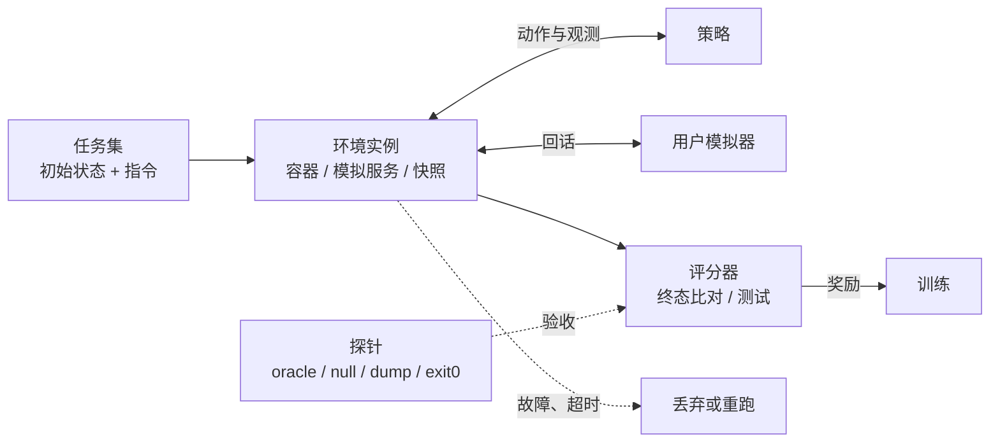

# 训练环境与用户模拟器

> 层级：垂类 · training · 预计 150 分钟 · 题目：[questions.md](questions.md)
> 前置：[04 Agentic RL](../04-agentic-rl/README.md)（多轮 rollout、工具返回 mask、异步 rollout）、[05 奖励与 Verifier](../05-reward-verifier/README.md)（Verifier 误判、reward hacking）
> 相关：[harness/03 权限、审批与沙箱隔离](../../harness/03-sandbox-permissions/README.md)（沙箱怎么隔离）、[07 RL 训练框架](../07-training-systems/README.md)（训练和推理引擎怎么协同）

## 1 这一章解决什么问题

单轮 RL 只要一个 prompt 集和一个打分函数。Agent RL 还要一个“世界”：工具能被调用，状态会变化，对话里有用户回话，最后能程序判定任务完成没有。这个世界就是训练环境。

环境出问题时，训练曲线不会报错。它会以三种方式坏掉：

- **奖励不对**。评分器有漏洞，策略学会钻漏洞，训练奖励涨、真实能力不涨。
- **奖励有噪声**。环境不可复现、用户模拟器犯错，同一个动作序列得到不同奖励，组内优势里混进噪声。
- **训练太慢**。每条 rollout 要起容器、跑测试、等工具返回，耗时分布长尾很重，GPU 大部分时间在等。

面试常问：环境要满足什么条件，怎么做到可复现，SWE-smith 一类工作怎么降低构建和存储成本，用户模拟器怎么建、它的错误率对奖励有什么影响，环境 bug 怎么发现，环境规模上去以后要多少并发。

本章只讲训练视角。沙箱的隔离、权限和审批实现见 [harness/03](../../harness/03-sandbox-permissions/README.md)；τ-bench 的判分和双控设定见 [evaluation/04 第 4.1 节](../../evaluation/04-benchmarks/README.md#41-τ-bench-到-τ²-bench)，pass^k 的估计见 [evaluation/01 的 eval-design-004](../../evaluation/01-eval-design/questions.md#eval-design-004-每题跑-n-次成功-c-次怎么估计-passk为什么不能用-pk)。

学完你应该能：

- 用 POMDP 写出一个 Agent 环境的状态、动作、观测、转移和奖励，说出它和传统 RL 环境的差别；
- 区分终止、截断和环境故障，知道三者在训练里分别怎么处理；
- 写出一个可复现、可重置、按状态判分的最小环境，并说出种子、时间、快照、mock 各管什么；
- 讲清 SWE-Gym、SWE-smith、R2E-Gym 的构建方法和存储账；
- 推出用户模拟器以概率 e 犯错时奖励的期望偏差和方差，知道什么时候它只是噪声、什么时候会被策略利用；
- 用探针 Agent 在训练前发现评分器漏洞，在训练中发现 reward hacking；
- 估算一个训练配置需要多少并发环境，解释同步 rollout 为什么 batch 越大越慢。

**本章符号**（后文沿用）：

| 符号 | 含义 |
|---|---|
| s, a, o | 环境状态、Agent 动作、Agent 收到的观测 |
| T(s, a) | 转移函数，返回新状态和观测 |
| R(s) | 奖励函数，看终态打分，取值 [0, 1] |
| p | 用户模拟器不犯错时，策略在一个任务上的成功率 |
| e | 用户模拟器犯致命错误的概率 |
| q | 模拟器犯致命错误时，奖励仍为 1 的概率 |
| m | 观测到的平均奖励 |
| G | GRPO 一组的轨迹数 |
| B | 同步训练一个 batch 的轨迹数 |
| T_i | 第 i 条轨迹的墙钟时间（生成 + 工具执行 + 启动） |
| U | 训练端一步更新的间隔 |

## 2 环境的形式化

### 2.1 用 POMDP 写一个 Agent 环境

**问题**：“环境”说起来很虚。把它写成数学对象，才能说清哪里会出随机性、奖励看什么、什么时候结束。

τ-bench（arXiv 2406.12045，第 3 节）把每个任务写成一个部分可观测马尔可夫决策过程（POMDP）：

```text
(S, A, O, T, R, U)
S = S_db ⊗ S_user          状态 = 数据库状态 × 用户状态
A = A_db ∪ A_user          动作 = 调 API，或给用户发消息
O = O_db ∪ O_user          观测 = API 返回，或用户回话
T : S × A → S × O          转移
R : S → [0, 1]             奖励只看状态
U                          指令空间：给用户模拟器的任务指令
```

几个细节决定了后面的工程做法：

- **数据库转移是确定的**。论文写明 T_db 是一个 Python 函数，同样的状态和动作得到同样的结果。
- **用户转移是随机的**。T_user 把 Agent 的消息追加到对话历史，再从 LLM 采样一条用户回话。用户状态 s_user 是系统提示（含任务指令）加全部对话历史。
- **部分可观测**。数据库状态对 Agent 和用户都隐藏，只能通过 API 读写；用户看不到 Agent 和工具之间的交互。
- **奖励只看终态**。R 的定义域是 S，不是轨迹，所以不同的动作序列只要终态一样，奖励就一样。
- **结束由用户触发**。用户输出 `###STOP###` 时这一轮结束，开始判分。

τ²-bench（arXiv 2506.07982，第 3.1 节）把它推广成去中心化 POMDP（Dec-POMDP）：Agent 和用户各有自己的工具和数据库，S_world = S_db,agent ⊗ S_db,user，再加一个记录所有事件的 S_history；每轮只有一方行动、只有一方收到观测。双控设定的细节见 [evaluation/04 第 4.1 节](../../evaluation/04-benchmarks/README.md#41-τ-bench-到-τ²-bench)。

### 2.2 和传统 RL 环境有什么不同

传统 RL 环境（Atari、MuJoCo）和 Agent 环境都能写成上面的元组，但工程性质差很多：

| 维度 | 传统 RL 环境 | Agent RL 环境 | 对训练的影响 |
|---|---|---|---|
| 动作 | 离散按键或连续向量 | 一段文本，解析成工具调用或消息 | 解析失败也是一种观测，要返回错误信息，不能让环境崩 |
| 一步的耗时 | 微秒到毫秒，和策略前向差不多 | 秒到分钟：装依赖、跑测试、查数据库、等模拟器回话 | rollout 时间被环境主导，长尾很重（第 6 节） |
| 一步耗时的分布 | 几乎恒定 | 跨任务、跨动作差几个数量级 | 同步 batch 等最慢者 |
| 确定性 | 模拟器给定种子就确定 | 外部 API、时间、网络、用户模拟器的采样都会引入随机性 | 要一项项固定（第 3.2 节） |
| 重置 | `reset()` 几乎免费 | 要恢复数据库、文件系统、容器 | 重置本身是成本，要用快照 |
| 奖励 | 环境内置，一般没 bug | 评分器是人写的程序，可能有漏洞 | 奖励本身要验收（第 5 节） |
| 并发 | 一台机器跑几百个环境 | 每个环境可能是一个容器，占 CPU、内存、磁盘 | 环境集群是单独的资源池 |

### 2.3 终止、截断、环境故障：三种“结束”

Gymnasium 从 0.26 版起把 `step()` 返回的 `done` 拆成两个：`terminated` 表示到达了 MDP 定义里的终止状态，`truncated` 表示 MDP 之外的截断条件成立，典型是时间上限（Gymnasium 文档 `Env.step`）。Agent 环境还要再加一种：

| 类型 | 例子 | 奖励怎么处理 |
|---|---|---|
| 终止 | Agent 调了 `finish`；用户输出 `###STOP###` | 跑评分器，用它的结果 |
| 截断 | 步数或 token 用完、单条轨迹超时 | 看任务：超长本身是失败时给 0 或惩罚；否则丢弃。DAPO 对截断样本的处理见 [03 章 4.4 节](../03-grpo-family/README.md#44-overlong-reward-shaping截断样本怎么处理) |
| 环境故障 | 容器崩溃、依赖安装失败、模拟器 API 超时 | 丢弃或重跑，不能当成策略失败给 0 |

第三类最容易混进训练。容器崩溃和任务难度无关，给 0 分等于随机地惩罚一部分轨迹。它还会和某些动作相关，比如某个命令会让内存超限，这时 0 分会把策略推离一个本来正确的动作。所以环境要把故障和失败用不同的状态码区分出来（[04 章](../04-agentic-rl/README.md#2-多轮-rollout-与环境交互)也强调了这一点）。

### 2.4 三个硬要求

一个环境通常包含四部分：

| 组成 | 作用 | 例子 |
|---|---|---|
| 任务集 | 初始状态 + 指令 + 判定标准 | 一个代码仓库的某个提交 + issue + 要通过的测试 |
| 工具 / 动作接口 | 策略能做什么 | 搜索、读写文件、调用业务 API |
| 状态 | 动作改变的东西 | 数据库、文件系统、虚拟手机的设置 |
| 评分器 | 结束时给奖励 | 跑测试、比对数据库终态、比对答案 |

在此之上有三个硬要求：

- **可验证**：奖励最好由程序判定。τ-bench 比对对话结束时的数据库和标注终态；AppWorld（arXiv 2407.18901）用基于状态的单元测试，既查任务完成，也查有没有造成“附带损害”（改了不该改的东西）。基于状态而不是基于动作序列，允许多种正确解法。
- **可复现**：同一个任务、同一组动作，应该得到同一个结果。否则奖励方差里混进了环境噪声，组内优势也不可信。
- **可重置**：每条 rollout 从同一个初始状态开始，互不污染。GRPO 一组 G 条轨迹要从完全相同的状态出发，比较才公平。

**为什么 GRPO 特别依赖可重置**（推导）。组内优势是 A_i = r_i − mean(r)，它把同一题的 G 条轨迹互相比较。如果第 i 条轨迹的初始状态 s_0^(i) 不同，r_i 的差异里就有一部分来自初始状态，而不是策略。设 r_i = f(策略动作) + g(s_0^(i))，g 在组内的波动会原样进入 A_i，期望为 0 但方差变大；g 和动作相关时（比如前一条轨迹已经退过款，后一条“退款”动作一定报错），偏差就不是 0 了。

**AppWorld 的判分细节**（论文第 3.2 节和附录 D）。设任务开始时数据库为 D^s，结束时为 D^f，两者的差为 Δ = diff(D^s, D^f)，列出所有新增、删除、修改的行和字段。每个任务标注一小组必须发生的变化 C_expect 和一小组允许但不要求的变化 C_allow（例如下单后购物车清空或恢复都可以）。判定条件是：

```text
C_expect ⊆ Δ ⊆ C_expect ∪ C_allow
```

左边的包含检查任务完成，右边的包含检查没有附带损害。Δ 用基于哈希的方法快速计算：每行维护一个内容哈希，每张表维护一个计数器，行哈希变了计数器就加一，没变的表直接跳过。

**评分器的坑**：τ-bench 论文自己承认，r = 1 只是成功的必要条件。例如 Agent 没有得到用户明确确认就执行了退货，违反政策，仍然得 1 分。训练时这种漏洞会被策略系统性地利用，第 5 节讲怎么发现。

## 3 工具沙箱与可复现环境

### 3.1 四种做法

**问题**：真实工具（网页搜索、线上 API）结果每次不同，会超时，有费用，还可能有副作用。

| 做法 | 怎么做 | 好处 | 代价 |
|---|---|---|---|
| 在线真实工具 | 直接调线上服务 | 分布最真实 | 不可复现、慢、贵、有副作用 |
| 离线快照 | 固定语料或缓存，例如 Search-R1 用 2018 年维基百科加本地检索器 | 可复现、便宜 | 和真实分布有差距，时效性没有 |
| 模拟服务 | 自己实现 API 和数据库，例如 AppWorld 的 9 个应用、457 个 API、约 100 个虚构用户的数据 | 状态可控、可重置、可程序判定 | 建设成本高；模拟得越简单，迁移越差 |
| 执行沙箱 | 每条轨迹一个容器，装好依赖，跑代码和测试，例如 SWE-Gym（arXiv 2412.21139）每个实例带可执行运行环境和单元测试 | 奖励可靠 | 启动慢、存储大，第 3.4 节和第 6 节细讲 |

模拟服务的建设成本有多高，AppWorld 给了一个参照（论文第 1、2 节）：环境本身约 6 万行代码，用 FastAPI、SQLite 和 SQLModel 实现，101 张表、726 列；API 的单元测试约 1780 个，代码覆盖率 98%；整个项目超过 10 万行代码，由作者在 14 个月里写成。

### 3.2 让环境可复现：一项项固定随机源

Agent 环境的随机性来自很多地方。每一处都要单独处理：

| 随机源 | 例子 | 固定方法 |
|---|---|---|
| 环境内部的随机数 | 生成订单号、随机抽一个商品 | 所有随机数从 `reset(seed)` 播种的同一个生成器出；禁止 `os.urandom`、`uuid4`、未播种的 `random` |
| 当前时间 | “查上周的订单”“今天是否过期” | 把时间当成状态。AppWorld 给每个任务指定起始数据库和起始时间，用 freezegun 冻结时间，保证每次运行条件相同 |
| 外部数据 | 搜索结果、网页内容、包仓库 | 离线快照；依赖锁版本；容器镜像固定到摘要 |
| 外部服务 | 第三方 API、LLM 评委、用户模拟器 | mock 或录制回放；LLM 调用固定模型版本，记录采样参数 |
| 并发与调度 | 多线程测试、文件系统遍历顺序 | 测试串行跑或固定种子；对输出排序后再比对 |
| 资源相关 | 超时、内存上限 | 超时设得宽，并把“超时”归为环境故障（第 2.3 节） |

还有两条不属于随机源，但同样影响复现：

- **工具结果缓存**：同一请求返回同一结果。缓存会让策略看不到真实工具的失败模式，所以 mock 要覆盖错误码、空结果、分页这些边界情况。
- **只读保护判定材料**：测试文件、标准答案对策略不可写，否则模型会改测试让它通过（第 5 节）。

**怎样检查环境真的可复现**：同一种子、同一动作序列跑两次，比较终态的哈希，而不只比较奖励。奖励是一个 0/1 的数，很多不确定性不会改变它，但会改变终态，迟早在别的任务上改变奖励。下一节的代码演示了这一点。

### 3.3 快照与重置

| 层次 | 做法 | 重置开销 |
|---|---|---|
| 进程内状态 | 序列化成 JSON，重置时反序列化 | 微秒到毫秒 |
| 数据库 | 每个任务一份数据库副本；或在事务里跑，结束时回滚 | 毫秒到秒 |
| 文件系统 | 写时复制（overlay 文件系统）：基础层只读共享，每条轨迹只写自己的上层 | 秒级，取决于改了多少 |
| 整个容器 | 从镜像重新启动；或预热池里取一个新容器 | 秒到几十秒，取决于镜像大小和是否已缓存 |

GRPO 同一题的 G 条轨迹可以共享同一个镜像，各自在写时复制层上改，这样 G 条轨迹只付一次镜像拉取的钱。预热池的大小怎么算见 [harness/03 第 8 节](../../harness/03-sandbox-permissions/README.md#8-数值例子预热池要多大)。

### 3.4 实现：一个可复现、可重置、按状态判分的最小环境

下面是一个玩具零售环境，只用标准库。状态是订单表、退款表和冻结的当前时间；动作是工具调用。它验证五件事：

1. 同一种子、同一动作序列得到同一终态哈希和同一奖励；
2. 按状态判分（AppWorld 式 C_expect ⊆ Δ ⊆ C_expect ∪ C_allow）：换一条路径也满分，顺手取消别的订单（附带损害）得 0；
3. 环境里混进一个未播种的随机源时，奖励不变，终态哈希变了。只比奖励发现不了这个 bug；
4. 从快照重置后，一组 G 条轨迹的初始状态完全相同；忘了重置时，同一个动作得到不同观测；
5. 步数用完返回截断，不返回终止。

```python
import copy
import hashlib
import json
import os
import random


def diff(start, final):
    """表级 diff：返回 {(表, 主键, 字段)}，只列出变化了的字段。AppWorld 用行哈希做同样的事。"""
    out = set()
    for table in start:
        if not isinstance(start[table], dict):
            continue
        keys = set(start[table]) | set(final[table])
        for k in keys:
            a, b = start[table].get(k), final[table].get(k)
            if a == b:
                continue
            if a is None or b is None:                       # 新增或删除整行
                out.add((table, k, "*"))
                continue
            for f in set(a) | set(b):
                if a.get(f) != b.get(f):
                    out.add((table, k, f))
    return out


class ShopEnv:
    """玩具零售环境。状态 = 订单表 + 退款表 + 冻结的当前时间；动作 = 工具调用。"""
    MAX_STEPS = 6
    EXPECT = {("orders", "A1", "status"), ("refunds", "R1", "*")}    # 必须发生的变化
    ALLOW = {("orders", "A1", "note")}                                 # 允许但不要求的变化

    def __init__(self, leak_entropy=False):
        self.leak_entropy = leak_entropy        # True：模拟一个常见 bug，用了未播种的随机源

    def reset(self, seed):
        self.rng = random.Random(seed)          # 环境里所有随机性都从这一个源出
        self.state = {"orders": {"A1": {"status": "delivered", "paid": 30},
                                 "A2": {"status": "pending", "paid": 12}},
                      "refunds": {},
                      "now": "2024-05-15T10:00:00"}                    # 时间也是状态
        self.start = copy.deepcopy(self.state)
        self.steps = 0
        return "user: 我想退掉台灯（订单 A1）"

    def snapshot(self):
        return json.dumps(self.state, sort_keys=True)

    def restore(self, snap):
        self.state, self.steps = json.loads(snap), 0

    def state_hash(self):
        return hashlib.sha256(self.snapshot().encode()).hexdigest()[:12]

    def grade(self):
        """C_expect ⊆ Δ ⊆ C_expect ∪ C_allow：目标达成，且没有附带损害。"""
        d = diff(self.start, self.state)
        return float(self.EXPECT <= d <= self.EXPECT | self.ALLOW)

    def step(self, action):
        """返回 (obs, reward, terminated, truncated)。奖励只在终止时给。"""
        self.steps += 1
        name, args = action.get("tool"), action.get("args", {})
        if name == "get_order":
            o = self.state["orders"].get(args.get("id"))
            obs = json.dumps(o) if o else "Error: order not found"
        elif name == "refund":
            o = self.state["orders"].get(args.get("id"))
            if o is None or o["status"] != "delivered":
                obs = "Error: not refundable"
            else:
                o["status"] = "refunded"
                token = os.urandom(4).hex() if self.leak_entropy else "%08x" % self.rng.getrandbits(32)
                rid = "R%d" % (len(self.state["refunds"]) + 1)
                self.state["refunds"][rid] = {"order": args["id"], "token": token, "at": self.state["now"]}
                obs = "refund %s ok" % rid
        elif name == "cancel":
            o = self.state["orders"].get(args.get("id"))
            if o:
                o["status"] = "cancelled"
            obs = "cancelled"
        elif name == "finish":
            return "done", self.grade(), True, False
        else:
            obs = "Error: unknown tool"         # 解析失败也是一种观测，不让环境崩
        return obs, 0.0, False, self.steps >= self.MAX_STEPS   # 步数用完：截断


def run(env, seed, actions):
    env.reset(seed)
    r = None
    for a in actions:
        obs, r, term, trunc = env.step(a)
        if term or trunc:
            break
    return r, env.state_hash()


good = [{"tool": "get_order", "args": {"id": "A1"}},
        {"tool": "refund", "args": {"id": "A1"}},
        {"tool": "finish"}]
damage = good[:2] + [{"tool": "cancel", "args": {"id": "A2"}}, {"tool": "finish"}]
other_path = [{"tool": "refund", "args": {"id": "A1"}}, {"tool": "finish"}]   # 没先查订单

env = ShopEnv()
# 1) 可复现：同一种子 + 同一动作序列 → 同一终态哈希、同一奖励
assert run(env, 7, good) == run(env, 7, good)
assert run(env, 7, good)[0] == 1.0
# 2) 基于状态判定：换一条路径也满分；顺手取消了 A2（附带损害）得 0
assert run(env, 7, other_path)[0] == 1.0
assert run(env, 7, damage)[0] == 0.0
# 3) 未播种的随机源：奖励一样，终态哈希不一样。回放比对哈希能抓到
bad = ShopEnv(leak_entropy=True)
(rb1, hb1), (rb2, hb2) = run(bad, 7, good), run(bad, 7, good)
assert rb1 == rb2 == 1.0 and hb1 != hb2
# 4) 可重置：一组 G 条轨迹都从同一快照出发
env.reset(7)
snap, starts = env.snapshot(), []
for g in range(4):
    env.restore(snap)
    starts.append(env.state_hash())
    env.step({"tool": "refund", "args": {"id": "A1"}})
assert len(set(starts)) == 1
#    忘了 restore：第二条轨迹从被第一条改过的状态开始，同一个动作得到不同观测
env.reset(7)
env.step({"tool": "refund", "args": {"id": "A1"}})
assert env.step({"tool": "refund", "args": {"id": "A1"}})[0] == "Error: not refundable"
# 5) 终止和截断分开：一直查不存在的订单，最后一步是截断，从没终止
env.reset(7)
flags = [env.step({"tool": "get_order", "args": {"id": "A9"}}) for _ in range(ShopEnv.MAX_STEPS)]
assert flags[-1][3] is True and not any(f[2] for f in flags)
print("ok")
```

### 3.5 Coding 环境怎么建：SWE-Gym、SWE-smith、R2E-Gym

**问题**：代码任务的评分器是“跑测试”。要跑测试，就要一个装好了依赖、能执行这个仓库这个版本的环境。环境怎么建、存在哪里，决定了任务能扩到多少。

三项工作的构建方法（只写方法和系统指标）：

| | SWE-Gym（arXiv 2412.21139） | SWE-smith（arXiv 2504.21798） | R2E-Gym（arXiv 2504.07164） |
|---|---|---|---|
| 任务来源 | 真实 GitHub issue 和 PR | 在仓库里注入让已有测试失败的改动 | 仓库的提交历史 |
| 环境粒度 | 按版本人工配依赖，每个实例一个 Docker 镜像 | 每个仓库只在一个提交上装一次，所有任务共用一个镜像 | 每个相关提交收集构建脚本 |
| 测试从哪来 | 仓库已有测试，用真实补丁验证 | 仓库已有测试，保留至少让一个通过的测试失败（F2P）的改动 | 已有测试找 F2P；没有测试的提交用自动生成的 F2P 测试补 |
| 任务描述 | 人写的 issue | LLM 根据 bug 补丁、一个 F2P 测试和测试输出写成 issue | 回译：LLM 根据代码改动和 F2P 测试写问题描述 |
| 规模 | 11 个仓库，2,438 个实例 | 128 个仓库，约 5 万个实例 | 8.1k 以上；去掉和 SWE-bench 测试仓库重叠的部分后 4,578 个，10 个仓库 |
| 存储 | 6 TB（论文第 2 节） | 295 GB（SWE-smith 表 2） | 子集 4 TB（SWE-smith 表 2 的统计） |

**SWE-Gym 的流程**（论文第 2 节）。先按条件筛出 358 个 Python 仓库，用 SWE-bench 的脚本抽出 64,689 个任务实例（SWE-Gym Raw，不带可执行环境）。再挑 11 个实例多的仓库，按版本号分组，同一版本的实例共用一次依赖配置，避免重复劳动。依赖靠人工读 requirements.txt、CI 脚本和文档配置。最后用 SWE-bench 的执行验证脚本确认真实补丁比原代码多通过测试。这一步约 200 个人工标注小时、1 万个 CPU 核时。每个实例发布一个预构建镜像，共 6 TB。

**SWE-smith 的流程**（论文第 2.1 节）。顺序和 SWE-bench 反过来：先建环境，再造任务。

1. **环境**：在仓库的最新提交上跑 SWE-agent，最多 100 步，让它装好仓库并跑测试。人工确认安装和测试指令，检查超过 80% 的已有测试能通过，然后为这个仓库建一个 Docker 镜像。
2. **任务**：四类策略生成候选改动。LM Modify 让 LLM 给函数加入错误；LM Rewrite 只给函数签名和文档，让 LLM 重写函数体；Procedural 对 AST 做随机变换（删掉条件或循环、换运算符等）；PR Mirror 让 LLM 把一个真实 PR 的改动反向应用到当前版本的文件上。另外把多个已验证的 bug 合并成一个任务（Combine）。
3. **验证**：每个候选打到仓库上跑测试，只保留让至少一个原本通过的测试失败的改动。测试运行超过两分钟的候选丢弃。
4. **描述**：LLM 写 GitHub issue 风格的描述，带基于 F2P 测试的复现代码。

论文报告：剩下的人工工作是从 Agent 轨迹里整理安装步骤（每个仓库约 7 分钟）和写测试输出解析器（每个仓库约 1 分钟），整个数据集约 20 小时人工；总花费约 1360 美元。各策略的产出率（候选里真能让测试失败的比例）差别很大，表 1 里 LM Modify 为 56.0%，LM Rewrite 为 35.0%，PR Mirror 为 33.8%，Procedural 为 40.2%，Combine 为 96.9%。LM Rewrite 低，是因为它没被要求制造 bug，只被要求重写。

**存储账**（SWE-smith 附录 C.1）。SWE-bench 的每个任务对应一个独立的基础提交，不同时期的依赖差别很大，社区的做法是每个任务一个镜像，每个至少几 GB（约 5 到 6 GB）。SWE-smith 的 bug 都生成在同一个（仓库，提交）上，所以同一仓库的任务都能在同一个镜像里复现：

```text
SWE-bench：2294 个任务 → 2294 个镜像，全部下载约 1.2 TB
SWE-Gym ：2438 个任务 → 平均 2.6 GB/个，共约 6 TB
SWE-smith：约 5 万个任务 → 125 个镜像（唯一的（仓库，提交）对），共 290.54 GB
论文估计：按每任务一个镜像造 5 万个任务，需要 50 到 150 TB，相差约 500 倍
```

正文表 2 写的是 295 GB，附录写 125 个镜像共 290.54 GB，两处口径略有不同。按 295 GB 算，50 TB / 295 GB ≈ 170，150 TB / 295 GB ≈ 508（推导），论文取的“500 倍”是上界附近。

**R2E-Gym 的流程**（论文第 2 节）。从提交历史出发：用规则加 LLM 启发式筛出“有意思的代码改动”，半人工地按依赖锁版本收集构建脚本；用提交里已有的测试找 F2P 测试，没有测试的提交用测试生成 Agent 补；最后回译生成问题描述。论文发现直接回译代码改动会得到很泛的描述，把 F2P 测试放进回译提示里，描述质量更高。

**合成任务的代价**：注入的 bug 和真实 bug 的分布不同；SWE-smith 的失败测试对 Agent 可见，和 SWE-bench 隐藏测试补丁的设定也不同。合成任务适合扩量，评测仍要用真实任务。

**测试当评分器的弱点**（R2E-Gym 第 4.1 节）。基于执行的判定（跑测试）区分度低：论文在 SWE-bench Verified 的一个子集上统计，大多数问题里不到 20% 的测试能区分排名靠前的正确补丁和错误补丁。还有少量“有毒”测试，让错误补丁通过、正确补丁失败，个别问题上最多占生成测试的 10%。不执行的判定（模型打分）区分度好，但有偏，容易看风格和 Agent 的思考过程。两者互补。训练时的评分器同样有这个问题，测试不全会让错误补丁拿到奖励。

## 4 用户模拟器：构建与校准

**问题**：客服、助理类 Agent 是多轮对话，轨迹中途需要“用户”回话。真人太贵，也无法支撑 RL 的采样量，只能让一个 LLM 扮演用户。第 2.1 节的 T_user 就是它：环境里唯一的随机转移，也是最容易出错的一环。

### 4.1 怎么构建

以 τ-bench（arXiv 2406.12045）为例：

- 用户模拟器的系统提示里有一段任务指令，规定身份、意图和偏好，这段指令对 Agent 隐藏。
- 指令写得足够具体，保证在领域政策下只有一种正确结局，这样奖励才能程序判定。论文的例子：如果没写偏好的支付方式，用户在不同试次里可能回答不同，终态数据库就不同。
- 模拟器温度为 1.0（Agent 为 0.0），多个试次的差异来自用户采样，这是 pass^k 指标的前提。
- 模拟器看不到 Agent 和工具之间的交互历史；输出 `###STOP###` 结束对话。

τ²-bench（arXiv 2506.07982）让用户也有工具，用户的行为被工具和可观测状态约束住，不完全靠自然语言指令。双控设定见 [evaluation/04 第 4.1 节](../../evaluation/04-benchmarks/README.md#41-τ-bench-到-τ²-bench)。

**设计要点**（常见做法）：

| 要素 | 做法 | 目的 |
|---|---|---|
| 隐藏目标 | 只给模拟器，不给 Agent | 逼 Agent 追问和确认 |
| 信息逐步透露 | 规定“被问到才说” | 防止模拟器第一句就把所有信息倒出来 |
| 画像与目标分离 | 同一目标配多种说话风格 | 提高多样性，防止策略记住套路 |
| 用工具约束行为 | 用户动作落在可观测状态上 | 减少模拟器胡编 |
| 模型隔离 | 模拟器和策略用不同模型或不同提示 | 避免两者共享盲区，策略学成“和自己对话” |

### 4.2 怎么校准

**问题**：模拟器自己会犯错。它犯的错会变成环境噪声，甚至让策略学到错误行为。

τ-bench 和 τ²-bench 给了两种可借鉴的做法：

- **迭代修指令**：τ-bench 构建任务时，用强模型 Agent 反复试跑（零售域每个任务 40 次以上），找出成功率为零或很低的任务，人工检查是不是指令有歧义或错字。它在失败分析里也发现，40 个失败中有 4 个是用户指令的错字或歧义造成的。
- **人工标注模拟器的错误率**：τ²-bench 让两名标注员逐轮检查用户回合，看是否遵守模拟器准则、是否遵守任务指令、用户工具是否用对、对话是否自然连贯。错误分为两类：致命错误（让任务无法完成）和无害错误。论文报告的致命错误率：航空 13%，零售 12%，电信 6%（分别标注了 100、50、50 段对话；表 2 的标题说电信没有致命错误，和表内数字矛盾，这里以表内为准）。电信域更低，论文归因于结构化的工具接口和清晰的动作空间。

τ²-bench 附录 E 还给了错误类型的分布，对设计模拟器很有用：

| 错误类型 | 零售（20 个错误） | 航空（47 个错误） | 电信（8 个错误） | 是否常致命 |
|---|---|---|---|---|
| 违反对话结构（如一轮里同时调工具又说话） | 11 | 19 | 0 | 一般无害，Agent 能恢复 |
| 提前结束（确认后立刻 `###STOP###`，或提前发转人工标记） | 3 | 2 | 8 | 常致命 |
| 编造上下文（支付方式、订单状态说错） | 2 | 15 | 0 | 一般无害 |
| 漏掉约束（忘了提“没货就换别的颜色”） | 4 | 11 | 0 | 常致命 |

致命错误主要来自“提前结束”和“漏掉约束”。前者可以用规则挡住（环境只在 Agent 完成写操作后才接受结束标记），后者要靠把约束写成结构化字段，而不是埋在一段自然语言里。

**训练时的校准清单**（常见做法）：

- 抽样让人比较模拟对话和真实对话，看能否分辨。
- 统计模拟器的“配合度”：第几轮透露关键信息、多久同意 Agent 的方案。太配合，Agent 学不会追问。
- 按模拟器错误类型分桶看奖励：如果奖励涨幅集中在模拟器犯错的轨迹上，说明策略在利用模拟器（第 4.4 节推导为什么会这样）。
- 保留一份真人对话评测集，检查模拟环境里的提升能否迁移。

### 4.3 模拟器会被钻空子

| 钻法 | 表现 | 防法 |
|---|---|---|
| 诱导泄露 | Agent 套出隐藏目标，跳过正常流程 | 模拟器只在被问到具体字段时回答；判定看终态 |
| 诱导确认 | Agent 让模拟器说“好的就这样”，提前结束 | 奖励不问模拟器满意度，检查数据库终态 |
| 利用推理弱点 | 模拟器算错账、记错前文，接受错误方案 | 用户侧关键判断交给工具或规则 |
| 话术迎合 | 策略学会某种让模拟器配合的固定措辞 | 轮换模拟器模型和画像 |

τ-bench 论文也指出模拟器推理、计算、长上下文记忆有限，例子是模拟用户没有核对功能就接受了推荐的商品。

### 4.4 模拟器错误率对奖励的影响：推导

**问题**：τ²-bench 报告航空域致命错误率 13%。拿这样的模拟器训练，奖励会差多少？是只多了噪声，还是会把策略带偏？

设一个任务上：模拟器不犯错时，策略成功的概率是 p；模拟器以概率 e 犯致命错误，犯错时奖励仍为 1 的概率是 q。q 通常接近 0（致命错误让任务无法完成），但不一定是 0：模拟器提前说“好的就这样”，终态有时碰巧是对的。奖励 r ∈ {0, 1}。

**期望**。按“犯不犯错”分两种情况求全期望：

```text
m = E[r] = (1 − e)·p + e·q
偏差 = m − p = e·(q − p)
```

q = 0 时，偏差是 −e·p：观测成功率被按比例压低。

**方差**。r 仍然是 0/1 变量，所以 Var(r) = m(1 − m)。e 不额外增加单个奖励的方差，它改变的是均值，以及均值里有多少是“策略的信号”。

**信号缩放**。比较两个策略，真实成功率差 Δp。两者面对的是同一个模拟器（e、q 相同），观测到的差是：

```text
m_1 − m_2 = (1 − e)·(p_1 − p_2)
```

信号乘了 (1 − e)，噪声的标准差 √(m(1 − m)/n) 几乎不变。要达到同样的检出把握，试次数要乘约 1/(1 − e)²。e = 0.13 时约 1.32 倍。

这和 [05 章 2.3 节](../05-reward-verifier/README.md#23-verifier-会错随机误判和系统性误判) 的 Verifier 误判模型是同一个东西。令 fp = e·q、fn = e·(1 − q)，代入 E[r_obs] = fp + (1 − fp − fn)·c 得到上式，信号缩放 1 − fp − fn = 1 − e。所以结论也一样：**错误和策略无关时，模拟器错误只缩小信号、增加方差，不改变梯度方向**。

**去偏**。e 和 q 能从人工标注估出来时，p̂ = (m̂ − e·q) / (1 − e) 无偏，但方差放大 1/(1 − e)²。去偏只对评测有用。训练里常数缩放会被组内基线和学习率吸收，不需要去偏。

**零优势组变多**。GRPO 一组 G 条轨迹全对或全错时优势为 0。零优势组的概率是 (1 − m)^G + m^G。q = 0 时 e 把 m 往 0 拉，难题上全错组变多。G = 8、p = 0.2、e = 0.13 时，m = 0.174，零优势组概率从 0.168 升到 0.217（推导，代码验证）。

**错误率依赖策略时，方向就变了**。上面都假设 e 是常数。实际上 e 依赖 Agent 说了什么：某些话术让模拟器更容易提前结束、更容易漏掉约束。设 e = e(θ)，对策略参数 θ 求导：

```text
∂m/∂θ = (1 − e)·∂p/∂θ + (q − p)·∂e/∂θ
```

第一项是正常的学习信号，被 (1 − e) 缩小。第二项是新的：当 q > p 时（模拟器犯错反而更容易拿分，比如困难任务上模拟器提前确认、终态碰巧对），策略会被推向“让模拟器犯错”的方向。这就是第 4.3 节“诱导确认”“话术迎合”的数学来源。q < p 时第二项方向相反，策略会学着避开让模拟器犯错的话术，这对训练是好事，但也说明奖励里混进了“和模拟器相处”的信号。

**实际含义**：

- 降低 e 的平均值，只是省试次数。
- 要防的是 ∂e/∂θ 和 (q − p) 同号的那部分。检查方法是按模拟器错误类型分桶，看 q 是否高于同任务的 p；看训练过程中 e 是否上升。
- 把结束条件、关键约束交给规则和工具（τ²-bench 的思路），直接让 q 接近 0、∂e/∂θ 接近 0。

### 4.5 实现：模拟器错误的偏差、方差和梯度

下面的代码用蒙特卡洛验证 4.4 节每一个式子：期望偏差 e·(q − p)、方差 m(1 − m)、和 fp/fn 模型的对应、两策略差被缩放 (1 − e)、去偏估计无偏且方差放大 1/(1 − e)²、零优势组变多，以及 e 依赖策略时多出来的梯度项。

```python
import numpy as np

rng = np.random.default_rng(0)


def observed_mean(p, e, q):
    """模拟器以概率 e 犯致命错误；犯错时奖励为 1 的概率是 q，不犯错时是 p。"""
    return (1 - e) * p + e * q


p, e, q, n = 0.6, 0.13, 0.0, 400_000      # e 取 τ²-bench 航空域的致命错误率量级
err = rng.random(n) < e
r = np.where(err, rng.random(n) < q, rng.random(n) < p).astype(float)
m = observed_mean(p, e, q)

# 1) 期望偏差 = e·(q − p)；方差 = m(1 − m)
assert abs(r.mean() - m) < 3e-3
assert abs((m - p) - e * (q - p)) < 1e-12
assert abs(r.var() - m * (1 - m)) < 3e-3

# 2) 它是 05 章 2.3 节 fp/fn 模型的特例：fp = e·q，fn = e·(1 − q)，信号缩放 1 − fp − fn = 1 − e
fp, fn = e * q, e * (1 - q)
for c in (0, 1):
    assert abs(observed_mean(c, e, q) - (fp + (1 - fp - fn) * c)) < 1e-12

# 3) 两个策略差 Δp，观测到的差只剩 (1 − e)·Δp；要同样的检出把握，试次数约乘 1/(1 − e)²·(方差比)
p1, p2 = 0.6, 0.5
assert abs((observed_mean(p1, e, q) - observed_mean(p2, e, q)) - (1 - e) * (p1 - p2)) < 1e-12

# 4) 已知 e、q 时可以去偏：p̂ = (m̂ − e·q)/(1 − e)。无偏，但方差放大 1/(1 − e)²
trials, reps = 32, 20000
mh = (rng.random((reps, trials)) < m).mean(1)
ph = (mh - e * q) / (1 - e)
assert abs(ph.mean() - p) < 3e-3
assert abs(ph.var() - m * (1 - m) / trials / (1 - e) ** 2) < 3e-4

# 5) 零优势组概率 (1 − m)^G + m^G：e 把 m 往 q 拉，难题上零优势组变多
G = 8
z = lambda mm: (1 - mm) ** G + mm ** G
p_hard = 0.2
assert z(observed_mean(p_hard, e, 0.0)) > z(p_hard)

# 6) 错误率依赖策略时：∂m/∂θ = (1 − e)·∂p/∂θ + (q − p)·∂e/∂θ。
#    q > p（例如模拟器提前确认就能让终态“碰巧”对）时，第二项把策略推向“让模拟器犯错”
def m_of(theta, q):
    p_t = 1 / (1 + np.exp(-theta))             # 策略真实能力
    e_t = 0.05 + 0.2 / (1 + np.exp(-2 * theta + 1))   # 某种话术同时让模拟器更容易出错
    return observed_mean(p_t, e_t, q), p_t, e_t

th, h = 0.0, 1e-5
for qq in (0.0, 0.9):
    num = (m_of(th + h, qq)[0] - m_of(th - h, qq)[0]) / (2 * h)
    _, pt, et = m_of(th, qq)
    dp = (m_of(th + h, qq)[1] - m_of(th - h, qq)[1]) / (2 * h)
    de = (m_of(th + h, qq)[2] - m_of(th - h, qq)[2]) / (2 * h)
    assert abs(num - ((1 - et) * dp + (qq - pt) * de)) < 1e-6
    if qq == 0.9:
        assert (qq - pt) * de > 0                # 额外的梯度来自“诱导模拟器出错”
print("m=%.3f bias=%.3f var=%.4f debiased var x%.2f" % (m, m - p, m * (1 - m), 1 / (1 - e) ** 2))
```

输出：m = 0.522，偏差 −0.078，单个奖励方差 0.2495，去偏估计的方差放大 1.32 倍。

## 5 奖励的可验证性与环境 bug

### 5.1 环境 bug 为什么会变成 reward hacking

**问题**：[05 章第 6 节](../05-reward-verifier/README.md#6-reward-hacking规律模式与防御) 讲了奖励函数本身的漏洞。环境的漏洞更隐蔽：评分器的逻辑看起来对，但环境的实现给了一条不解题也能拿分的路。

机制和 4.4 节一样。设一个任务的评分器有漏洞，某个“钻漏洞”动作拿分的概率是 q_hack，正常解题的成功率是 p。只要 q_hack > p，策略梯度就会把概率往钻漏洞的方向推。困难任务上 p 小，最先被钻。漏洞的形态和任务无关时（比如“提前退出就算通过”），它会在所有任务上同时生效，训练奖励突然整体跃升。

Agentic Benchmark Checklist（Zhu 等，arXiv 2507.02825，本章核对的是 v5）审计了 17 个常用的 Agent Benchmark，找到的环境 bug 可以直接当训练环境的反面教材：

| 漏洞 | 例子（论文报告） | 平凡策略怎么拿分 |
|---|---|---|
| 不可能任务的判定是“环境没变” | τ-bench 航空域 38%、零售域 6% 的任务是故意设计的不可完成任务，成功条件是数据库不变 | 什么都不做、回空消息就通过；航空域上这样的平凡 Agent 拿到 38% |
| 子串匹配 | τ-bench 航空 2%、零售 3.6% 的任务拿数据库原文当答案，按子串判 | 把整张表倒出来 |
| 判定材料可写 | SWE-Lancer 的测试放在加密的 ZIP 里，但目录结构能列出，内容能被覆盖 | 把测试换成 `assert 1 == 1` |
| 状态没清理 | KernelBench 没有清掉 GPU 显存里的标准答案 | 越界读显存拿到正确结果 |
| 网络边界漏了 | CVE-Bench 判“是否访问了禁止的外部服务器”，但同一 Docker 网络里能直接连 | 不做攻击也能“访问到”；修复后成功率下降 10% |

这些都是评测集里的 bug。在评测里它们让分数虚高；在训练里，策略会主动找到并放大它们。Baker 等（arXiv 2503.11926）在编码训练里观察到的 `exit(0)` 和 `raise SkipTest` 就属于这一类，见 [05 章 6.2 节](../05-reward-verifier/README.md#62-常见的钻空子模式)。

### 5.2 训练前：用探针验收环境

ABC 的清单里有两条可以直接自动化：提供一个能自动解出所有任务的 oracle 解法，证明任务配置是对的（T.9）；看试跑里的异常值（T.10），简单题总失败说明任务可能不可解，只有难题成功说明可能有捷径。再加上报告平凡 Agent 的结果（R.13），合起来是一套验收流程（常见做法）：

| 探针 | 做法 | 期望 | 不满足说明 |
|---|---|---|---|
| oracle | 用标准答案或真实补丁走一遍 | 必须通过 | 任务不可解，或评分器有假阴性 |
| null | 什么都不做，直接结束 | 必须不过 | “不变即成功”一类漏洞 |
| dump | 把能读到的所有数据都输出 | 必须不过 | 子串匹配、宽松提取 |
| exit0 / skip | 提前退出、跳过测试 | 必须不过 | 测试框架把“没跑完”当通过 |
| 改测试 | 尝试写测试文件和标准答案路径 | 写失败，或写了也不影响判定 | 判定材料没有只读保护 |
| 回放 | 同一种子、同一动作跑两次 | 终态哈希相同 | 环境不可复现（3.4 节） |

探针要对每个任务都跑，不能只抽样：漏洞往往只在一部分任务上。

### 5.3 训练中：发现已经发生的 hacking

探针只能抓到你想得到的漏洞。训练中还要监控（常见做法）：

- **两套评分器分叉**。训练用的评分器之外，留一个更严格的评分器（比如要求测试全部执行、换一套测试、人工抽检），定期在同一批轨迹上复评。训练奖励涨、严格评分不涨或下降，就是在钻漏洞。
- **按任务看奖励跃迁**。一个长期 0 分的任务突然变成稳定满分，先查轨迹再庆祝。
- **轨迹模式扫描**。用正则扫 `exit(0)`、`SkipTest`、对测试文件的写操作、超长的输出；统计每条轨迹实际执行的测试数是否等于总数。
- **模拟器分桶**。对话类环境按模拟器错误类型分桶看奖励（4.4 节）。

发现之后的处理见 [05 章 6.4 节](../05-reward-verifier/README.md#64-防御按层次)：修环境，把探针加进回归集，回到 hack 出现之前的检查点继续训。

### 5.4 实现：探针验收和训练中的分叉

下面的代码有两部分。第一部分：6 个玩具任务，其中 3 个的评分器埋了上表的漏洞（不变即成功、子串匹配、提前退出算通过）；用 oracle 和三个平凡探针验收，正好标出这 3 个。第二部分：一个两动作策略（正常解题 / 钻漏洞），一半任务的评分器有漏洞时用 REINFORCE 训练，训练奖励上升，严格评分器下的真实成功率下降；把漏洞修掉后两条曲线重合。

```python
import numpy as np

# 一组玩具任务。每个任务有：真实答案、评分器。部分评分器埋了常见的环境 bug。
def exact(ans):
    return lambda out: out.get("answer") == ans and out.get("tests_run") == out.get("tests_total")

def accept_empty_on_noop(ans):          # “不可能任务”：成功 = 环境没变，什么都不做也满分
    return lambda out: out.get("db_changed") is False

def substring(ans):                     # 用子串匹配判定：把整张表倒出来也能命中
    return lambda out: ans in str(out.get("answer", ""))

def exit_early(ans):                    # 测试框架把“提前退出”当成通过
    return lambda out: out.get("exit_code") == 0

TASKS = {
    "t0": ("42", exact), "t1": ("A7", exact), "t2": ("keep", accept_empty_on_noop),
    "t3": ("B12", substring), "t4": ("ok", exit_early), "t5": ("9", exact),
}
BUGGY = {"t2", "t3", "t4"}

# 探针 Agent：不看任务内容，只用来试评分器
def null_agent(ans):   return {"answer": "", "db_changed": False, "exit_code": 1, "tests_run": 0, "tests_total": 5}
def dump_agent(ans):   return {"answer": "A1 A7 B12 C3 ... 9 42 keep ok", "db_changed": True, "exit_code": 1,
                               "tests_run": 0, "tests_total": 5}
def exit0_agent(ans):  return {"answer": "", "db_changed": True, "exit_code": 0, "tests_run": 0, "tests_total": 5}
def oracle_agent(ans): return {"answer": ans, "db_changed": ans != "keep", "exit_code": 0, "tests_run": 5, "tests_total": 5}

def probe(tasks):
    """验收每个任务：oracle 必须过，所有平凡探针必须不过。违反任一条就标记。"""
    flagged = {}
    for tid, (ans, make) in tasks.items():
        g = make(ans)
        why = [name for name, a in [("null", null_agent), ("dump", dump_agent), ("exit0", exit0_agent)] if g(a(ans))]
        if not g(oracle_agent(ans)):
            why.append("oracle_fails")
        if why:
            flagged[tid] = why
    return flagged

flagged = probe(TASKS)
assert set(flagged) == BUGGY                      # 三个探针正好抓到埋下的三个 bug
assert flagged["t2"] == ["null"] and flagged["t3"] == ["dump"] and flagged["t4"] == ["exit0"]

# 训练中的检测：策略在“正常解题”和“钻漏洞”之间学习（softmax 两动作，REINFORCE）
rng = np.random.default_rng(0)
p_solve = 0.3                                     # 正常解题的成功率
def train(tasks_buggy, steps=3000, lr=0.05):
    z = np.zeros(2)                               # 动作 0 = 解题，1 = 钻漏洞
    proxy, true = [], []
    for _ in range(steps):
        pi = np.exp(z) / np.exp(z).sum()
        a = rng.choice(2, p=pi)
        buggy = rng.random() < tasks_buggy        # 这道题的评分器有没有漏洞
        solved = a == 0 and rng.random() < p_solve
        r = float(solved or (a == 1 and buggy))   # 训练用的评分器
        z += lr * (r - 0.3) * (np.eye(2)[a] - pi)
        proxy.append(r)
        true.append(float(solved))                # 留出的严格评分器
    return np.array(proxy), np.array(true)

proxy, true = train(tasks_buggy=0.5)
early, late = slice(0, 300), slice(-300, None)
assert proxy[late].mean() > proxy[early].mean() + 0.1    # 训练奖励在涨
assert true[late].mean() < true[early].mean()            # 严格评分器下的成功率在跌
gap = proxy[late].mean() - true[late].mean()
# 修掉漏洞（探针过滤后的任务集）：两条曲线重合
proxy2, true2 = train(tasks_buggy=0.0)
assert np.allclose(proxy2, true2)
print("flagged:", flagged)
print("训练奖励 %.2f → %.2f，严格评分 %.2f → %.2f，差距 %.2f"
      % (proxy[early].mean(), proxy[late].mean(), true[early].mean(), true[late].mean(), gap))
```

输出（种子固定）：训练奖励从 0.41 涨到 0.53，严格评分从 0.10 跌到 0.00。正常解题的成功率是 0.3，钻漏洞在有漏洞的任务上必得分，平均 0.5，策略于是全面转向钻漏洞。

## 6 环境的规模化与成本

### 6.1 成本花在哪里

**问题**：RL 需要大量不同的任务。环境数量从几百到几万时，成本主要花在三处：

| 成本 | 来源 | 降本方向 |
|---|---|---|
| 构建 | 每个环境要装依赖、写评分器、人工检查 | 自动化安装；一个环境派生多个任务（SWE-smith） |
| 存储 | 每个任务一个镜像 | 镜像按（仓库，提交）共享；写时复制 |
| 运行 | 每条 rollout 起容器、跑测试、等工具和模拟器 | 容器池复用、异步执行、超时丢弃 |

构建和存储在 3.5 节已经算过。这一节讲运行：同时要开多少个环境，以及 rollout 的长尾怎样浪费 GPU。

### 6.2 同步 rollout：batch 越大，越等最慢的那条

同步训练里，一个 batch 的 B 条轨迹全部结束才能更新。一步的时间是 max_i T_i。设单条时长的分布函数为 F，T_i 独立同分布，则（推导）：

```text
P(max_i T_i ≤ x) = F(x)^B
max 的中位数满足 F(x)^B = 1/2，即 F(x) = 0.5^(1/B) ≈ 1 − 0.69/B
```

也就是说，B 条轨迹里最慢那条的中位数，就是单条时长的 1 − 0.69/B 分位数。B = 256 时约是 p99.7。B 翻倍，要等的分位数就往尾部再挪一截。均值为 μ 的指数分布可以算出闭式：E[max] = μ·H_B，H_B 是调和数，推导和数值见 [04 章 5.1 节](../04-agentic-rl/README.md#51-同步训练的长尾损失)。

Agent 环境的时长比指数分布更重尾。一条轨迹有好几轮，每轮是“生成 + 工具执行”。生成时间受 token 数控制，比较集中；工具时间跨几个数量级，跑一个单元测试 1 秒，跑完整测试套件几分钟。工具时间取对数正态分布时，B 增大，max/mean 增长得比指数分布快。

**GPU 在等什么**。同步时推理引擎只在生成阶段忙。一条轨迹在等工具返回时，它占的生成槽位空着；它结束以后，槽位要空到整批最慢的那条结束。所以：

```text
同步时生成槽位的忙碌比例 = Σ_i gen_i / (B · max_i T_i)
```

分子是所有轨迹的生成时间之和，分母是 B 个槽位乘以这一步的总时长。

**异步时**。槽位一空就补一条新轨迹，“等最慢者”的空闲消失。剩下的空闲是单条轨迹内部等工具的时间，上限是 E[gen] / E[T]。要把这部分也填上，一个槽位要同时挂多条轨迹：一条等工具时，另一条在生成。推理引擎的连续批处理天然支持这样做。

异步带来策略滞后，需要重要性比率修正和有界滞后，见 [04 章第 5 节](../04-agentic-rl/README.md#5-异步-rollout-与长尾)；训练和推理引擎怎么部署、权重怎么同步见 [07 章第 5 节](../07-training-systems/README.md#5-rl-框架里训练与推理引擎的协同)。

### 6.3 要开多少个并发环境

Little 定律：一个稳定系统里，平均在途数 = 到达速率 × 平均停留时间。训练端每 U 秒消费 B 条完成的轨迹，每条平均占一个环境 E[T] 秒：

```text
并发环境数 ≈ (B / U) · E[T]
```

例如 B = 256、U = 60 秒、E[T] = 57 秒，约要 243 个环境同时在跑。几个推论：

- 每条轨迹多 20 秒容器冷启动，E[T] 就加 20 秒，并发环境数按比例增加。预热池把冷启动从 E[T] 里拿掉。
- 训练变快（U 变小），并发环境要同比增加，否则训练端等数据。
- 这是平均值。尾部轨迹会占着环境不放，资源池要留余量，并设单条超时。

**超时截断的取舍**。把超过 p99 的轨迹截断，一步时间明显下降，只丢 1% 的样本。但被截断的样本不是随机的：越难的任务往往越慢，截断它们会让 batch 偏向简单题。截断后按任务统计截断率，长期被截断的任务要么放宽超时，要么移出训练集（第 8 节第 5 条）。

### 6.4 实现：长尾、忙碌比例和并发数

下面的模拟里，一条轨迹 8 轮，每轮生成时间近似正态（均值 3 秒），工具时间取对数正态（中位数 2 秒，σ = 1.2）。数字只说明趋势。代码验证：max/mean 随 B 单调增大；max 的中位数等于单条时长的 0.5^(1/B) 分位数；同步时生成槽位的忙碌比例不到连续补位上限的一半；p99 截断的效果；Little 定律给出的并发数。

```python
import numpy as np

rng = np.random.default_rng(1)


def rollout_times(n, turns=8, cold=0.0):
    """一条 Agent 轨迹的墙钟时间（秒）：每轮 = 生成 + 工具执行；可选容器冷启动。
    生成近似正态截断，工具时间取对数正态（中位数 2 s，σ = 1.2，偶尔几十秒的测试运行）。"""
    gen = np.clip(rng.normal(3.0, 1.0, (n, turns)), 0.5, None)
    tool = rng.lognormal(np.log(2.0), 1.2, (n, turns))
    return (gen + tool).sum(1) + cold, gen.sum(1)


# 1) 同步 batch：一步时间 = batch 里最慢的那条。B 越大，max 越往尾部走
T, _ = rollout_times(400_000)
mean_T = T.mean()
ratios = {}
for B in (16, 64, 256, 1024):
    m = T[: (len(T) // B) * B].reshape(-1, B).max(1).mean()
    ratios[B] = m / mean_T
assert ratios[16] < ratios[64] < ratios[256] < ratios[1024]
# 推导：P(max ≤ x) = F(x)^B，所以 max 的中位数是单条时长的 0.5^(1/B) ≈ 1 − 0.69/B 分位数
for B in (64, 256):
    q = np.quantile(T, 0.5 ** (1 / B))
    med = np.median(T[: (len(T) // B) * B].reshape(-1, B).max(1))
    assert abs(med / q - 1) < 0.03

# 2) 同步时推理引擎的忙碌比例：GPU 只在“生成”阶段忙，工具执行和等最慢者时都闲着
B = 256
T, gen = rollout_times(B * 400)
T, gen = T.reshape(-1, B), gen.reshape(-1, B)
util_sync = (gen.sum(1) / (B * T.max(1))).mean()       # 每个槽位的生成时间 / 这一步的总时长
util_async = gen.sum() / T.sum()                        # 槽位持续补位：只剩工具等待的空闲
assert util_sync < 0.5 * util_async
print("同步 B=%d：生成槽位忙碌 %.1f%%；连续补位上限 %.1f%%" % (B, 100 * util_sync, 100 * util_async))

# 3) 超时截断的取舍：把超过 p99 的轨迹截断丢弃，一步时间降多少、丢多少样本
T, _ = rollout_times(B * 400)
cap = np.quantile(T, 0.99)
step_full = T.reshape(-1, B).max(1).mean()
step_cap = np.minimum(T, cap).reshape(-1, B).max(1).mean()
drop = (T > cap).mean()
assert step_cap < step_full and abs(drop - 0.01) < 0.002
#    但被截断的样本不是随机的：越难的任务越慢，丢掉它们会让 batch 偏向简单题（见第 6 节）

# 4) Little 定律：需要同时在跑的环境数 = 完成速率 × 平均时长
#    训练端每 U 秒要 B 条完成的轨迹，则在途环境约 B/U × E[T]
U = 60.0
need = B / U * mean_T
#    离散事件验证：k 个槽位持续补位，单位时间完成数 ≈ k / E[T]
k = int(np.ceil(need))
horizon = 50_000.0
per_slot = int(2 * horizon / mean_T)                  # 每个槽位预采足够多条，一条接一条跑
ends = np.cumsum(rollout_times(k * per_slot)[0].reshape(k, per_slot), axis=1)
rate = (ends <= horizon).sum() / horizon
assert abs(rate * U / B - 1) < 0.05
print("E[T]=%.1fs，每 %.0fs 要 %d 条 → 约 %d 个并发环境" % (mean_T, U, B, k))

# 5) 冷启动：每条轨迹多 20 s 容器启动，等价于平均时长变长，并发环境数按比例增加
T_cold, _ = rollout_times(200_000, cold=20.0)
assert T_cold.mean() > mean_T + 19
print("max/mean:", {b: round(float(v), 2) for b, v in ratios.items()})
print("p99 cap: step %.0f -> %.0f s, drop %.3f" % (step_full, step_cap, drop))
print("cold mean %.1f" % T_cold.mean())
```

结果（种子固定）：

| 量 | 值 |
|---|---|
| E[T] | 56.9 秒 |
| E[max] / E[T]，B = 16 / 64 / 256 / 1024 | 1.86 / 2.52 / 3.43 / 4.71 |
| 同步 B = 256 时生成槽位忙碌 | 13.5% |
| 连续补位时的上限（只剩等工具的空闲） | 42.2% |
| p99 截断：一步时间 | 194 秒 → 132 秒，丢 1% 样本 |
| B = 256、U = 60 秒时的并发环境 | 约 243 个 |
| 加 20 秒冷启动后的 E[T] | 76.8 秒 |

读法：同步训练里，B 从 16 加到 1024，一步时间相对平均时长从 1.9 倍涨到 4.7 倍，加 batch 换不来同比的吞吐。异步能把 13.5% 提到 42% 附近；剩下的 58% 是轨迹在等工具，只能靠一个槽位挂多条轨迹或缩短工具时间解决。



## 7 数值例子：一个客服 Agent 训练配置

假设配置（虚构）：航空客服任务，用户模拟器的致命错误率按 τ²-bench 航空域的量级取 e = 0.13，犯错时奖励为 1 的概率 q = 0；GRPO 每题 G = 8；同步训练，B = 256 条轨迹一步，训练端每 U = 60 秒更新一次；轨迹时长分布同 6.4 节，E[T] ≈ 57 秒。

**1. 奖励被压低多少**。一道中等题 p = 0.5：

```text
m = (1 − 0.13) × 0.5 = 0.435        偏差 −0.065
```

一道难题 p = 0.2：m = 0.174，偏差 −0.026。偏差绝对值和 p 成正比，相对偏差都是 13%。

**2. 零优势组**。(1 − m)^8 + m^8：

| | 不犯错 | e = 0.13 |
|---|---|---|
| p = 0.5 | 0.0078 | 0.0117 |
| p = 0.2 | 0.168 | 0.217 |

难题上每 5 组就有 1 组白算。按通过率筛题时，用观测到的 m 而不是想象中的 p 筛。

**3. 比较两个检查点要多少试次**。真实差 Δp = 0.05，观测差 0.87 × 0.05 = 0.0435。样本量和 1/Δ² 成正比，所以要多约 1/0.87² ≈ 1.32 倍试次。

**4. 什么时候会被带偏**。如果某种话术让模拟器在困难任务上提前确认，并且提前确认后终态有 30% 概率碰巧对（q = 0.3 > p = 0.2），那么 4.4 节的第二项 (q − p)·∂e/∂θ 为正，策略会学这种话术。检查：按“是否提前结束”分桶，提前结束桶的奖励均值高于同任务的正常桶，就是信号。

**5. 要多少环境**。(256 / 60) × 57 ≈ 243 个并发环境。用户模拟器是一个 LLM 服务，它也要按这个并发量部署：243 条对话同时在等模拟器回话时，模拟器的延迟直接加进 E[T]。

**6. 存储**（换成 Coding 环境）。要 5 万个任务。按 SWE-Gym 的平均 2.6 GB 每镜像、每任务一个镜像，约 130 TB，落在 SWE-smith 估计的 50 到 150 TB 之间；按（仓库，提交）共享镜像，约 300 GB。

## 8 工程细节与常见坑

每条按“现象 → 原因 → 排查 → 处理”写。

**1. 环境不可复现，组内优势里混进噪声**

- 现象：同一个检查点、同一批任务重跑，平均奖励波动明显大于二项分布的 √(m(1 − m)/n)；某些任务上同一动作序列有时得分有时不得分。
- 原因：环境里有未播种的随机源（`uuid4`、`os.urandom`、未固定的时间），或依赖外部服务。
- 排查：对每个任务跑“同种子同动作”回放两次，比较终态哈希（3.4 节）。奖励一样、哈希不一样的任务也要修，它们迟早在别的地方出问题。
- 处理：所有随机数从 `reset(seed)` 出；时间当成状态冻结；外部服务 mock 或录制回放。

**2. 忘了重置，轨迹互相污染**

- 现象：同一题 G 条轨迹里，后面的轨迹成功率系统性偏低或偏高；报错信息里出现“已退款”“文件已存在”。
- 原因：多条轨迹共用一个环境实例，前一条改过的状态留给了后一条。
- 排查：每条轨迹开始时记录初始状态哈希，同一题的 G 个哈希必须相同。
- 处理：每条轨迹从快照恢复，或在写时复制层上跑；不要为了省启动时间复用脏容器。

**3. 环境故障被当成策略失败**

- 现象：某类动作（如跑完整测试套件）的轨迹得分偏低，策略逐渐回避这类动作，即使它们是解题必需的。
- 原因：容器内存超限、超时被记成 0 分。故障和动作相关，于是变成了对这个动作的惩罚。
- 排查：按终止原因（正常终止、截断、各类故障）统计比例和平均奖励；故障率随训练变化要单独画曲线。
- 处理：环境返回明确的故障状态码，故障轨迹丢弃或重跑，不进 loss（2.3 节）。

**4. 评分器漏洞被策略找到**

- 现象：训练奖励突然整体跃升；长期 0 分的任务变成满分；轨迹长度骤降或出现固定模式。
- 原因：评分器有“不变即成功”“子串匹配”“提前退出算通过”这类漏洞（5.1 节）。
- 排查：严格评分器复评同一批轨迹，看两者是否分叉；扫轨迹里的可疑模式。
- 处理：训练前对每个任务跑探针（5.2 节）；发现后修环境、加回归探针、回到 hack 之前的检查点。

**5. 超时截断让训练集偏向简单题**

- 现象：设了较紧的超时后吞吐上去了，但难题的通过率不再提升，batch 里难题占比下降。
- 原因：截断不是随机的，慢的往往是难题（6.3 节）。截断后丢弃，等于把难题移出了训练集。
- 排查：按任务统计截断率，看截断率和任务难度的相关性。
- 处理：长期被截断的任务单独放宽超时；或者把超时归为“失败”给 0 分，前提是超长本身就算失败。两种选择要明确，不能混用。

**6. 用户模拟器提前结束对话**

- 现象：轨迹轮数分布出现一个很短的峰；这些轨迹的奖励集中在 0（或在某些任务上集中在 1）。
- 原因：模拟器在 Agent 完成写操作之前输出了结束标记。τ²-bench 电信域的 8 个模拟器错误全部是这一类。
- 排查：统计“结束时是否已有写操作”；按是否提前结束分桶看奖励（4.4 节）。
- 处理：环境规则化结束条件，Agent 未完成必要动作前忽略结束标记，或把提前结束的轨迹归为环境故障丢弃。

**7. 模拟器和策略同源，策略学会和自己说话**

- 现象：模拟环境里成功率很高，真人评测集上不涨；轨迹里 Agent 的措辞越来越固定。
- 原因：模拟器和策略用同一个模型或相近的提示，共享盲区，策略找到了让模拟器配合的固定说法。
- 排查：换一个模拟器模型复评，看奖励下降多少。
- 处理：模拟器用不同模型、多种画像轮换；保留真人对话评测集。

**8. 镜像拉取和冷启动吃掉吞吐**

- 现象：GPU 利用率低，但生成和工具时间都不长；环境节点的网络和磁盘 IO 打满。
- 原因：每条轨迹拉一次镜像或冷启动容器；每任务一个镜像时缓存命中率低。
- 排查：把轨迹时间拆成启动、生成、工具、评分四段统计。
- 处理：镜像按（仓库，提交）共享（3.5 节）；预热池；同一题的 G 条轨迹调度到同一节点，共享镜像缓存。

**9. 工具结果太长，挤掉上下文**

- 现象：轨迹在第几轮就因为 token 上限被截断；截断的轨迹集中在跑过测试的那些。
- 原因：测试日志、编译错误动辄几千 token。它们 mask 为 0、不产生梯度，但占上下文。
- 排查：统计每轮工具结果的 token 数分布。
- 处理：环境侧截断或摘要工具结果，保留头尾和错误行。

## 9 对比与取舍

### 9.1 环境类型

| 类型 | 可复现 | 构建成本 | 单步耗时 | 和真实分布的差距 | 适合 |
|---|---|---|---|---|---|
| 在线真实工具 | 差 | 低 | 秒级，随外部服务波动 | 最小 | 评测时检查迁移 |
| 离线快照 | 好 | 低到中 | 毫秒到秒 | 有时效差 | 搜索类训练 |
| 模拟服务 | 好 | 高（AppWorld 量级要几万行代码） | 毫秒 | 取决于模拟多细 | 业务 API、客服类训练 |
| 执行沙箱 | 好（固定镜像时） | 中，自动化后降低 | 秒到分钟 | 小 | 代码类训练 |

### 9.2 Coding 环境的构建路线

| | 按任务建镜像（SWE-Gym 式） | 按仓库共享镜像（SWE-smith 式） | 从提交回译（R2E-Gym 式） |
|---|---|---|---|
| 任务真实度 | 高，真实 issue | 中，注入的 bug | 中高，真实改动、合成描述 |
| 人工 | 高（论文报告约 200 小时） | 低（论文报告约 20 小时） | 半人工收集构建脚本 |
| 存储 | 每任务几 GB | 每仓库一个镜像 | 介于两者之间 |
| 测试 | 已有测试 | 已有测试 | 已有测试加生成测试，可能有毒测试 |
| 选择 | 要少量高真实度任务、或做评测 | 要大量任务扩量 | 仓库测试覆盖不够、issue 不多 |

### 9.3 用户模拟方式

| 方式 | 错误率 | 多样性 | 被钻的风险 | 选择 |
|---|---|---|---|---|
| 规则或脚本用户 | 低 | 低 | 低，但策略会记住套路 | 流程固定的任务、冷启动 |
| 纯自然语言指令的 LLM 用户 | 高（τ²-bench 零售、航空域总错误率 40%、47%） | 高 | 高 | 开放对话 |
| 工具约束的 LLM 用户 | 较低（τ²-bench 电信域 16%） | 中高 | 中 | 用户要动手的任务 |
| 真人 | 最低 | 最高 | 低 | 只够评测，不够训练 |

### 9.4 rollout 调度

| | 同步 | 异步 |
|---|---|---|
| 一步时间 | 等 batch 里最慢的一条，B 越大越接近尾部分位数 | 槽位一空就补，长尾不阻塞 |
| 策略 | 严格 on-policy | 有滞后，要修正（[04 章第 5 节](../04-agentic-rl/README.md#5-异步-rollout-与长尾)） |
| 实现 | 简单 | 要版本记录、有界滞后、权重同步（[07 章](../07-training-systems/README.md#5-rl-框架里训练与推理引擎的协同)） |
| 选择 | 环境耗时集中、batch 小 | 工具时间重尾、batch 大 |

## 10 自测清单

- [ ] 用 POMDP 写出 τ-bench 的状态、动作、观测、转移和奖励，指出哪个转移是随机的
- [ ] 说出 Agent 环境和传统 RL 环境在单步耗时、确定性、重置、奖励上的差别
- [ ] 区分终止、截断、环境故障，说出三者分别怎么处理奖励
- [ ] 解释为什么 GRPO 的一组轨迹必须从同一初始状态出发
- [ ] 写出 AppWorld 的判定条件 C_expect ⊆ Δ ⊆ C_expect ∪ C_allow，说出两边各查什么
- [ ] 列出至少五种随机源和固定方法；解释为什么回放校验要比终态哈希而不只比奖励
- [ ] 讲清 SWE-smith 为什么能把环境存储降两个数量级以上，以及合成任务的局限
- [ ] 推出模拟器以概率 e 犯错时奖励的期望偏差 e·(q − p)，说明它何时只是噪声、何时会带偏策略
- [ ] 说出 τ²-bench 怎样标注模拟器错误，哪两类错误最常致命
- [ ] 设计一组探针，在训练前发现“不变即成功”“子串匹配”“提前退出算通过”
- [ ] 推出同步 batch 最慢那条的中位数是单条时长的哪个分位数
- [ ] 用 Little 定律估算并发环境数

## 资料

- Yao、Shinn、Razavi、Narasimhan，[τ-bench: A Benchmark for Tool-Agent-User Interaction in Real-World Domains](https://arxiv.org/abs/2406.12045)，arXiv 2406.12045，2024-06
- Barres、Dong、Ray、Si、Narasimhan，[τ²-Bench: Evaluating Conversational Agents in a Dual-Control Environment](https://arxiv.org/abs/2506.07982)，arXiv 2506.07982，2025-06
- Trivedi 等，[AppWorld: A Controllable World of Apps and People for Benchmarking Interactive Coding Agents](https://arxiv.org/abs/2407.18901)，arXiv 2407.18901，2024-07
- Pan 等，[Training Software Engineering Agents and Verifiers with SWE-Gym](https://arxiv.org/abs/2412.21139)，arXiv 2412.21139，2024-12
- Yang 等，[SWE-smith: Scaling Data for Software Engineering Agents](https://arxiv.org/abs/2504.21798)，arXiv 2504.21798，2025-04
- Jain 等，[R2E-Gym: Procedural Environments and Hybrid Verifiers for Scaling Open-Weights SWE Agents](https://arxiv.org/abs/2504.07164)，arXiv 2504.07164，2025-04
- Zhu 等，[Establishing Best Practices for Building Rigorous Agentic Benchmarks](https://arxiv.org/abs/2507.02825)，arXiv 2507.02825，2025-07（本章核对 v5，2025-08）
- Jin 等，[Search-R1: Training LLMs to Reason and Leverage Search Engines with Reinforcement Learning](https://arxiv.org/abs/2503.09516)，arXiv 2503.09516，2025-03
- Farama Foundation，[Gymnasium Env API 文档](https://gymnasium.farama.org/api/env/)（`terminated` 与 `truncated`、`reset(seed)`），2026-11 查阅
